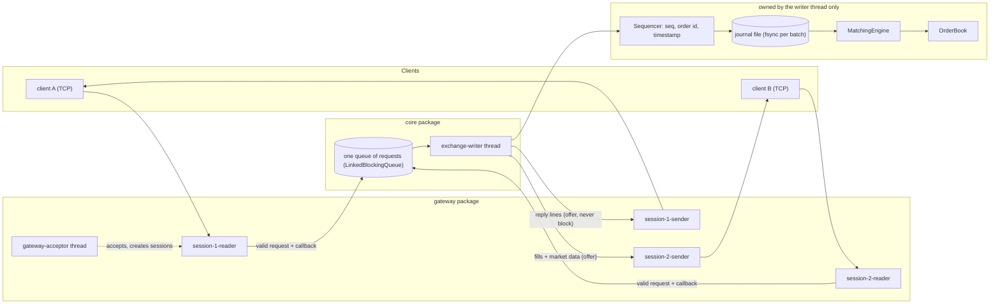
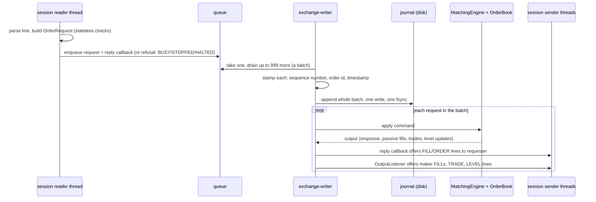
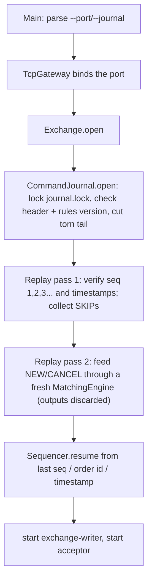
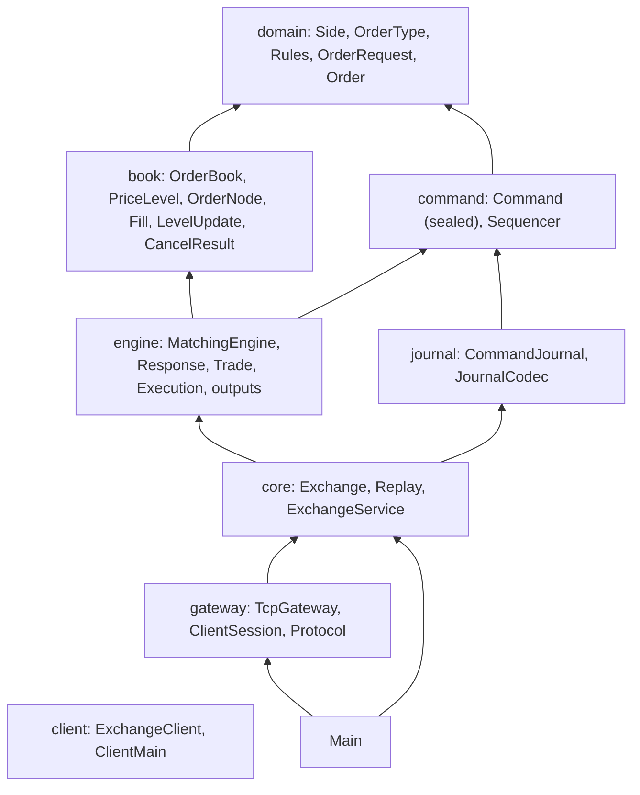

# 01 — The Big Picture

> **Project:** ExchangeServer2 | Single-instrument limit order book: price-time matching engine, write-ahead journal with replay, single writer thread, plain TCP gateway | Stack: Java 17, Maven wrapper, JUnit 5 (+ JMH, PIT)
> **This guide:** the problem the project solves, its features, a high-level architecture, and the 10 things you must know first | **Prerequisites:** 00 | **Related:** 03, 05, 06, 09
> **Repo layout summary:** `pom.xml` + Maven wrapper (`mvnw`, `mvnw.cmd`) at the root; production code in `src/main/java/exchangeserver/` (packages `domain`, `book`, `engine`, `command`, `journal`, `core`, `gateway`, `client`, plus `Main`); tests mirror it in `src/test/java/exchangeserver/` (plus `bench/` JMH benchmarks and `testing/MutableClock`); design docs in `docs/` (`ExchangeServer2_Vision.md` = purpose/roadmap, `ExchangeServer2_Spec.md` = decisions D1–D65); these guides in `docs/understanding/`.

## Overview

An **exchange** is a service where buyers and sellers of one thing (here: a single unnamed instrument) send
**orders**, and the exchange pairs them into **trades**. ExchangeServer2 implements the core of one: a
**limit order book** with a **price-time priority matching engine**, made durable by a **write-ahead journal**,
driven by **one writer thread**, and reachable over a **plain TCP line protocol**.

The project's stated purpose is learning: "a hands-on way to understand production-grade software systems",
where "depth of understanding matters more than feature count" (**[Verified]** `docs/ExchangeServer2_Vision.md`
§1). Its non-goals are just as telling: one instrument only, no multi-threaded matching, no replication, no
authentication or TLS, no FIX protocol (**[Verified]** Vision §6).

This guide gives you the shape of the whole system. Guide 05 traces each flow in detail; guide 07 opens each
module.

## The problem, in exchange terms

Some vocabulary first (all of it is also in guide 13, the glossary):

- **Order:** "buy (or sell) *quantity* units at a price no worse than *price*". The client gives it its own id,
  the **client order id** (`clOrdId`), and the exchange assigns an **order id**.
- **Order book:** all orders currently waiting, split into **bids** (buy orders, best = highest price) and **asks**
  (sell orders, best = lowest price). An order that waits in the book is **resting**; its owner is the **maker**.
- **Price level:** all resting orders on one side at one price, in arrival order.
- **Crossing / matching:** an incoming buy **crosses** a resting ask if the ask's price is at or below the buy's
  limit (and mirror-image for sells). The incoming order is the **aggressor** or **taker**.
- **Price-time priority:** the best price trades first; within a price, the order that arrived first trades first.
- **Trade price:** always the *resting* order's price (**[Verified]** `src/main/java/exchangeserver/engine/Trade.java:10`).

A tiny numeric example, which you can reproduce with guide 04:

1. Alice sends `NEW a1 SELL LIMIT 10 100`: sell 10 at 100. Nothing to match, so it **rests**: the book's best ask
   is now 100 x 10. Alice gets order id 1.
2. Bob sends `NEW b1 BUY LIMIT 4 101`: buy 4 at up to 101. The best ask (100) is ≤ 101, so it crosses. A trade of
   4 at **100** (the resting price) happens. Bob's order is fully **filled**; Alice's has 6 left.
3. Alice sends `CANCEL 1`: her remaining 6 are removed; the level at 100 disappears.

The real wire transcript of that session (**[Verified]**, observed running on 2026-10-27):

```
alice > NEW a1 SELL LIMIT 10 100
alice < ORDER orderId=1 clOrdId=a1 status=RESTED filled=0 remaining=10
alice > SUBSCRIBE
alice < SUBSCRIBED
alice < BOOK seq=1 last=0 bids=- asks=100x10
bob > NEW b1 BUY LIMIT 4 101
bob < FILL orderId=2 clOrdId=b1 side=BUY price=100 qty=4 leaves=0 liquidity=TAKER
bob < ORDER orderId=2 clOrdId=b1 status=FILLED filled=4 remaining=0
alice < FILL orderId=1 clOrdId=a1 side=SELL price=100 qty=4 leaves=6 liquidity=MAKER
alice < TRADE seq=2 price=100 qty=4 aggressor=BUY
alice < LEVEL seq=2 side=SELL price=100 qty=6 orders=1
alice > CANCEL 1
alice < CANCELLED orderId=1 qty=6
alice < LEVEL seq=6 side=SELL price=100 qty=0 orders=0
```

(Sequence numbers 3–5 were used by other commands in that session; see guide 04 for the full transcript.)

## Features

| Feature | What it means here | Where |
|---|---|---|
| Five order types | `LIMIT` (rest the remainder), `IOC` (cancel the remainder), `FOK` (all now or nothing), `MARKET` (no price, trades inside a collar), `POST_ONLY` (rests only, rejected if it would cross) | **[Verified]** `src/main/java/exchangeserver/domain/OrderType.java:5-9` |
| Cancel | Only the owner can cancel; someone else's order looks unknown | **[Verified]** `src/main/java/exchangeserver/book/OrderBook.java:96-107`, Spec D48 |
| Risk checks | Duplicate client order id, ±10% price band around the last trade, market-order collar, 10,000 open orders per participant | **[Verified]** `src/main/java/exchangeserver/domain/Rules.java:29-33`, `src/main/java/exchangeserver/engine/MatchingEngine.java:106-133` |
| Market data | Trades and level-2 updates (one line per changed price level) for subscribers; a snapshot (`BOOK`) on subscribe | **[Verified]** `src/main/java/exchangeserver/gateway/TcpGateway.java:183-207` |
| Write-ahead journal | Every command is appended to a text file and fsynced before it has any effect | **[Verified]** `src/main/java/exchangeserver/core/Exchange.java:137` |
| Replay on restart | The journal is fed through the same engine to rebuild the book | **[Verified]** `src/main/java/exchangeserver/core/Replay.java:17-25` |
| Torn-tail recovery | A half-written last record from a crash is cut on open | **[Verified]** `src/main/java/exchangeserver/journal/CommandJournal.java:81` |
| Poison-pill handling | A command that crashes the engine is quarantined with a `SKIP` record | **[Verified]** `src/main/java/exchangeserver/core/Exchange.java:178-189`, Spec D51 |
| Smart batching | The writer takes everything already queued, one fsync per batch | **[Verified]** `src/main/java/exchangeserver/core/ExchangeService.java:246-264`, Spec D52 |
| Backpressure | A full queue refuses with `BUSY` instead of blocking | **[Verified]** `src/main/java/exchangeserver/core/ExchangeService.java:192-193` |
| TCP gateway | Text lines, two threads per connection, slow clients disconnected | **[Verified]** `src/main/java/exchangeserver/gateway/ClientSession.java:78-86` |
| Console client | Type protocol lines, see server lines | **[Verified]** `src/main/java/exchangeserver/client/ClientMain.java` |
| Benchmarks, mutation testing | JMH micro-benchmarks; PIT mutation testing | **[Verified]** `pom.xml:93-169` |

## Architecture

### Components and threads



**[Verified]** thread names: `exchange-writer` (`src/main/java/exchangeserver/core/ExchangeService.java:112`),
`gateway-acceptor` (`src/main/java/exchangeserver/gateway/TcpGateway.java:79`), `session-N-reader` and
`session-N-sender` (`src/main/java/exchangeserver/gateway/ClientSession.java:62-63`).

### The one live path



The heart of this path is `Exchange.process` (**[Verified]**):

```java
// src/main/java/exchangeserver/core/Exchange.java:118-165 (trimmed)
void process(List<Pending<?>> batch, OutputListener listener) throws IOException {
    List<Command> commands = new ArrayList<>(batch.size());
    for (Pending<?> p : batch) {
        // stamp: sequence number, order id, timestamp (an invalid request is refused, never journalled)
        ...
    }
    journal.appendAll(commands);                // durable before any effect
    for (Pending<?> p : batch) {
        if (p.refused) { continue; }
        if (p.request instanceof Request.Snapshot s) { p.complete(engine.snapshot(s.depth())); continue; }
        EngineOutput output;
        try {
            interceptor.beforeEngine(p.command);
            output = apply(p.command);
        } catch (RuntimeException bug) {
            quarantine(p.command, bug);          // poison pill: SKIP record + rebuild the engine
            p.fail(new ExchangeException(INTERNAL_ERROR, ...));
            continue;
        }
        p.complete(...response or cancel result...);   // reply callback runs here, on the writer
        listener.onOutput(output);                      // passive fills and market data
    }
}
```

### Restart



**[Verified]** `src/main/java/exchangeserver/core/Exchange.java:70-92`,
`src/main/java/exchangeserver/journal/CommandJournal.java:73-103`, `src/main/java/exchangeserver/core/Replay.java:36-43`.

### Packages and their dependencies



Arrows mean "depends on". **[Verified]** from the import lists of each file. The `client` package depends on
nothing in the project: it only speaks the text protocol (**[Verified]** `src/main/java/exchangeserver/client/ExchangeClient.java:1-19`).

## The 10 things you must know first

**1. One thread owns all mutable exchange state.** **[Verified]** The `exchange-writer` thread alone touches the
`Exchange`, `Sequencer`, `CommandJournal`, `MatchingEngine` and `OrderBook`; none of those classes is
thread-safe, on purpose (`CLAUDE.md`, "Single writer"; class comments such as
`src/main/java/exchangeserver/book/OrderBook.java:29`). Every other thread reaches state only through the queue,
including reads such as a book snapshot (Spec D57). If you ever read the book from another thread, you have a data
race.

**2. The order of operations is stamp → journal (fsync) → engine → reply → listener.** **[Verified]**
`src/main/java/exchangeserver/core/Exchange.java:118-165`. Nothing in a batch is processed before the whole batch
is on disk. The reply callback runs before the listener for the same command, which is why a taker sees its
`FILL`/`ORDER` lines before the market data its order caused (Spec D53).

**3. "Visible ⇒ durable" holds; "durable ⇒ visible" does not.** **[Verified]** Spec §4. No client ever sees the
effect of a command that is not on disk. But a crash *after* the fsync and *before* the reply leaves journalled
commands whose clients heard nothing; on restart they are replayed anyway. Clients reconcile by resending with the
same client order id: the duplicate check returns the original order id (Spec D49).

**4. The engine is deterministic, and that is load-bearing.** **[Verified]** `CLAUDE.md` ("Determinism is
load-bearing"); `src/main/java/exchangeserver/engine/MatchingEngine.java:25-26`. The engine reads no clock and
counts nothing: sequence numbers, order ids and timestamps come from the `Sequencer`
(`src/main/java/exchangeserver/command/Sequencer.java:11`), and a trade's timestamp is the incoming command's
timestamp (`src/main/java/exchangeserver/engine/Trade.java:10-12`). Replay depends on this: the same commands must
produce the same book.

**5. Validation is split by kind.** **[Verified]** *Stateless* checks (syntax, field ranges, name patterns) happen
at the gateway in `OrderRequest`; a request failing them gets `ERROR` and never reaches the queue or the journal.
*State-dependent* checks (duplicate client order id, price band, open-order cap, post-only would cross) happen in
the engine after journalling, so replay reproduces them (Spec D13, D47;
`src/main/java/exchangeserver/engine/RejectReason.java:5-6`).

**6. Book invariants are protected by Java package visibility.** **[Verified]** Every mutator of `PriceLevel` is
package-private, so the engine (another package) can read levels but must call `OrderBook.add`, `fillBest` or
`cancel`, which keep the invariants: an id is in the id map iff the order rests; no empty price levels; the book is
never crossed after a command (Spec D44; `src/main/java/exchangeserver/book/OrderBook.java:20-27`).

**7. Every rule replay depends on lives in `Rules`, and changing one means bumping `Rules.VERSION`.**
**[Verified]** `src/main/java/exchangeserver/domain/Rules.java:7-19`. The journal's first record stores the version
(`HEADER,2,1` = format 2, rules 1), and opening a journal written under another version fails. Observed running:
a journal edited to say rules version 9 was refused at startup with exit code 1.

**8. Poison pills are quarantined live, never at startup.** **[Verified]** Spec D51;
`src/main/java/exchangeserver/core/Exchange.java:41-44, 178-189`. If the engine throws a `RuntimeException` on a
command while running, the exchange appends `SKIP <seq>`, rebuilds the engine by replaying everything before that
command, and carries on; the caller gets `INTERNAL_ERROR`. If replay fails at startup, startup fails; an operator
inspects the command and runs `--quarantine <seq>`. An `Error` (e.g. `OutOfMemoryError`) or a journal I/O failure
halts the exchange (process exit code 2).

**9. Batching is "smart": no timer.** **[Verified]** `src/main/java/exchangeserver/core/ExchangeService.java:251-264`,
Spec D52. The writer blocks for one request, then drains whatever else is already waiting (up to 1,000 in total),
journals them with one fsync, and processes them. Under light load a batch is one request; under load, batches grow
by themselves. Measured on the author's laptop: 43 orders/ms with 64 clients versus 0.8 orders/ms with an fsync per
command (Spec §5).

**10. The writer never waits for a client.** **[Verified]** `src/main/java/exchangeserver/gateway/ClientSession.java:78-86`,
Spec D54. Lines for a client go into that client's bounded outbound queue (10,000 lines) with a non-blocking
`offer`; if it is full, the client is disconnected. A separate sender thread per client writes to the socket. One
slow client therefore cannot stall the exchange for everyone.

## Where to go next

- Guide 02 if any of records, sealed interfaces, `CompletableFuture`, `FileChannel.force` or JUnit 5 `@Nested` is
  unfamiliar.
- Guide 03 for a file-by-file map.
- Guide 04 to build, run and poke at it.
- Guide 05 for the six end-to-end flows.

## Key takeaways

- One instrument, five order types, price-time priority; trade price is always the resting order's price.
- Pipeline: gateway (stateless checks) → one queue → writer thread: stamp → journal + fsync → engine → reply →
  listener.
- Single writer thread; no locks inside the engine or book; reads go through the queue too.
- Write-ahead journal + deterministic engine = restart by replay; the `Rules.VERSION` header guards against
  replaying under changed rules.
- Poison pills: quarantined live (SKIP + rebuild), refused at startup until an operator quarantines them.
- Smart batching: one fsync per batch, batch size grows with load, no timer.
- The gateway never blocks the writer; slow clients are disconnected.
- Most reasons are recorded in the Spec as D-numbers (D1–D65).

## Common confusions

- **"Is the journal a log of what happened (trades)?"** No. It logs *inputs* (commands), not outputs. Trades,
  replies and market data are re-derived by replay (Spec D12, Vision principle 5). That is why the engine must be
  deterministic.
- **"Rejected orders are not journalled."** Only *stateless* rejects (bad syntax, bad field) are not journalled.
  State-dependent rejects (duplicate id, price band, open-order cap, post-only cross) are journalled and replayed,
  because whether they reject depends on the book state at that moment.
- **"The listener runs on another thread."** No: the `OutputListener` and the gateway's reply callbacks both run
  on the writer thread (**[Verified]** `src/main/java/exchangeserver/core/OutputListener.java:7-9`). They only
  offer lines to queues, which is why they are cheap enough to run there.
- **"A market order trades at any price."** Only before the first trade. After that it trades only within ±10% of
  the last trade price, fixed when it arrives (the *collar*, Spec D50).
- **"Disconnecting cancels my orders."** No. Resting orders stay on the book after a disconnect; there is no
  cancel-on-disconnect (**[Verified]** Spec §6).

## Questions to test yourself

1. Bob sends `NEW b1 BUY LIMIT 4 101` against a single resting ask of 10 at 100. At what price is the trade, and
   who learns about it?
   <details><summary>Answer</summary>At 100, the resting price. Bob gets a TAKER `FILL` and an `ORDER ... FILLED`;
   the maker (Alice) gets a MAKER `FILL` with `leaves=6` on every session she has open; subscribers get `TRADE` and
   a `LEVEL` update for the ask at 100 (now 6).</details>
2. Why must the matching engine never call `Instant.now()`?
   <details><summary>Answer</summary>Replay feeds journalled commands through the engine again after a restart. A
   clock read inside the engine would give different values on replay, so trades (and anything depending on time)
   would differ from what clients saw. All timestamps are stamped by the `Sequencer` before journalling.</details>
3. A client's order is rejected for `PRICE_OUTSIDE_BAND`. Is it in the journal? What about an order rejected
   because its quantity was 0?
   <details><summary>Answer</summary>The band reject is in the journal (state-dependent: it depends on the last
   trade price). The quantity-0 order never reaches the queue: `OrderRequest` refuses it at the gateway with
   `ERROR`.</details>
4. Which thread runs the code that formats the `ORDER` reply line, and why does that matter?
   <details><summary>Answer</summary>The `exchange-writer` thread, via the callback the session attached before
   enqueueing. It must therefore never block; it only offers lines to the session's bounded queue.</details>
5. What are the two conditions under which the exchange halts rather than quarantining?
   <details><summary>Answer</summary>A journal I/O failure (write or fsync), or any `Throwable` that is not a
   `RuntimeException` from the engine step (an `Error` such as `OutOfMemoryError`, an interrupt, or a bug outside
   the engine). The process then exits with code 2.</details>
6. Under light load (one request at a time), how big is a batch, and what is the latency floor?
   <details><summary>Answer</summary>One request; one fsync (about 1.5 ms on the author's disk, Spec §5). Smart
   batching adds no timer, so it costs nothing extra at low load.</details>
