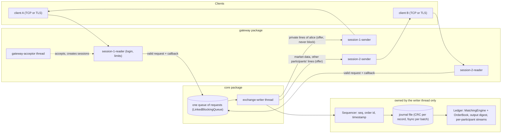
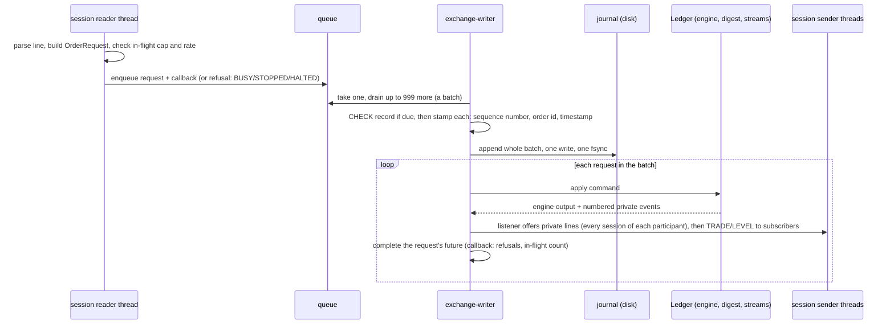
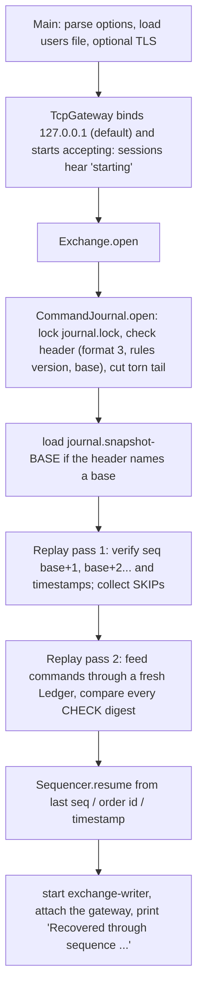
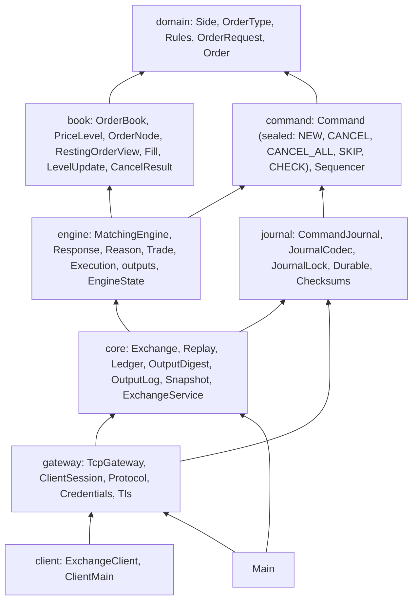

# 01 — The Big Picture

> **Project:** ExchangeServer2 | Single-instrument limit order book: price-time matching engine, write-ahead journal with replay, single writer thread, TCP/TLS gateway with authenticated participants | Stack: Java 17, Maven wrapper, JUnit 5 (+ JMH, PIT)
> **This guide:** the problem the project solves, its features, a high-level architecture, and the 10 things you must know first | **Prerequisites:** 00 | **Related:** 03, 05, 06, 09
> **Repo layout summary:** `pom.xml` + Maven wrapper (`mvnw`, `mvnw.cmd`) at the root; production code in `src/main/java/exchangeserver/` (packages `domain`, `book`, `engine`, `command`, `journal`, `core`, `gateway`, `client`, plus `Main`); tests mirror it in `src/test/java/exchangeserver/` (plus `bench/` JMH benchmarks and `testing/MutableClock`); design docs in `docs/` (`ExchangeServer2_Vision.md` = purpose/roadmap, `ExchangeServer2_Spec.md` = decisions D1–D77); these guides in `docs/understanding/`.

## Overview

An **exchange** is a service where buyers and sellers of one thing (here: a single unnamed instrument) send
**orders**, and the exchange pairs them into **trades**. ExchangeServer2 implements the core of one: a
**limit order book** with a **price-time priority matching engine**, made durable by a **write-ahead journal**,
driven by **one writer thread**, and reachable over a **TCP (optionally TLS) line protocol** with authenticated
participants.

The project's stated purpose is learning: "a hands-on way to understand production-grade software systems",
where "depth of understanding matters more than feature count" (**[Verified]** `docs/ExchangeServer2_Vision.md`
§1). Its non-goals are just as telling: no matching on several threads in one process, no price-indexed arrays,
no full FIX compliance, no real money, no paid infrastructure (**[Verified]** Vision §6). Authentication
and TLS used to be non-goals; they were built on 2026-10-27 (Spec D74). The same day, Vision v5 moved multiple
symbols, replication and sharding, DevOps and a public play-money demo from the non-goals onto the roadmap (Vision §7
steps 8–31); none of it is built yet, so the code is still single-instrument and single-process. Vision v6
(2026-10-28) adds a zero-cost rule: every step runs on free tooling and free tiers, the cluster locally and the demo
on one free-tier host (Vision §7, open decision 7).

This guide gives you the shape of the whole system. Guide 05 traces each flow in detail; guide 07 opens each
module.

## The problem, in exchange terms

Some vocabulary first (all of it is also in guide 13, the glossary):

- **Order:** "buy (or sell) *quantity* units at a price no worse than *price*". The client gives it its own id,
  the **client order id** (`clOrdId`), and the exchange assigns an **order id**.
- **Participant:** the trading identity a session logs in as (e.g. `alice`), with a secret.
- **Order book:** all orders currently waiting, split into **bids** (buy orders, best = highest price) and **asks**
  (sell orders, best = lowest price). An order that waits in the book is **resting**; its owner is the **maker**.
- **Price level:** all resting orders on one side at one price, in arrival order.
- **Crossing / matching:** an incoming buy **crosses** a resting ask if the ask's price is at or below the buy's
  limit (and mirror-image for sells). The incoming order is the **aggressor** or **taker**.
- **Price-time priority:** the best price trades first; within a price, the order that arrived first trades first.
- **Trade price:** always the *resting* order's price (**[Verified]** `src/main/java/exchangeserver/engine/Trade.java:10`).
- **Self-trade:** a trade between two orders of the same participant. Here it is prevented: the incoming
  order's remainder is cancelled instead (Spec D67).

A small example, observed running on 2026-10-27 against the final code (**[Verified — observed]**). Alice logs in
asking for cancel-on-disconnect (`COD`), rests a sell, then tries to buy against her own order; Bob buys part of
hers; Alice quits; a second session of Alice asks for everything she missed:

```
mallory > LOGIN alice guessed-secret
mallory < ERROR login failed
mallory < (closed)
alice > LOGIN alice alice-secret COD
alice < WELCOME participant=alice oseq=0
alice > NEW a1 SELL LIMIT 10 100
alice < ORDER oseq=1 orderId=1 clOrdId=a1 status=RESTED filled=0 remaining=10
alice > NEW a2 BUY LIMIT 5 100
alice < ORDER oseq=2 orderId=2 clOrdId=a2 status=CANCELLED filled=0 remaining=5 reason=SELF_TRADE_PREVENTED
bob > NEW b1 BUY LIMIT 4 100
bob < FILL oseq=1 orderId=3 clOrdId=b1 side=BUY price=100 qty=4 leaves=0 liquidity=TAKER
bob < ORDER oseq=1 orderId=3 clOrdId=b1 status=FILLED filled=4 remaining=0
alice < FILL oseq=3 orderId=1 clOrdId=a1 side=SELL price=100 qty=4 leaves=6 liquidity=MAKER
alice > QUIT
alice < BYE
alice < (closed)
bob > SUBSCRIBE
bob < SUBSCRIBED
bob < BOOK seq=4 last=100 bids=- asks=-
alice2 > LOGIN alice alice-secret
alice2 < WELCOME participant=alice oseq=4
alice2 > RESEND 1
alice2 < ORDER oseq=1 orderId=1 clOrdId=a1 status=RESTED filled=0 remaining=10 resend=1
alice2 < ORDER oseq=2 orderId=2 clOrdId=a2 status=CANCELLED filled=0 remaining=5 reason=SELF_TRADE_PREVENTED resend=1
alice2 < FILL oseq=3 orderId=1 clOrdId=a1 side=SELL price=100 qty=4 leaves=6 liquidity=MAKER resend=1
alice2 < CANCELLED oseq=4 orderId=1 qty=6 reason=CANCEL_ALL resend=1
alice2 < RESENT last=4
```

Read it line by line:

1. A wrong secret gets the same `ERROR login failed` whatever was wrong, and the connection closes (one attempt
   per connection, Spec D74).
2. Alice's sell of 10 at 100 rests. Her private message number (`oseq`) 1 is its outcome.
3. Her buy at 100 would trade with her own sell: it is **CANCELLED** with `SELF_TRADE_PREVENTED`, nothing trades.
4. Bob's buy of 4 trades at 100 against Alice's order. Bob hears a TAKER `FILL` and his `ORDER`; Alice hears a
   MAKER `FILL` (her `oseq` 3).
5. Alice quits. Because she logged in with `COD` and it was her last session, the gateway submits a journalled
   `CANCEL_ALL alice`: her remaining 6 are cancelled, so Bob's book snapshot shows an empty book.
6. A new session of Alice sees `oseq=4` in `WELCOME` and asks `RESEND 1`: every private message is repeated,
   marked `resend=1`, including the cancel she missed while away.

## Features

| Feature | What it means here | Where |
|---|---|---|
| Five order types | `LIMIT` (rest the remainder), `IOC` (cancel the remainder), `FOK` (all now or nothing), `MARKET` (no price, trades inside a collar), `POST_ONLY` (rests only, rejected if it would cross) | **[Verified]** `src/main/java/exchangeserver/domain/OrderType.java:5-9` |
| Cancel and cancel-all | Only the owner can cancel; someone else's order looks unknown; `CANCEL_ALL` cancels all of one participant's orders | **[Verified]** `src/main/java/exchangeserver/book/OrderBook.java:97-108`, `src/main/java/exchangeserver/engine/MatchingEngine.java:136`, Spec D48, D72 |
| Risk checks | Duplicate client order id, ±10% price band around the last trade, market collar (also before the first trade), 10,000 resting orders per participant and 1,000,000 in total (only for orders that would rest), self-trade prevention | **[Verified]** `src/main/java/exchangeserver/domain/Rules.java:21-37`, `src/main/java/exchangeserver/engine/MatchingEngine.java:178`, Spec D66–D68 |
| Market data | Trades and level-2 updates (one line per changed price level) for subscribers; a snapshot (`BOOK`) on subscribe | **[Verified]** `src/main/java/exchangeserver/gateway/TcpGateway.java:286-310` |
| Private stream + RESEND | Replies and fills numbered per participant (`oseq`), sent to all of its sessions, the last 1,000 repeatable on request | **[Verified]** `src/main/java/exchangeserver/core/OutputLog.java:23-26`, Spec D73 |
| Write-ahead journal | Every command is appended (with a CRC-32C) and fsynced before it has any effect | **[Verified]** `src/main/java/exchangeserver/core/Exchange.java:223`, Spec D69 |
| Replay, CHECKs, snapshots | Restart rebuilds the state from the latest snapshot plus the journal; CHECK digests prove replay matched the live run; `--compact` writes a snapshot and an empty journal | **[Verified]** `src/main/java/exchangeserver/core/Replay.java:39`, `src/main/java/exchangeserver/core/Exchange.java:174-194`, Spec D70, D71 |
| Torn-tail recovery | A half-written last record from a crash is cut on open | **[Verified]** `src/main/java/exchangeserver/journal/CommandJournal.java:110` |
| Poison-pill handling | A command that crashes the engine is quarantined with a `SKIP` record | **[Verified]** `src/main/java/exchangeserver/core/Exchange.java:278-287`, Spec D51 |
| Smart batching | The writer takes everything already queued, one fsync per batch | **[Verified]** `src/main/java/exchangeserver/core/ExchangeService.java:293-300`, Spec D52 |
| Backpressure | A full queue refuses with `BUSY` instead of blocking; per session, `SESSION_BUSY` and `RATE_LIMITED` | **[Verified]** `src/main/java/exchangeserver/core/ExchangeService.java:228`, `src/main/java/exchangeserver/gateway/ClientSession.java:279-291` |
| Security | Loopback bind by default, `LOGIN <p> <secret>` against salted PBKDF2 hashes, optional TLS, login and idle timeouts | **[Verified]** `src/main/java/exchangeserver/gateway/TcpGateway.java:68-70`, `src/main/java/exchangeserver/gateway/Credentials.java:82-87`, Spec D74, D75 |
| Console client | Type protocol lines, see server lines; TLS optional | **[Verified]** `src/main/java/exchangeserver/client/ClientMain.java` |
| Benchmarks, mutation testing | JMH micro-benchmarks; PIT mutation testing | **[Verified]** `pom.xml:93-169` |

## Architecture

### Components and threads



**[Verified]** thread names: `exchange-writer` (`src/main/java/exchangeserver/core/ExchangeService.java:119`),
`gateway-acceptor` (`src/main/java/exchangeserver/gateway/TcpGateway.java:144`), `session-N-reader` and
`session-N-sender` (`src/main/java/exchangeserver/gateway/ClientSession.java:91-92`).

### The one live path



The heart of this path is `Exchange.process` (**[Verified]**):

```java
// src/main/java/exchangeserver/core/Exchange.java:198-252 (trimmed)
void process(List<Pending<?>> batch, OutputListener listener) throws IOException {
    List<Command> commands = new ArrayList<>(batch.size() + 1);
    if (commandsSinceCheck >= options.checkInterval()) {
        commands.add(sequencer.stampCheck(ledger.digest()));       // D70: covers every command before it
        commandsSinceCheck = 0;
    }
    // stamp each request: NEW, CANCEL or CANCEL_ALL (an invalid one is refused, never journalled)
    journal.appendAll(commands);                // durable before any effect
    for (Pending<?> p : batch) {
        if (p.refused) {
            continue;
        }
        if (p.command == null) {
            p.complete(read(p.request));
            continue;
        }
        Ledger.Applied applied;
        try {
            interceptor.beforeEngine(p.command);
            applied = ledger.apply(p.command);
        } catch (RuntimeException bug) {
            quarantine(p.command, bug);         // poison pill: SKIP record + rebuild the ledger
            p.fail(new ExchangeException(ExchangeException.Reason.INTERNAL_ERROR,
                    "command " + p.command.sequenceNumber() + " failed and was quarantined", bug));
            continue;
        }
        commandsSinceCheck++;
        listener.onOutput(applied.output(), applied.events());     // (a throw is logged)
        p.complete(result(applied.output()));   // after the listener: the request's lines went out first (D76)
    }
}
```

### Restart



**[Verified]** `src/main/java/exchangeserver/Main.java:120-157`, `src/main/java/exchangeserver/core/Exchange.java:116`,
`src/main/java/exchangeserver/journal/CommandJournal.java:75-127`, `src/main/java/exchangeserver/core/Replay.java:39-70`.

### Packages and their dependencies



Arrows mean "depends on". **[Verified]** from the import lists of each file. `gateway` uses `journal.Durable` to
write the users file atomically (`src/main/java/exchangeserver/gateway/Credentials.java:72-80`); `client` uses only
`gateway.Tls` to build a TLS socket factory (`src/main/java/exchangeserver/client/ClientMain.java:3`), otherwise it
just speaks the text protocol.

## The 10 things you must know first

**1. One thread owns all mutable exchange state.** **[Verified]** The `exchange-writer` thread alone touches the
`Exchange`, `Sequencer`, `CommandJournal`, `Ledger`, `MatchingEngine` and `OrderBook`; none of those classes is
thread-safe, on purpose (`CLAUDE.md`, "Single writer"; class comments such as
`src/main/java/exchangeserver/book/OrderBook.java:30`). Every other thread reaches state only through the queue,
including reads (a book snapshot, a participant's latest `oseq`, a `RESEND`) (Spec D57, D73). If you ever read the
book from another thread, you have a data race.

**2. The order of operations is stamp → journal (fsync) → engine → listener → future.** **[Verified]**
`src/main/java/exchangeserver/core/Exchange.java:198-252`. Nothing in a batch is processed before the whole batch
is on disk. The listener (which sends the request's own lines, then market data) runs before the request's future
completes, so a callback that runs knows its lines were already offered (Spec D76). Within one command, the
requester's reply comes before the makers' fills and the market data (Spec D53, D73).

**3. "Visible ⇒ durable" holds; "durable ⇒ visible" does not.** **[Verified]** Spec §4. No client ever sees the
effect of a command that is not on disk. But a crash *after* the fsync and *before* the reply leaves journalled
commands whose clients heard nothing; on restart they are replayed anyway. Clients reconcile two ways: resend with
the same client order id (the duplicate check returns the original order id, D49), or log in again and `RESEND`
from the last `oseq` they saw (D73).

**4. The engine is deterministic, and that is load-bearing.** **[Verified]** `CLAUDE.md` ("Determinism is
load-bearing"); `src/main/java/exchangeserver/engine/MatchingEngine.java:29-30`. The engine reads no clock and
counts nothing: sequence numbers, order ids and timestamps come from the `Sequencer`
(`src/main/java/exchangeserver/command/Sequencer.java:11`), and a trade's timestamp is the incoming command's
timestamp (`src/main/java/exchangeserver/engine/Trade.java:10-12`). Replay depends on this, and now *checks* it:
every 10,000 commands a `CHECK` record stores a digest of every output so far, and replay stops with "diverged" if
it produces different outputs (Spec D70).

**5. Validation is split by kind.** **[Verified]** *Stateless* checks (syntax, field ranges, name patterns, the
session's rate and in-flight limits) happen at the gateway; a request failing them gets `ERROR` and never reaches
the queue or the journal. *State-dependent* checks (duplicate client order id, price band, resting caps, post-only
would cross, self-trade prevention) happen in the engine after journalling, so replay reproduces them (Spec D13,
D47; `src/main/java/exchangeserver/engine/Reason.java:5-9`).

**6. Book invariants are protected by Java package visibility.** **[Verified]** Every mutator of `PriceLevel` is
package-private, so the engine (another package) can read levels but must call `OrderBook.add`, `fillBest` or
`cancel`, which keep the invariants: an id is in the id map iff the order rests; no empty price levels; the book is
never crossed after a command (Spec D44; `src/main/java/exchangeserver/book/OrderBook.java:21-28`). Read access
for the engine goes through copies (`RestingOrderView`).

**7. Every rule replay depends on lives in `Rules`, and changing one means bumping `Rules.VERSION`.**
**[Verified]** `src/main/java/exchangeserver/domain/Rules.java:7-21`; the current version is 2. The journal header
stores it (`HEADER,3,2,0,<crc>` = format 3, rules 2, base sequence 0), and opening a journal with records written
under another version fails. The way across a rules change: compact with the old build (leaving an empty journal),
then start the new build, which adopts the empty journal (Spec D46, D71).

**8. Poison pills are quarantined live, never at startup.** **[Verified]** Spec D51;
`src/main/java/exchangeserver/core/Exchange.java:278-287`. If the engine throws a `RuntimeException` on a command
while running, the exchange appends `SKIP <seq>`, rebuilds the ledger by replaying everything before that command
(from the snapshot), and carries on; the caller gets `INTERNAL_ERROR`. If replay fails at startup, startup fails
with a hint naming the command; an operator inspects it and runs `--quarantine <seq>`. An `Error` (e.g.
`OutOfMemoryError`) or a journal I/O failure halts the exchange (process exit code 2).

**9. Batching is "smart": no timer.** **[Verified]** `src/main/java/exchangeserver/core/ExchangeService.java:293-300`,
Spec D52. The writer blocks for one request, then drains whatever else is already waiting (up to 1,000 in total),
journals them with one fsync, and processes them. Under light load a batch is one request; under load, batches grow
by themselves. Measured on the author's laptop: 43 orders/ms with 64 clients versus 0.8 orders/ms with an fsync per
command (Spec §5).

**10. The writer never waits for a client, and a client cannot hog the exchange.** **[Verified]**
`src/main/java/exchangeserver/gateway/ClientSession.java:116-124`, Spec D54, D75. Lines for a client go into that
client's bounded outbound queue (10,000 lines) with a non-blocking `offer`; if it is full, the client is
disconnected. A separate sender thread per client writes to the socket. On the way in, each session may have at
most 1,000 requests in flight and 1,000 per second (bursts of 2,000), and must log in within 10 s and say something
at least every 300 s.

## Where to go next

- Guide 02 if any of records, sealed interfaces, `CompletableFuture`, `FileChannel.force`, PBKDF2, TLS or JUnit 5
  `@Nested` is unfamiliar.
- Guide 03 for a file-by-file map.
- Guide 04 to build, run and poke at it.
- Guide 05 for the end-to-end flows.

## Key takeaways

- One instrument, five order types, price-time priority; trade price is always the resting order's price; no
  self-trades.
- Pipeline: authenticated gateway (stateless checks, limits) → one queue → writer thread: stamp → journal + fsync →
  ledger → listener (private stream, market data) → future.
- Single writer thread; no locks inside the engine or book; reads go through the queue too.
- Write-ahead journal + deterministic engine = restart by replay, from a snapshot when compacted; CHECK digests
  prove the replay matched; the `Rules.VERSION` header guards against replaying under changed rules.
- Each participant has a numbered private stream (`oseq`), delivered to all its sessions and resendable.
- Poison pills: quarantined live (SKIP + rebuild), refused at startup until an operator quarantines them.
- Smart batching: one fsync per batch, batch size grows with load, no timer.
- Most reasons are recorded in the Spec as D-numbers (D1–D77).

## Common confusions

- **"Is the journal a log of what happened (trades)?"** No. It logs *inputs* (commands), not outputs. Trades,
  replies, market data and even the private stream's `oseq` numbers are re-derived by replay (Spec D12, D73, Vision
  principle 5). The only derived value journalled is the CHECK digest, which replay compares rather than uses.
- **"Rejected orders are not journalled."** Only *stateless* rejects (bad syntax, bad field, over a session limit)
  are not journalled. State-dependent rejects (duplicate id, price band, caps, post-only cross) and self-trade
  cancellations are journalled and replayed, because they depend on the book state at that moment.
- **"The listener runs on another thread."** No: the `OutputListener` and the gateway's request callbacks both run
  on the writer thread (**[Verified]** `src/main/java/exchangeserver/core/OutputListener.java:9-12`). They only
  offer lines to queues, which is why they are cheap enough to run there.
- **"A reply goes only to the session that sent the order."** Not any more: a participant's private stream goes to
  every session logged in as that participant, so two sessions of Alice see the same `ORDER` line (Spec D73). Only
  refusals (`ERROR ... BUSY`, `RATE_LIMITED`, `SESSION_BUSY`) go to the requesting session alone.
- **"A market order trades at any price before the first trade."** Not any more: before the first trade its
  collar is ±10% around the best opposite price (Spec D66); after it, ±10% around the last trade (D50).
- **"Disconnecting cancels my orders."** Only if the participant logged in with `COD` and the closing session was
  its last one (Spec D72). Otherwise resting orders stay.

## Questions to test yourself

1. Bob sends `NEW b1 BUY LIMIT 4 101` against a single resting ask of 10 at 100 from Alice. At what price is the
   trade, and who learns about it?
   <details><summary>Answer</summary>At 100, the resting price. Bob's sessions get a TAKER `FILL` and an
   `ORDER ... FILLED` (his next `oseq`); every session of Alice gets a MAKER `FILL` with `leaves=6` (her next
   `oseq`); subscribers get `TRADE` and a `LEVEL` update for the ask at 100 (now 6).</details>
2. Why must the matching engine never call `Instant.now()`?
   <details><summary>Answer</summary>Replay feeds journalled commands through the engine again after a restart. A
   clock read inside the engine would give different values on replay, so trades (and anything depending on time)
   would differ from what clients saw, and the next CHECK would report a divergence. All timestamps are stamped by
   the `Sequencer` before journalling.</details>
3. A client's order is rejected for `PRICE_OUTSIDE_BAND`. Is it in the journal? What about an order refused with
   `RATE_LIMITED`?
   <details><summary>Answer</summary>The band reject is in the journal (state-dependent: it depends on the last
   trade price). The rate-limited order never reaches the queue: the session refuses it with `ERROR` before
   handing it in.</details>
4. Alice has a resting sell at 100 and sends a buy at 100. What happens?
   <details><summary>Answer</summary>Matching stops at her own resting order: no trade, and her buy's remainder is
   cancelled with `ORDER ... status=CANCELLED ... reason=SELF_TRADE_PREVENTED` (Spec D67). Her sell stays.</details>
5. Alice's client was offline when her order was filled. How does she find out?
   <details><summary>Answer</summary>After logging in again, `WELCOME` reports her latest `oseq`; she sends
   `RESEND <first oseq she has not seen>` and gets the missed lines marked `resend=1`, followed by `RESENT last=N`
   (or `ERROR RESEND_GAP first=M` if they are older than the retained 1,000 events or than the last compaction).</details>
6. What are the two conditions under which the exchange halts rather than quarantining?
   <details><summary>Answer</summary>A journal I/O failure (write or fsync), or any `Throwable` that is not a
   `RuntimeException` from the engine step (an `Error` such as `OutOfMemoryError`, an interrupt, or a bug outside
   the engine). The process then exits with code 2.</details>
