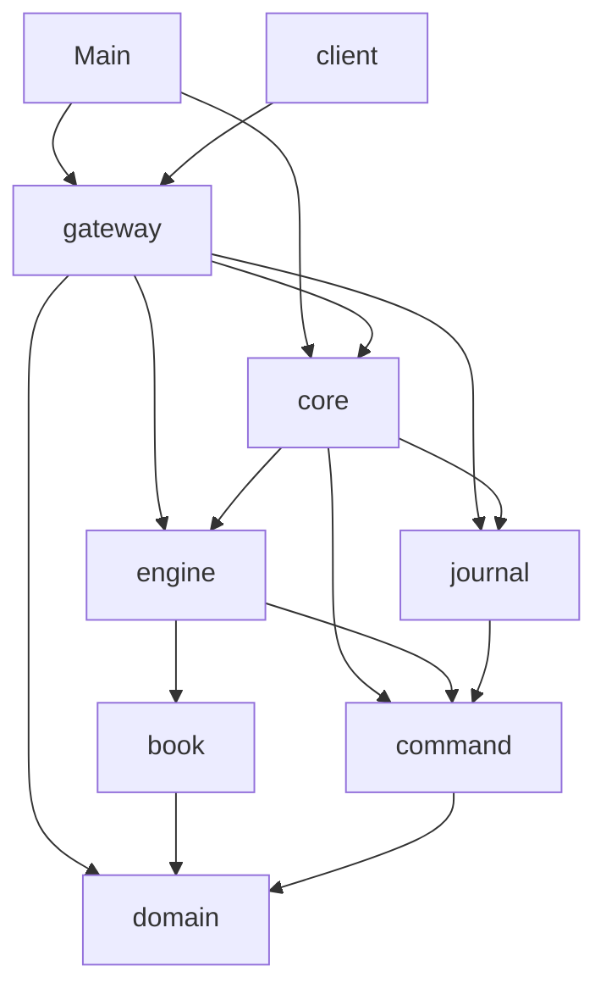

# 03 — Codebase Map

> **Project:** ExchangeServer2 | Single-instrument limit order book: price-time matching engine, write-ahead journal with replay, single writer thread, TCP/TLS gateway with authenticated participants | Stack: Java 17, Maven wrapper, JUnit 5 (+ JMH, PIT)
> **This guide:** a guided tour of the directories, entry points, conventions, and a one-line purpose for every file; what is generated vs hand-written | **Prerequisites:** 01 | **Related:** 02, 04, 07-modules/*, 10, 13
> **Repo layout summary:** `pom.xml` + Maven wrapper (`mvnw`, `mvnw.cmd`) at the root; production code in `src/main/java/exchangeserver/` (packages `domain`, `book`, `engine`, `command`, `journal`, `core`, `gateway`, `client`, plus `Main`); tests mirror it in `src/test/java/exchangeserver/` (plus `bench/` JMH benchmarks and `testing/MutableClock`); design docs in `docs/` (`ExchangeServer2_Vision.md` = purpose/roadmap, `ExchangeServer2_Spec.md` = decisions D1–D77); these guides in `docs/understanding/`.

## Overview

The repository is a single Maven module. Size (**[Verified]**, `wc -l` on 2026-10-27, branch `fix/risks`):
62 production files (~5,700 lines) in 8 packages plus `Main`, and 26 test files (~5,700 lines, including 2
benchmarks and one test helper). Git history: `b3091a8` "Initial Commit" (the rewrite), `d930e53` (survey fixes
D63–D65 and these guides), `5fb7602` (fixes for every risk of the review, D66–D77).

```
ExchangeServer2/
├── pom.xml                       build: Java 17, JUnit 5, profiles bench (JMH) and mutation (PIT)
├── mvnw, mvnw.cmd, .mvn/wrapper/  Maven Wrapper (downloads Maven 3.9.16)
├── README.md                     one-page intro, users, commands, a sample session
├── CLAUDE.md                     instructions for AI agents working in the repo (commands, architecture, rules)
├── .gitignore                    target/, *.journal, *.journal.lock, IDE files
├── .gitattributes                journals/snapshots never line-ending-converted; mvnw always LF
├── docs/
│   ├── ExchangeServer2_Vision.md purpose, working style, principles, roadmap (roadmap lives only here)
│   ├── ExchangeServer2_Spec.md   exact code state, decisions D1–D77, journal format, measurements, open threads
│   └── understanding/            these study guides
└── src/
    ├── main/java/exchangeserver/
    │   ├── Main.java             process entry point (server, --add-user, --quarantine, --compact)
    │   ├── domain/               orders and the rules
    │   ├── book/                 the order book data structure
    │   ├── engine/               matching logic and its outputs
    │   ├── command/              stamped commands + the Sequencer
    │   ├── journal/              the write-ahead log file, its lock, checksums, durable file writes
    │   ├── core/                 the live path, replay, ledger, snapshots, the writer thread
    │   ├── gateway/              TCP/TLS server, sessions, credentials, wire protocol
    │   └── client/               a line client (tests + interactive console)
    └── test/java/exchangeserver/ one test class per production class, plus bench/ and testing/
```

Not in the repo (ignored, **[Verified]** `.gitignore`): `target/` (all build output), `*.journal` (runtime
journals), `*.journal.lock` (the empty lock file next to each journal, D65). Snapshot and archive files
(`<journal>.snapshot-N`, `<journal>.archive-A-B`) and the users file (`exchange.users`) are runtime data too
(**[Inferred]** not matched by `*.journal`, so keep them out of commits yourself).

## Entry points

| Entry point | How it is started | What it does |
|---|---|---|
| `exchangeserver.Main` (server) | `java -jar target/exchange-server2-2.0.0-SNAPSHOT.jar [--port N] [--bind ADDR] [--journal FILE] [--users FILE] [--tls-keystore FILE] ...` | Loads the users file, binds the gateway (127.0.0.1 by default) and starts accepting, replays the journal (from its snapshot), starts the writer thread, prints the recovery summary, waits; exit codes 0 clean stop (signals included), 1 startup failure, 2 halted (**[Verified]** `src/main/java/exchangeserver/Main.java:23-41`, `120-184`) |
| `Main --add-user <p>` | `java -jar ... --users exchange.users --add-user alice` | Asks for a secret (console, or one line of standard input) and writes its salted PBKDF2 hash to the users file (**[Verified]** `src/main/java/exchangeserver/Main.java:94-100`) |
| `Main --quarantine <seq>` | `java -jar ... --journal FILE --quarantine 7` | Operator tool: appends `SKIP 7` to the journal (refused while the exchange runs) (**[Verified]** `src/main/java/exchangeserver/Main.java:101-107`) |
| `Main --compact` | `java -jar ... --journal FILE --compact` | Operator tool: snapshot + archive + empty journal (refused while the exchange runs) (**[Verified]** `src/main/java/exchangeserver/Main.java:108-116`) |
| `exchangeserver.client.ClientMain` | `java -cp target/exchange-server2-2.0.0-SNAPSHOT.jar exchangeserver.client.ClientMain [host] [port] [--tls [--truststore FILE]]` | Interactive console: type protocol lines, see every server line prefixed with `< ` (**[Verified]** `src/main/java/exchangeserver/client/ClientMain.java:12-20`) |
| JMH benchmarks | `mvnw.cmd -Pbench verify -Djmh.args="MatchingBenchmark ..."` | `org.openjdk.jmh.Main` runs the `@Benchmark` methods in `src/test/java/exchangeserver/bench` (**[Verified]** `pom.xml:95-125`) |
| Tests | `mvnw.cmd test` | Surefire runs every JUnit 5 test except `bench/**` |

There is no other `main` method (**[Verified]** by search). For programmatic use (tests, tools), the API entry
points are `ExchangeService.start(...)` (multi-threaded service), `Exchange.open(...)` (single-threaded core),
`Exchange.compact(...)` and `Exchange.quarantine(...)` (tools).

## How the packages layer

Dependencies flow one way, from the network inward (**[Verified]** from imports):



Reading tip: start at the bottom (`domain`, `book`) and work up; each layer only uses what is below it. `gateway`
uses `journal` only for `Durable` (writing the users file atomically). `client` uses only `gateway.Tls` (to build a
TLS socket factory) and otherwise talks to the server purely through the text protocol.

## Conventions you will see everywhere

1. **A block comment at the top of every class** explains its purpose, invariants, threading and the decisions it
   implements, e.g. `src/main/java/exchangeserver/book/OrderBook.java:19-35`. Method-level comments are short and
   explain *why*, not *what*. **[Verified]**
2. **Decision numbers in comments**: `(D44)`, `(D73)` refer to the decision table in
   `docs/ExchangeServer2_Spec.md` §3; `(M9)`, `(L6)` refer to risk items of the review (Spec §11); `(step 4A)` and
   "roadmap step N" refer to the roadmap in Vision §7. Comments citing a "threads guide" (4.3, 4.4, Lab 6) or "Spec
   v8"/"v3" refer to documents in the owner's **original project** (`Exchange Server/New Learnings/...`,
   `Exchange Server/src/docs/...`), not to this repo (**[Verified]** Spec §1.6).
3. **Visibility as an ownership tool**: mutators that only one class may call are package-private (`PriceLevel`'s
   `addOrder`, `fillHead`, `nextNode`, `unlink`; `OrderNode` entirely), so the compiler, not convention, keeps other
   packages out (**[Verified]** Spec D44). Read access across packages goes through copies (`RestingOrderView`,
   `Fill`).
4. **Package-private test seams** instead of mocks: `core.CommandInterceptor` (inject a failure or block the writer),
   `OrderBook.checkInvariants()` and `ordersAt()`, `MatchingEngine.book()` and the `MatchingEngine.Limits`
   constructor (small resting caps), `Exchange.engine()` and `digest()`,
   `TcpGateway.participantsRegistered()`/`subscriberCount()`/`drainingSessions()`, `Credentials.of(map, iterations)`.
   Tests live in the same package to reach them. **[Verified]** `CLAUDE.md` ("Test seams").
5. **Records for values, final classes for everything else**; no inheritance hierarchies besides sealed interfaces.
6. **Dispatch over sealed types with `instanceof` chains ending in a `throw`** (Java 17 has no final pattern
   `switch`); **exhaustive `switch` expressions over enums** (guide 02, §1.4).
7. **Exceptions by meaning** (**[Verified]** Spec D27): `IllegalArgumentException` = bad input from outside;
   `IllegalStateException` = our own bug or a corrupt journal/snapshot; `ReplayException` (a subclass) = replay
   failed at a known record, with a kind (`ENGINE_FAILURE`, `DIVERGED`); `ExchangeException` with a `Reason` = a
   request got no business result (BUSY, STOPPED, HALTED, INTERNAL_ERROR).
8. **Explicit charsets** everywhere (`UTF_8` for files, `US_ASCII` for the wire).
9. **Every persisted line carries a CRC-32C** (journal records, snapshot lines) and every replaced file is written
   with write-then-rename (`journal.Durable`).
10. **Tests: one test class per production class, `@Nested` groups per behaviour, every concurrent wait has a
    timeout**; test names are sentences (`aWrongSecretIsRefusedAndDisconnects`) (**[Verified]** `CLAUDE.md`).
11. **Getter style is mixed by kind**: classic `getX()` on the two domain classes (`Order`, `OrderRequest`) and
    `PriceLevel`; record-style `x()` on records and most other APIs (`lastTradePrice()`, `state()`, `recovery()`).
    **[Inferred]** the domain classes kept the style of the original hand-written project.

## Every file, with its purpose

### Root and docs

| File | Purpose |
|---|---|
| `pom.xml` | Maven build: Java 17 release, UTF-8, `-Xlint:all`, JUnit BOM 5.11.4, JMH 1.37 (test scope), Surefire excluding `bench/**`, jar `Main-Class`, profiles `bench` and `mutation` |
| `mvnw`, `mvnw.cmd` | Maven Wrapper scripts (Unix / Windows), vendored from Apache; not hand-written |
| `.mvn/wrapper/maven-wrapper.properties` | Wrapper config: Maven 3.9.16 distribution URL |
| `.gitignore` | Ignores `target/`, `*.journal`, `*.journal.lock`, IDE and OS files |
| `.gitattributes` | `*.journal` and `*.journal.*` are `-text` (never converted to CRLF, D69); `mvnw` always checked out with LF |
| `README.md` | Short intro, users, build/run commands, a sample session, operator tools, package table |
| `CLAUDE.md` | Agent instructions: commands, architecture across files, test rules, Windows environment notes |
| `docs/ExchangeServer2_Vision.md` | Purpose, working style, engineering principles, roadmap, non-goals, glossary |
| `docs/ExchangeServer2_Spec.md` | Current state per class, invariants, decisions D1–D77, journal and snapshot format, benchmark and mutation results, open threads, review fixes (§9–§11) |
| `docs/understanding/*` | These study guides, `AI-TUTOR-PROMPT.md`, generated `FULL-CONTEXT.md` and its generator `build-full-context.java` |

### `src/main/java/exchangeserver/` (production)

| File | Lines | Purpose |
|---|---|---|
| `Main.java` | 238 | Parses every option; tools `--add-user`, `--quarantine`, `--compact`; server: users, TLS, gateway, service, recovery summary, failure hints, shutdown hook ending with `halt(status)` |
| **domain/** | | |
| `domain/Side.java` | 10 | `BUY`/`SELL`, `opposite()` |
| `domain/OrderType.java` | 23 | `LIMIT`, `IOC`, `FOK`, `MARKET`, `POST_ONLY`; `canRest()` true only for LIMIT and POST_ONLY |
| `domain/Rules.java` | 48 | Every rule replay depends on: `VERSION` (2), max quantity/price, name patterns, band percent, per-participant and global resting caps, `withinBand` |
| `domain/OrderRequest.java` | 147 | A client's order before stamping; the only field-validation layer (D47); factories per type; price as `OptionalLong` |
| `domain/Order.java` | 110 | An accepted order: request + order id + timestamp; tracks filled quantity; `fill(q)` |
| **book/** | | |
| `book/OrderBook.java` | 272 | Bids/asks `TreeMap`s of levels, id → node map, per-participant open counts, changed-level set; `add`, `fillBest`, `cancel`, `drainLevelUpdates`, read-only `walk`/`restingOrders`/`headParticipant`; invariant checker for tests |
| `book/PriceLevel.java` | 165 | One price on one side: doubly linked list with sentinels, total volume, count; mutators package-private |
| `book/OrderNode.java` | 35 | Package-private list node (order, prev, next, level); sentinels only via `sentinel()` |
| `book/RestingOrderView.java` | 20 | Record: an immutable copy of one resting order (for the fillability walk, cancel-all, snapshots) |
| `book/Fill.java` | 13 | Record: what `fillBest` did to one resting order (immutable copy) |
| `book/LevelUpdate.java` | 11 | Record: a level's state after a command (volume 0 = gone); level-2 market data |
| `book/CancelResult.java` | 25 | Record: `CANCELLED` with quantity, or `UNKNOWN_ORDER` |
| `book/CancelStatus.java` | 12 | Enum `CANCELLED`, `UNKNOWN_ORDER` (not owning = unknown, D48) |
| **engine/** | | |
| `engine/MatchingEngine.java` | 333 | Price-time matching: pre-checks (duplicate id, band, resting caps, FOK, post-only), matching loop with self-trade prevention, outcome switch, cancel-all, snapshot, state export/restore; deterministic |
| `engine/Response.java` | 57 | Record: what the submitter is told; constructor rejects contradictions (D22) |
| `engine/Reason.java` | 29 | Why an order did not simply trade/rest: five reject reasons + `SELF_TRADE_PREVENTED` (with CANCELLED) |
| `engine/Trade.java` | 27 | Record: price, qty, buy/sell order ids, aggressor side, timestamp (= incoming command's) |
| `engine/Execution.java` | 13 | Record: a passive (maker) fill addressed to the resting order's owner |
| `engine/EngineOutput.java` | 25 | Sealed interface for everything one command produced |
| `engine/OrderOutput.java` | 22 | Output of a new order: response, passive fills, level updates |
| `engine/CancelOutput.java` | 27 | Output of a cancel: result, level updates |
| `engine/CancelAllOutput.java` | 29 | Output of a cancel-all: one result per cancelled order, level updates (D72) |
| `engine/BookSnapshot.java` | 20 | Record: book as of a command (seq, last trade price, best-first levels) |
| `engine/EngineState.java` | 22 | Record: counters, last trade price and resting orders, for snapshots (D71) |
| `engine/OrderStatus.java` | 9 | `FILLED`, `RESTED`, `CANCELLED`, `REJECTED` |
| **command/** | | |
| `command/Command.java` | 16 | Sealed interface: a stamped, journalled record |
| `command/NewOrderCommand.java` | 21 | Record: seq, timestamp, order id, request |
| `command/CancelOrderCommand.java` | 24 | Record: seq, timestamp, participant, target order id |
| `command/CancelAllCommand.java` | 21 | Record: seq, timestamp, participant (cancel-on-disconnect, D72) |
| `command/SkipCommand.java` | 25 | Record: seq, timestamp, skipped seq (quarantine marker, D51) |
| `command/CheckCommand.java` | 29 | Record: seq, timestamp, 16-hex-digit output digest (D70); compared on replay, never fed |
| `command/Sequencer.java` | 94 | The only clock reader and counter: stamps seq, order id, non-decreasing timestamp; `resume` after replay |
| **journal/** | | |
| `journal/JournalCodec.java` | 194 | Text format v3: `HEADER`/`NEW`/`CANCEL`/`CANCEL_ALL`/`SKIP`/`CHECK` records with CRCs, encode/decode, CRLF message |
| `journal/CommandJournal.java` | 317 | The write-ahead log: lock, header check (adopts new rules if empty), torn-tail cut, `appendAll` (one write + fsync), streaming `read`, base sequence, fail-stop, `writeFresh` |
| `journal/JournalLock.java` | 84 | One owner per journal: OS lock on `<journal>.lock` + in-JVM `HELD` set (D65) |
| `journal/Durable.java` | 64 | Crash-safe file operations: write-then-rename, durable copy, directory fsync |
| `journal/Checksums.java` | 18 | CRC-32C of a record's text, 8 hex digits (D69) |
| **core/** | | |
| `core/Exchange.java` | 359 | Single-threaded live path: CHECK when due, stamp → journal → ledger → listener → future; poison-pill quarantine + rebuild; `open` (replay), static `quarantine` and `compact` tools; `Options`, `Recovery`, `Compaction` |
| `core/Replay.java` | 131 | From the snapshot: verify pass, then feed a `Ledger` and compare CHECKs; `rebuild` for the poison pill |
| `core/Ledger.java` | 74 | Engine + output digest + output log, rebuilt together; `apply`, `snapshot` |
| `core/OutputDigest.java` | 88 | Running FNV-1a 64 over a canonical encoding of every engine output (D70) |
| `core/OutputLog.java` | 123 | Numbers each participant's private events (oseq) and keeps the last `retention` for RESEND (D73) |
| `core/PrivateEvent.java` | 32 | Sealed: `OrderReply`, `CancelReply`, `MakerFill` (one message of a participant's stream) |
| `core/ResendResult.java` | 12 | Record: retained events from an oseq, first retained, latest |
| `core/Snapshot.java` | 137 | State after a sequence number; file `<journal>.snapshot-N` with CRC lines and an END record (D71) |
| `core/ReplayException.java` | 37 | Replay failed at a record: `ENGINE_FAILURE` (poison pill) or `DIVERGED` (CHECK mismatch) |
| `core/ExchangeService.java` | 360 | The writer thread, the queue, hand-in lock, states, batching, stop/halt; callbacks logged if they throw; `recovery()` |
| `core/Request.java` | 57 | Sealed: `Submit`, `Cancel`, `CancelAll` (journalled), `Snapshot`, `Attach`, `Resend` (reads) |
| `core/Pending.java` | 36 | A request in flight with its own future; `command`, `refused` set by the writer |
| `core/ExchangeException.java` | 42 | Refusal/failure with `Reason`: BUSY, STOPPED, HALTED, INTERNAL_ERROR |
| `core/OutputListener.java` | 24 | Hook called with each command's output and private events on the writer thread (the gateway implements it) |
| `core/CommandInterceptor.java` | 17 | Package-private test seam run before each engine step |
| **gateway/** | | |
| `gateway/TcpGateway.java` | 320 | `Settings`; (TLS) server socket + acceptor thread with back-off; session registry; `OutputListener` routing private events and market data; cancel-on-disconnect |
| `gateway/ClientSession.java` | 475 | One connection: reader thread (login, parse, validate, limits, hand in), sender thread (bounded queue → socket), timeouts, subscribe, resend, close when nothing is in flight (D76) |
| `gateway/Credentials.java` | 150 | Users file of salted PBKDF2 hashes; `load`, `addUser`, constant-time `verify` (D74) |
| `gateway/Tls.java` | 67 | Server and client `SSLContext`s from PKCS#12 files; passwords from the environment |
| `gateway/Protocol.java` | 217 | The wire protocol: documentation, parser, line formatters (with `oseq`), limits (256-byte lines, snapshot depth 100) |
| `gateway/ClientMessage.java` | 40 | Sealed: one parsed client line (`Login` hides its secret in `toString`) |
| `gateway/ProtocolException.java` | 11 | A malformed line (answered with `ERROR`) |
| **client/** | | |
| `client/ExchangeClient.java` | 174 | Minimal line client (plain or TLS socket factory): background reader thread, `send`, `await`, `linesUntil`, `field` parser |
| `client/ClientMain.java` | 78 | Interactive console client; `--tls`, `--truststore` |

### `src/test/java/exchangeserver/` (tests and tools)

| File | Lines | What it covers |
|---|---|---|
| `MainTest.java` | 53 | Startup failure hints fit the failure (L2): no poison-pill advice for a corrupt file; compaction advice for a divergence |
| `domain/OrderRequestTest.java` | 140 | Factories, every validation rule, equality |
| `domain/OrderTest.java` | 95 | Construction, price for MARKET, fill/overfill |
| `domain/RulesTest.java` | 54 | Band edges and overflow, max price × quantity fits a long; also `Side.opposite`, `OrderType.canRest` |
| `book/PriceLevelTest.java` | 256 | Append, fillHead, unlink (head/middle/tail/only), `nextNode`, sentinel and foreign-node guards |
| `book/OrderBookTest.java` | 337 | add/fillBest/cancel, open counts, level updates, read-only views, `walk`/`restingOrders`/`headParticipant`, 3 × 10,000 random commands with `checkInvariants()` after each |
| `command/SequencerTest.java` | 196 | Stamping (incl. cancel-all and check), invalid input uses no numbers, backwards clock, resume, command record validation |
| `engine/MatchingEngineTest.java` | 865 | Every order type, collar before the first trade, cancels, risk checks, self-trade prevention, caps, cancel-all, snapshot state export/restore, outputs, guards, determinism |
| `engine/ResponseTest.java` | 87 | `Response` consistency rules (incl. `SELF_TRADE_PREVENTED` only with CANCELLED), `Trade` validation |
| `journal/JournalCodecTest.java` | 195 | Round trips of every record, header with base, corrupt records, checksum mismatch, CRLF message |
| `journal/CommandJournalTest.java` | 343 | Header (D64 refusals, rules adoption), append/read, recovery (torn tail), exclusive lock (incl. a child JVM running `Main --quarantine`), fail-stop |
| `journal/DurableTest.java` | 40 | Write-then-rename replaces the whole file and leaves no temporary file; copy; directory fsync is harmless |
| `core/ReplayTest.java` | 217 | Verify pass (gaps, repeats, backwards time, missing snapshot), feed and rebuild, CHECK match / divergence |
| `core/ExchangeTest.java` | 608 | Live path, restart equality, torn tail, rules version, poison pills, quarantine tool, CHECKs, compaction (restart, id scope, oseq continuity, crash safety, rules crossing, corrupt snapshot), recovery report, cancel-all |
| `core/ExchangeServiceTest.java` | 636 | Hand-in from many threads, D61 future hand-off, listener before callback (D76), stop/race, backpressure, halt, batching, logged callback failure, stop from the writer refused |
| `core/OutputLogTest.java` | 97 | Numbering per participant, cancel-all events, retention and RESEND ranges, resume after a snapshot |
| `core/OutputDigestTest.java` | 92 | Same outputs → same digest; every field and every output kind changes it; resume from hex |
| `core/SnapshotTest.java` | 88 | File round trip, changed character, truncation, wrong END, missing file, empty snapshot |
| `gateway/ProtocolTest.java` | 159 | Parsing and formatting of every message (login with secret, RESEND, oseq lines, resend marker) |
| `gateway/ClientSessionTest.java` | 59 | `readLine` limits and line endings |
| `gateway/CredentialsTest.java` | 68 | Verify, salted file, update, weak secrets refused, missing/corrupt file messages |
| `gateway/TcpGatewayTest.java` | 769 | End to end over real sockets: sessions, QUIT/EOF/shutdown replies, security (loopback, wrong secret, TLS round trip), limits (timeouts, rate, in-flight), trading, private stream, RESEND, cancel-on-disconnect, market data, restart |
| `client/ExchangeClientTest.java` | 57 | `linesUntil` consumes exactly the lines it returns (L4); timeouts keep lines; `field` |
| `testing/MutableClock.java` | 44 | A `Clock` tests can set and move, even backwards |
| `bench/MatchingBenchmark.java` | 100 | JMH: best-level lookup, rest-and-take, add-and-cancel at 10 / 1,000 / 100,000 levels |
| `bench/BatchingBenchmark.java` | 93 | JMH: per-command vs linger vs smart batching, closed-loop clients |

Production classes **without** a test class of their own (**[Verified]** by comparing the trees): small records
and enums tested through their users (`Fill`, `LevelUpdate`, `CancelResult`, `RestingOrderView`, `Execution`,
`Reason`, outputs, `EngineState`, `OrderNode`, command records, `Request`, `Pending`, `PrivateEvent`,
`ResendResult`, `ReplayException`, `ExchangeException`, `ClientMessage`), plus `Ledger` (through `ReplayTest` and
`ExchangeTest`), `JournalLock` (through `CommandJournalTest`), `Tls` (through `TcpGatewayTest`) and `ClientMain`.
Guide 10 discusses the gaps.

## Generated vs hand-written

| Kind | Files |
|---|---|
| Hand-written (by the AI author, 2026-10-27) | everything under `src/`, `pom.xml`, `README.md`, `CLAUDE.md`, `.gitattributes`, `docs/*.md` |
| Vendored | `mvnw`, `mvnw.cmd`, `.mvn/wrapper/maven-wrapper.properties` (Apache Maven Wrapper 3.3.2) |
| Generated at build time (in `target/`, ignored) | `target/classes`, `target/test-classes`, the JMH harness classes generated by the annotation processor, `target/exchange-server2-2.0.0-SNAPSHOT.jar`, `target/surefire-reports/`, `target/pit-reports/`, `target/bench/*.journal` |
| Generated by script | `docs/understanding/FULL-CONTEXT.md` (from the guides, by `docs/understanding/build-full-context.java`) |
| Runtime data | `*.journal` (default `exchange.journal` in the working directory), `*.journal.lock` (D65), `*.journal.snapshot-N` and `*.journal.archive-A-B` (D71), the users file (default `exchange.users`) |

## Key takeaways

- One Maven module, 8 packages + `Main`, ~5.7k production lines, ~5.7k test lines; no runtime dependencies.
- Packages layer inward: `gateway` → `core` → `engine`/`journal` → `book`/`command` → `domain`; `client` uses only
  `gateway.Tls`.
- Entry points: `Main` (server, or the `--add-user`, `--quarantine`, `--compact` tools), `ClientMain` (console), JMH
  via `-Pbench`.
- Every class opens with a block comment; D-numbers point to the Spec; M/L numbers to review risks; "threads guide"
  and "Spec v8" point to the original project.
- Package-private visibility enforces ownership and provides test seams; no mocking library.
- One test class per production class with `@Nested` groups; 453 tests in total (387 annotated methods; parameterized and repeated ones expand).
- Only `target/`, `FULL-CONTEXT.md` and runtime files (journal, lock, snapshots, archives, users) are generated;
  the wrapper is vendored.

## Common confusions

- **`core.Exchange` vs `core.ExchangeService` vs `core.Ledger`.** `Exchange` is the single-threaded core (no
  threads, no queue; tests and tools call it directly). `ExchangeService` owns the writer thread and the queue and
  calls `Exchange.process` for each batch. `Ledger` is what `Exchange` feeds commands into: the engine plus the
  output digest and the per-participant streams.
- **`domain.Order` vs `domain.OrderRequest` vs `command.NewOrderCommand`.** Request = validated client intent, not
  yet stamped. Command = request + sequence number + order id + timestamp (what is journalled). Order = the engine's
  mutable working object built from a command (what rests in the book).
- **`engine.Execution` vs `engine.Trade` vs `book.Fill` vs `core.PrivateEvent.MakerFill`.** `Fill` is the book's
  report to the engine about one resting order; `Trade` is public (market data and the taker's response);
  `Execution` is the maker's fill as the engine reports it; `MakerFill` wraps an `Execution` with the maker's
  `oseq` for the private stream.
- **`journal.Checksums` vs `core.OutputDigest`.** The first protects each stored record against corruption; the
  second summarises all outputs so far, so replay can prove it produced the same history.
- **`client` is not used by the server.** It is a test/interactive tool that lives in `src/main` so it ships in the
  jar.

## Questions to test yourself

1. You want to change what a market order may trade at. Which package and file?
   <details><summary>Answer</summary>`engine/MatchingEngine.java` (`matchLimit`), plus `domain/Rules.java` if the
   band percentage changes (and then `Rules.VERSION` must be bumped).</details>
2. Why can't the engine call `PriceLevel.fillHead` directly?
   <details><summary>Answer</summary>It is package-private in `book`; the engine is in `engine`. It must call
   `OrderBook.fillBest`, which also removes an exhausted order and an emptied level, keeping the book invariants
   (Spec D44).</details>
3. Where does a participant's `oseq` counter live, and which thread changes it?
   <details><summary>Answer</summary>In `core.OutputLog`, inside the `Ledger`, changed only by the
   `exchange-writer` thread as each command's output is recorded.</details>
4. Which files on disk belong to one journal named `exchange.journal` after a compaction at sequence 4?
   <details><summary>Answer</summary>`exchange.journal` (now just a header with base 4), `exchange.journal.lock`
   (empty), `exchange.journal.snapshot-4`, and `exchange.journal.archive-1-4` (the old journal). Observed in the
   live run on 2026-10-27.</details>
5. Which test would you open to see how a TLS connection is set up end to end?
   <details><summary>Answer</summary>`gateway/TcpGatewayTest.java`, `Security.tlsRoundTrip`: it creates a keystore
   with `keytool`, starts a TLS gateway and logs in through `ExchangeClient` with a TLS socket factory.</details>
