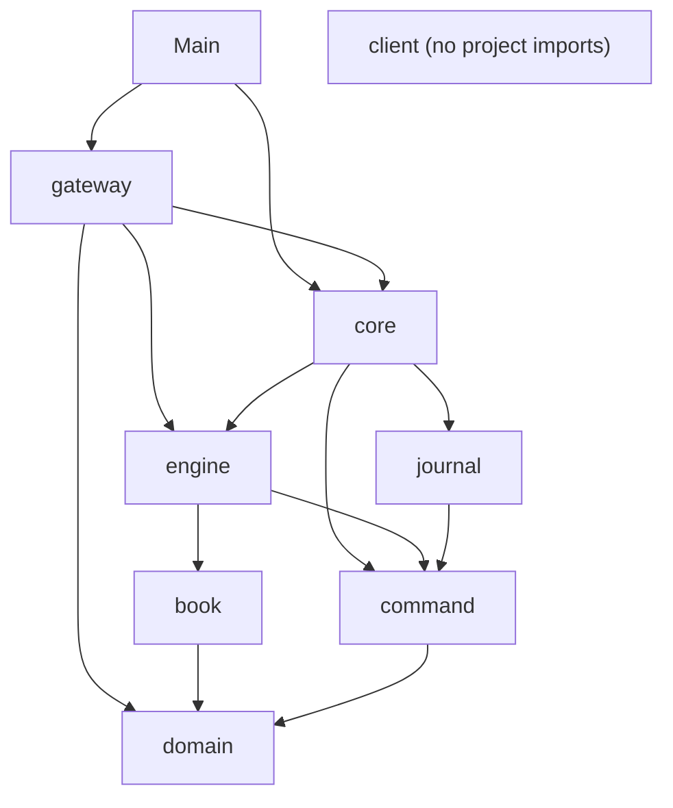

# 03 — Codebase Map

> **Project:** ExchangeServer2 | Single-instrument limit order book: price-time matching engine, write-ahead journal with replay, single writer thread, plain TCP gateway | Stack: Java 17, Maven wrapper, JUnit 5 (+ JMH, PIT)
> **This guide:** a guided tour of the directories, entry points, conventions, and a one-line purpose for every file; what is generated vs hand-written | **Prerequisites:** 01 | **Related:** 02, 04, 07-modules/*, 10, 13
> **Repo layout summary:** `pom.xml` + Maven wrapper (`mvnw`, `mvnw.cmd`) at the root; production code in `src/main/java/exchangeserver/` (packages `domain`, `book`, `engine`, `command`, `journal`, `core`, `gateway`, `client`, plus `Main`); tests mirror it in `src/test/java/exchangeserver/` (plus `bench/` JMH benchmarks and `testing/MutableClock`); design docs in `docs/` (`ExchangeServer2_Vision.md` = purpose/roadmap, `ExchangeServer2_Spec.md` = decisions D1–D65); these guides in `docs/understanding/`.

## Overview

The repository is a single Maven module. Size (**[Verified]**, `wc -l` on 2026-10-27, after the D63–D65 fixes):
45 production files (~3,800 lines) in 8 packages plus `Main`, and 19 test files (~4,100 lines, including 2
benchmarks and one test helper). There is one git commit, `b3091a8` "Initial Commit"; the fixes of 2026-10-27 are
uncommitted at the time of writing.

```
ExchangeServer2/
├── pom.xml                       build: Java 17, JUnit 5, profiles bench (JMH) and mutation (PIT)
├── mvnw, mvnw.cmd, .mvn/wrapper/  Maven Wrapper (downloads Maven 3.9.16)
├── README.md                     one-page intro, commands, a sample session
├── CLAUDE.md                     instructions for AI agents working in the repo (commands, architecture, rules)
├── .gitignore                    target/, *.journal, IDE files
├── docs/
│   ├── ExchangeServer2_Vision.md purpose, working style, principles, roadmap (roadmap lives only here)
│   ├── ExchangeServer2_Spec.md   exact code state, decisions D1–D65, journal format, measurements, open threads
│   └── understanding/            these study guides
└── src/
    ├── main/java/exchangeserver/
    │   ├── Main.java             process entry point (server / --quarantine tool)
    │   ├── domain/               orders and the rules
    │   ├── book/                 the order book data structure
    │   ├── engine/               matching logic and its outputs
    │   ├── command/              stamped commands + the Sequencer
    │   ├── journal/              the write-ahead log file
    │   ├── core/                 the live path, replay, the writer thread
    │   ├── gateway/              TCP server, sessions, wire protocol
    │   └── client/               a line client (tests + interactive console)
    └── test/java/exchangeserver/ one test class per production class, plus bench/ and testing/
```

Not in the repo (ignored, **[Verified]** `.gitignore`): `target/` (all build output), `*.journal` (runtime journals) and `*.journal.lock` (the empty lock file next to each
journal, D65).

## Entry points

| Entry point | How it is started | What it does |
|---|---|---|
| `exchangeserver.Main` | `java -jar target/exchange-server2-2.0.0-SNAPSHOT.jar [--port N] [--journal FILE]` | Binds the TCP port, opens and replays the journal, starts the writer thread and the gateway, waits; documented exit codes 0 clean, 1 startup failure, 2 halted (**[Verified]** as documented in `src/main/java/exchangeserver/Main.java:12-21`; 0 after Ctrl+C unverified, guide 15) |
| `exchangeserver.Main --quarantine <seq>` | `java -jar ... --journal FILE --quarantine 7` | Operator tool: appends `SKIP 7` to the journal, then exits (**[Verified]** `src/main/java/exchangeserver/Main.java:47-58`) |
| `exchangeserver.client.ClientMain` | `java -cp target/exchange-server2-2.0.0-SNAPSHOT.jar exchangeserver.client.ClientMain [host] [port]` | Interactive console: type protocol lines, see every server line prefixed with `< ` (**[Verified]** `src/main/java/exchangeserver/client/ClientMain.java:8-14`) |
| JMH benchmarks | `mvnw.cmd -Pbench verify -Djmh.args="MatchingBenchmark ..."` | `org.openjdk.jmh.Main` runs the `@Benchmark` methods in `src/test/java/exchangeserver/bench` (**[Verified]** `pom.xml:95-125`) |
| Tests | `mvnw.cmd test` | Surefire runs every JUnit 5 test except `bench/**` |

There is no other `main` method (**[Verified]** by search). For programmatic use (tests, tools), the API entry
points are `ExchangeService.start(...)` (multi-threaded service) and `Exchange.open(...)` (single-threaded core).

## How the packages layer

Dependencies flow one way, from the network inward (**[Verified]** from imports):



Reading tip: start at the bottom (`domain`, `book`) and work up; each layer only uses what is below it. `client`
talks to the server purely through the text protocol.

## Conventions you will see everywhere

1. **A block comment at the top of every class** explains its purpose, invariants, threading and the decisions it
   implements, e.g. `src/main/java/exchangeserver/book/OrderBook.java:18-34`. Method-level comments are short and
   explain *why*, not *what*. **[Verified]**
2. **Decision numbers in comments**: `(D44)`, `(D51)` refer to the decision table in `docs/ExchangeServer2_Spec.md`
   §3; `(step 4A)` and "roadmap step N" refer to the roadmap in Vision §7. Comments citing a "threads guide" (4.3,
   4.4, Lab 6) or "Spec v8"/"v3" refer to documents in the owner's **original project**
   (`Exchange Server/New Learnings/03_Threads_Visibility_and_Handoff.md`, `Exchange Server/src/docs/...`), not to
   this repo (**[Verified]** Spec §1.6).
3. **Visibility as an ownership tool**: mutators that only one class may call are package-private (`PriceLevel`'s
   `addOrder`, `fillHead`, `unlink`; `OrderNode` entirely), so the compiler, not convention, keeps other packages out
   (**[Verified]** Spec D44).
4. **Package-private test seams** instead of mocks: `core.CommandInterceptor` (inject a failure or block the writer),
   `OrderBook.checkInvariants()` and `ordersAt()`, `MatchingEngine.book()`, `Exchange.engine()`,
   `TcpGateway.participantsRegistered()`/`subscriberCount()`. Tests live in the same package to reach them.
   **[Verified]** `CLAUDE.md` ("Test seams").
5. **Records for values, final classes for everything else**; no inheritance hierarchies besides sealed interfaces.
6. **Dispatch over sealed types with `instanceof` chains ending in a `throw`** (Java 17 has no final pattern
   `switch`); **exhaustive `switch` expressions over enums** (guide 02, §1.4).
7. **Exceptions by meaning** (**[Verified]** Spec D27): `IllegalArgumentException` = bad input from outside;
   `IllegalStateException` = our own bug or a corrupt journal; `ExchangeException` with a `Reason` = a request got
   no business result (BUSY, STOPPED, HALTED, INTERNAL_ERROR).
8. **Explicit charsets** everywhere (`UTF_8` for the journal, `US_ASCII` for the wire).
9. **Tests: one test class per production class, `@Nested` groups per behaviour, every concurrent wait has a
   timeout**; test names are sentences (`duplicateIdThrowsAndChangesNothing`) (**[Verified]** `CLAUDE.md`).
10. **Getter style is mixed by kind**: classic `getX()` on the two domain classes (`Order`, `OrderRequest`) and
    `PriceLevel`; record-style `x()` on records and most other APIs (`lastTradePrice()`, `state()`).
    **[Inferred]** the domain classes kept the style of the original hand-written project.

## Every file, with its purpose

### Root and docs

| File | Purpose |
|---|---|
| `pom.xml` | Maven build: Java 17 release, UTF-8, `-Xlint:all`, JUnit BOM 5.11.4, JMH 1.37 (test scope), Surefire excluding `bench/**`, jar `Main-Class`, profiles `bench` and `mutation` |
| `mvnw`, `mvnw.cmd` | Maven Wrapper scripts (Unix / Windows), vendored from Apache; not hand-written |
| `.mvn/wrapper/maven-wrapper.properties` | Wrapper config: Maven 3.9.16 distribution URL |
| `.gitignore` | Ignores `target/`, `*.journal`, `*.journal.lock`, IDE and OS files |
| `README.md` | Short intro, build/run commands, a sample session, package table |
| `CLAUDE.md` | Agent instructions: commands, architecture across files, test rules, Windows environment notes |
| `docs/ExchangeServer2_Vision.md` | Purpose, working style, engineering principles, roadmap, non-goals, glossary |
| `docs/ExchangeServer2_Spec.md` | Current state per class, invariants, decisions D1–D65, journal format, benchmark and mutation results, open threads, review fixes (§9, §10) |
| `docs/understanding/*` | These study guides, `AI-TUTOR-PROMPT.md`, generated `FULL-CONTEXT.md` and its generator `build-full-context.java` |

### `src/main/java/exchangeserver/` (production)

| File | Lines | Purpose |
|---|---|---|
| `Main.java` | 92 | Parses `--port`, `--journal`, `--quarantine`; starts gateway + service; shutdown hook; exit codes 0/1/2 |
| **domain/** | | |
| `domain/Side.java` | 10 | `BUY`/`SELL`, `opposite()` |
| `domain/OrderType.java` | 23 | `LIMIT`, `IOC`, `FOK`, `MARKET`, `POST_ONLY`; `canRest()` true only for LIMIT and POST_ONLY |
| `domain/Rules.java` | 44 | Every rule replay depends on: `VERSION`, max quantity/price, name patterns, band percent, open-order cap, `withinBand` |
| `domain/OrderRequest.java` | 147 | A client's order before stamping; the only field-validation layer (D47); factories per type; price as `OptionalLong` |
| `domain/Order.java` | 110 | An accepted order: request + order id + timestamp; tracks filled quantity; `fill(q)` |
| **book/** | | |
| `book/OrderBook.java` | 239 | Bids/asks `TreeMap`s of levels, id → node map, per-participant open counts, changed-level set; `add`, `fillBest`, `cancel`, `drainLevelUpdates`; invariant checker for tests |
| `book/PriceLevel.java` | 157 | One price on one side: doubly linked list with sentinels, total volume, count; mutators package-private |
| `book/OrderNode.java` | 35 | Package-private list node (order, prev, next, level); sentinels only via `sentinel()` |
| `book/Fill.java` | 13 | Record: what `fillBest` did to one resting order (immutable copy) |
| `book/LevelUpdate.java` | 11 | Record: a level's state after a command (volume 0 = gone); level-2 market data |
| `book/CancelResult.java` | 25 | Record: `CANCELLED` with quantity, or `UNKNOWN_ORDER` |
| `book/CancelStatus.java` | 12 | Enum `CANCELLED`, `UNKNOWN_ORDER` (not owning = unknown, D48) |
| **engine/** | | |
| `engine/MatchingEngine.java` | 232 | Price-time matching: pre-checks (duplicate id, band, cap, FOK, post-only), matching loop, outcome switch, snapshot; deterministic |
| `engine/Response.java` | 54 | Record: what the submitter is told; constructor rejects contradictions (D22) |
| `engine/Trade.java` | 27 | Record: price, qty, buy/sell order ids, aggressor side, timestamp (= incoming command's) |
| `engine/Execution.java` | 13 | Record: a passive (maker) fill addressed to the resting order's owner |
| `engine/EngineOutput.java` | 25 | Sealed interface for everything one command produced |
| `engine/OrderOutput.java` | 22 | Output of a new order: response, passive fills, level updates |
| `engine/CancelOutput.java` | 27 | Output of a cancel: result, level updates |
| `engine/BookSnapshot.java` | 20 | Record: book as of a command (seq, last trade price, best-first levels) |
| `engine/OrderStatus.java` | 9 | `FILLED`, `RESTED`, `CANCELLED`, `REJECTED` |
| `engine/RejectReason.java` | 18 | The four state-dependent reject reasons |
| **command/** | | |
| `command/Command.java` | 16 | Sealed interface: a stamped, journalled input |
| `command/NewOrderCommand.java` | 21 | Record: seq, timestamp, order id, request |
| `command/CancelOrderCommand.java` | 24 | Record: seq, timestamp, participant, target order id |
| `command/SkipCommand.java` | 25 | Record: seq, timestamp, skipped seq (quarantine marker, D51) |
| `command/Sequencer.java` | 82 | The only clock reader and counter: stamps seq, order id, non-decreasing timestamp; `resume` after replay |
| **journal/** | | |
| `journal/JournalCodec.java` | 133 | Text format: `HEADER`/`NEW`/`CANCEL`/`SKIP` records, encode/decode |
| `journal/CommandJournal.java` | 326 | The write-ahead log: exclusive `<journal>.lock` file (D65), header check, torn-tail cut, `appendAll` (one write + fsync), streaming `read`, fail-stop |
| **core/** | | |
| `core/Exchange.java` | 245 | Single-threaded live path: stamp → journal → process; poison-pill quarantine + rebuild; `open` (replay), static `quarantine` tool |
| `core/Replay.java` | 90 | Two passes over the journal: verify, then feed the engine |
| `core/ExchangeService.java` | 320 | The writer thread, the queue, hand-in lock, states, batching, stop/halt |
| `core/Request.java` | 34 | Sealed: `Submit`, `Cancel`, `Snapshot` (what callers hand in, unstamped) |
| `core/Pending.java` | 36 | A request in flight with its own future; `command`, `refused` set by the writer |
| `core/ExchangeException.java` | 42 | Refusal/failure with `Reason`: BUSY, STOPPED, HALTED, INTERNAL_ERROR |
| `core/OutputListener.java` | 20 | Hook called with each command's output on the writer thread (the gateway implements it) |
| `core/CommandInterceptor.java` | 17 | Package-private test seam run before each engine step |
| **gateway/** | | |
| `gateway/TcpGateway.java` | 217 | Server socket + acceptor thread; session registry; `OutputListener` that routes maker fills and market data |
| `gateway/ClientSession.java` | 352 | One connection: reader thread (parse, validate, hand in), sender thread (bounded queue → socket), login, subscribe, close-after-replies (D63) |
| `gateway/Protocol.java` | 191 | The wire protocol: documentation, parser, line formatters, limits (256-byte lines, snapshot depth 100) |
| `gateway/ClientMessage.java` | 32 | Sealed: one parsed client line |
| `gateway/ProtocolException.java` | 11 | A malformed line (answered with `ERROR`) |
| **client/** | | |
| `client/ExchangeClient.java` | 151 | Minimal line client: background reader thread, `send`, `await(predicate, timeout)`, `field` parser |
| `client/ClientMain.java` | 51 | Interactive console client |

### `src/test/java/exchangeserver/` (tests and tools)

| File | Lines | What it covers |
|---|---|---|
| `domain/OrderRequestTest.java` | 140 | Factories, every validation rule, equality |
| `domain/OrderTest.java` | 95 | Construction, price for MARKET, fill/overfill |
| `domain/RulesTest.java` | 54 | Band edges and overflow, max price × quantity fits a long; also `Side.opposite`, `OrderType.canRest` |
| `book/PriceLevelTest.java` | 246 | Append, fillHead, unlink (head/middle/tail/only), sentinel and foreign-node guards |
| `book/OrderBookTest.java` | 299 | add/fillBest/cancel, open counts, level updates, read-only views, 3 × 10,000 random commands with `checkInvariants()` after each |
| `command/SequencerTest.java` | 171 | Stamping, invalid input uses no numbers, backwards clock, resume, command record validation |
| `engine/MatchingEngineTest.java` | 649 | Every order type, cancels, risk checks, outputs, snapshot, guards, determinism (2,000 random commands run twice) |
| `engine/ResponseTest.java` | 75 | `Response` consistency rules, `Trade` validation |
| `journal/JournalCodecTest.java` | 129 | Round trips, header, corrupt records |
| `journal/CommandJournalTest.java` | 327 | Header (incl. D64 refusals), append/read, recovery (torn tail), exclusive lock (D65, including a child JVM refused across processes), fail-stop |
| `core/ReplayTest.java` | 143 | Verify pass (gaps, repeats, backwards time), skips, `stopBefore`, feed alone |
| `core/ExchangeTest.java` | 377 | Live path, restart equality, torn tail, rules version, poison pills, quarantine tool (incl. D65) |
| `core/ExchangeServiceTest.java` | 553 | Hand-in from many threads, D61 future hand-off, stop/race, backpressure, halt, batching (with the `Gate` interceptor) |
| `gateway/ProtocolTest.java` | 133 | Parsing and formatting of every message |
| `gateway/ClientSessionTest.java` | 59 | `readLine` limits and line endings |
| `gateway/TcpGatewayTest.java` | 421 | End to end over real sockets: sessions, QUIT/EOF replies (D63), trading, market data, subscribe races, restart |
| `testing/MutableClock.java` | 44 | A `Clock` tests can set and move, even backwards |
| `bench/MatchingBenchmark.java` | 100 | JMH: best-level lookup, rest-and-take, add-and-cancel at 10 / 1,000 / 100,000 levels |
| `bench/BatchingBenchmark.java` | 93 | JMH: per-command vs linger vs smart batching, closed-loop clients |

Production classes **without** a test class of their own (**[Verified]** by comparing the trees): small records
and enums tested through their users (`Fill`, `LevelUpdate`, `CancelResult`, `Execution`, outputs, `OrderNode`,
command records, `Request`, `Pending`, `ExchangeException`, `ClientMessage`), plus `ExchangeClient`, `ClientMain`
and `Main`, which have no direct tests (`Main` is exercised only by hand). Guide 10 discusses the gaps.

## Generated vs hand-written

| Kind | Files |
|---|---|
| Hand-written (by the AI author, 2026-10-27) | everything under `src/`, `pom.xml`, `README.md`, `CLAUDE.md`, `docs/*.md` |
| Vendored | `mvnw`, `mvnw.cmd`, `.mvn/wrapper/maven-wrapper.properties` (Apache Maven Wrapper 3.3.2) |
| Generated at build time (in `target/`, ignored) | `target/classes`, `target/test-classes`, the JMH harness classes generated by the annotation processor, `target/exchange-server2-2.0.0-SNAPSHOT.jar`, `target/surefire-reports/`, `target/pit-reports/`, `target/bench/*.journal` |
| Generated by script | `docs/understanding/FULL-CONTEXT.md` (from the guides, by `docs/understanding/build-full-context.java`) |
| Runtime data | `*.journal` files (default `exchange.journal` in the working directory) and their empty `*.journal.lock` siblings (D65) |

## Key takeaways

- One Maven module, 8 packages + `Main`, ~3.8k production lines, ~4.1k test lines; no runtime dependencies.
- Packages layer inward: `gateway` → `core` → `engine`/`journal` → `book`/`command` → `domain`; `client` is
  independent.
- Entry points: `Main` (server, or `--quarantine` tool), `ClientMain` (console), JMH via `-Pbench`.
- Every class opens with a block comment; D-numbers point to the Spec; "threads guide" and "Spec v8" point to the
  original project.
- Package-private visibility enforces ownership and provides test seams; no mocking library.
- One test class per production class with `@Nested` groups; `Main`, `ClientMain`, `ExchangeClient` have no direct
  tests.
- Only `target/`, journals and `FULL-CONTEXT.md` are generated; the wrapper is vendored.

## Common confusions

- **`core.Exchange` vs `core.ExchangeService`.** `Exchange` is the single-threaded core (no threads, no queue; tests
  and tools call it directly). `ExchangeService` owns the writer thread and the queue and calls `Exchange.process`
  for each batch.
- **`domain.Order` vs `domain.OrderRequest` vs `command.NewOrderCommand`.** Request = validated client intent, not
  yet stamped. Command = request + sequence number + order id + timestamp (what is journalled). Order = the engine's
  mutable working object built from a command (what rests in the book).
- **`engine.Execution` vs `engine.Trade` vs `book.Fill`.** `Fill` is the book's report to the engine about one
  resting order; `Trade` is public (market data and the taker's response); `Execution` is the private maker fill sent
  to the resting order's owner.
- **`client` is not used by the server.** It is a test/interactive tool that happens to live in `src/main` so it
  ships in the jar.
- **`docs/` design docs vs `docs/understanding/`.** The first two are the project's own source of truth; these
  guides explain them and the code.

## Questions to test yourself

1. You want to change what a market order may trade at. Which package and file?
   <details><summary>Answer</summary>`engine/MatchingEngine.java` (`matchLimit`), plus `domain/Rules.java` if the
   band percentage changes (and then `Rules.VERSION` must be bumped).</details>
2. Why can't the engine call `PriceLevel.fillHead` directly?
   <details><summary>Answer</summary>It is package-private in `book`; the engine is in `engine`. It must call
   `OrderBook.fillBest`, which also removes an exhausted order and an emptied level, keeping the book invariants
   (D44).</details>
3. Which file documents the wire protocol, and where else is it summarised?
   <details><summary>Answer</summary>The block comment at the top of `gateway/Protocol.java`; the README shows a
   sample session.</details>
4. Name two test seams and what each lets a test do.
   <details><summary>Answer</summary>`CommandInterceptor` (throw to simulate an engine bug, or block the writer
   thread, e.g. the `Gate` in `ExchangeServiceTest`); `OrderBook.checkInvariants()` (re-derive every book invariant
   from scratch after each command).</details>
5. Which files would you never edit by hand?
   <details><summary>Answer</summary>Anything in `target/`, `docs/understanding/FULL-CONTEXT.md` (regenerate it),
   and normally the vendored wrapper scripts.</details>
