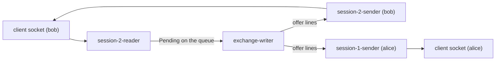
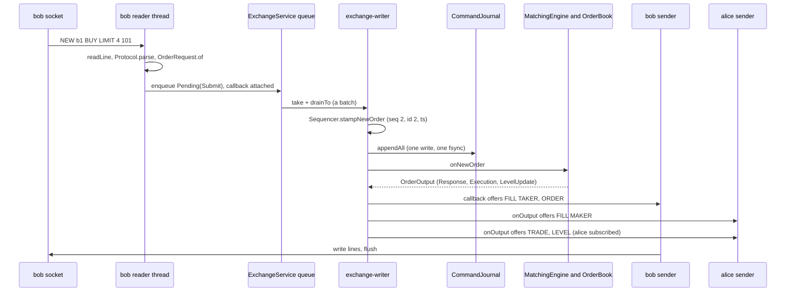
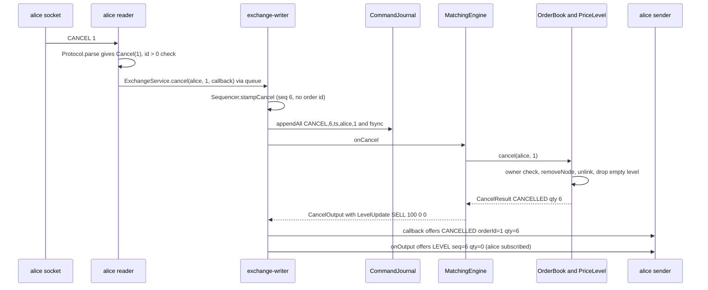
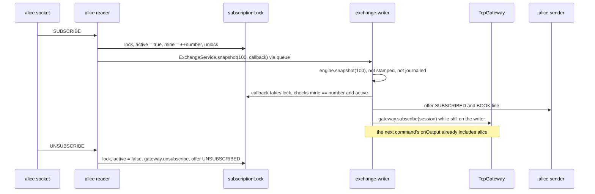

# 05a — Core flows, part 1: trading and market data

> **Project:** ExchangeServer2 | Single-instrument limit order book: price-time matching engine, write-ahead journal with replay, single writer thread, plain TCP gateway | Stack: Java 17, Maven wrapper, JUnit 5 (+ JMH, PIT)
> **This guide:** Step-by-step traces of flow 1 (a NEW order that trades, over TCP), flow 2 (CANCEL) and flow 3 (SUBSCRIBE / UNSUBSCRIBE market data), through every method, file and thread they touch, with the data shape at each step | **Prerequisites:** 01, 03 (helpful: 06) | **Related:** 05b, 06, 07-modules/gateway, 07-modules/exchange-service, 07-modules/engine, 07-modules/book, 07-modules/journal
> **Repo layout summary:** `pom.xml` + Maven wrapper (`mvnw`, `mvnw.cmd`) at the root; production code in `src/main/java/exchangeserver/` (packages `domain`, `book`, `engine`, `command`, `journal`, `core`, `gateway`, `client`, plus `Main`); tests mirror it in `src/test/java/exchangeserver/` (plus `bench/` JMH benchmarks and `testing/MutableClock`); design docs in `docs/` (`ExchangeServer2_Vision.md` = purpose/roadmap, `ExchangeServer2_Spec.md` = decisions D1–D65); these guides in `docs/understanding/`.

## Overview

This guide follows three requests from the moment a client types a line until the last byte leaves the server.
Read it with guide 06 (data and state) open if a type name is unfamiliar. Lifecycle flows (startup, crash recovery,
poison pills, shutdown, halts, backpressure, closing a connection) are in guide 05b.

Terms used throughout (all defined again in guide 13, the glossary):

- **Participant**: the trading identity a connection logs in as (`LOGIN alice`). No password: anyone can claim any
  name (a known, deferred security issue; guide 11).
- **Client order id (`clOrdId`)**: the client's own name for an order, unique per participant forever (Spec D49).
- **Order id**: the exchange's number for an order, issued by the sequencer, strictly increasing.
- **Sequence number (`seq`)**: the exchange's number for every journalled command (new orders *and* cancels).
- **Resting order / maker**: an order sitting on the book. **Aggressor / taker**: the incoming order that trades
  against it.
- **Writer thread** (`exchange-writer`): the one thread that owns the sequencer, journal, engine and book.
- **Journal**: the write-ahead log file; a command is written and fsynced before it is processed.

### The three threads a request crosses

Every TCP connection (a `ClientSession`) has two threads of its own: a **reader** that parses incoming lines, and a
**sender** that writes queued outgoing lines to the socket. Between them sits the exchange's single **writer**
thread. A request therefore makes three hops: *session reader → writer → session sender(s)*. No hop ever blocks
on another: the reader hands in through a queue, and the writer only *offers* lines to bounded per-session queues.
**[Verified]** `src/main/java/exchangeserver/gateway/ClientSession.java:24-36`,
`src/main/java/exchangeserver/core/ExchangeService.java:22-49`.



### The running example

All three flows use one real session captured while writing these guides (two raw TCP clients against the jar,
`--port 9137`). **[Verified]** (seen running):

```
alice > LOGIN alice                 alice < WELCOME participant=alice
bob   > LOGIN bob                   bob   < WELCOME participant=bob
alice > NEW a1 SELL LIMIT 10 100    alice < ORDER orderId=1 clOrdId=a1 status=RESTED filled=0 remaining=10
alice > SUBSCRIBE                   alice < SUBSCRIBED
                                    alice < BOOK seq=1 last=0 bids=- asks=100x10
bob   > NEW b1 BUY LIMIT 4 101      bob   < FILL orderId=2 clOrdId=b1 side=BUY price=100 qty=4 leaves=0 liquidity=TAKER
                                    bob   < ORDER orderId=2 clOrdId=b1 status=FILLED filled=4 remaining=0
                                    alice < FILL orderId=1 clOrdId=a1 side=SELL price=100 qty=4 leaves=6 liquidity=MAKER
                                    alice < TRADE seq=2 price=100 qty=4 aggressor=BUY
                                    alice < LEVEL seq=2 side=SELL price=100 qty=6 orders=1
bob   > NEW b1 BUY LIMIT 4 101      bob   < ORDER orderId=2 clOrdId=b1 status=REJECTED filled=0 remaining=4 reason=DUPLICATE_CLIENT_ORDER_ID
bob   > NEW b2 BUY LIMIT 1 200      bob   < ORDER orderId=4 clOrdId=b2 status=REJECTED filled=0 remaining=1 reason=PRICE_OUTSIDE_BAND
bob   > NEW b3 BUY MARKET 1 100     bob   < ERROR NEW takes 4 field(s), got 5
bob   > CANCEL 1                    bob   < CANCEL_REJECT orderId=1 reason=UNKNOWN_ORDER
alice > CANCEL 1                    alice < CANCELLED orderId=1 qty=6
                                    alice < LEVEL seq=6 side=SELL price=100 qty=0 orders=0
```

The journal file after that session (**[Verified]**, read from disk):

```
HEADER,2,1
NEW,1,2026-10-27T12:38:33.890909300Z,1,alice,a1,SELL,LIMIT,10,100
NEW,2,2026-10-27T12:38:34.862205500Z,2,bob,b1,BUY,LIMIT,4,101
NEW,3,2026-10-27T12:38:35.732225200Z,3,bob,b1,BUY,LIMIT,4,101
NEW,4,2026-10-27T12:38:36.154630600Z,4,bob,b2,BUY,LIMIT,1,200
CANCEL,5,2026-10-27T12:38:36.991832100Z,bob,1
CANCEL,6,2026-10-27T12:38:37.410921700Z,alice,1
```

Notice what is *not* there: the `MARKET 1 100` line (a syntax error at the gateway) and every `LOGIN`, `SUBSCRIBE`,
`PING`. Only commands that change, or could change, the book are journalled; the duplicate and the out-of-band
order *are* journalled, because whether they are rejected depends on state (Spec D13).

---

## Flow 1 — A NEW order that trades, over TCP

**Trigger:** bob's client sends the bytes `NEW b1 BUY LIMIT 4 101\n`. Book before: alice's order 1, SELL 10 @ 100,
resting. **Final effect:** a trade of 4 @ 100 is journalled-before-processed; bob hears FILL then ORDER; alice
hears her MAKER FILL; every subscriber hears TRADE then LEVEL.

### Sequence diagram



### Step by step

**Step 1 — bytes become a line (bob's reader thread).** The reader runs `readLoop`, which calls `readLine` in a
loop. `readLine` reads byte by byte, stops at `\n`, strips one trailing `\r`, and refuses anything longer than 256
bytes of content (`Protocol.MAX_LINE_LENGTH`) without buffering more than 257 bytes. **[Verified]**

```java
// src/main/java/exchangeserver/gateway/ClientSession.java:157-175 (trimmed)
static String readLine(InputStream in) throws IOException {
    ByteArrayOutputStream line = new ByteArrayOutputStream(64);
    int b;
    while ((b = in.read()) != -1) {
        if (b == '\n') {
            byte[] bytes = line.toByteArray();
            int length = bytes.length > 0 && bytes[bytes.length - 1] == '\r' ? bytes.length - 1 : bytes.length;
            if (length > Protocol.MAX_LINE_LENGTH) throw tooLong();
            return new String(bytes, 0, length, US_ASCII);
        }
        if (line.size() > Protocol.MAX_LINE_LENGTH) throw tooLong();
        line.write(b);
    }
    return null;            // a partial last line is dropped: it was never terminated
}
```

*Data shape:* `String "NEW b1 BUY LIMIT 4 101"`.

**Step 2 — syntax: the line becomes a `ClientMessage`.** `handle(line)` calls `Protocol.parse`, which splits on
single spaces (`split(" ", -1)`, so two spaces produce an empty token and an error) and switches on the first
token. `NEW` goes to `parseNew`, which parses the side and type as enum names (upper case only), then demands
exactly 6 tokens for priced types and exactly 5 for `MARKET`. **[Verified]**
`src/main/java/exchangeserver/gateway/ClientSession.java:182-189`,
`src/main/java/exchangeserver/gateway/Protocol.java:53-58`, `src/main/java/exchangeserver/gateway/Protocol.java:88-100`.

```java
// src/main/java/exchangeserver/gateway/Protocol.java:88-100 (trimmed)
private static ClientMessage parseNew(String[] t) {
    if (t.length < 5) throw new ProtocolException("NEW needs at least 4 fields");
    Side side = enumValue(Side.class, t[2], "side");
    OrderType type = enumValue(OrderType.class, t[3], "order type");
    if (type == OrderType.MARKET) {
        arity(t, 5);
        return new ClientMessage.NewOrder(t[1], side, type, number(t[4], "quantity"), OptionalLong.empty());
    }
    arity(t, 6);
    return new ClientMessage.NewOrder(t[1], side, type, number(t[4], "quantity"), OptionalLong.of(number(t[5], "price")));
}
```

A `ProtocolException` here is answered with `ERROR <text>` and the session carries on (that is how
`NEW b3 BUY MARKET 1 100` produced `ERROR NEW takes 4 field(s), got 5`). **[Verified]** (seen running;
`src/main/java/exchangeserver/gateway/ClientSession.java:184-189`).

*Data shape:* `ClientMessage.NewOrder(clientOrderId="b1", side=BUY, type=LIMIT, quantity=4, price=OptionalLong[101])`
— syntax only, no participant yet, no range checks.

**Step 3 — session checks.** `handle` answers `LOGIN`, `PING` and `QUIT` itself, then requires a logged-in
participant (`ERROR LOGIN first` otherwise), then dispatches `NewOrder` to `newOrder(p, n)`. **[Verified]**
`src/main/java/exchangeserver/gateway/ClientSession.java:191-209`. The `participant` field is `volatile` because the
reader writes it at LOGIN and the writer thread reads it while routing fills (`ClientSession.java:54-55`).

**Step 4 — stateless validation: `OrderRequest`.** `newOrder` builds the request with the general factory
`OrderRequest.of(...)`. This is the *only* field-validation layer in the system (Spec D47): participant and client
order id must match regular expressions, quantity must be 1..1,000,000,000, a priced order's price must be
1..`Rules.MAX_PRICE` (= `Long.MAX_VALUE / 1e9`, about 9.2e9, so price × quantity can never overflow), and a MARKET
order must have no price. A failure is answered on the reader thread and **never reaches the queue or the
journal**. **[Verified]** `src/main/java/exchangeserver/gateway/ClientSession.java:245-252`,
`src/main/java/exchangeserver/domain/OrderRequest.java:24-74`, `src/main/java/exchangeserver/domain/Rules.java:19-33`.

```java
// src/main/java/exchangeserver/gateway/ClientSession.java:245-263 (trimmed)
private void newOrder(String p, ClientMessage.NewOrder n) {
    OrderRequest request;
    try {
        request = OrderRequest.of(p, n.clientOrderId(), n.side(), n.type(), n.quantity(), n.price());
    } catch (IllegalArgumentException invalid) {
        send(Protocol.error("clOrdId=" + n.clientOrderId() + " " + invalid.getMessage()));
        return;
    }
    // Runs on the writer thread (or here, if refused): FILLs then ORDER, before this command's market data.
    gateway.service().submit(request, (Response response, Throwable failure) -> {
        if (failure != null) {
            send(failureLine("clOrdId=" + n.clientOrderId(), failure));
            return;
        }
        List<String> lines = new ArrayList<>(response.trades().size() + 1);
        Protocol.takerFills(response, n.side(), n.quantity(), lines);
        lines.add(Protocol.order(response));
        sendAll(lines);
    });
}
```

*Data shape:* `OrderRequest{participant="bob", clientOrderId="b1", side=BUY, orderType=LIMIT, quantity=4, price=101}`
(immutable; private constructor; `getPrice()` returns `OptionalLong`).

**Step 5 — hand-in: `ExchangeService.submit(request, callback)` (still on the reader thread).** The callback variant
wraps the request as `Request.Submit` inside a `Pending` (a request plus its own `CompletableFuture`), and calls
`enqueue`. `enqueue` attaches the callback to the future **before** queuing, then, under one lock, checks the
service state and the queue capacity and adds the request. **[Verified]**
`src/main/java/exchangeserver/core/ExchangeService.java:169-171`, `src/main/java/exchangeserver/core/ExchangeService.java:182-202`.

```java
// src/main/java/exchangeserver/core/ExchangeService.java:182-202 (trimmed)
private <R> CompletableFuture<R> enqueue(Pending<R> pending, BiConsumer<? super R, ? super Throwable> onDone) {
    if (onDone != null) {
        pending.result.whenComplete(onDone);
    }
    ExchangeException refusal = null;
    synchronized (lock) {
        if (state == State.HALTED)           refusal = new ExchangeException(HALTED, "exchange halted", haltCause);
        else if (state != State.RUNNING)     refusal = new ExchangeException(STOPPED, "exchange is stopping");
        else if (queue.size() >= settings.queueCapacity()) refusal = new ExchangeException(BUSY, "queue full");
        else                                 queue.add(pending);
    }
    if (refusal != null) {
        pending.fail(refusal);          // outside the lock: callbacks must not run while holding it
    }
    return pending.result;
}
```

Why attach first? `CompletableFuture.whenComplete` runs the callback on whichever thread completes the future. Attached
before the writer can see the request, the callback is guaranteed to run *on the writer thread, inside the
writer's processing of this command*; that is what makes the reply come out before the market data (step 12).
**[Verified]** comment `ExchangeService.java:166-168`. If the request is refused (BUSY, STOPPED, HALTED) the
callback runs right here on the reader thread and bob gets e.g. `ERROR clOrdId=b1 BUSY` (flow 6, guide 05b).

*Data shape:* `Pending{request=Request.Submit(OrderRequest), result=CompletableFuture<Response>, command=null, refused=false}`
in a `LinkedBlockingQueue<Pending<?>>`.

**Step 6 — the writer takes a batch.** The writer loops: block on `queue.take()` for one request, then
`drainTo` up to `maxBatchSize - 1` (999 by default) more that are *already* waiting, with no timer ("smart
batching", Spec D52). It removes the `STOP` marker if present (guide 05b), then calls `exchange.process(batch,
listener)`. **[Verified]** `src/main/java/exchangeserver/core/ExchangeService.java:246-265`.

```java
// src/main/java/exchangeserver/core/ExchangeService.java:251-264 (trimmed)
while (!stopping) {
    batch.clear();
    batch.add(queue.take());
    queue.drainTo(batch, settings.maxBatchSize() - 1);
    if (settings.lingerNanos() > 0) linger(batch);   // off by default; benchmark comparison only
    stopping = batch.remove(STOP);                     // always last: nothing is accepted after it
    if (!batch.isEmpty()) {
        exchange.process(batch, listener);
        batches++; processed += batch.size(); largestBatch = Math.max(largestBatch, batch.size());
    }
}
```

**Step 7 — stamping (writer thread).** `Exchange.process` first stamps every request in the batch with the
`Sequencer`, the *only* component that reads the clock or counts (Spec D32). A new order gets the next sequence
number, the next order id, and a timestamp that never goes backwards (if the clock steps back, the previous
timestamp is reused). A request whose stamping throws (an invalid cancel from a direct API caller, for example) is
marked `refused`, failed, and uses up no number. Snapshot reads are not stamped. **[Verified]**
`src/main/java/exchangeserver/core/Exchange.java:118-135`, `src/main/java/exchangeserver/command/Sequencer.java:48-52`,
`src/main/java/exchangeserver/command/Sequencer.java:74-81`.

```java
// src/main/java/exchangeserver/command/Sequencer.java:48-52
public NewOrderCommand stampNewOrder(OrderRequest request) {
    Objects.requireNonNull(request, "request");     // before stamping: a null must not use up numbers
    Instant timestamp = nextTimestamp();
    return new NewOrderCommand(nextSequenceNumber++, timestamp, nextOrderId++, request);
}
```

*Data shape:* `NewOrderCommand(sequenceNumber=2, timestamp=2026-10-27T12:38:34.862205500Z, orderId=2, request=OrderRequest)`,
stored in `Pending.command`.

**Step 8 — write-ahead: one write, one fsync for the whole batch.** `journal.appendAll(commands)` encodes every
command first (so an encoding bug writes nothing), writes the bytes, then calls `FileChannel.force(true)` — the
fsync that makes them durable. Only after it returns does anything get processed: "visible ⇒ durable" (Spec §4).
A failed write or fsync sets `failed = true` permanently ("fail-stop", D39) and propagates; the writer then halts
(guide 05b, flow 6). **[Verified]** `src/main/java/exchangeserver/core/Exchange.java:137`,
`src/main/java/exchangeserver/journal/CommandJournal.java:113-137`.

```java
// src/main/java/exchangeserver/journal/CommandJournal.java:113-137 (trimmed)
public void appendAll(List<? extends Command> commands) throws IOException {
    if (failed) throw new IllegalStateException("Journal failed earlier; restart to recover");
    if (commands.isEmpty()) return;
    StringBuilder sb = new StringBuilder(commands.size() * 96);
    for (Command command : commands) sb.append(JournalCodec.encode(command));
    ByteBuffer records = ByteBuffer.wrap(sb.toString().getBytes(UTF_8));
    try {
        while (records.hasRemaining()) channel.write(records);
        channel.force(true);
    } catch (IOException | RuntimeException e) {
        failed = true;      // a partial record may be on disk, and a failed fsync cannot be retried safely
        throw e;
    }
}
```

*Data shape:* the journal line `NEW,2,2026-10-27T12:38:34.862205500Z,2,bob,b1,BUY,LIMIT,4,101\n`
(`JournalCodec.encode`, `src/main/java/exchangeserver/journal/JournalCodec.java:68-98`).

**Step 9 — into the engine.** Back in `Exchange.process`, the second loop goes through the batch in order: skip
refused requests, answer snapshot reads, and for commands call the test-seam interceptor (a no-op in production)
then `apply`, which dispatches a `NewOrderCommand` to `MatchingEngine.onNewOrder`. **[Verified]**
`src/main/java/exchangeserver/core/Exchange.java:139-176`.

`onNewOrder` first guards determinism: the order id and sequence number must each be above the last one seen
(Spec D35), checked *before any mutation*. Then it builds the in-memory `Order` from the command and calls the
private `process`. **[Verified]** `src/main/java/exchangeserver/engine/MatchingEngine.java:61-75`.

```java
// src/main/java/exchangeserver/engine/MatchingEngine.java:61-75 (trimmed)
public OrderOutput onNewOrder(NewOrderCommand command) {
    if (command.orderId() <= lastOrderId) throw new IllegalStateException("Order id ... is not above the last one");
    checkSequence(command.sequenceNumber());
    lastOrderId = command.orderId();
    lastSequenceNumber = command.sequenceNumber();
    Order order = new Order(command.orderId(), command.request(), command.timestamp());
    List<Execution> passiveFills = new ArrayList<>();
    Response response = process(order, passiveFills);
    return new OrderOutput(command.sequenceNumber(), command.timestamp(), response, passiveFills,
            book.drainLevelUpdates());
}
```

*Data shape:* `Order{orderId=2, participant="bob", clientOrderId="b1", side=BUY, type=LIMIT, price=101,
originalQuantity=4, filledQuantity=0, timestamp=...}` — the only mutable field is `filledQuantity`
(`src/main/java/exchangeserver/domain/Order.java:16-45`).

**Step 10 — the engine's three phases.** `process` is written as (1) checks that change nothing, (2) the shared
matching loop, (3) an exhaustive `switch` over the order type (Spec D24). **[Verified]**
`src/main/java/exchangeserver/engine/MatchingEngine.java:106-173`.

*Phase 1, checks.* In order: duplicate client order id (the map entry is added even if a later check rejects —
"every new order uses up its id", D49); price band (a priced order must be within ±10% of the last trade price,
exact integer math, no band before the first trade, D50); open-order cap (LIMIT and POST_ONLY only, 10,000 resting
orders per participant); FOK fillability (walks the crossing levels without changing anything); POST_ONLY would
cross. For bob: no duplicate, no trade yet (no band), bob has 0 open orders, it is a LIMIT. **[Verified]**
`MatchingEngine.java:109-133`.

```java
// src/main/java/exchangeserver/engine/MatchingEngine.java:110-121 (trimmed)
Long original = orderIdByClientOrderId.putIfAbsent(
        new ClientOrderKey(order.getParticipant(), order.getClientOrderId()), order.getOrderId());
if (original != null) return rejected(original, order, RejectReason.DUPLICATE_CLIENT_ORDER_ID);
if (order.hasPrice() && lastTradePrice > 0 && !Rules.withinBand(order.getPrice(), lastTradePrice))
    return rejected(order.getOrderId(), order, RejectReason.PRICE_OUTSIDE_BAND);
if (order.getOrderType().canRest()
        && book.openOrders(order.getParticipant()) >= Rules.MAX_OPEN_ORDERS_PER_PARTICIPANT)
    return rejected(order.getOrderId(), order, RejectReason.MAX_OPEN_ORDERS);
```

*Phase 2, matching.* `matchLimit` gives the worst price the order may trade at (its own price for priced orders; a
collar around the last trade for MARKET). The loop asks the book for the best level on the *opposite* side; if it
crosses (a buy crosses an ask at or below its limit — the one definition, `crosses`, D28), it calls
`book.fillBest(restingSide, remaining)`, fills the incoming order by the same amount, records the last trade price,
and builds one `Trade` and one `Execution` (passive fill) per fill. **[Verified]** `MatchingEngine.java:135-151`,
`MatchingEngine.java:183-199`.

```java
// src/main/java/exchangeserver/engine/MatchingEngine.java:137-151 (trimmed)
while (order.getRemainingQuantity() > 0) {
    Optional<PriceLevel> best = book.bestLevel(restingSide);
    if (best.isEmpty() || !crosses(order.getSide(), limit, best.get().getPrice())) break;
    Fill fill = book.fillBest(restingSide, order.getRemainingQuantity());
    order.fill(fill.quantity());
    lastTradePrice = fill.price();
    long buyId  = order.getSide() == Side.BUY ? order.getOrderId() : fill.restingOrderId();
    long sellId = order.getSide() == Side.BUY ? fill.restingOrderId() : order.getOrderId();
    trades.add(new Trade(fill.price(), fill.quantity(), buyId, sellId, order.getSide(), order.getTimestamp()));
    passiveFills.add(new Execution(fill.participant(), fill.restingOrderId(), fill.clientOrderId(),
            restingSide, fill.price(), fill.quantity(), fill.leavesQuantity()));
}
```

Inside the book (package `book`, which the engine cannot reach into — every `PriceLevel` mutator is
package-private, D44): `fillBest` takes the best level from the `TreeMap` (`firstEntry()`, O(log L)), fills the
level's head order (time priority) via `PriceLevel.fillHead`, marks the level as changed for market data, and if
the head is exhausted removes it (and an emptied level) through the single removal path `removeNode`. It returns an
immutable `Fill` so the engine never holds the resting `Order`. **[Verified]**
`src/main/java/exchangeserver/book/OrderBook.java:77-94`, `src/main/java/exchangeserver/book/PriceLevel.java:96-113`.

```java
// src/main/java/exchangeserver/book/OrderBook.java:77-94 (trimmed)
public Fill fillBest(Side side, long maxQuantity) {
    Map.Entry<Long, PriceLevel> best = sideOf(side).firstEntry();
    if (best == null) throw new IllegalStateException("Fill on empty side " + side);
    PriceLevel level = best.getValue();
    OrderNode head = level.headNode();
    Order order = head.order;
    long quantity = level.fillHead(maxQuantity);
    changed.add(new LevelKey(side, level.getPrice()));
    if (order.getRemainingQuantity() == 0) removeNode(head);
    return new Fill(order.getOrderId(), order.getParticipant(), order.getClientOrderId(), side,
            level.getPrice(), quantity, order.getRemainingQuantity());
}
```

For bob: best ask is level 100 (alice's order 1, 10 remaining); `crosses(BUY, 101, 100)` is true; `fillBest(SELL, 4)`
fills 4, leaving alice 6, so her order stays. *Data shapes:*
`Fill(restingOrderId=1, participant="alice", clientOrderId="a1", restingSide=SELL, price=100, quantity=4, leavesQuantity=6)`,
`Trade(price=100, quantity=4, buyOrderId=2, sellOrderId=1, aggressorSide=BUY, timestamp=<bob's command ts>)`,
`Execution(participant="alice", orderId=1, clientOrderId="a1", side=SELL, price=100, quantity=4, leavesQuantity=6)`.
The trade price is always the resting price, and its timestamp is the incoming command's (never a clock read:
replay must reproduce it, D34). **[Verified]** `src/main/java/exchangeserver/engine/Trade.java:8-15`.

*Phase 3, outcome.* With 0 remaining, a LIMIT is `FILLED` (with some remaining it would `book.add` the remainder
and be `RESTED`; IOC/MARKET remainders are `CANCELLED`). The `Response` constructor re-checks consistency
(filled = sum of trades, a reason only with REJECTED, FILLED means nothing remains…; D22). **[Verified]**
`MatchingEngine.java:153-172`, `src/main/java/exchangeserver/engine/Response.java:18-53`.

*Data shape:* `Response(orderId=2, clientOrderId="b1", status=FILLED, rejectReason=null, filledQuantity=4,
remainingQuantity=0, trades=[Trade])`.

**Step 11 — level updates drained.** `onNewOrder` finishes with `book.drainLevelUpdates()`: for every level touched
since the last drain, in the order first touched (a `LinkedHashSet`, so deterministic), its *current absolute*
volume and order count, or 0/0 if the level is gone. **[Verified]** `src/main/java/exchangeserver/book/OrderBook.java:130-143`.

*Data shape:* `OrderOutput(sequenceNumber=2, timestamp, response, passiveFills=[Execution], levelUpdates=[LevelUpdate(SELL, 100, 6, 1)])`.

**Step 12 — the reply goes out first (writer thread).** `Exchange.process` completes this request's future with
the `Response`. Completing the future synchronously runs the callback attached in step 5, *on the writer thread*:
it formats bob's taker fills (leaves counting down trade by trade) and the ORDER line and offers them to bob's
outbound queue. Only **then** does `process` call the output listener. **[Verified]**
`src/main/java/exchangeserver/core/Exchange.java:159-164`, `src/main/java/exchangeserver/gateway/Protocol.java:131-152`.

```java
// src/main/java/exchangeserver/core/Exchange.java:159-164
p.complete(output instanceof OrderOutput o ? o.response() : ((CancelOutput) output).result());
try {
    listener.onOutput(output);
} catch (RuntimeException listenerBug) {
    LOG.log(Level.ERROR, "Output listener failed on command " + output.sequenceNumber(), listenerBug);
}
```

*Data shape:* bob's outbound queue gets
`FILL orderId=2 clOrdId=b1 side=BUY price=100 qty=4 leaves=0 liquidity=TAKER` then
`ORDER orderId=2 clOrdId=b1 status=FILLED filled=4 remaining=0`.

`send` never blocks: it `offer`s to a bounded `ArrayBlockingQueue` (10,000 lines by default) and, if the queue is
full, disconnects that client rather than stall the exchange (D54). **[Verified]**
`src/main/java/exchangeserver/gateway/ClientSession.java:77-86`.

**Step 13 — passive fills and market data (writer thread, `TcpGateway.onOutput`).** The gateway is the
`OutputListener`. It routes each `Execution` to *every* session logged in as the resting order's participant (a
`MAKER` FILL), then, if anyone is subscribed and there is public data, formats TRADE lines then LEVEL lines tagged
with the command's sequence number and offers them to every subscriber. A fill for a participant with no open
session is simply not delivered (no resend; Spec §8). **[Verified]**
`src/main/java/exchangeserver/gateway/TcpGateway.java:183-207`.

```java
// src/main/java/exchangeserver/gateway/TcpGateway.java:183-207 (trimmed)
public void onOutput(EngineOutput output) {
    for (Execution e : output.passiveFills()) {
        Set<ClientSession> owners = sessionsByParticipant.get(e.participant());
        if (owners != null) {
            String line = Protocol.makerFill(e);
            for (ClientSession s : owners) s.send(line);
        }
    }
    if (subscribers.isEmpty() || (output.trades().isEmpty() && output.levelUpdates().isEmpty())) return;
    List<String> lines = new ArrayList<>(...);
    for (Trade t : output.trades())             lines.add(Protocol.trade(output.sequenceNumber(), t));
    for (LevelUpdate l : output.levelUpdates()) lines.add(Protocol.level(output.sequenceNumber(), l));
    for (ClientSession s : subscribers)         s.sendAll(lines);
}
```

*Data shape:* alice's queue gets `FILL ... liquidity=MAKER`, `TRADE seq=2 price=100 qty=4 aggressor=BUY`,
`LEVEL seq=2 side=SELL price=100 qty=6 orders=1`.

**Step 14 — the senders write.** Each session's sender thread blocks on `outbound.take()`, writes each line plus
`\n`, and flushes only when its queue is momentarily empty (one flush per burst). **[Verified]**
`src/main/java/exchangeserver/gateway/ClientSession.java:323-343`.

**Step 15 — writer bookkeeping.** After `process` returns, the writer updates `batches`, `processed` and
`largestBatch` — *after* the futures were completed, so a caller holding a result may still see old stats (this is
what made one test flaky; fixed by reading stats only after `stop()`; Spec §10). **[Verified]**
`src/main/java/exchangeserver/core/ExchangeService.java:101-106`, `ExchangeService.java:259-263`.

### Why the ORDER reply precedes the maker FILL, TRADE and LEVEL

Two facts combine. (1) The callback was attached to the future before the request was queued, so completing the
future runs it immediately on the writer thread. (2) `Exchange.process` completes the future *before* it calls
`listener.onOutput`. So for any one command, its reply lines are offered before its market data. **[Verified]**
`ExchangeService.java:166-171`, `Exchange.java:159-161`; also tested by
`ExchangeServiceTest.callbackRunsOnTheWriterBeforeTheListener` and `TcpGatewayTest.takerHearsFillsBeforeTheOrderOutcome`.

What this does **not** promise **[Inferred]**: an order between lines on *different* sockets. Bob's sender and
alice's sender are independent threads; alice may well read her MAKER FILL before bob reads his ORDER. Ordering is
per session only.

### Variations of flow 1 (same path, different exit)

| Input | Where it exits | Journalled? | What the client sees |
|---|---|---|---|
| Malformed line (`NEW c1 BUY LIMIT ten 100`) | `Protocol.parse`, step 2 | No | `ERROR bad quantity: ten` |
| Not logged in | `handle`, step 3 | No | `ERROR LOGIN first` |
| Invalid field (quantity 0, bad clOrdId) | `OrderRequest`, step 4 | No | `ERROR clOrdId=… Quantity must be positive` |
| Queue full / stopping / halted | `enqueue`, step 5 | No | `ERROR clOrdId=… BUSY` (or `STOPPED`, `HALTED`) |
| Duplicate clOrdId (bob's second `b1`) | engine phase 1 | **Yes** (seq 3, id 3 used up) | `ORDER orderId=2 … REJECTED … reason=DUPLICATE_CLIENT_ORDER_ID` — the **original** id |
| Outside the ±10% band (`b2` @ 200 vs last 100) | engine phase 1 | **Yes** (seq 4, id 4) | `ORDER orderId=4 … REJECTED … reason=PRICE_OUTSIDE_BAND` |
| FOK that cannot fully fill | engine phase 1 | Yes | `ORDER … status=CANCELLED filled=0 remaining=<qty>` |
| POST_ONLY that would cross (equal price counts) | engine phase 1 | Yes | `ORDER … REJECTED … reason=POST_ONLY_WOULD_CROSS` |
| Engine throws a `RuntimeException` (a bug) | `Exchange.process` catch | Yes, plus a `SKIP` | `ERROR clOrdId=… INTERNAL_ERROR` (guide 05b, flow 5) |

All rows **[Verified]**: the first five and the duplicate/band rows were seen running; the others from
`MatchingEngine.java:109-133` and `Exchange.java:149-158`.

---

## Flow 2 — CANCEL

**Trigger:** a logged-in client sends `CANCEL <orderId>`. Two real cases from the example: bob sends `CANCEL 1`
(alice's order — refused), then alice sends `CANCEL 1` (her order, 6 left — cancelled, and its level disappears).

### Sequence diagram



### Step by step

**Step 1 — parse.** `CANCEL` takes exactly one numeric field: `ClientMessage.Cancel(orderId=1)`. **[Verified]**
`src/main/java/exchangeserver/gateway/Protocol.java:53-70` (the `CANCEL` case).

**Step 2 — session check and hand-in (reader thread).** The session rejects a non-positive id itself (otherwise the
writer would refuse it at stamping), then calls the callback variant `service.cancel(participant, orderId,
callback)`. Note the participant comes from the *session*, not the line: a client can only cancel as itself.
**[Verified]** `src/main/java/exchangeserver/gateway/ClientSession.java:210-216`.

```java
// src/main/java/exchangeserver/gateway/ClientSession.java:210-216
} else if (message instanceof ClientMessage.Cancel c) {
    if (c.orderId() <= 0) {
        send(Protocol.error("order id must be positive"));
    } else {
        gateway.service().cancel(p, c.orderId(), (result, failure) ->
                send(failure == null ? Protocol.cancel(result) : failureLine("orderId=" + c.orderId(), failure)));
    }
}
```

*Data shape:* `Pending{request=Request.Cancel(participant="alice", orderId=1)}` → `enqueue` exactly as in flow 1,
step 5 (`ExchangeService.java:173-175`).

**Step 3 — stamp.** `stampCancel` builds the record *before* incrementing the counter, so an invalid cancel uses up
no sequence number; a cancel never gets an order id of its own (its `orderId` field is the *target*). **[Verified]**
`src/main/java/exchangeserver/command/Sequencer.java:54-58`, `src/main/java/exchangeserver/command/CancelOrderCommand.java:8-23`.

*Data shape:* `CancelOrderCommand(sequenceNumber=6, timestamp, participant="alice", orderId=1)`.

**Step 4 — journal.** Same `appendAll` as flow 1: line `CANCEL,6,2026-10-27T12:38:37.410921700Z,alice,1`. Bob's
failed attempt was journalled too (`CANCEL,5,…,bob,1`): whether a cancel succeeds depends on state, so replay must
see it. **[Verified]** (journal read from disk).

**Step 5 — engine.** `onCancel` checks the sequence number, records it, and delegates entirely to the book.
**[Verified]** `src/main/java/exchangeserver/engine/MatchingEngine.java:77-83`.

```java
// src/main/java/exchangeserver/engine/MatchingEngine.java:77-83
public CancelOutput onCancel(CancelOrderCommand command) {
    checkSequence(command.sequenceNumber());
    lastSequenceNumber = command.sequenceNumber();
    CancelResult result = book.cancel(command.participant(), command.orderId());
    return new CancelOutput(command.sequenceNumber(), command.timestamp(), result, book.drainLevelUpdates());
}
```

**Step 6 — the book: ownership, O(1) removal, level cleanup.** `OrderBook.cancel` looks the id up in the
`orderId → OrderNode` map (O(1)). If there is no node *or the caller does not own it*, the answer is
`UNKNOWN_ORDER` — deliberately indistinguishable, so a participant cannot probe which ids are live (D48). Otherwise
it records the remaining quantity, marks the level changed, and calls `removeNode`, the single removal path shared
with fill-removal (D2). **[Verified]** `src/main/java/exchangeserver/book/OrderBook.java:97-127`.

```java
// src/main/java/exchangeserver/book/OrderBook.java:97-127 (trimmed)
public CancelResult cancel(String participant, long orderId) {
    OrderNode node = orders.get(orderId);
    if (node == null || !node.order.getParticipant().equals(participant)) {
        return CancelResult.unknown(orderId);
    }
    long remaining = node.order.getRemainingQuantity();
    changed.add(new LevelKey(node.order.getSide(), node.order.getPrice()));
    removeNode(node);
    return CancelResult.cancelled(orderId, remaining);
}

private void removeNode(OrderNode node) {
    Order order = node.order;
    PriceLevel level = node.level;
    if (level == null || orders.get(order.getOrderId()) != node) throw new IllegalStateException("... is not resting");
    level.unlink(node);
    orders.remove(order.getOrderId());
    openOrders.computeIfPresent(order.getParticipant(), (p, n) -> n == 1 ? null : n - 1);
    if (level.isEmpty()) {
        PriceLevel removed = sideOf(level.getSide()).remove(level.getPrice());
        if (removed != level) throw new IllegalStateException("Removed the wrong level at ...");   // D18
    }
}
```

`PriceLevel.unlink` splices the node out of the doubly linked list in O(1) (the sentinels mean no edge-case
branches), subtracts the node's *remaining* quantity from the level's total (0 for a fully filled order, which
`fillHead` already subtracted), decrements the count, and nulls the node's links. **[Verified]**
`src/main/java/exchangeserver/book/PriceLevel.java:116-134`.

For alice: the 100 level held only her order, so it becomes empty and is removed from the `asks` `TreeMap` at once
("eager removal", D10). For bob: the owner check fails → `UNKNOWN_ORDER`, nothing marked changed, so no level update.

*Data shapes:* `CancelResult(status=CANCELLED, orderId=1, cancelledQuantity=6)` and
`CancelOutput(sequenceNumber=6, timestamp, result, levelUpdates=[LevelUpdate(SELL, 100, 0, 0)])`; for bob,
`CancelResult(UNKNOWN_ORDER, 1, 0)` with an empty level-update list.

**Step 7 — reply, then market data.** As in flow 1: the callback (on the writer) offers `CANCELLED orderId=1 qty=6`
(or `CANCEL_REJECT orderId=1 reason=UNKNOWN_ORDER`), then `onOutput` sends subscribers `LEVEL seq=6 side=SELL
price=100 qty=0 orders=0`; `qty=0` means "level gone". A cancel produces no trades and no passive fills
(`CancelOutput.trades()` and `passiveFills()` return empty lists). **[Verified]**
`src/main/java/exchangeserver/gateway/Protocol.java:154-158`, `src/main/java/exchangeserver/engine/CancelOutput.java:18-26`,
and the live transcript.

### Points worth noticing

- A cancel that loses a race with a fill (the order filled while the cancel was queued) is a *normal* outcome:
  `UNKNOWN_ORDER`, not an exception (D17). **[Verified]** `src/main/java/exchangeserver/book/CancelResult.java:5`.
- A cancel only affects the book through `OrderBook`; the engine never touches a `PriceLevel` mutator (the compiler
  forbids it: they are package-private). **[Verified]** `PriceLevel.java:17-18`.
- Disconnecting does **not** cancel resting orders (no cancel-on-disconnect). **[Verified]** Spec §6; no cancel call
  exists on any close path in `ClientSession`/`TcpGateway`.

---

## Flow 3 — SUBSCRIBE and UNSUBSCRIBE (market data)

**Trigger:** a logged-in client sends `SUBSCRIBE`. **Final effect:** it receives `SUBSCRIBED`, one `BOOK` snapshot
(best 100 levels per side), then every later TRADE / LEVEL line, with no gap and no duplicate between the snapshot
and the first update. `UNSUBSCRIBE` stops the updates.

The core problem **[Inferred, confirmed by Spec D57]**: the book lives on the writer thread. If a session read the
book from its own thread it would be a data race, and if it took a snapshot and *then* registered for updates,
an update could slip in between (a gap) or be counted twice. The fix is to do both in **one writer-thread step**.

### Sequence diagram



### Step by step

**Step 1 — claim the subscription (reader thread).** `subscribe()` takes the session's `subscriptionLock`; if a
subscription is already active it answers `ERROR already subscribed`; otherwise it sets `subscriptionActive = true`
and takes a new number `mine = ++subscriptionNumber`. **[Verified]**
`src/main/java/exchangeserver/gateway/ClientSession.java:276-285`.

**Step 2 — a read through the queue.** It calls `service.snapshot(Protocol.SNAPSHOT_DEPTH, callback)`. The depth is
checked on the caller's thread when `Request.Snapshot` is constructed, so a bad read can never reach, and halt, the
writer. The request goes through the same queue as orders, so it sees exactly the state after every earlier request
and before every later one. **[Verified]** `ClientSession.java:288`, `src/main/java/exchangeserver/core/Request.java:24-33`,
`src/main/java/exchangeserver/gateway/Protocol.java:45-48`.

**Step 3 — the writer answers the read.** In `Exchange.process`, a snapshot is never stamped (no `command`) and so
never journalled; in the processing loop it is answered directly from the engine and the listener is **not**
called for it. **[Verified]** `src/main/java/exchangeserver/core/Exchange.java:120-135`, `Exchange.java:145-148`.

```java
// src/main/java/exchangeserver/core/Exchange.java:145-148
if (p.request instanceof Request.Snapshot s) {
    p.complete(engine.snapshot(s.depth()));
    continue;
}
```

`MatchingEngine.snapshot(depth)` copies up to `depth` levels per side, best first, plus the last processed sequence
number and the last trade price. **[Verified]** `src/main/java/exchangeserver/engine/MatchingEngine.java:86-91`,
`MatchingEngine.java:222-231`.

*Data shape:* `BookSnapshot(sequenceNumber=1, lastTradePrice=0, bids=[], asks=[LevelUpdate(SELL, 100, 10, 1)])`.

**Step 4 — the callback, on the writer thread, under the lock.** It acts only if this is still the current
subscription (`mine == subscriptionNumber && subscriptionActive`). On a refusal it clears the claim and sends an
ERROR. Otherwise it offers `SUBSCRIBED` and the BOOK line and adds the session to the gateway's subscriber set —
all while the writer is still between commands, so the next command's `onOutput` (same thread, later) includes
this session. If the session closed meanwhile, it removes itself again. **[Verified]** `ClientSession.java:288-305`.

```java
// src/main/java/exchangeserver/gateway/ClientSession.java:288-305 (trimmed)
gateway.service().snapshot(Protocol.SNAPSHOT_DEPTH, (snapshot, failure) -> {
    synchronized (subscriptionLock) {
        if (mine != subscriptionNumber || !subscriptionActive) return;   // withdrawn by an UNSUBSCRIBE that got here first
        if (failure != null) { subscriptionActive = false; send(failureLine("SUBSCRIBE", failure)); return; }
        send("SUBSCRIBED");
        send(Protocol.book(snapshot));
        gateway.subscribe(this);
    }
    if (closed.get()) gateway.unsubscribe(this);          // closed meanwhile: removed() may already have run
});
```

*Data shape on the wire:* `SUBSCRIBED`, then `BOOK seq=1 last=0 bids=- asks=100x10` (`-` for an empty side;
`price x volume` per level, comma-separated). **[Verified]** live transcript; `Protocol.java:160-177`.

**Step 5 — updates.** From now on every command with public effects produces TRADE/LEVEL lines via
`TcpGateway.onOutput` (flow 1, step 13). LEVEL carries the *absolute* quantity at that price after the command, so a
subscriber can simply overwrite its copy; a level deeper than the 100 in the snapshot appears the first time it
changes (D62). Sequence numbers on market data are the *command* sequence numbers, so gaps are normal (a rejected
order or an UNKNOWN_ORDER cancel has no public effect). **[Verified]** Spec D62, Spec §8 "Gateway".

**Step 6 — UNSUBSCRIBE (reader thread).** Under the same lock: clear the claim, leave the subscriber set, offer
`UNSUBSCRIBED`. **[Verified]** `ClientSession.java:308-314`.

### The two races the lock and the number handle

All three actions (SUBSCRIBE claim, snapshot callback, UNSUBSCRIBE) take `subscriptionLock`, so each happens
entirely before or after the others. **[Verified]** comment `ClientSession.java:266-275`; regression test
`TcpGatewayTest.rapidSubscribeUnsubscribeEndsConsistent` (Spec §9 finding 3).

1. **UNSUBSCRIBE overtakes the snapshot.** SUBSCRIBE claims, the read is queued, UNSUBSCRIBE runs (claim cleared,
   `UNSUBSCRIBED` sent), then the callback runs, sees `!subscriptionActive`, and does nothing. The client's last
   word is `UNSUBSCRIBED`, matching reality.
2. **SUBSCRIBE, UNSUBSCRIBE, SUBSCRIBE in quick succession.** Two reads are queued, with numbers 1 and 2. Callback 1
   sees `mine (1) != subscriptionNumber (2)` and does nothing; callback 2 acts. One BOOK goes out, not two.

The lock is held only while *offering* to the non-blocking outbound queue, so the writer is never delayed by it.
**[Verified]** `ClientSession.java:274`.

### Cost bound

SUBSCRIBE costs the writer a snapshot of at most 100 levels per side, whatever the book depth; before review fix 7
it copied the whole book on the writer thread. **[Verified]** Spec D62, `TcpGatewayTest.snapshotIsBoundedToTheSnapshotDepth`.

---

## Key takeaways

- Every request crosses three threads: session reader (parse + stateless checks) → `exchange-writer` (stamp,
  journal, match) → session sender(s) (socket writes). Only the writer touches the book.
- Bad syntax and bad fields are answered at the gateway and never journalled; state-dependent rejects
  (duplicate clOrdId, band, open-order cap, post-only cross) *are* journalled so replay reproduces them.
- Write-ahead: a whole batch is stamped, written and fsynced once before any command in it is processed.
- The engine decides (checks → shared matching loop → outcome switch); the book carries it out through
  `add` / `fillBest` / `cancel`, and returns immutable `Fill`, `CancelResult`, `LevelUpdate` values.
- The reply callback is attached before queuing, so it runs on the writer before `onOutput`: FILL(TAKER) and ORDER
  precede the same command's MAKER FILL, TRADE and LEVEL — per session, not across sessions.
- Cancels are owner-only; someone else's order looks exactly like a missing one (`UNKNOWN_ORDER`).
- An emptied price level is removed in the same step; a LEVEL with `qty=0` tells subscribers it is gone.
- SUBSCRIBE is a read through the queue, and joining the subscriber set happens in the same writer step as the
  snapshot: no gap, no duplicate.

## Common confusions

- **"orderId in a DUPLICATE reject is the new order's id."** No: it is the *original* order's id (bob's second
  `b1` got `orderId=2`), so a client that lost a reply learns which order it actually has. The new command still
  used up id 3, so the next order got 4.
- **"A cancel gets an order id."** No: cancels use up a sequence number only; `CancelOrderCommand.orderId` is the
  target.
- **"Market data sequence numbers should be contiguous."** They are command numbers; commands without public
  effects leave gaps.
- **"The LEVEL line is a delta."** It is the absolute quantity and order count at that price after the command.
- **"FILL leaves= for the taker is what remains on the book."** For the taker it is the order's remaining quantity
  after that trade; for an IOC it can be > 0 and then the ORDER line says CANCELLED.
- **"SUBSCRIBE reads the book from the session thread."** It never does; that would be a data race.

## Questions to test yourself

1. A client sends `NEW x BUY LIMIT 0 100`. Which class refuses it, on which thread, and is a sequence number used?
<details><summary>Answer</summary>`OrderRequest` (quantity must be positive), on the session's reader thread inside `ClientSession.newOrder`; the client gets `ERROR clOrdId=x Quantity must be positive`. Nothing is queued or journalled, so no sequence number or order id is used.</details>

2. Bob's order trades with alice's. Can alice's client receive her MAKER FILL before bob's client receives his ORDER line?
<details><summary>Answer</summary>Yes. The reply is offered to bob's queue before alice's lines are offered to hers, but the two sessions have independent sender threads and sockets. The ordering guarantee is per session.</details>

3. Why does `ExchangeService.enqueue` attach the callback before adding the request to the queue?
<details><summary>Answer</summary>So the callback is guaranteed to run on the writer thread when the writer completes the future, which happens inside `Exchange.process` before `listener.onOutput`. Attached later, it might run on the caller's thread after the market data had been sent.</details>

4. Bob sends `CANCEL 1` for alice's order. What is journalled, and what does each client see?
<details><summary>Answer</summary>`CANCEL,<seq>,<ts>,bob,1` is journalled. Bob sees `CANCEL_REJECT orderId=1 reason=UNKNOWN_ORDER`. Alice sees nothing: the book did not change, so there is no LEVEL line.</details>

5. Alice cancels the last order at ask 100. Name the method that removes the price level, and what subscribers see.
<details><summary>Answer</summary>`OrderBook.removeNode` removes it from the `asks` TreeMap (after `PriceLevel.unlink` leaves it empty). Subscribers get `LEVEL seq=<n> side=SELL price=100 qty=0 orders=0`.</details>

6. A client sends SUBSCRIBE, UNSUBSCRIBE, SUBSCRIBE very fast. How many BOOK lines does it get and why?
<details><summary>Answer</summary>One. Each SUBSCRIBE takes a new number under `subscriptionLock`; the first snapshot callback sees that its number is no longer the current one and does nothing; only the second acts.</details>

7. Is a SUBSCRIBE snapshot written to the journal? Does the output listener hear about it?
<details><summary>Answer</summary>Neither. Snapshots are never stamped (`Exchange.process` only stamps Submit and Cancel), so they are not journalled, and the processing loop `continue`s before the listener call.</details>
