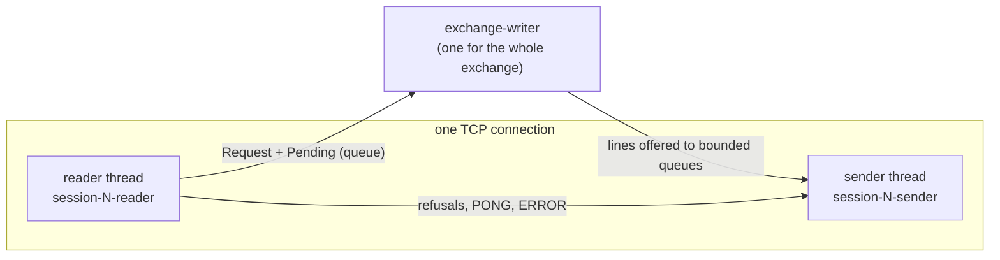
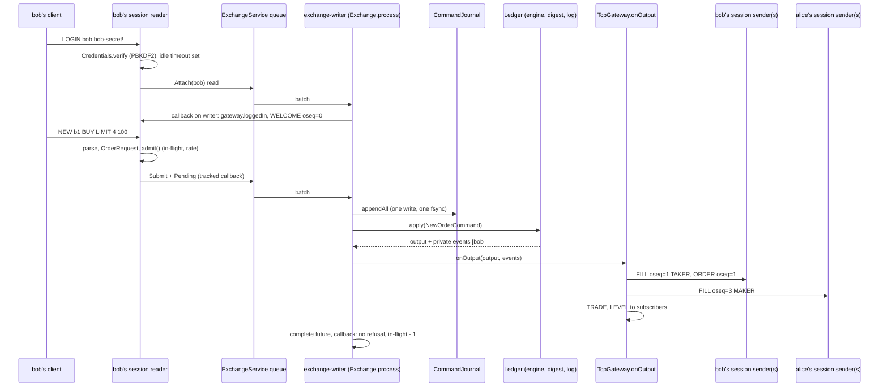
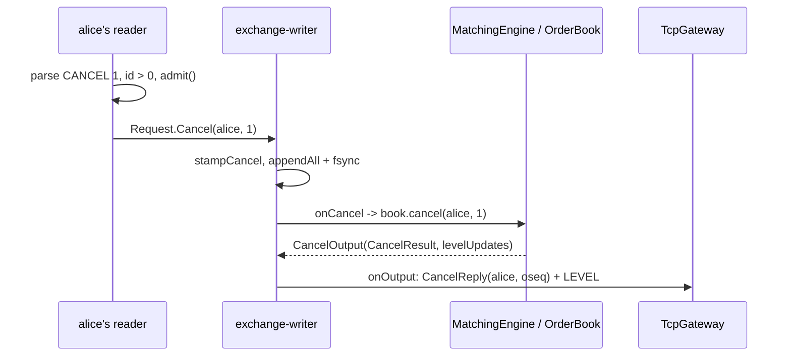
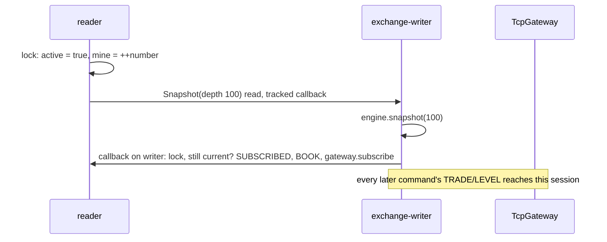

# 05a — Core flows, part 1: trading, cancels, market data, resend

> **Project:** ExchangeServer2 | Single-instrument limit order book: price-time matching engine, write-ahead journal with replay, single writer thread, TCP/TLS gateway with authenticated participants | Stack: Java 17, Maven wrapper, JUnit 5 (+ JMH, PIT)
> **This guide:** Step-by-step traces of flow 1 (login and a NEW order that trades), flow 2 (CANCEL, CANCEL_ALL and cancel-on-disconnect) and flow 3 (SUBSCRIBE/UNSUBSCRIBE and RESEND), with the data shape at each step | **Prerequisites:** 01, 05 (helpful: 02, 06) | **Related:** 05b, 06, 07-modules/gateway, 07-modules/exchange-service, 07-modules/exchange-and-replay, 07-modules/engine, 07-modules/book
> **Repo layout summary:** `pom.xml` + Maven wrapper (`mvnw`, `mvnw.cmd`) at the root; production code in `src/main/java/exchangeserver/` (packages `domain`, `book`, `engine`, `command`, `journal`, `core`, `gateway`, `client`, plus `Main`); tests mirror it in `src/test/java/exchangeserver/` (plus `bench/` JMH benchmarks and `testing/MutableClock`); design docs in `docs/` (`ExchangeServer2_Vision.md` = purpose/roadmap, `ExchangeServer2_Spec.md` = decisions D1–D77); these guides in `docs/understanding/`.

## Overview

This guide follows client requests through a running exchange, from the bytes a client sends to the lines it gets back, naming every method and file touched. Terms used throughout (also in guide 13):

- **Participant**: a trading identity (`alice`). A **session** is one TCP connection logged in as a participant; a participant may have several.
- **Private stream** (D73): the participant's own events (replies to its requests, fills on its resting orders, cancels), numbered 1, 2, 3, … by **oseq**, sent to *every* session of that participant.
- **Market data**: TRADE and LEVEL lines, sent to sessions that subscribed; they carry the command **seq** (the journal's sequence number), not an oseq.
- **Ledger**: the writer thread's derived state, rebuilt as one unit: the engine (book and counters), the running **output digest** (D70) and the **output log** that numbers private events (D73).
- **In flight**: a request a session has handed to the exchange and whose callback has not run yet (D75, D76).

### The three threads a request crosses



**[Verified]** thread names: `src/main/java/exchangeserver/gateway/ClientSession.java:91-92`, `src/main/java/exchangeserver/core/ExchangeService.java:119`.

### The running example (seen live, 2026-10-27, Windows)

Two users were created with `--add-user` (PBKDF2 hashes in `exchange.users`), the server was started, and four raw TCP clients sent these lines. **[Verified]** captured output:

```
mallory > LOGIN alice guessed-secret
mallory < ERROR login failed
mallory < (closed)
alice > LOGIN alice alice-secret COD
alice < WELCOME participant=alice oseq=0
bob > LOGIN bob bob-secret!
bob < WELCOME participant=bob oseq=0
alice > NEW a1 SELL LIMIT 10 100
alice < ORDER oseq=1 orderId=1 clOrdId=a1 status=RESTED filled=0 remaining=10
alice > NEW a2 BUY LIMIT 5 100
alice < ORDER oseq=2 orderId=2 clOrdId=a2 status=CANCELLED filled=0 remaining=5 reason=SELF_TRADE_PREVENTED
bob > NEW b1 BUY LIMIT 4 100
bob < FILL oseq=1 orderId=3 clOrdId=b1 side=BUY price=100 qty=4 leaves=0 liquidity=TAKER
bob < ORDER oseq=1 orderId=3 clOrdId=b1 status=FILLED filled=4 remaining=0
alice < FILL oseq=3 orderId=1 clOrdId=a1 side=SELL price=100 qty=4 leaves=6 liquidity=MAKER
alice > QUIT
alice < BYE
bob > SUBSCRIBE
bob < SUBSCRIBED
bob < BOOK seq=4 last=100 bids=- asks=-
alice2 > LOGIN alice alice-secret
alice2 < WELCOME participant=alice oseq=4
alice2 > RESEND 1
alice2 < ORDER oseq=1 orderId=1 clOrdId=a1 status=RESTED filled=0 remaining=10 resend=1
alice2 < ORDER oseq=2 orderId=2 clOrdId=a2 status=CANCELLED filled=0 remaining=5 reason=SELF_TRADE_PREVENTED resend=1
alice2 < FILL oseq=3 orderId=1 clOrdId=a1 side=SELL price=100 qty=4 leaves=6 liquidity=MAKER resend=1
alice2 < CANCELLED oseq=4 orderId=1 qty=6 reason=CANCEL_ALL resend=1
alice2 < RESENT last=4
```

And the journal it left (each record ends with its CRC-32C, D69):

```
HEADER,3,2,0,5d7826e0
NEW,1,2026-10-27T14:20:40.373493200Z,1,alice,a1,SELL,LIMIT,10,100,379beca7
NEW,2,2026-10-27T14:20:40.802670Z,2,alice,a2,BUY,LIMIT,5,100,f33577be
NEW,3,2026-10-27T14:20:41.217763100Z,3,bob,b1,BUY,LIMIT,4,100,bed0c339
CANCEL_ALL,4,2026-10-27T14:20:42.045241200Z,alice,2b6bb4a5
```

Read the story: mallory's guess is refused and disconnected; alice logs in asking for cancel-on-disconnect (`COD`); her buy a2 would have traded with her own sell a1, so self-trade prevention cancels it; bob's buy trades 4 against a1; when alice quits, her last session is gone, so the gateway submits a journalled `CANCEL_ALL` (record 4) that removes the rest of a1; when she logs in again, `WELCOME oseq=4` tells her four events exist, and `RESEND 1` repeats all of them.

---

## Flow 1 — Login, then a NEW order that trades

**Trigger:** a client sends `LOGIN bob bob-secret!`, then `NEW b1 BUY LIMIT 4 100` while alice's `a1 SELL 10 @ 100` rests. **Final effect:** a NEW record is fsynced; the book changes; bob's sessions get `FILL … TAKER` and `ORDER … FILLED` (his oseq 1); alice's sessions get `FILL … MAKER` (her oseq 3); subscribers get TRADE and LEVEL.

### Sequence diagram



### Step by step

**Step 1 — the session exists.** The acceptor thread accepted the socket, set `TCP_NODELAY`, refused it if 256 sessions were open, and started a `ClientSession` with a sender and a reader thread. If the server has a TLS keystore, the server socket is an `SSLServerSocket` and the handshake happens on the reader's first read. **[Verified]** `src/main/java/exchangeserver/gateway/TcpGateway.java:113-129` (TLS server socket), `TcpGateway.java:164-205` (accept loop).

**Step 2 — reading a line with a login timeout.** The reader sets a socket read timeout of `loginTimeout` (10 s by default) before reading anything, and reads byte by byte up to `\n` (a trailing `\r` is dropped; over 256 bytes is an error). **[Verified]** `src/main/java/exchangeserver/gateway/ClientSession.java:152-182`, `ClientSession.java:186-204`.

*Data shape:* the text line `LOGIN bob bob-secret!`.

**Step 3 — parse.** `Protocol.parse` splits on single spaces and builds a `ClientMessage`: here `Login("bob", "bob-secret!", false)`; a fourth token `COD` sets `cancelOnDisconnect`. `ClientMessage.Login.toString()` leaves the secret out, so a logged message never shows it. **[Verified]** `src/main/java/exchangeserver/gateway/Protocol.java:60-100`, `src/main/java/exchangeserver/gateway/ClientMessage.java:12-17`.

**Step 4 — authenticate (D74).** `login` allows one attempt per connection; checks the name pattern and the secret against `Credentials`; on any failure it answers the same `ERROR login failed` and stops reading (the session closes after its in-flight requests, of which there are none). On success the read timeout becomes `idleTimeout` (300 s), and an **Attach read** is handed to the exchange. **[Verified]** `src/main/java/exchangeserver/gateway/ClientSession.java:293-327`.

```java
// src/main/java/exchangeserver/gateway/ClientSession.java:303-326 (trimmed)
String requested = login.participant();
if (!Rules.PARTICIPANT.matcher(requested).matches() || !gateway.authenticate(requested, login.secret())) {
    send(Protocol.error("login failed"));       // the same answer whatever was wrong (D74)
    return false;
}
socket.setSoTimeout((int) settings.idleTimeout().toMillis());
cancelOnDisconnect = login.cancelOnDisconnect();
participant = requested;
// On the writer thread, before any later output: register for routing, then report the latest oseq (D73).
service.attach(requested, tracked((lastOseq, failure) -> {
    if (failure != null) {
        replyFailure("LOGIN", failure);
        return;
    }
    gateway.loggedIn(this);
    if (closed.get()) {
        gateway.removed(this);
        return;
    }
    send(Protocol.welcome(requested, lastOseq));
}));
```

`Credentials.verify` runs PBKDF2-HMAC-SHA256 with the participant's salt and iteration count (210,000 for users created with `--add-user`) and compares in constant time; an unknown participant is checked against a dummy entry so it costs the same. **[Verified]** `src/main/java/exchangeserver/gateway/Credentials.java:82-87`.

*Why an Attach read, not a direct registration?* The Attach request goes through the queue like a command, so its callback runs on the writer thread *between* two commands: the session is registered for routing and told the latest oseq at one point in the stream. Every private event after it reaches the session, none before it is counted twice: no gap, no duplicate (D73). **[Verified]** `src/main/java/exchangeserver/core/Request.java:43-47`, `src/main/java/exchangeserver/core/Exchange.java:255-261`; **[Inferred]** the no-gap argument (it mirrors the one for SUBSCRIBE, flow 3).

**Step 5 — `NEW b1 BUY LIMIT 4 100`: parse and validate.** The reader now handles a `NewOrder`. Before anything reaches the exchange: the session must be logged in; `admit()` applies the per-session limits (D75); then `OrderRequest.of` applies every stateless field rule (D47). **[Verified]** `src/main/java/exchangeserver/gateway/ClientSession.java:236-253`, `ClientSession.java:329-340`.

```java
// src/main/java/exchangeserver/gateway/ClientSession.java:279-291
private String admit() {
    if (inFlight.get() >= settings.maxInFlight()) {
        return "SESSION_BUSY";
    }
    long now = System.nanoTime();
    tokens = Math.min(settings.burst(), tokens + (now - lastRefillNanos) * settings.ratePerSecond() / 1e9);
    lastRefillNanos = now;
    if (tokens < 1) {
        return "RATE_LIMITED";
    }
    tokens -= 1;
    return null;
}
```

`admit` is a token bucket: tokens refill at `ratePerSecond` (1,000) up to `burst` (2,000); each request spends one. It reads the clock (`System.nanoTime`), which is fine: it runs on the reader thread, outside the engine, so replay determinism is untouched. A refusal is an `ERROR clOrdId=b1 RATE_LIMITED` (or `SESSION_BUSY`) line and nothing is queued or journalled. **[Verified]** code; regression tests `TcpGatewayTest.Limits.requestsBeyondTheRateAreRefusedWithoutReachingTheJournal`, `requestsBeyondTheInFlightLimitAreRefused`.

*Data shape:* `ClientMessage.NewOrder("b1", BUY, LIMIT, 4, OptionalLong.of(100))` → `OrderRequest{participant=bob, clOrdId=b1, BUY, LIMIT, qty 4, price 100}`.

**Step 6 — hand-in with a tracked callback.** `service.submit(request, tracked(...))`. `tracked` increments the session's in-flight count now and decrements it after the callback has run; the callback itself only reports a refusal, because the FILL and ORDER lines come through the private stream. **[Verified]** `src/main/java/exchangeserver/gateway/ClientSession.java:337-339`, `ClientSession.java:421-431`.

`ExchangeService.enqueue` wraps the callback so a throw inside it is logged (M9), then, under one lock, refuses with HALTED/STOPPED/BUSY or adds the `Pending` to the queue. A refusal completes the future on the reader thread, outside the lock. **[Verified]** `src/main/java/exchangeserver/core/ExchangeService.java:211-238`.

*Data shape:* `Pending{request = Request.Submit(OrderRequest), result = CompletableFuture<Response>, command = null, refused = false}` in a `LinkedBlockingQueue`.

**Step 7 — the writer takes a batch.** It blocks on `take()`, then drains whatever else is waiting, up to 1,000 (smart batching, D52). **[Verified]** `src/main/java/exchangeserver/core/ExchangeService.java:286-305`.

**Step 8 — stamp (and maybe CHECK).** `Exchange.process` first stamps a `CHECK` record if `checkInterval` (10,000) commands have been applied since the last one; it carries the current output digest and so asserts "every command before me produced these outputs" (D70). Then each request is stamped by the `Sequencer`, the only clock reader and counter: bob's order becomes `NewOrderCommand(seq 3, ts, orderId 3, request)`. A request whose stamping throws is marked `refused` and never journalled. **[Verified]** `src/main/java/exchangeserver/core/Exchange.java:198-221`.

```java
// src/main/java/exchangeserver/core/Exchange.java:199-223 (trimmed)
List<Command> commands = new ArrayList<>(batch.size() + 1);
if (commandsSinceCheck >= options.checkInterval()) {
    commands.add(sequencer.stampCheck(ledger.digest()));       // D70: covers every command before it
    commandsSinceCheck = 0;
}
for (Pending<?> p : batch) {
    try {
        if (p.request instanceof Request.Submit s) {
            p.command = sequencer.stampNewOrder(s.order());
        } else if (p.request instanceof Request.Cancel c) {
            p.command = sequencer.stampCancel(c.participant(), c.orderId());
        } else if (p.request instanceof Request.CancelAll c) {
            p.command = sequencer.stampCancelAll(c.participant());
        }
    } catch (RuntimeException invalid) {
        p.refused = true;                   // refused before stamping: uses up no number, never journalled
        p.fail(invalid);
        continue;
    }
    if (p.command != null) {
        commands.add(p.command);
    }
}

journal.appendAll(commands);                // durable before any effect
```

**Step 9 — journal: one write, one fsync.** `CommandJournal.appendAll` encodes every command first (a failing encode writes nothing), writes them in one buffer and calls `force(true)`. Each record is sealed with `,<crc32c>\n` (D69). A failed write or fsync fail-stops the journal and halts the writer (flow 6). **[Verified]** `src/main/java/exchangeserver/journal/CommandJournal.java:143-166`, `src/main/java/exchangeserver/journal/JournalCodec.java:166-168`.

*Data shape on disk:* `NEW,3,2026-10-27T14:20:41.217763100Z,3,bob,b1,BUY,LIMIT,4,100,bed0c339`.

**Step 10 — apply to the Ledger.** For each non-refused request: a read (no command) is answered from the ledger at once; a command goes through the test seam (`interceptor`, a no-op in production) and `ledger.apply`, which runs the engine, folds the output into the digest, and numbers the private events. **[Verified]** `src/main/java/exchangeserver/core/Exchange.java:225-252`, `src/main/java/exchangeserver/core/Ledger.java:42-55`.

```java
// src/main/java/exchangeserver/core/Ledger.java:42-55
Applied apply(Command command) {
    EngineOutput output;
    if (command instanceof NewOrderCommand n) {
        output = engine.onNewOrder(n);
    } else if (command instanceof CancelOrderCommand c) {
        output = engine.onCancel(c);
    } else if (command instanceof CancelAllCommand c) {
        output = engine.onCancelAll(c);
    } else {
        throw new IllegalStateException("Not an engine command: " + command);
    }
    digest.update(output);
    return new Applied(output, log.record(command, output));
}
```

**Step 11 — the engine matches.** `MatchingEngine.onNewOrder` checks the order id and sequence number increase (D35), builds the `Order`, and runs `process` in three parts. **[Verified]** `src/main/java/exchangeserver/engine/MatchingEngine.java:111-125`, `MatchingEngine.java:178-263`.

1. *Checks that change nothing* (`MatchingEngine.java:182-214`): duplicate client order id (the id is recorded even if a later check rejects); price band ±10% around the last trade (none before the first trade); **resting caps only for an order that would rest** (D68: at the participant cap or with 1,000,000 orders in the book, a LIMIT that would fully trade now is still accepted; POST_ONLY is rejected because it never trades on arrival); FOK fillability; POST_ONLY would cross.
2. *The match loop* (`MatchingEngine.java:216-237`): while the order has quantity, take the best opposite level; stop if it does not cross the order's limit; **stop if the head of that level belongs to the same participant (self-trade prevention, D67)**; otherwise `book.fillBest` fills the head order by up to the remainder and returns an immutable `Fill`, and the engine records a `Trade` (at the resting price, with the incoming command's timestamp) and an `Execution` for the maker.
3. *Outcome* (`MatchingEngine.java:239-262`): an exhaustive switch over the order type. A LIMIT/POST_ONLY remainder rests unless self-trade prevention stopped the loop, in which case it is CANCELLED with reason `SELF_TRADE_PREVENTED`; IOC and MARKET remainders are CANCELLED (with that reason if it applied); a FOK cannot have a remainder here.

```java
// src/main/java/exchangeserver/engine/MatchingEngine.java:218-228 (trimmed)
boolean selfTradePrevented = false;
while (order.getRemainingQuantity() > 0) {
    Optional<PriceLevel> best = book.bestLevel(restingSide);
    if (best.isEmpty() || !crosses(order.getSide(), limit, best.get().getPrice())) {
        break;
    }
    if (order.getParticipant().equals(book.headParticipant(restingSide))) {
        selfTradePrevented = true;      // D67: stop here; the remainder is cancelled below
        break;
    }
    Fill fill = book.fillBest(restingSide, order.getRemainingQuantity());
```

In the running example: `a2 BUY 5 @ 100` meets `a1` (alice's own) at the head of the 100 ask, so it stops before trading and is CANCELLED with the reason; `b1 BUY 4 @ 100` meets `a1`, which is not bob's, and fills 4. **[Verified]** live transcript; tests `MatchingEngineTest.SelfTrade.*`.

The market collar (D50, D66) is the limit of a MARKET order: ±10% around the last trade, or, before the first trade, around the best opposite price (the touch), so a first market order cannot sweep a thin book. **[Verified]** `src/main/java/exchangeserver/engine/MatchingEngine.java:274-289`.

*Data shape:* `OrderOutput(seq 3, ts, Response(orderId 3, "b1", FILLED, reason null, filled 4, remaining 0, [Trade(100, 4, buy 3, sell 1, BUY, ts)]), passiveFills [Execution(alice, 1, "a1", SELL, 100, 4, leaves 6)], levelUpdates [LevelUpdate(SELL, 100, 6, 1)])`.

**Step 12 — digest and numbering.** `OutputDigest.update` feeds a canonical text encoding of the output (every field: response, trades, executions, level updates, cancel results) into a running FNV-1a 64 hash (D70). `OutputLog.record` turns the output into numbered private events, requester's reply first, then the makers' fills in match order, and keeps the last `outputRetention` (1,000) per participant for RESEND. **[Verified]** `src/main/java/exchangeserver/core/OutputDigest.java:48-83`, `src/main/java/exchangeserver/core/OutputLog.java:58-76`.

```java
// src/main/java/exchangeserver/core/OutputLog.java:58-65 (trimmed)
List<PrivateEvent> record(Command command, EngineOutput output) {
    List<PrivateEvent> events = new ArrayList<>();
    if (output instanceof OrderOutput o && command instanceof NewOrderCommand n) {
        String p = n.request().getParticipant();
        events.add(add(new PrivateEvent.OrderReply(p, next(p), n.request().getSide(), n.request().getQuantity(), o.response())));
        for (Execution e : o.passiveFills()) {
            events.add(add(new PrivateEvent.MakerFill(e.participant(), next(e.participant()), e)));
        }
```

*Data shape:* `[OrderReply(bob, oseq 1, BUY, 4, Response…), MakerFill(alice, oseq 3, Execution…)]`. Alice is at 3 because her a1 reply was 1 and her a2 reply was 2.

**Step 13 — listener, then the future (D76).** `Exchange.process` calls `listener.onOutput(output, events)` and only afterwards completes the request's future, which runs the callback (on the writer thread). A throwing listener is logged and ignored. **[Verified]** `src/main/java/exchangeserver/core/Exchange.java:245-251`.

**Step 14 — the gateway routes.** `TcpGateway.onOutput` sends each private event's lines to every session registered for its participant, then, if anyone subscribed and the output has trades or level updates, the TRADE and LEVEL lines to every subscriber. **[Verified]** `src/main/java/exchangeserver/gateway/TcpGateway.java:285-310`.

```java
// src/main/java/exchangeserver/gateway/TcpGateway.java:286-296 (trimmed)
public void onOutput(EngineOutput output, List<PrivateEvent> events) {
    for (PrivateEvent e : events) {
        Set<ClientSession> owners = sessionsByParticipant.get(e.participant());
        if (owners != null) {
            List<String> lines = Protocol.lines(e, false);
            for (ClientSession s : owners) {
                s.sendAll(lines);
            }
        }
    }
```

`Protocol.lines` turns an `OrderReply` into one taker FILL per trade (with `leaves` counting down from the order quantity) followed by the ORDER line, all with the same oseq; a `MakerFill` into one MAKER FILL. **[Verified]** `src/main/java/exchangeserver/gateway/Protocol.java:145-166`.

`ClientSession.send` only *offers* the line to a bounded queue (10,000 lines); if it is full, the session is disconnected instead of blocking the writer (D54). **[Verified]** `src/main/java/exchangeserver/gateway/ClientSession.java:116-124`.

**Step 15 — the callback.** `p.complete(response)` runs bob's tracked callback: no failure, so nothing is sent; in-flight goes down by one, and if the reader had stopped and this was the last request in flight, the session closes now (flow 6). **[Verified]** `src/main/java/exchangeserver/gateway/ClientSession.java:421-442`.

**Step 16 — the sender writes.** Each session's sender thread takes lines from its queue, writes them with `\n`, and flushes when the queue is empty (once per burst). **[Verified]** `src/main/java/exchangeserver/gateway/ClientSession.java:446-466`.

### Why the taker's lines come before the maker's and before market data

Within one command, `OutputLog.record` lists the requester's reply first and makers' fills after it, and `onOutput` sends private events before market data; all of this runs on the one writer thread, which offers lines to the session queues in that order. Each session's sender preserves its queue order. So bob sees FILL then ORDER, and a subscriber sees TRADE then LEVEL, never the reverse. Across different sessions, delivery order depends on the sender threads and the network. **[Verified]** code order; **[Inferred]** the cross-session statement.

### Variations of flow 1 (same path, different exit)

| Situation | Where it exits | What the client sees |
|---|---|---|
| Wrong secret or unknown name | step 4 | `ERROR login failed`, connection closed (one attempt per connection) |
| No LOGIN for 10 s | step 2 | `ERROR login timeout; disconnecting`, closed |
| Syntax error | step 3 | `ERROR <reason>`, session continues |
| Not logged in | step 5 | `ERROR LOGIN first` |
| Over the rate or in-flight limit | step 5 | `ERROR clOrdId=… RATE_LIMITED` / `SESSION_BUSY` |
| Invalid field (quantity 0, bad clOrdId) | step 5 | `ERROR clOrdId=… <message>` |
| Exchange queue full / stopping / halted | step 6 | `ERROR clOrdId=… BUSY` / `STOPPED` / `HALTED` |
| Duplicate clOrdId, band, caps, post-only cross | step 11 | `ORDER … status=REJECTED reason=…` (journalled, numbered) |
| Own order at the head | step 11 | `ORDER … status=CANCELLED … reason=SELF_TRADE_PREVENTED` |
| The engine throws (a bug) | step 10 | `ERROR clOrdId=… INTERNAL_ERROR`; the command is quarantined (flow 5) |

**[Verified]** the code paths cited in each step; the first, fourth and seventh rows were also seen live or in `TcpGatewayTest`.

---

## Flow 2 — CANCEL, CANCEL_ALL and cancel-on-disconnect

### 2a. CANCEL

**Trigger:** `CANCEL 1` from a session logged in as alice. **Final effect:** a CANCEL record is journalled; if order 1 rests and is alice's, it leaves the book (its level too, if emptied), alice's sessions get `CANCELLED oseq=… orderId=1 qty=…`, subscribers get a LEVEL update; otherwise she gets `CANCEL_REJECT oseq=… orderId=1 reason=UNKNOWN_ORDER`.



1. The reader parses `Cancel(1)`, refuses an id ≤ 0 locally, applies `admit()`, and hands in `cancel(p, id, tracked(...))`. **[Verified]** `src/main/java/exchangeserver/gateway/ClientSession.java:254-259`.
2. The writer stamps `CancelOrderCommand(seq, ts, alice, 1)` and journals it. **[Verified]** `src/main/java/exchangeserver/core/Exchange.java:208-209`.
3. `MatchingEngine.onCancel` checks the sequence number and calls `OrderBook.cancel(participant, id)`. The book returns `UNKNOWN_ORDER` if the id is not resting **or belongs to someone else** (D48: a distinct "not yours" answer would reveal which ids are live). Otherwise it removes the node through the single removal path, which also removes an emptied level and decrements the participant's open-order count. **[Verified]** `src/main/java/exchangeserver/engine/MatchingEngine.java:127-133`, `src/main/java/exchangeserver/book/OrderBook.java:98-108`, `OrderBook.java:111-128`.
4. `OutputLog.record` numbers a `CancelReply` for the *canceller* (even an UNKNOWN_ORDER answer is part of its stream); the gateway formats `CANCELLED oseq=… orderId= qty=` or `CANCEL_REJECT oseq=… orderId= reason=UNKNOWN_ORDER`. **[Verified]** `src/main/java/exchangeserver/core/OutputLog.java:66-67`, `src/main/java/exchangeserver/gateway/Protocol.java:180-184`.

### 2b. CANCEL_ALL and cancel-on-disconnect (D72)

**Trigger:** the last session of a participant that logged in with `COD` closes, for any reason (QUIT, end of stream, slow-consumer disconnect, gateway shutdown). **Final effect:** a `CANCEL_ALL,<seq>,<ts>,<participant>` record is journalled; every resting order of that participant leaves the book; one `CancelReply(byCancelAll=true)` per order is numbered into its private stream (waiting for RESEND); subscribers get LEVEL updates.

```java
// src/main/java/exchangeserver/gateway/TcpGateway.java:246-262 (trimmed)
boolean[] wasLast = {false};
sessionsByParticipant.computeIfPresent(p, (k, mine) -> {
    mine.remove(session);
    wasLast[0] = mine.isEmpty();
    return mine.isEmpty() ? null : mine;
});
ExchangeService s = service;
if (wasLast[0] && session.cancelOnDisconnect() && s != null) {
    s.cancelAll(p, (results, failure) -> {
        if (failure != null) {
            LOG.log(Level.WARNING, "cancel-on-disconnect for " + p + " failed: " + failure);
        }
    });
}
```

1. `ClientSession.close()` calls `TcpGateway.removed`, which drops the session from the participant's set atomically (`computeIfPresent`) and learns whether it was the last one. **[Verified]** `src/main/java/exchangeserver/gateway/ClientSession.java:133-141`, `src/main/java/exchangeserver/gateway/TcpGateway.java:239-263`.
2. The writer stamps `CancelAllCommand` and journals it like any input; replay re-runs it. **[Verified]** `src/main/java/exchangeserver/core/Exchange.java:210-211`.
3. `MatchingEngine.onCancelAll` collects the participant's order ids by walking the book (bids best first, then asks, time priority within a level: a deterministic order, never a hash map), then cancels each. **[Verified]** `src/main/java/exchangeserver/engine/MatchingEngine.java:136-155`.
4. Each result becomes a `CancelReply` with `byCancelAll`, formatted `CANCELLED oseq=… orderId= qty= reason=CANCEL_ALL`. **[Verified]** `src/main/java/exchangeserver/core/OutputLog.java:68-71`, `src/main/java/exchangeserver/gateway/Protocol.java:182`.

In the running example alice's QUIT left no other alice session, so record 4 cancelled the 6 left of a1, and her reconnected session saw it as oseq 4 through RESEND. Without `COD`, orders stay (test `TcpGatewayTest.CancelOnDisconnect.withoutCodOrdersStay`). **[Verified]** live run and tests.

*Clean shutdown:* the shutdown hook closes the gateway first (every session closes, so COD participants trigger CANCEL_ALL), then stops the service; requests accepted before `stop()` are processed, so COD orders are cancelled on a clean stop. A crash cancels nothing. **[Inferred]** from the hook order (`src/main/java/exchangeserver/Main.java:159-177`) and D56; not exercised by a test.

---

## Flow 3 — SUBSCRIBE, UNSUBSCRIBE and RESEND (reads through the queue)

Reads do not change state, but they still go through the writer's queue: only the writer may touch the book or the output log (single writer, D57), and the queue gives each read an exact position between commands.

### 3a. SUBSCRIBE and UNSUBSCRIBE



1. `subscribe` takes `subscriptionLock`, refuses if already active, marks it active and takes a new subscription number, then queues a depth-100 snapshot read (D62). **[Verified]** `src/main/java/exchangeserver/gateway/ClientSession.java:373-384`.
2. The writer answers the read from `engine.snapshot(100)`; the callback runs on the writer, between commands. Under the lock it checks the number is still current and the subscription still active (an UNSUBSCRIBE may have overtaken it), then sends `SUBSCRIBED`, `BOOK seq= last= bids= asks=` and joins the subscribers. Because this happens at one point in the command stream, the first LEVEL the session gets belongs to the first command after the snapshot: no gap, no duplicate. **[Verified]** `ClientSession.java:385-402`, `src/main/java/exchangeserver/core/Exchange.java:255-258`.
3. `UNSUBSCRIBE` (reader thread, under the same lock) clears the flag, leaves the subscribers and sends `UNSUBSCRIBED`. **[Verified]** `ClientSession.java:405-411`.

The lock and the number handle two races: an UNSUBSCRIBE arriving before the snapshot callback (the callback then sends nothing), and SUBSCRIBE/UNSUBSCRIBE/SUBSCRIBE (only the current number's callback acts, so one BOOK). **[Verified]** comment `ClientSession.java:363-372`; test `TcpGatewayTest.MarketData.rapidSubscribeUnsubscribeEndsConsistent`.

In the running example bob subscribed after alice's CANCEL_ALL: `BOOK seq=4 last=100 bids=- asks=-` (the book is empty; the last trade, 100, remains the band reference). **[Verified]** live.

### 3b. RESEND (D73)

**Trigger:** `RESEND <n>` from a logged-in session. **Final effect:** the session gets every retained private event of its participant with oseq ≥ n, each line marked `resend=1`, then `RESENT last=<latest>`; if n is older than the oldest retained event, first `ERROR RESEND_GAP first=<oldest>`.

```java
// src/main/java/exchangeserver/gateway/ClientSession.java:348-360 (trimmed)
service.resend(p, from, tracked((ResendResult result, Throwable failure) -> {
    if (failure != null) {
        replyFailure("RESEND", failure);
        return;
    }
    if (from < result.firstAvailable() && from <= result.lastOseq()) {
        send(Protocol.error("RESEND_GAP first=" + result.firstAvailable()));
    }
    for (PrivateEvent e : result.events()) {
        sendAll(Protocol.lines(e, true));
    }
    send("RESENT last=" + result.lastOseq());
}));
```

1. The reader refuses n ≤ 0, applies `admit()`, and queues a `Request.Resend(participant, n)` read. **[Verified]** `src/main/java/exchangeserver/gateway/ClientSession.java:260-261`, `ClientSession.java:342-347`.
2. On the writer, `OutputLog.since(participant, n)` returns the retained events with oseq ≥ n, the first retained number and the latest number. The log keeps the last `outputRetention` (1,000) events per participant; after a restart they are rebuilt by replay, but a compaction keeps only the numbers, not the events (D71). **[Verified]** `src/main/java/exchangeserver/core/OutputLog.java:84-97`, `OutputLog.java:50-54`.
3. The callback sends the events in order, before any later live event (it runs on the writer at its queue position). Events produced between the WELCOME and the RESEND may arrive twice (once live, once resent); the client deduplicates by oseq. **[Verified]** code; **[Inferred]** the duplicate case.

*Data shape:* `ResendResult(events [OrderReply#1, OrderReply#2, MakerFill#3, CancelReply#4], firstAvailable 1, lastOseq 4)`.

Tests: `TcpGatewayTest.Resend.aReconnectingClientRecoversAMakerFillItMissed`, `eventsTooOldToRetainAreReportedAsAGap`, `theStreamSurvivesARestart`. **[Verified]**

---

## Key takeaways

- A session must log in with a secret (PBKDF2, one attempt per connection); WELCOME reports the participant's latest oseq from an Attach read, placed exactly in the command stream.
- The reader thread refuses everything it can without exchange state: syntax, fields, rate (token bucket) and in-flight limits; refusals are never journalled.
- The writer stamps (CHECK first when due), journals with one fsync, applies each command to the Ledger (engine + digest + numbered events), calls the listener, and only then completes the future (D76).
- Private events go to every session of the participant, numbered by oseq; the requester's reply comes before the makers' fills, and private lines before market data.
- Self-trade prevention stops the match loop at the participant's own resting order and cancels the remainder with `SELF_TRADE_PREVENTED`.
- CANCEL returns UNKNOWN_ORDER for someone else's order; CANCEL_ALL is a journalled command, and cancel-on-disconnect submits it when a COD participant's last session closes.
- SUBSCRIBE and RESEND are reads through the queue: each sees one exact point of the history, so no gap or duplicate within it.

## Common confusions

- **"The ORDER line is sent by the request's callback."** It is sent by the listener from the private stream; the callback only reports refusals and decrements the in-flight count.
- **"A second session of alice does not see the first session's replies."** It does: the private stream goes to every session of the participant (D73).
- **"Self-trade prevention skips my order and trades with the next one."** It stops; skipping would break price-time priority (D67).
- **"RESEND can reach any old event."** Only the last 1,000 per participant, and never past the last compaction; older requests get `RESEND_GAP`.
- **"A refused request still uses a sequence number."** Gateway refusals never reach the writer; a request that fails stamping is marked `refused` and uses up no number.

## Questions to test yourself

1. Alice is logged in on two sessions. Session 1 sends `NEW x BUY LIMIT 1 90`. What does session 2 see?
<details><summary>Answer</summary>The same `ORDER oseq=<n> … clOrdId=x …` line: the reply is a private event for participant alice and goes to every alice session (D73).</details>

2. Bob's buy at 101 crosses alice's ask at 100 (head of the level) and bob's own ask at 100 behind it. What happens to a 5-lot when alice's order has 2?
<details><summary>Answer</summary>It trades 2 with alice, then the head of the level is bob's own order: matching stops, and the remaining 3 is CANCELLED with `SELF_TRADE_PREVENTED`.</details>

3. Why is the RATE_LIMITED check allowed to read the clock when the engine may not?
<details><summary>Answer</summary>It runs on the session reader thread before anything is journalled; its result is never an input to replay, so determinism is unaffected.</details>

4. Alice logged in with COD and has two resting orders. Her only session drops. What appears in the journal, and how does she learn about it later?
<details><summary>Answer</summary>A `CANCEL_ALL,<seq>,<ts>,alice,<crc>` record; two `CancelReply` events numbered into her stream. When she logs in again, `WELCOME oseq=` shows the higher number and `RESEND <n>` repeats `CANCELLED … reason=CANCEL_ALL resend=1` lines.</details>

5. An UNSUBSCRIBE arrives on the reader before the snapshot callback of the preceding SUBSCRIBE runs. What does the client hear?
<details><summary>Answer</summary>Only `UNSUBSCRIBED`: the callback sees the subscription withdrawn (under the lock) and sends nothing.</details>
