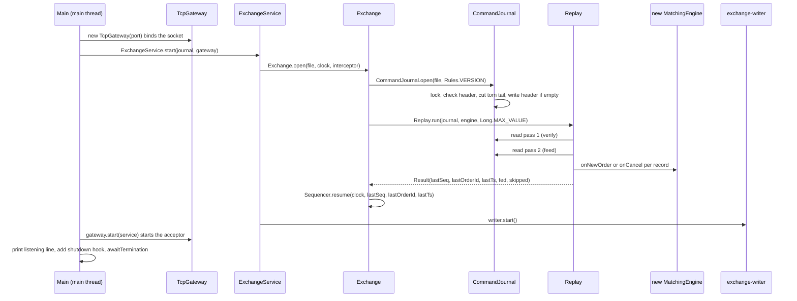
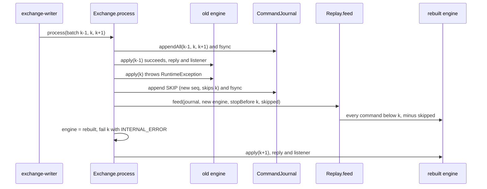
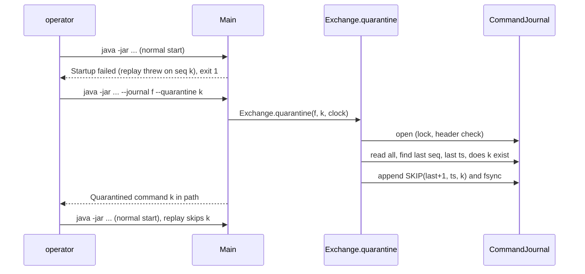
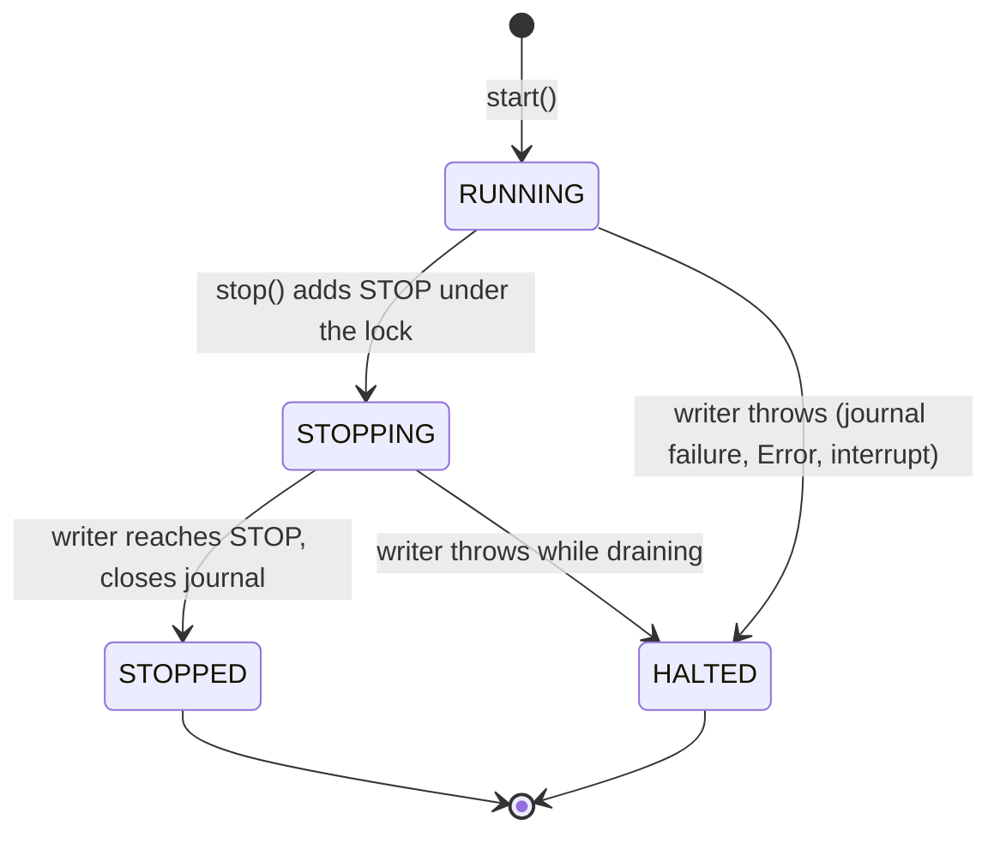
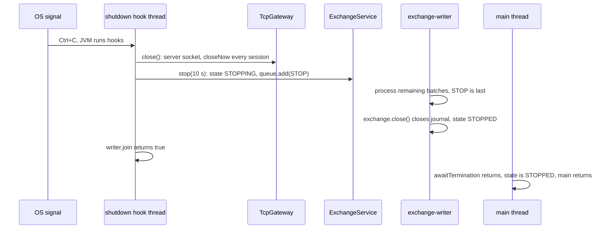

# 05b — Core flows, part 2: startup, recovery, poison pills, shutdown

> **Project:** ExchangeServer2 | Single-instrument limit order book: price-time matching engine, write-ahead journal with replay, single writer thread, plain TCP gateway | Stack: Java 17, Maven wrapper, JUnit 5 (+ JMH, PIT)
> **This guide:** Step-by-step traces of flow 4 (startup and crash recovery), flow 5 (poison pills, live and at startup) and flow 6 (shutdown, halt, backpressure, and closing a connection after its replies), with the data shape at each step | **Prerequisites:** 01, 05a (helpful: 06) | **Related:** 05a, 06, 07-modules/journal, 07-modules/exchange-and-replay, 07-modules/exchange-service, 07-modules/client-and-main, 08-cross-cutting
> **Repo layout summary:** `pom.xml` + Maven wrapper (`mvnw`, `mvnw.cmd`) at the root; production code in `src/main/java/exchangeserver/` (packages `domain`, `book`, `engine`, `command`, `journal`, `core`, `gateway`, `client`, plus `Main`); tests mirror it in `src/test/java/exchangeserver/` (plus `bench/` JMH benchmarks and `testing/MutableClock`); design docs in `docs/` (`ExchangeServer2_Vision.md` = purpose/roadmap, `ExchangeServer2_Spec.md` = decisions D1–D65); these guides in `docs/understanding/`.

## Overview

Guide 05a followed requests through a running exchange. This guide covers how the exchange *gets* running, how it
rebuilds itself after a crash, what it does when its own engine throws, and how it stops — cleanly, by halting, or
by refusing work. These paths matter more than their size suggests: they are where "the journal is the truth"
(Vision principle 5) is actually enforced.

Terms (also in guide 13):

- **Journal**: the append-only text file of stamped commands (`HEADER`, then `NEW` / `CANCEL` / `SKIP` lines). It is
  the *only* persistent state; everything else is rebuilt from it.
- **Replay**: feeding the journalled commands, in order, through a fresh `MatchingEngine`; outputs are discarded.
- **Torn tail**: bytes after the last `\n`, left by a crash in the middle of a write.
- **fsync**: `FileChannel.force(true)`, which returns only when the bytes are on the disk.
- **Poison pill**: a journalled command that makes the engine throw — and would make every replay throw too.
- **Quarantine / SKIP**: a `SKIP,<seq>,<ts>,<skippedSeq>` record telling replay to pass over a command; history is
  annotated, never edited.
- **Halt**: the writer thread stops for good after a failure it cannot continue from; the process exits with code 2.
- **Fail-stop**: after one failed write or fsync, the journal refuses every later append until a restart.

---

## Flow 4 — Startup and crash recovery

**Trigger:** `java -jar target/exchange-server2-2.0.0-SNAPSHOT.jar --port 9000 --journal exchange.journal`, either
on a fresh file or on a journal left by a crash. **Final effect:** the book, counters, last trade price and
client-order-id map are exactly what they were after the last journalled command; new commands continue the
numbering; the gateway accepts connections.

### Sequence diagram



### Step by step

**Step 1 — arguments (`Main.main`).** Three options: `--port` (default 9000), `--journal` (default
`exchange.journal` in the working directory), `--quarantine <seq>` (flow 5). Anything else, or a missing value,
prints the usage line and exits 1. **[Verified]** `src/main/java/exchangeserver/Main.java:28-45`.

**Step 2 — bind the port first.** `new TcpGateway(port)` creates and binds a `ServerSocket` on *all* interfaces
(`new InetSocketAddress(port)`), with no acceptor thread yet. **[Verified]**
`src/main/java/exchangeserver/Main.java:60`, `src/main/java/exchangeserver/gateway/TcpGateway.java:62-68`.
**[Inferred]** Binding before replay means a port clash fails fast, before a possibly long replay; a client that
connects during replay waits in the OS backlog until the acceptor starts. Binding to all interfaces with an
unauthenticated LOGIN is a known, deferred security issue (guide 11).

**Step 3 — `ExchangeService.start` → `Exchange.open` (still the main thread).** Opening, and replaying, happens on
the caller's thread; only afterwards is the writer thread started. `Exchange.open` creates the journal, engine and
sequencer *itself*, so no caller ever holds a reference that could bypass the journal (D43). If anything fails, it
closes the journal (releasing its lock) and rethrows. **[Verified]**
`src/main/java/exchangeserver/core/ExchangeService.java:117-133`, `src/main/java/exchangeserver/core/Exchange.java:74-92`.

```java
// src/main/java/exchangeserver/core/Exchange.java:74-92 (trimmed)
static Exchange open(Path journalFile, Clock clock, CommandInterceptor interceptor) throws IOException {
    CommandJournal journal = CommandJournal.open(journalFile, Rules.VERSION);
    try {
        MatchingEngine engine = new MatchingEngine();
        Replay.Result replay = Replay.run(journal, engine, Long.MAX_VALUE, interceptor);
        Sequencer sequencer = Sequencer.resume(clock, replay.lastSequenceNumber(), replay.lastOrderId(),
                replay.lastTimestamp());
        return new Exchange(journal, sequencer, engine, new HashSet<>(replay.skipped()), replay.fed(), interceptor);
    } catch (IOException | RuntimeException | Error e) {
        try { journal.close(); } catch (IOException closeFailure) { e.addSuppressed(closeFailure); }
        throw e;
    }
}
```

**Step 4 — `CommandJournal.open`: lock, then check, then change.** The order is deliberate (D64, D65, added in
this session's fixes). **[Verified]** `src/main/java/exchangeserver/journal/CommandJournal.java:71-103`.

```java
// src/main/java/exchangeserver/journal/CommandJournal.java:73-103 (trimmed)
public static CommandJournal open(Path file, int rulesVersion) throws IOException {
    Lock lock = Lock.acquire(file);
    FileChannel channel = null;
    long truncated;
    try {
        channel = FileChannel.open(file, CREATE, WRITE, APPEND);            // APPEND: never overwrite history
        checkHeader(file, rulesVersion);
        truncated = cutTornTail(file);
        if (channel.size() == 0) {
            channel.write(ByteBuffer.wrap(JournalCodec.encodeHeader(rulesVersion).getBytes(UTF_8)));
            channel.force(true);
        }
    } catch (IOException | RuntimeException e) {
        // close the channel if it was opened, then lock.release(); failures are added as suppressed
        throw e;
    }
    OPEN.incrementAndGet();
    return new CommandJournal(file, channel, lock, truncated);
}
```

1. **Lock first** (`Lock.acquire`, `CommandJournal.java:198-252`), *before* the journal itself is even opened. The
   lock lives on a separate, empty file next to the journal, `<journal>.lock` (e.g. `exchange.journal.lock`), that
   nothing else ever opens:
   - create the lock file if missing (`Files.createFile`, which never opens an existing one);
   - add its real path to a static in-JVM set `HELD`; if it is already there, refuse at once — a second open in the
     same JVM never touches the lock file;
   - open the lock file and `tryLock()` the whole of it; if another process holds it, refuse.

   The refusal is `IllegalStateException("Journal … is already open (a running exchange, or a --quarantine run)")`.
   Why a separate file: on Linux and macOS Java's file locks are POSIX locks, and closing *any* handle a process
   holds on a file drops all of that process's locks on it; the header check, the torn-tail cut and `read()` open
   and close handles on the journal itself, so a lock taken on the journal would silently vanish. `close()` closes
   the journal channel, then releases the lock (closing the lock channel and leaving `HELD`); the lock file is left
   on disk (deleting it would race with the next opener; `*.journal.lock` is git-ignored). **[Verified]** code and the
   comment at `CommandJournal.java:200-206`, `close()` at `CommandJournal.java:185-196`. Seen running with the final
   code on Windows: `--quarantine` against a running server was refused, the 0-byte `.lock` file appeared next to
   the journal, and after a hard kill the server restarted on the same journal despite the leftover lock file.
   Not yet run on Linux/macOS (guide 15).
2. **Open the journal in APPEND mode** (creating it if missing): every write goes to the end; history is never
   overwritten.
3. **Check the header before changing anything** (`checkHeader`, `CommandJournal.java:256-269`). Read the first
   record. If it is complete (ends in `\n`), it must parse as `HEADER,2,<rulesVersion>` with *this build's*
   `Rules.VERSION`, otherwise refuse ("was written under rules version 9; this build uses 1…"). If there is no
   complete record, the bytes must be a prefix of the expected header (a crash while the file was being created).
   Anything else is refused, and **the file is left untouched**. **[Verified]** code; seen running (a version-9
   journal refused, exit 1; a non-journal text file refused and unchanged).
4. **Cut a torn tail** (`cutTornTail`, `CommandJournal.java:271-282`): scan backwards in 4 KiB blocks for the last
   `\n` (`endOfLastCompleteRecord`, `CommandJournal.java:284-306`), truncate everything after it, and fsync the cut
   so new records cannot follow garbage. Cost is proportional to the last record, not the file. Returns the bytes
   cut. **[Verified]**
5. **Write the header** if the file is (now) empty, and fsync it.

*Data shape:* a `CommandJournal{file, channel (APPEND), lock (the held `<journal>.lock` channel), truncatedBytesOnOpen, failed=false}`; on disk at
least `HEADER,2,1\n`.

**Step 5 — `Replay.run`: two streaming passes.** The journal is read twice with `CommandJournal.read`, which streams
bytes in 64 KiB buffers, splits on `\n`, validates (but skips) record 1 as the header, and decodes every other
record with `JournalCodec.decode`; it never holds the whole file in memory (D60). A *complete* record that does not
parse throws `IllegalStateException("Corrupt journal record <n>: …")` — it is never silently dropped (D38).
**[Verified]** `src/main/java/exchangeserver/core/Replay.java:36-43`,
`src/main/java/exchangeserver/journal/CommandJournal.java:139-171`,
`src/main/java/exchangeserver/journal/JournalCodec.java:101-126`.

*Pass 1, verify* (`Replay.Verifier`, `Replay.java:66-89`): sequence numbers must be exactly 1, 2, 3, …;
timestamps must never decrease; it remembers the last sequence number, last timestamp, the last order id *from NEW
records* (a cancel's id is a target, not an issued id), and the set of skipped sequence numbers from SKIP records.
Nothing is fed if any of this fails anywhere in the file.

*Pass 2, feed* (`Replay.feed`, `Replay.java:47-64`): every NEW / CANCEL below `stopBefore` that is not skipped goes
through the test-seam interceptor and then into the real engine; SKIP records themselves are ignored; outputs are
thrown away (they were delivered in the live run, D41).

```java
// src/main/java/exchangeserver/core/Replay.java:47-64 (trimmed)
static long feed(CommandJournal journal, MatchingEngine engine, long stopBefore, Set<Long> skipped,
                 CommandInterceptor interceptor) throws IOException {
    long[] fed = {0};
    journal.read(command -> {
        if (command.sequenceNumber() >= stopBefore || command instanceof SkipCommand
                || skipped.contains(command.sequenceNumber())) {
            return;
        }
        interceptor.beforeEngine(command);
        if (command instanceof NewOrderCommand n) engine.onNewOrder(n);
        else if (command instanceof CancelOrderCommand c) engine.onCancel(c);
        fed[0]++;
    });
    return fed[0];
}
```

Because the engine is deterministic (no clock, no counters, no randomness, no hash-iteration order — D12), feeding
the same commands rebuilds the same book, the same `lastTradePrice` (so the price band comes back), and the same
client-order-id map (so a resend after a crash is caught as a duplicate, D49). **[Verified]**
`src/main/java/exchangeserver/engine/MatchingEngine.java:21-36` comment; tests
`ExchangeTest.rebuildsTheIdenticalBookAndContinuesTheCounters`, `clientOrderIdsSurviveSoAResendAfterRestartIsCaught`.

*Data shape:* `Replay.Result(lastSequenceNumber, lastOrderId, lastTimestamp, fed, skipped)`.

**Step 6 — resume the sequencer.** `Sequencer.resume` continues at `lastSequenceNumber + 1` and `lastOrderId + 1`,
and will never stamp a timestamp earlier than the last journalled one (if the machine's clock is behind, it reuses
the last timestamp). **[Verified]** `src/main/java/exchangeserver/command/Sequencer.java:38-46`,
`Sequencer.java:74-81`.

**Step 7 — start the writer.** `new ExchangeService(...)` creates the non-daemon thread `exchange-writer`
(non-daemon so the JVM cannot exit with accepted requests unprocessed or the journal open), and `writer.start()`
runs it. `Thread.start()` is the happens-before edge that safely hands everything the main thread built during
replay to the writer thread. **[Verified]** `ExchangeService.java:108-115`, `ExchangeService.java:117-118` comment,
`ExchangeService.java:129-132`.

**Step 8 — start accepting, then wait.** `gateway.start(service)` starts the daemon thread `gateway-acceptor`;
`Main` prints `ExchangeServer2 listening on port <p>, journal <absolute path>`, registers a shutdown hook (flow 6)
and blocks in `service.awaitTermination()` (a `join` on the writer). **[Verified]** `Main.java:71-85`,
`TcpGateway.java:74-82`. The acceptor loop then accepts sockets, turns on `TCP_NODELAY`, refuses beyond 256
sessions (`ERROR too many sessions`), and starts a `ClientSession` (sender thread, then reader thread) per
connection; an `accept()` failure other than "socket closed" is logged and retried after 100 ms. **[Verified]**
`TcpGateway.java:88-124`, `src/main/java/exchangeserver/gateway/ClientSession.java:68-71`.

### Failure exits

If step 3–6 throws (locked, wrong rules version, not a journal, corrupt record, sequence gap, backwards timestamp,
or an engine exception on a replayed command), `Main` closes the gateway, prints `Startup failed: <exception>` plus a
hint about `--quarantine`, and exits **1**. **[Verified]** `Main.java:62-70`. Note the hint is printed for every
startup failure, including ones that have nothing to do with poison pills, and the version error tells the operator
to "Start a fresh journal from a snapshot" although snapshots do not exist yet (Spec §8). **[Verified]** (seen
running; `CommandJournal.java:263-264`).

### Crash recovery, seen running

During this session the server was hard-killed (no shutdown hook ran), half a record was appended
(`NEW,7,2026-10-27T12:`), and the server restarted on the same file. **[Verified]** (seen running):

- startup succeeded and printed only the usual "listening" line — **the 21-byte cut is not reported**
  (`Exchange.truncatedBytesOnOpen()` exists but `Main` never prints it);
- a new subscriber received `BOOK seq=6 last=100 bids=- asks=-`: the empty book and the last trade price were
  rebuilt by replay;
- the next order became `NEW,7,…,5,carol,c1,BUY,LIMIT,5,99`: sequence 7 and order id 5 continued correctly.

### What a crash can and cannot lose

| Crash moment | After restart | Client's view |
|---|---|---|
| Before the batch's fsync returned | Records may be missing or torn (cut) | Nobody was answered, so nobody saw an effect: consistent |
| After fsync, before replies were sent | Commands are replayed and take effect | Client heard nothing; it should resend with the **same** clOrdId and gets DUPLICATE with the original order id (D49) |
| In the middle of writing a record | Torn tail cut on open | As row 1 |

**[Verified]** Spec §4 failure model ("visible ⇒ durable" holds; "durable ⇒ visible" does not).

---

## Flow 5 — Poison pills, live and at startup

**What a poison pill is:** a journalled command on which the engine throws a `RuntimeException` (a bug). Because
replay runs the same engine on the same command, *every* future startup would throw on it too.

### 5a. Live: quarantine, rebuild, carry on

**Trigger:** within a batch, `MatchingEngine` throws on command *k*. **Final effect:** a durable `SKIP` record for
*k*; the engine is rebuilt to the state just before *k*; the rest of the batch is processed; the caller of *k* gets
`INTERNAL_ERROR`; nobody else notices.



**Step by step.** **[Verified]** `src/main/java/exchangeserver/core/Exchange.java:149-158`,
`Exchange.java:178-189`.

```java
// src/main/java/exchangeserver/core/Exchange.java:149-158 (trimmed)
EngineOutput output;
try {
    interceptor.beforeEngine(p.command);
    output = apply(p.command);
} catch (RuntimeException bug) {
    quarantine(p.command, bug);
    p.fail(new ExchangeException(ExchangeException.Reason.INTERNAL_ERROR,
            "command " + p.command.sequenceNumber() + " failed and was quarantined", bug));
    continue;
}

// src/main/java/exchangeserver/core/Exchange.java:178-189 (trimmed)
private void quarantine(Command poison, RuntimeException cause) throws IOException {
    LOG.log(Level.ERROR, "Engine failed on command " + poison.sequenceNumber() + "; quarantining it", cause);
    journal.append(sequencer.stampSkip(poison.sequenceNumber()));
    skipped.add(poison.sequenceNumber());
    MatchingEngine rebuilt = new MatchingEngine();
    Replay.feed(journal, rebuilt, poison.sequenceNumber(), skipped, interceptor);
    engine = rebuilt;
}
```

1. The engine may have thrown half-way through *k* (some fills applied, others not), so the old engine is thrown
   away rather than "rolled back".
2. A `SKIP` is stamped with the *next* sequence number — after the whole batch, since the batch was stamped first —
   and appended with its own fsync. Example from `ExchangeTest.failingCommandIsQuarantinedAndTheExchangeCarriesOn`:
   orders at seq 1 and 2 (2 is the poison) → the journal gains `SKIP,3,<ts>,2`, and the next order becomes seq 4.
3. `Replay.feed` alone (no verification pass: the file was verified at open, and only this thread has appended
   since; review finding 9) rebuilds a new engine from every command before *k*, minus everything already skipped.
   That is exactly the history clients have seen, because *k*'s outputs were never emitted — outputs are only sent
   after `apply` returns.
4. The caller of *k* is failed with `ExchangeException(INTERNAL_ERROR)`; through the gateway this is
   `ERROR clOrdId=<id> INTERNAL_ERROR` (`ClientSession.failureLine`, `ClientSession.java:316-319`). The listener
   never hears of *k*.
5. The loop continues with the rebuilt engine; later commands of the same batch see the book as if *k* had never
   existed. `ExchangeTest.poisonInTheMiddleOfABatchDoesNotDisturbTheOthers` checks exactly this: a buy after the
   poison matches the sell before it, and the listener sees sequence numbers 1 and 3 only.

*Data shape:* new journal line `SKIP,<n>,<ts>,<k>`; `Exchange.skipped` gains *k*.

**What is not quarantined:** an `Error` (for example `OutOfMemoryError`, `StackOverflowError`, an `AssertionError`)
is not a `RuntimeException`, so it propagates out of `process` and halts the writer (flow 6). The same happens if
appending the SKIP fails. **[Verified]** `Exchange.java:153` catches only `RuntimeException`;
`ExchangeTest.errorsAreNotQuarantinedTheyPropagate`.

### 5b. At startup: stop and let an operator decide

**Trigger:** the journal contains a command, *without* a SKIP, on which today's engine throws during replay (for
example written by an older build, or a crash before the SKIP was durable). **Final effect:** startup fails (exit 1);
after inspecting the record the operator appends a SKIP with `--quarantine <seq>`; the next startup succeeds.

Why not skip it automatically? At startup the code cannot tell a true poison from a command that *succeeded* under
older code (and whose effects clients saw); skipping the latter would silently rebuild a different book (D51).
**[Verified]** Spec D51.



**Step by step.** **[Verified]** `src/main/java/exchangeserver/Main.java:47-58`,
`src/main/java/exchangeserver/core/Exchange.java:94-114`.

```java
// src/main/java/exchangeserver/core/Exchange.java:96-114 (trimmed)
public static void quarantine(Path journalFile, long sequenceNumber, Clock clock) throws IOException {
    try (CommandJournal journal = CommandJournal.open(journalFile, Rules.VERSION)) {
        long[] last = {0};
        Instant[] lastTimestamp = {null};
        boolean[] exists = {false};
        journal.read(c -> {
            last[0] = c.sequenceNumber();
            lastTimestamp[0] = c.timestamp();
            if (c.sequenceNumber() == sequenceNumber && !(c instanceof SkipCommand)) exists[0] = true;
        });
        if (!exists[0]) throw new IllegalArgumentException("No new-order or cancel record with sequence number " + sequenceNumber);
        Sequencer sequencer = Sequencer.resume(clock, last[0], 0, lastTimestamp[0]);
        journal.append(sequencer.stampSkip(sequenceNumber));
    }
}
```

1. `CommandJournal.open` takes the lock. If the exchange is running on that file, the tool is refused; since this
   session's fix `Main` prints `Quarantine failed: Journal … is already open (a running exchange, or a --quarantine
   run)` and exits 1. **[Verified]** seen running with the final code (lock file, `Main.java:48-55`): against a
   live server the tool printed exactly that line, exited 1, and appended nothing.
2. It reads every record (not through the engine), remembering the last sequence number and timestamp and whether
   *k* is a NEW or CANCEL record. Quarantining a SKIP, or a number that does not exist, is refused.
3. It stamps `SKIP(last + 1, ts, k)` with a sequencer resumed at the end of the file and appends it (fsync).
4. On the next normal start, the verify pass collects *k* into the skip set and the feed pass passes over it.

Limits **[Verified]**:
- A record that does not even *parse* cannot be quarantined: `journal.read` throws on it first. A corrupt complete
  record always stops startup (D38).
- The tool does not check whether *k* is already skipped; running it twice appends a second, harmless SKIP (seen in
  this session's scratch journal: `SKIP,8,…,7` then `SKIP,9,…,7`; recorded in Spec §8).

---

## Flow 6 — Shutdown, halt, backpressure, and closing a connection

### 6a. The service state machine

`ExchangeService` has four states. "Refused" and "never lost" hold together because the state check and the
enqueue happen under one lock, and `stop()` flips the state and enqueues the `STOP` marker under that same lock:
every accepted request is therefore ahead of `STOP` in the queue (D56). **[Verified]**
`src/main/java/exchangeserver/core/ExchangeService.java:35-47`, `ExchangeService.java:182-217`.



| State | New request | Already queued | Journal / writer |
|---|---|---|---|
| RUNNING | accepted (or BUSY if the queue is at capacity) | processed | open / running |
| STOPPING | refused `STOPPED` | processed (all are before STOP) | open / running |
| STOPPED | refused `STOPPED` | none left | closed / ended |
| HALTED | refused `HALTED` | refused `HALTED` | closed / ended |

### 6b. Clean shutdown (Ctrl+C)

**Trigger:** SIGINT / Ctrl+C. **Final effect:** connections dropped, every accepted request processed, journal
closed (lock released) by the writer as its last act. **Not exercised in this session** (the server could only be
hard-killed from the tool environment); the trace below is from code. **[Verified]** code. **Exit code: uncertain.**
`Main`'s comment and the README say 0, but when the JVM shuts down because of a signal the exit status normally comes
from the signal (130 for SIGINT on Linux/macOS), not from `main` returning; see guide 15 (open questions) for how
to check. **[Inferred]**



1. The hook (`Main.java:74-83`) closes the gateway first: `TcpGateway.close` closes the server socket (the acceptor's
   `accept()` throws, sees the socket closed, and returns) and calls `closeNow()` on every session: mark closed,
   unregister, close the socket, interrupt the sender. Queued outgoing lines are dropped. **[Verified]**
   `TcpGateway.java:209-216`, `ClientSession.java:94-110`.
2. It then calls `service.stop(Duration.ofSeconds(10))`: under the lock, RUNNING → STOPPING and `STOP` is added
   (the queue itself is unbounded, so this never blocks even when the capacity is reached); then `writer.join` with
   the timeout. Returns `false` (and `Main` prints "Writer thread did not stop within 10 s") if the writer is still
   alive. Idempotent. **[Verified]** `ExchangeService.java:206-217`.
3. The writer keeps taking batches. `STOP` is always the last thing in the queue, so the batch that contains it is
   the last batch: `batch.remove(STOP)` sets `stopping`, the remaining requests are processed, and the loop ends.
   Replies for sessions already closed are silently dropped (`send` checks `closed`). **[Verified]**
   `ExchangeService.java:250-265`, `ClientSession.java:78-81`.
4. In `finally`, the writer closes the `Exchange` (which closes the journal and releases the lock) — only the writer
   ever closes it, so nothing can be using it (D58) — and sets STOPPED under the lock. **[Verified]**
   `ExchangeService.java:268-282`.
5. `Main`'s main thread, blocked in `awaitTermination`, returns; the state is not HALTED, so `main` returns.

### 6c. Halt

**Trigger:** the writer catches any `Throwable` that escaped `exchange.process`: a journal `IOException` (disk
full, I/O error), the fail-stopped journal's `IllegalStateException`, an `Error` from the engine, a failure while
appending a SKIP, an interrupt, or a bug outside the engine. **Final effect:** HALTED, everyone waiting is told,
journal closed, process exits **2**; the journal is the truth on restart (fail-stop over limping, Vision principle
10). **[Verified]** `ExchangeService.java:266-271`, `ExchangeService.java:301-319`, `Main.java:85-90`.

```java
// src/main/java/exchangeserver/core/ExchangeService.java:302-319 (trimmed)
private void halt(Throwable cause, List<Pending<?>> batch) {
    LOG.log(Level.ERROR, "Exchange halted", cause);
    synchronized (lock) {
        haltCause = cause;
        state = State.HALTED;           // from here on enqueue() refuses, so the drain below is final
    }
    ExchangeException refusal = new ExchangeException(ExchangeException.Reason.HALTED, "exchange halted", cause);
    for (Pending<?> p : batch) p.fail(refusal);       // no-op for those already completed
    List<Pending<?>> left = new ArrayList<>();
    queue.drainTo(left);
    for (Pending<?> p : left) if (p != STOP) p.fail(refusal);
}
```

1. Under the lock: record the cause, set HALTED. From now on `enqueue` refuses with `HALTED`, so draining the queue
   afterwards is final — nothing can slip in behind the drain.
2. Fail every request in the current batch (those already completed are unaffected: `completeExceptionally` on a
   done future is a no-op) and everything still queued.
3. `finally` closes the journal; the state stays HALTED.
4. `Main` sees HALTED after `awaitTermination`, prints `Exchange halted: <cause>`, closes the gateway, and calls
   `System.exit(2)` (which also runs the shutdown hook; `stop` then just joins a dead thread).

**The gap a halt leaves:** commands of the failing batch were journalled (or partly), but their callers were told
`HALTED`. On restart they replay and take effect — "durable ⇒ visible" does not hold. Clients reconcile by resending
with the same client order id (D49). **[Verified]** Spec §4, `ExchangeException.java:9-11`.

### 6d. Backpressure: BUSY

`enqueue` refuses when `queue.size() >= queueCapacity` (100,000 by default), *without blocking the caller*, and
journals nothing; the caller should retry later. Through the gateway the refusal callback runs on the session's
reader thread and the client sees `ERROR clOrdId=<id> BUSY` (or `ERROR orderId=<n> BUSY` for a cancel). The capacity
is global — one queue for all sessions, with no per-session fairness (a deferred finding; guide 11). **[Verified]**
`ExchangeService.java:59-70`, `ExchangeService.java:182-202`, `ClientSession.java:316-319`;
`ExchangeServiceTest.fullQueueRefusesWithBusyAndJournalsNothing`.

A different kind of backpressure protects the writer from *slow readers*: each session's outbound queue holds at
most 10,000 lines; when an `offer` fails, that session is disconnected immediately (D54). **[Verified]**
`ClientSession.java:77-86`, `TcpGateway.java:58-60`.

### 6e. Closing a connection only after its replies (D63)

**Trigger:** the session's reader stops reading — the client sent `QUIT`, closed its sending side (end of stream),
or sent an over-long line. **Final effect:** every request that session already handed in is answered first; then
`BYE` (for QUIT only); then the connection closes. **[Verified]** `ClientSession.java:114-153`,
`ClientSession.java:199-201`; regression tests `TcpGatewayTest.quitAnswersEveryEarlierRequestBeforeBye`,
`endOfStreamStillGetsTheReplies`; seen running:

```
> LOGIN dave / NEW d1 BUY LIMIT 1 95 / NEW d2 BUY LIMIT 1 96 / QUIT     (one write)
< WELCOME participant=dave
< ORDER orderId=6 clOrdId=d1 status=RESTED filled=0 remaining=1
< ORDER orderId=7 clOrdId=d2 status=RESTED filled=0 remaining=1
< BYE
```

Before this session's fix, `QUIT` sent `BYE` and closed at once; a client sending NEW then QUIT lost the ORDER reply
for an order that had executed (199 of 200 replies lost in the regression test run against the old code).

```java
// src/main/java/exchangeserver/gateway/ClientSession.java:114-153 (trimmed)
private void readLoop() {
    boolean answerFirst = false;
    String farewell = null;
    try {
        InputStream in = new BufferedInputStream(socket.getInputStream());
        String line;
        while ((line = readLine(in)) != null) {
            if (!handle(line)) { farewell = "BYE"; break; }        // handle() returns false only for QUIT
        }
        answerFirst = true;                     // QUIT or end of stream
    } catch (ProtocolException e) {             // over-long line
        send(Protocol.error(e.getMessage()));
        answerFirst = true;
    } catch (IOException e) {
        // connection gone: nobody left to answer
    } finally {
        if (answerFirst) closeAfterReplies(farewell); else close();
    }
}

private void closeAfterReplies(String farewell) {
    gateway.service().snapshot(1, (snapshot, failure) -> {
        if (farewell != null) send(farewell);
        close();
    });
}
```

How it works: the exchange queue is FIFO and processed in order, so a depth-1 snapshot read queued *now* completes
after every request this session queued earlier, and their reply callbacks have already offered their lines to the
outbound queue. The read's own callback then offers `BYE` and calls `close()`, which puts the `CLOSE` sentinel
behind them; the sender writes everything, then closes the socket. A broken connection (`IOException`) still closes
at once — there is nobody to answer. During shutdown the read is refused immediately, so the session closes without
waiting (the gateway drops connections then anyway). **[Verified]** code and Spec D63.

---

## Key takeaways

- Startup = bind port → open journal (lock → header check → torn-tail cut → header) → two-pass replay (verify, then
  feed) → resume sequencer → start writer → start acceptor. Any failure exits 1 and leaves the journal untouched
  except for a legitimate torn-tail cut.
- Replay rebuilds *everything* (book, counters, last trade price, client-order-id map) because the engine is
  deterministic; the journal is the only persistent state.
- Only one process may have a journal open (D65); a non-journal or other-rules file is refused unchanged (D64).
- Live poison pill: SKIP (fsynced) → rebuild from commands before it → carry on; caller gets INTERNAL_ERROR. At
  startup a failing record is never skipped automatically; the operator runs `--quarantine <seq>`.
- `Error`s and journal failures are not quarantined: they halt the writer, every waiting request is refused
  HALTED, and the process exits 2.
- `stop()` is safe against racing producers because the state flip and the `STOP` marker share the enqueue lock;
  everything accepted before `STOP` is processed.
- BUSY is non-blocking backpressure at hand-in; slow *readers* are disconnected instead of being waited for.
- QUIT, end of stream and an over-long line close a session only after its earlier requests are answered (D63).

## Common confusions

- **"The torn-tail cut is reported somewhere."** It is not printed; only `Exchange.truncatedBytesOnOpen()` knows,
  and only tests read it.
- **"A SKIP removes the poison from the file."** It does not; the poison stays, and the SKIP (with its own,
  later sequence number) tells replay to pass over it.
- **"The SKIP gets the poison's sequence number + 1."** It gets the next number *after the whole batch*, because the
  batch was stamped before processing began.
- **"STOPPED and HALTED are the same."** STOPPED processes everything already accepted; HALTED refuses everything
  still queued, and its batch may contain commands that are journalled but whose callers were told HALTED.
- **"`stop()` waits forever."** It waits at most the timeout and returns `false` if the writer is still alive.
- **"Closing a connection cancels its orders."** No cancel-on-disconnect exists; resting orders stay.
- **"The writer's stats are up to date when my future completes."** They are updated after the batch's futures;
  read them after `stop()` (that is what fixed the flaky test).

## Questions to test yourself

1. The server crashed after fsyncing a batch but before replying. Bob never got his ORDER. What should bob's client do, and what will it see?
<details><summary>Answer</summary>Resend the same NEW with the same client order id. Replay already applied the original, so the engine rejects the resend as DUPLICATE_CLIENT_ORDER_ID and the ORDER line carries the original order id, which bob can then use (e.g. to cancel).</details>

2. A batch holds commands with sequence numbers 10, 11, 12. The engine throws on 11. What new journal record appears, and what engine state does 12 run against?
<details><summary>Answer</summary>`SKIP,13,<ts>,11` (13 because 10–12 were stamped before processing). Command 12 runs against a new engine rebuilt by `Replay.feed` from every command below 11 minus earlier skips — i.e. the state after 10.</details>

3. Why does `CommandJournal.open` lock a separate `<journal>.lock` file instead of the journal itself, and why is there also an in-JVM `HELD` set?
<details><summary>Answer</summary>On Linux/macOS Java file locks are POSIX locks: closing any handle the process has on the locked file drops the process's locks on it, and `open`/`read` open and close handles on the journal all the time, so a lock on the journal would vanish. A lock file nothing else opens keeps the lock alive. `HELD` refuses a second open in the same JVM before it opens (and later closes) the lock file, for the same reason — and because the OS lock alone would not stop a second open in the same process.</details>

4. You point `--journal` at `notes.txt` (two lines, no trailing newline). What happens to the file now, and what happened before D64?
<details><summary>Answer</summary>Now: the first record is complete but not a header, so `open` refuses and the file is unchanged (seen running). Before: the torn-tail cut ran first and removed the unterminated last line, then the header check refused it.</details>

5. During shutdown a client sends NEW after `stop()` was called. What does it get, and is anything journalled?
<details><summary>Answer</summary>`enqueue` sees STOPPING and refuses with STOPPED, on the reader thread: `ERROR clOrdId=<id> STOPPED`. Nothing is journalled. (In practice the gateway is closed first, so the client is usually disconnected before it can send.)</details>

6. Why is an `Error` from the engine not quarantined like a `RuntimeException`?
<details><summary>Answer</summary>`Exchange.process` catches only `RuntimeException`. An `Error` (out of memory, stack overflow) says the JVM itself may be unhealthy, so the code fail-stops: the writer halts, everyone waiting gets HALTED, and the process exits 2.</details>

7. A client sends 200 NEW lines followed by QUIT in one write. In what order do lines come back, and why is that guaranteed?
<details><summary>Answer</summary>200 ORDER lines (plus any FILL lines), then BYE, then the connection closes. QUIT makes the session queue a depth-1 snapshot read behind its 200 requests; the queue is processed in order, so that read's callback (which sends BYE and closes) runs after every earlier reply callback.</details>
