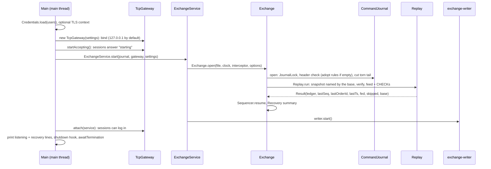
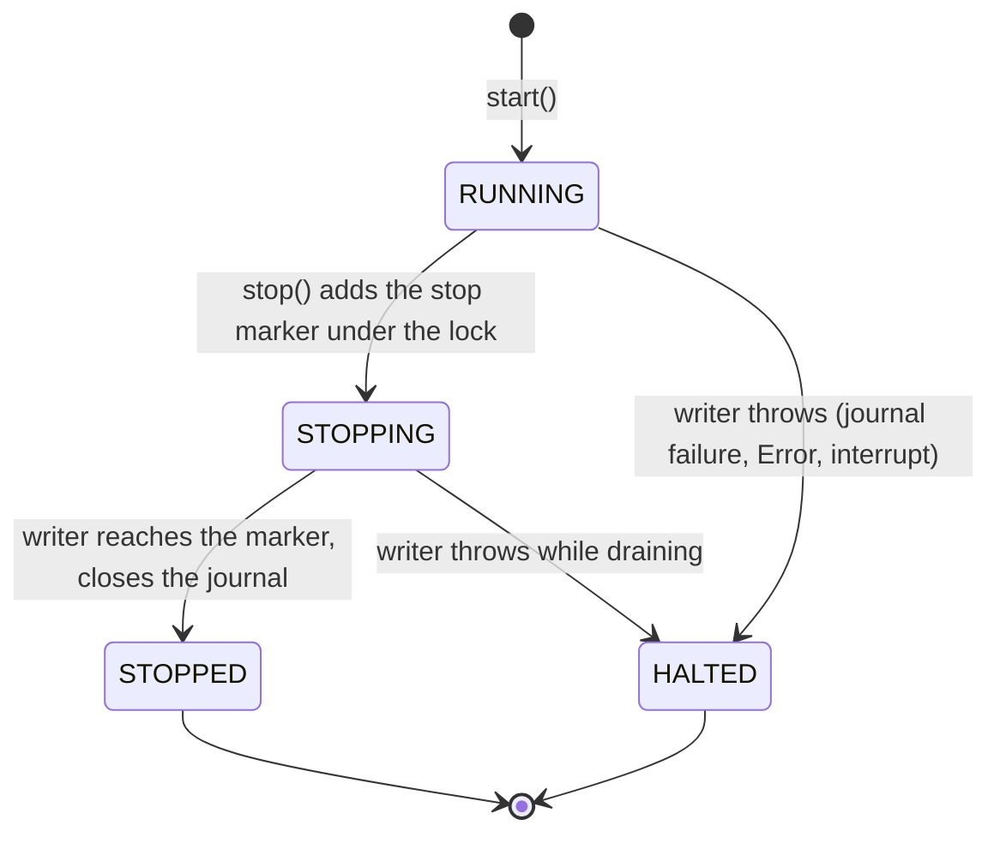

# 05b — Core flows, part 2: startup, recovery, compaction, poison pills, shutdown

> **Project:** ExchangeServer2 | Single-instrument limit order book: price-time matching engine, write-ahead journal with replay, single writer thread, TCP/TLS gateway with authenticated participants | Stack: Java 17, Maven wrapper, JUnit 5 (+ JMH, PIT)
> **This guide:** Step-by-step traces of flow 4 (startup, crash recovery, compaction, crossing a rules change), flow 5 (poison pills, live and at startup) and flow 6 (shutdown, halt, backpressure, timeouts, closing a connection), with the data shape at each step | **Prerequisites:** 01, 05a (helpful: 06) | **Related:** 05a, 06, 07-modules/journal, 07-modules/exchange-and-replay, 07-modules/exchange-service, 07-modules/client-and-main, 08-cross-cutting
> **Repo layout summary:** `pom.xml` + Maven wrapper (`mvnw`, `mvnw.cmd`) at the root; production code in `src/main/java/exchangeserver/` (packages `domain`, `book`, `engine`, `command`, `journal`, `core`, `gateway`, `client`, plus `Main`); tests mirror it in `src/test/java/exchangeserver/` (plus `bench/` JMH benchmarks and `testing/MutableClock`); design docs in `docs/` (`ExchangeServer2_Vision.md` = purpose/roadmap, `ExchangeServer2_Spec.md` = decisions D1–D77); these guides in `docs/understanding/`.

## Overview

Guide 05a followed requests through a running exchange. This guide covers how the exchange *gets* running, how it rebuilds itself after a crash, how it keeps its history bounded, what it does when its own engine throws, and how it stops. Terms (also in guide 13):

- **Journal**: the append-only text file of stamped commands (`HEADER`, then `NEW` / `CANCEL` / `CANCEL_ALL` / `SKIP` / `CHECK`, each ending in a CRC-32C). With the snapshot it names, it is the only exchange state on disk.
- **Snapshot** (D71): `<journal>.snapshot-<seq>`, the state after command `seq`; the journal header's **base sequence** names the snapshot it continues from (0: none).
- **Replay**: feeding the journalled commands, in order, through a fresh **Ledger** (engine + output digest + output log); outputs are not delivered.
- **CHECK** (D70): a journal record carrying the digest of every output before it; replay must reproduce it.
- **Torn tail**: bytes after the last `\n`, left by a crash in the middle of a write.
- **Poison pill / quarantine / SKIP**: a journalled command that makes the engine throw; a `SKIP` record tells replay to pass over it.
- **Halt / fail-stop**: the writer stops for good after a failure it cannot continue from; the process exits 2.

---

## Flow 4 — Startup, crash recovery, compaction

**Trigger:** `java -jar target/exchange-server2-2.0.0-SNAPSHOT.jar --port 9000 --journal exchange.journal --users exchange.users`. **Final effect:** the book, counters, last trade price, client-order-id map, output digest and every participant's oseq numbering are what they were after the last journalled command; new commands continue the numbering; clients can log in.

### Sequence diagram



### Step by step

**Step 1 — arguments and tools (`Main.main`).** Options: `--port`, `--bind`, `--journal`, `--users`, `--tls-keystore`, the session limits, `--check-interval`, `--resend-window`; the tools `--add-user`, `--quarantine`, `--compact` run and exit. An unknown option or a missing value prints usage and exits 1. **[Verified]** `src/main/java/exchangeserver/Main.java:66-118`.

**Step 2 — credentials, TLS, bind.** `serve` loads the users file (missing file: a message telling the operator to run `--add-user`), builds a TLS context if `--tls-keystore` is given (password from `ES2_TLS_PASSWORD`), warns when binding a non-loopback address without TLS, and creates the gateway, which binds at once (127.0.0.1 unless `--bind`). Any failure here exits 1. **[Verified]** `src/main/java/exchangeserver/Main.java:120-138`, `src/main/java/exchangeserver/gateway/TcpGateway.java:113-129`.

**Step 3 — accept before replay (L6).** `gateway.startAccepting()` starts the acceptor *before* the journal is replayed; until `attach`, a session answers any request with `ERROR exchange is starting; retry shortly` and closes, instead of leaving the client in silence. **[Verified]** `src/main/java/exchangeserver/Main.java:139`, `src/main/java/exchangeserver/gateway/ClientSession.java:228-232`; test `TcpGatewayTest.Session.beforeTheExchangeIsAttachedSessionsAreToldItIsStarting`.

**Step 4 — `ExchangeService.start` → `Exchange.open` (main thread).** Opening and replaying run on the calling thread; only then is the writer started (`Thread.start()` hands the replayed state to it with a happens-before edge). `Exchange.open` creates the journal, ledger and sequencer itself and closes the journal if anything fails. **[Verified]** `src/main/java/exchangeserver/core/ExchangeService.java:124-136`, `src/main/java/exchangeserver/core/Exchange.java:116-137`.

**Step 5 — `CommandJournal.open`: lock, check, change.** **[Verified]** `src/main/java/exchangeserver/journal/CommandJournal.java:75-127`.

```java
// src/main/java/exchangeserver/journal/CommandJournal.java:98-116 (trimmed)
private static CommandJournal openLocked(Path file, int rulesVersion, JournalLock ownedLock) throws IOException {
    JournalCodec.Header header = checkHeader(file, rulesVersion);
    int adoptedFrom = 0;
    if (header != null && header.rulesVersion() != rulesVersion) {
        adoptedFrom = header.rulesVersion();            // checkHeader allowed it: no records yet
        writeFresh(file, rulesVersion, header.baseSequence());
        header = new JournalCodec.Header(rulesVersion, header.baseSequence());
    }

    FileChannel channel = FileChannel.open(file, CREATE, WRITE, APPEND);    // APPEND: never overwrite history
    long truncated;
    try {
        truncated = cutTornTail(file);
        if (channel.size() == 0) {
            channel.write(ByteBuffer.wrap(JournalCodec.encodeHeader(rulesVersion, 0).getBytes(UTF_8)));
            channel.force(true);
            Durable.fsyncDirectory(file);           // a new file's directory entry must be durable too
```

1. **Lock first** (D65, `JournalLock.acquire`, `src/main/java/exchangeserver/journal/JournalLock.java:37-66`): add the lock file's real path to an in-JVM set (`HELD`), then `tryLock()` the whole of `<journal>.lock` through a channel nothing else ever opens. A second open, in this JVM or another process, is refused with "already open". The separate file matters on Linux/macOS, where closing *any* handle on a locked file drops the process's locks on it. **[Verified]** on Windows and Linux (cross-process test passed in a Linux container; live `--quarantine` against a running server refused on both).
2. **Check the header before changing anything** (D64, `checkHeader`, `CommandJournal.java:241-260`): a complete first record must be a valid v3 header (checksum included). A header of *other* rules is accepted only if the journal has no records yet: the header is then rewritten atomically with this build's rules, keeping the base sequence (D71: "adopted"). Anything else, including a file that is not a journal, is refused and left untouched.
3. **Cut a torn tail** after the last `\n` and fsync the cut (D38).
4. **Write a header** if the file is empty, fsync it and fsync the directory (D69).

*Data shape:* a `CommandJournal{file, channel (APPEND), lock, baseSequence, truncatedBytesOnOpen, adoptedRulesFrom, failed=false}`.

**Step 6 — `Replay.run`: snapshot, verify, feed.** **[Verified]** `src/main/java/exchangeserver/core/Replay.java:39-48`.

```java
// src/main/java/exchangeserver/core/Replay.java:39-48
static Result run(CommandJournal journal, Path journalFile, long stopBefore, CommandInterceptor interceptor,
                  int retention) throws IOException {
    Snapshot snapshot = snapshotFor(journal, journalFile);
    Verifier verifier = new Verifier(snapshot);
    journal.read(verifier);
    Ledger ledger = Ledger.from(snapshot, retention);
    long fed = feed(journal, ledger, stopBefore, verifier.skipped, interceptor);
    return new Result(ledger, verifier.lastSequenceNumber, verifier.lastOrderId, verifier.lastTimestamp, fed,
            Set.copyOf(verifier.skipped), journal.baseSequence());
}
```

- *Snapshot* (`Replay.java:59-69`): base 0 means the empty snapshot; otherwise `<journal>.snapshot-<base>` is read (each line checksummed, an END record proving it is complete) and must hold that sequence number.
- *Pass 1, verify* (`Replay.java:101-130`): sequence numbers exactly `base+1, base+2, …`; timestamps never decrease; remember the last sequence number, timestamp, last order id from NEW records (skipped ones included: those ids were issued) and the set of skipped sequence numbers. Nothing is fed if any of this fails.
- *Pass 2, feed* (`Replay.java:72-99`): start a `Ledger` from the snapshot (engine restored with time priority, digest and oseq numbering resumed), then feed every NEW/CANCEL/CANCEL_ALL below `stopBefore` that is not skipped. At each CHECK record, the replayed digest must equal the recorded one, or replay stops with `ReplayException(DIVERGED, seq)` (D70). An engine exception becomes `ReplayException(ENGINE_FAILURE, seq)`.

```java
// src/main/java/exchangeserver/core/Replay.java:80-95 (trimmed)
if (command instanceof CheckCommand check) {
    if (!check.digest().equals(ledger.digest())) {
        throw new ReplayException(ReplayException.Kind.DIVERGED, seq, "Replay diverged before CHECK " + seq
                + ": the journal recorded output digest " + check.digest() + ", this build produced "
                + ledger.digest() + ". This build processes the old commands differently; start it from a "
                + "snapshot written by the build that wrote this journal (--compact).", null);
    }
    return;
}
try {
    interceptor.beforeEngine(command);      // the test seam stands in for the engine here
    ledger.apply(command);
} catch (RuntimeException e) {
    throw new ReplayException(ReplayException.Kind.ENGINE_FAILURE, seq, "Replay failed on command " + seq
            + " (" + e.getMessage() + ")", e);
}
```

Because the engine depends only on its commands (no clock, counters, randomness or hash order, D12), the same commands rebuild the same book, last trade price, client-order-id map, digest and oseq numbers. **[Verified]** code; tests `ExchangeTest.Restart.*`, `ExchangeTest.Checkpoints.*`, `TcpGatewayTest.Resend.theStreamSurvivesARestart`.

*Data shape:* `Replay.Result(ledger, lastSequenceNumber, lastOrderId, lastTimestamp, fed, skipped, baseSequence)`.

**Step 7 — resume the sequencer.** It continues at `lastSequenceNumber + 1` and `lastOrderId + 1`, and never stamps a timestamp earlier than the last journalled one. **[Verified]** `src/main/java/exchangeserver/command/Sequencer.java:40-46`, `src/main/java/exchangeserver/core/Exchange.java:122-123`.

**Step 8 — start the writer, attach, report (L1).** `ExchangeService.start` starts the non-daemon `exchange-writer`; `Main` attaches the service to the gateway (now LOGIN works) and prints two lines: where it listens, and what recovery did. **[Verified]** `src/main/java/exchangeserver/Main.java:150-157`. Seen live after a compaction:

```
ExchangeServer2 listening on 127.0.0.1:9137, journal ...\live3\exchange.journal
Recovered through sequence 4 from snapshot 4: replayed 0 commands, cut 0 torn bytes
```

The summary also names quarantined commands and a rules adoption when there are any. **[Verified]** live; `Exchange.Recovery` at `src/main/java/exchangeserver/core/Exchange.java:78-80`.

**Step 9 — hook and wait.** `Main` registers the shutdown hook (flow 6) and blocks in `service.awaitTermination()`. **[Verified]** `src/main/java/exchangeserver/Main.java:159-183`.

### Startup failures

Any failure in steps 4–7 closes the gateway, prints `Startup failed: <message>` and a hint chosen by `Main.hint`, and exits 1 (L2, D77): an `ENGINE_FAILURE` gets the `--quarantine <seq>` advice, a `DIVERGED` gets the compaction advice, anything else (locked journal, other rules with records, not a journal, corrupt record, checksum mismatch, CRLF conversion, sequence gap, missing snapshot) gets "The journal was not changed." **[Verified]** `src/main/java/exchangeserver/Main.java:140-149`, `Main.java:186-198`; tests `MainTest`.

### Crash recovery, seen running

Earlier the same day (before D69 changed the format), the server was hard-killed, half a record appended, and the server restarted: the torn bytes were cut, the book and counters came back, and new commands continued the numbering. With D77 the cut is now reported in the recovery line. **[Verified]** live (format v2 then); `ExchangeTest.Operations.recoveryReportsWhatItDid` checks the report.

### What a crash can and cannot lose

| Crash moment | After restart | Client's view |
|---|---|---|
| Before the batch's fsync returned | Records missing or torn (cut) | Nobody was answered: consistent |
| After fsync, before the lines were sent | Commands are replayed and take effect | Client heard nothing; on reconnect `WELCOME oseq=` shows the higher number and `RESEND` delivers the events (D73); a resend of the same clOrdId is rejected as DUPLICATE with the original id (D49, within one journal) |
| While compacting | The old journal is still in charge (see 4b) | Nothing visible changed |

**[Verified]** Spec §4 failure model; RESEND path in 05a flow 3.

### 4b. Compaction (`--compact`, D71)

**Trigger:** `java -jar … --journal exchange.journal --compact`, run while the exchange is stopped. **Final effect:** `<journal>.snapshot-<last>` holds the state after the last command; the old journal is copied to `<journal>.archive-<first>-<last>`; the journal is replaced atomically by one that holds only `HEADER,3,<rules>,<last>`. Recovery afterwards costs the snapshot plus the journal since it, not all history.

```java
// src/main/java/exchangeserver/core/Exchange.java:174-193 (trimmed)
public static Compaction compact(Path journalFile) throws IOException {
    try (JournalLock lock = JournalLock.acquire(journalFile)) {
        Replay.Result replay;
        try (CommandJournal journal = CommandJournal.open(journalFile, Rules.VERSION, lock)) {
            replay = Replay.run(journal, journalFile, Long.MAX_VALUE, CommandInterceptor.NONE,
                    Options.defaults().outputRetention());
        }
        if (replay.lastSequenceNumber() == replay.baseSequence()) {
            return null;
        }
        long last = replay.lastSequenceNumber();
        Snapshot snapshot = replay.ledger().snapshot(last, replay.lastOrderId(), replay.lastTimestamp());
        Path snapshotFile = Snapshot.path(journalFile, last);
        snapshot.write(snapshotFile);
        Path archive = journalFile.resolveSibling(journalFile.getFileName() + ".archive-"
                + (replay.baseSequence() + 1) + "-" + last);
        Durable.copyDurably(journalFile, archive);
        CommandJournal.writeFresh(journalFile, Rules.VERSION, last);
        return new Compaction(last, snapshot.orders().size(), snapshotFile, archive);
    }
}
```

1. Take the journal's lock for the whole operation (a running exchange makes it fail: "already open").
2. Replay the journal fully (with its snapshot, CHECKs verified).
3. Write the snapshot: header line (last sequence, last order id, last timestamp, last trade price, digest), one ORDER line per resting order in book priority, one OSEQ line per participant (sorted), END with counts; written to a temporary file, fsynced, atomically renamed, directory fsynced (`Durable.writeAtomically`, `src/main/java/exchangeserver/journal/Durable.java:25-36`).
4. Copy the journal to the archive and fsync it.
5. Replace the journal atomically with a header-only journal whose base is `last` (`CommandJournal.writeFresh`, `CommandJournal.java:130-132`).

**Why it is crash-safe:** until step 5 the old journal (with its old base) is untouched and still names its own snapshot, so a crash leaves at most stray new files; after step 5 the new journal names a snapshot that is already durable. Each snapshot's name carries its sequence number, so no file is ever overwritten under a journal that needs it. **[Verified]** code; test `ExchangeTest.Compaction.aCrashAfterWritingTheSnapshotLeavesTheOldJournalInCharge`; **[Inferred]** the general argument.

**What compaction ends:** the client-order-id map keeps only resting orders' ids (an id is unique per participant within one journal, revising D49), and RESEND cannot reach events before it (the snapshot keeps each participant's last oseq, not the events). **[Verified]** `ExchangeTest.Compaction.clientOrderIdsAreScopedToTheJournalExceptForRestingOrders`, `outputNumberingContinuesAcrossACompaction`.

Seen live: `--compact` while the server ran was refused (`Compaction failed: Journal … is already open …`, exit 1); after the stop it printed `Compacted through sequence 4: 0 resting orders in …snapshot-4; old journal archived as …archive-1-4`, and the snapshot read:

```
SNAPSHOT,1,4,3,2026-10-27T14:20:42.045241200Z,100,88a18b6a6365ebe4,d7e6a970
OSEQ,alice,4,d1453b0b
OSEQ,bob,1,3d136969
END,0,2,6a6d3c70
```

**[Verified]** live run.

### 4c. Crossing a rules change

`Rules.VERSION` (now 2) is in every journal header; a journal with records written under other rules is refused, because replaying it under new rules would silently build a different book (D46). The way across (D71): run `--compact` **with the old build** (its journal is now empty, naming a snapshot), then start the new build: `CommandJournal.open` sees an empty journal of other rules, rewrites its header with the new version, and the recovery line says `journal moved from rules N`. The snapshot is state, not commands, so the new rules never re-judge old orders. **[Verified]** `CommandJournal.java:99-105`, `CommandJournal.java:252-258`; tests `CommandJournalTest.Header.anEmptyJournalAdoptsANewRulesVersionAndKeepsItsBase`, `ExchangeTest.Compaction.aRulesChangeIsCrossedWithAnEmptyCompactedJournal`.

---

## Flow 5 — Poison pills, live and at startup

### 5a. Live: quarantine, rebuild from the snapshot, carry on

**Trigger:** within a batch, `ledger.apply` throws a `RuntimeException` on command *k*. **Final effect:** a durable `SKIP` record for *k*; the ledger rebuilt to the state just before *k*; the rest of the batch processed; the caller of *k* gets `INTERNAL_ERROR`; nobody else notices.

```mermaid
sequenceDiagram
    participant W as exchange-writer
    participant X as Exchange.process
    participant J as CommandJournal
    participant R as Replay.rebuild
    W->>X: process(batch k-1, k, k+1)
    X->>J: appendAll(k-1, k, k+1) + fsync
    X->>X: apply(k-1): listener, then future
    X->>X: apply(k) throws RuntimeException
    X->>J: append SKIP(next seq, skips k) + fsync
    X->>R: rebuild: snapshot + every command before k, minus skipped
    X->>X: ledger = rebuilt; fail k with INTERNAL_ERROR
    X->>X: apply(k+1) on the rebuilt ledger
```

```java
// src/main/java/exchangeserver/core/Exchange.java:278-287 (trimmed)
private void quarantine(Command poison, RuntimeException cause) throws IOException {
    LOG.log(Level.ERROR, "Engine failed on command " + poison.sequenceNumber() + "; quarantining it", cause);
    journal.append(sequencer.stampSkip(poison.sequenceNumber()));
    skipped.add(poison.sequenceNumber());
    ledger = Replay.rebuild(journal, journalFile, poison.sequenceNumber(), skipped, interceptor, options.outputRetention());
}
```

1. The engine may have thrown half-way through *k*, so the old ledger is discarded, not rolled back. The whole ledger is replaced, so engine, digest and oseq numbering cannot disagree.
2. The SKIP gets the next sequence number *after the whole batch* (the batch was stamped first), with its own fsync.
3. `Replay.rebuild` starts from the journal's snapshot and feeds every command before *k* minus the skip set, in one pass (the journal was verified at open; only this thread has appended since). **[Verified]** `src/main/java/exchangeserver/core/Replay.java:52-57`; test `ExchangeTest.Compaction.aPoisonAfterACompactionRebuildsFromTheSnapshot`.
4. *k*'s outputs were never sent (the listener runs only after `apply` returns), so the rebuilt history is exactly what clients saw. **[Verified]** `src/main/java/exchangeserver/core/Exchange.java:235-251`.

An `Error` (out of memory, stack overflow) is not caught here: it propagates and halts the writer (flow 6). **[Verified]** `Exchange.java:239` catches `RuntimeException` only.

### 5b. At startup: stop, then the operator decides

**Trigger:** replay throws `ReplayException(ENGINE_FAILURE, k)` on a command with no SKIP. **Final effect:** startup fails (exit 1) with the hint `Replay failed on command k (a poison pill?). Inspect it, then run --quarantine k and start again.`; after `--quarantine k` the next start skips it.

A failing record is never skipped automatically at startup: the code cannot tell a true poison from a command that succeeded under older code and whose effects clients saw (D51). `Exchange.quarantine` opens the journal (refused while the exchange runs: lock), reads every record, requires *k* to be a NEW, CANCEL or CANCEL_ALL, **refuses a command already quarantined** (L3), and appends `SKIP(last+1, ts, k)`. **[Verified]** `src/main/java/exchangeserver/core/Exchange.java:141-166`, `src/main/java/exchangeserver/Main.java:101-107`; tests `ExchangeTest.PoisonPill.*`, `ExchangeTest.Operations.quarantineRefusesACommandAlreadyQuarantined`.

A `DIVERGED` replay is different: no single record is at fault; the build changed. The hint says to compact with the old build first (4c). A record that does not even parse cannot be quarantined: `journal.read` throws on it first, and startup always stops (D38).

---

## Flow 6 — Shutdown, halt, backpressure, timeouts, closing a connection

### 6a. The service state machine



"Refused" and "never lost" hold together because the state check and the enqueue share one lock with `stop()`'s state flip and marker (D56). `stop()` refuses to run on the writer thread itself (it would wait for its own end, L6). **[Verified]** `src/main/java/exchangeserver/core/ExchangeService.java:211-257`.

### 6b. Clean shutdown (Ctrl+C, SIGTERM)

```java
// src/main/java/exchangeserver/Main.java:159-177 (trimmed)
Runtime.getRuntime().addShutdownHook(new Thread(() -> {
    int status = 0;
    try {
        gateway.close();
        if (!service.stop(Duration.ofSeconds(10))) {
            System.err.println("Writer thread did not stop within 10 s");
            status = 1;
        }
    } catch (IOException | InterruptedException e) {
        System.err.println("Shutdown: " + e);
        status = 1;
    }
    if (service.state() == ExchangeService.State.HALTED) {
        status = 2;
    }
    System.out.flush();
    System.err.flush();
    Runtime.getRuntime().halt(status);     // the documented code, whatever started the shutdown
}, "shutdown"));
```

1. Close the gateway: the server socket closes and every session is closed at once (`closeNow`). Each close runs `TcpGateway.removed`, so participants that asked for cancel-on-disconnect get their `CANCEL_ALL` queued now, ahead of the stop marker (05a flow 2b). **[Verified]** `src/main/java/exchangeserver/gateway/TcpGateway.java:313-319`; **[Inferred]** COD on shutdown from the order of calls.
2. `stop(10 s)`: STOPPING, marker queued; the writer processes everything accepted before it, then closes the journal (releasing the lock) as its last act and sets STOPPED (D58). **[Verified]** `ExchangeService.java:245-257`, `ExchangeService.java:286-323`.
3. `Runtime.halt(status)` ends the process with the documented code: 0, or 1 if the writer did not stop in time, or 2 if halted. Without it, a JVM ending on a signal reports the signal's status (130 for SIGINT, 143 for SIGTERM). **[Verified]** in a Linux container: exit status 0 after SIGINT and after SIGTERM.

### 6c. Halt

**Trigger:** the writer catches any `Throwable` that escaped `Exchange.process`: a journal I/O error (or the fail-stopped journal's refusal), an `Error`, a failure while appending a SKIP, an interrupt. **Final effect:** HALTED, everyone waiting refused, journal closed, process exits 2. **[Verified]** `src/main/java/exchangeserver/core/ExchangeService.java:306-311`, `ExchangeService.java:342-359`, `src/main/java/exchangeserver/Main.java:179-183`.

```java
// src/main/java/exchangeserver/core/ExchangeService.java:342-358 (trimmed)
private void halt(Throwable cause, List<Pending<?>> batch) {
    LOG.log(Level.ERROR, "Exchange halted", cause);
    synchronized (lock) {
        haltCause = cause;
        state = State.HALTED;           // from here on enqueue() refuses, so the drain below is final
    }
    ExchangeException refusal = new ExchangeException(ExchangeException.Reason.HALTED, "exchange halted", cause);
    for (Pending<?> p : batch) {
        p.fail(refusal);                // no-op for those already completed
    }
    List<Pending<?>> left = new ArrayList<>();
    queue.drainTo(left);
    for (Pending<?> p : left) {
        if (p != stopMarker) {
            p.fail(refusal);
        }
    }
}
```

The batch that failed may be journalled while its callers were told HALTED; on restart those commands replay (durable ⇒ visible does not hold). Clients reconcile with `RESEND` after logging in again (D73) or by resending with the same client order id (D49). **[Verified]** Spec §4.

### 6d. Backpressure and limits

| Refusal | Where | Scope | Journalled? |
|---|---|---|---|
| `BUSY` | `ExchangeService.enqueue`, queue at 100,000 | whole exchange | no |
| `STOPPED` / `HALTED` | `ExchangeService.enqueue` | whole exchange | no |
| `SESSION_BUSY` | `ClientSession.admit`, 1,000 requests in flight | one session | no |
| `RATE_LIMITED` | `ClientSession.admit`, token bucket 1,000/s, burst 2,000 | one session | no |
| slow consumer | `ClientSession.send`, outbound queue of 10,000 lines full | one session, disconnected | no |

**[Verified]** `src/main/java/exchangeserver/core/ExchangeService.java:222-233`, `src/main/java/exchangeserver/gateway/ClientSession.java:116-124`, `ClientSession.java:279-291`. The per-session limits (D75) stop one pipelining client from filling the global queue so that everyone gets BUSY.

### 6e. Timeouts (D75)

The reader's socket read timeout is the login timeout (10 s) until a successful LOGIN, then the idle timeout (300 s; any line, PING included, resets it). On expiry the session sends `ERROR login timeout; disconnecting` or `ERROR idle timeout; disconnecting` and closes after its in-flight requests. **[Verified]** `src/main/java/exchangeserver/gateway/ClientSession.java:157`, `ClientSession.java:166-168`, `ClientSession.java:308`; tests `TcpGatewayTest.Limits.aConnectionThatNeverLogsInIsDisconnected`, `anIdleSessionIsDisconnected`.

### 6f. Closing a connection only after its requests complete (D76)

**Trigger:** the reader stops: QUIT, end of stream, an overlong line, a failed login, a timeout. **Final effect:** every request the session handed in completes and its lines go out; then `BYE` (for QUIT); then the connection closes. A broken connection (I/O error) closes at once.

```java
// src/main/java/exchangeserver/gateway/ClientSession.java:421-442 (trimmed)
private <T> BiConsumer<T, Throwable> tracked(BiConsumer<T, Throwable> callback) {
    inFlight.incrementAndGet();
    return (value, failure) -> {
        try {
            callback.accept(value, failure);
        } finally {
            inFlight.decrementAndGet();
            finishIfIdle();
        }
    };
}

private void finishIfIdle() {
    if (readerDone && inFlight.get() == 0 && finished.compareAndSet(false, true)) {
        String last = farewell;
        if (last != null) {
            send(last);
        }
        close();
    }
}
```

How it works: every request a session hands in is counted until its callback has run, and since D76 a callback runs only after the listener has offered the request's lines. When the reader stops it sets `readerDone` and tries `finishIfIdle`; the last callback to bring the count to zero also tries it; the compare-and-set makes exactly one of them close. This also holds during shutdown: requests accepted before `stop()` are still processed, and refused ones complete at once. The D63 version (queue a snapshot read as a barrier) did not, because the exchange refuses reads once stopping. **[Verified]** code; tests `TcpGatewayTest.Session.quitAnswersEveryEarlierRequestBeforeBye`, `endOfStreamStillGetsTheReplies`, `quitDuringShutdownStillGetsTheRepliesOfAcceptedRequests`.

---

## Key takeaways

- Startup = credentials and TLS → bind → accept ("starting") → lock → header check (adopt rules if the journal is empty) → torn-tail cut → snapshot + verify + feed with CHECK comparison → sequencer resume → attach → recovery summary.
- The journal names its snapshot by sequence number; recovery costs the snapshot plus the journal since it.
- `--compact` (exchange stopped) writes the snapshot, archives the journal and atomically replaces it with an empty one; it is crash-safe at every step and is the only way across a rules change.
- A CHECK mismatch (`DIVERGED`) means this build behaves differently from the one that wrote the journal; an `ENGINE_FAILURE` at startup is a poison pill for the operator to quarantine.
- Live poison pill: SKIP (fsynced), rebuild the whole ledger from the snapshot, carry on; the caller gets INTERNAL_ERROR.
- A signal-triggered stop exits 0 (verified on Linux); a halt exits 2; startup and tool failures exit 1.
- Sessions close only after their in-flight requests complete, during shutdown too; refusals at every level are stateless and never journalled.

## Common confusions

- **"Compaction can run next to the exchange."** No: it takes the journal's lock; a running exchange makes it fail.
- **"A snapshot depends on the rules version."** It is state, not commands; that is why it can carry the book across a rules change.
- **"RESEND after a compaction reaches the old events."** The snapshot keeps each participant's last oseq, not the events.
- **"A DIVERGED replay can be quarantined."** No single record is at fault; compact with the old build instead.
- **"Exit code 0 after Ctrl+C is automatic."** It is enforced by the hook's `Runtime.halt(status)`; without it the JVM reports the signal's status.

## Questions to test yourself

1. The journal's header says base 120 and `exchange.journal.snapshot-120` is missing. What happens at startup?
<details><summary>Answer</summary>`Snapshot.read` fails with "Snapshot … is missing: the journal continues from it"; startup stops with exit 1 and the hint "The journal was not changed."</details>

2. A crash hits compaction after the snapshot was written but before the journal was replaced. What does the next start load?
<details><summary>Answer</summary>The old journal, with its old base and snapshot, exactly as before; the new snapshot file is a stray (the next compaction overwrites or reuses it). Tested by `aCrashAfterWritingTheSnapshotLeavesTheOldJournalInCharge`.</details>

3. Commands 10, 11, 12 share a batch; the engine throws on 11. What new record appears, and what state does 12 run against?
<details><summary>Answer</summary>`SKIP,13,<ts>,11,<crc>`. Command 12 runs on a ledger rebuilt from the snapshot plus every command below 11 (minus earlier skips), i.e. the state after 10.</details>

4. You upgrade to a build with `Rules.VERSION` 3. What are the steps, and what does the new build print?
<details><summary>Answer</summary>Stop the old build, run `--compact` with it, start the new build. The empty journal adopts rules 3; the recovery line ends with ", journal moved from rules 2".</details>

5. A client sends NEW and then QUIT while the operator presses Ctrl+C. Does it get its ORDER line?
<details><summary>Answer</summary>If the NEW was accepted before `stop()`, yes: it is processed, the listener sends the ORDER line, its callback brings the in-flight count to zero and only then the session sends BYE and closes (D76). The gateway's `closeNow` during shutdown can still drop lines already queued, since shutdown closes connections.</details>
