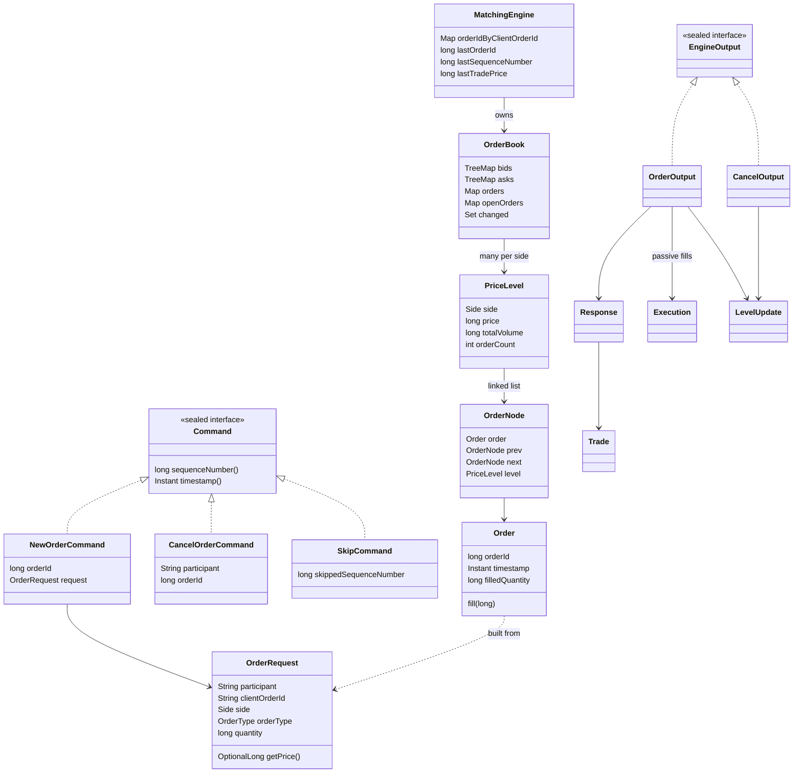
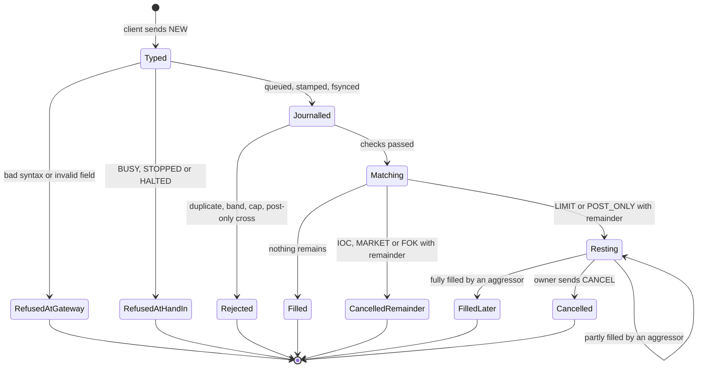
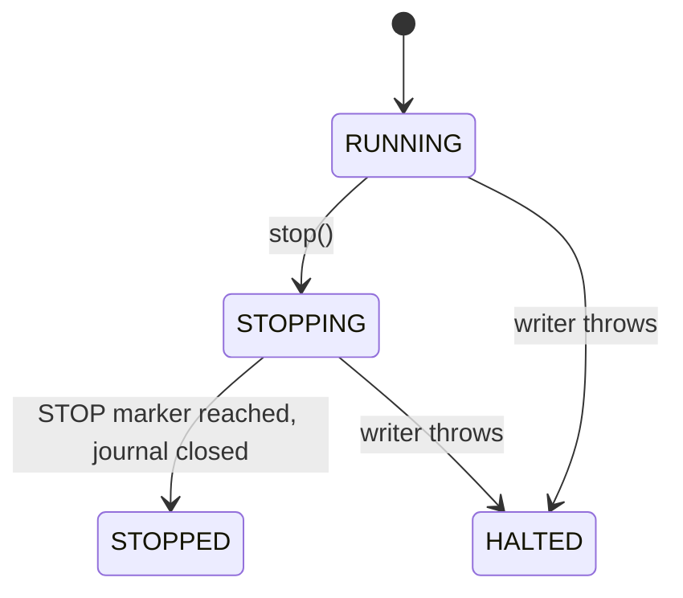
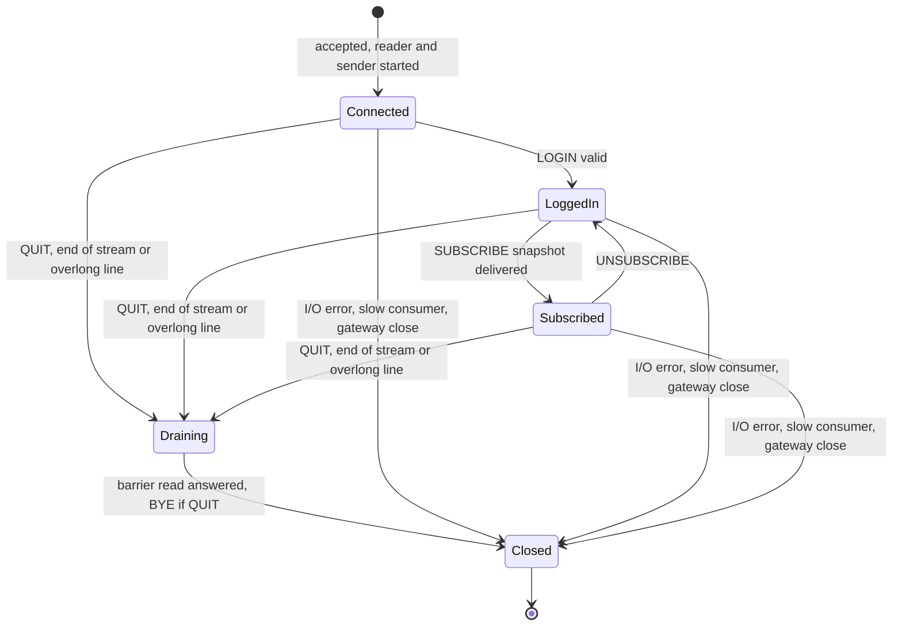

# 06 — Data and state

> **Project:** ExchangeServer2 | Single-instrument limit order book: price-time matching engine, write-ahead journal with replay, single writer thread, plain TCP gateway | Stack: Java 17, Maven wrapper, JUnit 5 (+ JMH, PIT)
> **This guide:** Every data model (domain, commands, book, engine outputs, core requests, gateway messages), the journal file format, the wire protocol, where each piece of state lives and which thread may touch it, how state changes over time, the validation layers, what persists, and how "migrations" work | **Prerequisites:** 01 (helpful: 02 for records and sealed interfaces) | **Related:** 05a, 05b, 07-modules/domain-and-commands, 07-modules/book, 07-modules/engine, 07-modules/journal, 07-modules/gateway, 13
> **Repo layout summary:** `pom.xml` + Maven wrapper (`mvnw`, `mvnw.cmd`) at the root; production code in `src/main/java/exchangeserver/` (packages `domain`, `book`, `engine`, `command`, `journal`, `core`, `gateway`, `client`, plus `Main`); tests mirror it in `src/test/java/exchangeserver/` (plus `bench/` JMH benchmarks and `testing/MutableClock`); design docs in `docs/` (`ExchangeServer2_Vision.md` = purpose/roadmap, `ExchangeServer2_Spec.md` = decisions D1–D65); these guides in `docs/understanding/`.

## Overview

ExchangeServer2 has no database. Its data lives in three places:

1. **One journal file** — the only thing that persists. Plain text, one record per line.
2. **In-memory state owned by the single writer thread** — the order book, the engine's counters and maps, the
   sequencer. All of it is rebuilt from the journal at startup.
3. **Per-connection gateway state** — sessions, subscriptions, outbound queues. Never persisted; lost on restart.

Most types are Java **records** (immutable data classes with generated accessors, `equals` and `hashCode`) and
**sealed interfaces** (an interface that lists exactly which classes may implement it, so the compiler knows every
case). Guide 02 explains both. Two design rules shape almost every type **[Verified]** (Spec D22, D31, D47):

- **An invalid value cannot be constructed.** Constructors (including records' "compact constructors") check their
  fields and throw. So code that holds an `OrderRequest`, a `Command` or a `Response` never re-checks it.
- **Validation happens once, at the right layer.** Stateless field rules live only in `OrderRequest`; rules that
  depend on the book live only in the engine.

Prices and quantities are plain `long` integers everywhere. The code never says what one unit of price is (a cent,
a tick) or what instrument is traded. **[Verified]** (no currency, tick or decimal type anywhere in
`src/main/java`); the intended unit is unknown — see guide 15.

---

## 1. Data models

### 1.1 Domain (`exchangeserver.domain`)

| Type | Kind | Fields / values | Rules enforced | Source |
|---|---|---|---|---|
| `Side` | enum | `BUY`, `SELL`; `opposite()` | — | `src/main/java/exchangeserver/domain/Side.java:3-10` |
| `OrderType` | enum | `LIMIT`, `IOC`, `FOK`, `MARKET`, `POST_ONLY`; `canRest()` true only for LIMIT and POST_ONLY | — | `src/main/java/exchangeserver/domain/OrderType.java:12-23` |
| `Rules` | constants | `VERSION=1`, `MAX_ORDER_QUANTITY=1e9`, `MAX_PRICE=Long.MAX_VALUE/1e9` (≈9.2e9), `PARTICIPANT=[A-Za-z0-9_]{1,16}`, `CLIENT_ORDER_ID=[A-Za-z0-9_.-]{1,32}`, `PRICE_BAND_PERCENT=10`, `MAX_OPEN_ORDERS_PER_PARTICIPANT=10,000`, `withinBand(price, ref)` | every rule replay depends on | `src/main/java/exchangeserver/domain/Rules.java:17-44` |
| `OrderRequest` | final class, private constructor | `participant`, `clientOrderId`, `side`, `orderType`, `quantity`, `price` (`-1` internally for MARKET) | the regexes, 1 ≤ quantity ≤ 1e9, 1 ≤ price ≤ MAX_PRICE for priced types, MARKET has no price | `src/main/java/exchangeserver/domain/OrderRequest.java:15-74` |
| `Order` | final class, one mutable field | `orderId`, the request's fields, `timestamp`, **`filledQuantity`** (mutable) | id > 0, non-null timestamp; `fill(q)` rejects q ≤ 0 and overfill; `getPrice()` throws for MARKET | `src/main/java/exchangeserver/domain/Order.java:16-103` |

Two details worth knowing **[Verified]**:

- The participant and client-order-id patterns forbid `,` and spaces because those separate fields in the journal
  and the wire protocol (`Rules.java:25`).
- A market order's "no price" is the sentinel `Order.NO_PRICE = -1` inside the objects, but it never leaks: the API
  returns `OptionalLong` (`OrderRequest.getPrice()`, `OrderRequest.java:116-118`) and `Order.getPrice()` throws for
  MARKET (`Order.java:71-77`); the journal writes `-`.

```java
// src/main/java/exchangeserver/domain/Rules.java:38-43
// Exact integer comparison, no rounding: price * 100 vs reference * (100 +- band).
// Cannot overflow: both prices are <= MAX_PRICE (~9.2e9), times at most 110.
public static boolean withinBand(long price, long referencePrice) {
    return price * 100 <= referencePrice * (100 + PRICE_BAND_PERCENT)
            && price * 100 >= referencePrice * (100 - PRICE_BAND_PERCENT);
}
```

### 1.2 Commands (`exchangeserver.command`) — what the journal stores

A **command** is a request after the writer thread has stamped it: the immutable, journalled source of truth
(D12, D31). `Command` is a sealed interface with three records. **[Verified]**
`src/main/java/exchangeserver/command/Command.java:11-16`.

| Record | Fields | Constructor checks | Source |
|---|---|---|---|
| `NewOrderCommand` | `sequenceNumber`, `timestamp`, `orderId`, `request` (an `OrderRequest`) | seq > 0, id > 0, non-nulls | `NewOrderCommand.java:8-21` |
| `CancelOrderCommand` | `sequenceNumber`, `timestamp`, `participant`, `orderId` (the **target**) | seq > 0, participant matches the regex, id > 0 | `CancelOrderCommand.java:9-23` |
| `SkipCommand` | `sequenceNumber`, `timestamp`, `skippedSequenceNumber` | seq > 0, 0 < skipped < seq (only an earlier command) | `SkipCommand.java:14-24` |

The `Sequencer` (`Sequencer.java:20-82`) is the only place that creates the stamps: one counter for sequence
numbers (every command), one for order ids (new orders only), and a timestamp from an injected `java.time.Clock`
that never goes backwards.

### 1.3 Book (`exchangeserver.book`)

```java
// src/main/java/exchangeserver/book/OrderBook.java:37-45
private record LevelKey(Side side, long price) { }

private final TreeMap<Long, PriceLevel> bids = new TreeMap<>(Comparator.reverseOrder());   // best = highest
private final TreeMap<Long, PriceLevel> asks = new TreeMap<>();                            // best = lowest
private final Map<Long, OrderNode> orders = new HashMap<>();          // orderId -> node, iff resting
private final Map<String, Integer> openOrders = new HashMap<>();      // participant -> resting count
private final Set<LevelKey> changed = new LinkedHashSet<>();          // levels touched since last drain
```

| Type | What it is | Source |
|---|---|---|
| `OrderBook` | Two sorted maps of price levels, an id map for O(1) cancel, per-participant counts, and the "changed" set that feeds market data. Owns the lifecycle of every resting order. | `src/main/java/exchangeserver/book/OrderBook.java:35-45` |
| `PriceLevel` | All orders resting at one price on one side, in time priority, as a doubly linked list between two sentinel nodes (`head <-> o1 <-> o2 <-> tail`), plus `totalVolume` and `orderCount`. Public getters; every mutator package-private. | `src/main/java/exchangeserver/book/PriceLevel.java:9-41` |
| `OrderNode` | Package-private list node: `order` (null only for sentinels), `prev`, `next`, `level` (the level it is linked in, null when unlinked). | `src/main/java/exchangeserver/book/OrderNode.java:7-35` |
| `Fill` | Immutable record of what `fillBest` did to one resting order: id, participant, clOrdId, side, price, quantity, leaves. | `src/main/java/exchangeserver/book/Fill.java:5-13` |
| `LevelUpdate` | `(side, price, volume, orderCount)`: the absolute state of one level after a command; volume 0 = gone. | `src/main/java/exchangeserver/book/LevelUpdate.java:5-11` |
| `CancelResult`, `CancelStatus` | `(status, orderId, cancelledQuantity)`; `CANCELLED` (qty > 0) or `UNKNOWN_ORDER` (qty 0). | `src/main/java/exchangeserver/book/CancelResult.java:6-24` |

A **sentinel** is a dummy node at each end of the list so that linking and unlinking never need "is this the
first/last node?" branches. **[Verified]** `PriceLevel.java:11-15`.

### 1.4 Engine outputs (`exchangeserver.engine`)

| Type | Fields | Notes | Source |
|---|---|---|---|
| `Response` | `orderId, clientOrderId, status, rejectReason, filledQuantity, remainingQuantity, trades` | constructor rejects contradictions: filled = Σ trades, a reason iff REJECTED, FILLED ⇒ 0 remaining, RESTED/CANCELLED ⇒ > 0 remaining, REJECTED ⇒ nothing filled | `src/main/java/exchangeserver/engine/Response.java:15-53` |
| `OrderStatus` | `FILLED, RESTED, CANCELLED, REJECTED` | | `OrderStatus.java:4-9` |
| `RejectReason` | `DUPLICATE_CLIENT_ORDER_ID, PRICE_OUTSIDE_BAND, MAX_OPEN_ORDERS, POST_ONLY_WOULD_CROSS` | all state-dependent, all journalled | `RejectReason.java:9-18` |
| `Trade` | `price, quantity, buyOrderId, sellOrderId, aggressorSide, timestamp` | price = resting price; timestamp = incoming command's | `Trade.java:15-26` |
| `Execution` | `participant, orderId, clientOrderId, side, price, quantity, leavesQuantity` | a passive (maker) fill, addressed to the resting order's owner | `Execution.java:11-12` |
| `EngineOutput` (sealed) | `sequenceNumber, timestamp, trades(), passiveFills(), levelUpdates()` | `OrderOutput` (adds `response`) or `CancelOutput` (adds `result`) | `EngineOutput.java:14-25`, `OrderOutput.java:9-22`, `CancelOutput.java:10-26` |
| `BookSnapshot` | `sequenceNumber, lastTradePrice, bids, asks` (lists of `LevelUpdate`, best first) | 0 = no command / no trade yet | `BookSnapshot.java:14-19` |

Every list in these records is defensively copied with `List.copyOf`, so an output cannot change after it is built.
**[Verified]** e.g. `Response.java:21`, `OrderOutput.java:14-15`.

### 1.5 Core hand-in (`exchangeserver.core`)

| Type | What it is | Source |
|---|---|---|
| `Request<R>` (sealed, package-private) | What a caller hands in, *before* stamping: `Submit(OrderRequest)` → `Response`, `Cancel(participant, orderId)` → `CancelResult`, `Snapshot(depth)` → `BookSnapshot` (depth checked on the caller's thread). | `src/main/java/exchangeserver/core/Request.java:16-34` |
| `Pending<R>` (package-private) | One request in flight: `request`, its own `CompletableFuture<R> result`, plus `command` and `refused`, set by the writer. No field is volatile: the queue's put→take and the future's complete→get are the happens-before edges. | `src/main/java/exchangeserver/core/Pending.java:7-36` |
| `ExchangeException` | Why a request got no business result: `BUSY`, `STOPPED`, `HALTED`, `INTERNAL_ERROR`. | `src/main/java/exchangeserver/core/ExchangeException.java:16-41` |
| `ExchangeService.Settings` | `queueCapacity` (100,000), `maxBatchSize` (1,000), `lingerNanos` (0 = smart batching), `clock` (UTC). | `src/main/java/exchangeserver/core/ExchangeService.java:59-87` |

The queue carries *requests*, not commands, so that stamping happens on the writer thread and "sequence order =
queue order = processing order" holds without locking (D55). **[Verified]** `Request.java:8-15`.

### 1.6 Gateway (`exchangeserver.gateway`)

`ClientMessage` is a sealed interface of records for one parsed client line, syntax only: `Login(participant)`,
`NewOrder(clientOrderId, side, type, quantity, OptionalLong price)`, `Cancel(orderId)`, `Subscribe()`,
`Unsubscribe()`, `Ping()`, `Quit()`. The session adds the participant and builds the `OrderRequest`.
**[Verified]** `src/main/java/exchangeserver/gateway/ClientMessage.java:8-32`.

### 1.7 Class diagram



---

## 2. The journal file format

**[Verified]** `src/main/java/exchangeserver/journal/JournalCodec.java:16-41`, Spec §4.

```
HEADER,<formatVersion=2>,<rulesVersion>                                       (first record only)
NEW,<seq>,<timestamp>,<orderId>,<participant>,<clientOrderId>,<side>,<type>,<quantity>,<price or ->
CANCEL,<seq>,<timestamp>,<participant>,<targetOrderId>
SKIP,<seq>,<timestamp>,<skippedSeq>
```

- UTF-8 text, `,`-separated, every record ends in `\n` (LF only).
- Timestamps are `Instant.toString()` (ISO-8601 UTC, exact to the nanosecond); enums by `name()`; a MARKET order's
  price is `-`.
- A SKIP has its own sequence number; the skipped record stays in the file.

A real journal from this session, including a quarantine **[Verified]** (read from disk):

```
HEADER,2,1
NEW,1,2026-10-27T12:38:33.890909300Z,1,alice,a1,SELL,LIMIT,10,100
NEW,2,2026-10-27T12:38:34.862205500Z,2,bob,b1,BUY,LIMIT,4,101
NEW,3,2026-10-27T12:38:35.732225200Z,3,bob,b1,BUY,LIMIT,4,101        <- duplicate clOrdId: rejected, still journalled
NEW,4,2026-10-27T12:38:36.154630600Z,4,bob,b2,BUY,LIMIT,1,200        <- outside the band: rejected, still journalled
CANCEL,5,2026-10-27T12:38:36.991832100Z,bob,1                        <- not bob's order: UNKNOWN_ORDER
CANCEL,6,2026-10-27T12:38:37.410921700Z,alice,1
NEW,7,2026-10-27T12:38:57.279532800Z,5,carol,c1,BUY,LIMIT,5,99       <- after a crash and restart: ids continue
SKIP,8,2026-10-27T12:51:59.624498Z,7                                 <- operator quarantined seq 7
```

(The `<-` notes are added here; they are not in the file.)

Decoding goes back through `OrderRequest.of`, so a journal record must satisfy the same stateless rules as a
gateway request (no third copy of the rules). Anything that does not parse — a wrong field count, a bad number or
timestamp, an unknown enum, an invalid participant — is `IllegalStateException("Corrupt journal record <n>: …")`,
where record 1 is the header. **[Verified]** `JournalCodec.java:101-126`.

How the file behaves at open, in order (D65, D64, D38): lock the separate `<journal>.lock` file (plus an in-JVM set of held lock files); check the first record is this format and rules
version (or a prefix of the header); cut bytes after the last `\n`; write a header if empty. A **complete** corrupt
record is never dropped — startup fails. **[Verified]** `src/main/java/exchangeserver/journal/CommandJournal.java:71-103`.

**[Verified, seen running]** A journal converted to CRLF line endings (e.g. by an editor or a tool that rewrites
line endings) no longer opens: the header becomes `HEADER,2,1\r`, which fails to parse. Spec §8 records this.

---

## 3. The wire protocol

ASCII lines ending in `\n` (`\r\n` accepted), tokens separated by single spaces, at most 256 bytes of content.
Server lines are `TYPE key=value …` so fields can be added without breaking parsers (D53). **[Verified]**
`src/main/java/exchangeserver/gateway/Protocol.java:16-48`.

### Client → server

| Line | Meaning | Checked where |
|---|---|---|
| `LOGIN <participant>` | Claim an identity (no password). Once per connection. | `ClientSession.login`, `ClientSession.java:225-243` |
| `NEW <clOrdId> <BUY\|SELL> <LIMIT\|IOC\|FOK\|POST_ONLY> <qty> <price>` | Priced order | `Protocol.parseNew`, then `OrderRequest.of` |
| `NEW <clOrdId> <BUY\|SELL> MARKET <qty>` | Market order (no price field) | same |
| `CANCEL <orderId>` | Cancel your own resting order | `Protocol.parse`, `ClientSession.java:210-216` |
| `SUBSCRIBE` / `UNSUBSCRIBE` | Start / stop market data | `ClientSession.java:276-314` |
| `PING` | Liveness | answered `PONG` by the reader |
| `QUIT` | Close after every earlier request is answered, then `BYE` (D63) | `ClientSession.java:199-201` |

### Server → client

| Line | When | Example (seen running) |
|---|---|---|
| `WELCOME participant=` | after LOGIN | `WELCOME participant=alice` |
| `FILL orderId= clOrdId= side= price= qty= leaves= liquidity=TAKER\|MAKER` | one per trade, to the taker (before ORDER) and to every session of the maker | `FILL orderId=1 clOrdId=a1 side=SELL price=100 qty=4 leaves=6 liquidity=MAKER` |
| `ORDER orderId= clOrdId= status= filled= remaining= [reason=]` | outcome of a NEW | `ORDER orderId=4 clOrdId=b2 status=REJECTED filled=0 remaining=1 reason=PRICE_OUTSIDE_BAND` |
| `CANCELLED orderId= qty=` / `CANCEL_REJECT orderId= reason=UNKNOWN_ORDER` | outcome of a CANCEL | `CANCELLED orderId=1 qty=6` |
| `BOOK seq= last= bids=<p>x<q>,… asks=…` | snapshot after SUBSCRIBE (best 100 levels/side; `-` if empty) | `BOOK seq=1 last=0 bids=- asks=100x10` |
| `TRADE seq= price= qty= aggressor=` | to subscribers | `TRADE seq=2 price=100 qty=4 aggressor=BUY` |
| `LEVEL seq= side= price= qty= orders=` | to subscribers; absolute; `qty=0` = level gone | `LEVEL seq=6 side=SELL price=100 qty=0 orders=0` |
| `SUBSCRIBED`, `UNSUBSCRIBED`, `PONG`, `BYE` | acknowledgements | |
| `ERROR <text>` | syntax error, invalid field, refusal (`BUSY`/`STOPPED`/`HALTED`/`INTERNAL_ERROR`), over-long line | `ERROR NEW takes 4 field(s), got 5` |

`seq` on BOOK/TRADE/LEVEL is the *command* sequence number, so gaps are normal. **[Verified]** Spec §8.

---

## 4. Where state lives

| State | Location | Owner thread(s) | Persisted? | After a restart |
|---|---|---|---|---|
| The journal records | file on disk; `CommandJournal.channel` (APPEND), `failed` flag | writer appends; `read` may run while open (poison rebuild) | **yes — the only thing** | read and replayed |
| Bids, asks, id map, open-order counts, changed set | `OrderBook` fields, `OrderBook.java:40-45` | writer only | no | rebuilt by replay |
| Orders' filled quantities | `Order.filledQuantity`, `Order.java:28` | writer only | no | rebuilt by replay |
| Client-order-id map, last order id, last sequence number, last trade price | `MatchingEngine.java:42-46` | writer only | no | rebuilt by replay (so duplicates and the band survive restarts) |
| Next sequence number, next order id, previous timestamp | `Sequencer.java:22-25` | writer only | no | resumed from the replayed last values |
| Quarantined (skipped) sequence numbers, current engine reference | `Exchange.java:51-58` | writer only (built on main thread before `Thread.start`) | no (the SKIP records are) | collected by the verify pass |
| Request queue, service state, halt cause, stats | `ExchangeService.java:91-106` | any thread hands in under `lock`; writer takes; `state`/stats `volatile` | no | empty queue, RUNNING |
| Open journal count (diagnostic) | static `CommandJournal.OPEN`, `CommandJournal.java:50` | any (atomic) | no | — |
| Exclusive-open lock (D65) | empty file `<journal>.lock` next to the journal, held via `CommandJournal.lock`; static in-JVM set `CommandJournal.HELD` of held lock-file paths, `CommandJournal.java:52-53`, `CommandJournal.java:198-252` | whoever calls `open`/`close` (main thread at startup, writer at close) | the file stays on disk (empty, git-ignored); the lock does not | re-acquired on open; a stale file is harmless |
| Sessions, subscribers, participant → sessions | `TcpGateway.java:51-56` (concurrent sets/maps) | acceptor, readers, writer | no | empty: clients reconnect, LOGIN, re-SUBSCRIBE |
| One session's outbound queue, `closed`, `participant`, subscription flag and number | `ClientSession.java:41-55` | reader, sender, writer (`participant` volatile; subscription fields guarded by `subscriptionLock`) | no | gone |
| Passive fills for a participant with no session | nowhere | — | **no** | lost: no resend (Spec §8) |

**[Verified]** for every row from the cited fields and comments; the "single writer" rule is stated in
`ExchangeService.java:22-28` and `OrderBook.java:29`.

The important consequence: **only the writer thread may touch the book, engine, sequencer or journal.** Other
threads reach them only through the queue — reads included (a snapshot is a queued request). Tests that inspect
state must also go through a future. **[Verified]** `CLAUDE.md` "Single writer", Spec D57.

---

## 5. How state changes over time

### 5.1 An order's lifecycle



A FOK that cannot fill entirely never trades: it is answered `CANCELLED` with nothing filled before the loop runs.
A POST_ONLY never trades: it rests or is rejected. **[Verified]** `MatchingEngine.java:123-133`, Spec §2 order-type
table. Only `Order.filledQuantity` changes while an order rests; everything else about it is final.

### 5.2 The service



**[Verified]** `ExchangeService.java:35-47`. Details and refusal rules: guide 05b, flow 6.

### 5.3 A connection (session)



"Draining" is not a named field; it is the time between the reader stopping and the barrier read's callback calling
`close()` (D63). Resting orders are untouched by any of these transitions. **[Verified]**
`ClientSession.java:94-153`, `ClientSession.java:225-243`, `ClientSession.java:276-314`.

### 5.4 The journal file

Missing → (open) header written → appended in batches → (crash) possibly torn → (open) torn tail cut → … The file
only grows, except for the torn-tail cut. There is no rotation, compaction or snapshot, so recovery time grows with
the journal. **[Verified]** Spec §8 "No snapshots".

---

## 6. Validation layers

| # | Layer | Where | Examples | On failure | Journalled? |
|---|---|---|---|---|---|
| 1 | Line framing | `ClientSession.readLine`, `ClientSession.java:157-175` | > 256 bytes | `ERROR …; disconnecting`, close after replies | no |
| 2 | Syntax | `Protocol.parse`, `Protocol.java:53-121` | unknown command, wrong field count, non-number, lower-case enum | `ERROR <text>`, session continues | no |
| 3 | Session rules | `ClientSession.handle/login`, `ClientSession.java:182-243` | not logged in, second LOGIN, invalid name, cancel id ≤ 0 | `ERROR …` | no |
| 4 | Stateless fields | `OrderRequest` constructor/factories, `OrderRequest.java:24-74` | quantity 0 or > 1e9, price 0 or > MAX_PRICE, bad clOrdId, MARKET with a price | `ERROR clOrdId=… <reason>` | no |
| 5 | Hand-in | `ExchangeService.enqueue`, `ExchangeService.java:182-202` | queue full, stopping, halted | `ERROR … BUSY/STOPPED/HALTED` | no |
| 6 | Stamping | record constructors via `Sequencer`, `Exchange.java:120-131` | invalid cancel from a direct API caller | future fails; no number used | no |
| 7 | State-dependent | `MatchingEngine.process`, `MatchingEngine.java:109-133` | duplicate clOrdId, band, open-order cap, post-only cross; FOK not fillable | `ORDER … REJECTED reason=…` (FOK: `CANCELLED`) | **yes** |
| 8 | Invariants (bugs) | engine guards (`MatchingEngine.java:63-66`), book guards (`OrderBook.java:48-57`, `110-126`), `Response` constructor | non-increasing id/seq, duplicate id in the book, inconsistent response | `IllegalStateException` → poison-pill quarantine (guide 05b) | the command yes, plus a SKIP |
| 9 | Journal history | `CommandJournal.open`, `Replay.Verifier`, `JournalCodec.decode` | wrong rules version, sequence gap, backwards timestamp, corrupt record | startup fails, exit 1 | — |

The exception convention (D27): `IllegalArgumentException` = bad input from outside; `IllegalStateException` = our
own bug or a corrupt journal. **[Verified]** Spec D27.

---

## 7. What persists, what is rebuilt, what is lost

- **Persists:** the journal only — every accepted, stamped NEW/CANCEL (including state-dependent rejects) and every
  SKIP. **[Verified]**
- **Rebuilt at startup by replay:** the whole book, the per-participant counts, the client-order-id map, the last
  trade price, and the counters the sequencer resumes from. Outputs produced during replay are discarded.
  **[Verified]** `Replay.java:15-27`.
- **Lost on restart:** sessions, logins, subscriptions, queued outgoing lines, undelivered passive fills, and the
  writer's statistics. A reconnecting client must LOGIN and SUBSCRIBE again (getting a fresh BOOK). **[Verified]**
  Spec §8 "No output sequence numbers / resend".
- **Grows forever:** the client-order-id map (every participant/clOrdId pair ever used; D49) and the journal itself.
  Both are open threads; the planned fix is daily snapshots plus journal rotation (Vision §7, next candidate 1).
  **[Verified]** Spec §8.

## 8. "Migrations": versions instead of schema changes

There is no schema-migration tool. Two version numbers protect replay instead **[Verified]**:

- `JournalCodec.FORMAT_VERSION = 2` (`JournalCodec.java:34`): the shape of the records. A header with another
  format version is refused.
- `Rules.VERSION = 1` (`Rules.java:19`): the business rules replay depends on (limits, regexes, band, cap). Replaying
  old commands under changed rules could reject or accept them differently and silently rebuild a different book, so
  `CommandJournal.open` refuses a journal written under another rules version (D46). Rule change ⇒ bump `VERSION`
  (guide 12 has the recipe).

The intended way across a version change is "snapshot + fresh journal", but snapshots are **not built yet**, so in
practice crossing a rule change today means starting from an empty book (the error message's advice to "start a
fresh journal from a snapshot" cannot be followed). **[Verified]** `CommandJournal.java:263-264`, Spec D46 and §8.
And the version number only catches *deliberate* rule changes: a code change that alters matching behaviour without
bumping it would replay differently and go unnoticed (Spec §8). **[Verified]**

## Key takeaways

- Data types are immutable records/enums that validate in their constructors; the one mutable domain field is
  `Order.filledQuantity`.
- Requests (`Request` in a `Pending`) become commands (`NewOrderCommand`, `CancelOrderCommand`, `SkipCommand`) only
  on the writer thread, when the `Sequencer` stamps them.
- The journal is a versioned, LF-only text file and is the only persistent state; everything in memory is rebuilt by
  replay, sessions and undelivered fills are not.
- The book is two `TreeMap`s of `PriceLevel`s (doubly linked lists with sentinels) plus an id → node map; the engine
  can read levels but only `OrderBook` can change them.
- Every piece of book/engine/sequencer/journal state belongs to the writer thread; other threads reach it only
  through the queue.
- Validation is layered: framing → syntax → session → `OrderRequest` → hand-in → engine (journalled rejects) →
  invariants (exceptions = bugs) → journal history at startup.
- `Rules.VERSION` and `FORMAT_VERSION` replace migrations; without snapshots, a version change means a new, empty
  journal.

## Common confusions

- **"`Order` and `OrderRequest` are duplicates."** `OrderRequest` is the validated client intent (no id, no time);
  `Order` is that plus the exchange's id and timestamp and the mutable filled quantity. `Order` can only be built
  from an `OrderRequest`, so it never re-validates fields (D47).
- **"`CancelOrderCommand.orderId` is the cancel's own id."** It is the target order's id.
- **"Rejected orders are not in the journal."** Stateless rejects are not; state-dependent rejects are.
- **"`LevelUpdate` is a delta."** It is the absolute volume and order count at that price after the command.
- **"The journal can be edited to fix a bad record."** Editing breaks contiguity or, with a CRLF-converting editor,
  the header; the supported tool is `--quarantine`, which appends.
- **"State survives in memory across a restart."** Nothing does; only the journal.

## Questions to test yourself

1. Which classes may change a `PriceLevel`, and how does the code enforce that?
<details><summary>Answer</summary>Only classes in the `exchangeserver.book` package — in practice `OrderBook`. `PriceLevel`'s mutators (`addOrder`, `headNode`, `fillHead`, `unlink`) are package-private, so the engine (another package) cannot call them; the compiler enforces it (D44).</details>

2. Write the journal record for a market order: seq 12, order id 9, participant `p1`, clOrdId `m-1`, SELL, quantity 3.
<details><summary>Answer</summary>`NEW,12,<ISO timestamp>,9,p1,m-1,SELL,MARKET,3,-` followed by `\n`.</details>

3. After a restart, does a participant's old client order id still count as used? Why?
<details><summary>Answer</summary>Yes. The client-order-id map is engine state rebuilt by replaying every NEW record (rejected ones included), so a resend with an old clOrdId is rejected as a duplicate with the original order id.</details>

4. List three pieces of state lost on restart and say how a client recovers each.
<details><summary>Answer</summary>Its login (send LOGIN again), its subscription (SUBSCRIBE again, receiving a fresh BOOK snapshot), and any fills or market data sent while it was disconnected (not recoverable: there is no resend; it can only learn the current book via BOOK and its own order state by reconciling, e.g. resending with the same clOrdId).</details>

5. A developer changes `PRICE_BAND_PERCENT` from 10 to 5 and restarts on an existing journal. What should happen, and what must they have done for it to happen?
<details><summary>Answer</summary>Startup should refuse the journal ("written under rules version 1; this build uses 2"). That only happens if they also bumped `Rules.VERSION`; otherwise replay would silently re-evaluate old orders under the new band and could build a different book.</details>

6. Which validation layer rejects `NEW c1 buy LIMIT 1 100`, and is anything journalled?
<details><summary>Answer</summary>The syntax layer (`Protocol.parse` → `enumValue`): enum names are case-sensitive, so `buy` is `ERROR bad side: buy`. Nothing is journalled.</details>
