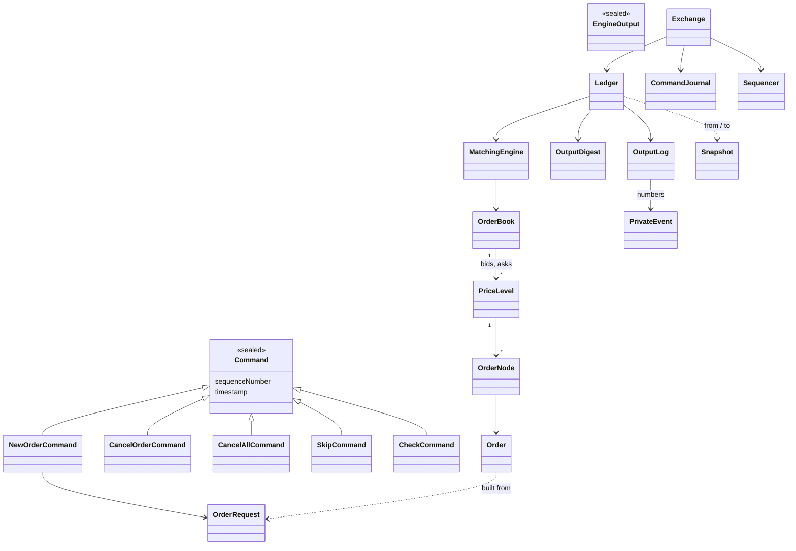
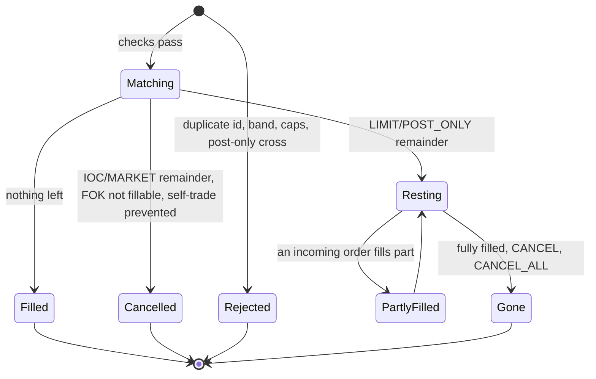
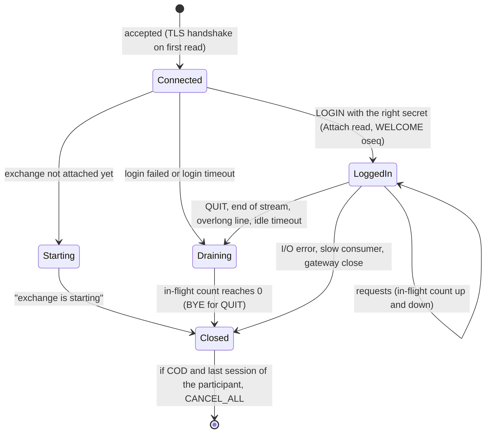
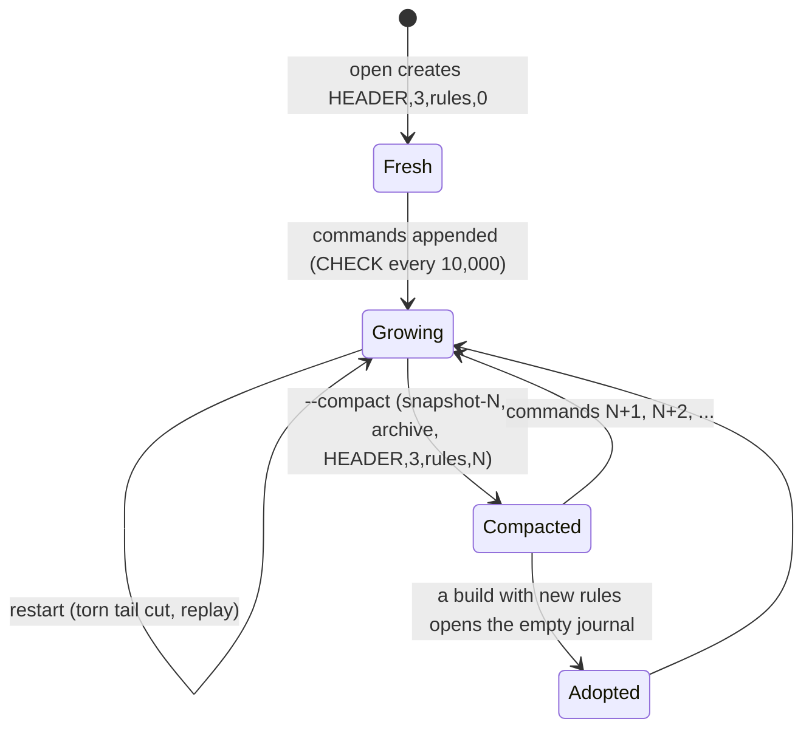

# 06 — Data and state

> **Project:** ExchangeServer2 | Single-instrument limit order book: price-time matching engine, write-ahead journal with replay, single writer thread, TCP/TLS gateway with authenticated participants | Stack: Java 17, Maven wrapper, JUnit 5 (+ JMH, PIT)
> **This guide:** The data models (domain, commands, book, engine outputs, core, gateway), every file format (journal, snapshot, users file), the wire protocol, where every piece of state lives and who may touch it, how state changes over time, the validation layers, what persists, and how versions replace migrations | **Prerequisites:** 01, 02 | **Related:** 05, 05a, 05b, 07-modules/*, 13
> **Repo layout summary:** `pom.xml` + Maven wrapper (`mvnw`, `mvnw.cmd`) at the root; production code in `src/main/java/exchangeserver/` (packages `domain`, `book`, `engine`, `command`, `journal`, `core`, `gateway`, `client`, plus `Main`); tests mirror it in `src/test/java/exchangeserver/` (plus `bench/` JMH benchmarks and `testing/MutableClock`); design docs in `docs/` (`ExchangeServer2_Vision.md` = purpose/roadmap, `ExchangeServer2_Spec.md` = decisions D1–D77); these guides in `docs/understanding/`.

## Overview

There is no database. The exchange keeps its state in memory, owned by one writer thread, and persists only **inputs**: a write-ahead journal of stamped commands, plus, after a compaction, a snapshot of the state at one sequence number (D71). Everything else (the book, the counters, the client-order-id map, the output digest, every participant's numbered private stream) is derived by feeding those inputs through the same deterministic engine. A users file holds the participants' salted password hashes (D74). This guide lists every data shape and file format, says where each piece of state lives and which thread may touch it, and how it changes.

Notation: **[Verified]** = read in the code or seen running (cited); **[Inferred]** = reasoning about intent or behaviour.

---

## 1. Data models

### 1.1 Domain (`exchangeserver.domain`)

| Type | Shape | Notes |
|---|---|---|
| `Side` | `BUY`, `SELL`, `opposite()` | |
| `OrderType` | `LIMIT`, `IOC`, `FOK`, `MARKET`, `POST_ONLY`; `canRest()` = LIMIT or POST_ONLY | |
| `Rules` | constants every replayed decision depends on | `VERSION` 2, `MAX_ORDER_QUANTITY` 1e9, `MAX_PRICE`, participant pattern `[A-Za-z0-9_]{1,16}`, client-order-id pattern `[A-Za-z0-9_.-]{1,32}`, `PRICE_BAND_PERCENT` 10, `MAX_OPEN_ORDERS_PER_PARTICIPANT` 10,000, `MAX_RESTING_ORDERS` 1,000,000, `withinBand` |
| `OrderRequest` | participant, clientOrderId, side, type, quantity, price (none for MARKET) | the only field-validation layer (D47); immutable |
| `Order` | orderId, the request's fields, timestamp, mutable `filledQuantity` | built only from an `OrderRequest` |

**[Verified]** `src/main/java/exchangeserver/domain/Rules.java:21-44`.

### 1.2 Commands (`exchangeserver.command`): what the journal stores

```java
// src/main/java/exchangeserver/command/Command.java:11
public sealed interface Command permits NewOrderCommand, CancelOrderCommand, CancelAllCommand, SkipCommand, CheckCommand {
```

| Record | Fields | Meaning |
|---|---|---|
| `NewOrderCommand` | seq, timestamp, orderId, request | a new order |
| `CancelOrderCommand` | seq, timestamp, participant, orderId (the target) | a cancel |
| `CancelAllCommand` | seq, timestamp, participant | cancel every resting order of one participant (D72) |
| `SkipCommand` | seq, timestamp, skippedSequenceNumber | quarantine an earlier command (D51) |
| `CheckCommand` | seq, timestamp, digest (16 hex) | "the outputs of every command before me digest to this" (D70) |

All are records validated in their constructors; every one gets a sequence number from the `Sequencer`, so the journal numbers 1, 2, 3, … without gaps (only NEW uses up an order id). **[Verified]** `src/main/java/exchangeserver/command/Command.java:11`, `src/main/java/exchangeserver/command/CancelAllCommand.java:10`, `src/main/java/exchangeserver/command/CheckCommand.java:16`, `src/main/java/exchangeserver/command/Sequencer.java:48-76`.

### 1.3 Book (`exchangeserver.book`)

- `OrderBook`: `bids` (`TreeMap` in reverse price order) and `asks`, each price → `PriceLevel`; `orders`: id → `OrderNode` (O(1) cancel); `openOrders`: participant → count; `changed`: a `LinkedHashSet` of touched levels, drained into level updates after each command. **[Verified]** `src/main/java/exchangeserver/book/OrderBook.java:41-46`.
- `PriceLevel`: a doubly linked list of `OrderNode`s with sentinels, plus `totalVolume` and `orderCount`; mutators are package-private (D44).
- Read-only copies handed out: `Fill` (what `fillBest` did), `LevelUpdate` (side, price, volume, orderCount; volume 0 = gone), `CancelResult` (`CANCELLED` or `UNKNOWN_ORDER`), `RestingOrderView` (one resting order: id, participant, clOrdId, side, type, price, original, filled, timestamp) for walks, cancel-all and snapshots. **[Verified]** `src/main/java/exchangeserver/book/RestingOrderView.java:14`, `OrderBook.java:149-171`.

### 1.4 Engine outputs (`exchangeserver.engine`)

| Type | Shape |
|---|---|
| `Response` | orderId, clientOrderId, status (`FILLED`/`RESTED`/`CANCELLED`/`REJECTED`), `reason`, filled, remaining, trades; the constructor rejects contradictions |
| `Reason` | rejects: `DUPLICATE_CLIENT_ORDER_ID`, `PRICE_OUTSIDE_BAND`, `MAX_OPEN_ORDERS`, `BOOK_FULL`, `POST_ONLY_WOULD_CROSS`; cancel: `SELF_TRADE_PREVENTED` (D67) |
| `Trade` | price, quantity, buyOrderId, sellOrderId, aggressorSide, timestamp (the incoming command's) |
| `Execution` | a fill on a resting order, addressed to its owner |
| `EngineOutput` (sealed) | `OrderOutput(seq, ts, response, passiveFills, levelUpdates)`, `CancelOutput(seq, ts, result, levelUpdates)`, `CancelAllOutput(seq, ts, participant, results, levelUpdates)` |
| `BookSnapshot` | the top levels for SUBSCRIBE |
| `EngineState` | lastSequenceNumber, lastOrderId, lastTradePrice, resting orders: what a snapshot stores of the engine (D71) |

**[Verified]** `src/main/java/exchangeserver/engine/Response.java:15`, `src/main/java/exchangeserver/engine/EngineOutput.java:14`, `src/main/java/exchangeserver/engine/EngineState.java:14`.

### 1.5 Core (`exchangeserver.core`)

| Type | Shape | Notes |
|---|---|---|
| `Request<R>` (sealed) | `Submit`, `Cancel`, `CancelAll` (become commands); `Snapshot`, `Attach`, `Resend` (reads) | what a caller hands in; R is the result type |
| `Pending<R>` | request, its own `CompletableFuture`, the stamped command, `refused` | one per request, never shared |
| `PrivateEvent` (sealed) | `OrderReply(participant, oseq, side, quantity, response)`, `CancelReply(participant, oseq, result, byCancelAll)`, `MakerFill(participant, oseq, execution)` | one numbered message of a participant's private stream (D73) |
| `ResendResult` | events, firstAvailable, lastOseq | the answer to RESEND |
| `Ledger` | engine + `OutputDigest` + `OutputLog` | rebuilt as a unit (replay, poison rebuild) |
| `Snapshot` | lastSequence, lastOrderId, lastTimestamp, lastTradePrice, digest, orders, lastOseqs | the state after `lastSequence` (D71) |
| `Exchange.Recovery` | base, lastSequence, replayed, truncatedBytes, quarantined, adoptedRulesFrom | what startup did (L1) |

**[Verified]** `src/main/java/exchangeserver/core/Request.java:21-56`, `src/main/java/exchangeserver/core/PrivateEvent.java:15-31`, `src/main/java/exchangeserver/core/Snapshot.java:41-42`, `src/main/java/exchangeserver/core/Exchange.java:78-80`.

### 1.6 Gateway (`exchangeserver.gateway`)

- `ClientMessage` (sealed): `Login(participant, secret, cancelOnDisconnect)` (its `toString` hides the secret), `NewOrder`, `Cancel`, `Resend`, `Subscribe`, `Unsubscribe`, `Ping`, `Quit`. Syntax only.
- `Credentials`: participant → (iterations, salt, PBKDF2 hash).
- `TcpGateway.Settings`: bind address, port, credentials, TLS context, session limits, timeouts, flow control.

**[Verified]** `src/main/java/exchangeserver/gateway/ClientMessage.java:9-40`, `src/main/java/exchangeserver/gateway/Credentials.java:34-48`.

### 1.7 Class diagram (the main relations)



---

## 2. The journal file (format v3, D69)

```
HEADER,3,<rulesVersion>,<baseSequence>,<crc>
NEW,<seq>,<timestamp>,<orderId>,<participant>,<clientOrderId>,<side>,<type>,<quantity>,<price or ->,<crc>
CANCEL,<seq>,<timestamp>,<participant>,<targetOrderId>,<crc>
CANCEL_ALL,<seq>,<timestamp>,<participant>,<crc>
SKIP,<seq>,<timestamp>,<skippedSeq>,<crc>
CHECK,<seq>,<timestamp>,<outputDigest>,<crc>
```

**[Verified]** `src/main/java/exchangeserver/journal/JournalCodec.java:18-35`.

- Every record ends with `,<crc>\n`, where `<crc>` is the CRC-32C of the text before that comma, as 8 lower-case hex digits. A changed character makes the record corrupt; startup stops with the record number (D69). **[Verified]** `JournalCodec.java:166-187`.
- Records are LF-only. A record ending in `\r` (a CRLF conversion by an editor or git) is reported as such; `.gitattributes` keeps `*.journal` and its siblings out of git's line-ending conversion. **[Verified]** `JournalCodec.java:172-175`.
- `baseSequence` names the snapshot the journal continues from (0: none); the first record is `baseSequence + 1` (D71).
- Timestamps are `Instant.toString()`; a MARKET order's price is `-`.

A real journal (2026-10-27): **[Verified]** live run.

```
HEADER,3,2,0,5d7826e0
NEW,1,2026-10-27T14:20:40.373493200Z,1,alice,a1,SELL,LIMIT,10,100,379beca7
NEW,2,2026-10-27T14:20:40.802670Z,2,alice,a2,BUY,LIMIT,5,100,f33577be
NEW,3,2026-10-27T14:20:41.217763100Z,3,bob,b1,BUY,LIMIT,4,100,bed0c339
CANCEL_ALL,4,2026-10-27T14:20:42.045241200Z,alice,2b6bb4a5
```

Neighbours of the journal: `exchange.journal.lock` (empty; holds the OS lock while a process has the journal open, D65), `exchange.journal.snapshot-<seq>` and `exchange.journal.archive-<first>-<last>` (after compactions).

## 3. The snapshot file (D71)

```
SNAPSHOT,1,<lastSequence>,<lastOrderId>,<lastTimestamp or ->,<lastTradePrice>,<digest>,<crc>
ORDER,<orderId>,<participant>,<clientOrderId>,<side>,<type>,<price>,<originalQty>,<filledQty>,<timestamp>,<crc>
OSEQ,<participant>,<lastOseq>,<crc>
END,<orderCount>,<participantCount>,<crc>
```

**[Verified]** `src/main/java/exchangeserver/core/Snapshot.java:27-40`, `Snapshot.java:64-77`.

- ORDER lines are in book priority (bids best first, then asks best first, time priority within a level), so loading them in order restores time priority; partial fills are kept (`filledQty`).
- OSEQ lines are sorted by participant, so the file is the same bytes whatever the hash map's iteration order.
- END proves the file is complete; it is written to a temporary file, fsynced and renamed atomically.
- The snapshot depends on no rule: it is state, not commands to re-run. That is what lets a rules change be crossed.

A real snapshot (no resting orders left, two participants): **[Verified]** live run.

```
SNAPSHOT,1,4,3,2026-10-27T14:20:42.045241200Z,100,88a18b6a6365ebe4,d7e6a970
OSEQ,alice,4,d1453b0b
OSEQ,bob,1,3d136969
END,0,2,6a6d3c70
```

## 4. The users file (D74)

```
<participant>:pbkdf2-sha256:<iterations>:<salt base64>:<hash base64>
```

One line per participant, written atomically by `--add-user` (which asks for the secret, or reads one line from standard input, dropping a UTF-8 byte-order mark that Windows PowerShell adds). The secret itself is never stored: PBKDF2-HMAC-SHA256 with a random 16-byte salt and 210,000 iterations. Lines starting with `#` are comments. **[Verified]** `src/main/java/exchangeserver/gateway/Credentials.java:18-31`, `Credentials.java:72-80`, `src/main/java/exchangeserver/Main.java:212-232`; seen live: `alice:pbkdf2-sha256:210000:gJDXXBPuB1OYmFalrdCSx...`.

A secret is 8 to 64 printable ASCII characters without spaces (the protocol separates fields with spaces). **[Verified]** `Credentials.java:38`.

---

## 5. The wire protocol

ASCII lines ending in `\n` (`\r\n` accepted), at most 256 bytes, tokens separated by single spaces (D53). **[Verified]** `src/main/java/exchangeserver/gateway/Protocol.java:18-46`.

### Client → server

| Line | Meaning |
|---|---|
| `LOGIN <participant> <secret> [COD]` | authenticate; `COD` = cancel my orders when my last session closes |
| `NEW <clOrdId> <BUY\|SELL> <LIMIT\|IOC\|FOK\|POST_ONLY> <qty> <price>` | priced order |
| `NEW <clOrdId> <BUY\|SELL> MARKET <qty>` | market order |
| `CANCEL <orderId>` | cancel own order |
| `RESEND <oseq>` | repeat retained private events from oseq on |
| `SUBSCRIBE`, `UNSUBSCRIBE`, `PING`, `QUIT` | market data, keep-alive, leave |

### Server → client

| Line | Stream |
|---|---|
| `FILL oseq= orderId= clOrdId= side= price= qty= leaves= liquidity=TAKER\|MAKER` | private, numbered |
| `ORDER oseq= orderId= clOrdId= status= filled= remaining= [reason=]` | private, numbered |
| `CANCELLED oseq= orderId= qty= [reason=CANCEL_ALL]`, `CANCEL_REJECT oseq= orderId= reason=UNKNOWN_ORDER` | private, numbered |
| `… resend=1` | a private line repeated by RESEND |
| `WELCOME participant= oseq=`, `RESENT last=`, `ERROR RESEND_GAP first=` | session |
| `BOOK seq= last= bids=<p>x<q>,… asks=…` | market data snapshot (top 100 levels) |
| `TRADE seq= price= qty= aggressor=`, `LEVEL seq= side= price= qty= orders=` | market data (qty=0: level gone) |
| `SUBSCRIBED`, `UNSUBSCRIBED`, `PONG`, `BYE`, `ERROR <text>` | session |

The private stream is sent to every session of the participant (D73). `oseq` counts one participant's events; `seq` counts journal records for the whole exchange, so market data has gaps (commands without public effects).

---

## 6. Where state lives and who may touch it

| State | Where | Owner thread | Persisted? |
|---|---|---|---|
| Book (levels, nodes, id map, open counts) | `OrderBook` in `MatchingEngine` in `Ledger` | exchange-writer | rebuilt by replay; in snapshots |
| Client-order-id map | `MatchingEngine.orderIdByClientOrderId` | exchange-writer | rebuilt (since the last snapshot) |
| Last order id, last seq, last trade price | `MatchingEngine` | exchange-writer | rebuilt; in snapshots |
| Output digest | `OutputDigest` in `Ledger` | exchange-writer | checked by CHECK records; in snapshots |
| Private streams (lastOseq + last 1,000 events per participant) | `OutputLog` in `Ledger` | exchange-writer | numbers rebuilt and in snapshots; events rebuilt only since the last snapshot |
| Sequencer counters, last timestamp | `Sequencer` | exchange-writer | rebuilt from the journal |
| Skip set, commands since the last CHECK | `Exchange` | exchange-writer | skip set rebuilt; CHECK counter not |
| Request queue, state, halt cause | `ExchangeService` | any thread, under `lock` | no |
| Journal channel, fail-stop flag | `CommandJournal` | exchange-writer (opened by the starting thread) | the file is the persistence |
| Lock | `JournalLock` (`HELD` in-JVM set + OS lock on `<journal>.lock`) | owning journal / compaction | no |
| Sessions, participants → sessions, subscribers | `TcpGateway` (concurrent sets and map) | reader threads, writer thread | no |
| Per-session: participant, COD flag, in-flight count, reader-done, outbound queue, subscription flags, rate tokens | `ClientSession` | reader (tokens), writer and reader (rest, via volatile/atomic/lock) | no |
| Credentials | `Credentials` (immutable) | any | the users file |

**[Verified]** fields: `src/main/java/exchangeserver/engine/MatchingEngine.java:56-61`, `src/main/java/exchangeserver/core/Exchange.java:86-94`, `src/main/java/exchangeserver/gateway/TcpGateway.java:104-111`, `src/main/java/exchangeserver/gateway/ClientSession.java:60-82`, `src/main/java/exchangeserver/journal/JournalLock.java:27-30`.

---

## 7. How state changes over time

### 7.1 An order's lifecycle



**[Verified]** `src/main/java/exchangeserver/engine/MatchingEngine.java:178-263`, `MatchingEngine.java:127-155`.

### 7.2 The service

`RUNNING` → `STOPPING` (after `stop()`, everything accepted is still processed) → `STOPPED`; or `RUNNING`/`STOPPING` → `HALTED` (journal failure, `Error`): everything waiting is refused, exit 2. **[Verified]** `src/main/java/exchangeserver/core/ExchangeService.java:245-257`, `ExchangeService.java:342-359`.

### 7.3 A connection (session)



**[Verified]** `src/main/java/exchangeserver/gateway/ClientSession.java:152-182`, `ClientSession.java:293-327`, `ClientSession.java:421-442`, `src/main/java/exchangeserver/gateway/TcpGateway.java:239-263`.

### 7.4 The journal and its snapshots over time



**[Verified]** `src/main/java/exchangeserver/journal/CommandJournal.java:98-132`, `src/main/java/exchangeserver/core/Exchange.java:174-194`.

---

## 8. Validation layers

| Layer | Where | Checks | On failure |
|---|---|---|---|
| Line framing | `ClientSession.readLine` | ≤ 256 bytes | ERROR, disconnect after in-flight |
| Syntax | `Protocol.parse` | message type, arity, numbers, enums | ERROR, session continues |
| Authentication | `ClientSession.login`, `Credentials.verify` | name pattern, secret (PBKDF2, constant time) | `ERROR login failed`, disconnect |
| Session limits | `ClientSession.admit`, timeouts | in-flight, rate, login/idle time | ERROR (`SESSION_BUSY`, `RATE_LIMITED`, timeout) |
| Fields | `OrderRequest` | participant, clOrdId, side, type, quantity, price | ERROR, never queued |
| Hand-in | `ExchangeService.enqueue`, `Request` constructors | state, queue capacity, depth > 0, oseq > 0 | BUSY / STOPPED / HALTED |
| Stamping | `Sequencer` + command constructors | valid command | refused, never journalled |
| State-dependent | `MatchingEngine.process` | duplicate id, band, caps, post-only, self-trade | REJECTED or CANCELLED with a reason, journalled |
| Invariants | records' constructors, `OrderBook`, `PriceLevel` | contradictions, bugs | exception (poison-pill path) |
| Storage | `JournalCodec`, `Snapshot.read`, `Replay` | checksums, header, gaps, timestamps, CHECK digests | startup fails, file untouched |

**[Verified]** the cited classes; see guide 05a for the request path through them.

---

## 9. What persists, what is rebuilt, what is lost

| On disk | Rebuilt at startup | Lost on restart |
|---|---|---|
| journal (inputs), snapshot-N (state at N), archives (old journals), users file, lock file (empty) | book, counters, client-order-id map (since the snapshot), digest, oseq numbers, retained private events (since the snapshot), skip set | sessions, subscriptions, queued lines, requests in flight that were not journalled, rate tokens |

A restart rebuilds the identical book and the identical private-stream numbering; a client recovers what it missed with RESEND after logging in again. **[Verified]** tests `ExchangeTest.Restart.*`, `TcpGatewayTest.Resend.theStreamSurvivesARestart`.

---

## 10. "Migrations": versions instead of schema changes

There is no schema to migrate. Three version numbers decide what can be read:

| Version | Where | Changes when | Effect |
|---|---|---|---|
| `JournalCodec.FORMAT_VERSION` (3) | journal header | the record format changes | a journal of another format is refused (v2 journals from before D69 cannot be opened) |
| `Rules.VERSION` (2) | journal header | any rule replay depends on | a journal of other rules with records is refused; an empty one adopts the new rules |
| `Snapshot.FORMAT_VERSION` (1) | snapshot header | the snapshot format changes | a snapshot of another format is refused |

**[Verified]** `src/main/java/exchangeserver/journal/JournalCodec.java:41`, `src/main/java/exchangeserver/domain/Rules.java:21`, `src/main/java/exchangeserver/core/Snapshot.java:44`.

The way across a rules change is a compaction with the old build, then the new build (guide 05b, flow 4c). A code change that alters behaviour without a rules bump is caught by the next CHECK record (`DIVERGED`, D70) and needs the same procedure.

---

## Key takeaways

- Only inputs persist: a checksummed journal of stamped commands, plus a snapshot of the state at the journal's base sequence; everything else is derived.
- Five command records: NEW, CANCEL, CANCEL_ALL (journalled like any input), SKIP (quarantine), CHECK (an output digest assertion).
- The Ledger (engine + output digest + output log) is the writer's derived state and is always rebuilt as one unit.
- Private events are numbered per participant (oseq) and retained (1,000) for RESEND; the numbering survives restarts and compactions.
- All exchange state belongs to the writer thread; sessions, the gateway's maps and the service's queue are the only state touched by other threads.
- Validation happens in layers, from line framing to CHECK digests; nothing the gateway refuses is journalled.
- Three version numbers (journal format, rules, snapshot format) replace migrations; compaction is the bridge across a rules change.

## Common confusions

- **"The snapshot replaces the journal."** It replaces the journal's *past*: the journal after compaction holds only a header naming the snapshot, then new commands.
- **"CHECK records are inputs."** They are assertions about outputs; replay compares them and never feeds them to the engine.
- **"oseq is stored in the journal."** It is derived from the commands by `OutputLog`; only snapshots store each participant's last number.
- **"The lock file must be deleted after a crash."** The OS lock dies with the process; the empty file is reused.
- **"The users file stores secrets."** It stores salted PBKDF2 hashes only.

## Questions to test yourself

1. Which of these are on disk: the book, the client-order-id map, the oseq numbering, the journal, the users file?
<details><summary>Answer</summary>The journal and the users file (plus snapshots). The book and the oseq numbering are also inside a snapshot after a compaction; the client-order-id map is never stored (after a snapshot only resting orders' ids are rebuilt from the ORDER lines).</details>

2. Why are OSEQ lines sorted in the snapshot?
<details><summary>Answer</summary>The output log keeps them in a hash map; sorting makes the file the same bytes regardless of iteration order (determinism, and stable checksums).</details>

3. A record `NEW,…,LIMIT,10,100,379beca7` has its quantity edited to 11. What happens at startup?
<details><summary>Answer</summary>The CRC-32C no longer matches: decoding fails with "Corrupt journal record <n>", startup stops, and the file is not changed.</details>

4. Which thread may read `OutputLog`, and how does a session get data from it?
<details><summary>Answer</summary>Only the exchange-writer. A session queues an Attach or Resend read; its callback runs on the writer and offers lines to the session's outbound queue.</details>
