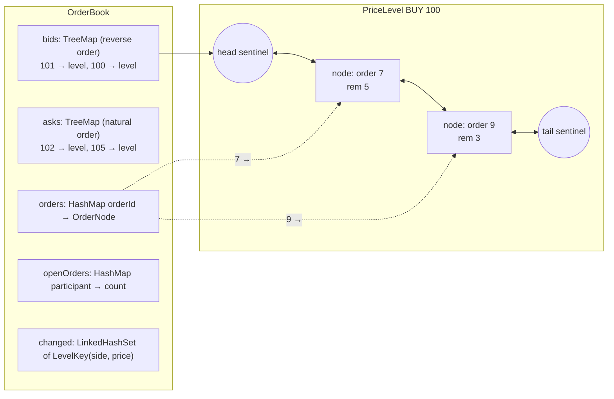
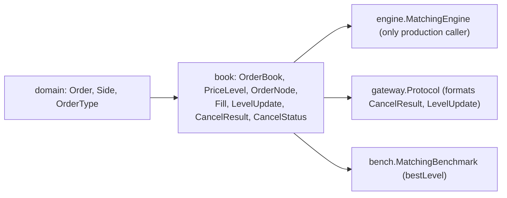

# 07 — Module: book

> **Project:** ExchangeServer2 | Single-instrument limit order book: price-time matching engine, write-ahead journal with replay, single writer thread, plain TCP gateway | Stack: Java 17, Maven wrapper, JUnit 5 (+ JMH, PIT)
> **This guide:** the order book data structure (`OrderBook`, `PriceLevel`, `OrderNode`) and its small result types (`Fill`, `LevelUpdate`, `CancelResult`, `CancelStatus`), its invariants and how they are kept | **Prerequisites:** 01, 07-modules/domain-and-commands | **Related:** 06, 07-modules/engine, 09, 10
> **Repo layout summary:** `pom.xml` + Maven wrapper (`mvnw`, `mvnw.cmd`) at the root; production code in `src/main/java/exchangeserver/` (packages `domain`, `book`, `engine`, `command`, `journal`, `core`, `gateway`, `client`, plus `Main`); tests mirror it in `src/test/java/exchangeserver/` (plus `bench/` JMH benchmarks and `testing/MutableClock`); design docs in `docs/` (`ExchangeServer2_Vision.md` = purpose/roadmap, `ExchangeServer2_Spec.md` = decisions D1–D65); these guides in `docs/understanding/`.

## Overview

An **order book** is the list of orders waiting to trade (**resting** orders), grouped by side and price:
- the **bids** are buy orders, best = highest price first;
- the **asks** are sell orders, best = lowest price first.

Inside one price, orders queue in arrival order, which is **time priority**. Together that gives
**price-time priority**: better price first, then earlier arrival.

The `book` package is a data structure with a few hard rules (**invariants**) and no business logic:
- It does not decide whether two orders match. That is the engine's job (guide 07-modules/engine).
- It *carries out* what the engine decides, through exactly three mutating entry points: `add`, `fillBest` and
  `cancel`.

**[Verified]** Spec D44 and Vision §4 principles 2 and 9.

The physical shape:

- **Each side** is a `TreeMap<Long, PriceLevel>`, a sorted map keyed by price. The bid map uses
  `Comparator.reverseOrder()`, so `firstEntry()` is the best price on both sides. **[Verified]**
  `src/main/java/exchangeserver/book/OrderBook.java:40-41`.
- **Each `PriceLevel`** is a hand-written **doubly linked list with sentinels**: dummy `head` and `tail` nodes
  that are never removed, so linking and unlinking need no special cases for the ends. **[Verified]** Spec D6, D7.
- **An id map `orderId → OrderNode`** lets a cancel find an order's node in O(1) and unlink it in O(1).
  **[Verified]** `OrderBook.java:42`, Spec D1, D5.



## Responsibility

| Type | What it is | Visibility |
|---|---|---|
| `OrderBook` | Owns the lifecycle of every resting order (Spec D1); the only mutator of levels | public class |
| `PriceLevel` | Orders at one price on one side, in time priority. **Public getters only; every mutator is package-private** | public class |
| `OrderNode` | One list node: `order`, `prev`, `next`, `level` | package-private class |
| `Fill` | Immutable record of what `fillBest` did to one resting order | public record |
| `LevelUpdate` | Immutable record: one level's state after a command (level-2 market data); volume 0 = gone | public record |
| `CancelResult` / `CancelStatus` | Outcome of a cancel: `CANCELLED` (with quantity) or `UNKNOWN_ORDER` | public record / enum |

"Level-2 market data" (L2) means aggregated volume per price level, as opposed to individual orders.

## Public interface and who calls it

| Member | Visibility | Called by |
|---|---|---|
| `OrderBook.add(Order)` | public | `MatchingEngine.process` (rests a LIMIT/POST_ONLY remainder) |
| `OrderBook.fillBest(Side, maxQty) → Fill` | public | `MatchingEngine.process` (the match loop) |
| `OrderBook.cancel(participant, orderId) → CancelResult` | public | `MatchingEngine.onCancel` |
| `OrderBook.drainLevelUpdates()` | public | `MatchingEngine.onNewOrder` / `onCancel` (once per command) |
| `OrderBook.bestLevel(Side)` | public | `MatchingEngine.process` (match loop, post-only check); `MatchingBenchmark` |
| `OrderBook.levels(Side)` | public | `MatchingEngine.canBeFilled` (FOK), `MatchingEngine.levels` (snapshot) |
| `OrderBook.openOrders(participant)` | public | `MatchingEngine.process` (open-order cap) |
| `OrderBook.restingOrderCount()` | public | `MatchingEngine(OrderBook)` constructor (must be 0) |
| `volumeAt`, `levelCount`, `isResting` | public | tests only **[Verified]** by grep |
| `OrderBook.ordersAt`, `checkInvariants()` | package-private | tests only (test seams) |
| `PriceLevel.getSide/getPrice/getTotalVolume/getOrderCount/isEmpty` | public | engine (read-only) and `OrderBook` |
| `PriceLevel.addOrder/headNode/fillHead/unlink` | package-private | `OrderBook` only |

Because the engine is in another package, the compiler stops it from calling `PriceLevel` mutators. That is the
"ownership enforced by packages" rule from `CLAUDE.md`. **[Verified]** Spec D44.

## The invariants

The class comment lists them, and `checkInvariants()` re-derives them from scratch:

```java
// src/main/java/exchangeserver/book/OrderBook.java:20-32 (trimmed comment)
Every mutation goes through four methods (add, fillBest, cancel, and the private removeNode they share), so
these invariants have exactly one place to hold:
1. An id is in `orders` iff its order is linked in a level.
2. No empty level is ever left in `bids` or `asks` (eager removal, D10).
3. openOrders.get(p) == number of resting orders owned by p (absent when 0).
4. Every level touched since the last drainLevelUpdates() is in `changed`.
```

```java
// src/main/java/exchangeserver/book/PriceLevel.java:20-25 (comment)
1. totalVolume == sum of remaining quantity over the linked nodes.
2. orderCount  == number of linked nodes.
3. node.level == this  <=>  node is linked in this level.
4. Every linked order has remaining > 0, except the head between fillHead() exhausting it and
   OrderBook unlinking it (both inside one OrderBook.fillBest call).
```

Plus, from `checkInvariants` (`OrderBook.java:193-234`): levels are strictly ordered on each side, and the book
is never **crossed**, meaning the best bid is below the best ask. **[Verified]** The "never crossed" invariant
holds because the engine always matches before resting; the book itself does not enforce it on `add`.
**[Inferred]** from reading `add`, which has no cross check.

## Internal walkthrough: `PriceLevel`

### Construction and the sentinels

```java
// src/main/java/exchangeserver/book/PriceLevel.java:28-41 (trimmed)
public final class PriceLevel {
    private final Side side;
    private final long price;
    private final OrderNode head = OrderNode.sentinel();
    private final OrderNode tail = OrderNode.sentinel();
    private long totalVolume;
    private int orderCount;

    PriceLevel(Side side, long price) {
        this.side = side;
        this.price = price;
        head.next = tail;
        tail.prev = head;
    }
```

```java
// src/main/java/exchangeserver/book/OrderNode.java:18-35 (trimmed)
final class OrderNode {
    final Order order;
    OrderNode prev;
    OrderNode next;
    PriceLevel level;

    OrderNode(Order order) {
        this.order = Objects.requireNonNull(order, "A real node must wrap an order");
    }
    private OrderNode() { this.order = null; }
    static OrderNode sentinel() { return new OrderNode(); }
}
```

`order == null` holds **if and only if** the node is a sentinel. That is enforced by construction: the
real-node constructor rejects null, and sentinels can only come from `sentinel()`. **[Verified]**
`OrderNode.java:12-13, 24-34`. Every real linked node therefore has a non-null `prev` and `next`, at worst a
sentinel, which is why link and unlink have no `if (node == head)` branches.

### `addOrder`: append at the tail, checks first

```java
// src/main/java/exchangeserver/book/PriceLevel.java:64-87
OrderNode addOrder(Order order) {
    // All checks before any mutation.
    if (order.getSide() != side || order.getPrice() != price) { throw new IllegalStateException(...); }
    if (order.getRemainingQuantity() <= 0) { throw new IllegalStateException(...); }
    if (order.getRemainingQuantity() > Long.MAX_VALUE - totalVolume) { throw new IllegalStateException(...); }

    OrderNode node = new OrderNode(order);
    OrderNode last = tail.prev;
    node.prev = last;
    node.next = tail;
    last.next = node;
    tail.prev = node;
    node.level = this;

    totalVolume += order.getRemainingQuantity();
    orderCount++;
    return node;
}
```

- It returns the node so `OrderBook` can store it in the id map. **[Verified]**
- It adds the order's *remaining* quantity, not the original. A partially filled incoming order that rests adds
  only what is left (`PriceLevelTest.addsRemainingNotOriginalQuantity`). **[Verified]**
- **Overflow guard.** It makes sure `totalVolume` can never wrap round. **[Verified]** **[Inferred]** It is
  practically unreachable, since at most 10,000 orders per participant × 1e9 each per participant. Spec §7 lists
  the related `<=`/`<` mutant as equivalent.

### `fillHead`: fill, never remove

```java
// src/main/java/exchangeserver/book/PriceLevel.java:96-113
long fillHead(long maxQuantity) {
    if (maxQuantity <= 0) { throw new IllegalArgumentException("Fill quantity must be positive"); }
    OrderNode first = headNode();
    if (first == null) { throw new IllegalStateException("Fill on empty level " + side + " " + price); }
    Order order = first.order;
    if (order.getRemainingQuantity() == 0) { throw new IllegalStateException("Exhausted order ... left at the head ..."); }

    long quantity = Math.min(order.getRemainingQuantity(), maxQuantity);
    order.fill(quantity);
    totalVolume -= quantity;
    return quantity;
}
```

It fills the head order by `min(remaining, maxQuantity)` and subtracts that from `totalVolume`, but **does not
unlink an exhausted head**: "that is OrderBook's job, so the id map and the list change together" (Spec D3).
**[Verified]** This leaves a deliberate, short window where invariant 4 is broken: the head has remaining 0. The
window closes inside the same `OrderBook.fillBest` call (below).

### `unlink`: O(1) removal, shared by fills and cancels

```java
// src/main/java/exchangeserver/book/PriceLevel.java:116-134
void unlink(OrderNode node) {
    if (node.order == null) { throw new IllegalStateException("Cannot unlink a sentinel"); }
    if (node.level != this) { throw new IllegalStateException("Order ... is not linked in level ..."); }

    node.prev.next = node.next;
    node.next.prev = node.prev;

    // 0 for a filled order (fillHead already subtracted it); the live remainder for a cancel.
    totalVolume -= node.order.getRemainingQuantity();
    orderCount--;

    node.prev = null;
    node.next = null;
    node.level = null;
}
```

The key arithmetic is `totalVolume -= remaining`:
- For a **fill-removal**, `fillHead` already subtracted the filled quantity and the remaining is 0, so this
  subtracts 0.
- For a **cancel**, the remaining is still on the books, so this subtracts it.

One line serves both paths (Spec D2). **[Verified]** Nulling the links (Spec D8) makes a second `unlink` of the
same node fail loudly (`node.level != this`), and so does unlinking a node from another level.
`PriceLevelTest.Unlink.refusesASecondUnlink`, `refusesANodeFromAnotherLevel` and `refusesASentinel` cover this.
**[Verified]**

## Internal walkthrough: `OrderBook`

### `add`: all-or-nothing

```java
// src/main/java/exchangeserver/book/OrderBook.java:48-73
public void add(Order order) {
    if (!order.getOrderType().canRest()) { throw new IllegalStateException("A " + ... + " order never rests: " ...); }
    if (order.getRemainingQuantity() <= 0) { throw new IllegalStateException(... "has nothing left to rest"); }
    if (orders.containsKey(order.getOrderId())) { throw new IllegalStateException("Duplicate order id " ...); }  // D15

    TreeMap<Long, PriceLevel> side = sideOf(order.getSide());
    PriceLevel level = side.get(order.getPrice());
    boolean newLevel = level == null;
    if (newLevel) {
        level = new PriceLevel(order.getSide(), order.getPrice());
    }
    OrderNode node = level.addOrder(order);         // throws before linking anything
    if (newLevel) {
        side.put(order.getPrice(), level);          // only now: a failed add must not leave an empty level
    }

    orders.put(order.getOrderId(), node);
    openOrders.merge(order.getParticipant(), 1, Integer::sum);
    changed.add(new LevelKey(order.getSide(), order.getPrice()));
}
```

The **ordering** is the point. A new level is created but put into the tree only *after* `addOrder` succeeded.
If `addOrder` threw (wrong price, overflow), the tree would otherwise keep an empty level and break invariant 2.
After `addOrder` returns, the remaining statements (`put`, `merge`, `add`) cannot fail on valid state.
**[Verified]** `OrderBookTest.Add.duplicateIdThrowsAndChangesNothing`, `refusesTypesThatNeverRest` and
`refusesAnExhaustedOrder`. **[Inferred]** Only an `OutOfMemoryError` could interrupt them, and an `Error` halts
the exchange anyway.

### `fillBest`: fill, remove the exhausted order, remove an emptied level

```java
// src/main/java/exchangeserver/book/OrderBook.java:77-94
public Fill fillBest(Side side, long maxQuantity) {
    Map.Entry<Long, PriceLevel> best = sideOf(side).firstEntry();
    if (best == null) { throw new IllegalStateException("Fill on empty side " + side); }
    PriceLevel level = best.getValue();
    OrderNode head = level.headNode();
    Order order = head.order;

    long quantity = level.fillHead(maxQuantity);
    changed.add(new LevelKey(side, level.getPrice()));
    if (order.getRemainingQuantity() == 0) {
        removeNode(head);
    }

    return new Fill(order.getOrderId(), order.getParticipant(), order.getClientOrderId(), side,
            level.getPrice(), quantity, order.getRemainingQuantity());
}
```

Line by line:
1. `side` is the side **of the book being hit**, the resting side, not the incoming order's side. The comment
   on `bestLevel` says the same (`OrderBook.java:145`). **[Verified]**
2. It remembers `head` and `order` before filling, because the head may be unlinked during the call.
3. `fillHead` fills; then, if the order is exhausted, `removeNode` unlinks it, drops it from the id map,
   decrements the owner's open-order count, and drops the level if it emptied. That closes the invariant-4 window
   inside this one call (Spec D4 revised by D44). **[Verified]**
4. It returns an **immutable copy** (`Fill`), so the engine learns the resting order's id, owner, client order
   id, price, filled quantity and leaves (what is left) without ever holding the `Order` object that sits in the
   book. **[Verified]** `Fill.java:5-9`. `level.getPrice()` is still valid after the level left the tree, because
   the object still exists.

### `cancel`: owner-only, unknown otherwise

```java
// src/main/java/exchangeserver/book/OrderBook.java:96-107
public CancelResult cancel(String participant, long orderId) {
    OrderNode node = orders.get(orderId);
    if (node == null || !node.order.getParticipant().equals(participant)) {
        return CancelResult.unknown(orderId);
    }
    long remaining = node.order.getRemainingQuantity();
    changed.add(new LevelKey(node.order.getSide(), node.order.getPrice()));
    removeNode(node);
    return CancelResult.cancelled(orderId, remaining);
}
```

- Someone else's order looks exactly like a missing one: the result is `UNKNOWN_ORDER`, never a "not owner"
  status. A distinct status would let any participant probe which order ids are live (Spec D48). **[Verified]**
- `UNKNOWN_ORDER` is a normal return value, not an exception, because racing a fill is ordinary: you cancel an
  order that just filled (Spec D17). **[Verified]** `CancelResult.java:5`.
- An unknown cancel touches no level, so no level update is produced
  (`OrderBookTest.LevelUpdates.unknownCancelTouchesNothing`). **[Verified]**

### `removeNode`: the single removal path

```java
// src/main/java/exchangeserver/book/OrderBook.java:110-127
private void removeNode(OrderNode node) {
    Order order = node.order;
    PriceLevel level = node.level;
    if (level == null || orders.get(order.getOrderId()) != node) {
        throw new IllegalStateException("Order " + order.getOrderId() + " is not resting");
    }
    level.unlink(node);
    orders.remove(order.getOrderId());
    openOrders.computeIfPresent(order.getParticipant(), (p, n) -> n == 1 ? null : n - 1);

    if (level.isEmpty()) {
        PriceLevel removed = sideOf(level.getSide()).remove(level.getPrice());
        if (removed != level) {
            throw new IllegalStateException("Removed the wrong level at " + ...);   // D18
        }
    }
}
```

- **One path for fills and cancels** (Spec D2), so invariants 1–3 are maintained in exactly one place.
- `computeIfPresent` returning `null` removes the map entry when the count reaches zero, which keeps invariant 3
  ("absent when 0"). **[Verified]**
- **Eager level removal** (Spec D10, D14). An emptied level leaves the tree immediately. **D18:** it checks that
  `TreeMap.remove` returned *this* level object, as a guard against a corrupted tree. **[Verified]**

### `drainLevelUpdates`: deterministic L2 output

```java
// src/main/java/exchangeserver/book/OrderBook.java:130-143
public List<LevelUpdate> drainLevelUpdates() {
    if (changed.isEmpty()) {
        return List.of();
    }
    List<LevelUpdate> updates = new ArrayList<>(changed.size());
    for (LevelKey key : changed) {
        PriceLevel level = sideOf(key.side()).get(key.price());
        updates.add(level == null
                ? new LevelUpdate(key.side(), key.price(), 0, 0)
                : new LevelUpdate(key.side(), key.price(), level.getTotalVolume(), level.getOrderCount()));
    }
    changed.clear();
    return updates;
}
```

- `changed` is a `LinkedHashSet<LevelKey>`, so each touched level appears **once**, in the order it was **first**
  touched. Iteration order is insertion order, never hash order, which keeps outputs deterministic across runs
  and replays. **[Verified]** `OrderBook.java:44-45`. A plain `HashSet` would iterate in an order that depends on
  hash codes; still repeatable in practice for these keys, but the code avoids relying on that. **[Inferred]**
- The update carries the **absolute** state after the command (not a delta); a vanished level is reported as
  volume 0, orders 0 (`LevelUpdate.java:7`). **[Verified]**
- The engine drains once per command, so every output's level updates belong to that command only. **[Verified]**
  `MatchingEngine.onNewOrder`/`onCancel`.

### Read-only views

`levels(side)` returns `Collections.unmodifiableCollection(sideOf(side).values())`: best first, and removal
through the view is rejected. `PriceLevel` exposes no public mutators, so the view is read-only twice over.
**[Verified]** `OrderBook.java:152-154`; `OrderBookTest.levelViewsAreReadOnly`. It is a *live* view, not a copy.
**[Inferred]** Iterating it while the book changes would be unsafe, but only the writer thread ever does either.

## Worked example

The bids at 100 hold order 7 (alice, 5 left) then order 9 (bob, 3 left), so `totalVolume = 8` and
`orderCount = 2`. An incoming SELL IOC for 6 at 100 arrives.

| Step | Call | Effect |
|---|---|---|
| 1 | `fillBest(BUY, 6)` | head = order 7; `fillHead(6)` fills `min(5,6)=5`; totalVolume 8→3; `changed += (BUY,100)`; order 7 has 0 left → `removeNode`: `unlink` subtracts 0 (totalVolume stays 3), count 2→1; id 7 leaves the map; alice's count drops (entry removed if it was 1); level not empty. Returns `Fill(7, alice, …, 100, qty 5, leaves 0)` |
| 2 | `fillBest(BUY, 1)` | head = order 9; fills 1; totalVolume 3→2; order 9 has 2 left, stays. Returns `Fill(9, bob, …, 100, qty 1, leaves 2)` |
| 3 | `drainLevelUpdates()` | `[LevelUpdate(BUY, 100, 2, 1)]` (one entry although touched twice) |
| 4 | later, `cancel("bob", 9)` | `changed += (BUY,100)`; `removeNode`: `unlink` subtracts the live remainder 2 → 0, count 0; level empty → removed from the tree (D18 check). Returns `CANCELLED, qty 2` |
| 5 | `drainLevelUpdates()` | `[LevelUpdate(BUY, 100, 0, 0)]`: the level is gone |

**[Verified]** by tracing the code. Compare `OrderBookTest.FillBest.exhaustedOrderAndEmptiedLevelLeaveTheBook`
and `LevelUpdates.removedLevelReportsZero`.

```mermaid
sequenceDiagram
    participant E as MatchingEngine
    participant B as OrderBook
    participant L as PriceLevel (BUY 100)
    E->>B: fillBest(BUY, 6)
    B->>L: headNode() → node(7)
    B->>L: fillHead(6)
    L-->>B: 5 (order 7 now has 0 left; still linked)
    B->>B: changed.add(BUY,100)
    B->>B: removeNode(node 7)
    B->>L: unlink(node 7)  (totalVolume -= 0)
    B->>B: orders.remove(7); openOrders--; level empty? no
    B-->>E: Fill(7, alice, ..., qty 5, leaves 0)
```

## Complexity

**[Verified]** from the class comment (`OrderBook.java:31-32`) and Spec D59:

| Operation | Cost |
|---|---|
| add | O(log L): tree lookup for the level, where L = levels on that side |
| cancel / fill-removal of a node | O(1), plus O(log L) when the level empties |
| best-level lookup | O(log L); measured at 8–18 ns from 10 to 100,000 levels, under 2% of a ~1 µs command, so no cached pointer (D59) |

## Dependencies in and out



**[Verified]** `book` imports only `domain` and the JDK. `LevelUpdate`, `CancelResult` and `CancelStatus` also
travel outwards inside engine outputs to the gateway.

## How it's tested

| Test class | Groups | Highlights |
|---|---|---|
| `book/PriceLevelTest` (21 tests) | `AddOrder`, `FillHead`, `Unlink` (middle, head, tail-then-append, only node, filled order subtracts nothing, links cleared, second unlink refused, foreign node refused, sentinel refused), `realNodeNeedsAnOrder` | Every link/unlink edge, and the `totalVolume` arithmetic |
| `book/OrderBookTest` (21 tests) | `Add`, `FillBest`, `Cancel` (incl. `cancelInTheMiddleKeepsTimePriority`), `OpenOrders`, `LevelUpdates`, `levelViewsAreReadOnly`, `InvariantsUnderRandomTraffic` | Public behaviour and invariants |

The flagship test is `InvariantsUnderRandomTraffic.tenThousandRandomCommands`
(`src/test/java/exchangeserver/book/OrderBookTest.java:257-299`). **[Verified]** For 3 seeds × 10,000 commands
(30,000 in total):
- it drives a real `MatchingEngine` with random order types, sides and prices in 95–105;
- about a quarter of the commands are cancels; a fifth of those are sent by a randomly chosen participant (usually
  not the owner);
- after **every** command it calls `checkInvariants()` and asserts that traded quantity equals passive-fill
  quantity.

`checkInvariants()` and `ordersAt()` are package-private test seams. `ordersAt` walks each level forwards and
backwards and fails if the two walks disagree, which catches broken `prev` pointers. **[Verified]**
`OrderBook.java:178-190`. The package is under PIT mutation testing; Spec §7 lists the surviving `book` mutants
as equivalent or test-support only. **[Verified]**

## Key takeaways

- Each side is a `TreeMap` keyed by price (bids reversed), so `firstEntry()` is always the best level; each level
  is a sentinel-bounded doubly linked list in time priority.
- The engine can **read** levels but cannot **change** them: `PriceLevel` mutators are package-private (D44).
- All mutation goes through `add`, `fillBest` and `cancel`, and all removal through `removeNode` (D2), so each
  invariant has one place to hold.
- `fillHead` never removes; `fillBest` removes an exhausted order and an emptied level in the same call (D3, D4/D44).
- `unlink` subtracts the remaining quantity: 0 for a filled order, the live remainder for a cancel.
- `add` is all-or-nothing: a new level enters the tree only after the order was linked.
- Cancel is owner-only, and someone else's order reads as `UNKNOWN_ORDER` (D48).
- Level updates are drained once per command, deduplicated, in first-touched order (`LinkedHashSet`), as absolute
  values.

## Common confusions

- **"`fillBest(side, …)` takes the incoming order's side."** No: it takes the side of the book being filled.
  The engine passes `order.getSide().opposite()`.
- **"Cancelling subtracts twice from `totalVolume`."** No. For a cancel, `fillHead` never ran, so `unlink`'s
  subtraction of the remainder is the only one.
- **"The book prevents crossing."** It doesn't check. The engine never rests an order that still crosses, and
  `checkInvariants` (tests) verifies the outcome.
- **"`LevelUpdate` is a delta."** It is the absolute state of the level after the command; 0 means gone.
- **"`levels()` returns a copy."** It's a live, unmodifiable view.

## Questions to test yourself

1. Why does `OrderBook.add` put a new `PriceLevel` into the tree only after `addOrder` returns?
   <details><summary>Answer</summary>If `addOrder` threw (wrong price/side, exhausted order, overflow), a level already in the tree would be empty, breaking "no empty levels". Putting it in last makes `add` all-or-nothing.</details>
2. A level holds one order with 4 left. `fillBest` fills 4. Trace `totalVolume` through `fillHead` and `unlink`.
   <details><summary>Answer</summary>4 → 0 in `fillHead` (subtracts the filled 4). `unlink` subtracts the remaining, which is now 0, so it stays 0. Then the empty level is removed from the tree.</details>
3. Bob cancels Alice's resting order 12. What does he get, and why not a "not owner" reply?
   <details><summary>Answer</summary>`CancelResult(UNKNOWN_ORDER, 12, 0)`. A distinct status would reveal which ids are live to any participant; the caller's next action is the same either way (D48).</details>
4. One command touches BUY 100, then SELL 101, then BUY 100 again. What does `drainLevelUpdates` return, and in what order?
   <details><summary>Answer</summary>Two updates, BUY 100 then SELL 101 (first-touched order, deduplicated by the `LinkedHashSet`), each with the level's absolute volume and order count after the command (0/0 if it emptied).</details>
5. When is invariant 4 ("every linked order has remaining > 0") temporarily false?
   <details><summary>Answer</summary>Inside one `OrderBook.fillBest` call, between `PriceLevel.fillHead` exhausting the head and `removeNode` unlinking it.</details>
6. What does the D18 check in `removeNode` protect against?
   <details><summary>Answer</summary>Against removing the wrong object from the tree: it asserts `TreeMap.remove(price)` returned exactly the level being emptied, failing loudly if the tree and the level disagree.</details>
