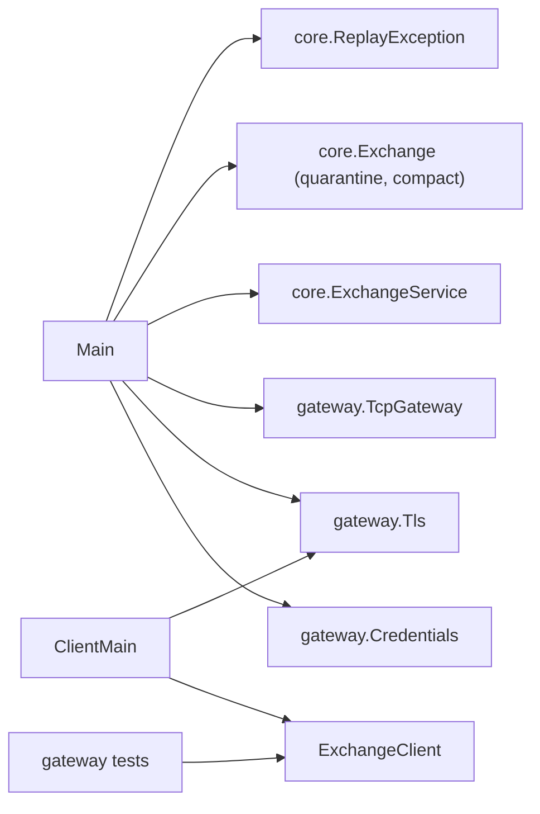

# 07 — Module: client and Main (ExchangeClient, ClientMain, Main)

> **Project:** ExchangeServer2 | Single-instrument limit order book: price-time matching engine, write-ahead journal with replay, single writer thread, TCP/TLS gateway with authenticated participants | Stack: Java 17, Maven wrapper, JUnit 5 (+ JMH, PIT)
> **This guide:** the entry points: `Main` (server start-up, every flag, the `--add-user`, `--quarantine` and `--compact` tools, recovery summary, failure advice, shutdown and exit codes) and the client side: `ExchangeClient` (the line client used by tests and `ClientMain`) and `ClientMain` (interactive console, TLS optional) | **Prerequisites:** 01, 04, 07-modules/gateway | **Related:** 05b, 07-modules/exchange-and-replay, 07-modules/exchange-service, 10, 14
> **Repo layout summary:** `pom.xml` + Maven wrapper (`mvnw`, `mvnw.cmd`) at the root; production code in `src/main/java/exchangeserver/` (packages `domain`, `book`, `engine`, `command`, `journal`, `core`, `gateway`, `client`, plus `Main`); tests mirror it in `src/test/java/exchangeserver/` (plus `bench/` JMH benchmarks and `testing/MutableClock`); design docs in `docs/` (`ExchangeServer2_Vision.md` = purpose/roadmap, `ExchangeServer2_Spec.md` = decisions D1–D77); these guides in `docs/understanding/`.

## Overview

`Main` is the jar's entry point (`java -jar target/exchange-server2-2.0.0-SNAPSHOT.jar`). It either runs one
operator tool and exits, or starts the server: load credentials, bind the gateway, start accepting, replay the
journal, attach the exchange, print what recovery did, and wait. `ExchangeClient` is a small line client in
`src/main` because both `ClientMain` and the gateway tests use it **[Verified]**
(`src/main/java/exchangeserver/Main.java:23-42`).

What changed on 2026-10-27 (Spec D71–D77):
- new flags: `--bind`, `--users`, `--tls-keystore`, timeouts, flow control, `--check-interval`, `--resend-window`;
- new tools: `--add-user` and `--compact`;
- a recovery summary line (L1) and advice that fits the failure (L2);
- a shutdown hook that ends the process with the documented exit code;
- TLS in the client;
- an `ExchangeClient.linesUntil` fix (L4).

## Dependencies



## Main

### Options

```java
// src/main/java/exchangeserver/Main.java:48-64
private static final class Options {
    int port = 9000;
    InetAddress bind = InetAddress.getLoopbackAddress();
    Path journal = Path.of("exchange.journal");
    Path users = Path.of("exchange.users");
    Path tlsKeystore;
    String addUser;
    Long quarantine;
    boolean compact;
    int loginTimeout = 10;
    int idleTimeout = 300;
    int maxInFlight = 1_000;
    int rate = 1_000;
    int burst = 2_000;
    int checkInterval = 10_000;
    int resendWindow = 1_000;
}
```

| Flag | Default | Effect |
|---|---|---|
| `--port N` | 9000 | gateway port |
| `--bind ADDR` | 127.0.0.1 | listen address; anything non-loopback without TLS prints a warning (D74) |
| `--journal FILE` | `exchange.journal` | the journal; also `FILE.lock`, `FILE.snapshot-N`, `FILE.archive-A-B` next to it |
| `--users FILE` | `exchange.users` | credentials file; required to serve |
| `--tls-keystore FILE` | none | PKCS#12 keystore; password from `ES2_TLS_PASSWORD` |
| `--login-timeout S`, `--idle-timeout S` | 10, 300 | session timeouts (D75) |
| `--max-in-flight N`, `--rate N`, `--burst N` | 1,000, 1,000, 2,000 | session flow control (D75) |
| `--check-interval N` | 10,000 | commands between CHECK records (D70) |
| `--resend-window N` | 1,000 | private events kept per participant for RESEND (D73) |
| `--add-user NAME` | tool | add or replace a participant in `--users` |
| `--quarantine SEQ` | tool | append a SKIP for a poison pill (D51) |
| `--compact` | tool | snapshot + empty journal (D71) |

A bad or unknown option prints `Usage: see the comment at the top of Main.java (...)` and exits 1 **[Verified]**
(`Main.java:66-92`).

### The tools

```java
// src/main/java/exchangeserver/Main.java:94-117 (trimmed)
if (o.addUser != null) {
    tool(() -> {
        Credentials.addUser(o.users, o.addUser, readSecret(o.addUser), Credentials.DEFAULT_ITERATIONS);
        System.out.println("Saved " + o.addUser + " in " + o.users.toAbsolutePath());
    }, "Adding the user");
    return;
}
if (o.quarantine != null) {
    // ... Exchange.quarantine(o.journal, o.quarantine, Clock.systemUTC())
}
if (o.compact) {
    tool(() -> {
        Exchange.Compaction c = Exchange.compact(o.journal);
        System.out.println(c == null ? "Nothing to compact: the journal has no records since its snapshot"
                : "Compacted through sequence " + c.lastSequence() + ": " + c.restingOrders()
                + " resting orders in " + c.snapshot() + "; old journal archived as " + c.archive());
    }, "Compaction");
    return;
}
serve(o);
```

`tool(...)` turns any exception into one line `<what> failed: <message>` and exit 1 (`Main.java:204-210`). Seen live:
`Compaction failed: Journal ... is already open (a running exchange, or a --quarantine or --compact run)` while the
server ran, and `Compacted through sequence 4: 0 resting orders in ...snapshot-4; old journal archived as
...archive-1-4` after it stopped **[Verified — observed]**.

#### --add-user and the PowerShell byte-order mark

```java
// src/main/java/exchangeserver/Main.java:212-232
private static String readSecret(String participant) throws IOException {
    Console console = System.console();
    if (console != null) {
        char[] first = console.readPassword("Secret for %s: ", participant);
        char[] again = console.readPassword("Again: ");
        if (first == null || !Arrays.equals(first, again)) {
            throw new IllegalArgumentException("the secrets differ");
        }
        return new String(first);
    }
    // No terminal (a script): one line from standard input. Windows PowerShell pipes text with a UTF-8
    // byte-order mark in front; it is not part of the secret.
    String line = new BufferedReader(new InputStreamReader(System.in, UTF_8)).readLine();
    if (line == null) {
        throw new IllegalArgumentException("no secret on standard input");
    }
    if (!line.isEmpty() && line.charAt(0) == (char) 0xFEFF) {
        line = line.substring(1);
    }
    return line.strip();
}
```

- At a terminal the secret is read twice without echo; from a script, one line of standard input.
- **Found live:** `"alice-secret" | java -jar ... --add-user alice` in Windows PowerShell 5.1 (output encoding
  UTF-8) failed with "A secret is 8 to 64 printable ASCII characters without spaces". The bytes Java received
  started with `ef bb bf` (a UTF-8 byte-order mark, U+FEFF), which `cmd`'s `echo` does not send. The mark is now
  dropped. It is built as `(char) 0xFEFF` so the source file stays ASCII (the build reads UTF-8, but other tools
  might not) **[Verified — observed]**.
- The file is written with `Credentials.DEFAULT_ITERATIONS` (210,000) and replaced atomically (guide 07
  (modules/gateway)).

### serve(): the start-up order

```java
// src/main/java/exchangeserver/Main.java:120-157 (trimmed)
private static void serve(Options o) throws Exception {
    TcpGateway gateway;
    ExchangeService service;
    try {
        Credentials credentials = Credentials.load(o.users);
        SSLContext tls = o.tlsKeystore == null ? null
                : Tls.serverContext(o.tlsKeystore, Tls.passwordFromEnvironment("ES2_TLS_PASSWORD"));
        // ... warning if not loopback and no TLS
        gateway = new TcpGateway(TcpGateway.Settings.defaults(o.port, credentials)
                .withBindAddress(o.bind)
                .withTls(tls)
                .withTimeouts(Duration.ofSeconds(o.loginTimeout), Duration.ofSeconds(o.idleTimeout))
                .withFlowControl(o.maxInFlight, o.rate, o.burst));
    } catch (IOException | RuntimeException e) {
        fail("Startup failed: " + e.getMessage());
        return;
    }
    gateway.startAccepting();                   // clients get "starting" during replay instead of silence (L6)
    try {
        service = ExchangeService.start(o.journal, gateway, ExchangeService.Settings.defaults()
                .withExchangeOptions(new Exchange.Options(o.checkInterval, o.resendWindow)));
    } catch (IOException | RuntimeException e) {
        gateway.close();
        System.err.println("Startup failed: " + e.getMessage());
        System.err.println(hint(e));
        System.exit(1);
        return;
    }
    gateway.attach(service);
    Exchange.Recovery r = service.recovery();
    // ... "ExchangeServer2 listening on <addr>:<port> [(TLS)], journal <path>"
    // ... "Recovered through sequence N [from snapshot B]: replayed R commands, cut T torn bytes[, quarantined ...]"
```

1. **Credentials and TLS first**: a missing users file stops start-up with "No users file ...: create it with
   --add-user <participant> --users <file>" before anything binds **[Verified]**
   (`src/main/java/exchangeserver/gateway/Credentials.java:56-62`).
2. **Bind, then accept**: binding first fails fast on a busy port; accepting before replay answers early clients
   with "exchange is starting" (L6).
3. **Replay** inside `ExchangeService.start`. On failure, `hint` chooses the advice (below), exit 1.
4. **Attach and report**: the second line is the recovery summary (L1). Seen live after a compaction:
   `Recovered through sequence 4 from snapshot 4: replayed 0 commands, cut 0 torn bytes` **[Verified — observed]**.

### Advice that fits (L2)

```java
// src/main/java/exchangeserver/Main.java:186-198
// L2: advice that fits the failure.
static String hint(Throwable e) {
    for (Throwable t = e; t != null; t = t.getCause()) {
        if (t instanceof ReplayException r) {
            return r.kind() == ReplayException.Kind.ENGINE_FAILURE
                    ? "Replay failed on command " + r.sequenceNumber() + " (a poison pill?). Inspect it, then run --quarantine "
                    + r.sequenceNumber() + " and start again."
                    : "This build replays the journal differently from the build that wrote it. Start the old build, run "
                    + "--compact, then start this build.";
        }
    }
    return "The journal was not changed.";
}
```

Before L2 every start-up failure printed the poison-pill hint, including a wrong rules version or a file that is
not a journal, where quarantining is wrong. Now the hint depends on the exception: engine failure -> quarantine
that sequence; divergence at a CHECK -> compact with the old build; anything else -> reassurance that nothing was
changed (D64) **[Verified]** (`src/test/java/exchangeserver/MainTest.java:35`, `:42`).

### Shutdown and exit codes

```java
// src/main/java/exchangeserver/Main.java:159-183
Runtime.getRuntime().addShutdownHook(new Thread(() -> {
    int status = 0;
    try {
        gateway.close();
        if (!service.stop(Duration.ofSeconds(10))) {
            System.err.println("Writer thread did not stop within 10 s");
            status = 1;
        }
    } catch (IOException | InterruptedException e) {
        System.err.println("Shutdown: " + e);
        status = 1;
    }
    if (service.state() == ExchangeService.State.HALTED) {
        status = 2;
    }
    System.out.flush();
    System.err.flush();
    Runtime.getRuntime().halt(status);     // the documented code, whatever started the shutdown
}, "shutdown"));

service.awaitTermination();
if (service.state() == ExchangeService.State.HALTED) {
    System.err.println("Exchange halted: " + service.haltCause());
    System.exit(2);
}
```

| How it ends | Exit code |
|---|---|
| Ctrl+C / SIGINT / SIGTERM, clean stop | 0 |
| writer did not stop within 10 s, or an error in the hook | 1 |
| bad arguments, start-up failure, tool failure | 1 |
| the exchange halted (journal I/O failure, an `Error`) | 2 |

- **Why `Runtime.halt` in the hook**: when the JVM shuts down because of a signal, the process's exit status is the
  signal's (130 for SIGINT, 143 for SIGTERM on Linux), not what `main` returned, so the documented "0 after
  Ctrl+C" was not true (open question 24 in guide 15). Halting at the end of the hook sets the status explicitly.
  **Verified on Linux** (Docker, eclipse-temurin:17): exit status 0 after SIGINT and after SIGTERM
  **[Verified — observed]**.
- **A pitfall found while verifying**: a background job started from a *non-interactive* bash script inherits
  SIGINT as ignored (POSIX, job control off). `kill -INT` then does nothing: the server's `/proc/<pid>/status`
  showed `SigIgn: 0000000000000002` (bit for signal 2 set). The check needed `set -m` (job control on) to deliver
  SIGINT **[Verified — observed]**.
- On a halt the main thread calls `System.exit(2)`, which runs the hook; the hook sees HALTED and halts with 2.
- The hook closes the gateway first (sessions with COD get their CANCEL_ALL, guide 07 (modules/gateway)), then
  stops the exchange, which processes everything already accepted.

## ExchangeClient

```java
// src/main/java/exchangeserver/client/ExchangeClient.java:40-52
public ExchangeClient(String host, int port) throws IOException {
    this(host, port, SocketFactory.getDefault());
}

// With an SSLSocketFactory for a TLS gateway (D74).
public ExchangeClient(String host, int port, SocketFactory factory) throws IOException {
    socket = factory.createSocket(host, port);
    socket.setTcpNoDelay(true);
    out = new BufferedWriter(new OutputStreamWriter(socket.getOutputStream(), US_ASCII));
    Thread reader = new Thread(this::readLoop, "client-reader");
    reader.setDaemon(true);
    reader.start();
}
```

A background thread reads lines into a queue; `await`/`awaitPrefix` return the first matching line within a timeout
and keep the skipped ones for later calls (replies, fills and market data interleave on one connection)
**[Verified]** (`ExchangeClient.java:60-89`).

### linesUntil: consume exactly what is returned (L4)

```java
// src/main/java/exchangeserver/client/ExchangeClient.java:91-120 (trimmed)
public List<String> linesUntil(Predicate<String> match, Duration timeout) throws InterruptedException {
    List<String> lines = new ArrayList<>();
    while (!skipped.isEmpty()) {
        String line = skipped.remove(0);
        lines.add(line);
        if (match.test(line)) {
            return lines;
        }
    }
    long deadline = System.nanoTime() + timeout.toNanos();
    while (true) {
        long left = deadline - System.nanoTime();
        String line = left <= 0 ? null : incoming.poll(left, TimeUnit.NANOSECONDS);
        if (line == null) {
            skipped.addAll(0, lines);
            throw new IllegalStateException("No matching line within " + timeout + "; read so far: " + lines);
        }
        // ... end of stream: push EOF back, restore the lines, throw
        lines.add(line);
        if (match.test(line)) {
            return lines;
        }
    }
}
```

The old version delegated to `await` and then called `skipped.removeAll(lines)`, which removes *every* equal string,
so a later, not yet consumed duplicate (a second `PONG`) disappeared (L4). Now it takes skipped lines from the front
and stops at the match; on a timeout the lines go back, so nothing is lost **[Verified]**
(`src/test/java/exchangeserver/client/ExchangeClientTest.java:33` `linesUntilConsumesExactlyTheLinesItReturns`,
`:43` `aTimeoutKeepsTheLinesForTheNextCall`).

## ClientMain

```
java -cp target/exchange-server2-2.0.0-SNAPSHOT.jar exchangeserver.client.ClientMain [host] [port] [--tls [--truststore FILE]]
```

Positional host (default `localhost`) and port (9000); `--tls` builds an `SSLSocketFactory` from the JDK's trusted
certificates, or from `--truststore` with its password in `ES2_TRUSTSTORE_PASSWORD` **[Verified]**
(`src/main/java/exchangeserver/client/ClientMain.java:27-48`). It prints every server line with `< ` and stops after
`QUIT`. The greeting suggests `LOGIN alice <secret>`.

## How it is tested

| Test | Covers |
|---|---|
| `MainTest` (`src/test/java/exchangeserver/MainTest.java:19`) | `hint` for a corrupt journal (no poison advice) and for a divergence (compaction advice) |
| `ExchangeClientTest` (`src/test/java/exchangeserver/client/ExchangeClientTest.java:17`) | L4 `linesUntil`; lines kept after a timeout; `field` |
| `CommandJournalTest.Exclusive.anotherProcessIsRefusedWhileTheJournalIsOpen` | runs `Main --quarantine` in a child JVM against a held journal: exit 1, "already open" (Windows and Linux) |
| `TcpGatewayTest` | uses `ExchangeClient` for every end-to-end case, including TLS |

Not automated: the full `serve()` path, the shutdown hook and the exit codes. They were checked by hand on Windows
(start, sessions, compaction, restart) and in Docker on Linux (SIGINT/SIGTERM exit 0) on 2026-10-27
**[Verified — observed]**.

## Key takeaways

- `Main` is either one tool (`--add-user`, `--quarantine`, `--compact`, each "failed: <message>" + exit 1 on error)
  or the server.
- Start-up order: credentials and TLS -> bind -> accept ("starting") -> replay -> attach -> print the recovery summary.
- The advice after a start-up failure depends on `ReplayException.kind()` (L2).
- The shutdown hook halts with the documented status: 0 clean, 1 hook trouble, 2 halted; verified 0 on Linux for
  SIGINT and SIGTERM.
- `--add-user` reads a secret from the console or one stdin line, dropping a PowerShell byte-order mark.
- `ExchangeClient` supports TLS through a `SocketFactory`; `linesUntil` now consumes exactly the lines it returns.

## Common confusions

- **"`--quarantine` and `--compact` can run next to the server."** Both take the journal lock and are refused while
  the exchange runs.
- **"Exit code 1 means the exchange crashed."** 1 means it never started (or a tool failed, or shutdown had
  trouble); a running exchange that fails exits 2.
- **"Killing the server in a script with `kill -INT` tests Ctrl+C."** Not from a non-interactive script's
  background job: SIGINT is ignored there unless job control (`set -m`) is on.
- **"The secret can be passed on the command line."** It cannot: it comes from the console or standard input, and
  keystore passwords from environment variables, so they do not show in the process list.

## Questions to test yourself

1. The server fails at start-up with a rules-version error. What hint is printed, and why not the quarantine advice?
<details><summary>Answer</summary>"The journal was not changed." The error is not a `ReplayException` (it comes from the header check), so quarantining a command would be wrong; the header check refused the file without modifying it (D64).</details>

2. Why does the shutdown hook call `Runtime.getRuntime().halt(status)` instead of letting `main` return?
<details><summary>Answer</summary>When a signal triggers the shutdown, the JVM exits with the signal's status (130/143 on Linux) regardless of `main`. Halting at the end of the hook, after the clean stop, sets the documented code (0, or 2 if halted).</details>

3. `printf 'pw\n' | java -jar es.jar --users u --add-user alice` prints "Adding the user failed: A secret is 8 to 64 printable ASCII characters without spaces". Why?
<details><summary>Answer</summary>"pw" is shorter than 8 characters. (A PowerShell-piped secret would also have had a byte-order mark in front, which `readSecret` now strips.)</details>

4. In which order does `serve` do: replay, bind, load credentials, start accepting, attach? Why is credentials first?
<details><summary>Answer</summary>Load credentials (and TLS) -> bind -> start accepting -> replay -> attach. Without credentials no one could log in, so a missing users file should fail before anything binds or replays.</details>
