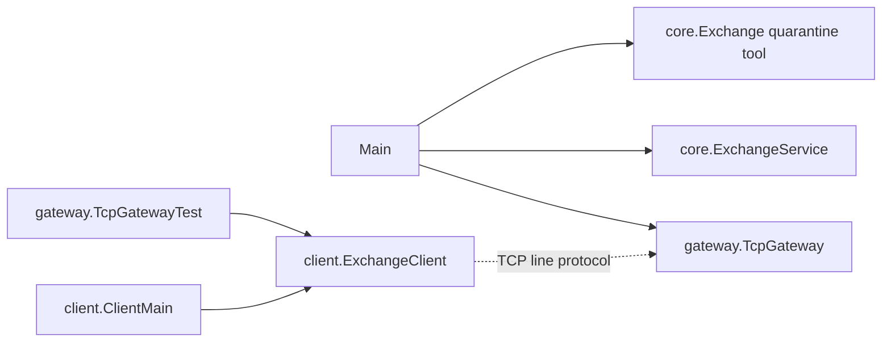
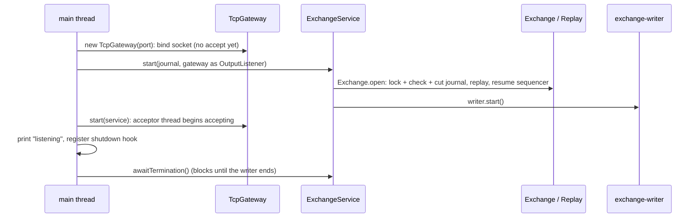

# 07 — Module: client and Main (ExchangeClient, ClientMain, Main)

> **Project:** ExchangeServer2 | Single-instrument limit order book: price-time matching engine, write-ahead journal with replay, single writer thread, plain TCP gateway | Stack: Java 17, Maven wrapper, JUnit 5 (+ JMH, PIT)
> **This guide:** the process entry point `exchangeserver.Main` (CLI options, start order, exit codes 0/1/2, shutdown hook, the `--quarantine` path) and the `exchangeserver.client` package (`ExchangeClient`, the line client used by tests; `ClientMain`, the interactive console client) | **Prerequisites:** 01, 04, 07-modules/gateway | **Related:** 05, 07-modules/exchange-service, 07-modules/exchange-and-replay, 08, 10, 14
> **Repo layout summary:** `pom.xml` + Maven wrapper (`mvnw`, `mvnw.cmd`) at the root; production code in `src/main/java/exchangeserver/` (packages `domain`, `book`, `engine`, `command`, `journal`, `core`, `gateway`, `client`, plus `Main`); tests mirror it in `src/test/java/exchangeserver/` (plus `bench/` JMH benchmarks and `testing/MutableClock`); design docs in `docs/` (`ExchangeServer2_Vision.md` = purpose/roadmap, `ExchangeServer2_Spec.md` = decisions D1–D65); these guides in `docs/understanding/`.

---

## Overview

These three classes sit at the edges of the system:

| Class | Package | Role | Entry point |
|---|---|---|---|
| `Main` | `exchangeserver` | Starts the server (or runs the operator quarantine tool), wires gateway ↔ service, handles shutdown and exit codes | `java -jar target/exchange-server2-2.0.0-SNAPSHOT.jar …` (the jar manifest names it, `pom.xml:79-88`) |
| `ExchangeClient` | `exchangeserver.client` | Minimal TCP line client with a background reader and a "wait for a matching line" API; used by `TcpGatewayTest` and by `ClientMain` | library |
| `ClientMain` | `exchangeserver.client` | Interactive console client: type protocol lines, see every server line | `java -cp target/exchange-server2-2.0.0-SNAPSHOT.jar exchangeserver.client.ClientMain localhost 9000` |

**[Verified]** `client` lives in `src/main` (not `src/test`), so it ships in the jar and the console client can run against a real server. **[Inferred]** The cost is that test-support code (`await`, `linesUntil`, `isClosedByServer`) ships in production.

---

## Dependencies



- **[Verified]** The client package depends on **nothing** in the rest of the code base: it only speaks the text protocol over a socket (`src/main/java/exchangeserver/client/ExchangeClient.java:1-19` imports only `java.*`).
- **[Verified]** `Main` depends on `Exchange` (quarantine), `ExchangeService` and `TcpGateway` only (`src/main/java/exchangeserver/Main.java:3-5`).

---

## `Main`

### Usage and exit codes

```java
// src/main/java/exchangeserver/Main.java:12-21 (trimmed)
/*
Starts the exchange: replay the journal, start the writer thread, open the TCP gateway.

    java -jar exchange-server2.jar [--port 9000] [--journal exchange.journal]
    java -jar exchange-server2.jar --journal exchange.journal --quarantine <seq>

Exit codes: 0 after a clean stop (Ctrl+C), 1 bad arguments or startup failure, 2 the exchange halted (restart
it; the journal is the truth). Fail-stop: a halted exchange exits rather than limp along refusing everything.
*/
```

| Exit code | Meaning | Where |
|---|---|---|
| 0 | Clean stop (documented as "after Ctrl+C") | `main` returns normally after `awaitTermination` (`Main.java:85-91`); see the open question below |
| 1 | Bad arguments; startup failure (bad journal, other rules version, journal already open, replay failure); failed `--quarantine` | `Main.java:43`, `:53`, `:68`; also any uncaught exception, e.g. the port is already in use |
| 2 | The exchange halted (journal I/O failure, `Error` in the engine, failed rebuild) | `Main.java:89` |

### Argument parsing

```java
// src/main/java/exchangeserver/Main.java:28-45
public static void main(String[] args) throws Exception {
    int port = 9000;
    Path journal = Path.of("exchange.journal");
    Long quarantine = null;
    try {
        for (int i = 0; i < args.length; i++) {
            switch (args[i]) {
                case "--port" -> port = Integer.parseInt(args[++i]);
                case "--journal" -> journal = Path.of(args[++i]);
                case "--quarantine" -> quarantine = Long.parseLong(args[++i]);
                default -> throw new IllegalArgumentException("unknown option " + args[i]);
            }
        }
    } catch (RuntimeException e) {
        System.err.println("Usage: [--port 9000] [--journal exchange.journal] [--quarantine <seq>]  (" + e.getMessage() + ")");
        System.exit(1);
        return;
    }
    ...
```

- **[Verified]** Defaults: port 9000, journal `exchange.journal` in the current working directory. There are no environment variables or config files.
- **[Verified]** `args[++i]` reads the option's value. A missing value throws `ArrayIndexOutOfBoundsException`, a bad number `NumberFormatException`; both are `RuntimeException`s, caught, and turned into the usage line with exit 1.
- **[Inferred]** A repeated option silently takes the last value; `--port` is ignored when `--quarantine` is given.
- **[Verified]** `return` after `System.exit(1)` never runs; it is there so the compiler knows `port`/`journal` are definitely assigned on the paths that continue.

### The `--quarantine` path

```java
// src/main/java/exchangeserver/Main.java:47-58
if (quarantine != null) {
    try {
        Exchange.quarantine(journal, quarantine, Clock.systemUTC());
    } catch (IOException | RuntimeException e) {
        // e.g. no such command, or the journal is open in a running exchange (D65)
        System.err.println("Quarantine failed: " + e.getMessage());
        System.exit(1);
        return;
    }
    System.out.println("Quarantined command " + quarantine + " in " + journal.toAbsolutePath());
    return;
}
```

- **[Verified]** This is the operator half of the poison-pill policy (D51): if startup fails because replay throws on command *k*, the operator inspects record *k* and runs `--quarantine k`, which appends `SKIP,<next seq>,<ts>,k`; the next start skips *k*. Details in guide 07-modules/exchange-and-replay.
- **[Verified]** Since this session (Spec §10 finding 4), a refusal prints one line and exits 1 instead of a stack trace. The most important refusal is D65: a running exchange holds the lock on `<journal>.lock`, a separate empty file next to the journal that stays on disk after close (`src/main/java/exchangeserver/journal/CommandJournal.java:201-205`). **[Verified]** by a live run in this survey:

```
--- quarantine while running:
Quarantine failed: Journal …\demo.journal is already open (a running exchange, or a --quarantine run)
```

(The first live attempt printed a raw stack trace before the `Main` change; the message text comes from `CommandJournal`.)

### Start order: bind, replay, accept

```java
// src/main/java/exchangeserver/Main.java:60-72
TcpGateway gateway = new TcpGateway(port);
ExchangeService service;
try {
    service = ExchangeService.start(journal, gateway);
} catch (IOException | RuntimeException e) {
    gateway.close();
    System.err.println("Startup failed: " + e);
    System.err.println("If replay failed on one command (a poison pill), inspect it, then restart with --quarantine <seq>.");
    System.exit(1);
    return;
}
gateway.start(service);
System.out.println("ExchangeServer2 listening on port " + gateway.port() + ", journal " + journal.toAbsolutePath());
```



1. **[Verified]** The port is bound **before** the journal is replayed (line 60 before 63). **[Inferred]** Why: a port conflict fails fast, before a possibly long replay. Clients that connect during replay wait in the operating system's accept backlog, because the acceptor starts only at line 71.
2. **[Verified]** The gateway is passed as the service's `OutputListener` before the gateway knows the service. That is safe: `onOutput` does not use the service, and no sessions exist until `gateway.start(service)`.
3. **[Verified]** Any `IOException` or `RuntimeException` from start (bad header, rules-version mismatch, "already open", replay failure on a poison pill) closes the gateway and exits 1. The hint about `--quarantine` is printed for **every** startup failure. **[Verified]** by a live run: a journal with another rules version printed the correct "written under rules version 9; this build uses 1" message **and** the poison-pill hint, which does not apply there. The rules-version message also says "Start a fresh journal from a snapshot", but snapshots do not exist yet (Spec §8).
4. **[Verified]** An `Error` during start (e.g. `OutOfMemoryError` in replay) is not caught. **[General Java knowledge]** It escapes `main`, the JVM prints the stack trace, and the exit status is 1 (no non-daemon threads are running yet).
5. **[Verified]** `Main` prints neither the replayed command count nor the torn bytes cut on open. `Exchange.replayedOnOpen()` and `truncatedBytesOnOpen()` exist but only tests read them (Spec §8, "Startup reporting"). **[Verified]** by a live run: after a torn record was appended to a journal and the server restarted, stdout showed only the "listening" line.

### Shutdown hook and halt

```java
// src/main/java/exchangeserver/Main.java:74-91
Runtime.getRuntime().addShutdownHook(new Thread(() -> {
    try {
        gateway.close();
        if (!service.stop(Duration.ofSeconds(10))) {
            System.err.println("Writer thread did not stop within 10 s");
        }
    } catch (IOException | InterruptedException e) {
        System.err.println("Shutdown: " + e);
    }
}, "shutdown"));

service.awaitTermination();
if (service.state() == ExchangeService.State.HALTED) {
    System.err.println("Exchange halted: " + service.haltCause());
    gateway.close();
    System.exit(2);
}
```

A **shutdown hook** is a thread the JVM runs when it is asked to exit: on Ctrl+C (SIGINT), SIGTERM, or a call to `System.exit`. It does **not** run on a hard kill (SIGKILL, or `Stop-Process -Force` / Task Manager on Windows).

**Clean stop (Ctrl+C):**
1. **[Verified]** The hook closes the gateway first: no new connections, every session dropped (`closeNow`).
2. **[Verified]** Then `service.stop(10 s)`: state `STOPPING`, `STOP` enqueued, everything accepted before it is processed, the writer closes the journal, state `STOPPED` (guide 07-modules/exchange-service).
3. **[Verified]** Meanwhile `main` was blocked in `awaitTermination()`; it returns when the writer ends, sees `STOPPED`, and returns normally.

**[Inferred]** Closing the gateway before stopping the service means replies for requests still in the queue are computed and journalled but go to closed sessions. Clients reconcile on reconnect by resending with the same client order id (D49).

**Halt:**
1. **[Verified]** The writer halts; `awaitTermination()` returns; the state is `HALTED`; `main` prints the cause, closes the gateway, and calls `System.exit(2)`.
2. **[Verified]** `System.exit` runs the shutdown hook too: `gateway.close()` again (idempotent) and `service.stop(...)`, which sees the state is not `RUNNING`, enqueues nothing, and returns at once because the writer has already ended.
3. **[Verified]** Fail-stop: "a halted exchange exits rather than limp along refusing everything" (`Main.java:20`, Vision principle 10, D58). The operator restarts; replay rebuilds the state from the journal.

**Hard kill (crash):** **[Verified]** by live runs in this survey: the process was killed with `Stop-Process -Force` (no hook ran). A restart on the same journal rebuilt the book (`BOOK seq=6 last=100 bids=- asks=-`), continued the counters (next order id 5, next sequence 7), and silently cut a torn half-record that had been appended to simulate a crash mid-write.

> **Open question (see 15-open-questions.md):** the documented "exit 0 after Ctrl+C" was not verified in this survey (only hard kills were possible from the tooling). **[General Java knowledge]** When a JVM exits because of a signal, the process exit status is usually set by the signal (for example 130 for SIGINT on Linux), not by `main` returning. Whether the exit code really is 0 after Ctrl+C on Windows and Linux needs a manual check.

### How `Main` is tested

**[Verified]** It is not unit-tested: there is no `MainTest`. PIT does not mutate the root package (`pom.xml:143-150` lists only `domain`, `book`, `engine`, `command`, `journal`, `core`), and `ExchangeService.awaitTermination()` (used only by `Main`) is a reported survivor (Spec §7). The pieces `Main` calls are tested individually (`ExchangeServiceTest`, `ExchangeTest$PoisonPill` for the quarantine tool, `TcpGatewayTest`). This survey exercised `Main` by hand (normal session, restart after a hard kill with a torn tail, wrong rules version, non-journal file, `--quarantine` while running).

---

## `ExchangeClient`

```java
// src/main/java/exchangeserver/client/ExchangeClient.java:21-46 (trimmed)
/*
A minimal client for the line protocol, used by ClientMain and by the gateway tests.

A background thread reads lines into a queue. await() returns the first line matching a predicate within a
timeout and keeps the lines it skipped, so a later await() can still find them (replies, fills and market data
interleave on one connection).
*/
public final class ExchangeClient implements AutoCloseable {
    private static final String EOF = "\u0000EOF";
    private final Socket socket;
    private final Writer out;
    private final BlockingQueue<String> incoming = new LinkedBlockingQueue<>();
    private final List<String> skipped = new ArrayList<>();

    public ExchangeClient(String host, int port) throws IOException {
        socket = new Socket(host, port);
        socket.setTcpNoDelay(true);
        out = new BufferedWriter(new OutputStreamWriter(socket.getOutputStream(), US_ASCII));
        Thread reader = new Thread(this::readLoop, "client-reader");
        reader.setDaemon(true);
        reader.start();
    }
```

### Public interface

| Member | Purpose | Thread |
|---|---|---|
| `ExchangeClient(host, port)` | Connect; start the daemon `client-reader` thread | caller |
| `send(String line)` | Write `line + "\n"`, flush. `synchronized`. A string containing `\n` sends several lines (the D63 test uses this to send 201 lines in one write). | any |
| `await(Predicate<String>, Duration)` | First line (already-skipped ones first, oldest first) that matches; non-matching lines read meanwhile are kept in `skipped`. Throws `IllegalStateException` on timeout or on connection close. | one test thread |
| `awaitPrefix(String, Duration)` | `await` for `line.startsWith(prefix)` | one test thread |
| `linesUntil(Predicate, Duration)` | Every line, in arrival order, up to and including the first match | one test thread |
| `nextLine()` | Block for the next raw line, or `null` at end of stream (for `ClientMain`) | printer thread |
| `isClosedByServer(Duration)` | `true` if end of stream arrives within the timeout | one test thread |
| `static field(line, key)` | Parse `key=value` out of a server line, e.g. `field("ORDER orderId=7 …", "orderId")` → `"7"` | any |
| `close()` | Close the socket | any |

### The `await` buffer

```java
// src/main/java/exchangeserver/client/ExchangeClient.java:55-79
public String await(Predicate<String> match, Duration timeout) throws InterruptedException {
    for (Iterator<String> it = skipped.iterator(); it.hasNext(); ) {
        String line = it.next();
        if (match.test(line)) {
            it.remove();
            return line;
        }
    }
    long deadline = System.nanoTime() + timeout.toNanos();
    while (true) {
        long left = deadline - System.nanoTime();
        String line = left <= 0 ? null : incoming.poll(left, TimeUnit.NANOSECONDS);
        if (line == null) {
            throw new IllegalStateException("No matching line within " + timeout + "; unmatched so far: " + skipped);
        }
        if (line == EOF) {
            incoming.add(EOF);
            throw new IllegalStateException("Connection closed; unmatched lines: " + skipped);
        }
        if (match.test(line)) {
            return line;
        }
        skipped.add(line);
    }
}
```

- **[Verified]** Why it exists: on one connection a client receives its replies, its maker fills and market data interleaved. A test that waits for `ORDER` must not lose a `TRADE` that arrived first; the skipped list keeps it for a later `await`.
- **[Verified]** Every wait has a deadline, in line with the project's rule that tests never wait without a timeout. A timeout failure message lists every unmatched line, which makes gateway test failures readable.
- **[Verified]** `EOF` is a sentinel string compared by identity (`line == EOF`), added by the reader thread when the stream ends (`ExchangeClient.java:124-135`). It is put back after being seen so later calls also see end of stream. **[Inferred]** The `\u0000` prefix makes it impossible to confuse with a real ASCII protocol line even by value; identity comparison makes it doubly safe.
- **[Verified]** `skipped` is a plain `ArrayList`; `await`, `linesUntil` and `isClosedByServer` are meant for a single test thread (not thread-safe). `incoming` is a thread-safe `LinkedBlockingQueue` filled by the reader thread.

### The `linesUntil` quirk

```java
// src/main/java/exchangeserver/client/ExchangeClient.java:85-97
public List<String> linesUntil(Predicate<String> match, Duration timeout) throws InterruptedException {
    List<String> lines = new ArrayList<>();
    String[] last = {null};
    await(line -> {
        lines.add(line);
        last[0] = line;
        return match.test(line);
    }, timeout);
    // await() moved the non-matching lines it read into `skipped`; they are reported here, so drop them.
    skipped.removeAll(lines);
    return lines;
}
```

**[Verified]** It records every line `await` tests, then removes them from `skipped`. **[Inferred]** `List.removeAll` removes **every** element equal to any recorded line, not just the recorded occurrences. If the match is found among already-skipped lines and a *later* skipped line has identical text to an earlier recorded one (two identical `PONG`s, two identical `LEVEL` lines), that later line is dropped too and a following `await` will not find it. Harmless for the current tests; a trap for new ones. **[Verified]** `last` is written but never read (dead variable).

---

## `ClientMain`

```java
// src/main/java/exchangeserver/client/ClientMain.java:20-50 (trimmed)
public static void main(String[] args) throws Exception {
    String host = args.length > 0 ? args[0] : "localhost";
    int port = args.length > 1 ? Integer.parseInt(args[1]) : 9000;

    try (ExchangeClient client = new ExchangeClient(host, port)) {
        Thread printer = new Thread(() -> {
            ... while ((line = client.nextLine()) != null) { System.out.println("< " + line); }
            System.out.println("(connection closed)");
        }, "printer");
        printer.setDaemon(true);
        printer.start();

        System.out.println("Connected to " + host + ":" + port + ". Try: LOGIN alice / NEW c1 BUY LIMIT 10 100 / SUBSCRIBE / QUIT");
        BufferedReader stdin = new BufferedReader(new InputStreamReader(System.in, UTF_8));
        String line;
        while ((line = stdin.readLine()) != null) {
            client.send(line.strip());
            if (line.strip().equals("QUIT")) {
                printer.join(2000);
                break;
            }
        }
    }
}
```

- **[Verified]** Two threads: `main` reads stdin and sends; a daemon `printer` prints every server line as it arrives, prefixed `< `. Input is stripped of surrounding whitespace before sending.
- **[Verified]** After `QUIT` it waits up to 2 s for the printer (so `BYE` and, since D63, any outstanding replies are printed), then closes.
- **[Inferred]** stdin is decoded as UTF-8 but the socket writer encodes US-ASCII; a non-ASCII character would be replaced (typically by `?`) and then rejected by the server's patterns. Harmless for the ASCII protocol.
- **[Verified]** It has no tests.

---

## How the client is tested

**[Verified]** `ExchangeClient` has no test class of its own; it is exercised by every test in `TcpGatewayTest` (`src/test/java/exchangeserver/gateway/TcpGatewayTest.java`), which creates clients through `connect()`/`login(...)` helpers and closes them in `@AfterEach`. Two of this session's D63 tests show both styles: `quitAnswersEveryEarlierRequestBeforeBye` (`TcpGatewayTest.java:106`) uses `ExchangeClient.send` + `linesUntil`; `endOfStreamStillGetsTheReplies` (`:123`) uses a raw `java.net.Socket` because `ExchangeClient` has no way to half-close its output.

---

## Key takeaways

- `Main` has two modes: run the server, or `--quarantine <seq>` (operator tool, refused while a server holds the journal, D65).
- Start order is bind → replay (on the main thread) → start writer → start accepting → print "listening" → wait for the writer.
- Exit codes: 0 clean stop, 1 bad arguments / startup failure / failed quarantine, 2 halted. A halt is fail-stop: restart and let replay rebuild.
- The shutdown hook closes the gateway, then stops the service with a 10 s timeout; it runs on Ctrl+C and `System.exit`, not on a hard kill.
- A hard kill is survivable by design: restart rebuilds the identical book from the journal (verified live, including a torn tail).
- `ExchangeClient` buffers unmatched lines so tests can wait for a specific line in an interleaved stream; every wait has a timeout.
- `linesUntil` removes by value (`removeAll`), which can drop identical later lines.
- `Main` has no unit tests and is outside PIT's scope; it was exercised by hand.

## Common confusions

- **"`--port` matters for `--quarantine`."** No; the quarantine path returns before the gateway is created.
- **"Startup failure always means a poison pill."** The hint is printed for every startup failure, including a rules-version mismatch or "already open".
- **"Ctrl+C loses queued orders."** No: `stop()` processes everything accepted before `STOP`. What is lost is delivery of those late replies to clients whose sessions were already closed by `gateway.close()`.
- **"`ExchangeClient` is test code."** It lives in `src/main` and ships in the jar; `ClientMain` uses it.
- **"`await` consumes every line it reads."** It returns the match and keeps the others for later calls.

## Questions to test yourself

1. What does `java -jar …jar --port` (no value) print, and with which exit code?
<details><summary>Answer</summary>`args[++i]` throws `ArrayIndexOutOfBoundsException`, a `RuntimeException`, so `Main` prints `Usage: [--port 9000] [--journal exchange.journal] [--quarantine <seq>]  (Index 1 out of bounds for length 1)` and exits 1 (`Main.java:32-45`).</details>

2. Why is the TCP port bound before the journal is replayed, and what happens to a client that connects during replay?
<details><summary>Answer</summary>So a port conflict fails before a possibly long replay ([Inferred]). The connection is queued in the OS accept backlog and is accepted once `gateway.start(service)` starts the acceptor after replay (`Main.java:60-71`).</details>

3. The exchange halts on a journal write error. Trace what happens until the process ends.
<details><summary>Answer</summary>The writer halts (state HALTED, outstanding futures failed with HALTED, journal closed). `awaitTermination()` returns in `main`; `main` prints "Exchange halted: …", closes the gateway and calls `System.exit(2)`. The shutdown hook runs: `gateway.close()` again (no-op) and `service.stop(10 s)`, which returns at once. Exit code 2.</details>

4. Why can't an operator accidentally corrupt a live journal with `--quarantine` any more?
<details><summary>Answer</summary>`CommandJournal.open` first takes an exclusive lock on the sibling file `<journal>.lock` (D65). The running exchange holds it, so the tool's `open` throws "already open" before it touches the journal; `Main` prints "Quarantine failed: …" and exits 1 without writing anything.</details>

5. A test calls `client.awaitPrefix("ORDER", WAIT)` but the server sent `FILL`, `TRADE`, `ORDER`. What is returned, and where do the other two lines go?
<details><summary>Answer</summary>The `ORDER` line is returned. `FILL` and `TRADE` were read first, did not match, and were appended to `skipped`, where a later `await` (which checks `skipped` first, oldest first) can still find them.</details>
