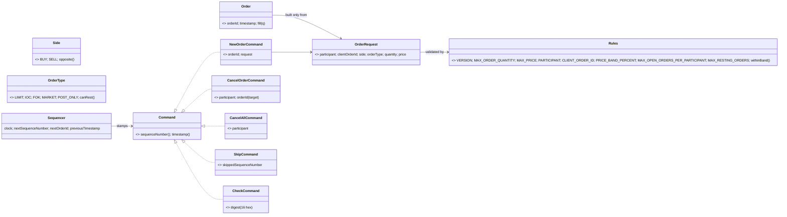
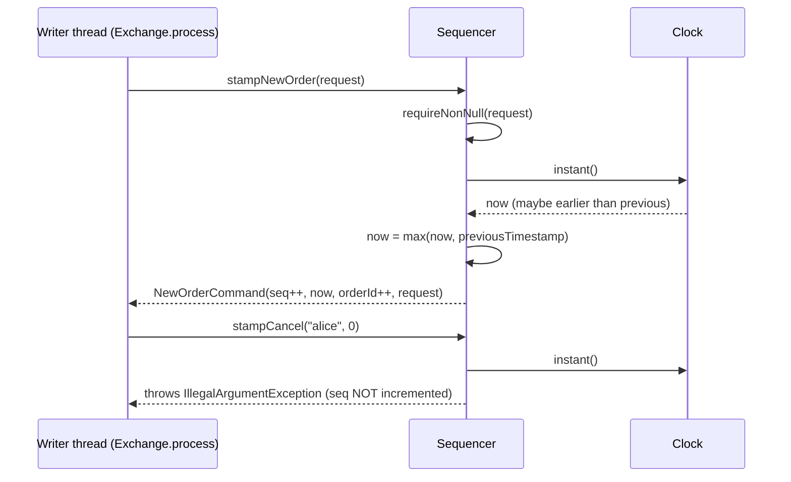
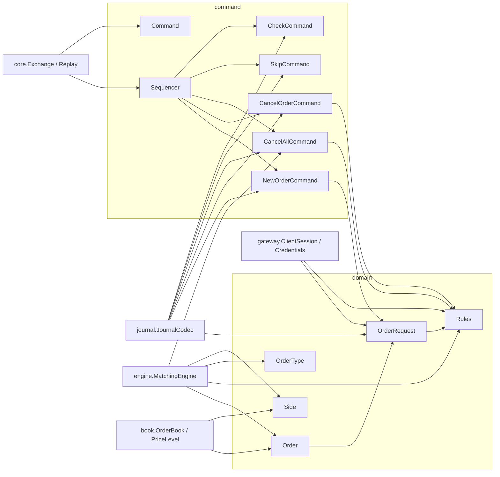

# 07 — Module: domain and command

> **Project:** ExchangeServer2 | Single-instrument limit order book: price-time matching engine, write-ahead journal with replay, single writer thread, TCP/TLS gateway with authenticated participants | Stack: Java 17, Maven wrapper, JUnit 5 (+ JMH, PIT)
> **This guide:** the value types every other package is built on (`domain`: `Side`, `OrderType`, `Rules`, `OrderRequest`, `Order`) and the stamped inputs plus their stamper (`command`: `Command`, `NewOrderCommand`, `CancelOrderCommand`, `CancelAllCommand`, `SkipCommand`, `CheckCommand`, `Sequencer`) | **Prerequisites:** 01, 02 | **Related:** 06, 07-modules/engine, 07-modules/journal, 07-modules/exchange-and-replay, 09, 12
> **Repo layout summary:** `pom.xml` + Maven wrapper (`mvnw`, `mvnw.cmd`) at the root; production code in `src/main/java/exchangeserver/` (packages `domain`, `book`, `engine`, `command`, `journal`, `core`, `gateway`, `client`, plus `Main`); tests mirror it in `src/test/java/exchangeserver/` (plus `bench/` JMH benchmarks and `testing/MutableClock`); design docs in `docs/` (`ExchangeServer2_Vision.md` = purpose/roadmap, `ExchangeServer2_Spec.md` = decisions D1–D77); these guides in `docs/understanding/`.

## Overview

These two small packages (about 490 lines together) define *what an order is* and *what an input to the
exchange is*. Almost every rule that can make a request invalid lives here, and the only component allowed to
read the clock or count lives here too.

- **`domain`**: plain business values.
  - `Side` is `BUY` or `SELL`.
  - `OrderType` is one of the five order types.
  - `Rules` holds every limit and constant that replay depends on.
  - `OrderRequest` is a client's order **before** the exchange accepts it. It is the only place fields are
    validated.
  - `Order` is an accepted order: a request plus an id and a timestamp. It is the one mutable object, because it
    tracks how much has been filled.
- **`command`**: the **commands**. A command is a stamped, journalled input, and commands are the system's
  source of truth.
  - There are five kinds. Three are engine inputs: `NewOrderCommand`, `CancelOrderCommand` and
    `CancelAllCommand` (cancel every resting order of one participant, used for cancel-on-disconnect, Spec D72).
    Two are bookkeeping that replay reads but never feeds to the engine: `SkipCommand` (quarantine a poison pill,
    D51) and `CheckCommand` (a digest of every output so far, D70).
  - `Sequencer` stamps them with a sequence number, a timestamp and (for new orders) an order id.

Two project terms appear throughout:

- **Replay.** On restart, the exchange rebuilds its state by feeding every journalled command through the same
  matching engine again (see guide 07-modules/exchange-and-replay). Anything replay depends on must therefore be
  deterministic and must not change silently. That requirement is why `Rules` exists and why only the
  `Sequencer` reads the clock.
- **Stateless vs state-dependent validation.** A *stateless* check needs only the request itself (is the
  quantity positive?). A *state-dependent* check needs the book (is this client order id already used?). The
  stateless checks live in `OrderRequest`; the state-dependent ones live in the engine (guide
  07-modules/engine). **[Verified]** Spec D47, Vision §4 principle 6.



## Responsibility

| Type | Responsibility | Mutable? |
|---|---|---|
| `Side` | Which side of the book; `opposite()` | no |
| `OrderType` | The five order types; `canRest()` says which may sit on the book | no |
| `Rules` | One home for every limit replay depends on, plus the price-band arithmetic | no |
| `OrderRequest` | The only field-validation layer (stateless) | no |
| `Order` | An accepted order inside the engine and book; tracks `filledQuantity` | **yes** (only `fill`) |
| `Command` + 5 records | Stamped, journalled inputs; validated in their constructors | no |
| `Sequencer` | The only clock reader and the only counter | yes (writer thread only) |

## Public interface and who calls it

| Member | Visibility | Called by |
|---|---|---|
| `Side.opposite()` | public | `MatchingEngine.process` (`restingSide`), `MatchingEngine.matchLimit` (the touch, D66), `MatchingEngine.fillability` |
| `OrderType.canRest()` | public | `OrderBook.add` (guard), `MatchingEngine.process` (the resting caps, D68) |
| `Rules.*` constants | public | `OrderRequest`, `CancelOrderCommand`, `CancelAllCommand`, `ClientSession.login` and `Credentials` (participant pattern), `MatchingEngine` (band, caps via `Limits.RULES`, collar), `Exchange` (`Rules.VERSION` to open, compact and quarantine the journal) |
| `Rules.withinBand(price, ref)` | public | `MatchingEngine.process` (band check) |
| `OrderRequest.of(..., OptionalLong)` | public | `ClientSession.newOrder` (`src/main/java/exchangeserver/gateway/ClientSession.java:332`), `JournalCodec.decode` (`src/main/java/exchangeserver/journal/JournalCodec.java:138`), `MatchingEngine.restore` (rebuilding resting orders from a snapshot, `src/main/java/exchangeserver/engine/MatchingEngine.java:89`) |
| `OrderRequest.limit/ioc/fok/postOnly/market` | public | tests, benchmarks |
| `OrderRequest.rawPrice()` | package-private | `Order` constructor only |
| `new Order(id, request, ts)` | public | `MatchingEngine.onNewOrder`, `MatchingEngine.restore` |
| `Order.fill(q)` | public | `PriceLevel.fillHead` (resting side), `MatchingEngine.process` (incoming side), `MatchingEngine.restore` (re-applying a snapshot's filled quantity) |
| `Sequencer.stampNewOrder/stampCancel/stampCancelAll` | public | `Exchange.process` (`src/main/java/exchangeserver/core/Exchange.java:207`, `:209`, `:211`) |
| `Sequencer.stampCheck` | public | `Exchange.process`, at the start of a batch when a CHECK is due (`Exchange.java:201`) |
| `Sequencer.stampSkip` | public | `Exchange.quarantine` (both the static operator tool, `Exchange.java:164`, and the live poison-pill path, `Exchange.java:280`) |
| `Sequencer.resume(...)` | public static | `Exchange.open` (after replay, `Exchange.java:122`), `Exchange.quarantine` (static tool, `Exchange.java:163`) |

All of the above is **[Verified]** by reading the call sites.

## Internal walkthrough: `domain`

### `Side` and `OrderType`

```java
// src/main/java/exchangeserver/domain/Side.java:3-10
public enum Side {
    BUY,
    SELL;

    public Side opposite() {
        return this == BUY ? SELL : BUY;
    }
}
```

```java
// src/main/java/exchangeserver/domain/OrderType.java:3-23 (trimmed)
/*
LIMIT      match what crosses now, rest the remainder.
IOC        match what crosses now, cancel the remainder.
FOK        fill completely now or do nothing.
MARKET     no price; match at any price inside the market collar (Rules), cancel the remainder.
POST_ONLY  rest without matching; rejected if it would cross on arrival.
 */
public enum OrderType {
    LIMIT, IOC, FOK, MARKET, POST_ONLY;

    // Only these two ever rest on the book.
    public boolean canRest() {
        return this == LIMIT || this == POST_ONLY;
    }
}
```

**[Verified]** The comment block is the clearest one-line definition of each type. IOC means "immediate or
cancel" and FOK means "fill or kill". `canRest()` drives two distinct things:
1. `OrderBook.add` refuses any other type, which is a bug guard.
2. Only `LIMIT` and `POST_ONLY` are subject to the resting caps (per participant and for the whole book), and
   then only when they would actually rest (Spec D68; guide 07-modules/engine). That is a business rule.

### `Rules`: everything replay depends on

```java
// src/main/java/exchangeserver/domain/Rules.java:17-47 (trimmed)
public final class Rules {

    // 2: self-trade prevention (D67), caps only for orders that would rest + BOOK_FULL (D68), market collar before
    //    the first trade anchored on the opposite touch (D66), CANCEL_ALL (D72).
    public static final int VERSION = 2;

    // Stateless (checked by OrderRequest, i.e. at the gateway).
    public static final long MAX_ORDER_QUANTITY = 1_000_000_000L;
    // Notional (price x quantity) can never overflow a long.
    public static final long MAX_PRICE = Long.MAX_VALUE / MAX_ORDER_QUANTITY;
    // No ',' or whitespace: they separate fields in the journal and in the wire protocol.
    public static final Pattern PARTICIPANT = Pattern.compile("[A-Za-z0-9_]{1,16}");
    public static final Pattern CLIENT_ORDER_ID = Pattern.compile("[A-Za-z0-9_.-]{1,32}");

    // State-dependent (checked by the engine).
    public static final int PRICE_BAND_PERCENT = 10;
    public static final int MAX_OPEN_ORDERS_PER_PARTICIPANT = 10_000;
    // All participants together (D68): bounds the book's memory however many participants exist.
    public static final int MAX_RESTING_ORDERS = 1_000_000;

    // Exact integer comparison, no rounding: price * 100 vs reference * (100 +- band).
    // Cannot overflow: both prices are <= MAX_PRICE (~9.2e9), times at most 110.
    public static boolean withinBand(long price, long referencePrice) {
        return price * 100 <= referencePrice * (100 + PRICE_BAND_PERCENT)
                && price * 100 >= referencePrice * (100 - PRICE_BAND_PERCENT);
    }
}
```

Line by line:

- **`VERSION` (line 21) is 2.** **[Verified]** It is written into the journal header, and `CommandJournal.open`
  refuses a journal *with records* whose header names another version (Spec D46). Replay feeds *old* commands
  through *today's* code. If, say, `MAX_ORDER_QUANTITY` shrank, an old valid order would fail decoding or be
  rejected differently, and the rebuilt book would differ from what clients saw. The class comment
  (`Rules.java:5-16`) says exactly this.
  - **Why 2 [Verified]** (`Rules.java:19-21`): version 2 changed what the engine does with the same commands:
    self-trade prevention (D67), the caps applying only to orders that would rest plus the new `BOOK_FULL` cap
    (D68), the market collar before the first trade (D66) and the new `CANCEL_ALL` command (D72). A version-1
    journal replayed under version 2 could build a different book, so it is refused.
  - **How a rules change is crossed [Verified]** (Spec D71): compact the journal with the *old* build (a
    snapshot plus an empty journal); an empty journal adopts the new build's version when it is opened (guide
    07-modules/journal).
  - **Caveat [Verified]** (Spec D70, §8): the version catches *deliberate* rule changes. A code change that alters
    outputs without touching `Rules` is now caught at the next `CHECK` record, whose output digest replay must
    reproduce; it is no longer silent, but it is detected only at a CHECK and only if an output differs.
- **`MAX_RESTING_ORDERS` (line 37) = 1,000,000.** **[Verified]** A cap on resting orders across *all*
  participants (Spec D68). The per-participant cap alone did not bound memory, because participant names used to
  be free (now they need credentials, D74). The engine rejects a resting order at this cap with `BOOK_FULL`.
- **`MAX_PRICE` (line 26) = `Long.MAX_VALUE / 1_000_000_000` = 9,223,372,036.** **[Verified]**
  `RulesTest.maxPriceTimesMaxQuantityFitsInALong` checks it. So `price * quantity` can never overflow a `long`,
  whatever the inputs. A consequence **[Inferred]**: prices are integer "ticks" (no decimals anywhere), with a
  ceiling of about 9.2 billion ticks.
- **The two patterns (lines 28–29).** They exclude `,` (the journal's field separator) and spaces (the wire
  protocol's token separator). So a participant or client order id can never corrupt either format. **[Verified]**
  by the comment, by `JournalCodec` splitting on `,` and by `Protocol.parse` splitting on a single space.
- **`withinBand` (lines 44–47).** It compares `price × 100` with `reference × 110` and `reference × 90` in
  integers, so there's no floating point and no rounding. Both edges are inclusive.
  - **Worked example [Verified by arithmetic]:** with last trade 105, the band is `[94.5, 115.5]` in real
    numbers. For integer prices 95 is the lowest allowed (`9500 >= 9450`) and 115 the highest
    (`11500 <= 11550`). 94 is out (`9400 < 9450`) and 116 is out (`11600 > 11550`).
  - **Overflow note [Verified]:** `MAX_PRICE × 110 ≈ 1.01e12`, far below `Long.MAX_VALUE`.
    `RulesTest.bandDoesNotOverflowAtTheMaximumPrice` covers it.

### `OrderRequest`: the only field-validation layer

```java
// src/main/java/exchangeserver/domain/OrderRequest.java:24-74 (trimmed)
private OrderRequest(String participant, String clientOrderId, Side side, OrderType orderType, long quantity, long price) {
    if (participant == null || !Rules.PARTICIPANT.matcher(participant).matches()) {
        throw new IllegalArgumentException("Invalid participant: " + participant);
    }
    if (clientOrderId == null || !Rules.CLIENT_ORDER_ID.matcher(clientOrderId).matches()) { ... }
    if (side == null) { ... }
    if (orderType == null) { ... }
    if (quantity <= 0) { ... }
    if (quantity > Rules.MAX_ORDER_QUANTITY) { ... }
    if (orderType != OrderType.MARKET) {
        if (price <= 0) { ... }
        if (price > Rules.MAX_PRICE) { ... }
    }
    ...
}

// The general factory: the price is present for every type except MARKET.
public static OrderRequest of(String participant, String clientOrderId, Side side, OrderType orderType,
                              long quantity, OptionalLong price) {
    Objects.requireNonNull(price, "price");
    if (orderType == OrderType.MARKET) {
        if (price.isPresent()) {
            throw new IllegalArgumentException("A market order has no price");
        }
        return new OrderRequest(participant, clientOrderId, side, orderType, quantity, Order.NO_PRICE);
    }
    if (price.isEmpty()) {
        throw new IllegalArgumentException("A " + orderType + " order needs a price");
    }
    return new OrderRequest(participant, clientOrderId, side, orderType, quantity, price.getAsLong());
}
```

Key design points:

1. **The constructor is private.** Every route in goes through a factory, so every instance has passed every
   check. "An invalid `OrderRequest` cannot exist" is enforced by the type, not by convention. **[Verified]**
   `OrderRequest.java:24`.
2. **One rule set, three users.** **[Verified]**
   - The gateway builds requests with `of(...)`: `ClientSession.java:332`.
   - The journal decoder builds them with `of(...)` too (guide 07-modules/journal).
   - `MatchingEngine.restore` rebuilds each resting order of a snapshot through `of(...)` (`MatchingEngine.java:89`),
     so even a snapshot's orders pass the stateless rules.

   So a journalled record is re-validated on replay by the *same* rules as the gateway applied. The class comment
   calls this "reuse, not a third copy of the rules" (`OrderRequest.java:9`).
3. **A market order has no price in the API.** `getPrice()` returns `OptionalLong`, empty for `MARKET`
   (`OrderRequest.java:116-118`). Internally the field holds the sentinel `Order.NO_PRICE = -1`
   (`Order.java:18`), but only `Order`'s constructor can see it, through the package-private `rawPrice()`
   (`OrderRequest.java:121-123`). **[Verified]** Spec D25/D26 record this choice.
4. **`equals`/`hashCode` cover every field** (`OrderRequest.java:126-140`). **[Verified]**
   `OrderRequestTest.equalityCoversEveryField`. **[Inferred]** These matter for tests that compare decoded
   journal records with the originals, and for `NewOrderCommand` (a record), whose `equals` delegates to the
   request's.

`IllegalArgumentException` means "bad input from outside". **[Verified]** Spec D27:
`IllegalArgumentException` = bad input; `IllegalStateException` = our bug or a corrupt journal. The gateway
catches the `IllegalArgumentException` and answers `ERROR clOrdId=… <message>`, so the request never reaches the
queue (guide 07-modules/gateway).

### `Order`: an accepted order

```java
// src/main/java/exchangeserver/domain/Order.java:30-103 (trimmed)
public Order(long orderId, OrderRequest request, Instant timestamp) {
    Objects.requireNonNull(request, "request");
    Objects.requireNonNull(timestamp, "timestamp");
    if (orderId <= 0) {
        throw new IllegalArgumentException("Order id must be positive");
    }
    this.orderId = orderId;
    this.participant = request.getParticipant();
    ...
    this.price = request.rawPrice();
    this.originalQuantity = request.getQuantity();
    this.timestamp = timestamp;
}

public boolean hasPrice() { return orderType != OrderType.MARKET; }

// A market order has no price; asking for one is a bug.
public long getPrice() {
    if (!hasPrice()) {
        throw new IllegalStateException("Order " + orderId + " is a market order and has no price");
    }
    return price;
}

public long getRemainingQuantity() { return originalQuantity - filledQuantity; }

public void fill(long quantity) {
    if (quantity <= 0) { throw new IllegalArgumentException("Fill quantity must be positive"); }
    if (quantity > getRemainingQuantity()) { throw new IllegalArgumentException("Cannot overfill order " + orderId); }
    filledQuantity += quantity;
}
```

- **The only constructor takes a request** (Spec D47). So `Order` re-checks only what a request cannot know:
  the id and the timestamp. **[Verified]**
- **Its single mutable field is `filledQuantity`** (`Order.java:28`); "remaining" is derived from it. **[Verified]**
- **An `Order` holds no references to the book, level or node.** "An Order does not know where it is stored"
  (`Order.java:13`). The book wraps it in an `OrderNode` instead (guide 07-modules/book). **[Verified]**
- **`getPrice()` throws for `MARKET`.** Code that forgets the "market has no price" case fails loudly instead of
  matching at price −1. **[Verified]**
- **Who calls `fill`.** It is called on the resting order (inside `PriceLevel.fillHead`) and on the incoming
  order (in `MatchingEngine.process`). Both pass the same quantity per trade. **[Verified]** by reading both.

## Internal walkthrough: `command`

### The sealed `Command` interface and its five records

```java
// src/main/java/exchangeserver/command/Command.java:11-16
public sealed interface Command permits NewOrderCommand, CancelOrderCommand, CancelAllCommand, SkipCommand, CheckCommand {
    long sequenceNumber();
    Instant timestamp();
}
```

A **sealed interface** (Java 17) lists every allowed implementation, so the compiler knows the full set. A
**record** is an immutable data class; a *compact constructor* (`public NewOrderCommand { ... }`) runs
validation before the fields are assigned. Commands are immutable, so "the object that is logged and the object
that is processed cannot differ" (`Command.java:7-8`). **[Verified]**

```java
// src/main/java/exchangeserver/command/NewOrderCommand.java:8-21 (trimmed)
public record NewOrderCommand(long sequenceNumber, Instant timestamp, long orderId, OrderRequest request)
        implements Command {
    public NewOrderCommand {
        Objects.requireNonNull(timestamp, "timestamp");
        Objects.requireNonNull(request, "request");
        if (sequenceNumber <= 0) { throw new IllegalArgumentException("Sequence number must be positive"); }
        if (orderId <= 0) { throw new IllegalArgumentException("Order id must be positive"); }
    }
}
```

```java
// src/main/java/exchangeserver/command/CancelOrderCommand.java:8-23 (trimmed)
// orderId is the target; a cancel is not issued an id of its own (D32).
public record CancelOrderCommand(long sequenceNumber, Instant timestamp, String participant, long orderId)
        implements Command {
    public CancelOrderCommand {
        Objects.requireNonNull(timestamp, "timestamp");
        if (sequenceNumber <= 0) { ... }
        if (participant == null || !Rules.PARTICIPANT.matcher(participant).matches()) { ... }
        if (orderId <= 0) { ... }
    }
}
```

```java
// src/main/java/exchangeserver/command/SkipCommand.java:14-24 (trimmed)
public record SkipCommand(long sequenceNumber, Instant timestamp, long skippedSequenceNumber) implements Command {
    public SkipCommand {
        Objects.requireNonNull(timestamp, "timestamp");
        if (sequenceNumber <= 0) { ... }
        if (skippedSequenceNumber <= 0 || skippedSequenceNumber >= sequenceNumber) {
            throw new IllegalArgumentException("Can only skip an earlier command, not " + skippedSequenceNumber);
        }
    }
}
```

```java
// src/main/java/exchangeserver/command/CancelAllCommand.java:8-21 (trimmed)
// Cancels every resting order of one participant (cancel-on-disconnect, D72). An input like any other: journalled
// before it is processed, replayed on restart.
public record CancelAllCommand(long sequenceNumber, Instant timestamp, String participant) implements Command {
    public CancelAllCommand {
        Objects.requireNonNull(timestamp, "timestamp");
        if (sequenceNumber <= 0) { ... }
        if (participant == null || !Rules.PARTICIPANT.matcher(participant).matches()) { ... }
    }
}
```

```java
// src/main/java/exchangeserver/command/CheckCommand.java:16-29 (trimmed)
public record CheckCommand(long sequenceNumber, Instant timestamp, String digest) implements Command {

    private static final Pattern HEX16 = Pattern.compile("[0-9a-f]{16}");

    public CheckCommand {
        Objects.requireNonNull(timestamp, "timestamp");
        if (sequenceNumber <= 0) { ... }
        if (digest == null || !HEX16.matcher(digest).matches()) {
            throw new IllegalArgumentException("Digest must be 16 lower-case hex digits: " + digest);
        }
    }
}
```

- **`NewOrderCommand`** carries the issued `orderId` and the validated request.
- **`CancelOrderCommand`** carries the participant, needed for the ownership check (Spec D45, D48), and the
  *target* order id. A cancel does not consume an order id. **[Verified]**
- **`CancelAllCommand`** carries only the participant whose resting orders are all cancelled (Spec D72). The
  gateway issues it when the last session of a participant that logged in with `COD` closes. It is an input like
  any other: journalled first, replayed on restart, and it consumes a sequence number but no order id.
  **[Verified]** `CancelAllCommand.java:8-9`.
- **`SkipCommand`** is the quarantine marker of the poison-pill policy (Spec D51). It names an *earlier*
  sequence number that replay must not feed to the engine. The skipped record stays in the file: "history is
  never edited, only annotated" (`SkipCommand.java:11`). **[Verified]** The constructor's "only earlier"
  check makes a self-skip or a forward skip impossible. **[Verified]**
- **`CheckCommand`** is a checkpoint (Spec D70): "the digest of every engine output for the commands before this
  one is `digest`" (`CheckCommand.java:9-10`). The live exchange writes one every `checkInterval` commands; replay
  recomputes the digest and stops if it differs. `HEX16` (`CheckCommand.java:18`) requires exactly 16 *lower-case*
  hex digits: the digest is a 64-bit value printed with `%016x`, so any other spelling cannot be one. It is never
  fed to the engine. **[Verified]**

Only the first three are engine inputs. `SkipCommand` and `CheckCommand` are bookkeeping that replay reads and
acts on (skip a command; compare a digest) but never feeds to the engine. **[Verified]** `Replay.feed`
(`src/main/java/exchangeserver/core/Replay.java`, guide 07-modules/exchange-and-replay).

There is no command for reads (snapshots, attach, resend). Reads are never stamped or journalled (guide
07-modules/exchange-and-replay). **[Verified]** `ExchangeTest.interceptorSeesEveryCommandLiveInOrder` asserts
that only the two orders and the cancel got sequence numbers.

### `Sequencer`: the only clock reader and counter

```java
// src/main/java/exchangeserver/command/Sequencer.java:20-94 (trimmed)
public final class Sequencer {
    private final Clock clock;
    private long nextSequenceNumber;
    private long nextOrderId;
    private Instant previousTimestamp;

    public Sequencer(Clock clock) { this(clock, 1, 1, Instant.MIN); }

    public static Sequencer resume(Clock clock, long lastSequenceNumber, long lastOrderId, Instant lastTimestamp) {
        if (lastSequenceNumber < 0 || lastOrderId < 0) {
            throw new IllegalArgumentException("Counters cannot be negative");
        }
        return new Sequencer(clock, lastSequenceNumber + 1, lastOrderId + 1,
                lastTimestamp == null ? Instant.MIN : lastTimestamp);
    }

    public NewOrderCommand stampNewOrder(OrderRequest request) {
        Objects.requireNonNull(request, "request");     // before stamping: a null must not use up numbers
        Instant timestamp = nextTimestamp();
        return new NewOrderCommand(nextSequenceNumber++, timestamp, nextOrderId++, request);
    }

    public CancelOrderCommand stampCancel(String participant, long orderId) {
        CancelOrderCommand command = new CancelOrderCommand(nextSequenceNumber, nextTimestamp(), participant, orderId);
        nextSequenceNumber++;                           // only once the command is valid
        return command;
    }

    public CancelAllCommand stampCancelAll(String participant) {
        CancelAllCommand command = new CancelAllCommand(nextSequenceNumber, nextTimestamp(), participant);
        nextSequenceNumber++;
        return command;
    }

    public CheckCommand stampCheck(String digest) {
        CheckCommand command = new CheckCommand(nextSequenceNumber, nextTimestamp(), digest);
        nextSequenceNumber++;
        return command;
    }

    public SkipCommand stampSkip(long skippedSequenceNumber) {
        SkipCommand command = new SkipCommand(nextSequenceNumber, nextTimestamp(), skippedSequenceNumber);
        nextSequenceNumber++;
        return command;
    }

    private Instant nextTimestamp() {
        Instant now = clock.instant();
        if (now.isBefore(previousTimestamp)) {
            now = previousTimestamp;
        }
        previousTimestamp = now;
        return now;
    }
}
```

The tricky parts, line by line:

1. **Two counters, both starting at 1** (`Sequencer.java:27-29`). Every command gets the next sequence number;
   only new orders get the next order id. **[Verified]**
   - Example: NEW, CANCEL, NEW is stamped seq 1/2/3 with order ids 1 and 2.
   - `SequencerTest.onlyNewOrdersUseUpOrderIds` checks this.
   - CANCEL_ALL, CHECK and SKIP also take a sequence number and no order id.
     `SequencerTest.CommandValidation.cancelAllAndCheckUseSequenceNumbersButNoOrderIds` checks the first two.
2. **"Only once valid" ordering.** `stampCancel`, `stampCancelAll`, `stampCheck` and `stampSkip` build the
   record first, which runs its validation, and increment `nextSequenceNumber` only afterwards
   (`Sequencer.java:55-56`, `61-62`, `67-68`, `73-74`). An invalid cancel (bad participant, order id ≤ 0) or
   cancel-all (bad participant) therefore throws without using a number, and the journal keeps its sequence
   numbers contiguous. **[Verified]** `SequencerTest.InvalidInputUsesUpNothing`, and
   `cancelAllAndCheckUseSequenceNumbersButNoOrderIds` (an invalid `stampCancelAll` leaves the next number at 3).
   - Why it matters more now: `Exchange.process` stamps a whole batch before journalling it, and a CHECK at the
     start of a batch (D70). A number used up by an invalid request would leave a gap that replay refuses.
   - `stampNewOrder` uses the opposite style: post-increments inside the constructor call. That is safe because
     the only failure its constructor could raise on real input (a null request) is checked *before*
     (`Sequencer.java:49`). **[Verified]** by reading.
   - **[Inferred]** `nextTimestamp()` is still called before an invalid cancel throws, so `previousTimestamp` may
     move forward for a command that is never issued. That is harmless, because timestamps only need to be
     non-decreasing.
3. **The backwards clock (Spec D33).** If the wall clock steps back (an NTP correction, a VM pause),
   `nextTimestamp` reuses the previous timestamp instead of going backwards (`Sequencer.java:86-93`). Equal
   timestamps are allowed. **[Verified]** `SequencerTest.Clock`.
   - Why it matters: replay *verifies* that timestamps never decrease and refuses a journal where they do (guide
     07-modules/exchange-and-replay). So a backwards stamp would make the next restart fail.
4. **`resume` continues after a replayed journal** (Spec D41). The caller passes the last sequence number, the
   last *new-order* id and the last timestamp. **[Verified]** The comment at `Sequencer.java:38-39` explains why
   it must be the last NEW record's id rather than the last record's id field: a cancel's id field is a target,
   not an issued id. `ExchangeTest.nextOrderIdComesFromTheLastNewOrderNotTheLastRecord` covers this. After a
   compaction (D71) the counters come from the snapshot plus whatever the journal added since, so numbering
   continues across the compaction. **[Verified]** `ExchangeTest.Compaction.restartAfterCompactionRebuildsTheSameState`.
5. **The clock is injected.** The `Clock` is a constructor parameter, so tests pass `MutableClock` (a clock tests
   can move, even backwards; `src/test/java/exchangeserver/testing/MutableClock.java`). **[Verified]**
6. **Not thread-safe, by design.** It is called only from the writer thread. Because stamping happens there,
   *sequence order equals queue order equals processing order* without any lock (`Sequencer.java:16-17`; Spec
   D55). **[Verified]**



## Dependencies in and out



**[Verified]** by imports. `domain` depends on nothing but the JDK. `command` depends only on `domain`. They are
the foundation layer.

## How it's tested

| Test class | `@Nested` groups / notable tests | What it pins down |
|---|---|---|
| `domain/OrderRequestTest` (16 tests) | `Factories` (each typed factory sets its type; `of` matches the typed factories; market with price and priced type without price are refused); `Validation` (parameterised quantity/price must be positive; limits inclusive; patterns); `equalityCoversEveryField` | The stateless rule set |
| `domain/OrderTest` (8) | `Construction`, `Price` (market has no price and says so), `Fill` (partial then full, cannot overfill, must be positive) | The one mutable object |
| `domain/RulesTest` (6) | `bandIsInclusiveAtBothEdges`, `bandComparesExactlyWithoutRounding`, `bandDoesNotOverflowAtTheMaximumPrice`, `maxPriceTimesMaxQuantityFitsInALong`, `oppositeSide`, `onlyLimitAndPostOnlyRest` | Arithmetic edges; also `Side` and `OrderType` |
| `command/SequencerTest` (21) | `Stamping`, `InvalidInputUsesUpNothing`, `Clock` (backwards step reuses the previous timestamp; resumes once it catches up; equal timestamps allowed), `Resume`, `CommandValidation` (the records' constructors: `cancelAllCommand`, `checkCommandNeedsSixteenHexDigits` including upper-case refused, `cancelAllAndCheckUseSequenceNumbersButNoOrderIds`, the skip rule) | Counters, clock policy, record validation |

**[Verified]** Test counts come from counting `@Test`/`@ParameterizedTest` annotations; parameterised tests run
more cases than that. Two deviations from "one test class per production class" **[Verified]**: `Side` and
`OrderType` are tested in `RulesTest`, and the five command records in `SequencerTest.CommandValidation`. Both
packages are included in PIT mutation testing (`pom.xml` `targetClasses`). **[Verified]**

## Key takeaways

- `OrderRequest` is the **only** field-validation layer. Its private constructor makes an invalid request
  impossible, and both the gateway and the journal decoder build requests through it.
- `Order` is the only mutable domain object, and only `filledQuantity` changes. A market order has no price
  (`hasPrice()` is false, `getPrice()` throws).
- `Rules` holds every constant replay depends on. Changing one means bumping `Rules.VERSION` (now 2, for D66–D68
  and D72); an old journal with records is then refused, and the way across is compaction with the old build.
- `MAX_PRICE × MAX_ORDER_QUANTITY` fits in a `long`; the band check is exact integer arithmetic, inclusive at both
  edges.
- Commands are immutable records under a sealed interface: three engine inputs (NEW, CANCEL, CANCEL_ALL) and
  two pieces of bookkeeping replay reads but never feeds (SKIP, CHECK). Reads are not commands.
- `Sequencer` is the single source of sequence numbers, order ids and timestamps. It never moves a timestamp
  backwards and never uses up a number for an invalid input.
- Only new orders consume order ids; cancels carry a *target* id; a SKIP names an earlier sequence number and never
  deletes history.

## Common confusions

- **"Is `Order` validated twice?"** No. `Order` checks only the id and the timestamp; everything else was checked
  when the `OrderRequest` was built (Spec D47).
- **"Does the order id equal the sequence number?"** Only by coincidence. The two counters diverge as soon as a
  cancel or skip is stamped, which uses a sequence number but no order id.
- **"A rejected order doesn't get an order id, right?"** Wrong. The order id is stamped before the engine runs,
  so a state-dependent reject (duplicate client order id, band, cap, post-only cross) still uses up an order id
  and a sequence number, and is journalled. Only *stateless* rejects (refused at the gateway) use nothing.
- **"`Order.NO_PRICE` is −1, so a market order trades at −1?"** No. The sentinel never leaves the domain package
  through a public API; `getPrice()` throws for market orders, and the engine uses a separate "match limit"
  (guide 07-modules/engine).
- **"`Rules.VERSION` protects against any behaviour change."** No, only against deliberate changes to `Rules`.
  Other behaviour changes are caught later and differently: at the next `CHECK` record, if an output differs
  (Spec D70).
- **"A CHECK is an engine command, like a cancel."** No. It takes a sequence number, but replay only compares
  its digest; the engine never sees it.

## Questions to test yourself

1. Why is `OrderRequest`'s constructor private, and which two production call sites build requests?
   <details><summary>Answer</summary>So that every instance has passed every check: factories are the only way in. The gateway (`ClientSession.newOrder` via `OrderRequest.of`) and the journal decoder (`JournalCodec.decode` via `OrderRequest.of`) both build requests, so replay re-applies the same stateless rules as the gateway.</details>
2. Stamp, in order: NEW, CANCEL (participant "bob", order 1), CANCEL (participant "bad name", order 1), NEW. What sequence numbers and order ids result?
   <details><summary>Answer</summary>NEW → seq 1, id 1. CANCEL → seq 2. The invalid cancel throws `IllegalArgumentException` from the record constructor before the increment, so it uses no number. NEW → seq 3, id 2.</details>
3. The clock reads 10:00:05, then 10:00:03, then 10:00:06. Which timestamps are stamped, and why does it matter?
   <details><summary>Answer</summary>10:00:05, 10:00:05 (the previous one is reused), 10:00:06. Replay refuses a journal whose timestamps decrease, so a backwards stamp would make the next restart fail.</details>
4. The last trade was 200. Which integer prices pass `Rules.withinBand`?
   <details><summary>Answer</summary>`price×100 ≤ 200×110 = 22000` and `price×100 ≥ 200×90 = 18000`, so 180 to 220 inclusive.</details>
5. Why must `Sequencer.resume` take the last NEW record's order id rather than the last record's id field?
   <details><summary>Answer</summary>The last record may be a CANCEL, whose id field is the target order, not an issued id. Taking it would reuse or skip ids; the engine refuses a non-increasing id (D35), so startup or the next order would fail.</details>
6. Can a `SkipCommand` skip itself or a later command? Where is that enforced?
   <details><summary>Answer</summary>No. Its compact constructor requires `0 < skippedSequenceNumber < sequenceNumber` (`SkipCommand.java:21-23`).</details>
7. Why do the participant and client-order-id patterns exclude commas and spaces?
   <details><summary>Answer</summary>Commas separate journal fields and spaces separate wire-protocol tokens; an id containing either could corrupt or be mis-parsed by those formats.</details>
8. A batch arrives with a CHECK due, then NEW, CANCEL_ALL ("alice"), NEW; the sequencer is at seq 10, order id 4. What is stamped?
   <details><summary>Answer</summary>CHECK seq 10 (stamped first, so its digest covers everything before it), NEW seq 11 id 4, CANCEL_ALL seq 12 (no order id), NEW seq 13 id 5.</details>
9. Why did `Rules.VERSION` go from 1 to 2, and what must an operator do to move a version-1 journal to this build?
   <details><summary>Answer</summary>Version 2 changes what the engine does with the same commands (self-trade prevention, caps only for orders that would rest plus BOOK_FULL, the market collar before the first trade, CANCEL_ALL), so replaying a version-1 journal could build a different book. In general the way across is to compact with the old build (snapshot + empty journal) and start the new build, whose open adopts the empty journal. (Format v2 journals from before this change also fail the format check, Spec §8.)</details>
