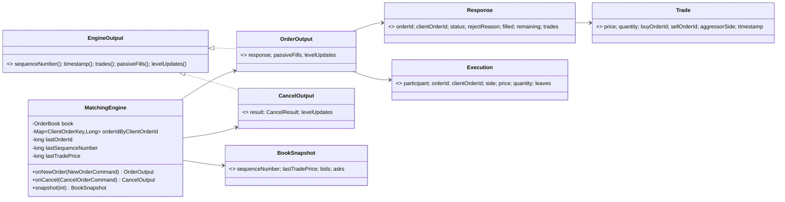
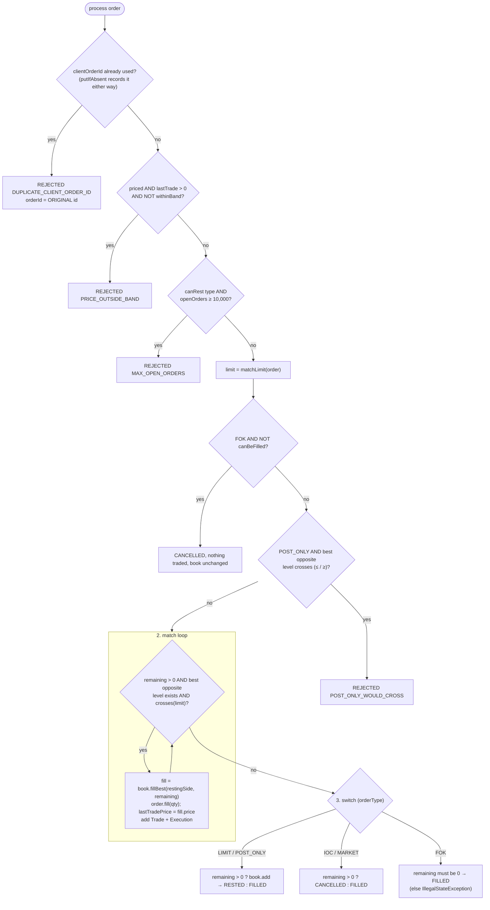
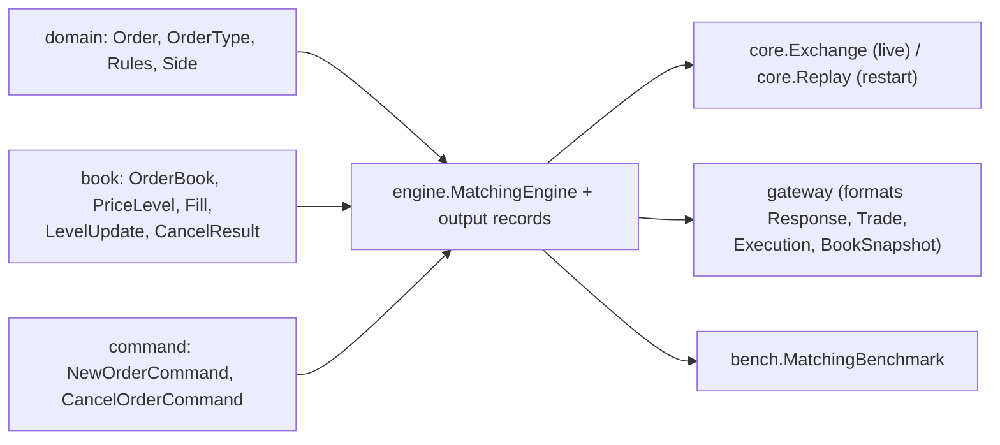

# 07 — Module: engine

> **Project:** ExchangeServer2 | Single-instrument limit order book: price-time matching engine, write-ahead journal with replay, single writer thread, plain TCP gateway | Stack: Java 17, Maven wrapper, JUnit 5 (+ JMH, PIT)
> **This guide:** the matching engine (`MatchingEngine`), how it processes new orders and cancels, its risk checks, and the output types it produces (`Response`, `Trade`, `Execution`, `EngineOutput`/`OrderOutput`/`CancelOutput`, `OrderStatus`, `RejectReason`, `BookSnapshot`) | **Prerequisites:** 01, 07-modules/domain-and-commands, 07-modules/book | **Related:** 05, 06, 07-modules/exchange-and-replay, 07-modules/gateway, 09
> **Repo layout summary:** `pom.xml` + Maven wrapper (`mvnw`, `mvnw.cmd`) at the root; production code in `src/main/java/exchangeserver/` (packages `domain`, `book`, `engine`, `command`, `journal`, `core`, `gateway`, `client`, plus `Main`); tests mirror it in `src/test/java/exchangeserver/` (plus `bench/` JMH benchmarks and `testing/MutableClock`); design docs in `docs/` (`ExchangeServer2_Vision.md` = purpose/roadmap, `ExchangeServer2_Spec.md` = decisions D1–D65); these guides in `docs/understanding/`.

## Overview

`MatchingEngine` implements **price-time-priority matching** for one instrument. An incoming order trades
against the best opposite price first, and within a price against the oldest resting order first.

It decides *what* a match means. The book (guide 07-modules/book) carries it out. **[Verified]**
`src/main/java/exchangeserver/engine/MatchingEngine.java:23`.

The engine's contract with the rest of the system is **determinism**. Its behaviour depends only on the commands
it is given, in order:
- no clock;
- no counter of its own (ids, sequence numbers and timestamps all arrive inside the command);
- no randomness;
- no reliance on hash-iteration order (its `HashMap`s are only looked up).

**[Verified]** `MatchingEngine.java:25-26`, Spec D12. Determinism is what makes **replay** work: on restart the
same journalled commands are fed through a fresh engine and must rebuild the identical book (guide
07-modules/exchange-and-replay).

It has two entry points, each returning an **output** record:
- `onNewOrder(NewOrderCommand) → OrderOutput` holds the submitter's `Response`, the **passive fills** (fills on
  resting orders, addressed to their owners) and the **level updates** (L2 market data).
- `onCancel(CancelOrderCommand) → CancelOutput` holds the `CancelResult` and the level updates.

A third method, `snapshot(depth)`, is a read.



## Responsibility

- Turn each `NewOrderCommand` into an outcome. The four outcomes are `FILLED`, `RESTED`, `CANCELLED` and
  `REJECTED` (Spec D23); the client's next action differs for each.
- Apply the **state-dependent** checks. These are journalled, so replay reproduces them (Spec D13).
  `RejectReason` lists four (`RejectReason.java:9-18`):
  - `DUPLICATE_CLIENT_ORDER_ID`
  - `PRICE_OUTSIDE_BAND`
  - `MAX_OPEN_ORDERS`
  - `POST_ONLY_WOULD_CROSS`
- Guard its own inputs: reject a non-increasing order id or sequence number before any mutation (Spec D35).
- Produce everything a command caused, so the caller can route it.

All **[Verified]**.

## Public interface and who calls it

| Member | Visibility | Called by |
|---|---|---|
| `new MatchingEngine()` | public | `Exchange.open` (`src/main/java/exchangeserver/core/Exchange.java:78`), `Exchange.quarantine` rebuild (`Exchange.java:186`), tests |
| `new MatchingEngine(OrderBook)` | public | tests and `MatchingBenchmark` only; throws unless the book is empty |
| `onNewOrder`, `onCancel` | public | `Exchange.apply` (live), `Replay.feed` (`src/main/java/exchangeserver/core/Replay.java:57`, `:59`) |
| `snapshot(depth)` | public | `Exchange.process` for a `Snapshot` read (`Exchange.java:146`) |
| `lastTradePrice()`, `lastSequenceNumber()` | public | tests (grep) |
| `book()` | package-private | tests in `engine` only; "Reading it from another thread is a data race" |
| `matchLimit(Order)` | package-private | `process`; visible to tests |
| `crosses(side, limit, restingPrice)` | static, package-private | `process`, `canBeFilled`; `MatchingEngineTest.crossesIsInclusiveOnBothSides` |

**[Verified]** by reading the call sites. The single-argument constructor exists "for tests that inspect the
book"; production uses the no-argument one, "so no caller keeps a reference that could change the book behind the
engine's back" (`MatchingEngine.java:52-59`).

## Internal walkthrough

### State

```java
// src/main/java/exchangeserver/engine/MatchingEngine.java:39-46
private record ClientOrderKey(String participant, String clientOrderId) {
}

private final OrderBook book;
private final Map<ClientOrderKey, Long> orderIdByClientOrderId = new HashMap<>();
private long lastOrderId;
private long lastSequenceNumber;
private long lastTradePrice;        // 0 = no trade yet; the reference for the band and the collar
```

- `orderIdByClientOrderId` remembers every `(participant, clientOrderId)` ever used, mapped to the order id it
  got. **It only grows**: a known limitation (Spec §8). **[Verified]**
- `lastTradePrice` is the reference for the price band and the market collar; 0 means "no trade yet, no band".
  **[Verified]**

### `onNewOrder` and `onCancel`

```java
// src/main/java/exchangeserver/engine/MatchingEngine.java:61-83
public OrderOutput onNewOrder(NewOrderCommand command) {
    // D35: catches any id reuse, including ids that already left the book. Before any mutation.
    if (command.orderId() <= lastOrderId) {
        throw new IllegalStateException("Order id " + command.orderId() + " is not above the last one, " + lastOrderId);
    }
    checkSequence(command.sequenceNumber());
    lastOrderId = command.orderId();
    lastSequenceNumber = command.sequenceNumber();

    Order order = new Order(command.orderId(), command.request(), command.timestamp());
    List<Execution> passiveFills = new ArrayList<>();
    Response response = process(order, passiveFills);
    return new OrderOutput(command.sequenceNumber(), command.timestamp(), response, passiveFills,
            book.drainLevelUpdates());
}

public CancelOutput onCancel(CancelOrderCommand command) {
    checkSequence(command.sequenceNumber());
    lastSequenceNumber = command.sequenceNumber();

    CancelResult result = book.cancel(command.participant(), command.orderId());
    return new CancelOutput(command.sequenceNumber(), command.timestamp(), result, book.drainLevelUpdates());
}
```

- **Guards first.** An order id at or below the last one is rejected *before any mutation*. That also catches an
  id that already left the book, which the book's own duplicate check (`add`) cannot see. **[Verified]**
  `MatchingEngineTest.Guards.orderIdMustIncreaseAndAViolationChangesNothing`; `ReplayTest.reusedOrderIdIsCaughtByTheEngine`.
- These guards throw `IllegalStateException` (a bug or a corrupt journal, Spec D27), not a reject. **[Verified]**
- **[Inferred]** `lastOrderId`/`lastSequenceNumber` are advanced *before* `process` runs. If `process` then throws
  half-way (a poison pill), the engine is in an unknown state. That is exactly why the live path throws this
  engine away and rebuilds a new one by replay (Spec D51; guide 07-modules/exchange-and-replay).
- Level updates are drained once per command, so each output carries exactly that command's L2 changes.
  **[Verified]**

### `process`: three phases (Spec D24)



#### Phase 1: checks that change nothing

```java
// src/main/java/exchangeserver/engine/MatchingEngine.java:106-133
private Response process(Order order, List<Execution> passiveFills) {
    Side restingSide = order.getSide().opposite();

    // 1. Checks that change nothing (except remembering the client order id, which every order uses up).
    Long original = orderIdByClientOrderId.putIfAbsent(
            new ClientOrderKey(order.getParticipant(), order.getClientOrderId()), order.getOrderId());
    if (original != null) {
        return rejected(original, order, RejectReason.DUPLICATE_CLIENT_ORDER_ID);
    }
    if (order.hasPrice() && lastTradePrice > 0 && !Rules.withinBand(order.getPrice(), lastTradePrice)) {
        return rejected(order.getOrderId(), order, RejectReason.PRICE_OUTSIDE_BAND);
    }
    if (order.getOrderType().canRest()
            && book.openOrders(order.getParticipant()) >= Rules.MAX_OPEN_ORDERS_PER_PARTICIPANT) {
        return rejected(order.getOrderId(), order, RejectReason.MAX_OPEN_ORDERS);
    }

    long limit = matchLimit(order);
    if (order.getOrderType() == OrderType.FOK && !canBeFilled(order, limit)) {
        return new Response(order.getOrderId(), order.getClientOrderId(), OrderStatus.CANCELLED, null,
                0, order.getRemainingQuantity(), List.of());
    }
    if (order.getOrderType() == OrderType.POST_ONLY) {
        Optional<PriceLevel> best = book.bestLevel(restingSide);
        if (best.isPresent() && crosses(order.getSide(), limit, best.get().getPrice())) {
            return rejected(order.getOrderId(), order, RejectReason.POST_ONLY_WOULD_CROSS);
        }
    }
    ...
```

Why this order:

1. **The duplicate check comes first and records the id at the same time.** `putIfAbsent` returns the existing
   value or inserts the new one. So **every** order uses up its client order id, even one rejected later for the
   band or the cap (Spec D49). **[Verified]** `MatchingEngineTest.Risk.aRejectedOrderStillUsesUpItsClientOrderId`.
   - The duplicate reply carries the **original** order id. A client that never got a reply (crash, halt) can
     resend with the same client order id after a restart and learn the original's id instead of creating a
     second order. **[Verified]** Spec D49, `Response.java:11`.
   - **[Inferred]** Putting it first makes the answer to "is this a resend?" independent of whatever the book
     looks like now; the other checks depend on current state.
   - **Live evidence [Verified]**, from a run of the real server during the survey: bob's second `NEW b1` got
     `ORDER orderId=2 clOrdId=b1 status=REJECTED … reason=DUPLICATE_CLIENT_ORDER_ID`, and his next order got
     `orderId=4`. The resend's own id 3 was used up silently.
2. **Price band (D50).** It applies only to priced orders and only after the first trade (`lastTradePrice > 0`).
   It uses `Rules.withinBand`: ±10%, inclusive, exact integer math. **[Verified]**
3. **Open-order cap.** It applies only to types that can rest (LIMIT, POST_ONLY), and is checked **on arrival**.
   So a LIMIT that would have fully filled is still rejected when its owner is at the cap; Spec §8 calls this
   "simple and deterministic; real venues differ". **[Verified]**
4. **FOK pre-check** (below). A FOK that cannot fill completely is answered `CANCELLED` (not `REJECTED`) with no
   trades, and the book is unchanged. **[Verified]**
5. **Post-only.** If the best opposite level **crosses** the order's price, it is rejected; it is not repriced,
   or "slid" (Spec D29). `crosses` is inclusive, so an **equal price counts as crossing**. **[Verified]**
   `MatchingEngineTest.PostOnly.equalPriceCountsAsCrossingAndIsRejected`.

```java
// src/main/java/exchangeserver/engine/MatchingEngine.java:175-178
private static Response rejected(long orderId, Order order, RejectReason reason) {
    return new Response(orderId, order.getClientOrderId(), OrderStatus.REJECTED, reason,
            0, order.getRemainingQuantity(), List.of());
}
```

A reject reports `filled = 0` and `remaining = the full quantity`. **[Verified]**

#### The one definition of "crosses" (D28) and the match limit (D50)

```java
// src/main/java/exchangeserver/engine/MatchingEngine.java:183-199
long matchLimit(Order order) {
    if (order.hasPrice()) {
        return order.getPrice();
    }
    if (lastTradePrice == 0) {
        return order.getSide() == Side.BUY ? Long.MAX_VALUE : 0;
    }
    return order.getSide() == Side.BUY
            ? lastTradePrice * (100 + Rules.PRICE_BAND_PERCENT) / 100
            : (lastTradePrice * (100 - Rules.PRICE_BAND_PERCENT) + 99) / 100;
}

static boolean crosses(Side incomingSide, long limit, long restingPrice) {
    return incomingSide == Side.BUY ? restingPrice <= limit : restingPrice >= limit;
}
```

- **Match limit.** This is the worst price the order may trade at.
  - For a priced order it is the order's price.
  - For a market order it is the **collar**: the same ±10% band around the last trade. It is computed **once, on
    arrival**, so the order's own trades (which update `lastTradePrice` inside the loop) cannot widen it.
    **[Verified]** `MatchingEngineTest.Market.collarIsFixedAtArrivalNotMovedByItsOwnTrades`.
  - With no trade yet, a market order has no limit: `Long.MAX_VALUE` for a buy, 0 for a sell, so it sweeps every
    level. **[Verified]**
- **Collar rounding, with a worked example.** The last trade is 105, so the real band is [94.5, 115.5].
  - BUY collar = `105 × 110 / 100 = 11550 / 100 = 115`. Integer division floors 115.5 down, inward.
  - SELL collar = `(105 × 90 + 99) / 100 = 9549 / 100 = 95`. The `+ 99` turns integer division into a ceiling:
    94.5 rounds up to 95, inward.
  - `Rules.withinBand` gives exactly the same edges: 115 passes (`11500 ≤ 11550`), 116 fails; 95 passes
    (`9500 ≥ 9450`), 94 fails.

  So a market order trades in exactly the range a limit order may be priced in. The code comment says
  "floor / ceil keep the collar exactly equal to Rules.withinBand" (`MatchingEngine.java:182`).
  `Market.buyCollarStopsAtReferencePlusBand` and `sellCollarRoundsInward` cover it. **[Verified]**
- **Crosses.** A buy crosses an ask *at or below* its limit; a sell crosses a bid *at or above* it. Every caller
  uses this one function (Spec D28). **[Verified]**

#### FOK pre-walk

```java
// src/main/java/exchangeserver/engine/MatchingEngine.java:202-214
private boolean canBeFilled(Order order, long limit) {
    long needed = order.getRemainingQuantity();
    for (PriceLevel level : book.levels(order.getSide().opposite())) {
        if (!crosses(order.getSide(), limit, level.getPrice())) {
            return false;
        }
        needed -= level.getTotalVolume();
        if (needed <= 0) {
            return true;
        }
    }
    return false;
}
```

It walks the opposite side best first, summing volume only over levels that cross, and stops at the first one
that doesn't. It reads, never writes, so a FOK that will not fill leaves the book untouched; no undo is needed.
**[Verified]** `Fok.notEnoughVolumeKillsItWithNoTradesAndNoChange` and `volumeBeyondItsPriceDoesNotCount`.

#### Phase 2: the match loop

```java
// src/main/java/exchangeserver/engine/MatchingEngine.java:135-151
// 2. Match. A post-only order that got here crosses nothing, so the loop ends at once.
List<Trade> trades = new ArrayList<>();
while (order.getRemainingQuantity() > 0) {
    Optional<PriceLevel> best = book.bestLevel(restingSide);
    if (best.isEmpty() || !crosses(order.getSide(), limit, best.get().getPrice())) {
        break;
    }
    Fill fill = book.fillBest(restingSide, order.getRemainingQuantity());
    order.fill(fill.quantity());
    lastTradePrice = fill.price();

    long buyId = order.getSide() == Side.BUY ? order.getOrderId() : fill.restingOrderId();
    long sellId = order.getSide() == Side.BUY ? fill.restingOrderId() : order.getOrderId();
    trades.add(new Trade(fill.price(), fill.quantity(), buyId, sellId, order.getSide(), order.getTimestamp()));
    passiveFills.add(new Execution(fill.participant(), fill.restingOrderId(), fill.clientOrderId(),
            restingSide, fill.price(), fill.quantity(), fill.leavesQuantity()));
}
```

Each iteration fills against the head of the best opposite level and records two views of the same fill:

| | `Trade` (public) | `Execution` (private, to the resting order's owner) |
|---|---|---|
| Price | the **resting** level's price (`Trade.java:10`) | same |
| Who | buy order id, sell order id, aggressor side | owner participant, resting order id, client order id, leaves |
| Timestamp | the **incoming command's** timestamp (D34): reading a clock here would make replay produce different trades | — |

The incoming order is the **aggressor** (also called the *taker*); the resting order is the *maker*. The trade
price is always the resting price, so a buy at 105 that meets an ask at 100 trades at 100: **price improvement**
for the aggressor. **[Verified]** `Limit.tradesAtTheRestingPrice`.

**Self-trades are allowed** (Spec §8). Nothing in the loop compares participants. **[Verified]**

#### Phase 3: the outcome, an exhaustive switch

```java
// src/main/java/exchangeserver/engine/MatchingEngine.java:153-172
long remaining = order.getRemainingQuantity();
OrderStatus status = switch (order.getOrderType()) {
    case LIMIT, POST_ONLY -> {
        if (remaining > 0) {
            book.add(order);
            yield OrderStatus.RESTED;
        }
        yield OrderStatus.FILLED;
    }
    case IOC, MARKET -> remaining > 0 ? OrderStatus.CANCELLED : OrderStatus.FILLED;
    case FOK -> {
        if (remaining != 0) {
            throw new IllegalStateException("Fillable FOK " + order.getOrderId() + " left " + remaining);
        }
        yield OrderStatus.FILLED;
    }
};
```

- A **switch expression** over an enum with no `default` must cover every constant, or it doesn't compile. Add a
  sixth `OrderType` and this line fails to build until you decide its outcome (Spec D24). **[Verified]** Java
  language rule, and the code comment at `MatchingEngine.java:32`.
- `RESTED` means "the remainder is now on the book". A LIMIT that partly filled and rested reports both
  `filled > 0` and `RESTED`. **[Verified]** `Limit.partialFillRestsTheRemainder`.
- The FOK branch is a **bug guard**: the pre-walk promised enough volume, so leftover quantity means the code is
  wrong. **[Verified]**

The outcome table from Spec §2 **[Verified]**:

| Type | Fully fills now | Partly fills now | Nothing crosses |
|---|---|---|---|
| LIMIT | FILLED | RESTED (remainder rests) | RESTED |
| IOC | FILLED | CANCELLED (remainder) | CANCELLED |
| FOK | FILLED | *(cannot happen)* CANCELLED, all, no trades | CANCELLED |
| MARKET | FILLED | CANCELLED (remainder) | CANCELLED |
| POST_ONLY | *(rejected)* | *(rejected)* | RESTED |

### Worked example

Asks: 100 × 3 (order 1, alice), 101 × 5 (order 2, alice), 103 × 4 (order 3, carol). No trade yet, so there is
no band. Bob sends `NEW b1 BUY LIMIT 7 101` (stamped as order 4).

| Step | What happens |
|---|---|
| checks | `(bob, b1)` is new and recorded → 4; no band yet (`lastTradePrice == 0`); bob has 0 open orders < 10,000; `matchLimit` = 101 |
| loop 1 | best ask 100 crosses (100 ≤ 101) → `fillBest(SELL, 7)` fills order 1 by 3 (exhausted, removed, level 100 removed); `lastTradePrice = 100`; Trade(100, 3, buy 4, sell 1, BUY) |
| loop 2 | best ask 101 crosses → `fillBest(SELL, 4)` fills order 2 by 4, leaving 1; `lastTradePrice = 101`; Trade(101, 4, buy 4, sell 2, BUY) |
| loop 3 | remaining 0 → loop ends |
| outcome | LIMIT, remaining 0 → `FILLED`; `Response(4, "b1", FILLED, null, filled 7, remaining 0, [2 trades])` |
| outputs | passive fills: Execution(alice, 1, …, 100, 3, leaves 0), Execution(alice, 2, …, 101, 4, leaves 1); level updates: (SELL,100,0,0), (SELL,101,1,1) |

The next priced order must now be within ±10% of **101**, so 91 to 111 inclusive (`withinBand`). **[Verified]**
by tracing the code.

### Output types

```java
// src/main/java/exchangeserver/engine/Response.java:15-53 (trimmed)
public record Response(long orderId, String clientOrderId, OrderStatus status, RejectReason rejectReason,
                       long filledQuantity, long remainingQuantity, List<Trade> trades) {
    public Response {
        Objects.requireNonNull(clientOrderId, "clientOrderId");
        Objects.requireNonNull(status, "status");
        trades = List.copyOf(trades);
        long traded = 0;
        for (Trade t : trades) { traded += t.quantity(); }
        if (traded != filledQuantity) { throw new IllegalStateException("Trades add up to ..."); }
        if (remainingQuantity < 0) { throw new IllegalStateException("Negative remaining quantity"); }
        if ((status == OrderStatus.REJECTED) != (rejectReason != null)) { throw new IllegalStateException(...); }
        switch (status) {
            case FILLED -> { if (remainingQuantity != 0) throw ... }
            case RESTED, CANCELLED -> { if (remainingQuantity == 0) throw ... }
            case REJECTED -> { if (filledQuantity != 0) throw ... }
        }
    }
}
```

The constructor makes contradictory responses **unconstructable** (Spec D22). **[Verified]** It enforces:
- `filled` equals the sum of the trade quantities;
- `remaining ≥ 0`;
- a reason is present if and only if the status is `REJECTED`;
- `FILLED` means nothing remains;
- `RESTED`/`CANCELLED` mean something remains;
- `REJECTED` means nothing traded.

A bug therefore fails *inside the engine* (as a poison pill) instead of reaching a client. `ResponseTest` checks
each rule. **[Verified]**

| Record | Fields / rules | File |
|---|---|---|
| `Trade` | price > 0, quantity > 0, aggressor and timestamp non-null | `Trade.java:15-26` |
| `Execution` | a passive fill for the resting order's owner; the aggressor learns its own fills from its `Response` | `Execution.java:5-12` |
| `EngineOutput` | sealed: `OrderOutput` or `CancelOutput`; exposes `trades()`, `passiveFills()`, `levelUpdates()` uniformly | `EngineOutput.java:14-25` |
| `OrderOutput` | `trades()` delegates to `response.trades()`; lists copied | `OrderOutput.java:9-22` |
| `CancelOutput` | `trades()` and `passiveFills()` are always empty | `CancelOutput.java:10-27` |
| `BookSnapshot` | `(sequenceNumber, lastTradePrice, bids, asks)`, levels best first, lists copied; seq 0 = empty history, lastTradePrice 0 = none | `BookSnapshot.java:7-20` |

All **[Verified]**. `List.copyOf` in the compact constructors makes the lists immutable, so a record that has
left the writer thread can be read safely by other threads. **[Inferred]** That matters because outputs travel to
gateway sessions.

`snapshot(depth)` returns up to `depth` levels per side, best first, plus `lastSequenceNumber` (the last command
the engine *processed*) and `lastTradePrice`. A depth ≤ 0 throws. **[Verified]** `MatchingEngine.java:86-91,
222-231`. The gateway asks for depth 100 (Spec D62).

## Dependencies in and out



**[Verified]** by imports. The engine never sees the journal, the clock, threads or sockets.

## Determinism, concretely

**[Verified]** Spec D12; `MatchingEngine.java:25-26`.

| Possible source of nondeterminism | How it is avoided |
|---|---|
| Wall clock | Timestamps arrive in the command; trades copy the command's timestamp (D34) |
| Ids / sequence numbers | Arrive in the command (stamped by `Sequencer`) |
| Hash iteration order | `orderIdByClientOrderId` and the book's maps are only looked up; touched levels are kept in a `LinkedHashSet` |
| Randomness | None |

`MatchingEngineTest.Determinism.sameCommandsGiveIdenticalOutputs` runs 2,000 seeded random commands through two
fresh engines and asserts the output lists are `equals`. **[Verified]**

## How it's tested

| Test class | Groups (tests) | Highlights |
|---|---|---|
| `engine/MatchingEngineTest` (54 tests) | `Limit` (incl. `allSixPriceRelationsBetweenSidesAndPrices`: 2 sides × 3 price relations), `Ioc`, `Fok`, `Market` (collar rounding, collar fixed at arrival), `PostOnly`, `Cancel`, `Risk` (duplicate gives the original id, band inclusive, band on every priced type, cap only on resting types), `Outputs` (passive fills with leaves, level updates in order, trade timestamp = command timestamp, quantity conserved), `Snapshot`, `Guards`, `Determinism`; plus `crossesIsInclusiveOnBothSides`, `onlyRejectedResponsesCarryAReason` | Every order type × outcome, every reject reason |
| `engine/ResponseTest` (9 tests) | consistency rules, list copying, `Trade` validation | The "cannot construct a contradiction" rule |
| `book/OrderBookTest.InvariantsUnderRandomTraffic` | 30,000 random engine commands with `checkInvariants()` after each | Exercises the engine and the book together |

The test helpers stamp commands "like the sequencer would", incrementing `seq` and `id` locally
(`MatchingEngineTest.java:39-46`). **[Verified]** The package is under PIT mutation testing. **[Verified]** `pom.xml`.

## Key takeaways

- The engine is deterministic: everything it needs, including ids and timestamps, is in the command. That is what
  lets replay rebuild the identical book.
- New-order processing has three phases: checks that change nothing → the shared match loop → an exhaustive
  `switch` over `OrderType`.
- The client order id is recorded first with `putIfAbsent`, so every order uses its id up; a duplicate is rejected
  **with the original order id** (D49).
- Band (±10% of the last trade, priced orders only, none before the first trade), market collar (the same range,
  fixed at arrival, rounded inward), open-order cap (resting types, checked on arrival).
- `crosses` is the single, inclusive definition of crossing; a post-only at an equal price is rejected.
- FOK is pre-walked read-only, so a killed FOK never touches the book.
- Trades happen at the resting price and carry the incoming command's timestamp; each trade has exactly one passive
  `Execution`.
- `Response`'s constructor rejects any self-contradictory outcome, so engine bugs fail fast.

## Common confusions

- **"A FOK that can't fill is REJECTED."** No, it's `CANCELLED` with no trades. `REJECTED` is only for the four
  `RejectReason`s.
- **"The duplicate reject's orderId is the new order's id."** No: it is the *original* order's id. The new
  order's own id is used up silently, leaving a gap in issued ids.
- **"Market orders have no price protection."** They do once a trade has happened: the collar. Before the first
  trade they sweep everything.
- **"The collar moves as the market order trades."** No, `matchLimit` is computed once before the loop.
- **"`RESTED` means nothing traded."** It means the remainder rests; `filledQuantity` may be positive.
- **"The engine journals rejects."** The engine never touches the journal. State-dependent rejects end up in the
  journal because the *command* was journalled before the engine ran (guide 07-modules/exchange-and-replay).

## Questions to test yourself

1. The last trade is 200. Which prices may a LIMIT BUY carry, and up to what price may a MARKET BUY trade? A MARKET SELL?
   <details><summary>Answer</summary>LIMIT: 180–220 inclusive (`withinBand`). MARKET BUY collar: `200×110/100 = 220`. MARKET SELL collar: `(200×90 + 99)/100 = 18099/100 = 180`. Both equal the band edges.</details>
2. Alice is at exactly 10,000 resting orders. She sends a LIMIT BUY that would fully fill against a resting ask. What happens?
   <details><summary>Answer</summary>`REJECTED MAX_OPEN_ORDERS`: the cap is checked on arrival for resting types, before matching (a known simplification, Spec §8). An IOC or MARKET would not be capped.</details>
3. Best ask is 100. A POST_ONLY BUY at 100 arrives. Outcome?
   <details><summary>Answer</summary>`REJECTED POST_ONLY_WOULD_CROSS`: `crosses(BUY, 100, 100)` is true (inclusive).</details>
4. Bob's order `x` was rejected for PRICE_OUTSIDE_BAND with order id 9. He resends `x` with a valid price. Outcome?
   <details><summary>Answer</summary>`REJECTED DUPLICATE_CLIENT_ORDER_ID` with orderId 9: the client order id was used up by the first attempt (D49). He must use a new client order id.</details>
5. Why does the trade carry the incoming command's timestamp rather than "now"?
   <details><summary>Answer</summary>Determinism (D34): replay must produce identical trades, so no clock can be read inside the engine; the incoming order is also what caused the trade.</details>
6. What prevents a contributor from adding a new `OrderType` and forgetting its outcome?
   <details><summary>Answer</summary>The outcome is a switch *expression* over `OrderType` with no default; a missing constant is a compile error.</details>
7. Asks: 100×2, 102×5. FOK BUY 4 @ 101. Trace `canBeFilled`.
   <details><summary>Answer</summary>Level 100 crosses: needed 4−2 = 2. Level 102 does not cross 101 → return false. Response CANCELLED, filled 0, remaining 4, no trades, book unchanged.</details>
