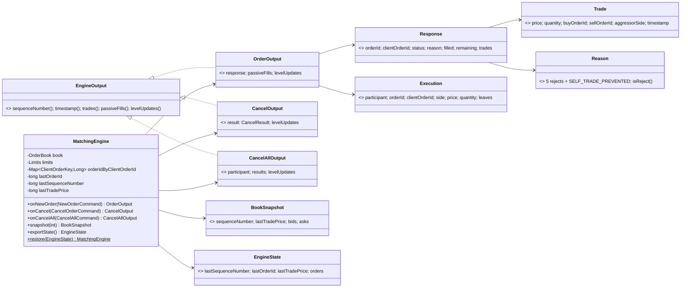
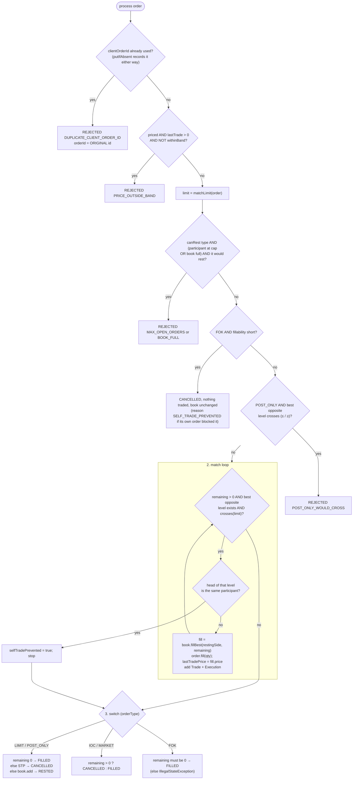
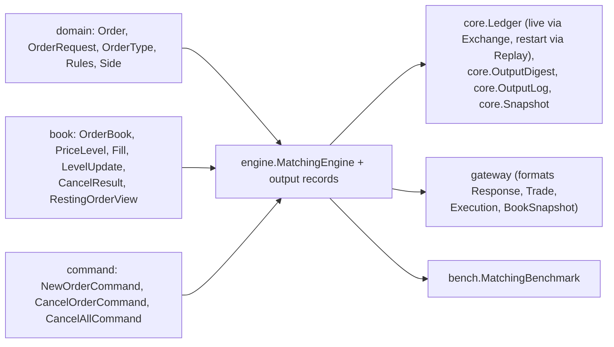

# 07 — Module: engine

> **Project:** ExchangeServer2 | Single-instrument limit order book: price-time matching engine, write-ahead journal with replay, single writer thread, TCP/TLS gateway with authenticated participants | Stack: Java 17, Maven wrapper, JUnit 5 (+ JMH, PIT)
> **This guide:** the matching engine (`MatchingEngine`): how it processes new orders, cancels and cancel-alls, its risk checks and self-trade prevention, state export/restore for snapshots, and the output types it produces (`Response`, `Reason`, `Trade`, `Execution`, `EngineOutput`/`OrderOutput`/`CancelOutput`/`CancelAllOutput`, `OrderStatus`, `BookSnapshot`, `EngineState`) | **Prerequisites:** 01, 07-modules/domain-and-commands, 07-modules/book | **Related:** 05, 06, 07-modules/exchange-and-replay, 07-modules/gateway, 09
> **Repo layout summary:** `pom.xml` + Maven wrapper (`mvnw`, `mvnw.cmd`) at the root; production code in `src/main/java/exchangeserver/` (packages `domain`, `book`, `engine`, `command`, `journal`, `core`, `gateway`, `client`, plus `Main`); tests mirror it in `src/test/java/exchangeserver/` (plus `bench/` JMH benchmarks and `testing/MutableClock`); design docs in `docs/` (`ExchangeServer2_Vision.md` = purpose/roadmap, `ExchangeServer2_Spec.md` = decisions D1–D77); these guides in `docs/understanding/`.

## Overview

`MatchingEngine` implements **price-time-priority matching** for one instrument. An incoming order trades
against the best opposite price first, and within a price against the oldest resting order first.

It decides *what* a match means. The book (guide 07-modules/book) carries it out. **[Verified]**
`src/main/java/exchangeserver/engine/MatchingEngine.java:27`.

The engine's contract with the rest of the system is **determinism**. Its behaviour depends only on the commands
it is given, in order:
- no clock;
- no counter of its own (ids, sequence numbers and timestamps all arrive inside the command);
- no randomness;
- no reliance on hash-iteration order (its `HashMap` is only looked up; anything it iterates is walked through
  the book's levels).

**[Verified]** `MatchingEngine.java:29-30`, Spec D12. Determinism is what makes **replay** work: on restart the
same journalled commands are fed through a fresh engine and must rebuild the identical book, and since D70 the
replay must also reproduce a digest of every output the live run wrote (guide 07-modules/exchange-and-replay).

It has three command entry points, each returning an **output** record:
- `onNewOrder(NewOrderCommand) → OrderOutput` holds the submitter's `Response`, the **passive fills** (fills on
  resting orders, addressed to their owners) and the **level updates** (L2 market data).
- `onCancel(CancelOrderCommand) → CancelOutput` holds the `CancelResult` and the level updates.
- `onCancelAll(CancelAllCommand) → CancelAllOutput` (Spec D72) holds one `CancelResult` per cancelled order and
  the level updates.

`snapshot(depth)` is a read. `exportState()` and the static `restore(EngineState)` move the engine's whole state
into and out of a snapshot file (Spec D71).



## Responsibility

- Turn each `NewOrderCommand` into an outcome. The four outcomes are `FILLED`, `RESTED`, `CANCELLED` and
  `REJECTED` (Spec D23); the client's next action differs for each.
- Apply the **state-dependent** checks. These are journalled (the command is), so replay reproduces them
  (Spec D13). `Reason` lists five rejects and one cancel reason (`Reason.java:12-24`):
  - `DUPLICATE_CLIENT_ORDER_ID`, `PRICE_OUTSIDE_BAND`, `MAX_OPEN_ORDERS`, `BOOK_FULL` (D68),
    `POST_ONLY_WOULD_CROSS` → status `REJECTED`;
  - `SELF_TRADE_PREVENTED` (D67) → status `CANCELLED`.
- Never let a participant trade with itself (Spec D67).
- Guard its own inputs: reject a non-increasing order id or sequence number before any mutation (Spec D35).
- Produce everything a command caused, so the caller can route it and digest it.
- Export and restore its state for snapshots (Spec D71).

All **[Verified]**.

## Public interface and who calls it

| Member | Visibility | Called by |
|---|---|---|
| `new MatchingEngine()` | public | `Ledger.from` for an empty history (`src/main/java/exchangeserver/core/Ledger.java:38`), `restore`, tests |
| `MatchingEngine.restore(EngineState)` | public static | `Ledger.from` when the journal continues from a snapshot (`Ledger.java:38`) |
| `exportState()` | public | `Ledger.snapshot` for compaction (`Ledger.java:58`) |
| `new MatchingEngine(OrderBook)` | public | tests and `MatchingBenchmark` only; throws unless the book is empty |
| `MatchingEngine(OrderBook, Limits)` | package-private | tests only (the `Limits` seam) |
| `onNewOrder`, `onCancel`, `onCancelAll` | public | `Ledger.apply` (`Ledger.java:45`, `:47`, `:49`), used both live (`Exchange.process`) and in replay (`Replay.feed`) |
| `snapshot(depth)` | public | `Exchange.read` for a `Snapshot` request (`src/main/java/exchangeserver/core/Exchange.java:257`) |
| `lastTradePrice()`, `lastSequenceNumber()` | public | tests (grep) |
| `book()` | package-private | tests in `engine` only; "Reading it from another thread is a data race" |
| `matchLimit(Order)` | package-private | `process`; visible to tests |
| `crosses(side, limit, restingPrice)` | static, package-private | `process`, `fillability`; `MatchingEngineTest.crossesIsInclusiveOnBothSides` |

**[Verified]** by reading the call sites. Since D70 the engine is always wrapped in a `core.Ledger` (engine +
output digest + private-event log, rebuilt together; guide 07-modules/exchange-and-replay). The single-argument
constructor exists "for tests that inspect the book"; production uses the no-argument one, "so no caller keeps a
reference that could change the book behind the engine's back" (`MatchingEngine.java:67-71`).

## Internal walkthrough

### State, and the `Limits` seam

```java
// src/main/java/exchangeserver/engine/MatchingEngine.java:43-61
private record ClientOrderKey(String participant, String clientOrderId) {
}

// How much an order could trade right now, and whether its own resting order is in the way (D67).
private record Fillability(long quantity, boolean blockedBySelf) {
}

// The resting caps (D68). Always Rules' values in production; a smaller pair lets tests reach BOOK_FULL
// without a million orders.
record Limits(int maxOpenOrdersPerParticipant, int maxRestingOrders) {
    static final Limits RULES = new Limits(Rules.MAX_OPEN_ORDERS_PER_PARTICIPANT, Rules.MAX_RESTING_ORDERS);
}

private final OrderBook book;
private final Limits limits;
private final Map<ClientOrderKey, Long> orderIdByClientOrderId = new HashMap<>();
private long lastOrderId;
private long lastSequenceNumber;
private long lastTradePrice;        // 0 = no trade yet; the reference for the band and the collar
```

- `orderIdByClientOrderId` remembers every `(participant, clientOrderId)` used since the journal began, mapped to
  the order id it got. It grows with every new order, but **only until the next compaction**: after a snapshot the
  map holds just the resting orders' ids (Spec D71, which revises D49's "forever"). **[Verified]**
  `EngineState.java:9-11`, `restore` below.
- `lastTradePrice` is the reference for the price band and the market collar; 0 means "no trade yet".
  **[Verified]**
- **`Limits` is a test seam.** Production always uses `Limits.RULES` (the public constructors pass it,
  `MatchingEngine.java:69-71`). The package-private constructor lets `MatchingEngineTest.Caps` use
  `new Limits(2, 3)` to reach the per-participant and `BOOK_FULL` caps without a million orders. **[Verified]**
  Replay always uses `RULES`, so the seam cannot make a replay differ. **[Inferred]** from the call sites.

### `onNewOrder`, `onCancel`, `onCancelAll`

```java
// src/main/java/exchangeserver/engine/MatchingEngine.java:111-155
public OrderOutput onNewOrder(NewOrderCommand command) {
    // D35: catches any id reuse, including ids that already left the book. Before any mutation.
    if (command.orderId() <= lastOrderId) {
        throw new IllegalStateException("Order id " + command.orderId() + " is not above the last one, " + lastOrderId);
    }
    checkSequence(command.sequenceNumber());
    lastOrderId = command.orderId();
    lastSequenceNumber = command.sequenceNumber();

    Order order = new Order(command.orderId(), command.request(), command.timestamp());
    List<Execution> passiveFills = new ArrayList<>();
    Response response = process(order, passiveFills);
    return new OrderOutput(command.sequenceNumber(), command.timestamp(), response, passiveFills,
            book.drainLevelUpdates());
}

public CancelOutput onCancel(CancelOrderCommand command) {
    checkSequence(command.sequenceNumber());
    lastSequenceNumber = command.sequenceNumber();

    CancelResult result = book.cancel(command.participant(), command.orderId());
    return new CancelOutput(command.sequenceNumber(), command.timestamp(), result, book.drainLevelUpdates());
}

// Cancels every resting order of the participant, in book priority order (D72).
public CancelAllOutput onCancelAll(CancelAllCommand command) {
    checkSequence(command.sequenceNumber());
    lastSequenceNumber = command.sequenceNumber();

    List<Long> ids = new ArrayList<>();
    for (Side side : Side.values()) {
        book.walk(side, o -> {
            if (o.participant().equals(command.participant())) {
                ids.add(o.orderId());
            }
            return true;
        });
    }
    List<CancelResult> results = new ArrayList<>(ids.size());
    for (long id : ids) {
        results.add(book.cancel(command.participant(), id));
    }
    return new CancelAllOutput(command.sequenceNumber(), command.timestamp(), command.participant(), results,
            book.drainLevelUpdates());
}
```

- **Guards first.** An order id at or below the last one is rejected *before any mutation*. That also catches an
  id that already left the book, which the book's own duplicate check (`add`) cannot see. **[Verified]**
  `MatchingEngineTest.Guards.orderIdMustIncreaseAndAViolationChangesNothing`; `ReplayTest.Feed.reusedOrderIdIsCaughtByTheEngine`.
- Every command type checks its sequence number, `onCancelAll` included (`MatchingEngineTest.CancelAll.itsSequenceNumberMustIncreaseLikeAnyCommand`
  asserts the book is unchanged after the refusal). **[Verified]**
- These guards throw `IllegalStateException` (a bug or a corrupt journal, Spec D27), not a reject. **[Verified]**
- **[Inferred]** `lastOrderId`/`lastSequenceNumber` are advanced *before* `process` runs. If `process` then throws
  half-way (a poison pill), the engine is in an unknown state. That is exactly why the live path throws the whole
  ledger away and rebuilds a new one by replay (Spec D51; guide 07-modules/exchange-and-replay).
- Level updates are drained once per command, so each output carries exactly that command's L2 changes.
  **[Verified]**

**`onCancelAll`, line by line (D72):**
1. It walks bids then asks (`Side.values()` is `BUY, SELL`) and collects the ids of the participant's resting
   orders. `book.walk` visits in **book priority** (best price first, time priority within it), so the result
   order is deterministic and the same on replay. **[Verified]** guide 07-modules/book.
2. Only *then* does it cancel each id. Cancelling inside the walk would unlink the nodes the walk is following;
   collecting first keeps the walk read-only. **[Inferred]** from the code shape.
3. Each `book.cancel(participant, id)` goes through the normal owner-checked cancel, so every result is
   `CANCELLED` with the remainder. Level updates accumulate in the book's `changed` set and are drained once, in
   first-touched order. **[Verified]**
   `MatchingEngineTest.CancelAll.cancelsOnlyThatParticipantsOrdersInBookPriority`: with a's orders at bid 100, bid
   99 and ask 101 (and b's at bid 99), the results come back as ids 4 (bid 100), 1 (bid 99), 3 (ask 101), b's order
   stays, and the updates are `(BUY,100,0,0)`, `(BUY,99,2,1)`, `(SELL,101,0,0)`.
4. A participant with nothing resting gets an empty result list; the command is still journalled and still
   consumes a sequence number. **[Verified]** `aParticipantWithNothingRestingGetsNoResults`.

Who sends it: the gateway, when the last session of a participant that logged in with `COD` closes (guide
07-modules/gateway). The cancels then appear in that participant's private stream (`CANCELLED … reason=CANCEL_ALL`)
for `RESEND` (Spec D73).

### `process`: three phases (Spec D24)

The class comment summarises it (`MatchingEngine.java:32-36`):

```text
Processing a new order (D24):
  1. Checks that change nothing: duplicate client order id, price band, resting caps (only for an order that would
     rest, D68), FOK fillability, post-only cross. A failed check returns before any mutation.
  2. The shared matching loop. It stops at the participant's own resting order (self-trade prevention, D67).
  3. The outcome, as a switch over OrderType with no default (the compiler rejects a missed type).
```



#### Phase 1: checks that change nothing

```java
// src/main/java/exchangeserver/engine/MatchingEngine.java:178-214
private Response process(Order order, List<Execution> passiveFills) {
    Side restingSide = order.getSide().opposite();
    OrderType type = order.getOrderType();

    // 1. Checks that change nothing (except remembering the client order id, which every order uses up).
    Long original = orderIdByClientOrderId.putIfAbsent(
            new ClientOrderKey(order.getParticipant(), order.getClientOrderId()), order.getOrderId());
    if (original != null) {
        return rejected(original, order, Reason.DUPLICATE_CLIENT_ORDER_ID);
    }
    if (order.hasPrice() && lastTradePrice > 0 && !Rules.withinBand(order.getPrice(), lastTradePrice)) {
        return rejected(order.getOrderId(), order, Reason.PRICE_OUTSIDE_BAND);
    }

    long limit = matchLimit(order);
    if (type.canRest()) {
        // D68: the caps bound what rests, so an order that will fully trade now is not refused.
        boolean atParticipantCap = book.openOrders(order.getParticipant()) >= limits.maxOpenOrdersPerParticipant();
        boolean bookFull = book.restingOrderCount() >= limits.maxRestingOrders();
        if ((atParticipantCap || bookFull)
                && (type == OrderType.POST_ONLY || fillability(order, limit).quantity() < order.getRemainingQuantity())) {
            return rejected(order.getOrderId(), order, atParticipantCap ? Reason.MAX_OPEN_ORDERS : Reason.BOOK_FULL);
        }
    }
    if (type == OrderType.FOK) {
        Fillability f = fillability(order, limit);
        if (f.quantity() < order.getRemainingQuantity()) {
            return new Response(order.getOrderId(), order.getClientOrderId(), OrderStatus.CANCELLED,
                    f.blockedBySelf() ? Reason.SELF_TRADE_PREVENTED : null, 0, order.getRemainingQuantity(), List.of());
        }
    }
    if (type == OrderType.POST_ONLY) {
        Optional<PriceLevel> best = book.bestLevel(restingSide);
        if (best.isPresent() && crosses(order.getSide(), limit, best.get().getPrice())) {
            return rejected(order.getOrderId(), order, Reason.POST_ONLY_WOULD_CROSS);
        }
    }
    ...
```

Why this order:

1. **The duplicate check comes first and records the id at the same time.** `putIfAbsent` returns the existing
   value or inserts the new one. So **every** order uses up its client order id, even one rejected later for the
   band or a cap (Spec D49). **[Verified]** `MatchingEngineTest.Risk.aRejectedOrderStillUsesUpItsClientOrderId`.
   - The duplicate reply carries the **original** order id. A client that never got a reply (crash, halt) can
     resend with the same client order id after a restart and learn the original's id instead of creating a
     second order. **[Verified]** Spec D49, `Response.java:11`. Since D71 that holds **within one journal**: after
     a compaction only resting orders keep their ids.
   - **[Inferred]** Putting it first makes the answer to "is this a resend?" independent of whatever the book
     looks like now; the other checks depend on current state.
2. **Price band (D50).** It applies only to priced orders and only after the first trade (`lastTradePrice > 0`).
   It uses `Rules.withinBand`: ±10%, inclusive, exact integer math. **[Verified]** A priced order has no band
   before the first trade (`Risk.noBandBeforeTheFirstTrade`); only market orders get a collar then (D66, below).
3. **The match limit is computed next**, because the cap check and the FOK check need it.
4. **Resting caps (D68).** They apply only to types that can rest (LIMIT, POST_ONLY), and only to an order that
   **would actually rest**:
   - `atParticipantCap`: the participant already has `maxOpenOrdersPerParticipant` (10,000) resting orders;
     `bookFull`: the whole book holds `maxRestingOrders` (1,000,000).
   - If either holds, a POST_ONLY is always rejected (it never trades on arrival, so it would rest), and a LIMIT
     is rejected only if `fillability` says it cannot trade its whole quantity right now.
   - The reason is `MAX_OPEN_ORDERS` if the participant is at its cap, else `BOOK_FULL`.
   - **Before D68** the participant cap was checked on arrival for every resting type, so a LIMIT that would have
     filled completely was still refused. **[Verified]** Spec D68; `Caps.atTheParticipantCapAFullyFillableLimitIsAccepted`,
     `atTheParticipantCapARemainderThatWouldRestIsRejected` (rejected *before any trade*: the ask is untouched),
     `aPostOnlyAtTheCapIsRejected`, `aFullBookRejectsWhatWouldRestButNotWhatTrades`.
   - Why a global cap: participant names used to be free, so a flood under many names could fill memory (risk H2);
     the global cap bounds the book whatever the number of participants. **[Verified]** Spec D68.
5. **FOK pre-check** (below). A FOK that cannot fill completely is answered `CANCELLED` (not `REJECTED`) with no
   trades, and the book is unchanged. If its own resting order is what stopped it, the reason is
   `SELF_TRADE_PREVENTED`; if there simply isn't enough volume, there is no reason. **[Verified]**
   `SelfTrade.aFokThatOnlyItsOwnOrderWouldCompleteIsKilledWithTheReason`, `aFokShortOfVolumeWithoutItsOwnOrderHasNoReason`.
6. **Post-only.** If the best opposite level **crosses** the order's price, it is rejected; it is not repriced, or
   "slid" (Spec D29). `crosses` is inclusive, so an **equal price counts as crossing**. A post-only that would
   cross its *own* order is rejected the same way (`POST_ONLY_WOULD_CROSS`, not a self-trade reason). **[Verified]**
   `MatchingEngineTest.PostOnly.equalPriceCountsAsCrossingAndIsRejected`.

```java
// src/main/java/exchangeserver/engine/MatchingEngine.java:265-268
private static Response rejected(long orderId, Order order, Reason reason) {
    return new Response(orderId, order.getClientOrderId(), OrderStatus.REJECTED, reason,
            0, order.getRemainingQuantity(), List.of());
}
```

A reject reports `filled = 0` and `remaining = the full quantity`. **[Verified]**

#### The one definition of "crosses" (D28) and the match limit (D50, D66)

```java
// src/main/java/exchangeserver/engine/MatchingEngine.java:274-295
long matchLimit(Order order) {
    if (order.hasPrice()) {
        return order.getPrice();
    }
    long reference = lastTradePrice;
    if (reference == 0) {
        Optional<PriceLevel> touch = book.bestLevel(order.getSide().opposite());
        if (touch.isEmpty()) {
            return order.getSide() == Side.BUY ? Long.MAX_VALUE : 0;     // nothing to trade with anyway
        }
        reference = touch.get().getPrice();
    }
    return order.getSide() == Side.BUY
            ? reference * (100 + Rules.PRICE_BAND_PERCENT) / 100
            : (reference * (100 - Rules.PRICE_BAND_PERCENT) + 99) / 100;
}

static boolean crosses(Side incomingSide, long limit, long restingPrice) {
    return incomingSide == Side.BUY ? restingPrice <= limit : restingPrice >= limit;
}
```

- **Match limit.** This is the worst price the order may trade at.
  - For a priced order it is the order's price.
  - For a market order it is the **collar**: the same ±10% band around a reference price. It is computed **once,
    on arrival**, so the order's own trades (which update `lastTradePrice` inside the loop) cannot widen it.
    **[Verified]** `MatchingEngineTest.Market.collarIsFixedAtArrivalNotMovedByItsOwnTrades`.
  - **The reference** is the last trade price. **Before the first trade** it is the **touch**: the best price on
    the side the market order trades against (Spec D66). Before D66 a market order with no trade yet had no limit
    at all and could sweep a thin book (100, then 500). **[Verified]** the comment at `MatchingEngine.java:270-273`.
  - Only if that side is empty does the limit stay unbounded (`Long.MAX_VALUE` for a buy, 0 for a sell). Nothing
    can trade then anyway, so the value does not matter (PIT lists that branch as an equivalent mutant). **[Verified]**
- **Worked example, before the first trade (D66).** Asks: 100, 110, 500 (1 each). A MARKET BUY for 3 arrives.
  The touch is 100, so the collar is `100 × 110 / 100 = 110`. It trades at 100 and 110 and stops; 500 is untouched;
  the remainder (1) is `CANCELLED`. **[Verified]**
  `Market.beforeTheFirstTradeTheCollarIsAnchoredOnTheTouch`.
- **Sell side.** Bids: 101, 91, 90. A MARKET SELL for 3: the touch is 101, the collar
  `(101 × 90 + 99) / 100 = 9189 / 100 = 91` (90.9 rounded **up**, inward). It trades at 101 and 91; 90 stays.
  **[Verified]** `Market.beforeTheFirstTradeASellCollarRoundsInwardFromTheTouch`.
- **Collar rounding, after a trade.** The last trade is 105, so the real band is [94.5, 115.5].
  - BUY collar = `105 × 110 / 100 = 11550 / 100 = 115`. Integer division floors 115.5 down, inward.
  - SELL collar = `(105 × 90 + 99) / 100 = 9549 / 100 = 95`. The `+ 99` turns integer division into a ceiling:
    94.5 rounds up to 95, inward.
  - `Rules.withinBand` gives exactly the same edges: 115 passes (`11500 ≤ 11550`), 116 fails; 95 passes
    (`9500 ≥ 9450`), 94 fails.

  So a market order trades in exactly the range a limit order may be priced in. The code comment says
  "floor / ceil keep the collar exactly equal to Rules.withinBand" (`MatchingEngine.java:273`).
  `Market.buyCollarStopsAtReferencePlusBand` and `sellCollarRoundsInward` cover it. **[Verified]**
- **Crosses.** A buy crosses an ask *at or below* its limit; a sell crosses a bid *at or above* it. Every caller
  uses this one function (Spec D28). **[Verified]**

#### `fillability`: the read-only pre-walk (FOK and caps)

```java
// src/main/java/exchangeserver/engine/MatchingEngine.java:297-315
// Walks the crossing resting orders in priority order, changes nothing. Stops at the order's own resting
// order, as the matching loop would (D67).
private Fillability fillability(Order order, long limit) {
    long needed = order.getRemainingQuantity();
    long[] quantity = {0};
    boolean[] self = {false};
    book.walk(order.getSide().opposite(), resting -> {
        if (!crosses(order.getSide(), limit, resting.price())) {
            return false;
        }
        if (resting.participant().equals(order.getParticipant())) {
            self[0] = true;
            return false;
        }
        quantity[0] += resting.remainingQuantity();
        return quantity[0] < needed;
    });
    return new Fillability(Math.min(quantity[0], needed), self[0]);
}
```

Line by line:
1. `needed` is what the order wants to trade now.
2. `quantity` and `self` are one-element arrays because a lambda can only capture effectively final locals; the
   array is final, its slot is not. A common Java idiom. **[Verified]**
3. `book.walk` visits the opposite side's resting orders **one order at a time**, in priority order (best price
   first, oldest first within a price), handing out `RestingOrderView` copies (guide 07-modules/book).
4. The first order whose price does **not** cross ends the walk: every later order is at a worse price. **[Verified]**
5. **The participant's own order ends the walk too, and sets `self`.** That is exactly where the match loop
   would stop (self-trade prevention, below), so volume *behind* the own order must not count, however large.
   **[Verified]** `SelfTrade.volumeBehindItsOwnOrderDoesNotMakeAFokFillable`: x 2, a 3, y 5 at 100; a FOK BUY
   for 5 from a is `CANCELLED SELF_TRADE_PREVENTED`, although 7 shares from others rest at that price. Without
   stopping here, the pre-check would call it fillable, the loop would stop after 2, and the FOK's bug guard
   (`Fillable FOK … left 3`) would throw. The pre-check and the loop must agree on where matching ends.
6. Otherwise it adds the order's remainder and continues only while it still has less than `needed`, so the walk
   stops as soon as the answer is known. **[Verified]**
7. It returns `min(quantity, needed)` (so "fillable" is `quantity == needed`) and whether its own order blocked
   it. It reads, never writes, so a FOK that will not fill leaves the book untouched; no undo is needed.
   **[Verified]** `Fok.notEnoughVolumeKillsItWithNoTradesAndNoChange` and `volumeBeyondItsPriceDoesNotCount`.

Before D67/D68 this was `canBeFilled`, which summed whole **levels**; it now walks **orders**, because the own
order may sit in the middle of a level. The cost is one small copy per visited order, only for FOK and for orders
that hit a cap. **[Inferred]**

#### Phase 2: the match loop, with self-trade prevention (D67)

```java
// src/main/java/exchangeserver/engine/MatchingEngine.java:216-237
// 2. Match. A post-only order that got here crosses nothing, so the loop ends at once.
List<Trade> trades = new ArrayList<>();
boolean selfTradePrevented = false;
while (order.getRemainingQuantity() > 0) {
    Optional<PriceLevel> best = book.bestLevel(restingSide);
    if (best.isEmpty() || !crosses(order.getSide(), limit, best.get().getPrice())) {
        break;
    }
    if (order.getParticipant().equals(book.headParticipant(restingSide))) {
        selfTradePrevented = true;      // D67: stop here; the remainder is cancelled below
        break;
    }
    Fill fill = book.fillBest(restingSide, order.getRemainingQuantity());
    order.fill(fill.quantity());
    lastTradePrice = fill.price();

    long buyId = order.getSide() == Side.BUY ? order.getOrderId() : fill.restingOrderId();
    long sellId = order.getSide() == Side.BUY ? fill.restingOrderId() : order.getOrderId();
    trades.add(new Trade(fill.price(), fill.quantity(), buyId, sellId, order.getSide(), order.getTimestamp()));
    passiveFills.add(new Execution(fill.participant(), fill.restingOrderId(), fill.clientOrderId(),
            restingSide, fill.price(), fill.quantity(), fill.leavesQuantity()));
}
```

Each iteration looks at the head of the best opposite level:
- **Self-trade check (D67).** If that head order belongs to the incoming order's participant, matching **stops**.
  It does not skip the own order to trade with others behind it: skipping would break price-time priority.
  **[Verified]** Spec D67; `SelfTrade.itStopsRatherThanSkippingToWorsePrices` (own ask at 100, another at 101: a
  BUY LIMIT 101 trades nothing, the 101 ask stays). `book.headParticipant` costs the same as `bestLevel` and
  allocates nothing (guide 07-modules/book).
- The policy, chosen by the user: **cancel the incoming remainder**; the resting order and its time priority are
  untouched. "Cancel resting" and "cancel both" were the alternatives. **[Verified]** Spec D67.
- Otherwise it fills against that head and records two views of the same fill:

| | `Trade` (public) | `Execution` (private, to the resting order's owner) |
|---|---|---|
| Price | the **resting** level's price (`Trade.java:10`) | same |
| Who | buy order id, sell order id, aggressor side | owner participant, resting order id, client order id, leaves |
| Timestamp | the **incoming command's** timestamp (D34): reading a clock here would make replay produce different trades | — |

The incoming order is the **aggressor** (also called the *taker*); the resting order is the *maker*. The trade
price is always the resting price, so a buy at 105 that meets an ask at 100 trades at 100: **price improvement**
for the aggressor. **[Verified]** `Limit.tradesAtTheRestingPrice`. Others ahead of the own order still trade:
x 2, a 3, y 4 at 100; an IOC BUY 9 from a trades 2 with x and is `CANCELLED SELF_TRADE_PREVENTED` with 7 left.
**[Verified]** `SelfTrade.tradesWithOthersAheadThenStopsAtItsOwnOrder`.

#### Phase 3: the outcome, an exhaustive switch

```java
// src/main/java/exchangeserver/engine/MatchingEngine.java:239-262
// 3. Outcome. A remainder stopped by self-trade prevention never rests: it would cross its own order.
long remaining = order.getRemainingQuantity();
Reason reason = selfTradePrevented ? Reason.SELF_TRADE_PREVENTED : null;    // the loop only stops there with a remainder
OrderStatus status = switch (type) {
    case LIMIT, POST_ONLY -> {
        if (remaining == 0) {
            yield OrderStatus.FILLED;
        }
        if (selfTradePrevented) {
            yield OrderStatus.CANCELLED;
        }
        book.add(order);
        yield OrderStatus.RESTED;
    }
    case IOC, MARKET -> remaining > 0 ? OrderStatus.CANCELLED : OrderStatus.FILLED;
    case FOK -> {
        if (remaining != 0) {
            throw new IllegalStateException("Fillable FOK " + order.getOrderId() + " left " + remaining);
        }
        yield OrderStatus.FILLED;
    }
};
return new Response(order.getOrderId(), order.getClientOrderId(), status, reason,
        order.getFilledQuantity(), remaining, trades);
```

- A **switch expression** over an enum with no `default` must cover every constant, or it doesn't compile. Add a
  sixth `OrderType` and this line fails to build until you decide its outcome (Spec D24). **[Verified]** Java
  language rule, and the code comment at `MatchingEngine.java:36`.
- **A LIMIT stopped by self-trade prevention does not rest.** Its price crosses its own resting order, so resting
  it would leave the book crossed. It is `CANCELLED` with `SELF_TRADE_PREVENTED`. **[Verified]**
  `SelfTrade.aLimitThatWouldCrossItsOwnOrderIsCancelledNotRested`: own ask 100 × 5, own BUY LIMIT 100 × 5 →
  CANCELLED, remaining 5, no trades, the ask untouched and nothing resting on the bid.
- **The reason is set whenever the loop stopped at the own order.** It never stops there with nothing left (the
  loop condition is `remaining > 0`), so the earlier `&& remaining > 0` was dropped as redundant (PIT reported it
  as an equivalent mutant). **[Verified]** the comment at `MatchingEngine.java:241`.
- IOC and MARKET: a remainder is `CANCELLED` (reason `SELF_TRADE_PREVENTED` if that is why it stopped).
  **[Verified]** `SelfTrade.aMarketOrderIsCancelledWithTheReason`.
- `RESTED` means "the remainder is now on the book". A LIMIT that partly filled and rested reports both
  `filled > 0` and `RESTED`. **[Verified]** `Limit.partialFillRestsTheRemainder`.
- The FOK branch is a **bug guard**: the pre-walk promised enough volume before the own order, so leftover
  quantity means the code is wrong. **[Verified]**

The outcome table (Spec §2) **[Verified]**:

| Type | Fully fills now | Partly fills now | Nothing crosses | Stopped at its own order |
|---|---|---|---|---|
| LIMIT | FILLED | RESTED (remainder rests) | RESTED | CANCELLED, `SELF_TRADE_PREVENTED` |
| IOC | FILLED | CANCELLED (remainder) | CANCELLED | CANCELLED, `SELF_TRADE_PREVENTED` |
| FOK | FILLED | *(cannot happen)* CANCELLED, all, no trades | CANCELLED | CANCELLED, all, `SELF_TRADE_PREVENTED` |
| MARKET | FILLED | CANCELLED (remainder) | CANCELLED | CANCELLED, `SELF_TRADE_PREVENTED` |
| POST_ONLY | *(rejected)* | *(rejected)* | RESTED | *(rejected, `POST_ONLY_WOULD_CROSS`)* |

### Worked example

Asks: 100 × 3 (order 1, alice), 101 × 5 (order 2, alice), 103 × 4 (order 3, carol). No trade yet. Bob sends
`NEW b1 BUY LIMIT 7 101` (stamped as order 4).

| Step | What happens |
|---|---|
| checks | `(bob, b1)` is new and recorded → 4; no band yet (`lastTradePrice == 0`); `matchLimit` = 101; LIMIT can rest, but bob is far below both caps, so no fillability walk |
| loop 1 | best ask 100 crosses (100 ≤ 101); head is alice ≠ bob → `fillBest(SELL, 7)` fills order 1 by 3 (exhausted, removed, level 100 removed); `lastTradePrice = 100`; Trade(100, 3, buy 4, sell 1, BUY) |
| loop 2 | best ask 101 crosses; head alice ≠ bob → `fillBest(SELL, 4)` fills order 2 by 4, leaving 1; `lastTradePrice = 101`; Trade(101, 4, buy 4, sell 2, BUY) |
| loop 3 | remaining 0 → loop ends |
| outcome | LIMIT, remaining 0 → `FILLED`; `Response(4, "b1", FILLED, null, filled 7, remaining 0, [2 trades])` |
| outputs | passive fills: Execution(alice, 1, …, 100, 3, leaves 0), Execution(alice, 2, …, 101, 4, leaves 1); level updates: (SELL,100,0,0), (SELL,101,1,1) |

Had **alice** sent that order instead, the loop would have stopped at once (her own order 1 is the head) and the
order would be `CANCELLED SELF_TRADE_PREVENTED`, remaining 7. The next priced order must now be within ±10% of
**101**, so 91 to 111 inclusive (`withinBand`). **[Verified]** by tracing the code.

### State export and restore (Spec D71)

```java
// src/main/java/exchangeserver/engine/MatchingEngine.java:81-109
// An engine that continues from a snapshot (D71). The orders go back in the given order, which is book
// priority, so time priority survives; only their client order ids are remembered.
public static MatchingEngine restore(EngineState state) {
    MatchingEngine engine = new MatchingEngine();
    for (RestingOrderView v : state.orders()) {
        if (v.orderId() > state.lastOrderId()) {
            throw new IllegalStateException("Snapshot order " + v.orderId() + " is above the last order id " + state.lastOrderId());
        }
        OrderRequest request = OrderRequest.of(v.participant(), v.clientOrderId(), v.side(), v.orderType(),
                v.originalQuantity(), OptionalLong.of(v.price()));
        Order order = new Order(v.orderId(), request, v.timestamp());
        if (v.filledQuantity() > 0) {
            order.fill(v.filledQuantity());
        }
        engine.book.add(order);
        if (engine.orderIdByClientOrderId.putIfAbsent(new ClientOrderKey(v.participant(), v.clientOrderId()), v.orderId()) != null) {
            throw new IllegalStateException("Snapshot repeats client order id " + v.participant() + "/" + v.clientOrderId());
        }
    }
    engine.book.drainLevelUpdates();
    engine.lastOrderId = state.lastOrderId();
    engine.lastSequenceNumber = state.lastSequenceNumber();
    engine.lastTradePrice = state.lastTradePrice();
    return engine;
}

public EngineState exportState() {
    return new EngineState(lastSequenceNumber, lastOrderId, lastTradePrice, book.restingOrders());
}
```

```java
// src/main/java/exchangeserver/engine/EngineState.java:14-21
public record EngineState(long lastSequenceNumber, long lastOrderId, long lastTradePrice, List<RestingOrderView> orders) {
    public EngineState {
        if (lastSequenceNumber < 0 || lastOrderId < 0 || lastTradePrice < 0) {
            throw new IllegalArgumentException("Counters and prices cannot be negative");
        }
        orders = List.copyOf(orders);
    }
}
```

Line by line:
1. **Export** is the three counters plus `book.restingOrders()`: every resting order as a `RestingOrderView`,
   bids best first then asks best first, each level in time priority (guide 07-modules/book). `core.Ledger`
   wraps it with the output digest and the per-participant output numbers to write the snapshot file. **[Verified]**
2. **Restore rebuilds each order through the normal front door.** `OrderRequest.of` re-applies the stateless
   rules, `new Order` checks the id, and the snapshot's **filled quantity** is re-applied with `order.fill`, so a
   partly filled order comes back with the same remainder. **[Verified]**
3. **Time priority survives by insertion order.** `book.add` appends to the tail of a level, and the views arrive
   in priority order, so the first order of each level is added first and is the head again. **[Verified]**
   `SnapshotState.exportThenRestoreBehavesIdentically`: after `a` 5 and `b` 3 at 100 and a partial fill, the
   restored engine gives the same snapshot, and the *same* next command produces an *equal* `OrderOutput` (same
   fills, same order).
4. **Only the resting orders' client order ids come back.** The map is rebuilt from the views, so after a
   compaction a participant can reuse the client order id of an order that is gone, but not of one still resting.
   A repeat inside the snapshot is a corrupt snapshot and throws. **[Verified]**
   `SnapshotState.restingClientOrderIdsAreStillDuplicatesAfterARestore`; Spec D71.
5. **The level updates produced by reloading are drained and discarded**: nobody should receive market data for
   a reload. **[Verified]**
6. **Counters come last**, from the state. `lastTradePrice` restores the band reference
   (`exportThenRestoreBehavesIdentically` checks a price 50 is still `PRICE_OUTSIDE_BAND`); `lastOrderId` and
   `lastSequenceNumber` keep the D35 guards working (`counterViolationsStillFailAfterARestore`). **[Verified]**
7. An order id above `lastOrderId` is a corrupt snapshot and throws. **[Verified]** Caps are not applied on
   restore: the orders were accepted under the rules of their time. **[Inferred]** `book.add` has no cap.

### Output types

```java
// src/main/java/exchangeserver/engine/Response.java:15-56 (trimmed)
public record Response(long orderId, String clientOrderId, OrderStatus status, Reason reason,
                       long filledQuantity, long remainingQuantity, List<Trade> trades) {
    public Response {
        Objects.requireNonNull(clientOrderId, "clientOrderId");
        Objects.requireNonNull(status, "status");
        trades = List.copyOf(trades);
        long traded = 0;
        for (Trade t : trades) { traded += t.quantity(); }
        if (traded != filledQuantity) { throw new IllegalStateException("Trades add up to ..."); }
        if (remainingQuantity < 0) { throw new IllegalStateException("Negative remaining quantity"); }
        if ((status == OrderStatus.REJECTED) != (reason != null && reason.isReject())) {
            throw new IllegalStateException("A reject reason goes with REJECTED and nothing else");
        }
        if (reason == Reason.SELF_TRADE_PREVENTED && status != OrderStatus.CANCELLED) {
            throw new IllegalStateException("SELF_TRADE_PREVENTED goes with CANCELLED only");
        }
        switch (status) {
            case FILLED -> { if (remainingQuantity != 0) throw ... }
            case RESTED, CANCELLED -> { if (remainingQuantity == 0) throw ... }
            case REJECTED -> { if (filledQuantity != 0) throw ... }
        }
    }
}
```

```java
// src/main/java/exchangeserver/engine/Reason.java:12-28 (trimmed)
public enum Reason {
    DUPLICATE_CLIENT_ORDER_ID, PRICE_OUTSIDE_BAND, MAX_OPEN_ORDERS, BOOK_FULL, POST_ONLY_WOULD_CROSS,
    SELF_TRADE_PREVENTED;

    public boolean isReject() {
        return this != SELF_TRADE_PREVENTED;
    }
}
```

`Reason` replaced the former `RejectReason` when a reason stopped being only about rejects; the field is
`Response.reason` (was `rejectReason`). The constructor makes contradictory responses **unconstructable**
(Spec D22). **[Verified]** It enforces:
- `filled` equals the sum of the trade quantities;
- `remaining ≥ 0`;
- `REJECTED` if and only if the reason is a *reject* reason (`isReject()`);
- `SELF_TRADE_PREVENTED` only with `CANCELLED` (which may follow trades with others: filled > 0 is allowed);
- `FILLED` means nothing remains; `RESTED`/`CANCELLED` mean something remains; `REJECTED` means nothing traded.

A bug therefore fails *inside the engine* (as a poison pill) instead of reaching a client. `ResponseTest` checks
each rule, including `selfTradePreventedGoesWithCancelledOnly`. **[Verified]**

| Record | Fields / rules | File |
|---|---|---|
| `Trade` | price > 0, quantity > 0, aggressor and timestamp non-null | `Trade.java:15-26` |
| `Execution` | a passive fill for the resting order's owner; the aggressor learns its own fills from its `Response` | `Execution.java:5-12` |
| `EngineOutput` | sealed: `OrderOutput`, `CancelOutput` or `CancelAllOutput`; exposes `trades()`, `passiveFills()`, `levelUpdates()` uniformly | `EngineOutput.java:14-25` |
| `OrderOutput` | `trades()` delegates to `response.trades()`; lists copied | `OrderOutput.java:9-22` |
| `CancelOutput` | `trades()` and `passiveFills()` are always empty | `CancelOutput.java:10-27` |
| `CancelAllOutput` | `(seq, ts, participant, results, levelUpdates)`; `trades()`/`passiveFills()` empty; lists copied (D72) | `CancelAllOutput.java:10-29` |
| `BookSnapshot` | `(sequenceNumber, lastTradePrice, bids, asks)`, levels best first, lists copied; seq 0 = empty history, lastTradePrice 0 = none | `BookSnapshot.java:7-20` |
| `EngineState` | counters ≥ 0, orders copied; the snapshot payload (D71) | `EngineState.java:14-21` |

All **[Verified]**. `List.copyOf` in the compact constructors makes the lists immutable, so a record that has
left the writer thread can be read safely by other threads. **[Inferred]** That matters because outputs travel to
gateway sessions, and into the output digest and the private-event log (guide 07-modules/exchange-and-replay).

`snapshot(depth)` returns up to `depth` levels per side, best first, plus `lastSequenceNumber` (the last command
the engine *processed*) and `lastTradePrice`. A depth ≤ 0 throws. **[Verified]** `MatchingEngine.java:157-163,
323-332`. The gateway asks for depth 100 (Spec D62).

## Dependencies in and out



**[Verified]** by imports. The engine never sees the journal, the clock, threads or sockets.

## Determinism, concretely

**[Verified]** Spec D12; `MatchingEngine.java:29-30`.

| Possible source of nondeterminism | How it is avoided |
|---|---|
| Wall clock | Timestamps arrive in the command; trades copy the command's timestamp (D34) |
| Ids / sequence numbers | Arrive in the command (stamped by `Sequencer`) |
| Hash iteration order | `orderIdByClientOrderId` and the book's maps are only looked up; walks (fillability, cancel-all, export) go through the book's levels; touched levels are kept in a `LinkedHashSet` |
| Randomness | None |
| Test seams | `Limits` is always `RULES` outside tests |

`MatchingEngineTest.Determinism.sameCommandsGiveIdenticalOutputs` runs 2,000 seeded random commands through two
fresh engines and asserts the output lists are `equals`. **[Verified]** In production the same property is checked
continuously: every `CHECK` record holds a digest of all outputs, and replay must reproduce it (Spec D70).

## How it's tested

| Test class | Groups (tests) | Highlights |
|---|---|---|
| `engine/MatchingEngineTest` (73 tests) | `Limit` (incl. `allSixPriceRelationsBetweenSidesAndPrices`), `Ioc`, `Fok`, `Market` (D66 collar from the touch on both sides, collar rounding, collar fixed at arrival), `PostOnly`, `Cancel`, `Risk` (duplicate gives the original id, band inclusive, band on every priced type, cap only on resting types), `SelfTrade` (8: cancelled not rested, trades with others ahead, stops rather than skipping, market, FOK blocked by self, volume behind its own order, FOK short without a reason, others unaffected), `Caps` (4, with `Limits(2, 3)`), `CancelAll` (3), `SnapshotState` (3), `Outputs`, `Snapshot`, `Guards`, `Determinism`; plus `crossesIsInclusiveOnBothSides`, `onlyRejectedResponsesCarryAReason` | Every order type × outcome, every reason |
| `engine/ResponseTest` (10 tests) | consistency rules incl. `selfTradePreventedGoesWithCancelledOnly`, list copying, `Trade` validation | The "cannot construct a contradiction" rule |
| `book/OrderBookTest.InvariantsUnderRandomTraffic` | 30,000 random engine commands with `checkInvariants()` after each | Exercises the engine and the book together |
| `core/OutputDigestTest`, `core/ReplayTest.Check` | each output field changes the digest; a changed history stops replay | The engine's outputs as replay must reproduce them |

The test helpers stamp commands "like the sequencer would", incrementing `seq` and `id` locally
(`src/test/java/exchangeserver/engine/MatchingEngineTest.java:39-45`). `Caps` has its own small engine and
counters (`MatchingEngineTest.java:580-589`). **[Verified]** The package is under PIT mutation testing; the
surviving `engine` mutants are equivalent (the empty-touch branch of `matchLimit`, boundaries inside the
fillability walk that only change how far it reads) or test support (Spec §7). **[Verified]**

## Key takeaways

- The engine is deterministic: everything it needs, including ids and timestamps, is in the command. That is what
  lets replay rebuild the identical book, and since D70 replay proves it with an output digest.
- New-order processing has three phases: checks that change nothing → the shared match loop → an exhaustive
  `switch` over `OrderType`.
- The client order id is recorded first with `putIfAbsent`, so every order uses its id up; a duplicate is rejected
  **with the original order id** (D49), within one journal (D71).
- Band (±10% of the last trade, priced orders, none before the first trade); market collar (the same range around
  the last trade, or around the **touch** before the first trade (D66), fixed at arrival, rounded inward).
- Resting caps (per participant and `BOOK_FULL`) apply only to an order that would rest; a LIMIT that fully trades
  is accepted at the cap (D68).
- **Self-trade prevention** stops matching at the participant's own resting order and cancels the remainder with
  `SELF_TRADE_PREVENTED`; a LIMIT then does not rest; the FOK pre-walk stops at the same place (D67).
- `crosses` is the single, inclusive definition of crossing; a post-only at an equal price is rejected.
- `onCancelAll` collects the participant's ids by walking the book, then cancels them, in book priority (D72).
- `exportState`/`restore` move the counters and every resting order through a snapshot, preserving time priority
  and only the resting orders' client order ids (D71).
- `Response`'s constructor rejects any self-contradictory outcome, including a misplaced reason, so engine bugs
  fail fast.

## Common confusions

- **"A FOK that can't fill is REJECTED."** No, it's `CANCELLED` with no trades (with `SELF_TRADE_PREVENTED` if its
  own order is what stopped it). `REJECTED` is only for the five reject reasons.
- **"Self-trade prevention skips my order and trades with the next one."** No: matching *stops* at the own order;
  orders behind it (even at the same price) are not reached.
- **"Self-trade prevention cancels my resting order."** No: the resting order is untouched; the *incoming*
  remainder is cancelled.
- **"`SELF_TRADE_PREVENTED` means nothing traded."** Not necessarily: the order may have traded with others ahead
  of its own order first (`filled > 0`, status `CANCELLED`).
- **"The duplicate reject's orderId is the new order's id."** No: it is the *original* order's id. The new
  order's own id is used up silently, leaving a gap in issued ids.
- **"Market orders have no price protection before the first trade."** They do since D66: the collar is anchored
  on the opposite touch.
- **"At the cap every LIMIT is refused."** Only one that would rest; one that trades fully now is accepted (D68).
- **"The collar moves as the market order trades."** No, `matchLimit` is computed once before the loop.
- **"`RESTED` means nothing traded."** It means the remainder rests; `filledQuantity` may be positive.
- **"The engine journals rejects."** The engine never touches the journal. State-dependent rejects end up in the
  journal because the *command* was journalled before the engine ran (guide 07-modules/exchange-and-replay).
- **"`restore` replays the old commands."** No: it reloads the resting orders and counters directly; no command
  is re-run, which is why a snapshot does not depend on `Rules`.

## Questions to test yourself

1. The last trade is 200. Which prices may a LIMIT BUY carry, and up to what price may a MARKET BUY trade? A MARKET SELL?
   <details><summary>Answer</summary>LIMIT: 180–220 inclusive (`withinBand`). MARKET BUY collar: `200×110/100 = 220`. MARKET SELL collar: `(200×90 + 99)/100 = 18099/100 = 180`. Both equal the band edges.</details>
2. No trade has happened yet. Asks: 100 × 1, 110 × 1, 500 × 1. A MARKET BUY for 3 arrives. Outcome?
   <details><summary>Answer</summary>The collar is anchored on the touch (D66): `100×110/100 = 110`. It trades 100 and 110 and is `CANCELLED` with 1 remaining; 500 is untouched.</details>
3. Alice is at exactly 10,000 resting orders. She sends a LIMIT BUY that would fully fill against resting asks from others. What happens? And a POST_ONLY?
   <details><summary>Answer</summary>The LIMIT is accepted and FILLED: the cap only applies to an order that would rest (D68; `fillability` shows it trades fully). The POST_ONLY is `REJECTED MAX_OPEN_ORDERS`: it never trades on arrival, so it would rest.</details>
4. Asks at 100: x × 2, then alice × 3, then y × 5. Alice sends IOC BUY 9 at 100. Outcome? And FOK BUY 5 at 100?
   <details><summary>Answer</summary>IOC: trades 2 with x, stops at her own order: `CANCELLED SELF_TRADE_PREVENTED`, filled 2, remaining 7; her ask and y's stay. FOK: `fillability` stops at her own order with 2 counted, sets `blockedBySelf`, so `CANCELLED SELF_TRADE_PREVENTED`, filled 0, book unchanged; y's 5 behind her order do not count.</details>
5. Best ask is 100 and it is alice's own. Alice sends a LIMIT BUY 100 × 5. Why is it cancelled instead of resting?
   <details><summary>Answer</summary>Matching stops at once (self-trade prevention). Resting a bid at 100 against her own ask at 100 would leave the book crossed, so the remainder is CANCELLED with `SELF_TRADE_PREVENTED` (D67).</details>
6. Best ask is 100. A POST_ONLY BUY at 100 arrives. Outcome?
   <details><summary>Answer</summary>`REJECTED POST_ONLY_WOULD_CROSS`: `crosses(BUY, 100, 100)` is true (inclusive).</details>
7. Bob's order `x` was rejected for PRICE_OUTSIDE_BAND with order id 9. He resends `x` with a valid price in the same journal. Outcome? And after a compaction?
   <details><summary>Answer</summary>Same journal: `REJECTED DUPLICATE_CLIENT_ORDER_ID` with orderId 9 (D49). After a compaction the map holds only resting orders' ids; order 9 never rested, so `x` is accepted (D71).</details>
8. Alice has bids at 100 and 99 and an ask at 101; bob has a bid at 99. A `CANCEL_ALL alice` arrives. In what order are her orders cancelled, and which level updates come out?
   <details><summary>Answer</summary>Book priority: bid 100, bid 99, ask 101. Updates in first-touched order: (BUY,100,0,0), (BUY,99, bob's volume, 1), (SELL,101,0,0). Bob's order stays.</details>
9. Why does `restore` re-apply `filledQuantity` with `order.fill`, and why does insertion order matter?
   <details><summary>Answer</summary>A partly filled resting order must come back with the same remainder (and `Execution` leaves). `book.add` appends at a level's tail, so adding the views in priority order rebuilds each level with the same head and the same time priority.</details>
10. Why does the trade carry the incoming command's timestamp rather than "now"?
    <details><summary>Answer</summary>Determinism (D34): replay must produce identical trades, so no clock can be read inside the engine; the incoming order is also what caused the trade.</details>
11. What prevents a contributor from adding a new `OrderType` and forgetting its outcome?
    <details><summary>Answer</summary>The outcome is a switch *expression* over `OrderType` with no default; a missing constant is a compile error.</details>
