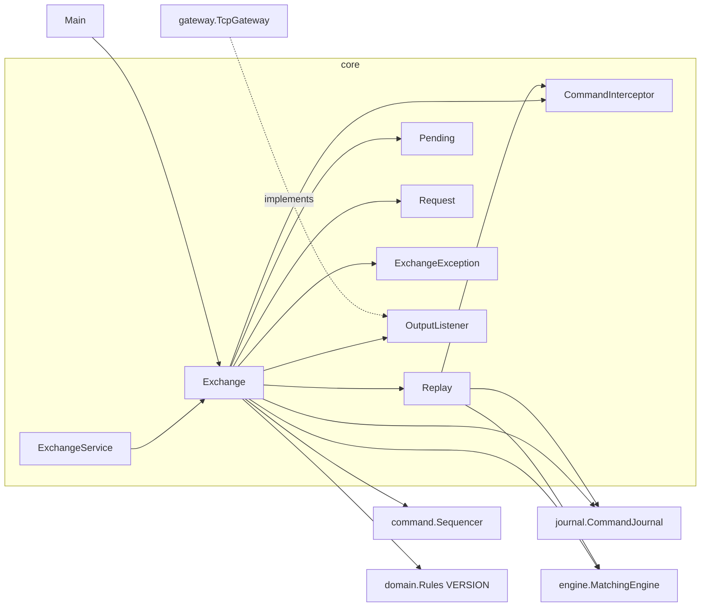
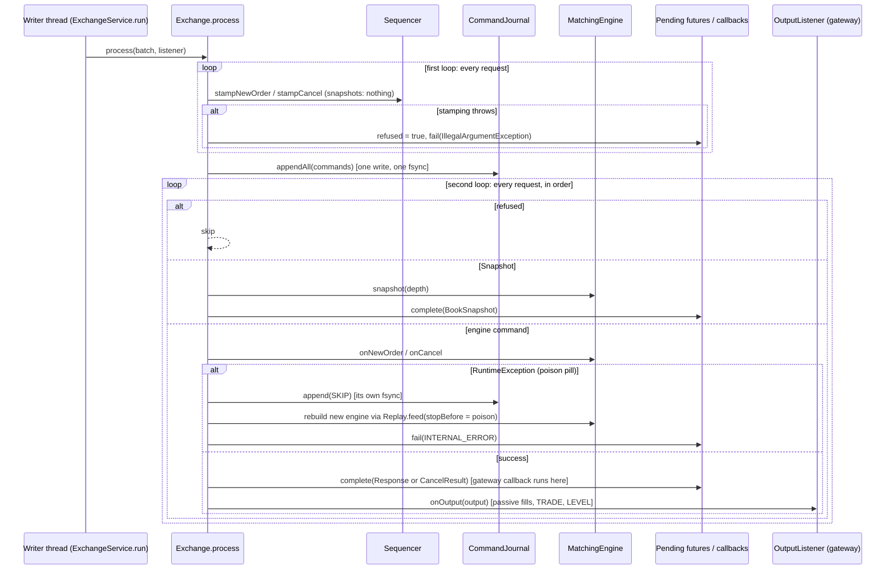

# 07 — Module: core (Exchange, Replay and their helpers)

> **Project:** ExchangeServer2 | Single-instrument limit order book: price-time matching engine, write-ahead journal with replay, single writer thread, plain TCP gateway | Stack: Java 17, Maven wrapper, JUnit 5 (+ JMH, PIT)
> **This guide:** the single-threaded heart of `exchangeserver.core`: `Exchange` (stamp → journal → process, poison-pill quarantine, the operator quarantine tool), `Replay` (two-pass rebuild), and the small types `Request`, `Pending`, `CommandInterceptor`, `ExchangeException`, `OutputListener` | **Prerequisites:** 01, 06, 07-modules/domain-and-commands, 07-modules/engine, 07-modules/journal | **Related:** 05, 07-modules/exchange-service, 09, 10, 11
> **Repo layout summary:** `pom.xml` + Maven wrapper (`mvnw`, `mvnw.cmd`) at the root; production code in `src/main/java/exchangeserver/` (packages `domain`, `book`, `engine`, `command`, `journal`, `core`, `gateway`, `client`, plus `Main`); tests mirror it in `src/test/java/exchangeserver/` (plus `bench/` JMH benchmarks and `testing/MutableClock`); design docs in `docs/` (`ExchangeServer2_Vision.md` = purpose/roadmap, `ExchangeServer2_Spec.md` = decisions D1–D65); these guides in `docs/understanding/`.

---

## Overview

The `core` package glues the deterministic engine to durable storage and to threads. It splits into two layers:

| Layer | Classes | Threads |
|---|---|---|
| **Single-threaded live path and recovery** (this guide) | `Exchange`, `Replay`, `Request`, `Pending`, `CommandInterceptor`, `ExchangeException`, `OutputListener` | Exactly one thread at a time; in production, the writer thread |
| **Thread model** (guide 07-modules/exchange-service) | `ExchangeService` | Any number of caller threads + the one writer thread |

`Exchange` answers one question: *given a batch of requests, how do we turn them into stamped, durable commands and engine outputs, in order, without ever letting a client see something that is not on disk?* Its answer, in one line, is the comment at the top of the class:

```java
// src/main/java/exchangeserver/core/Exchange.java:31-48 (trimmed)
/*
The one live path: stamp -> write ahead -> process (D40), one batch at a time.

open() creates everything itself (sequencer, journal, engine) and replays the journal before returning, so
nobody else holds a reference that could bypass the journal.

A batch: stamp every command, append them all with one write and one fsync, then process them in order.
Nothing is processed before its record is durable, so "visible => durable" holds (write-ahead rule).

Poison pills (D51): if the engine throws on a command, the engine may be half-way through it. The command is
quarantined (a durable SKIP record), the engine is rebuilt by replaying everything before it, and the batch
continues. The failing caller gets INTERNAL_ERROR; nobody else notices. A journal failure is different: it
propagates, and the caller (ExchangeService) halts.

Not thread-safe: exactly one thread may call it. ExchangeService provides that thread.
*/
```

Terms used throughout (defined once here):

- **Command**: a stamped, journalled input (`NewOrderCommand`, `CancelOrderCommand`, `SkipCommand`), carrying a sequence number and timestamp. See guide 07-modules/domain-and-commands.
- **Request**: what a caller hands in *before* stamping (`Submit`, `Cancel`, `Snapshot`). Requests become commands on the writer thread.
- **Write-ahead**: persisting (and fsyncing) a command before anything acts on it. "Visible ⇒ durable": nothing a client can observe exists unless it is on disk.
- **fsync**: forcing the operating system to flush a file's data to the physical disk (`FileChannel.force(true)` in Java). Expensive: about 1.5 ms on the development disk (Spec §1.5).
- **Replay**: rebuilding state by feeding the journal's commands through the same engine again.
- **Poison pill**: a command that makes the engine throw. If it is in the journal, every replay throws on it too.
- **Quarantine**: appending a `SKIP <seq>` record so replay passes over a poison pill. The poisoned record stays in the file; history is annotated, never edited.

---

## Responsibility

**[Verified]** `Exchange`:
1. Opens the journal, replays it into a fresh engine, and resumes the sequencer, all inside `open()` (`src/main/java/exchangeserver/core/Exchange.java:74-92`).
2. Processes batches: stamp → `appendAll` (one write, one fsync) → engine → complete each request's future → call the output listener (`Exchange.java:118-166`).
3. Survives engine bugs on a single command (poison-pill quarantine + rebuild, `Exchange.java:178-189`).
4. Provides an operator tool to quarantine a command found to be poisonous at startup (`Exchange.java:96-114`).
5. Offers a single-threaded convenience API (`submit`, `cancel`, `snapshot`) for tests, tools and the benchmark baseline (`Exchange.java:193-216`).

**[Verified]** `Replay` rebuilds engine state from the journal in two streaming passes: verify, then feed (`src/main/java/exchangeserver/core/Replay.java:15-27`).

---

## Public interface

| Member | Visibility | Called by | Thread |
|---|---|---|---|
| `Exchange.open(Path, Clock)` | public | tests, tools | caller's thread (then it owns the instance) |
| `Exchange.open(Path, Clock, CommandInterceptor)` | package-private | `ExchangeService.start`, tests | the starting thread |
| `Exchange.quarantine(Path, long, Clock)` | public static | `Main --quarantine`, tests | `main` (the exchange must **not** be running; enforced by the journal lock, D65) |
| `process(List<Pending<?>>, OutputListener)` | package-private | `ExchangeService.run`, tests | writer thread only |
| `submit(OrderRequest)`, `cancel(String,long)`, `snapshot(int)` | public | tests, tools, benchmark baseline | the single owning thread |
| `lastSequenceNumber()`, `replayedOnOpen()`, `truncatedBytesOnOpen()`, `quarantined()` | public | tests (only) | owning thread |
| `engine()` | package-private | tests in `core` | owning thread |
| `close()` | public (`AutoCloseable`) | `ExchangeService.run` (finally), tests | owning thread |
| `Replay.run(...)`, `Replay.feed(...)` | package-private static | `Exchange.open`, `Exchange.quarantine` (private), tests | owning thread |
| `Request.Submit / Cancel / Snapshot` | package-private sealed interface + records | `ExchangeService`, `Exchange` | created on caller threads, read on the writer |
| `Pending<R>` | package-private | `ExchangeService`, `Exchange` | created on callers, mutated on the writer |
| `CommandInterceptor` | package-private functional interface | tests only (production uses `NONE`) | writer thread / replay thread |
| `ExchangeException` (+ `Reason`) | public | everyone who gets a refused or failed future | any |
| `OutputListener` | public functional interface | implemented by `gateway.TcpGateway` | called on the writer thread |

**[Verified]** that `replayedOnOpen()`, `truncatedBytesOnOpen()` and `quarantined()` are read only by tests: a search of `src/` finds them only in `Exchange.java` and `ExchangeTest.java`. `Main` prints neither (Spec §8, "Startup reporting").

---

## Dependencies



- **In:** `ExchangeService` (the only production caller of `process`), `Main` (quarantine tool), tests.
- **Out:** `Sequencer` (all stamps), `CommandJournal` (durability), `MatchingEngine` (all business decisions), `Rules.VERSION` (passed to `CommandJournal.open`).

---

## The small types first

### `Request<R>`: what goes on the queue

```java
// src/main/java/exchangeserver/core/Request.java:16-34 (trimmed)
sealed interface Request<R> permits Request.Submit, Request.Cancel, Request.Snapshot {
    record Submit(OrderRequest order) implements Request<Response> { }
    record Cancel(String participant, long orderId) implements Request<CancelResult> { }
    // A read. Goes through the queue like everything else, so it sees the state after every earlier request
    // and before every later one. Never journalled.
    record Snapshot(int depth) implements Request<BookSnapshot> {
        public Snapshot {
            // Checked here, on the caller's thread: a bad read must not reach (and halt) the writer thread.
            if (depth <= 0) { throw new IllegalArgumentException("Depth must be positive"); }
        }
    }
}
```

- **[Verified]** The type parameter `R` is the result type: `Submit` → `Response`, `Cancel` → `CancelResult`, `Snapshot` → `BookSnapshot` (`Request.java:18-26`). A *sealed* interface lists every allowed implementation (`permits`), so the compiler knows the full set.
- **[Verified]** The queue carries requests, not commands: stamping happens on the writer thread "so sequence order is exactly processing order and no producer reads the clock" (`Request.java:10-14`, Spec D55).
- **[Verified]** `Snapshot` validates its depth in the constructor, i.e. on the caller's thread, because `MatchingEngine.snapshot` would otherwise throw on the writer thread (`Request.java:27-32`). `Cancel` does **not** validate: an invalid cancel (e.g. `orderId <= 0`) is caught when the writer stamps it (see "First loop" below).

### `Pending<R>`: a request in flight with its own result slot

```java
// src/main/java/exchangeserver/core/Pending.java:16-36 (trimmed)
final class Pending<R> {
    final Request<R> request;
    final CompletableFuture<R> result = new CompletableFuture<>();
    Command command;                // set by the writer thread when stamped; null for reads
    boolean refused;                // set by the writer thread when stamping refused it; never journalled

    @SuppressWarnings("unchecked")
    void complete(Object value) { ((CompletableFuture<Object>) result).complete(value); }

    // A no-op if the future is already done, so failing a whole batch after a partial success is safe.
    void fail(Throwable cause) { result.completeExceptionally(cause); }
}
```

- **`CompletableFuture`**: a one-shot result slot that one thread completes (`complete` / `completeExceptionally`) and others wait on (`get`, `join`) or attach callbacks to (`whenComplete`). Completing an already-completed future does nothing and returns `false`.
- **[Verified]** One future per request, never shared: "a shared slot hands every waiter the first result (threads guide, Lab 6)" (`Pending.java:9-10`). The "threads guide" is a document in the original project, `Exchange Server/New Learnings/03_Threads_Visibility_and_Handoff.md` (Spec §1.6).
- **[Verified]** No field is `volatile`: the queue's put → take publishes the request to the writer, and the future's complete → get publishes the result back (`Pending.java:12-13`). **Happens-before** is the Java Memory Model rule that says when one thread's writes are guaranteed visible to another. `BlockingQueue` hand-off and `CompletableFuture` completion each create such an edge.
- **[Inferred]** `command` and `refused` are written and read only by the writer thread, so they need no synchronisation at all.
- **[Verified]** `complete(Object)` uses an unchecked cast because `process` works on a `List<Pending<?>>` and cannot name `R` (`Pending.java:27-30`). The result type is still guaranteed by construction (`Request<R>` pairs each request with its result type).

### `CommandInterceptor`: the test seam

```java
// src/main/java/exchangeserver/core/CommandInterceptor.java:5-17 (trimmed)
/* Test seam: runs just before the engine processes a command, live and during replay. Tests use it to inject a
   poison pill (throw) or to hold the writer thread (block). Production uses NONE. */
@FunctionalInterface
interface CommandInterceptor {
    CommandInterceptor NONE = command -> { };
    void beforeEngine(Command command);
}
```

**[Verified]** It is package-private, so only code in `exchangeserver.core` (production and tests) can pass one. It is called in `Exchange.process` (`Exchange.java:151`) and in `Replay.feed` (`Replay.java:55`).

### `ExchangeException`: why a request got no business result

```java
// src/main/java/exchangeserver/core/ExchangeException.java:5-23 (trimmed)
/*
BUSY            the queue is full (backpressure); nothing was journalled. Retry later.
STOPPED         the exchange is stopping or stopped; nothing was journalled.
HALTED          ... The request may or may not be in the journal: after restart, resend with the same client
                order id and the duplicate check tells you (D49).
INTERNAL_ERROR  the engine failed on this command (a bug). The command was quarantined and the exchange
                carried on without it (D51).
*/
public final class ExchangeException extends RuntimeException {
    public enum Reason { BUSY, STOPPED, HALTED, INTERNAL_ERROR }
    ...
}
```

**[Verified]** The message is `reason + ": " + message` (`ExchangeException.java:29-37`). The gateway turns the `Reason` into the text after `ERROR` (`ClientSession.failureLine`, see guide 07-modules/gateway).

Note what is *not* an `ExchangeException`: an **invalid request** refused at stamping fails its future with the original `IllegalArgumentException` (`Exchange.java:127-130`), and **business rejects** (duplicate client order id, price band, …) are normal `Response`s with status `REJECTED`, not exceptions.

### `OutputListener`: the hook for passive fills and market data

```java
// src/main/java/exchangeserver/core/OutputListener.java:7-20 (trimmed)
/* Receives every command's output, in sequence order, on the writer thread, after the command's own future has
   been completed. Must not block (it would stall the whole exchange) and should not throw (a throw is logged and
   ignored). The gateway uses it for passive fills and market data.
   Not called during replay: those outputs were already delivered in the live run (D41). */
@FunctionalInterface
public interface OutputListener {
    OutputListener NONE = output -> { };
    void onOutput(EngineOutput output);
}
```

---

## `Exchange.open`: build everything, replay, resume

```java
// src/main/java/exchangeserver/core/Exchange.java:74-92
static Exchange open(Path journalFile, Clock clock, CommandInterceptor interceptor) throws IOException {
    Objects.requireNonNull(clock, "clock");
    CommandJournal journal = CommandJournal.open(journalFile, Rules.VERSION);
    try {
        MatchingEngine engine = new MatchingEngine();
        Replay.Result replay = Replay.run(journal, engine, Long.MAX_VALUE, interceptor);
        Sequencer sequencer = Sequencer.resume(clock, replay.lastSequenceNumber(), replay.lastOrderId(),
                replay.lastTimestamp());
        return new Exchange(journal, sequencer, engine, new HashSet<>(replay.skipped()), replay.fed(), interceptor);
    } catch (IOException | RuntimeException | Error e) {
        // The exchange owns the journal from here (D43): a failed open must not leak the file handle.
        try {
            journal.close();
        } catch (IOException closeFailure) {
            e.addSuppressed(closeFailure);
        }
        throw e;
    }
}
```

Line by line:

1. **[Verified]** `CommandJournal.open(journalFile, Rules.VERSION)` (line 76) first takes an exclusive lock on a separate sibling file, `<journal>.lock` (D65; a second open in the same JVM is refused even earlier by an in-memory set of held lock files), then checks the header and rules version *before* changing anything (D64), then cuts a torn last record or writes a fresh header. If it throws, no journal exists yet and there is nothing to close. Details: guide 07-modules/journal.
2. **[Verified]** A brand-new `MatchingEngine` is created here, and nowhere else in production, so no caller holds a reference that could change the book behind the journal's back (`Exchange.java:35-36`, Spec D43).
3. **[Verified]** `Replay.run(..., Long.MAX_VALUE, ...)` feeds the whole history (line 79). `stopBefore = Long.MAX_VALUE` means "no stop".
4. **[Verified]** The sequencer resumes from the journal's counters (line 80-81): next sequence number = last + 1, next order id = last *issued* order id + 1, and timestamps never earlier than the last journalled one (Sequencer, guide 07-modules/domain-and-commands).
5. **[Verified]** The skip set is copied into a mutable `HashSet` (line 82) because live quarantines will add to it later (`Exchange.java:181`).
6. **[Verified]** On any failure, including an `Error`, the journal is closed before rethrowing (lines 83-91). Closing the journal also releases its `<journal>.lock` lock, so a retry (or `--quarantine`) can open it. The empty lock file itself stays on disk (it is gitignored as `*.journal.lock`). Test: `ExchangeTest$Restart.failedReplayReleasesTheJournal` (`src/test/java/exchangeserver/core/ExchangeTest.java:216`).

**[Verified]** Replay at startup **never** quarantines automatically: an exception during `Replay.run` propagates and startup fails (Spec D51). The reason (D51): at startup we cannot tell a true poison pill from a record that succeeded under older code; skipping the latter would silently build a different book.

---

## `Replay`: two passes over the file

```java
// src/main/java/exchangeserver/core/Replay.java:36-64 (trimmed)
static Result run(CommandJournal journal, MatchingEngine engine, long stopBefore, CommandInterceptor interceptor)
        throws IOException {
    Verifier verifier = new Verifier();
    journal.read(verifier);                                                  // pass 1: verify
    long fed = feed(journal, engine, stopBefore, verifier.skipped, interceptor);   // pass 2: feed
    return new Result(verifier.lastSequenceNumber, verifier.lastOrderId, verifier.lastTimestamp, fed,
            Set.copyOf(verifier.skipped));
}

static long feed(CommandJournal journal, MatchingEngine engine, long stopBefore, Set<Long> skipped,
                 CommandInterceptor interceptor) throws IOException {
    long[] fed = {0};
    journal.read(command -> {
        if (command.sequenceNumber() >= stopBefore || command instanceof SkipCommand
                || skipped.contains(command.sequenceNumber())) {
            return;
        }
        interceptor.beforeEngine(command);
        if (command instanceof NewOrderCommand n) {
            engine.onNewOrder(n);
        } else if (command instanceof CancelOrderCommand c) {
            engine.onCancel(c);
        }
        fed[0]++;
    });
    return fed[0];
}
```

### Pass 1: the `Verifier`

```java
// src/main/java/exchangeserver/core/Replay.java:66-89 (trimmed)
private static final class Verifier implements java.util.function.Consumer<Command> {
    long lastSequenceNumber;
    long lastOrderId;           // from NEW records only, skipped ones included: that id was issued
    Instant lastTimestamp;
    final Set<Long> skipped = new HashSet<>();

    public void accept(Command command) {
        if (command.sequenceNumber() != lastSequenceNumber + 1) { throw new IllegalStateException("Journal sequence gap or repeat: ..."); }
        if (lastTimestamp != null && command.timestamp().isBefore(lastTimestamp)) { throw new IllegalStateException("Journal timestamp goes backwards ..."); }
        lastSequenceNumber = command.sequenceNumber();
        lastTimestamp = command.timestamp();
        if (command instanceof NewOrderCommand n) { lastOrderId = n.orderId(); }
        else if (command instanceof SkipCommand s) { skipped.add(s.skippedSequenceNumber()); }
    }
}
```

- **[Verified]** Sequence numbers must be exactly 1, 2, 3, … (lines 74-77), counting every record kind, SKIPs included.
- **[Verified]** Timestamps must never decrease (lines 78-80). Equal timestamps are fine.
- **[Verified]** `lastOrderId` comes from **NEW records only, skipped ones included** (line 68, 83-84). Why: a quarantined NEW still *issued* its order id, and ids are never reused (Spec D15/D16). If the last record is a CANCEL, its `orderId` is a *target*, not an issued id, which is why the verifier does not just take "the last record's id". Test: `ExchangeTest$Restart.nextOrderIdComesFromTheLastNewOrderNotTheLastRecord` (`ExchangeTest.java:158`), `ReplayTest.skippedCommandsAreNotFedButTheirIdsCount` (`src/test/java/exchangeserver/core/ReplayTest.java:70`).
- **[Verified]** The verifier does **not** check that order ids increase. The engine does that when the command is fed (`MatchingEngine.onNewOrder`, D35). Test: `ReplayTest.reusedOrderIdIsCaughtByTheEngine` (`ReplayTest.java:137`).

### Why two passes (D60)

**[Verified]** Spec D60: "Replay streams the file twice (verify, then feed) instead of loading a `List`. Constant memory, and nothing is fed if the history is invalid anywhere." Two consequences:

- The skip set must be complete before feeding starts, because a `SKIP` record always comes **after** the command it skips (`Replay.java:25`). A single pass would have already fed the poison by the time it read the SKIP.
- **[Verified]** Nothing is fed if verification fails anywhere: `ReplayTest.nothingIsFedIfVerificationFails` (`ReplayTest.java:127`).

**[Inferred]** The cost is reading the file twice at startup. Recovery time is O(journal size) because there are no snapshots yet (Spec §8, first "next candidate" in the Vision roadmap).

### What feed skips

**[Verified]** `feed` ignores three kinds of record (`Replay.java:51-53`): anything at or after `stopBefore`, every `SkipCommand` (they carry no engine work), and every sequence number in the skip set. Outputs returned by the engine are discarded: they were delivered in the live run (D41). `OutputListener` is never called during replay.

---

## `Exchange.process`: the live path, two loops around one fsync

```java
// src/main/java/exchangeserver/core/Exchange.java:118-166
void process(List<Pending<?>> batch, OutputListener listener) throws IOException {
    List<Command> commands = new ArrayList<>(batch.size());
    for (Pending<?> p : batch) {
        try {
            if (p.request instanceof Request.Submit s) {
                p.command = sequencer.stampNewOrder(s.order());
            } else if (p.request instanceof Request.Cancel c) {
                p.command = sequencer.stampCancel(c.participant(), c.orderId());
            }
        } catch (RuntimeException invalid) {
            p.refused = true;                   // refused before stamping: uses up no number, never journalled
            p.fail(invalid);
            continue;
        }
        if (p.command != null) {
            commands.add(p.command);
        }
    }

    journal.appendAll(commands);                // durable before any effect

    for (Pending<?> p : batch) {
        // Decided from the writer's own state, never from the future: a journalled command must reach the
        // engine whatever happened to anyone's future, or the live book and the replayed one differ (D61).
        if (p.refused) {
            continue;
        }
        if (p.request instanceof Request.Snapshot s) {
            p.complete(engine.snapshot(s.depth()));
            continue;
        }
        EngineOutput output;
        try {
            interceptor.beforeEngine(p.command);
            output = apply(p.command);
        } catch (RuntimeException bug) {
            quarantine(p.command, bug);
            p.fail(new ExchangeException(ExchangeException.Reason.INTERNAL_ERROR,
                    "command " + p.command.sequenceNumber() + " failed and was quarantined", bug));
            continue;
        }
        p.complete(output instanceof OrderOutput o ? o.response() : ((CancelOutput) output).result());
        try {
            listener.onOutput(output);
        } catch (RuntimeException listenerBug) {
            LOG.log(Level.ERROR, "Output listener failed on command " + output.sequenceNumber(), listenerBug);
        }
    }
}
```



### First loop: stamp (or refuse)

- **[Verified]** Only `Submit` and `Cancel` are stamped. A `Snapshot` keeps `command == null` and is never journalled (`Exchange.java:122-126, 132-134`). Test: `ExchangeTest$LivePath.snapshotIsNotJournalled` (`ExchangeTest.java:110`), `ExchangeTest.interceptorSeesEveryCommandLiveInOrder` (`ExchangeTest.java:366`, "reads are never stamped or journalled").
- **[Verified]** If stamping throws (for example `CancelOrderCommand`'s constructor rejects `orderId <= 0` or a participant that fails `Rules.PARTICIPANT`), the request is marked `refused`, its future fails with that exception, and no sequence number is used: `Sequencer.stampCancel` increments the counter only after the command was built (`src/main/java/exchangeserver/command/Sequencer.java:54-58`). Test: `ExchangeTest$LivePath.invalidCancelIsRefusedWithoutUsingASequenceNumber` (`ExchangeTest.java:101`).
- **[Inferred]** Through the gateway this path is rare: `ClientSession` already rejects `CANCEL` with a non-positive id and only logged-in, pattern-valid participants exist. It protects direct API callers (`ExchangeService.cancel(participant, id)`).

### The fsync in the middle

**[Verified]** `journal.appendAll(commands)` (line 137) encodes every command first, writes them with one write and one `force(true)`, and only then returns (`src/main/java/exchangeserver/journal/CommandJournal.java`, `appendAll`). Nothing in the second loop runs before that, which is the write-ahead rule. If it throws (`IOException`, or `IllegalStateException` because the journal fail-stopped earlier), the exception propagates out of `process` before any future is completed; `ExchangeService` then halts and fails every future in the batch with `HALTED` (guide 07-modules/exchange-service).

**[Verified]** An empty `commands` list (a batch of only snapshots or refused requests) writes nothing and does not fsync (`CommandJournal.appendAll` returns early on an empty list).

### Second loop: why `refused`, not the future, decides (D61)

**[Verified]** The comment at `Exchange.java:140-141` and Spec D61 record a real bug found in code review (Spec §9, finding 1). An earlier version shared one future between caller and writer and skipped any request whose future was already done. A caller could then:

1. submit an order (it gets journalled in the first loop);
2. call `future.cancel(true)` or `orTimeout(...)` on its future before the second loop reached it;
3. the writer saw "already done" and skipped the engine step.

The order was **in the journal but not in the live book**. On restart, replay would put it in the book: the live and replayed books diverge, breaking the project's central determinism promise. The fix has two halves: callers never get the writer's future (`ExchangeService.handOff`, guide 07-modules/exchange-service), and `process` decides only from writer-owned state (`p.refused`). Regression test: `ExchangeServiceTest$HandIn.cancellingTheCallersFutureDoesNotStopAJournalledCommand` (`src/test/java/exchangeserver/core/ExchangeServiceTest.java:196`).

### Completing, then notifying

- **[Verified]** The future is completed **before** the listener is called (lines 159-161). Callbacks attached to that future before it completes (the gateway's reply callbacks) run synchronously inside `p.complete(...)`, on the writer thread. That is how a client sees its own `FILL`/`ORDER` lines before the `TRADE`/`LEVEL` market data of the same command (D53). Test: `ExchangeServiceTest$HandIn.callbackRunsOnTheWriterBeforeTheListener` (`ExchangeServiceTest.java:238`).
- **[Verified]** A `RuntimeException` from the listener is logged and ignored (lines 160-164). An `Error` from the listener is not caught and halts the exchange (it escapes `process`).
- **[Verified]** Snapshots never reach the listener (`continue` at line 147): reads have no public effect.

---

## Poison pills: quarantine and rebuild

```java
// src/main/java/exchangeserver/core/Exchange.java:178-189
private void quarantine(Command poison, RuntimeException cause) throws IOException {
    LOG.log(Level.ERROR, "Engine failed on command " + poison.sequenceNumber() + "; quarantining it", cause);
    journal.append(sequencer.stampSkip(poison.sequenceNumber()));
    skipped.add(poison.sequenceNumber());

    // Everything before the poison, minus earlier quarantined commands, is exactly what clients have seen.
    // One pass: the journal was verified at open and only this thread has appended since, and `skipped` is
    // already the complete skip set.
    MatchingEngine rebuilt = new MatchingEngine();
    Replay.feed(journal, rebuilt, poison.sequenceNumber(), skipped, interceptor);
    engine = rebuilt;
}
```

### Why rebuild at all

**[Verified]** "If the engine throws on a command, the engine may be half-way through it" (`Exchange.java:41-42`). For example, the matching loop might have filled two resting orders and then thrown: the book has changed but no output was emitted. The only state known to be correct is "everything before the poison". **[Verified]** Clients have seen exactly that, because outputs are emitted only after a command succeeds (Spec D51).

### Worked example: batch 5, 6, 7 with a poison at 6

Assume the journal holds commands 1–4 and the writer takes a batch of three requests.

| Step | What happens | Journal afterwards |
|---|---|---|
| First loop | Stamps sequence numbers 5, 6, 7. The sequencer's next number is now 8. | (unchanged) |
| `appendAll` | One write + one fsync of 5, 6, 7. | 1 2 3 4 **5 6 7** |
| Command 5 | Engine succeeds; future completed; listener called. | |
| Command 6 | Engine throws `RuntimeException` → `quarantine(6)`: `stampSkip(6)` produces `SKIP` with **sequence number 8** (the next free number, after the batch's own), appended with its own fsync; `6` added to `skipped`; a new engine is fed records with sequence < 6, minus skipped ones (so 1–5); the old engine is dropped. Caller of 6 gets `INTERNAL_ERROR`. Listener never hears about 6. | 1 2 3 4 5 6 7 **SKIP(8→6)** |
| Command 7 | Processed by the **rebuilt** engine. | |
| Next restart | Verify pass: sequence 1…8 contiguous; skip set {6}. Feed pass: 1–5, 7. | |

**[Verified]** This matches `ExchangeTest$PoisonPill.poisonInTheMiddleOfABatchDoesNotDisturbTheOthers` (`ExchangeTest.java:283`): with batch `[a, POISON, b]`, the listener hears sequence numbers 1 and 3 only, and `b` trades against `a`. Also `failingCommandIsQuarantinedAndTheExchangeCarriesOn` (`ExchangeTest.java:253`) asserts the fourth journal line starts with `SKIP,3,` (sequence 3 skipping 2).

**[Inferred]** Why command 7 is still valid for the rebuilt engine: the engine requires strictly increasing sequence numbers and order ids (D35). The rebuilt engine's last sequence number is 5 and its last order id is 5's (or earlier). Command 7's numbers are larger than the poison's, so both checks pass.

### Why the rebuild uses `Replay.feed` only (D60, Spec §9 finding 9)

**[Verified]** The rebuild skips the verify pass. The comment gives the reason: the journal was verified at open, only this thread has appended since, and the in-memory `skipped` set is already complete (`Exchange.java:184-185`). Spec §9 finding 9 records the earlier version, which read the journal twice per poison pill. Regression test: `ReplayTest.feedAloneUsesTheGivenSkipSetAndDoesNotVerify` (`ReplayTest.java:91`).

### What is *not* a poison pill

- **[Verified]** Only `RuntimeException` is quarantined. An `Error` (e.g. `OutOfMemoryError`, `AssertionError`) propagates out of `process` and halts the exchange (`Exchange.java:153`; test `ExchangeTest$PoisonPill.errorsAreNotQuarantinedTheyPropagate`, `ExchangeTest.java:354`; service-level `ExchangeServiceTest$Failures.fatalErrorHaltsAndEveryoneWaitingIsTold`, `ExchangeServiceTest.java:419`).
- **[Verified]** A failure *inside* `quarantine` (the SKIP append fails, or the rebuild's replay throws) escapes from the `catch` block and halts the exchange.
- **[Inferred]** Rebuild cost is O(journal size) per poison pill, on the writer thread, during which no other request is processed. Acceptable for a rare bug path; it would matter with a large journal (no snapshots yet).

---

## The operator tool: `Exchange.quarantine(Path, long, Clock)`

```java
// src/main/java/exchangeserver/core/Exchange.java:96-114
public static void quarantine(Path journalFile, long sequenceNumber, Clock clock) throws IOException {
    try (CommandJournal journal = CommandJournal.open(journalFile, Rules.VERSION)) {
        long[] last = {0};
        Instant[] lastTimestamp = {null};
        boolean[] exists = {false};
        journal.read(c -> {
            last[0] = c.sequenceNumber();
            lastTimestamp[0] = c.timestamp();
            if (c.sequenceNumber() == sequenceNumber && !(c instanceof SkipCommand)) {
                exists[0] = true;
            }
        });
        if (!exists[0]) {
            throw new IllegalArgumentException("No new-order or cancel record with sequence number " + sequenceNumber);
        }
        Sequencer sequencer = Sequencer.resume(clock, last[0], 0, lastTimestamp[0]);
        journal.append(sequencer.stampSkip(sequenceNumber));
    }
}
```

- **[Verified]** Used by `Main --quarantine <seq>` when startup failed on a command (D51). It does **not** replay through the engine: it only reads to find the last sequence number and timestamp, checks the target exists and is a NEW or CANCEL (not a SKIP), and appends one SKIP.
- **[Verified]** The one-element arrays (`long[] last = {0}`) are a Java idiom: a lambda can only capture effectively-final local variables, so mutable state goes inside an array.
- **[Verified]** `lastOrderId` is passed as 0 (line 111) because stamping a SKIP never issues an order id.
- **[Verified]** Since D65 the tool cannot run against a journal that a running exchange holds: `CommandJournal.open` refuses with "already open". Test: `ExchangeTest$PoisonPill.quarantineToolRefusesWhileTheExchangeIsRunning` (`ExchangeTest.java:341`). Before D65, the tool would append its own sequence numbers next to the running exchange's, and the next startup would fail on a sequence gap or repeat (Spec §10 finding 4).
- **[Verified]** Refuses a non-existent sequence number and refuses to skip a SKIP (tests at `ExchangeTest.java:321` and `:330`).
- **[Verified]** It does **not** refuse a command that is already skipped; that writes a harmless second SKIP (Spec §8). It also does not verify contiguity, and it fails on an unparsable record like any `read` (a *corrupt* record cannot be quarantined: D38 says such a record is never dropped).

---

## The convenience API and state getters

```java
// src/main/java/exchangeserver/core/Exchange.java:205-216
private <R> R runOne(Request<R> request) throws IOException {
    Pending<R> p = new Pending<>(request);
    process(List.of(p), OutputListener.NONE);
    try {
        return p.result.join();
    } catch (CompletionException e) {
        if (e.getCause() instanceof RuntimeException r) {
            throw r;
        }
        throw e;
    }
}
```

- **[Verified]** Each call is a batch of one, so one fsync per call. `join()` wraps failures in `CompletionException`; `runOne` unwraps runtime causes so callers see the real `ExchangeException` / `IllegalArgumentException`.
- **[Verified]** `lastSequenceNumber()` is `sequencer.nextSequenceNumber() - 1` (`Exchange.java:220-222`): it counts SKIP records too, unlike `MatchingEngine.lastSequenceNumber()`, which only counts commands the engine processed. Example in `ExchangeTest$PoisonPill.unquarantinedPoisonStopsStartupUntilAnOperatorQuarantinesIt` (`ExchangeTest.java:304`): after quarantining command 2, `lastSequenceNumber()` is 3.
- **[Verified]** `close()` closes the journal (and with it the file lock). In production only the writer thread calls it, as its last act (D58).

---

## How it is tested

| Test class | `@Nested` groups / notable tests | What it pins down |
|---|---|---|
| `ExchangeTest` (`src/test/java/exchangeserver/core/ExchangeTest.java`) | `LivePath` (submit/cancel, visible ⇒ durable, state-dependent rejects journalled, invalid cancel uses no number, snapshot not journalled); `Restart` (identical book after random traffic, time priority and partial fills survive, next order id, client order ids survive restart, timestamps never go back, torn tail cut, other rules refused, failed replay releases the journal, close releases it); `PoisonPill` (quarantine + carry on, restart skips it, poison mid-batch, startup refuses until operator quarantines, tool refusals incl. D65, errors propagate); `interceptorSeesEveryCommandLiveInOrder` | `Exchange` end to end with a real journal in a `@TempDir` |
| `ReplayTest` (`src/test/java/exchangeserver/core/ReplayTest.java`) | empty journal; feeds and reports counters; skipped not fed but ids count; `stopBefore`; feed alone; gap / repeat / backwards timestamp refused; nothing fed if verification fails; reused order id caught by the engine | both passes |

- **[Verified]** The `POISON` interceptor in `ExchangeTest` throws `IllegalStateException("simulated engine bug")` for any order whose client order id starts with `POISON` (`ExchangeTest.java:55-59`). This is why a passing test run logs that stack trace (CLAUDE.md: expected noise).
- **[Verified]** Journal handles are proven released with `CommandJournal.openJournals()`, not by deleting the file: on Windows Java opens files with delete sharing, so deletion proves nothing (Spec §1.5).
- **[Verified]** PIT mutation testing targets `core` among other packages (`pom.xml:143-150`); survivors for `core` include removed log calls and `addSuppressed` (Spec §7).

---

## Key takeaways

- `Exchange` is single-threaded by contract; `ExchangeService` supplies the one thread. Nothing inside is synchronised.
- A batch is: stamp all → **one write + one fsync** → process in order → complete future → notify listener. Nothing is visible before it is durable.
- Requests (unstamped) go on the queue; commands (stamped) go in the journal. Snapshots are requests that never become commands.
- The second loop decides from `p.refused`, never from a future's state (D61). Otherwise a caller cancelling its future could make the live book differ from the replayed one.
- Completing the future before calling the listener is what puts a client's reply ahead of the market data its order caused.
- A `RuntimeException` from the engine is quarantined live: SKIP (next free sequence number, after the batch's own) → rebuild by `Replay.feed` up to the poison → continue. An `Error` halts.
- At startup nothing is skipped automatically; the operator inspects and runs `--quarantine <seq>`, which is refused while the exchange holds the journal (D65).
- Replay is two streaming passes: verify (contiguous sequence, non-decreasing time, collect skips and counters), then feed. `lastOrderId` counts skipped NEWs because their ids were issued.

## Common confusions

- **"The SKIP record has the poison's sequence number."** No. A SKIP has its *own* sequence number (the next free one) and names the skipped one in its third field: `SKIP,8,<ts>,6`.
- **"Rebuild replays the whole journal."** It replays only records *before* the poison (`stopBefore = poison`), skipping already-quarantined ones. Later commands of the current batch are then processed live by the new engine.
- **"`refused` means a business reject."** No. `refused` means stamping threw: the request was invalid and never journalled. Business rejects (`REJECTED` with a `RejectReason`) are journalled and replayed (D13).
- **"`Exchange.lastSequenceNumber()` equals the engine's."** The `Exchange` value counts SKIPs; the engine's counts only processed commands.
- **"The listener sees replayed commands."** It does not: replay discards outputs (D41).
- **"`HALTED` means the command was not journalled."** It might have been. A halt fails every not-yet-completed future in the batch, but the batch may already be on disk. Clients reconcile by resending the same client order id (D49).

## Questions to test yourself

1. A batch contains `[Submit A, Snapshot, Cancel with orderId 0, Submit B]` and the journal's last record is sequence 41. Which sequence numbers are used, and what is written to the journal?
<details><summary>Answer</summary>A gets 42. The snapshot is not stamped. The cancel throws while stamping (`CancelOrderCommand` rejects `orderId <= 0`), is marked refused, fails with `IllegalArgumentException` and uses no number. B gets 43. One `appendAll` writes NEW 42 and NEW 43 with one fsync. (`Exchange.java:120-137`, `Sequencer.java:54-58`.)</details>

2. Why must the skip set be complete before the feed pass starts?
<details><summary>Answer</summary>Because a SKIP record always comes after the command it skips. A single pass would feed the poison before reading its SKIP. Pass 1 collects every SKIP, pass 2 feeds (`Replay.java:20-25`).</details>

3. In the worked example (batch 5, 6, 7; poison 6), why is the SKIP numbered 8 and not 6 or 7?
<details><summary>Answer</summary>All three requests were stamped in the first loop, so the sequencer's next number is 8. Sequence numbers are unique and contiguous across all record kinds; the SKIP is a new record and takes the next free number, naming 6 as the skipped one.</details>

4. What would go wrong if the second loop skipped requests whose future was already cancelled?
<details><summary>Answer</summary>A cancelled-but-journalled order would not reach the live engine, but replay would feed it: the live book and the book rebuilt from the journal would differ (Spec D61, §9 finding 1).</details>

5. Why does `Exchange.open` catch `Error` as well as exceptions?
<details><summary>Answer</summary>To close the journal (and release its file lock) whatever goes wrong during replay, including an `OutOfMemoryError` or `AssertionError`; then it rethrows (`Exchange.java:83-91`, D43).</details>

6. Why can't the quarantine tool help with a journal record that does not parse?
<details><summary>Answer</summary>`Exchange.quarantine` reads the whole journal with `CommandJournal.read`, which throws on a complete unparsable record. By design (D38) a corrupt complete record is never dropped; the operator must investigate the file itself.</details>

7. A listener throws `NullPointerException` on command 12. What happens to command 12 and to command 13 in the same batch?
<details><summary>Answer</summary>Command 12's future was already completed, so its caller has its result. The exception is logged and ignored (`Exchange.java:160-164`). Command 13 is processed normally. Command 12 is not quarantined: the engine succeeded.</details>
