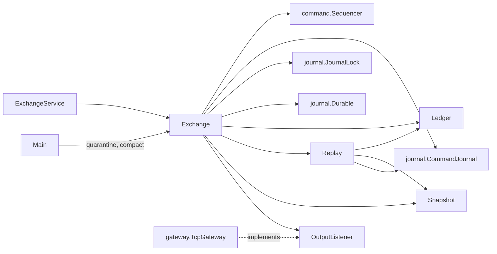
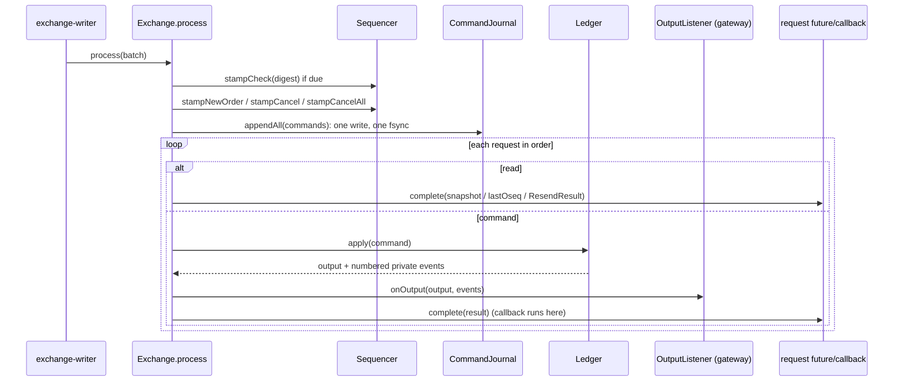

# 07 — Module: core (Exchange, Replay and their helpers)

> **Project:** ExchangeServer2 | Single-instrument limit order book: price-time matching engine, write-ahead journal with replay, single writer thread, TCP/TLS gateway with authenticated participants | Stack: Java 17, Maven wrapper, JUnit 5 (+ JMH, PIT)
> **This guide:** `core.Exchange` (the single-threaded live path, poison pills, the `--quarantine` and `--compact` tools), `core.Replay` (rebuild from snapshot + journal, CHECK verification), and the small types around them: `Request`, `Pending`, `CommandInterceptor`, `ExchangeException`, `ReplayException`, `OutputListener` | **Prerequisites:** 01, 05, 06, 07-modules/journal, 07-modules/engine | **Related:** 05b, 07-modules/ledger-and-snapshots, 07-modules/exchange-service, 08, 09
> **Repo layout summary:** `pom.xml` + Maven wrapper (`mvnw`, `mvnw.cmd`) at the root; production code in `src/main/java/exchangeserver/` (packages `domain`, `book`, `engine`, `command`, `journal`, `core`, `gateway`, `client`, plus `Main`); tests mirror it in `src/test/java/exchangeserver/` (plus `bench/` JMH benchmarks and `testing/MutableClock`); design docs in `docs/` (`ExchangeServer2_Vision.md` = purpose/roadmap, `ExchangeServer2_Spec.md` = decisions D1–D77); these guides in `docs/understanding/`.

## Overview

`Exchange` is "the one live path" (D40): for each batch of requests it **stamps** them (sequence number, order id,
timestamp from the `Sequencer`), **writes them ahead** to the journal with one fsync, and only then **processes**
them through the `Ledger` (engine + output digest + per-participant private streams; see guide 07
(modules/ledger-and-snapshots)). It is single-threaded by contract: `ExchangeService` gives it exactly one thread
(guide 07 (modules/exchange-service)).

`Replay` rebuilds the ledger at startup from the snapshot the journal names (if any) plus the journal itself, in
two streaming passes, and checks every `CHECK` record's digest on the way (D70).

What changed on 2026-10-27 (risk fixes, Spec D66–D77):
- the engine sits inside a `Ledger`, so a poison-pill rebuild replaces engine, digest and numbering together;
- a `CHECK` record every `checkInterval` commands (D70);
- `CancelAll` commands (D72) and two new reads, `Attach` and `Resend` (D73);
- the listener runs **before** the request's future completes (D76);
- snapshots and the `--compact` tool (D71); `--quarantine` refuses a command already quarantined (L3);
- `Recovery` and `ReplayException` so `Main` can say what happened and give fitting advice (L1, L2).

Terms: **batch** = the requests the writer took off the queue at once; **poison pill** = a journalled command on
which the engine throws; **SKIP** = a journal record that quarantines one; **base** = the last sequence number of
the snapshot a journal continues from (0 = none).

## Dependencies



## Interface

| Member | Visibility | Caller | Thread |
|---|---|---|---|
| `Exchange.open(path, clock)`; package overloads with `CommandInterceptor` and `Options` | public / package | `ExchangeService.start`, tests | starting thread |
| `Exchange.process(batch, listener)` | package | `ExchangeService` writer loop | writer |
| `Exchange.quarantine(path, seq, clock)` | public static | `Main --quarantine` | tool |
| `Exchange.compact(path) -> Compaction` (null if nothing to do) | public static | `Main --compact` | tool |
| `recovery()`, `lastSequenceNumber()`, `replayedOnOpen()`, `truncatedBytesOnOpen()`, `quarantined()` | public | `ExchangeService`, `Main`, tests | owner |
| `submit`, `cancel`, `cancelAll`, `snapshot`, `resend` (convenience, one request each) | public | tests, tools, benchmark | owner |
| `engine()`, `digest()` | package | tests | owner |
| `Options(checkInterval, outputRetention)`, `Recovery(...)`, `Compaction(...)` | public records | `ExchangeService.Settings`, `Main` | any |
| `Replay.run`, `Replay.rebuild`, `Replay.snapshotFor`, `Replay.feed` | package | `Exchange` | starting thread / writer |

```java
// src/main/java/exchangeserver/core/Exchange.java:62-84
// checkInterval: commands between CHECK records (D70). outputRetention: private events kept per participant
// for RESEND (D73).
public record Options(int checkInterval, int outputRetention) {

    public Options {
        if (checkInterval <= 0 || outputRetention <= 0) {
            throw new IllegalArgumentException("Bad options");
        }
    }

    public static Options defaults() {
        return new Options(10_000, 1_000);
    }
}

// What recovery did (L1), for the operator.
public record Recovery(long baseSequence, long lastSequence, long replayed, long truncatedBytes, Set<Long> quarantined,
                       int adoptedRulesFrom) {
}

// What compaction did (D71).
public record Compaction(long lastSequence, int restingOrders, Path snapshot, Path archive) {
}
```

## Exchange.open: replay before anyone can call in

```java
// src/main/java/exchangeserver/core/Exchange.java:116-137
static Exchange open(Path journalFile, Clock clock, CommandInterceptor interceptor, Options options) throws IOException {
    Objects.requireNonNull(clock, "clock");
    Objects.requireNonNull(options, "options");
    CommandJournal journal = CommandJournal.open(journalFile, Rules.VERSION);
    try {
        Replay.Result replay = Replay.run(journal, journalFile, Long.MAX_VALUE, interceptor, options.outputRetention());
        Sequencer sequencer = Sequencer.resume(clock, replay.lastSequenceNumber(), replay.lastOrderId(),
                replay.lastTimestamp());
        Recovery recovery = new Recovery(replay.baseSequence(), replay.lastSequenceNumber(), replay.fed(),
                journal.getTruncatedBytesOnOpen(), replay.skipped(), journal.adoptedRulesFrom());
        return new Exchange(journal, journalFile, sequencer, replay.ledger(), new HashSet<>(replay.skipped()), recovery,
                interceptor, options);
    } catch (IOException | RuntimeException | Error e) {
        // The exchange owns the journal from here (D43): a failed open must not leak the file handle.
        try {
            journal.close();
        } catch (IOException closeFailure) {
            e.addSuppressed(closeFailure);
        }
        throw e;
    }
}
```

- `CommandJournal.open` takes the journal's lock (D65), checks the header (D64), adopts new rules if the journal is
  empty (D71), and cuts a torn tail (guide 07 (modules/journal)).
- `Replay.run` loads the snapshot named by the header's base, verifies and feeds the journal, and returns the
  rebuilt `Ledger` plus the counters to resume from.
- The `Recovery` record is what `Main` prints at startup: e.g. "Recovered through sequence 4 from snapshot 4:
  replayed 0 commands, cut 0 torn bytes" (seen live on 2026-10-27) **[Verified — observed]**.
- Any failure closes the journal (which releases its lock) before rethrowing **[Verified]** (`Exchange.java:128-136`).

## Exchange.process: one batch

```java
// src/main/java/exchangeserver/core/Exchange.java:198-253 (trimmed)
void process(List<Pending<?>> batch, OutputListener listener) throws IOException {
    List<Command> commands = new ArrayList<>(batch.size() + 1);
    if (commandsSinceCheck >= options.checkInterval()) {
        commands.add(sequencer.stampCheck(ledger.digest()));       // D70: covers every command before it
        commandsSinceCheck = 0;
    }
    for (Pending<?> p : batch) {
        try {
            if (p.request instanceof Request.Submit s) {
                p.command = sequencer.stampNewOrder(s.order());
            } else if (p.request instanceof Request.Cancel c) {
                p.command = sequencer.stampCancel(c.participant(), c.orderId());
            } else if (p.request instanceof Request.CancelAll c) {
                p.command = sequencer.stampCancelAll(c.participant());
            }
        } catch (RuntimeException invalid) {
            p.refused = true;                   // refused before stamping: uses up no number, never journalled
            p.fail(invalid);
            continue;
        }
        if (p.command != null) {
            commands.add(p.command);
        }
    }

    journal.appendAll(commands);                // durable before any effect

    for (Pending<?> p : batch) {
        if (p.refused) {
            continue;
        }
        if (p.command == null) {
            p.complete(read(p.request));
            continue;
        }
        Ledger.Applied applied;
        try {
            interceptor.beforeEngine(p.command);
            applied = ledger.apply(p.command);
        } catch (RuntimeException bug) {
            quarantine(p.command, bug);
            p.fail(new ExchangeException(ExchangeException.Reason.INTERNAL_ERROR,
                    "command " + p.command.sequenceNumber() + " failed and was quarantined", bug));
            continue;
        }
        commandsSinceCheck++;
        try {
            listener.onOutput(applied.output(), applied.events());
        } catch (RuntimeException listenerBug) {
            LOG.log(Level.ERROR, "Output listener failed on command " + applied.output().sequenceNumber(), listenerBug);
        }
        p.complete(result(applied.output()));   // after the listener: the request's lines went out first (D76)
    }
}
```

Step by step:

1. **CHECK first, if due.** After `checkInterval` (default 10,000) applied commands, the batch starts with a
   `CHECK,<seq>,<ts>,<digest>` record carrying the digest of every output so far. Stamping it *before* the batch's
   commands means "the digest covers every command with a smaller sequence number", which is exactly what
   `Replay.feed` checks **[Verified]** (`Exchange.java:200-203`, `Replay.java:80-88`). A CHECK takes a sequence
   number like any record.
2. **Stamp.** Submit -> NEW, Cancel -> CANCEL, CancelAll -> CANCEL_ALL. Reads (Snapshot, Attach, Resend) get no
   command. A request the sequencer refuses (e.g. an invalid participant from a direct API caller) is marked
   `refused`, failed, and never journalled; it uses up no number **[Verified]** (`Exchange.java:204-221`).
3. **Write ahead**: one `appendAll`, one fsync, for the CHECK and all commands of the batch (D52).
4. **Process in order.** `refused` is the writer's own flag (D61): a journalled command always reaches the engine,
   whatever happened to anyone's future.
   - A read completes at its place in the batch: it sees every earlier command and no later one **[Verified]**
     (`Exchange.java:231-234`, `:255-266`).
   - A command goes through `ledger.apply`. If the engine (or the test interceptor) throws a `RuntimeException`,
     the poison-pill path runs (below).
   - **The listener runs before the future completes (D76).** The listener is the gateway: it sends the
     participant's private lines (FILL/ORDER/CANCELLED, numbered by oseq) and the market data. The request's
     callback, attached by the gateway, runs inside `p.complete`, i.e. *after* the lines were offered. The gateway
     relies on this to close a session only after its last request's lines went out (guide 07 (modules/gateway)).
     Before D76 the order was the opposite (reply in the callback, then the listener).
5. `result()` maps the output to the request's result type: `Response`, `CancelResult` or `List<CancelResult>`
   **[Verified]** (`Exchange.java:268-276`).



## Poison pills: quarantine and rebuild from the snapshot

```java
// src/main/java/exchangeserver/core/Exchange.java:278-287
private void quarantine(Command poison, RuntimeException cause) throws IOException {
    LOG.log(Level.ERROR, "Engine failed on command " + poison.sequenceNumber() + "; quarantining it", cause);
    journal.append(sequencer.stampSkip(poison.sequenceNumber()));
    skipped.add(poison.sequenceNumber());

    // Everything before the poison, minus earlier quarantined commands, is exactly what clients have seen.
    // One pass from the snapshot: the journal was verified at open and only this thread has appended since,
    // and `skipped` is already the complete skip set.
    ledger = Replay.rebuild(journal, journalFile, poison.sequenceNumber(), skipped, interceptor, options.outputRetention());
}
```

- The SKIP gets the next sequence number, i.e. *after* the whole stamped batch. Worked example: batch with sequence
  5, 6, 7; the engine throws on 6 -> `SKIP,8,<ts>,6` is appended (its own fsync), and 7 is then processed by the
  rebuilt ledger.
- `Replay.rebuild` builds a new ledger from the snapshot the header names and feeds every command below the poison,
  minus the skip set. Engine, digest and output numbering are replaced together, so none of them keeps a trace of
  the half-processed poison **[Verified]** (`Replay.java:50-57`).
- Since the snapshot work, the rebuild costs "commands since the last compaction", not "all history".
- The poison's caller gets `INTERNAL_ERROR`; the listener never hears of it; an `Error` is not caught here and
  halts the writer **[Verified]** (`ExchangeTest.PoisonPill`, `src/test/java/exchangeserver/core/ExchangeTest.java:250`;
  `errorsAreNotQuarantinedTheyPropagate`, `:354`).
- After a compaction: `ExchangeTest.Compaction.aPoisonAfterACompactionRebuildsFromTheSnapshot` (`:519`) checks that
  the rebuilt ledger still has the snapshot's resting order.

## The operator tools

### --quarantine (D51, L3)

```java
// src/main/java/exchangeserver/core/Exchange.java:141-166 (trimmed)
public static void quarantine(Path journalFile, long sequenceNumber, Clock clock) throws IOException {
    try (CommandJournal journal = CommandJournal.open(journalFile, Rules.VERSION)) {
        long[] last = {journal.baseSequence()};
        Instant[] lastTimestamp = {null};
        boolean[] exists = {false};
        Set<Long> alreadySkipped = new HashSet<>();
        // ... read every record: remember the last seq/ts, whether `sequenceNumber` is a NEW/CANCEL/CANCEL_ALL,
        //     and which sequence numbers SKIP records already name
        if (!exists[0]) {
            throw new IllegalArgumentException("No new-order, cancel or cancel-all record with sequence number " + sequenceNumber);
        }
        if (alreadySkipped.contains(sequenceNumber)) {
            throw new IllegalArgumentException("Command " + sequenceNumber + " is already quarantined");       // L3
        }
        Sequencer sequencer = Sequencer.resume(clock, last[0], 0, lastTimestamp[0]);
        journal.append(sequencer.stampSkip(sequenceNumber));
    }
}
```

- Opening the journal takes its lock, so the tool is refused while an exchange runs (D65; refused live with
  "already open" on Windows and Linux) **[Verified — observed]**.
- New since 2026-10-27: a command that already has a SKIP is refused instead of getting a second, harmless SKIP
  (L3) **[Verified]** (`ExchangeTest.Operations.quarantineRefusesACommandAlreadyQuarantined`, `ExchangeTest.java:571`).
- `last` starts at the journal's base, so a compacted journal numbers the SKIP correctly.

### --compact (D71)

```java
// src/main/java/exchangeserver/core/Exchange.java:174-194
public static Compaction compact(Path journalFile) throws IOException {
    try (JournalLock lock = JournalLock.acquire(journalFile)) {
        Replay.Result replay;
        try (CommandJournal journal = CommandJournal.open(journalFile, Rules.VERSION, lock)) {
            replay = Replay.run(journal, journalFile, Long.MAX_VALUE, CommandInterceptor.NONE,
                    Options.defaults().outputRetention());
        }
        if (replay.lastSequenceNumber() == replay.baseSequence()) {
            return null;
        }
        long last = replay.lastSequenceNumber();
        Snapshot snapshot = replay.ledger().snapshot(last, replay.lastOrderId(), replay.lastTimestamp());
        Path snapshotFile = Snapshot.path(journalFile, last);
        snapshot.write(snapshotFile);
        Path archive = journalFile.resolveSibling(journalFile.getFileName() + ".archive-"
                + (replay.baseSequence() + 1) + "-" + last);
        Durable.copyDurably(journalFile, archive);
        CommandJournal.writeFresh(journalFile, Rules.VERSION, last);
        return new Compaction(last, snapshot.orders().size(), snapshotFile, archive);
    }
}
```

Crash-safety walk-through (what is on disk if the process dies after each step):

| Died after | Journal on disk | Next start |
|---|---|---|
| replay (nothing written) | old journal | as before |
| `snapshot.write` (atomic) | old journal, plus a new `snapshot-<last>` | old journal names its own base; the new snapshot is a stray file |
| `copyDurably` (archive) | old journal, snapshot, archive | as above |
| `writeFresh` (atomic rename over the journal) | empty journal with base `<last>` | loads `snapshot-<last>`, replays nothing |

**[Verified]** (`Exchange.java:168-173`; `ExchangeTest.Compaction.aCrashAfterWritingTheSnapshotLeavesTheOldJournalInCharge`,
`ExchangeTest.java:491`).

- The lock is held by the tool for the whole operation; the journal itself is opened with the caller's lock, so
  closing it does not release the lock before the file is replaced (guide 07 (modules/journal)).
- Refused while the exchange runs: live, `--compact` printed "Compaction failed: Journal ... is already open"
  **[Verified — observed]**.
- **Client order ids**: after compaction only resting orders keep theirs (`MatchingEngine.restore` re-registers
  only those) **[Verified]** (`ExchangeTest.Compaction.clientOrderIdsAreScopedToTheJournalExceptForRestingOrders`, `:444`).
- **Rules change**: the empty journal carries the compacting build's rules version; a newer build adopts it because
  the journal has no records **[Verified]** (`aRulesChangeIsCrossedWithAnEmptyCompactedJournal`, `:505`).

## Replay

```java
// src/main/java/exchangeserver/core/Replay.java:39-48
static Result run(CommandJournal journal, Path journalFile, long stopBefore, CommandInterceptor interceptor,
                  int retention) throws IOException {
    Snapshot snapshot = snapshotFor(journal, journalFile);
    Verifier verifier = new Verifier(snapshot);
    journal.read(verifier);
    Ledger ledger = Ledger.from(snapshot, retention);
    long fed = feed(journal, ledger, stopBefore, verifier.skipped, interceptor);
    return new Result(ledger, verifier.lastSequenceNumber, verifier.lastOrderId, verifier.lastTimestamp, fed,
            Set.copyOf(verifier.skipped), journal.baseSequence());
}
```

- **`snapshotFor`**: base 0 -> `Snapshot.empty()`; otherwise read `<journal>.snapshot-<base>` and check it holds
  that sequence **[Verified]** (`Replay.java:59-69`; `ReplayTest.Verify.aBaseSequenceNeedsItsSnapshot`,
  `src/test/java/exchangeserver/core/ReplayTest.java:112`).
- **Pass 1, `Verifier`** starts from the snapshot's counters: sequence numbers must be exactly base+1, base+2, ...;
  timestamps never decrease; it collects SKIP targets and the last order id (from NEW records, skipped ones
  included) **[Verified]** (`Replay.java:101-130`). Nothing is fed if this fails anywhere.
- **Pass 2, `feed`**:

```java
// src/main/java/exchangeserver/core/Replay.java:72-99
static long feed(CommandJournal journal, Ledger ledger, long stopBefore, Set<Long> skipped,
                 CommandInterceptor interceptor) throws IOException {
    long[] fed = {0};
    journal.read(command -> {
        long seq = command.sequenceNumber();
        if (seq >= stopBefore || command instanceof SkipCommand || skipped.contains(seq)) {
            return;
        }
        if (command instanceof CheckCommand check) {
            if (!check.digest().equals(ledger.digest())) {
                throw new ReplayException(ReplayException.Kind.DIVERGED, seq, "Replay diverged before CHECK " + seq
                        + ": the journal recorded output digest " + check.digest() + ", this build produced "
                        + ledger.digest() + ". This build processes the old commands differently; start it from a "
                        + "snapshot written by the build that wrote this journal (--compact).", null);
            }
            return;
        }
        try {
            interceptor.beforeEngine(command);      // the test seam stands in for the engine here
            ledger.apply(command);
        } catch (RuntimeException e) {
            throw new ReplayException(ReplayException.Kind.ENGINE_FAILURE, seq, "Replay failed on command " + seq
                    + " (" + e.getMessage() + ")", e);
        }
        fed[0]++;
    });
    return fed[0];
}
```

- A CHECK is compared, never fed. A mismatch is `DIVERGED`: this build turns the same commands into different
  outputs. It is caught at the first CHECK after the difference **[Verified]** (`ReplayTest.Check`, `ReplayTest.java:183`;
  `ExchangeTest.Checkpoints.aChangedHistoryIsCaughtAtTheNextCheck`, `ExchangeTest.java:391`).
- An engine exception is wrapped as `ENGINE_FAILURE` with the sequence number, so `Main` can print the matching
  `--quarantine <seq>` advice. The interceptor is *inside* the `try`: in tests it stands in for an engine bug, so a
  simulated poison pill at startup is reported the same way **[Verified]** (`Replay.java:89-95`;
  `ReplayTest.Feed.reusedOrderIdIsCaughtByTheEngine`, `ReplayTest.java:172`).
- `ReplayException` extends `IllegalStateException`, so callers that catch the general type still work
  **[Verified]** (`src/main/java/exchangeserver/core/ReplayException.java:12`).

## The small types

```java
// src/main/java/exchangeserver/core/Request.java:22-56 (trimmed)
sealed interface Request<R> permits Request.Submit, Request.Cancel, Request.CancelAll, Request.Snapshot,
        Request.Attach, Request.Resend {

    record Submit(OrderRequest order) implements Request<Response> {
    }

    record Cancel(String participant, long orderId) implements Request<CancelResult> {
    }

    // D72: the results of the cancels it made, in book priority order.
    record CancelAll(String participant) implements Request<List<CancelResult>> {
    }

    // D73: the participant's latest output sequence number. The callback runs on the writer thread before any later
    // output, which is how a session joins the participant's stream with no gap.
    record Attach(String participant) implements Request<Long> {
    }

    // D73: the participant's retained private events from `fromOseq` on.
    record Resend(String participant, long fromOseq) implements Request<ResendResult> {
    }
}
```

- `R` is the result type, so `Pending<R>` completes with the right object (`Pending.complete` does an unchecked
  cast; the pairing is enforced by `process`, `read` and `result`) **[Verified]** (`src/main/java/exchangeserver/core/Pending.java:27-30`).
- `Snapshot(depth)` and `Resend(fromOseq)` validate in their constructors on the caller's thread, so a bad read
  never reaches the writer **[Verified]** (`Request.java:35-56`).
- `OutputListener.onOutput(EngineOutput, List<PrivateEvent>)`: market data plus the numbered private events;
  called on the writer before the future completes; not called during replay **[Verified]**
  (`src/main/java/exchangeserver/core/OutputListener.java:9-24`).
- `ExchangeException` reasons `BUSY`, `STOPPED`, `HALTED`, `INTERNAL_ERROR` (unchanged); `CommandInterceptor` is the
  package-private test seam (`NONE` in production).

## How it is tested

| Test group | What it pins down |
|---|---|
| `ExchangeTest.LivePath`, `Restart`, `PoisonPill` (`ExchangeTest.java:66`, `:122`, `:250`) | write-ahead, restart rebuilds the identical book, torn tail, quarantine and rebuild, operator quarantine, refusal while running |
| `ExchangeTest.Checkpoints` (`:367`) | a CHECK every interval is accepted by replay; a changed history is caught as DIVERGED at the next CHECK |
| `ExchangeTest.Compaction` (`:412`) | same state after compaction, id scoping, numbering continues, chained compactions and "nothing to compact", crash after the snapshot write, rules crossing, poison after compaction, corrupt snapshot |
| `ExchangeTest.Operations` (`:551`) | `Recovery` values, duplicate quarantine refused, CANCEL_ALL journalled and replayed |
| `ReplayTest.Verify`, `Feed`, `Check` (`ReplayTest.java:64`, `:123`, `:183`) | gaps, repeats, backwards time, nothing fed on failure, base without snapshot; counters, skips, stopBefore, rebuild; CHECK pass/fail |
| `MainTest` (`src/test/java/exchangeserver/MainTest.java:19`) | the advice `Main` derives from `ReplayException` |

## Key takeaways

- One batch: optional CHECK -> stamp -> one fsync -> for each request: read, or ledger + listener + future.
- The listener (the request's lines) runs before the future completes (D76).
- A poison pill gets a SKIP and a full ledger rebuild from the snapshot; an `Error` halts instead.
- `--quarantine` and `--compact` take the journal's lock, so they are refused while the exchange runs.
- Compaction is crash-safe because the old journal stays in charge until one atomic rename, and journals name their
  snapshot by sequence number.
- Replay starts at the snapshot, verifies continuity from base+1, and checks every CHECK digest; failures are
  `ReplayException(ENGINE_FAILURE | DIVERGED, seq)`.

## Common confusions

- **"A CHECK is an engine command."** It is a journalled assertion: stamped, fsynced, compared during replay, never fed.
- **"Reads are journalled."** Snapshot, Attach and Resend never are; they are ordered by the queue.
- **"Compaction runs while trading."** It needs the lock, so the exchange must be stopped (Spec §8: no online rotation).
- **"After compaction a client can resend any old client order id."** Yes, unless that order is still resting (its id survives).
- **"DIVERGED means the journal is corrupt."** Corruption is caught by CRCs (D69). DIVERGED means the *code* changed what the same commands produce.

## Questions to test yourself

1. A batch holds a cancel, a snapshot read and a NEW; `checkInterval` is due. Which sequence numbers are used, and what does the snapshot see?
<details><summary>Answer</summary>The CHECK gets the next number, then the cancel and the NEW get the two after it (the read gets none). The snapshot sees the state after the cancel and before the NEW: reads complete at their place in the batch.</details>

2. Why does `Replay.feed` put `interceptor.beforeEngine` inside the `try`?
<details><summary>Answer</summary>In tests the interceptor simulates an engine bug. Inside the try, a throw is reported as `ReplayException(ENGINE_FAILURE, seq)` like a real engine failure, so the startup advice (`--quarantine seq`) is the same.</details>

3. The engine throws on command 6 of a batch 5, 6, 7. What is in the journal afterwards, and what state does 7 run against?
<details><summary>Answer</summary>Records 5, 6, 7 and then `SKIP,8,...,6`. Command 7 runs against a ledger rebuilt from the snapshot plus every command below 6 that is not skipped (i.e. the state after 5).</details>

4. What does `Exchange.compact` return for a journal that was just compacted, and why?
<details><summary>Answer</summary>`null`: replay's last sequence equals the base (no records since the snapshot), so there is nothing to compact; `Main` prints "Nothing to compact".</details>

5. Why does the listener run before `p.complete` since D76?
<details><summary>Answer</summary>The gateway counts a session's requests in flight and closes a session that stopped reading when the count reaches zero. The count is decremented in the request's callback, which runs inside `p.complete`. If the callback ran before the listener, the session could close before the request's own ORDER/FILL lines were offered.</details>
