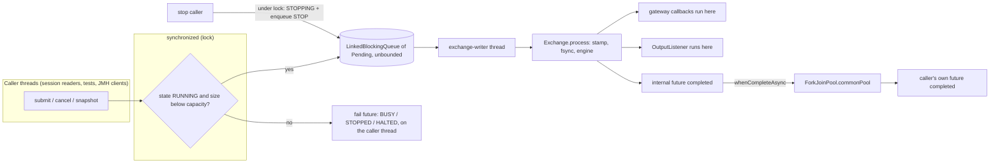
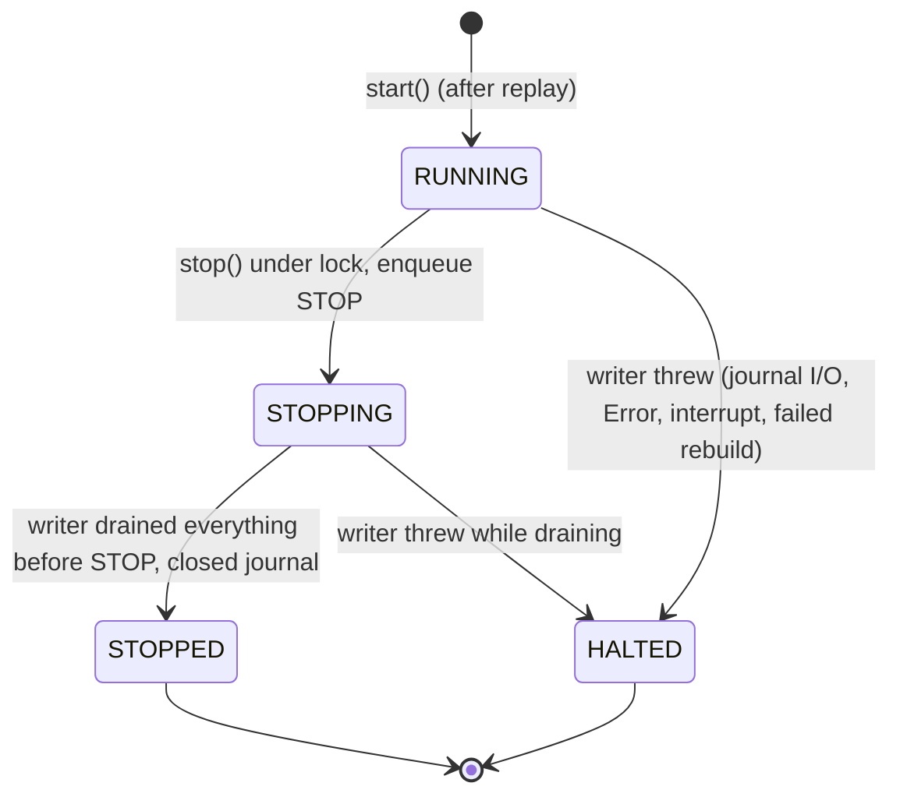
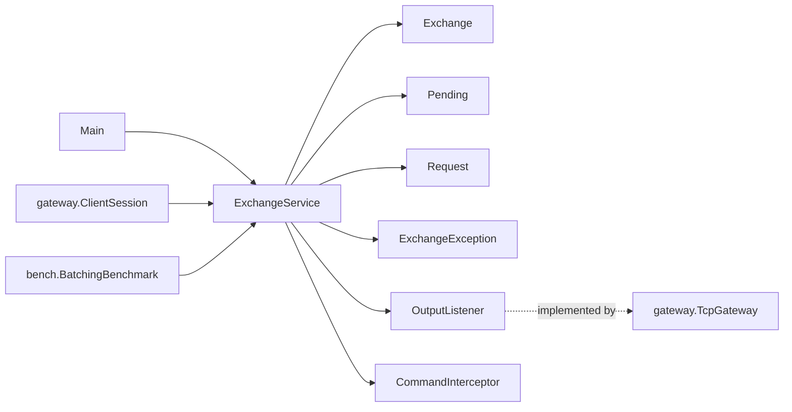

# 07 — Module: core (ExchangeService, the single-writer thread)

> **Project:** ExchangeServer2 | Single-instrument limit order book: price-time matching engine, write-ahead journal with replay, single writer thread, plain TCP gateway | Stack: Java 17, Maven wrapper, JUnit 5 (+ JMH, PIT)
> **This guide:** `exchangeserver.core.ExchangeService`: the one queue, the "exchange-writer" thread, `Settings`, the hand-in lock and states (RUNNING / STOPPING / STOPPED / HALTED), smart batching vs linger, the future hand-off (D61), halting, and the stats (including the flaky-test history) | **Prerequisites:** 01, 02, 07-modules/exchange-and-replay | **Related:** 05, 07-modules/gateway, 08, 09, 10, 11
> **Repo layout summary:** `pom.xml` + Maven wrapper (`mvnw`, `mvnw.cmd`) at the root; production code in `src/main/java/exchangeserver/` (packages `domain`, `book`, `engine`, `command`, `journal`, `core`, `gateway`, `client`, plus `Main`); tests mirror it in `src/test/java/exchangeserver/` (plus `bench/` JMH benchmarks and `testing/MutableClock`); design docs in `docs/` (`ExchangeServer2_Vision.md` = purpose/roadmap, `ExchangeServer2_Spec.md` = decisions D1–D65); these guides in `docs/understanding/`.

---

## Overview

`ExchangeService` is the **single-writer thread model**: exactly one thread, named `exchange-writer`, owns the `Exchange` (and through it the sequencer, journal, engine and book). Any number of other threads (gateway session readers, tests, benchmark clients) hand requests in through **one queue** and get a `CompletableFuture` (or a callback) back.

```java
// src/main/java/exchangeserver/core/ExchangeService.java:22-49 (trimmed)
/*
The single-writer thread model (roadmap step 4A).

Exactly one thread, "exchange-writer", owns the Exchange (sequencer, journal, engine, book). Any number of
caller threads hand in requests through one queue and get a CompletableFuture each. Nothing inside the engine
is synchronised: there is no second thread there to synchronise with (Vision 5).

Batching (step 4C, D52): the writer takes whatever is waiting (up to maxBatchSize), journals it with one fsync,
then processes it ("smart batching"). ...

States (threads guide 4.3):
  state      new request         already queued                   resources
  RUNNING    accepted            processed                        open
  STOPPING   refused (STOPPED)   processed (all are before STOP)  open
  STOPPED    refused (STOPPED)   none                             journal closed, thread ended
  HALTED     refused (HALTED)    refused (HALTED)                 journal closed, thread ended

"Refused" and "never lost" are both true because the state check and the enqueue happen under one lock, and
stop() flips the state and enqueues STOP under the same lock: every accepted request is ahead of STOP. Only
the writer thread closes the journal, as its last act, so nothing can be using it.

The queue itself is unbounded; the capacity is enforced under the lock, so stop() never blocks on a full queue.
*/
```

"Step 4A / 4C" refer to the roadmap in `docs/ExchangeServer2_Vision.md` §7; "threads guide 4.3" is section 4.3 ("The shutdown state machine") of `Exchange Server/New Learnings/03_Threads_Visibility_and_Handoff.md` in the original project (Spec §1.6).

**Why a single writer at all?** **[Verified]** Determinism and simplicity: sequence order = queue order = processing order with no locking around the sequencer (Spec D55), and the book needs no internal thread-safety (Vision §5). **[Inferred]** It is the same idea as the LMAX "single writer principle": one thread mutates state; others communicate with it by messages.

---

## Threads and what each one touches



| Thread | Reads / writes |
|---|---|
| Any caller | `enqueue` under `lock`: reads `state`, `haltCause`, `queue.size()`; adds to `queue`. `stop()`: writes `state`, adds `STOP`. Getters read `volatile` fields. |
| `exchange-writer` | Everything inside `Exchange`; `queue.take/drainTo/poll`; writes `batches`, `processed`, `largestBatch`; writes `state` (STOPPED / HALTED) and `haltCause` under `lock`. |
| `ForkJoinPool.commonPool` worker | Completes the caller's own future in `handOff` (and runs any continuation the caller attached to it). |

---

## Public interface

| Member | Visibility | Called by | Thread |
|---|---|---|---|
| `start(Path, OutputListener, Settings)` / `start(Path, OutputListener)` | public static | `Main`, `TcpGatewayTest`, `BatchingBenchmark`, tests | starting thread; replays the journal on it |
| `start(Path, OutputListener, Settings, CommandInterceptor)` | package-private static | `ExchangeServiceTest` | starting thread |
| `submit(OrderRequest)` → `CompletableFuture<Response>` | public | tests, benchmark | any |
| `cancel(String, long)` → `CompletableFuture<CancelResult>` | public | tests | any |
| `snapshot(int)` → `CompletableFuture<BookSnapshot>` | public | tests | any |
| `submit(OrderRequest, BiConsumer)`, `cancel(String, long, BiConsumer)`, `snapshot(int, BiConsumer)` | public | `gateway.ClientSession` | any; the callback runs on the writer (or on the caller if refused) |
| `stop(Duration)` → `boolean` | public | `Main` shutdown hook, tests, benchmark | any (not the writer itself: see Common confusions) |
| `awaitTermination()` | public | `Main` | `main` thread |
| `state()`, `haltCause()`, `batches()`, `processed()`, `largestBatch()` | public | `Main`, tests, benchmark | any (volatile reads) |
| `Settings` record + `defaults()`, `withQueueCapacity`, `withMaxBatchSize`, `withLinger`, `withClock` | public | `Main` (defaults), tests, benchmark | any |
| `State` enum | public | `Main`, tests | any |

---

## `Settings`

```java
// src/main/java/exchangeserver/core/ExchangeService.java:59-87 (trimmed)
public record Settings(int queueCapacity, int maxBatchSize, long lingerNanos, Clock clock) {
    public Settings {
        Objects.requireNonNull(clock, "clock");
        if (queueCapacity <= 0 || maxBatchSize <= 0 || lingerNanos < 0) {
            throw new IllegalArgumentException("Bad settings");
        }
    }
    public static Settings defaults() {
        return new Settings(100_000, 1_000, 0, Clock.systemUTC());
    }
    public Settings withQueueCapacity(int capacity) { ... }
    public Settings withMaxBatchSize(int size) { ... }
    public Settings withLinger(Duration linger) { ... linger.toNanos() ... }
    public Settings withClock(Clock c) { ... }
}
```

| Setting | Default | Effect |
|---|---|---|
| `queueCapacity` | 100,000 | Above this many queued requests, new ones are refused with `BUSY` (backpressure). |
| `maxBatchSize` | 1,000 | Most requests per batch (per fsync). `1` = fsync per command. |
| `lingerNanos` | 0 | `0` = smart batching. `> 0` = group commit with a timeout (benchmark comparison only). |
| `clock` | `Clock.systemUTC()` | The only clock the system reads, handed to the `Sequencer`. Tests pass `MutableClock`. |

**[Verified]** There is no configuration file or environment variable: `Main` always uses `Settings.defaults()` (`src/main/java/exchangeserver/Main.java:63`, via the two-argument `start`). The settings are code constants changed only by tests and the benchmark.

**Backpressure**: refusing new work (`BUSY`) instead of queueing without limit, so a flood shows up as visible refusals rather than unbounded memory and latency.

---

## Starting

```java
// src/main/java/exchangeserver/core/ExchangeService.java:108-133 (trimmed)
private ExchangeService(Exchange exchange, OutputListener listener, Settings settings) {
    ...
    this.writer = new Thread(this::run, "exchange-writer");
    // Not a daemon: the JVM must not exit with accepted requests unprocessed or the journal open.
    this.writer.setDaemon(false);
}

// Opens (and replays) the journal on the calling thread, then starts the writer thread. Thread.start() is
// the happens-before edge that hands the replayed state to the writer.
static ExchangeService start(Path journalFile, OutputListener listener, Settings settings,
                             CommandInterceptor interceptor) throws IOException {
    Exchange exchange = Exchange.open(journalFile, settings.clock(), interceptor);
    ExchangeService service = new ExchangeService(exchange, Objects.requireNonNull(listener, "listener"), settings);
    service.writer.start();
    return service;
}
```

- **[Verified]** Replay runs on the **calling** thread (`ExchangeService.java:129`). The engine, book and sequencer built there are then used only by the writer. `Thread.start()` is a happens-before edge (Java Memory Model rule: everything a thread did before calling `t.start()` is visible to `t`), so no synchronisation is needed for that hand-over (`ExchangeService.java:117-118`).
- **[Verified]** The writer is a non-daemon thread. A **daemon** thread does not keep the JVM alive; a non-daemon one does. Non-daemon here means the JVM cannot exit while accepted requests are unprocessed or the journal is open (`ExchangeService.java:113-114`).
- **[Verified]** If `Exchange.open` throws (bad header, other rules version, journal already open, replay failure), no thread is started and the exception propagates to the caller (`Main` prints "Startup failed" and exits 1).

---

## Hand-in: `enqueue` under one lock

```java
// src/main/java/exchangeserver/core/ExchangeService.java:181-202
// Returns the internal future: for handOff() only, never to a caller.
private <R> CompletableFuture<R> enqueue(Pending<R> pending, BiConsumer<? super R, ? super Throwable> onDone) {
    if (onDone != null) {
        pending.result.whenComplete(onDone);
    }
    ExchangeException refusal = null;
    synchronized (lock) {
        if (state == State.HALTED) {
            refusal = new ExchangeException(ExchangeException.Reason.HALTED, "exchange halted", haltCause);
        } else if (state != State.RUNNING) {
            refusal = new ExchangeException(ExchangeException.Reason.STOPPED, "exchange is stopping");
        } else if (queue.size() >= settings.queueCapacity()) {
            refusal = new ExchangeException(ExchangeException.Reason.BUSY, "queue full");
        } else {
            queue.add(pending);
        }
    }
    if (refusal != null) {
        pending.fail(refusal);          // outside the lock: callbacks must not run while holding it
    }
    return pending.result;
}
```

Line by line:

1. **[Verified]** The callback (if any) is attached **before** the request can reach the writer (line 183-185). That guarantees it is registered before the writer completes the future, so it runs inside the completion, on the writer thread, before the listener (see "Callback variants" below).
2. **[Verified]** The state check and the `queue.add` are inside one `synchronized (lock)` block (lines 187-197). `stop()` changes the state and adds `STOP` under the same lock (`ExchangeService.java:208-214`). So either a request is added before `STOP` (and will be processed) or it sees `STOPPING` and is refused. There is no window where a request is accepted after `STOP` and then silently never processed. That is the "never lost" invariant (Spec D56), tested by `ExchangeServiceTest$Stop.racingStopNeverLosesARequest`, repeated 5 times (`src/test/java/exchangeserver/core/ExchangeServiceTest.java:323`).
3. **[Verified]** The refusal is delivered **outside** the lock (line 198-200) because failing the future runs the gateway's callback synchronously, and callbacks must not run while holding the lock.
4. **[Verified]** Priority of refusals: `HALTED` over `STOPPED` over `BUSY`. A halted exchange also attaches the halt cause to the exception.

### Why an unbounded queue with a capacity check (D56)

**[Verified]** "The queue itself is unbounded; the capacity is enforced under the lock, so stop() never blocks on a full queue" (`ExchangeService.java:47`). With a bounded `ArrayBlockingQueue`, `stop()` would have to `put` the `STOP` marker into a possibly full queue and could block (or fail with `offer`). Here `queue.add(STOP)` always succeeds.

**[Inferred]** The capacity check is slightly conservative but safe: only the writer removes items, and it does so outside the lock, so `queue.size()` can only shrink between the check and the add. The real number of queued items never exceeds `queueCapacity` (plus the `STOP` marker).

**[Verified]** BUSY is tested by `ExchangeServiceTest$Backpressure.fullQueueRefusesWithBusyAndJournalsNothing` (`ExchangeServiceTest.java:379`): with capacity 3 and the writer held by the `Gate` interceptor, the fourth request is refused immediately, without the writer's help.

---

## Two ways to get a result

### Future variants and the hand-off (D61)

```java
// src/main/java/exchangeserver/core/ExchangeService.java:137-164 (trimmed)
// Future variants. The caller gets its own future, completed from the common pool, never the one the writer
// completes:
//  - continuations the caller attaches (thenAccept, ...) can block without stalling the exchange;
//  - cancelling it, or completing it via orTimeout(), cannot make the writer skip a request it has already
//    journalled (the writer decides from its own state, D61).
public CompletableFuture<Response> submit(OrderRequest order) {
    return handOff(enqueue(new Pending<>(new Request.Submit(Objects.requireNonNull(order, "order"))), null));
}

private static <R> CompletableFuture<R> handOff(CompletableFuture<R> internal) {
    CompletableFuture<R> mine = new CompletableFuture<>();
    internal.whenCompleteAsync((value, failure) -> {
        if (failure != null) {
            mine.completeExceptionally(failure);
        } else {
            mine.complete(value);
        }
    });
    return mine;
}
```

**[Verified]** Spec D61 and §9 findings 1 and 8 describe two bugs this fixes:

1. **Skipped journalled command.** With one shared future, a caller's `cancel()` or `orTimeout()` completed the writer's future early; the writer then skipped a command it had already journalled. The live book differed from the replayed one. Now the caller cancels only *its own* future (`mine`), and `Exchange.process` decides from `Pending.refused`, not from any future. Test: `ExchangeServiceTest$HandIn.cancellingTheCallersFutureDoesNotStopAJournalledCommand` (`ExchangeServiceTest.java:196`).
2. **Blocked writer.** With one shared future, a continuation such as `submit(...).thenAccept(r -> slowDatabaseCall())` attached *before* completion ran on the writer thread and stalled the whole exchange. **[General Java knowledge]** `whenCompleteAsync` without an executor argument runs its action on `ForkJoinPool.commonPool()`. So `mine` is completed on a pool thread, and continuations on `mine` run there (or on the caller's thread if attached after completion), never on the writer. Test: `ExchangeServiceTest$HandIn.callerContinuationsRunOffTheWriterAndCannotStallIt` (`ExchangeServiceTest.java:218`).

**[Inferred]** Cost: one extra future and a common-pool task per request. The common pool is shared JVM-wide; a very busy pool would delay result delivery but never the writer.

### Callback variants (the gateway's path)

```java
// src/main/java/exchangeserver/core/ExchangeService.java:166-179 (trimmed)
// Callback variants, for the gateway: the callback is attached before the request is queued, so it runs on the
// writer thread, before that command's OutputListener call; that is how a reply goes out before the fills and
// market data the same command caused. The callback must not block: it holds up the whole exchange.
public void submit(OrderRequest order, BiConsumer<? super Response, ? super Throwable> onDone) {
    enqueue(new Pending<>(new Request.Submit(Objects.requireNonNull(order, "order"))), onDone);
}
```

**[Verified]** Here the callback is attached to the writer's *internal* future. **[General Java knowledge]** A dependent action registered with `whenComplete` before the future completes runs synchronously in the thread that completes it. That thread is the writer, inside `p.complete(...)` at `src/main/java/exchangeserver/core/Exchange.java:159`, just before `listener.onOutput(output)`. The ordering "reply, then market data" falls out of that. Test: `ExchangeServiceTest$HandIn.callbackRunsOnTheWriterBeforeTheListener` (`ExchangeServiceTest.java:238`) asserts the events `reply 1, listener 1, reply 2, listener 2`, all on `exchange-writer`.

- **[Verified]** The gateway's callbacks only offer lines to bounded queues, so they never block (guide 07-modules/gateway, D54).
- **[Verified]** When a request is refused at hand-in, its callback runs on the **caller's** thread (the session reader), right inside `enqueue` (line 199).
- **[Inferred]** An exception thrown by a callback is captured by the dependent future that `whenComplete` returns, which nobody looks at, so it vanishes silently. The gateway's callbacks are trivial, but a new callback that throws would fail without a trace. See guide 11.

---

## The writer loop: smart batching

```java
// src/main/java/exchangeserver/core/ExchangeService.java:246-283
private void run() {
    List<Pending<?>> batch = new ArrayList<>(settings.maxBatchSize());
    Throwable failure = null;
    try {
        boolean stopping = false;
        while (!stopping) {
            batch.clear();
            batch.add(queue.take());
            queue.drainTo(batch, settings.maxBatchSize() - 1);
            if (settings.lingerNanos() > 0) {
                linger(batch);
            }
            stopping = batch.remove(STOP);      // always last: nothing is accepted after it
            if (!batch.isEmpty()) {
                exchange.process(batch, listener);
                batches++;
                processed += batch.size();
                largestBatch = Math.max(largestBatch, batch.size());
            }
        }
    } catch (Throwable t) {
        failure = t;
    } finally {
        if (failure != null) {
            halt(failure, batch);
        }
        try {
            exchange.close();
        } catch (IOException e) {
            LOG.log(Level.WARNING, "Closing the journal failed", e);
        }
        if (failure == null) {
            synchronized (lock) {
                state = State.STOPPED;
            }
        }
    }
}
```

**Smart batching**: block for the first request (`take`), then grab whatever else is *already* waiting (`drainTo`, up to `maxBatchSize - 1` more), with no timer. Under light load a batch is one request, so latency is one fsync; under load batches grow on their own, so throughput grows with load. **Group commit with a timeout** ("linger"): after the first request, keep waiting up to a fixed time for more.

**[Verified]** Measured results that chose smart batching (Spec §5, D52), closed-loop clients, one fsync ≈ 1.5 ms:

| clients | mode | throughput (orders/ms) | p50 latency | avg batch |
|---|---|---|---|---|
| 1 | per command | 0.76 | 1.5 ms | 1 |
| 1 | linger 1 ms | 0.07 | 16 ms | 1 |
| 1 | smart | ~0.6 | 1.6 ms | 1 |
| 64 | per command | 0.81 | 152 ms | 1 |
| 64 | linger 1 ms | 4.1 | 20 ms | 64 |
| 64 | smart | 43.3 | 1.4 ms | 63 |

**[Verified]** Linger measured badly on Windows because a "1 ms" timed wait rounds up to the ~15.6 ms Windows timer resolution (Spec §5). I did not re-run the benchmarks in this session.

### The STOP marker: identity and "always last"

```java
// src/main/java/exchangeserver/core/ExchangeService.java:91
private final Pending<Void> STOP = new Pending<>(null);     // marker, compared by identity
```

- A **sentinel object compared by identity** is a special instance that means "stop" and can never be confused with real data because nothing else is the same object. **[Verified]** `Pending` does not override `equals`, so `batch.remove(STOP)` (line 258), which uses `equals`, falls back to `Object.equals`, i.e. identity. `linger` and `halt` compare with `!=` directly (lines 288, 315).
- **[Verified]** "Always last" holds because `stop()` sets `STOPPING` and enqueues `STOP` under the lock, and `enqueue` refuses everything while not `RUNNING`. Nothing can be queued behind `STOP`.
- **[Inferred]** `STOP` may not be in the current batch: if more than `maxBatchSize` requests are queued before it, the writer processes full batches first and meets `STOP` later. Either way everything accepted is processed before the loop ends.
- **[Verified]** A batch that contained only `STOP` is empty after the removal and is not processed or counted (line 259).
- **[Inferred]** Naming nit: `STOP` is an instance field written in constant case. It must be per-instance only in the sense that it is compared by identity per service; a `static` one would also work. See guide 11.

### Shutdown order inside `finally`

**[Verified]** The `finally` block runs in this order: (1) on failure, `halt(...)` first, which sets `HALTED` and fails everything outstanding; (2) `exchange.close()` closes the journal and releases its lock (D58: only the writer closes it, as its last act); (3) only on a clean exit, set `STOPPED` under the lock. **[Inferred]** Consequences: once `state()` returns `STOPPED`, the journal is guaranteed closed; a halted service shows `HALTED` slightly *before* its journal is closed, which is why tests wait for the thread with `stop()`/`join` rather than polling `state()`.

### Linger (group commit), kept for comparison

```java
// src/main/java/exchangeserver/core/ExchangeService.java:285-299
private void linger(List<Pending<?>> batch) throws InterruptedException {
    long deadline = System.nanoTime() + settings.lingerNanos();
    while (batch.size() < settings.maxBatchSize() && batch.get(batch.size() - 1) != STOP) {
        long left = deadline - System.nanoTime();
        if (left <= 0) {
            break;
        }
        Pending<?> next = queue.poll(left, TimeUnit.NANOSECONDS);
        if (next == null) {
            break;
        }
        batch.add(next);
    }
}
```

**[Verified]** It stops early if the batch is full, the deadline passes, or the last item taken is `STOP`, so `stop()` never waits out a long linger (test `ExchangeServiceTest$Batching.stopDuringLingerStillDrains`, `ExchangeServiceTest.java:535`, linger 5 s, stop must finish in under 4 s). **[Verified]** Production never lingers (`lingerNanos` defaults to 0); only tests and `BatchingBenchmark` use `withLinger`. **[Inferred]** It is effectively benchmark-only code living in production (guide 11).

---

## Stopping and halting

### State machine



### `stop(Duration)`

```java
// src/main/java/exchangeserver/core/ExchangeService.java:206-217
public boolean stop(Duration timeout) throws InterruptedException {
    synchronized (lock) {
        if (state == State.RUNNING) {
            state = State.STOPPING;
            queue.add(STOP);
        }
    }
    writer.join(Math.max(1, timeout.toMillis()));
    return !writer.isAlive();
}
```

- **[Verified]** Idempotent: a second call (or a call after a halt) does not enqueue another `STOP`; it just waits (lines 210-213). Test: `ExchangeServiceTest$Stop.isIdempotentAndReleasesTheJournal`.
- **[Verified]** `Math.max(1, …)` avoids `join(0)`, which in Java means "wait forever".
- **[Verified]** Returns `false` if the writer is still alive after the timeout (test `reportsFalseWhenTheWriterDoesNotEndInTime`, `ExchangeServiceTest.java:309`).
- **[Verified]** `join` is a happens-before edge: after `stop()` returns `true`, everything the writer did is visible to the caller, including the final stats (see "Stats" below).
- **[Verified]** Spec §8 open thread: calling `stop()` **from the writer thread itself** (e.g. inside a listener or callback) would `join` on itself and wait until the timeout.

### `halt`

```java
// src/main/java/exchangeserver/core/ExchangeService.java:301-319
// Journal failure, interrupt, or a bug outside the engine: nothing more can be processed safely.
private void halt(Throwable cause, List<Pending<?>> batch) {
    LOG.log(Level.ERROR, "Exchange halted", cause);
    synchronized (lock) {
        haltCause = cause;
        state = State.HALTED;           // from here on enqueue() refuses, so the drain below is final
    }
    ExchangeException refusal = new ExchangeException(ExchangeException.Reason.HALTED, "exchange halted", cause);
    for (Pending<?> p : batch) {
        p.fail(refusal);                // no-op for those already completed
    }
    List<Pending<?>> left = new ArrayList<>();
    queue.drainTo(left);
    for (Pending<?> p : left) {
        if (p != STOP) {
            p.fail(refusal);
        }
    }
}
```

- **[Verified]** What halts the writer: anything that escapes `Exchange.process`, i.e. a journal `IOException`, an `IllegalStateException` from a journal that already fail-stopped, an `Error` from the engine or listener, a failure inside the poison-pill rebuild, or an `InterruptedException` from `take`/`poll` (nothing in production interrupts the writer).
- **[Verified]** **Fail-stop**: rather than limp along, the writer stops; `Main` then exits with code 2 and the operator restarts; the journal is the truth (Vision principle 10, D58).
- **[Verified]** Every future in the failing batch that was not yet completed, and everything still queued, is failed with `HALTED` (tests `fatalErrorHaltsAndEveryoneWaitingIsTold`, `ExchangeServiceTest.java:419`, and `haltRefusesWhatIsStillQueuedAndClosesTheJournal`, `ExchangeServiceTest.java:449`). Because state changes to `HALTED` under the lock *before* the drain, no new request can slip in after it.
- **[Verified]** The failing batch may already be journalled. Its callers hear `HALTED`, but on restart those commands are replayed ("durable ⇒ visible" does not hold; Spec §4). Clients reconcile by resending with the same client order id: the duplicate check answers with the original order id (D49).

---

## Stats and the flaky-test history

```java
// src/main/java/exchangeserver/core/ExchangeService.java:101-106
// Written only by the writer thread; volatile so other threads can read a recent value. Updated after the
// batch's futures complete, so a caller holding a result may still see the previous values; after stop()
// returns true (the writer's join) they are final.
private volatile long batches;
private volatile long processed;
private volatile int largestBatch;
```

- **[Verified]** `processed` counts every request in processed batches, **including snapshot reads and refused requests**: it is `batch.size()` (line 262). That is why `manyThreadsEachGetTheirOwnResult` now expects `threads * each + 1` after a final snapshot.
- **[Verified]** `volatile` makes each read see the latest write, and `processed += …` is safe without atomics because only one thread writes (single writer).
- **[Verified]** The stats are updated **after** `exchange.process` returns (lines 260-263), and `process` completes futures inside. A thread woken by a completed future can therefore still see the *previous* values. In this session's first full test run, `ExchangeServiceTest$Batching.waitingRequestsShareOneBatch` failed with `expected: <50> but was: <1>` for exactly this reason; it passed 8 times out of 8 when the class ran alone (an intermittent timing race). Spec §10, finding 1: five assertions had the race; the tests now read stats only after `stop()` (the writer's `join` is the happens-before edge), and the field comment above documents the lag. Production behaviour was not changed.

**[Inferred]** Why not update the stats before completing the futures? It would make `batches()` count a batch that later halts, and stats are diagnostics, not a protocol. Documenting the lag was the smaller change.

---

## Dependencies



- **In:** `Main` (start, stop via shutdown hook, awaitTermination, state, haltCause), `ClientSession` (callback variants), `TcpGateway` (holds the reference), tests and `BatchingBenchmark`.
- **Out:** `Exchange` (everything stateful), JDK concurrency (`LinkedBlockingQueue`, `CompletableFuture`, `ForkJoinPool.commonPool` via `whenCompleteAsync`), `System.Logger` for the halt and close-failure logs.

---

## How it is tested

`ExchangeServiceTest` (`src/test/java/exchangeserver/core/ExchangeServiceTest.java`):

| `@Nested` group | Tests |
|---|---|
| `HandIn` (`:113`) | `manyThreadsEachGetTheirOwnResult` (8 threads × 500, every caller gets its own result, replay rebuilds the same book); `readsGoThroughTheQueueInOrder`; `startReplaysAnExistingJournal`; `nullOrderIsRefusedOnTheCallersThread`; the two D61 regression tests; `callbackRunsOnTheWriterBeforeTheListener` |
| `Stop` (`:258`) | `drainsEverythingAcceptedAndRefusesTheRest`; `isIdempotentAndReleasesTheJournal`; `reportsFalseWhenTheWriterDoesNotEndInTime`; `racingStopNeverLosesARequest` (`@RepeatedTest(5)`, 4 producers × 250) |
| `Backpressure` (`:376`) | `fullQueueRefusesWithBusyAndJournalsNothing` |
| `Failures` (`:403`) | `poisonIsQuarantinedAndTheServiceCarriesOn`; `fatalErrorHaltsAndEveryoneWaitingIsTold` (a simulated `OutOfMemoryError`); `haltRefusesWhatIsStillQueuedAndClosesTheJournal` |
| `Batching` (`:479`) | `waitingRequestsShareOneBatch` (50 in one batch); `maxBatchSizeOneIsFsyncPerCommand`; `lingerCollectsLateArrivalsIntoTheSameBatch`; `stopDuringLingerStillDrains` |
| top level | `settingsAreValidated` |

The **`Gate`** interceptor (`ExchangeServiceTest.java:88`) blocks the writer inside the engine step on any order whose client order id starts with `HOLD`, using two `CountDownLatch`es (`reached`, `release`). Tests use it to pile requests up in the queue deterministically, for example to form a batch of exactly 50 or to fill the queue to capacity.

- **[Verified]** Every wait has a timeout (`WAIT` = 30 s), following the original project's threads guide §4.4 (`ExchangeServiceTest.java:39-41`). One exception: `racingStopNeverLosesARequest` spins with `Thread.onSpinWait()` until a third of the requests are handed in, without a timeout.
- **[Verified]** Tests that inject an `OutOfMemoryError` log a `SEVERE: Exchange halted` stack trace; that is expected noise (CLAUDE.md).
- **[Verified]** `ExchangeService` is in PIT's target packages (`pom.xml:143-150`). Survivors include `setDaemon(false)` (equivalent: the thread is already non-daemon), `awaitTermination()` (only `Main` uses it), and linger loop boundaries (Spec §7).

---

## Key takeaways

- One thread (`exchange-writer`) owns all mutable exchange state; every other thread talks to it through one `LinkedBlockingQueue`.
- The state check and the enqueue share a lock with `stop()`, so every request is either processed or explicitly refused (`BUSY`, `STOPPED`, `HALTED`), never silently lost.
- The queue is unbounded on purpose; capacity is checked under the lock so `stop()` can always enqueue `STOP` without blocking.
- Smart batching (take what is waiting, one fsync, no timer) was chosen by measurement; linger exists only for comparison.
- Future variants return the caller's *own* future, completed on the common pool (D61); callback variants run on the writer, before the listener, which is how replies precede market data.
- `STOP` is a sentinel compared by identity; it is always the last thing accepted.
- A halt fails every outstanding request with `HALTED`, closes the journal, and `Main` exits 2. Some halted commands may still be in the journal and are replayed on restart.
- Stats are `volatile` diagnostics that lag replies; read them after `stop()` if you need exact values.

## Common confusions

- **"`BUSY` means the order was journalled but slow."** No: `BUSY`, `STOPPED` refusals happen before the queue; nothing was journalled. Only `HALTED` is ambiguous.
- **"Cancelling my future cancels my order."** No. It only stops *you* waiting. A queued order is still processed (D61). To cancel an order, send a cancel request.
- **"The callback runs on my thread."** Only when the request is refused at hand-in. Otherwise it runs on the writer thread and must not block.
- **"`stop()` from a listener is fine."** It is not: the writer would `join` itself and the call would time out (Spec §8).
- **"`processed()` counts orders."** It counts requests in processed batches, including snapshot reads and requests refused at stamping.
- **"Linger is the default."** `lingerNanos` defaults to 0 (smart batching).
- **"`state() == STOPPED` right after `stop()` began."** `STOPPED` is set by the writer at the very end, after closing the journal; until then it reads `STOPPING`.

## Questions to test yourself

1. Producer P checks `state == RUNNING` and, just before adding its request, `stop()` runs on another thread. Why can't P's request end up behind `STOP` and be lost?
<details><summary>Answer</summary>The check and the add are in the same `synchronized (lock)` block, and `stop()` takes the same lock to set `STOPPING` and add `STOP`. Either P's whole block runs first (its request is ahead of `STOP`) or `stop()` runs first (P sees `STOPPING` and is refused). (`ExchangeService.java:187-197, 208-214`.)</details>

2. Why does `stop()` never block on a full queue?
<details><summary>Answer</summary>The `LinkedBlockingQueue` is unbounded; the capacity limit is a check in `enqueue`, not a property of the queue, so `queue.add(STOP)` always succeeds (D56).</details>

3. With `maxBatchSize = 1000` and 2,500 requests queued ahead of `STOP`, how many batches does the writer process after `stop()` and how many `fsync`s?
<details><summary>Answer</summary>Three batches (1000, 1000, 500); the third drains 500 requests and `STOP`, removes `STOP` and processes 500. Three `appendAll` calls, one fsync each (assuming no snapshots-only batch and no poison pills, which would add a SKIP fsync).</details>

4. A test awaits all 50 futures of a batch and immediately asserts `largestBatch() == 50`. Why can that fail, and what is the fix?
<details><summary>Answer</summary>The writer completes the futures inside `process()` and updates the stats only after `process()` returns, so the test thread may run before the update. Read the stats after `stop()` returns true (the `join` gives happens-before). Spec §10 finding 1.</details>

5. Why does `handOff` use `whenCompleteAsync` instead of `whenComplete`?
<details><summary>Answer</summary>So the caller's future is completed on a common-pool thread rather than the writer; then any continuation the caller attached runs off the writer and cannot stall the exchange (D61, Spec §9 finding 8).</details>

6. The engine throws `IllegalStateException` on one command. Does the service halt?
<details><summary>Answer</summary>No. `Exchange.process` catches the `RuntimeException`, quarantines the command (SKIP + rebuild) and continues; the caller gets `INTERNAL_ERROR`. Only an `Error`, a journal failure, a failed rebuild or an interrupt escapes `process` and halts the service.</details>

7. A gateway callback runs on the writer. Where does it run if the exchange is already stopping?
<details><summary>Answer</summary>On the caller's thread (the session reader), inside `enqueue`, after the lock is released, because the request is refused before ever reaching the writer (`ExchangeService.java:198-200`).</details>
