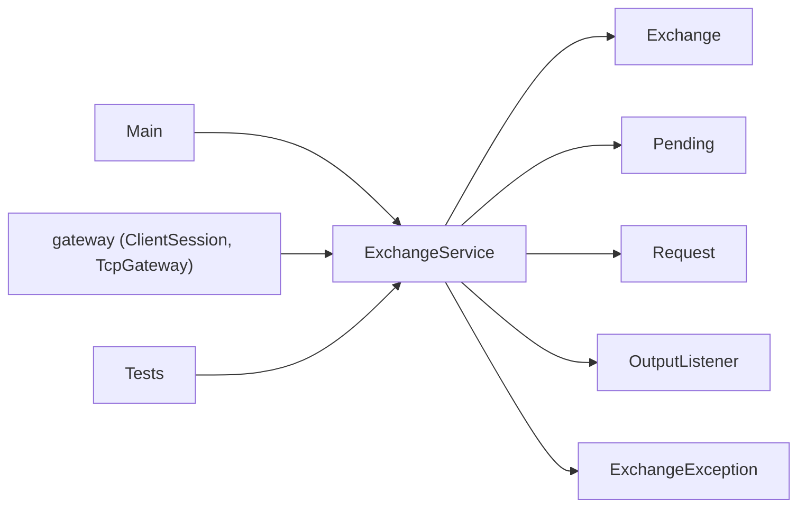
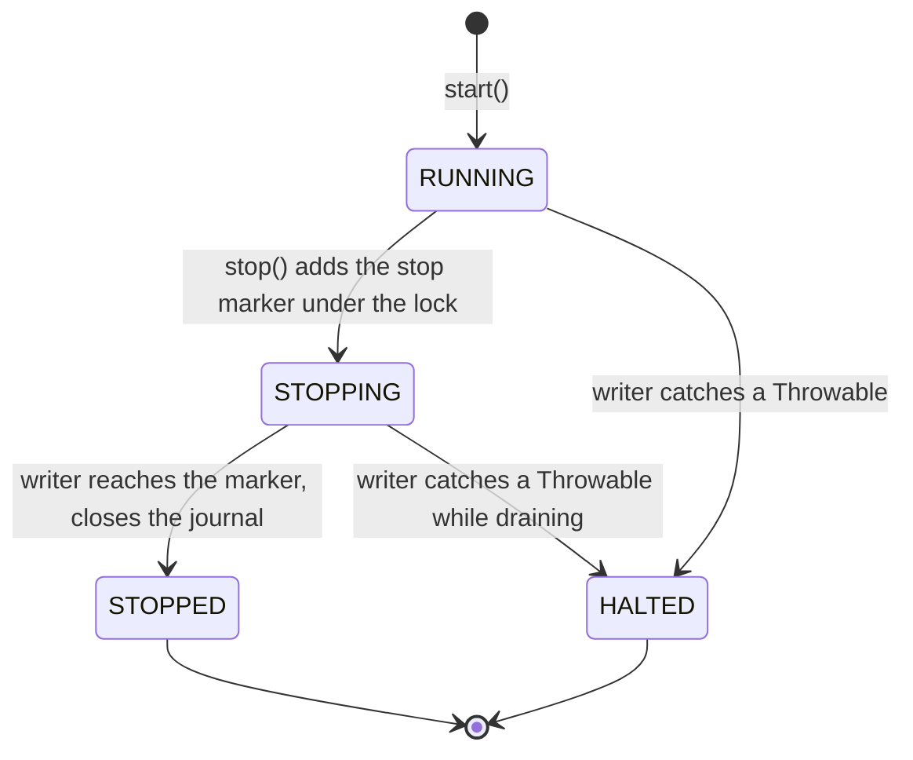

# 07 — Module: core (ExchangeService, the single-writer thread)

> **Project:** ExchangeServer2 | Single-instrument limit order book: price-time matching engine, write-ahead journal with replay, single writer thread, TCP/TLS gateway with authenticated participants | Stack: Java 17, Maven wrapper, JUnit 5 (+ JMH, PIT)
> **This guide:** `core.ExchangeService`: the writer thread, the hand-in queue and its lock, `Settings`, the four states, batching (smart and linger), halting, the future hand-off (D61), callbacks (logged if they throw, run after the listener), and the stats | **Prerequisites:** 01, 02, 05, 07-modules/exchange-and-replay | **Related:** 05a, 05b, 07-modules/gateway, 08, 10
> **Repo layout summary:** `pom.xml` + Maven wrapper (`mvnw`, `mvnw.cmd`) at the root; production code in `src/main/java/exchangeserver/` (packages `domain`, `book`, `engine`, `command`, `journal`, `core`, `gateway`, `client`, plus `Main`); tests mirror it in `src/test/java/exchangeserver/` (plus `bench/` JMH benchmarks and `testing/MutableClock`); design docs in `docs/` (`ExchangeServer2_Vision.md` = purpose/roadmap, `ExchangeServer2_Spec.md` = decisions D1–D77); these guides in `docs/understanding/`.

## Overview

`ExchangeService` turns the single-threaded `Exchange` (guide 07 (modules/exchange-and-replay)) into something any
number of threads can use. Exactly one thread, `exchange-writer`, owns the `Exchange` (sequencer, journal, ledger,
book); every other thread hands in requests through one queue and gets a result back through a
`CompletableFuture` or a callback **[Verified]** (`src/main/java/exchangeserver/core/ExchangeService.java:22-49`).

Terms:
- **Single writer**: only one thread ever touches the mutable state, so the engine needs no locks.
- **Smart batching** (D52): the writer takes whatever is already queued (up to `maxBatchSize`) and journals it with
  one fsync. **Linger** (group commit with a timeout) is kept only for the benchmark.
- **Backpressure**: refusing with `BUSY` instead of queueing without limit.
- **Happens-before**: the Java memory-model rule that makes one thread's writes visible to another (e.g. a queue's
  put -> take, `Thread.start`, `Thread.join`, a future's complete -> get).

What changed on 2026-10-27: `Settings` carries `Exchange.Options` (CHECK interval, RESEND window); `recovery()`
(L1); new requests `cancelAll`, `attach`, `resend`; callbacks are wrapped so a throw is logged (M9); `stop()` is
refused on the writer thread (L6); the marker is renamed `stopMarker`; callbacks run *after* the listener (D76);
the stats are documented as lagging the replies.

## Dependencies



## Interface

| Member | Caller | Thread it runs on |
|---|---|---|
| `start(path, listener, settings)` (public); `start(..., interceptor)` (package, tests) | `Main`, tests, benchmark | caller: opens and replays, then starts the writer |
| `submit`, `cancel`, `cancelAll`, `snapshot`, `resend` -> `CompletableFuture` | tests, programmatic clients | caller enqueues; result completed from the common pool |
| `submit`, `cancel`, `cancelAll`, `snapshot`, `attach`, `resend` with a `BiConsumer` callback | gateway | callback on the writer (or the caller if refused) |
| `stop(timeout)`, `awaitTermination()` | `Main`'s shutdown hook, tests | caller (never the writer) |
| `state()`, `haltCause()`, `recovery()`, `batches()`, `processed()`, `largestBatch()` | `Main`, tests | any |

```java
// src/main/java/exchangeserver/core/ExchangeService.java:59-71 (trimmed)
public record Settings(int queueCapacity, int maxBatchSize, long lingerNanos, Clock clock, Exchange.Options exchange) {

    public Settings {
        Objects.requireNonNull(clock, "clock");
        Objects.requireNonNull(exchange, "exchange");
        if (queueCapacity <= 0 || maxBatchSize <= 0 || lingerNanos < 0) {
            throw new IllegalArgumentException("Bad settings");
        }
    }

    public static Settings defaults() {
        return new Settings(100_000, 1_000, 0, Clock.systemUTC(), Exchange.Options.defaults());
    }
```

`Exchange.Options` = `(checkInterval 10,000, outputRetention 1,000)`; `Main` sets them from `--check-interval` and
`--resend-window` with `withExchangeOptions` **[Verified]** (`ExchangeService.java:89-91`;
`src/main/java/exchangeserver/Main.java:141-142`). The old two-argument `start(path, listener)` was removed (no
caller left).

## Starting

```java
// src/main/java/exchangeserver/core/ExchangeService.java:130-141
static ExchangeService start(Path journalFile, OutputListener listener, Settings settings,
                             CommandInterceptor interceptor) throws IOException {
    Exchange exchange = Exchange.open(journalFile, settings.clock(), interceptor, settings.exchange());
    ExchangeService service = new ExchangeService(exchange, Objects.requireNonNull(listener, "listener"), settings);
    service.writer.start();
    return service;
}

// What recovery did at start (L1). Built on the starting thread before the writer existed; immutable.
public Exchange.Recovery recovery() {
    return recovery;
}
```

- Replay runs on the *calling* thread inside `Exchange.open`; `Thread.start()` is the happens-before edge that
  hands the replayed state to the writer **[Verified]** (`ExchangeService.java:124-125`).
- The constructor copies `exchange.recovery()` into a final field, so any thread can read it later without touching
  the writer's objects **[Verified]** (`ExchangeService.java:114-122`). `Main` prints it.

## Hand-in: one lock for "refused" and "never lost"

```java
// src/main/java/exchangeserver/core/ExchangeService.java:211-238
private <R> CompletableFuture<R> enqueue(Pending<R> pending, BiConsumer<? super R, ? super Throwable> onDone) {
    if (onDone != null) {
        pending.result.whenComplete((value, failure) -> {
            // whenComplete would capture a throw in a future nobody reads: log it instead (M9).
            try {
                onDone.accept(value, failure);
            } catch (RuntimeException | Error callbackBug) {
                LOG.log(Level.ERROR, "Request callback failed", callbackBug);
            }
        });
    }
    ExchangeException refusal = null;
    synchronized (lock) {
        if (state == State.HALTED) {
            refusal = new ExchangeException(ExchangeException.Reason.HALTED, "exchange halted", haltCause);
        } else if (state != State.RUNNING) {
            refusal = new ExchangeException(ExchangeException.Reason.STOPPED, "exchange is stopping");
        } else if (queue.size() >= settings.queueCapacity()) {
            refusal = new ExchangeException(ExchangeException.Reason.BUSY, "queue full");
        } else {
            queue.add(pending);
        }
    }
    if (refusal != null) {
        pending.fail(refusal);          // outside the lock: callbacks must not run while holding it
    }
    return pending.result;
}
```

- **State check + enqueue under one lock**, and `stop()` flips the state and enqueues the stop marker under the
  same lock, so every accepted request is ahead of the marker: "refused" and "never lost" both hold (D56).
- **The queue is unbounded; capacity is checked under the lock**, so `stop()` can always enqueue its marker even
  when the queue is "full" (D56).
- **M9, new**: a callback is attached with `whenComplete`. `whenComplete` returns a *new* future that captures any
  exception the callback throws; nobody reads that future, so a gateway bug used to vanish (the client just got no
  reply). The wrapper logs it. Tested by capturing the JUL log record (`System.Logger` goes to
  `java.util.logging`) **[Verified]** (`src/test/java/exchangeserver/core/ExchangeServiceTest.java:564`
  `aThrowingCallbackIsLoggedAndTheExchangeCarriesOn`).
- **Where callbacks run**: on the writer, *inside* `Exchange.process` right after that command's listener call
  (D76); for a read, at the read's place in the batch, before any later output (that is how SUBSCRIBE and LOGIN
  join a stream with no gap); on the caller's thread if refused **[Verified]** (`ExchangeService.java:182-185`).
  The order "listener, then callback" is pinned by `listenerRunsOnTheWriterBeforeTheCallback`
  (`ExchangeServiceTest.java:240`); before D76 it was the reverse.

### Future variants and D61

```java
// src/main/java/exchangeserver/core/ExchangeService.java:170-180
private static <R> CompletableFuture<R> handOff(CompletableFuture<R> internal) {
    CompletableFuture<R> mine = new CompletableFuture<>();
    internal.whenCompleteAsync((value, failure) -> {
        if (failure != null) {
            mine.completeExceptionally(failure);
        } else {
            mine.complete(value);
        }
    });
    return mine;
}
```

The caller never gets the writer's own future: continuations it attaches run on the common pool (they cannot stall
the writer), and cancelling it cannot make the writer skip a journalled command, because the writer decides from
`Pending.refused`, never from a future's state (D61) **[Verified]** (`ExchangeServiceTest.HandIn`, `:196`, `:218`).

## The writer loop

```java
// src/main/java/exchangeserver/core/ExchangeService.java:286-323
private void run() {
    List<Pending<?>> batch = new ArrayList<>(settings.maxBatchSize());
    Throwable failure = null;
    try {
        boolean stopping = false;
        while (!stopping) {
            batch.clear();
            batch.add(queue.take());
            queue.drainTo(batch, settings.maxBatchSize() - 1);
            if (settings.lingerNanos() > 0) {
                linger(batch);
            }
            stopping = batch.remove(stopMarker);    // always last: nothing is accepted after it
            if (!batch.isEmpty()) {
                exchange.process(batch, listener);
                batches++;
                processed += batch.size();
                largestBatch = Math.max(largestBatch, batch.size());
            }
        }
    } catch (Throwable t) {
        failure = t;
    } finally {
        if (failure != null) {
            halt(failure, batch);
        }
        try {
            exchange.close();
        } catch (IOException e) {
            LOG.log(Level.WARNING, "Closing the journal failed", e);
        }
        if (failure == null) {
            synchronized (lock) {
                state = State.STOPPED;
            }
        }
    }
}
```

- **Smart batching**: block for the first request, then take whatever else is waiting, up to `maxBatchSize`.
- **`stopMarker`** (renamed from the constant-looking instance field `STOP`, a smell in guide 11) is a per-instance
  `Pending` compared by identity; it is always the last element because nothing is accepted after it
  **[Verified]** (`ExchangeService.java:96`, `:298`).
- **Stats lag the replies**: `batches`/`processed`/`largestBatch` are updated *after* `process` returned, i.e.
  after the batch's futures completed. A caller holding a result may see the previous values; after `stop()`
  returns true (the writer's `join`) they are final. That race made `waitingRequestsShareOneBatch` flaky; the tests
  now read stats after `stop()` **[Verified]** (`ExchangeService.java:107-112`; Spec §10).
- **Only the writer closes the journal**, as its last act (D58); the state becomes STOPPED after a clean end.

### Linger (benchmark only)

`linger` keeps polling with a deadline until the batch is full, the deadline passes or the marker arrives
(`ExchangeService.java:325-339`). It exists so `BatchingBenchmark` can compare group commit with smart batching
(Spec §5); production uses `lingerNanos` 0 **[Verified]**.

## States, stop and halt



```java
// src/main/java/exchangeserver/core/ExchangeService.java:242-257
// Refuses new requests, lets the writer finish everything already accepted, and waits for it to end.
// Idempotent: later callers just wait. Returns false if the writer did not end within the timeout.
// Not from the writer thread (a listener or callback): it would wait for its own end.
public boolean stop(Duration timeout) throws InterruptedException {
    if (Thread.currentThread() == writer) {
        throw new IllegalStateException("stop() called on the writer thread: it would wait for itself");
    }
    synchronized (lock) {
        if (state == State.RUNNING) {
            state = State.STOPPING;
            queue.add(stopMarker);
        }
    }
    writer.join(Math.max(1, timeout.toMillis()));
    return !writer.isAlive();
}
```

- **L6, new**: called from a listener or callback (both run on the writer), `stop()` used to `join` its own thread
  and wait out the timeout. It now throws at once; the state is untouched **[Verified]**
  (`ExchangeServiceTest.Robustness.stopFromTheWriterThreadIsRefused`, `ExchangeServiceTest.java:597`).
- `Math.max(1, …)` avoids `join(0)`, which means "wait forever" in Java.
- **Halt** (`ExchangeService.java:341-359`): log, set HALTED and the cause under the lock (so `enqueue` refuses
  from then on and the drain is final), fail every request in the batch (no-op for completed ones) and everything
  still queued. `Main` exits 2.
- **During shutdown, sessions still get their replies.** Requests accepted before the marker are processed; their
  callbacks run after their lines went out (D76). The gateway's in-flight count relies on that (guide 07
  (modules/gateway)).

## How it is tested

`ExchangeServiceTest` (`src/test/java/exchangeserver/core/ExchangeServiceTest.java:42`); every wait has a timeout,
and the stats are read only after `stop()` (comment at the top of the class). The `Gate` interceptor holds the
writer inside the engine step to shape batches and races (`:88-109`).

| Group | Covers |
|---|---|
| `HandIn` (`:113`) | many threads each get their own result; reads in queue order; replay at start; null refused on the caller's thread; cancelling the caller's future does not skip a journalled command (D61); continuations run off the writer; listener before callback (D76) |
| `Stop` (`:260`) | drain then refuse; idempotent and releases the journal; `false` on timeout; racing `stop()` never loses a request (the spin-wait now has a deadline, L5) |
| `Backpressure` (`:379`) | BUSY at capacity, nothing journalled |
| `Failures` (`:406`) | poison quarantined; an `Error` halts and everyone waiting is told; queued requests refused on halt |
| `Batching` (`:482`) | waiting requests share a batch; max batch 1; linger collects late arrivals; stop during linger drains |
| `Robustness` (`:560`) | a throwing callback is logged (M9); `stop()` on the writer refused (L6); `cancelAll` and `resend` through the queue; `recovery()` after a restart |

## Key takeaways

- One writer thread owns everything; callers reach state only through the queue (reads included).
- State check + enqueue and `stop()` share one lock: every accepted request is processed or refused, never lost.
- Callers get their own future (D61); gateway callbacks run on the writer, after the request's listener call (D76).
- A throwing callback is now logged (M9); `stop()` from the writer is refused (L6).
- The stats lag the replies; read them after `stop()`.
- `Settings` carries `Exchange.Options` (CHECK interval, RESEND window); `recovery()` reports what start-up replay did.

## Common confusions

- **"The callback runs before the market data."** Since D76 the listener (private lines and market data) runs
  first; the callback follows and only reports refusals and does bookkeeping.
- **"`stop()` cancels queued requests."** It refuses *new* ones; everything already accepted is processed.
- **"A full queue blocks the caller."** It refuses with BUSY; nothing waits.
- **"`attach` is a command."** It is a read (no journal record); its value is the participant's latest oseq.

## Questions to test yourself

1. A gateway callback throws a `NullPointerException`. What does the client see, and what is logged?
<details><summary>Answer</summary>Whatever the callback had already sent; the exception is caught by the wrapper in `enqueue` and logged as "Request callback failed" at ERROR. The exchange carries on; the command itself was already processed and its lines already sent by the listener.</details>

2. Why can `stop()` always enqueue its marker, even when the queue holds `queueCapacity` requests?
<details><summary>Answer</summary>The queue itself is an unbounded `LinkedBlockingQueue`; the capacity is a check `enqueue` makes under the lock. `stop()` does not make that check.</details>

3. A test reads `service.processed()` right after its last future completes and sees a smaller number than expected. Bug?
<details><summary>Answer</summary>No: the writer updates the stats after `process` returns, i.e. after the futures completed. Read them after `stop()` returns true (the join is the happens-before edge).</details>

4. A listener calls `service.stop(Duration.ofSeconds(1))`. What happens now, and what happened before L6?
<details><summary>Answer</summary>Now: `IllegalStateException` at once, state unchanged. Before: the writer thread joined itself and blocked for the full timeout, stalling the whole exchange, then returned false.</details>
