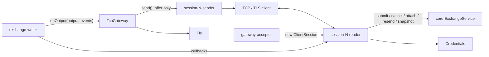
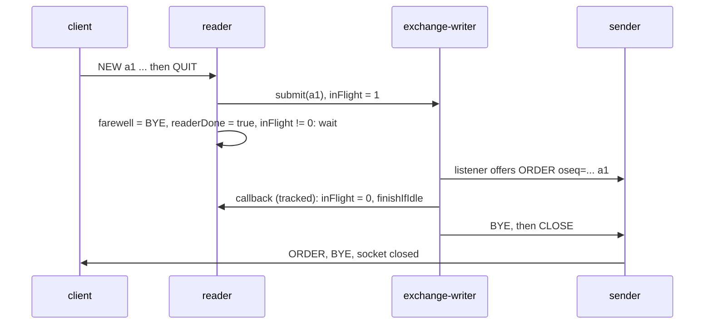

# 07 — Module: gateway (TcpGateway, ClientSession, Protocol, Credentials, Tls)

> **Project:** ExchangeServer2 | Single-instrument limit order book: price-time matching engine, write-ahead journal with replay, single writer thread, TCP/TLS gateway with authenticated participants | Stack: Java 17, Maven wrapper, JUnit 5 (+ JMH, PIT)
> **This guide:** `exchangeserver.gateway`: the line protocol (`Protocol`, `ClientMessage`, `ProtocolException`), the acceptor, routing and settings (`TcpGateway`), one connection's two threads with login, limits, timeouts, RESEND and close-after-replies (`ClientSession`), authentication (`Credentials`) and TLS (`Tls`) | **Prerequisites:** 01, 02, 05a, 07-modules/exchange-service | **Related:** 05b, 06, 07-modules/ledger-and-snapshots, 07-modules/client-and-main, 08, 11
> **Repo layout summary:** `pom.xml` + Maven wrapper (`mvnw`, `mvnw.cmd`) at the root; production code in `src/main/java/exchangeserver/` (packages `domain`, `book`, `engine`, `command`, `journal`, `core`, `gateway`, `client`, plus `Main`); tests mirror it in `src/test/java/exchangeserver/` (plus `bench/` JMH benchmarks and `testing/MutableClock`); design docs in `docs/` (`ExchangeServer2_Vision.md` = purpose/roadmap, `ExchangeServer2_Spec.md` = decisions D1–D77); these guides in `docs/understanding/`.

## Overview

The gateway is the only part of the system that talks to the outside world. It accepts TCP (optionally TLS)
connections, gives each one a **reader** thread (parse, check, hand in) and a **sender** thread (bounded queue ->
socket), and implements `OutputListener`, so the exchange's writer thread hands it every command's output to route
**[Verified]** (`src/main/java/exchangeserver/gateway/TcpGateway.java:30-50`).

On 2026-10-27 the four deferred security findings and the related risks were fixed here (Spec D72–D77):
- **Authentication and transport (D74):** loopback bind by default; `LOGIN <participant> <secret> [COD]` checked
  against salted PBKDF2 hashes; one attempt per connection; TLS 1.3/1.2 optional.
- **Per-session limits (D75):** login and idle timeouts; at most `maxInFlight` requests in flight; a token-bucket
  rate limit.
- **A numbered private stream per participant (D73):** replies and fills carry `oseq=`, go to *every* session of the
  participant, and can be re-requested with `RESEND`.
- **Cancel-on-disconnect (D72)** when the last `COD` session of a participant closes.
- **Close after the replies, also during shutdown (D76),** replacing the D63 barrier.
- **"Exchange is starting"** for clients that connect during replay (L6), and alarming accept failures.

Terms: **session** = one connection; **participant** = the trading identity a session logs in as; **oseq** = a
participant's private event number; **COD** = cancel-on-disconnect; **in flight** = handed to the exchange and not
yet completed.

## Dependencies and threads



The writer thread only ever *offers* lines to bounded session queues; a slow client is disconnected, never waited
for (D54) **[Verified]** (`src/main/java/exchangeserver/gateway/ClientSession.java:115-124`).

## Interface

| Member | Caller | Thread |
|---|---|---|
| `new TcpGateway(Settings)` (binds) | `Main`, tests | caller |
| `startAccepting()`, `attach(service)`, `start(service)` | `Main`, tests | caller |
| `onOutput(EngineOutput, List<PrivateEvent>)` | `Exchange.process` | writer |
| `close()` | `Main` shutdown hook, tests | caller |
| `port()` | `Main`, tests | any |
| package: `authenticate`, `loggedIn`, `removed`, `subscribe`, `unsubscribe`, `service()`, `settings()` | `ClientSession` | reader / writer / sender |
| package test hooks: `participantsRegistered()`, `subscriberCount()`, `drainingSessions()` | tests | any |
| `Credentials.load`, `of`, `addUser`, `verify` | `Main`, `TcpGateway`, tests | any (immutable) |
| `Tls.serverContext`, `clientContext`, `passwordFromEnvironment` | `Main`, `ClientMain`, tests | caller |

## TcpGateway

### Settings

```java
// src/main/java/exchangeserver/gateway/TcpGateway.java:52-71 (trimmed)
public record Settings(InetAddress bindAddress, int port, Credentials credentials, SSLContext tls, int maxSessions,
                       int outboundCapacity, Duration loginTimeout, Duration idleTimeout, int maxInFlight,
                       double ratePerSecond, int burst) {

    public static Settings defaults(int port, Credentials credentials) {
        return new Settings(InetAddress.getLoopbackAddress(), port, credentials, null, 256, 10_000,
                Duration.ofSeconds(10), Duration.ofMinutes(5), 1_000, 1_000, 2_000);
    }
```

| Setting | Default | `Main` flag | Decision |
|---|---|---|---|
| bind address | 127.0.0.1 | `--bind` | D74 |
| credentials | required | `--users` | D74 |
| TLS context | none | `--tls-keystore` (password in `ES2_TLS_PASSWORD`) | D74 |
| max sessions / outbound lines | 256 / 10,000 | (none) | D54 |
| login / idle timeout | 10 s / 5 min | `--login-timeout`, `--idle-timeout` | D75 |
| max in flight | 1,000 | `--max-in-flight` | D75 |
| rate / burst | 1,000 per s / 2,000 | `--rate`, `--burst` | D75 |

`with...` methods return modified copies; the compact constructor rejects non-positive values and zero or negative
timeouts **[Verified]** (`TcpGateway.java:56-96`).

### Construction: TLS or plain, bound to one address

```java
// src/main/java/exchangeserver/gateway/TcpGateway.java:113-129
public TcpGateway(Settings settings) throws IOException {
    this.settings = Objects.requireNonNull(settings, "settings");
    if (settings.tls() == null) {
        this.server = new ServerSocket();
    } else {
        SSLServerSocket tls = (SSLServerSocket) settings.tls().getServerSocketFactory().createServerSocket();
        tls.setEnabledProtocols(Tls.PROTOCOLS);
        this.server = tls;
    }
    try {
        server.setReuseAddress(true);
        server.bind(new InetSocketAddress(settings.bindAddress(), settings.port()));
    } catch (IOException e) {
        server.close();
        throw e;
    }
}
```

- Loopback by default (risk H1 was "binds every interface, anyone on the LAN can log in as anyone"). `Main` warns
  when `--bind` is not loopback and TLS is off **[Verified]** (`src/main/java/exchangeserver/Main.java:127-129`).
- With TLS, an `SSLServerSocket` restricted to TLS 1.3 and 1.2. The handshake happens lazily on the session's
  first read or write, so it runs on the session's threads, not the acceptor **[Verified — code; Inferred: JSSE's
  lazy handshake]**.

### Start order: accept before replay (L6)

```java
// src/main/java/exchangeserver/gateway/TcpGateway.java:139-158
// Accepts connections from now on; until attach(), sessions are told the exchange is starting (L6).
public synchronized void startAccepting() {
    if (acceptor != null) {
        throw new IllegalStateException("Already accepting");
    }
    acceptor = new Thread(this::acceptLoop, "gateway-acceptor");
    acceptor.setDaemon(true);
    acceptor.start();
}

public void attach(ExchangeService exchangeService) {
    this.service = Objects.requireNonNull(exchangeService, "exchangeService");
}

public synchronized void start(ExchangeService exchangeService) {
    attach(exchangeService);
    if (acceptor == null) {
        startAccepting();
    }
}
```

`Main` binds and starts accepting *before* the (possibly long) replay, then attaches the service. A session that
sends anything but PING/QUIT while `service` is still null gets `ERROR exchange is starting; retry shortly` and is
closed, instead of hanging in the OS backlog **[Verified]** (`ClientSession.java:228-232`;
`src/test/java/exchangeserver/gateway/TcpGatewayTest.java:316` `beforeTheExchangeIsAttachedSessionsAreToldItIsStarting`).

### The acceptor: back off, alarm if it persists

```java
// src/main/java/exchangeserver/gateway/TcpGateway.java:164-186 (trimmed)
private void acceptLoop() {
    int failures = 0;
    while (!server.isClosed()) {
        Socket socket;
        try {
            socket = server.accept();
            failures = 0;
        } catch (IOException e) {
            if (server.isClosed()) {
                return;
            }
            failures++;
            LOG.log(failures >= ALARM_AFTER_FAILURES ? Level.ERROR : Level.WARNING,
                    "accept failed " + failures + " time(s) in a row; retrying", e);
            try {
                Thread.sleep(Math.min(MAX_BACKOFF_MILLIS, MIN_BACKOFF_MILLIS << Math.min(failures - 1, 6)));
            } catch (InterruptedException interrupted) {
                return;
            }
            continue;
        }
```

Exponential backoff 100, 200, 400 ... capped at 5 s, and ERROR instead of WARNING from the 10th consecutive failure
(L6: it used to retry every 100 ms forever with a warning each time). Over the session limit, the client gets
`ERROR too many sessions` (with a 2 s socket timeout, so a TLS handshake cannot stall the acceptor) and is closed
**[Verified]** (`TcpGateway.java:187-200`).

### Routing private events and market data

```java
// src/main/java/exchangeserver/gateway/TcpGateway.java:285-310 (trimmed)
@Override
public void onOutput(EngineOutput output, List<PrivateEvent> events) {
    for (PrivateEvent e : events) {
        Set<ClientSession> owners = sessionsByParticipant.get(e.participant());
        if (owners != null) {
            List<String> lines = Protocol.lines(e, false);
            for (ClientSession s : owners) {
                s.sendAll(lines);
            }
        }
    }

    if (subscribers.isEmpty() || (output.trades().isEmpty() && output.levelUpdates().isEmpty())) {
        return;
    }
    // ... TRADE and LEVEL lines to every subscriber
}
```

- **Every** session of the participant gets the private stream, replies included. Before D73 the reply went only to
  the requesting session; one numbering per participant only makes sense if every session sees every number
  **[Verified]** (`TcpGatewayTest.Trading.everySessionOfAParticipantSeesItsWholeStream`, `TcpGatewayTest.java:483`).
- The events arrive in oseq order, requester's reply first, then maker fills (guide 07
  (modules/ledger-and-snapshots)). A participant with no open session still gets numbers; the events wait in the
  exchange's output log for RESEND.
- Market data (`TRADE`, `LEVEL`) goes to subscribers after the private lines.

### removed(): unregister, and cancel-on-disconnect (D72)

```java
// src/main/java/exchangeserver/gateway/TcpGateway.java:239-263
void removed(ClientSession session) {
    sessions.remove(session);
    subscribers.remove(session);
    String p = session.participant();
    if (p == null) {
        return;
    }
    // Drop the participant's entry with its last session, so ever-new names cannot grow the map.
    boolean[] wasLast = {false};
    sessionsByParticipant.computeIfPresent(p, (k, mine) -> {
        mine.remove(session);
        wasLast[0] = mine.isEmpty();
        return mine.isEmpty() ? null : mine;
    });
    ExchangeService s = service;
    if (wasLast[0] && session.cancelOnDisconnect() && s != null) {
        // D72: the participant's last session is gone and it asked for this. A journalled CANCEL_ALL, so the
        // replies wait in its private stream for RESEND.
        s.cancelAll(p, (results, failure) -> {
            if (failure != null) {
                LOG.log(Level.WARNING, "cancel-on-disconnect for " + p + " failed: " + failure);
            }
        });
    }
}
```

- `computeIfPresent` is atomic per key, so "was this the last session" is decided in the same step that removes
  the entry **[Verified]** (`TcpGateway.java:221-229`, `:246-252`).
- Only the *closing* session's own `COD` flag counts. A clean shutdown closes all sessions before stopping the
  exchange, so COD participants' orders are cancelled then too; a crash does not run it (Spec D72).
- The CANCEL_ALL is an ordinary journalled command; its `CANCELLED ... reason=CANCEL_ALL` replies are numbered and
  retained. Live on 2026-10-27, alice reconnected after a COD disconnect and `RESEND 1` returned
  `CANCELLED oseq=4 orderId=1 qty=6 reason=CANCEL_ALL resend=1` **[Verified — observed]**.

## ClientSession

### Reading, timeouts and the end of reading

```java
// src/main/java/exchangeserver/gateway/ClientSession.java:152-182
private void readLoop() {
    // Not try-with-resources: closing a socket's input stream closes the whole socket, and the sender must
    // still flush what is queued (replies, BYE, a final ERROR). The sender closes the socket.
    boolean answerFirst = false;
    try {
        socket.setSoTimeout((int) settings.loginTimeout().toMillis());
        InputStream in = new BufferedInputStream(socket.getInputStream());
        String line;
        while ((line = readLine(in)) != null) {
            if (!handle(line)) {
                break;
            }
        }
        answerFirst = true;                     // QUIT, a failed login, or end of stream
    } catch (SocketTimeoutException e) {
        send(Protocol.error(participant == null ? "login timeout; disconnecting" : "idle timeout; disconnecting"));
        answerFirst = true;
    } catch (ProtocolException e) {
        send(Protocol.error(e.getMessage()));
        answerFirst = true;
    } catch (IOException e) {
        // connection gone: nobody left to answer
    } finally {
        if (answerFirst) {
            readerDone = true;
            finishIfIdle();
        } else {
            close();
        }
    }
}
```

- **Timeouts (D75, M1)** are socket read timeouts: `loginTimeout` until a successful LOGIN, then `idleTimeout`
  (set in `login`). Any line (PING included) resets the idle clock. Before, a silent connection held two threads
  and a session slot forever; 256 of them locked everyone out **[Verified]** (`TcpGatewayTest.Limits`,
  `TcpGatewayTest.java:404`, `:413`).
- `SocketTimeoutException` is caught before `IOException` (it is a subclass).
- **How reading ends decides how the session closes**: QUIT, end of stream, an overlong line, a timeout or a
  failed login -> answer first (`readerDone`, then `finishIfIdle`); a broken connection -> close at once.
- `readLine` is unchanged: bounded to 256 bytes of content (the `\r` of `\r\n` does not count) **[Verified]**
  (`ClientSession.java:184-204`).

### handle(): order of the checks

```java
// src/main/java/exchangeserver/gateway/ClientSession.java:220-251 (trimmed)
if (message instanceof ClientMessage.Ping) {
    send("PONG");
    return true;
}
if (message instanceof ClientMessage.Quit) {
    farewell = "BYE";                       // sent after the replies still owed (D76)
    return false;
}
ExchangeService service = gateway.service();
if (service == null) {
    send(Protocol.error("exchange is starting; retry shortly"));        // L6
    return false;
}
if (message instanceof ClientMessage.Login login) {
    return login(service, login);
}
String p = participant;
if (p == null) {
    send(Protocol.error("LOGIN first"));
    return true;
}
if (message instanceof ClientMessage.Unsubscribe) {
    unsubscribe();
    return true;
}

String context = context(message);
String refusal = admit();
if (refusal != null) {
    send(Protocol.error(context + " " + refusal));
    return true;
}
```

PING and QUIT work before LOGIN; everything else needs a participant; NEW, CANCEL, RESEND and SUBSCRIBE also pass
`admit()` **[Verified]** (`ClientSession.java:211-266`).

### Login (D74, D73)

```java
// src/main/java/exchangeserver/gateway/ClientSession.java:293-327 (trimmed)
private boolean login(ExchangeService service, ClientMessage.Login login) throws IOException {
    if (participant != null) {
        send(Protocol.error("already logged in as " + participant));
        return true;
    }
    if (loginAttempted) {
        send(Protocol.error("one login attempt per connection"));
        return false;
    }
    loginAttempted = true;
    String requested = login.participant();
    if (!Rules.PARTICIPANT.matcher(requested).matches() || !gateway.authenticate(requested, login.secret())) {
        send(Protocol.error("login failed"));       // the same answer whatever was wrong (D74)
        return false;
    }
    socket.setSoTimeout((int) settings.idleTimeout().toMillis());
    cancelOnDisconnect = login.cancelOnDisconnect();
    participant = requested;
    // On the writer thread, before any later output: register for routing, then report the latest oseq (D73).
    service.attach(requested, tracked((lastOseq, failure) -> {
        // ... on failure: ERROR LOGIN <reason>
        gateway.loggedIn(this);
        // ... undo if the session closed meanwhile (add-then-check)
        send(Protocol.welcome(requested, lastOseq));
    }));
    return true;
}
```

- **One attempt per connection; the same `ERROR login failed` whether the name is invalid, unknown or the secret is
  wrong**, and the connection closes (after flushing the error). This slows down guessing (a new TCP connection
  and a PBKDF2 computation per guess) and does not reveal which names exist. Live: `LOGIN alice guessed-secret` ->
  `ERROR login failed`, connection closed **[Verified — observed; TcpGatewayTest.Security, `:337`, `:345`]**.
- **The secret is checked on the reader thread** (a PBKDF2 hash takes tens to hundreds of ms at 210,000 iterations;
  only this session waits) **[Inferred: the cost]**.
- **Joining the stream without a gap**: `attach` is a read processed on the writer in queue order. Its callback
  registers the session for routing and sends `WELCOME participant=<p> oseq=<latest>`. Any command handed in after
  LOGIN is behind the attach in the queue, so its events find the session registered; any event before it is
  covered by `<latest>` and can be re-requested with RESEND **[Verified]** (`src/main/java/exchangeserver/core/Request.java:44-47`).
- `participant` and `cancelOnDisconnect` are `volatile`: written by the reader, read by the writer (routing) and by
  `removed()` on whatever thread closes the session.

### Limits: admit() (D75)

```java
// src/main/java/exchangeserver/gateway/ClientSession.java:278-291
// D75: null if the request may go to the exchange, else why not.
private String admit() {
    if (inFlight.get() >= settings.maxInFlight()) {
        return "SESSION_BUSY";
    }
    long now = System.nanoTime();
    tokens = Math.min(settings.burst(), tokens + (now - lastRefillNanos) * settings.ratePerSecond() / 1e9);
    lastRefillNanos = now;
    if (tokens < 1) {
        return "RATE_LIMITED";
    }
    tokens -= 1;
    return null;
}
```

- **In-flight cap**: one session cannot fill the global queue so that everyone gets BUSY (M2).
- **Token bucket**: `tokens` refills at `ratePerSecond` up to `burst`; each request costs one. A flood is refused at
  the gateway, so it never reaches the journal or the client-order-id map (H2) **[Verified]**
  (`TcpGatewayTest.Limits.requestsBeyondTheRateAreRefusedWithoutReachingTheJournal`, `TcpGatewayTest.java:422`).
- Both refusals are stateless `ERROR` lines (`ERROR clOrdId=c3 RATE_LIMITED`): never queued, never journalled, so
  they cannot affect replay. `System.nanoTime` is read here, outside the engine, so determinism is untouched.
- The token fields are only touched by the reader thread, so they need no synchronisation.

### Close after the replies (D76)

```java
// src/main/java/exchangeserver/gateway/ClientSession.java:420-442
// D76: counts the request in flight until its callback has run (after the request's own lines went out).
private <T> BiConsumer<T, Throwable> tracked(BiConsumer<T, Throwable> callback) {
    inFlight.incrementAndGet();
    return (value, failure) -> {
        try {
            callback.accept(value, failure);
        } finally {
            inFlight.decrementAndGet();
            finishIfIdle();
        }
    };
}

// Closes after the reader stopped and nothing is in flight; whichever of the two happens last does it.
private void finishIfIdle() {
    if (readerDone && inFlight.get() == 0 && finished.compareAndSet(false, true)) {
        String last = farewell;
        if (last != null) {
            send(last);
        }
        close();
    }
}
```

- Every request the session hands in (attach, NEW, CANCEL, RESEND, SUBSCRIBE) is wrapped by `tracked`. The counter
  goes up before the hand-in and down after the callback ran. Since D76 the callback runs *after* the exchange's
  listener sent the request's lines, so "count is zero" means "every line this session is owed has been offered".
- Two threads can reach `finishIfIdle` (the reader when it stops; the writer when the last callback finishes). Both
  conditions are re-read and `finished.compareAndSet` makes it happen exactly once. Because the reader sets the
  `volatile readerDone` *before* checking the count, and the callback decrements *before* checking `readerDone`,
  at least one of them sees both conditions true **[Inferred — the argument; code at the lines above]**.
- `farewell` is `BYE` only for QUIT; it is written before `readerDone` (volatile), so the finishing thread sees it.

**Why the D63 barrier was replaced.** D63 closed a session after a depth-1 snapshot read queued behind its
requests. Once the exchange is STOPPING, `enqueue` refuses every new request, including that read, and its
callback ran at once, so the session closed immediately. Replies for requests accepted *before* the stop then
found a closed session and were dropped. The in-flight count needs no new request: those accepted requests still
complete (processed before the stop marker), and the last completion closes the session **[Verified]**
(`TcpGatewayTest.Session.quitDuringShutdownStillGetsTheRepliesOfAcceptedRequests`, `TcpGatewayTest.java:214`;
Spec D76).



### RESEND

```java
// src/main/java/exchangeserver/gateway/ClientSession.java:342-361 (trimmed)
private void resend(ExchangeService service, String p, long from) {
    if (from <= 0) {
        send(Protocol.error("oseq must be positive"));
        return;
    }
    // On the writer thread: the events go out before any later live event.
    service.resend(p, from, tracked((ResendResult result, Throwable failure) -> {
        // ... failure -> ERROR RESEND <reason>
        if (from < result.firstAvailable() && from <= result.lastOseq()) {
            send(Protocol.error("RESEND_GAP first=" + result.firstAvailable()));
        }
        for (PrivateEvent e : result.events()) {
            sendAll(Protocol.lines(e, true));
        }
        send("RESENT last=" + result.lastOseq());
    }));
}
```

- The read runs on the writer at its queue position, so resent events and live events cannot interleave out of
  order; a live event may arrive both live and in the resend (the client deduplicates by oseq).
- `RESEND_GAP` when the request reaches further back than the exchange retains (`--resend-window`, or before the
  last compaction) **[Verified]** (`TcpGatewayTest.Resend.eventsTooOldToRetainAreReportedAsAGap`, `:582`).

### Subscriptions and sending

Unchanged in substance: `subscriptionLock` plus numbered subscriptions keep the last SUBSCRIBED/UNSUBSCRIBED word
consistent; the snapshot read and the subscription happen in one writer step (no gap) **[Verified]**
(`ClientSession.java:363-411`). The sender flushes once per burst and closes the socket when it meets the `CLOSE`
sentinel (`:446-466`). A full outbound queue disconnects the session (`:115-124`).

## Protocol and ClientMessage

```java
// src/main/java/exchangeserver/gateway/Protocol.java:66-81 (trimmed)
case "LOGIN" -> {
    if (t.length == 4 && t[3].equals(CANCEL_ON_DISCONNECT)) {
        yield new ClientMessage.Login(t[1], t[2], true);
    }
    arity(t, 3);
    yield new ClientMessage.Login(t[1], t[2], false);
}
// ...
case "RESEND" -> {
    arity(t, 2);
    yield new ClientMessage.Resend(number(t[1], "oseq"));
}
```

```java
// src/main/java/exchangeserver/gateway/Protocol.java:140-166 (trimmed)
static String welcome(String participant, long lastOseq) {
    return "WELCOME participant=" + participant + " oseq=" + lastOseq;
}

// The lines of one private event; resent ones are marked.
static List<String> lines(PrivateEvent event, boolean resent) {
    List<String> lines = new ArrayList<>(2);
    String o = "oseq=" + event.oseq() + " ";
    if (event instanceof PrivateEvent.OrderReply r) {
        Response response = r.response();
        long leaves = r.quantity();
        for (Trade t : response.trades()) {
            leaves -= t.quantity();
            lines.add(fill(o, response.orderId(), response.clientOrderId(), r.side(), t.price(), t.quantity(), leaves, "TAKER"));
        }
        lines.add(order(o, response));
    }
    // ... CancelReply -> CANCELLED / CANCEL_REJECT, MakerFill -> FILL ... liquidity=MAKER
    if (resent) {
        lines.replaceAll(line -> line + " resend=1");
    }
    return lines;
}
```

- `oseq=` comes right after the message type; a multi-line event (taker FILLs + ORDER) shares one oseq.
- `CANCELLED ... reason=CANCEL_ALL` marks a cancel made by cancel-on-disconnect (`Protocol.java:180-184`).
- `ORDER ... reason=SELF_TRADE_PREVENTED` appears with `status=CANCELLED` (D67; seen live) **[Verified — observed]**.
- `ClientMessage.Login.toString()` leaves the secret out, so a parsed message in a log never shows it
  **[Verified]** (`src/main/java/exchangeserver/gateway/ClientMessage.java:11-17`).

## Credentials (D74)

```java
// src/main/java/exchangeserver/gateway/Credentials.java:82-87
public boolean verify(String participant, String secret) {
    Entry entry = participant == null ? null : entries.get(participant);
    Entry against = entry == null ? dummy : entry;      // same work either way
    byte[] candidate = pbkdf2(secret == null ? "" : secret, against.salt(), against.iterations());
    return MessageDigest.isEqual(candidate, against.hash()) && entry != null;
}
```

- **File format**: one line per participant, `<participant>:pbkdf2-sha256:<iterations>:<salt base64>:<hash base64>`;
  `#` comments and blank lines allowed; a bad line is reported with its number **[Verified]**
  (`Credentials.java:23-25`, `:93-118`). Live: `alice:pbkdf2-sha256:210000:gJDX...` **[Verified — observed]**.
- **PBKDF2-HMAC-SHA256**, random 16-byte salt per entry, `DEFAULT_ITERATIONS` 210,000, 256-bit hash: a stolen file
  is expensive to brute-force, and the same secret hashes differently for two users (`CredentialsTest.java:33`).
- **Constant time**: `MessageDigest.isEqual` compares without early exit; an unknown participant is checked
  against a dummy entry so it costs the same as a known one (no user enumeration by timing) **[Verified — code;
  Inferred: the timing argument]**.
- **Secrets**: 8 to 64 printable ASCII characters without spaces (the protocol separates fields by spaces)
  (`Credentials.java:37-38`).
- `addUser` rewrites the whole file atomically through `Durable.writeAtomically` (`:71-80`). Tests build
  `Credentials.of(map, 1_000)` with few iterations because they log in hundreds of times (`TcpGatewayTest.java:52-60`).

## Tls

`Tls.serverContext(keystore, password)` loads a PKCS#12 keystore into a `KeyManagerFactory`;
`clientContext(truststore, password)` trusts that store or, with `null`, the JDK's default certificates. Passwords
come from environment variables, never the command line, where other users could read them in the process list
**[Verified]** (`src/main/java/exchangeserver/gateway/Tls.java:14-58`). `TcpGatewayTest.Security.tlsRoundTrip`
(`:369`) creates a keystore with the JDK's `keytool`, logs in over TLS, and checks that a plain-text client does not
get `PONG`.

## How it is tested

`TcpGatewayTest` runs real sockets, a real writer thread and a real journal. A `Hold` listener wraps the gateway
and blocks the writer once after a chosen command's output, so requests stay in flight deterministically
(`TcpGatewayTest.java:69`).

| Group | Covers |
|---|---|
| `Session` (`:145`) | LOGIN first; WELCOME with oseq; QUIT/EOF answer every earlier request first (D63/D76); replies still delivered when QUIT comes during shutdown (D76); malformed and overlong lines; registry cleanup; CRLF accepted; "starting" before attach (L6) |
| `Security` (`:329`) | loopback default; wrong secret and unknown name get the same answer and a close; credentials file; TLS round trip |
| `Limits` (`:401`) | login timeout; idle timeout; RATE_LIMITED without reaching the journal; SESSION_BUSY with a held writer |
| `Trading` (`:454`) | oseq on FILL/ORDER; taker FILLs before ORDER; every session sees the stream; cancel ownership; duplicates; self-trade prevention on the wire; stateless rejects never journalled; refusals after stop |
| `Resend` (`:558`) | a reconnecting client recovers a missed maker fill; RESEND_GAP; the stream survives a restart |
| `CancelOnDisconnect` (`:613`) | the last COD session closing cancels the participant's orders (and the cancels are resendable); without COD orders stay |
| `MarketData` (`:650`) | snapshot then updates, subscribe races, bounded snapshot, non-subscribers get nothing |

Also `ProtocolTest` (parsing and formatting), `ClientSessionTest` (`readLine` bounds) and `CredentialsTest`
(`src/test/java/exchangeserver/gateway/CredentialsTest.java:17`). The gateway is not mutated by PIT (Spec §7). The
whole suite passed on Windows (453 tests) and on Linux (Docker, 446 tests at the time) **[Verified — observed]**.

## Key takeaways

- Loopback bind, secret-checked LOGIN (one attempt, one answer for every failure), optional TLS (D74).
- Per-session limits are refused at the gateway, stateless and unjournalled: timeouts, in-flight cap, token bucket (D75).
- Private events are numbered per participant and go to every session of it; RESEND replays the retained ones (D73).
- A COD participant's orders are cancelled by a journalled CANCEL_ALL when its last session closes (D72).
- A session that stops reading closes when its in-flight count reaches zero, which works during shutdown (D76).
- The writer thread only offers to bounded queues; slow clients are disconnected (D54).

## Common confusions

- **"WELCOME's oseq is 0 for a new session."** It is the participant's latest number; a returning participant sees
  how far its stream already got, and can RESEND from its last seen number + 1.
- **"Rate-limited orders are rejected by the engine."** They never reach the engine or the journal; the reply is an
  ERROR line, not an ORDER line.
- **"COD cancels when any session closes."** Only when the participant's last session closes, and only if that
  session asked for COD.
- **"The idle timeout needs a heartbeat from the server."** It is a read timeout on the client's lines; the client
  keeps the session alive by sending (e.g. PING).
- **"Unknown participants fail faster."** They are checked against a dummy hash on purpose.

## Questions to test yourself

1. A client sends `LOGIN alice wrong-secret`, then `LOGIN alice right-secret` on the same connection. What happens?
<details><summary>Answer</summary>`ERROR login failed`, and the reader stops after the first LOGIN (one attempt per connection), so the second line is never read; the session closes after flushing the error. The client must reconnect.</details>

2. With `maxInFlight` 2 and the writer held after c1, a client sends NEW c1, c2, c3 quickly. What does it get?
<details><summary>Answer</summary>c1 and c2 are handed in (in flight 2); c3 gets `ERROR clOrdId=c3 SESSION_BUSY` and is never journalled. After the writer resumes, ORDER lines for c1 and c2 arrive.</details>

3. Why does `login` register the session in the attach callback, not right after the secret check?
<details><summary>Answer</summary>The callback runs on the writer at the attach read's queue position: after every earlier output and before every later one. So the WELCOME's oseq and the first live event the session receives meet exactly (no gap, no duplicate). Registering from the reader thread could race with an output being routed at that moment.</details>

4. During shutdown a client's NEW was accepted before the stop marker, then the client sends QUIT. What does it receive, and why did D63 fail here?
<details><summary>Answer</summary>Its ORDER line (when the writer processes the NEW), then BYE. D63 queued a snapshot read as a barrier, which a STOPPING exchange refuses, so the session closed at once and the ORDER was dropped. D76 counts in-flight requests instead; the accepted NEW still completes and its callback closes the session.</details>

5. Why are the rate-limit tokens not synchronised?
<details><summary>Answer</summary>Only the session's reader thread calls `admit()`, so `tokens` and `lastRefillNanos` are confined to one thread.</details>
