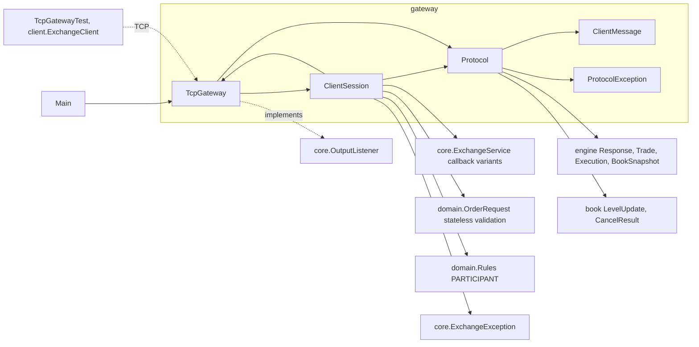
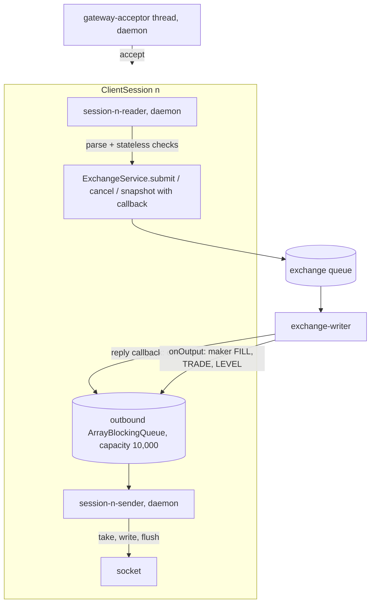
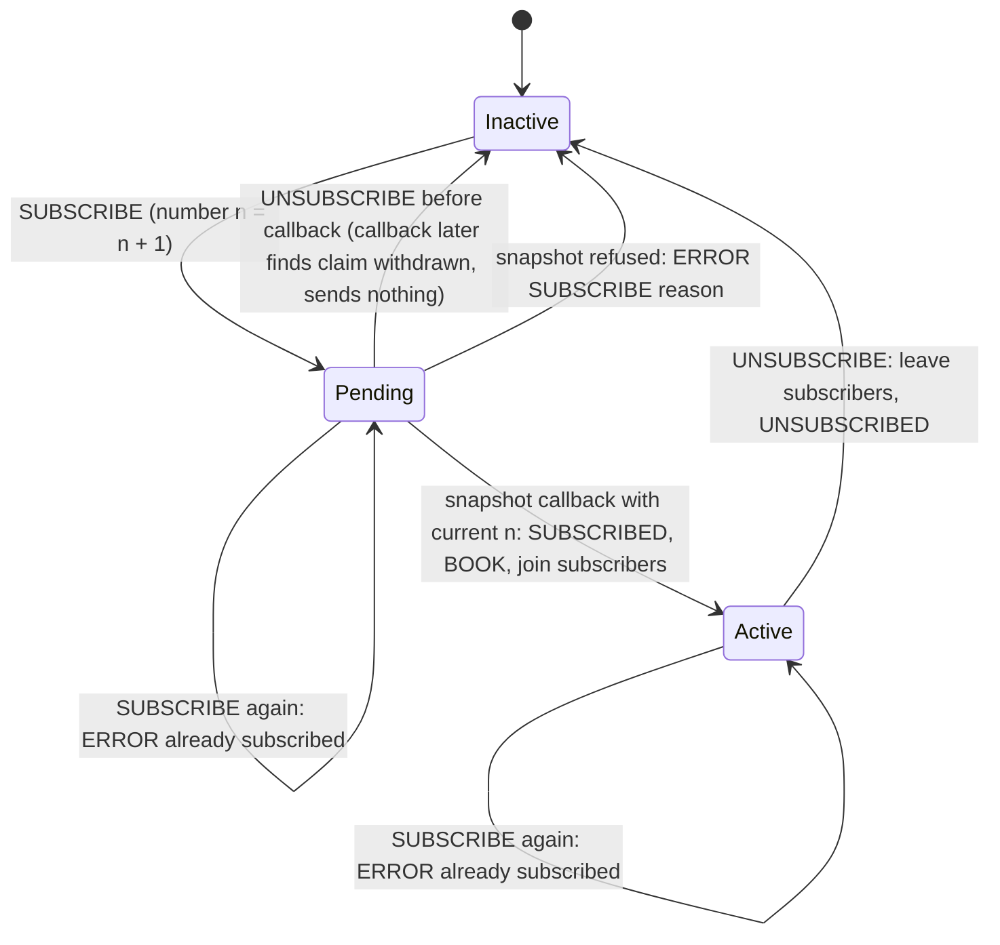
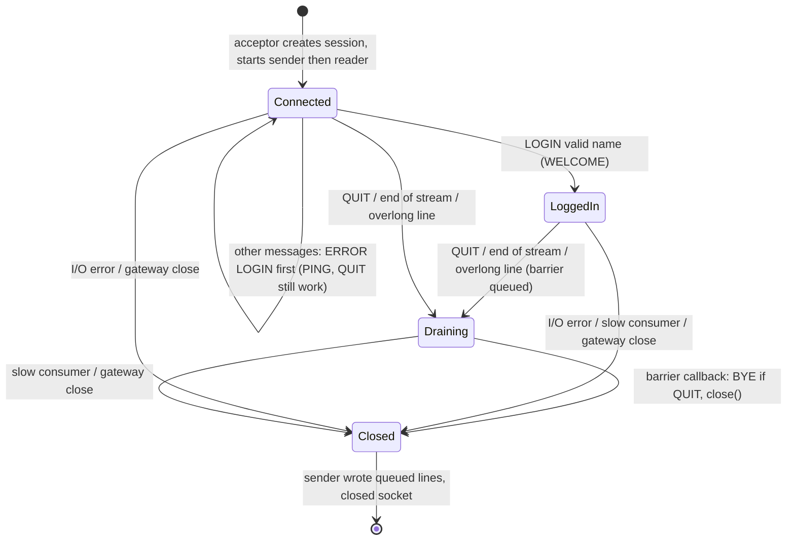

# 07 — Module: gateway (TcpGateway, ClientSession, Protocol)

> **Project:** ExchangeServer2 | Single-instrument limit order book: price-time matching engine, write-ahead journal with replay, single writer thread, plain TCP gateway | Stack: Java 17, Maven wrapper, JUnit 5 (+ JMH, PIT)
> **This guide:** `exchangeserver.gateway`: the plain-TCP line protocol (`Protocol`, `ClientMessage`, `ProtocolException`), the acceptor and routing (`TcpGateway`), and one connection's two threads, login, subscription and close-after-replies logic (`ClientSession`, D63) | **Prerequisites:** 01, 06, 07-modules/exchange-service | **Related:** 04, 05, 07-modules/client-and-main, 08, 11, 12
> **Repo layout summary:** `pom.xml` + Maven wrapper (`mvnw`, `mvnw.cmd`) at the root; production code in `src/main/java/exchangeserver/` (packages `domain`, `book`, `engine`, `command`, `journal`, `core`, `gateway`, `client`, plus `Main`); tests mirror it in `src/test/java/exchangeserver/` (plus `bench/` JMH benchmarks and `testing/MutableClock`); design docs in `docs/` (`ExchangeServer2_Vision.md` = purpose/roadmap, `ExchangeServer2_Spec.md` = decisions D1–D65); these guides in `docs/understanding/`.

---

## Overview

The gateway is the only network-facing part. It turns text lines from TCP clients into requests for `ExchangeService`, and turns results and engine outputs back into text lines. It owns **no exchange state**: it never touches the book; everything goes through `ExchangeService`'s queue (Spec D57).

| Class | Role |
|---|---|
| `Protocol` | Parse client lines into `ClientMessage`s (syntax only) and format server lines. The protocol is documented at the top of this file. |
| `ClientMessage` | Sealed interface of parsed messages: `Login`, `NewOrder`, `Cancel`, `Subscribe`, `Unsubscribe`, `Ping`, `Quit`. |
| `ProtocolException` | A malformed line; answered with `ERROR`, never reaches the exchange. |
| `TcpGateway` | Binds the server socket, runs the acceptor thread, keeps the session registries, implements `OutputListener` to route passive fills and market data. |
| `ClientSession` | One connection: a reader thread and a sender thread, a bounded outbound queue, login, subscription state, the close logic. |

**[Verified]** It is plain TCP, ASCII, one message per line, with **thread-per-connection**: two platform threads per session plus one acceptor (Spec §6). Limits: 256 sessions, 10,000 queued outbound lines per session, 256-byte lines (`src/main/java/exchangeserver/gateway/TcpGateway.java:58-60`, `src/main/java/exchangeserver/gateway/Protocol.java:44`).

**[Verified]** There is no authentication and no TLS: `LOGIN <name>` accepts any name matching `[A-Za-z0-9_]{1,16}` (Vision §6 non-goals). The server socket binds to **all interfaces** (`new InetSocketAddress(port)`, `TcpGateway.java:67`), so anyone on the network can log in as any participant. This is a known, deliberately deferred security finding (guides 08 and 11).

---

## The wire protocol

```java
// src/main/java/exchangeserver/gateway/Protocol.java:16-40 (trimmed)
/*
The wire protocol: ASCII lines ending in '\n' ("\r\n" accepted), tokens separated by single spaces (D53).

Client -> server
    LOGIN <participant>
    NEW <clOrdId> <BUY|SELL> <LIMIT|IOC|FOK|POST_ONLY> <quantity> <price>
    NEW <clOrdId> <BUY|SELL> MARKET <quantity>
    CANCEL <orderId>
    SUBSCRIBE | UNSUBSCRIBE | PING | QUIT

Server -> client (key=value after the message type, so fields can be added without breaking parsers)
    WELCOME participant=<p>
    FILL orderId= clOrdId= side= price= qty= leaves= liquidity=TAKER|MAKER     (one per trade, both sides)
    ORDER orderId= clOrdId= status= filled= remaining= [reason=]               (the outcome of a NEW)
    CANCELLED orderId= qty=          CANCEL_REJECT orderId= reason=UNKNOWN_ORDER
    BOOK seq= last= bids=<price>x<qty>,... asks=...      (best SNAPSHOT_DEPTH levels; "-" for an empty side)
    TRADE seq= price= qty= aggressor=          LEVEL seq= side= price= qty= orders=   (qty=0: level gone)
    SUBSCRIBED  UNSUBSCRIBED  PONG  BYE
    ERROR <text>

For a NEW, the submitter gets its FILL lines, then ORDER; market data for the same command follows.
QUIT: every request sent before it is answered first, then BYE, then the server closes the connection.
*/
```

A real session, captured in this survey against the running jar (`alice` and `bob` on two connections; lines prefixed `>` were sent, `<` received). **[Verified]** by running it:

```
alice > NEW x1 BUY LIMIT 1 100
alice < ERROR LOGIN first
alice > LOGIN alice
alice < WELCOME participant=alice
alice > NEW a1 SELL LIMIT 10 100
alice < ORDER orderId=1 clOrdId=a1 status=RESTED filled=0 remaining=10
alice > SUBSCRIBE
alice < SUBSCRIBED
alice < BOOK seq=1 last=0 bids=- asks=100x10
bob   > NEW b1 BUY LIMIT 4 101
bob   < FILL orderId=2 clOrdId=b1 side=BUY price=100 qty=4 leaves=0 liquidity=TAKER
bob   < ORDER orderId=2 clOrdId=b1 status=FILLED filled=4 remaining=0
alice < FILL orderId=1 clOrdId=a1 side=SELL price=100 qty=4 leaves=6 liquidity=MAKER
alice < TRADE seq=2 price=100 qty=4 aggressor=BUY
alice < LEVEL seq=2 side=SELL price=100 qty=6 orders=1
bob   > NEW b1 BUY LIMIT 4 101
bob   < ORDER orderId=2 clOrdId=b1 status=REJECTED filled=0 remaining=4 reason=DUPLICATE_CLIENT_ORDER_ID
bob   > NEW b2 BUY LIMIT 1 200
bob   < ORDER orderId=4 clOrdId=b2 status=REJECTED filled=0 remaining=1 reason=PRICE_OUTSIDE_BAND
bob   > NEW b3 BUY MARKET 1 100
bob   < ERROR NEW takes 4 field(s), got 5
bob   > CANCEL 1
bob   < CANCEL_REJECT orderId=1 reason=UNKNOWN_ORDER
alice > CANCEL 1
alice < CANCELLED orderId=1 qty=6
alice < LEVEL seq=6 side=SELL price=100 qty=0 orders=0
alice > QUIT
alice < BYE
```

Things worth noticing (all **[Verified]** in that run and in code):
- The duplicate `b1` is rejected with the **original** order id (2), but it used up order id 3, which is why `b2` gets id 4 (D49).
- `CANCEL` of someone else's order looks exactly like an unknown order (D48).
- Market-data `seq=` is the **command** sequence number, so gaps are normal: commands 3, 4 and 5 had no public effect (Spec §8).
- The maker hears its `FILL … liquidity=MAKER` because it is logged in as `alice`, even though the trade was caused by `bob`.

---

## Dependencies



---

## Threads



| Thread | Runs | May block on |
|---|---|---|
| `gateway-acceptor` | `TcpGateway.acceptLoop` | `ServerSocket.accept()` |
| `session-<id>-reader` | `ClientSession.readLoop` | socket reads |
| `session-<id>-sender` | `ClientSession.sendLoop` | `outbound.take()`, socket writes |
| `exchange-writer` | reply callbacks + `TcpGateway.onOutput` | **never**: only `offer` to bounded queues (D54) |

**[Verified]** All gateway threads are daemon threads (`TcpGateway.java:80`, `src/main/java/exchangeserver/gateway/ClientSession.java:64-65`): they never keep the JVM alive. Only the exchange writer is non-daemon.

---

## Public (package) interface

| Member | Visibility | Called by | Thread |
|---|---|---|---|
| `TcpGateway(int port)` / `(port, maxSessions, outboundCapacity)` | public | `Main`, tests | main; binds immediately |
| `TcpGateway.port()` | public | `Main` (log line), tests (port 0 = ephemeral) | any |
| `TcpGateway.start(ExchangeService)` | public, synchronized | `Main`, tests | main; starts the acceptor once |
| `TcpGateway.onOutput(EngineOutput)` | public (`OutputListener`) | `Exchange.process` | writer |
| `TcpGateway.close()` | public (`AutoCloseable`) | `Main` (startup failure, shutdown hook, halt), tests | any |
| `loggedIn`, `subscribe`, `unsubscribe`, `removed`, `service()`, `log` | package-private | `ClientSession` | reader / writer / sender |
| `participantsRegistered()`, `subscriberCount()` | package-private | tests | any |
| `ClientSession.send`, `sendAll` | package-private | writer (callbacks, `onOutput`), reader | any; never blocks |
| `ClientSession.close`, `closeNow` | package-private | reader, sender, writer, `TcpGateway.close` | any; idempotent |
| `ClientSession.readLine(InputStream)` | package-private static | reader, `ClientSessionTest` | reader |
| `Protocol.parse`, format methods, `MAX_LINE_LENGTH`, `SNAPSHOT_DEPTH` | package-private | `ClientSession`, `TcpGateway`, tests | any (stateless) |

**[Verified]** Everything except `TcpGateway`'s constructor, `port`, `start`, `onOutput` and `close` is package-private: the rest of the system sees a gateway only as an `OutputListener` with a lifecycle.

---

## `Protocol`: parse (syntax only) and format

```java
// src/main/java/exchangeserver/gateway/Protocol.java:53-100 (trimmed)
static ClientMessage parse(String line) {
    if (line.isEmpty()) {
        throw new ProtocolException("empty line");
    }
    String[] t = line.split(" ", -1);
    return switch (t[0]) {
        case "LOGIN" -> { arity(t, 2); yield new ClientMessage.Login(t[1]); }
        case "NEW" -> parseNew(t);
        case "CANCEL" -> { arity(t, 2); yield new ClientMessage.Cancel(number(t[1], "order id")); }
        case "SUBSCRIBE" -> { arity(t, 1); yield new ClientMessage.Subscribe(); }
        ...
        default -> throw new ProtocolException("unknown message " + t[0]);
    };
}

private static ClientMessage parseNew(String[] t) {
    if (t.length < 5) { throw new ProtocolException("NEW needs at least 4 fields"); }
    Side side = enumValue(Side.class, t[2], "side");
    OrderType type = enumValue(OrderType.class, t[3], "order type");
    if (type == OrderType.MARKET) {
        arity(t, 5);
        return new ClientMessage.NewOrder(t[1], side, type, number(t[4], "quantity"), OptionalLong.empty());
    }
    arity(t, 6);
    return new ClientMessage.NewOrder(t[1], side, type, number(t[4], "quantity"), OptionalLong.of(number(t[5], "price")));
}
```

- **[Verified]** `split(" ", -1)`: the `-1` limit keeps trailing empty strings. So `"PING "` becomes `["PING", ""]` and fails the arity check instead of being silently accepted; a double space produces an empty token, which also fails. Separators are exactly one space; tabs are not separators.
- **[Verified]** Keywords and enum values are case-sensitive (`Enum.valueOf`): `new`, `buy` and `Limit` are errors.
- **[Verified]** `parse` checks **syntax only**: numbers parse, enums exist, field counts match. It does not check that quantity is positive, the price is in range, or the client order id matches its pattern. That happens one layer later in `OrderRequest` (`ProtocolTest$Parse.syntaxOnlySemanticsAreCheckedLater`). The "is this order type supported" decision is stateless and lives here too (D30).
- **[Verified]** A market order with a price is an arity error (`ERROR NEW takes 4 field(s), got 5`), observed live above.

The format side builds `key=value` lines. One detail: the taker's own `FILL` lines are reconstructed from the `Response`, counting `leaves` down trade by trade from the original quantity:

```java
// src/main/java/exchangeserver/gateway/Protocol.java:130-137
// The submitter's own fills, from its Response; leaves counts down trade by trade.
static void takerFills(Response r, Side side, long quantity, List<String> out) {
    long leaves = quantity;
    for (Trade t : r.trades()) {
        leaves -= t.quantity();
        out.add(fill(r.orderId(), r.clientOrderId(), side, t.price(), t.quantity(), leaves, "TAKER"));
    }
}
```

**[Inferred]** For an IOC or MARKET order the last taker `FILL` can show `leaves > 0` even though the remainder is cancelled; the following `ORDER … status=CANCELLED` line is the authority.

**[Verified]** `Protocol.error` replaces `\n` and `\r` with spaces so an error message is always exactly one line (`Protocol.java:187-190`).

---

## `TcpGateway`: acceptor, registries and routing

### Binding and the acceptor loop

```java
// src/main/java/exchangeserver/gateway/TcpGateway.java:62-124 (trimmed)
public TcpGateway(int port, int maxSessions, int outboundCapacity) throws IOException {
    ...
    this.server = new ServerSocket();
    server.setReuseAddress(true);
    server.bind(new InetSocketAddress(port));
}

private void acceptLoop() {
    while (!server.isClosed()) {
        Socket socket;
        try {
            socket = server.accept();
        } catch (IOException e) {
            // Only a closed server socket ends the loop. Anything else (e.g. "Too many open files", also a
            // SocketException) is passing: log, back off, keep accepting.
            if (server.isClosed()) { return; }
            LOG.log(Level.WARNING, "accept failed; retrying", e);
            try { Thread.sleep(ACCEPT_BACKOFF_MILLIS); } catch (InterruptedException interrupted) { return; }
            continue;
        }
        try {
            socket.setTcpNoDelay(true);
            if (sessions.size() >= maxSessions) {
                OutputStream out = socket.getOutputStream();
                out.write((Protocol.error("too many sessions") + "\n").getBytes(US_ASCII));
                out.flush();
                closeQuietly(socket);
                continue;
            }
        } catch (IOException e) {
            closeQuietly(socket);           // a client that reset at once must not leak a descriptor
            continue;
        }
        ClientSession session = new ClientSession(sessionIds.incrementAndGet(), socket, this, outboundCapacity);
        sessions.add(session);
        session.start();
    }
}
```

- **[Verified]** The constructor binds at once, before `start` (so `Main` binds the port before replaying the journal; guide 07-modules/client-and-main). Port `0` asks the OS for a free port; tests use it and read `port()`.
- **[Verified]** Spec §9 finding 2: the acceptor used to exit on *any* `SocketException`, e.g. "too many open files", silently ending all new connections. Now only a closed server socket ends the loop; other failures are logged and retried after 100 ms (`ACCEPT_BACKOFF_MILLIS`, line 46). Spec §8 notes there is no alarm if failures persist.
- **[Verified]** Spec §9 finding 5: a socket leaked if writing "too many sessions" or `setTcpNoDelay` failed; it is now closed in the catch.
- **TCP_NODELAY** disables Nagle's algorithm (which delays small writes to batch them), so short reply lines go out immediately.
- **[Inferred]** The `sessions.size() >= maxSessions` check is not atomic with `sessions.add`, but only the acceptor thread adds, so the limit holds.

### Registries

```java
// src/main/java/exchangeserver/gateway/TcpGateway.java:52-54, 136-165 (trimmed)
private final Set<ClientSession> sessions = ConcurrentHashMap.newKeySet();
private final Set<ClientSession> subscribers = ConcurrentHashMap.newKeySet();
private final Map<String, Set<ClientSession>> sessionsByParticipant = new ConcurrentHashMap<>();

// Add and remove both run inside compute*, which is atomic per key: a remove that drops an emptied set cannot
// interleave with an add into that same set (the add would land in a set no longer in the map).
void loggedIn(ClientSession session) {
    sessionsByParticipant.compute(session.participant(), (p, mine) -> {
        Set<ClientSession> set = mine == null ? ConcurrentHashMap.newKeySet() : mine;
        set.add(session);
        return set;
    });
}

void removed(ClientSession session) {
    sessions.remove(session);
    subscribers.remove(session);
    String p = session.participant();
    if (p != null) {
        // Drop the participant's entry with its last session, so ever-new names cannot grow the map.
        sessionsByParticipant.computeIfPresent(p, (k, mine) -> {
            mine.remove(session);
            return mine.isEmpty() ? null : mine;
        });
    }
}
```

- **[General Java knowledge]** `ConcurrentHashMap.compute` and `computeIfPresent` run their function atomically for that key; returning `null` removes the entry.
- **[Verified]** Spec §9 finding 6: the map used to keep an empty set for every participant name ever used, which a client could grow forever by logging in under new names. Now the last session's removal drops the entry. Regression test: `TcpGatewayTest$Session.participantRegistryForgetsDisconnectedParticipants` (`src/test/java/exchangeserver/gateway/TcpGatewayTest.java:161`).
- **[Inferred]** Why the two halves must both be in `compute*`: if `removed` did "remove session; if set empty, remove key" as two steps, a concurrent `loggedIn` could add to the set between them, and the second step would delete the key together with the new session, so that session would never get its maker fills.

### Routing outputs (`onOutput`, on the writer thread)

```java
// src/main/java/exchangeserver/gateway/TcpGateway.java:182-207 (trimmed)
public void onOutput(EngineOutput output) {
    for (Execution e : output.passiveFills()) {
        Set<ClientSession> owners = sessionsByParticipant.get(e.participant());
        if (owners != null) {
            String line = Protocol.makerFill(e);
            for (ClientSession s : owners) { s.send(line); }
        }
    }
    if (subscribers.isEmpty() || (output.trades().isEmpty() && output.levelUpdates().isEmpty())) {
        return;
    }
    List<String> lines = ...;
    for (Trade t : output.trades()) { lines.add(Protocol.trade(output.sequenceNumber(), t)); }
    for (LevelUpdate l : output.levelUpdates()) { lines.add(Protocol.level(output.sequenceNumber(), l)); }
    for (ClientSession s : subscribers) { s.sendAll(lines); }
}
```

| Output | Goes to |
|---|---|
| Reply to a request (`FILL … TAKER`, `ORDER`, `CANCELLED`, …) | The requesting session only, via the request's callback (not via `onOutput`) |
| Passive fill (`FILL … MAKER`) | Every session logged in as the resting order's participant |
| `TRADE`, `LEVEL` | Every subscribed session |

- **[Verified]** A maker fill for a participant with no open session is **dropped**; there is no store or resend (Spec §8, "next candidate" 2 in the Vision roadmap).
- **[Verified]** Everything `onOutput` does is `offer` to bounded queues via `send`, so it cannot block the writer (D54).
- **[Verified]** `TcpGateway.close()` closes the server socket and calls `closeNow()` on every session; it does **not** stop the exchange (`TcpGateway.java:209-216`).

---

## `ClientSession`: one connection

### Construction and the never-blocking `send`

```java
// src/main/java/exchangeserver/gateway/ClientSession.java:77-110 (trimmed)
// Any thread; never blocks.
void send(String line) {
    if (closed.get()) {
        return;
    }
    if (!outbound.offer(line)) {
        gateway.log("session " + id + " is too slow; disconnecting");
        closeNow();
    }
}

// Graceful: the sender writes what is queued (e.g. BYE), then closes the socket.
void close() {
    if (!closed.compareAndSet(false, true)) {
        return;
    }
    gateway.removed(this);
    if (!outbound.offer(CLOSE)) {
        closeSocket();
    }
}

// Immediate: pending output is dropped.
void closeNow() {
    close();
    closeSocket();
    sender.interrupt();
}
```

- **[Verified]** The outbound queue is an `ArrayBlockingQueue` of 10,000 lines (`ClientSession.java:61`, capacity from `TcpGateway.java:59`). `offer` returns `false` instead of blocking when full. A full queue means the client is not reading fast enough: a **slow consumer**. It is disconnected rather than allowed to stall the writer for everybody (D54, "a classic exchange failure mode").
- **[Verified]** `close()` is idempotent thanks to `AtomicBoolean.compareAndSet` (line 96).

### The `CLOSE` sentinel

```java
// src/main/java/exchangeserver/gateway/ClientSession.java:41-42
@SuppressWarnings("StringOperationCanBeSimplified")
private static final String CLOSE = new String("<close>");     // sentinel, compared by identity
```

**[Verified]** The sender stops when it takes exactly this object: `if (line == CLOSE)` (`ClientSession.java:327`). `new String(...)` creates a distinct object, so no other string, even one with the same text, can be `==` to it. **[Inferred]** The `@SuppressWarnings` name is an IntelliJ inspection ID (javac ignores unknown names), silencing the IDE's "redundant `new String`" hint.

### The reader: lines, bounds and the three ways to stop

```java
// src/main/java/exchangeserver/gateway/ClientSession.java:155-175
// A line without its terminator, or null at end of stream. Bounded: a client cannot make us buffer more than
// MAX_LINE_LENGTH + 1 bytes (the +1 is room for the '\r' of "\r\n", which does not count toward the limit).
static String readLine(InputStream in) throws IOException {
    ByteArrayOutputStream line = new ByteArrayOutputStream(64);
    int b;
    while ((b = in.read()) != -1) {
        if (b == '\n') {
            byte[] bytes = line.toByteArray();
            int length = bytes.length > 0 && bytes[bytes.length - 1] == '\r' ? bytes.length - 1 : bytes.length;
            if (length > Protocol.MAX_LINE_LENGTH) {
                throw tooLong();
            }
            return new String(bytes, 0, length, US_ASCII);
        }
        if (line.size() > Protocol.MAX_LINE_LENGTH) {
            throw tooLong();
        }
        line.write(b);
    }
    return null;            // a partial last line is dropped: it was never terminated
}
```

- **[Verified]** A line may hold at most 256 bytes of content; the size check before each write caps the buffer at 257 bytes (256 + a possible `\r`), so an endless line is refused without buffering it (`ClientSessionTest$ReadLine.anEndlessLineIsRefusedWithoutBufferingIt`).
- **[Verified]** Spec §9 finding 10: the `\r` of `\r\n` used to count toward the limit, so a 256-byte line was accepted with `\n` but refused with `\r\n`. The limit now applies to the content (`ClientSessionTest$ReadLine.aLineOfExactlyTheLimitIsAcceptedWithEitherEnding`).
- **[Verified]** A partial last line at end of stream is dropped (line 174): a request without its terminator was never really sent.

```java
// src/main/java/exchangeserver/gateway/ClientSession.java:114-153
private void readLoop() {
    // Not try-with-resources: closing a socket's input stream closes the whole socket, and the sender must
    // still flush what is queued (replies, BYE, a final ERROR). The sender closes the socket.
    boolean answerFirst = false;
    String farewell = null;
    try {
        InputStream in = new BufferedInputStream(socket.getInputStream());
        String line;
        while ((line = readLine(in)) != null) {
            if (!handle(line)) {
                farewell = "BYE";
                break;
            }
        }
        answerFirst = true;                     // QUIT or end of stream
    } catch (ProtocolException e) {
        send(Protocol.error(e.getMessage()));
        answerFirst = true;
    } catch (IOException e) {
        // connection gone: nobody left to answer
    } finally {
        if (answerFirst) {
            closeAfterReplies(farewell);
        } else {
            close();
        }
    }
}

// Closes once every request this session handed in has been answered (D63). The exchange processes its queue
// in order, so a read queued now completes after all of them, and their reply callbacks have already offered
// their lines. A refused read (exchange stopping) completes at once: shutdown drops connections anyway.
private void closeAfterReplies(String farewell) {
    gateway.service().snapshot(1, (snapshot, failure) -> {
        if (farewell != null) {
            send(farewell);
        }
        close();
    });
}
```

| How the reader stops | What the client gets | Close |
|---|---|---|
| `QUIT` (`handle` returns `false`) | all replies still owed, then `BYE` | after replies (D63) |
| End of stream (client closed or half-closed its side) | all replies still owed | after replies (D63) |
| Overlong line (`ProtocolException` from `readLine`) | `ERROR line longer than 256 bytes; disconnecting`, replies still owed | after replies (D63) |
| `IOException` (connection reset) | nothing (nobody to answer) | at once |
| `TcpGateway.close()` or slow consumer | nothing more | `closeNow()`: at once, output dropped |

### D63: close only after the replies are out

**Barrier**: a marker that cannot complete until everything queued before it has completed. Here the barrier is a cheap `snapshot(1)` read.

**[Verified]** Before this session's fix, `QUIT` sent `BYE` and closed at once. A client that sent `NEW` then `QUIT` usually lost the `ORDER` reply for an order that had executed and could be resting on the book. The regression test lost 199 of 200 replies against the old code (Spec D63 and §10 finding 2).

Why the barrier works, step by step (**[Verified]** from code and Spec D63; the ordering argument is **[Inferred]** from the FIFO queue and the processing loop):

1. Every request this session handed in is already on the exchange queue (handed in by this same reader thread, earlier).
2. `closeAfterReplies` hands in one more request, a `Snapshot(1)`, with a callback. The queue is FIFO and processed in order, so the writer processes the snapshot **after** all of them.
3. Each earlier request's reply callback ran on the writer when its future completed and offered its lines to `outbound`.
4. The snapshot's callback then offers `BYE` (for `QUIT`) and calls `close()`, which offers the `CLOSE` sentinel.
5. The sender writes everything in queue order (replies, `BYE`), meets `CLOSE`, flushes and closes the socket.

```mermaid
sequenceDiagram
    participant C as Client
    participant R as session reader
    participant Q as exchange queue
    participant W as exchange-writer
    participant O as outbound queue
    participant S as session sender
    C->>R: NEW d1 ... / NEW d2 ... / QUIT (one write)
    R->>Q: Submit d1 (callback)
    R->>Q: Submit d2 (callback)
    R->>R: handle(QUIT) returns false, farewell = BYE
    R->>Q: Snapshot(1) barrier (callback)
    Note over R: reader thread ends; session still open
    W->>W: batch: stamp d1, d2; one fsync
    W->>O: callback d1: ORDER orderId=6 ...
    W->>O: callback d2: ORDER orderId=7 ...
    W->>O: barrier callback: BYE, then close() offers CLOSE
    S->>C: ORDER ..., ORDER ..., BYE
    S->>S: takes CLOSE: flush, close socket
```

**[Verified]** Observed live after the fix:

```
< WELCOME participant=dave
< ORDER orderId=6 clOrdId=d1 status=RESTED filled=0 remaining=1
< ORDER orderId=7 clOrdId=d2 status=RESTED filled=0 remaining=1
< BYE
```

Edge cases:
- **[Verified]** If the exchange is stopping, the barrier is refused at once and its callback runs immediately on the reader thread: the session closes without waiting ("shutdown drops connections anyway", `ClientSession.java:145`). Requests accepted before `STOP` are still processed, but their replies go to a closed session and are dropped.
- **[Inferred]** Between the reader stopping and the barrier completing, the session stays registered: it can still receive maker fills and market data, which may appear between the replies and `BYE`.
- **[Inferred]** Cost: one snapshot of depth 1 through the writer per disconnect, not journalled. Spec D63 chose this over adding a dedicated "barrier" request type to `core`.
- **[Verified]** Resting orders stay on the book after a disconnect; there is no cancel-on-disconnect (Spec §6).

### `handle`: dispatch and the validation layers

```java
// src/main/java/exchangeserver/gateway/ClientSession.java:182-223 (trimmed)
private boolean handle(String line) {
    ClientMessage message;
    try {
        message = Protocol.parse(line);
    } catch (ProtocolException e) {
        send(Protocol.error(e.getMessage()));
        return true;                                // a malformed line does not end the session
    }
    if (message instanceof ClientMessage.Login login) { login(login.participant()); return true; }
    if (message instanceof ClientMessage.Ping) { send("PONG"); return true; }
    if (message instanceof ClientMessage.Quit) {
        return false;                           // BYE follows the replies still owed (readLoop)
    }
    String p = participant;
    if (p == null) { send(Protocol.error("LOGIN first")); return true; }

    if (message instanceof ClientMessage.NewOrder n) {
        newOrder(p, n);
    } else if (message instanceof ClientMessage.Cancel c) {
        if (c.orderId() <= 0) {
            send(Protocol.error("order id must be positive"));
        } else {
            gateway.service().cancel(p, c.orderId(), (result, failure) ->
                    send(failure == null ? Protocol.cancel(result) : failureLine("orderId=" + c.orderId(), failure)));
        }
    } else if (message instanceof ClientMessage.Subscribe) {
        subscribe();
    } else if (message instanceof ClientMessage.Unsubscribe) {
        unsubscribe();
    }
    return true;
}
```

**[Verified]** Layers of validation, each one cheaper and earlier than the next (Spec D47, D19/D30):

1. `readLine`: length (disconnects).
2. `Protocol.parse`: syntax (answers `ERROR`, session survives).
3. Session state: `LOGIN first`, positive cancel id.
4. `OrderRequest.of(...)` in `newOrder`: every stateless field rule, the **only** field-validation layer (`ClientSession.java:245-264`; an `IllegalArgumentException` becomes `ERROR clOrdId=<id> <message>`).
5. Only then is the request queued. Stateless rejects therefore never reach the journal (`TcpGatewayTest$Trading.statelessRejectsNeverReachTheJournal`). State-dependent rejects (duplicate id, price band, open-order cap, post-only cross) are decided by the engine and journalled.

**[Verified]** `failureLine` turns an `ExchangeException` into its reason name, otherwise the exception's simple class name: e.g. `ERROR clOrdId=x BUSY` or `ERROR orderId=5 HALTED` (`ClientSession.java:316-319`).

### Login: add-then-check against set-then-remove

```java
// src/main/java/exchangeserver/gateway/ClientSession.java:225-243 (trimmed)
private void login(String requested) {
    if (participant != null) { send(Protocol.error("already logged in as " + participant)); return; }
    if (!Rules.PARTICIPANT.matcher(requested).matches()) { send(Protocol.error("invalid participant " + requested)); return; }
    participant = requested;
    gateway.loggedIn(this);
    // close() sets `closed` and then unregisters. If it ran before loggedIn(), its unregistering missed us:
    // undo it here. (Add-then-check against set-then-remove: at least one side sees the other.)
    if (closed.get()) {
        gateway.removed(this);
        return;
    }
    send(Protocol.welcome(requested));
}
```

**[Verified]** Spec §9 finding 4: a session closed during LOGIN (or SUBSCRIBE) could be re-registered after `removed()` had run, and leak. **[Inferred]** Why "at least one side sees the other": login does (A) register, then (B) read `closed`; close does (C) set `closed`, then (D) unregister. If B reads `false`, then C has not happened yet, so D comes after A and removes the registration. If B reads `true`, login undoes its own registration. Either way nothing leaks. This relies on the concurrent map and `AtomicBoolean` operations being sequentially consistent.

**[Verified]** `participant` is `volatile` (line 55): written by the reader at LOGIN, read by the writer when routing fills.

### Subscriptions: one lock, numbered claims

```java
// src/main/java/exchangeserver/gateway/ClientSession.java:276-314 (trimmed)
private void subscribe() {
    long mine;
    synchronized (subscriptionLock) {
        if (subscriptionActive) { send(Protocol.error("already subscribed")); return; }
        subscriptionActive = true;
        mine = ++subscriptionNumber;
    }
    // The snapshot is taken on the writer thread and the session joins the subscribers in the same step,
    // so the first update it gets is the first command after the snapshot: no gap, no duplicate.
    gateway.service().snapshot(Protocol.SNAPSHOT_DEPTH, (snapshot, failure) -> {
        synchronized (subscriptionLock) {
            if (mine != subscriptionNumber || !subscriptionActive) {
                return;                         // withdrawn by an UNSUBSCRIBE that got here first
            }
            if (failure != null) { subscriptionActive = false; send(failureLine("SUBSCRIBE", failure)); return; }
            send("SUBSCRIBED");
            send(Protocol.book(snapshot));
            gateway.subscribe(this);
        }
        if (closed.get()) {
            gateway.unsubscribe(this);          // closed meanwhile: removed() may already have run
        }
    });
}

private void unsubscribe() {
    synchronized (subscriptionLock) {
        subscriptionActive = false;
        gateway.unsubscribe(this);
        send("UNSUBSCRIBED");
    }
}
```



- **[Verified]** No gap and no duplicate between snapshot and updates (D57): the snapshot callback runs on the writer thread, inside `Exchange.process` for the snapshot request, and joins `subscribers` in that same step. Every later command's `onOutput` runs after it, and snapshots never trigger `onOutput`.
- **[Verified]** Spec §9 finding 3: an `UNSUBSCRIBE` overtaking the snapshot used to leave the client's last word `SUBSCRIBED` while it was actually unsubscribed, and `SUBSCRIBE`/`UNSUBSCRIBE`/`SUBSCRIBE` could send two `BOOK`s. The lock plus the claim number make "the client's last word matches its real state". Regression test: `TcpGatewayTest$MarketData.rapidSubscribeUnsubscribeEndsConsistent` (`TcpGatewayTest.java:342`).
- **[Verified]** The lock is held only while offering lines (non-blocking), so the writer is not delayed (`ClientSession.java:266-275`).
- **[Verified]** D62: the snapshot is limited to `SNAPSHOT_DEPTH` = 100 levels per side, so a SUBSCRIBE costs the writer bounded work. `LEVEL` updates carry absolute quantities, so a deeper level appears in a subscriber's view when it first changes. Test `snapshotIsBoundedToTheSnapshotDepth` (`TcpGatewayTest.java:375`).

### The sender

```java
// src/main/java/exchangeserver/gateway/ClientSession.java:323-343 (trimmed)
private void sendLoop() {
    try (Writer out = new BufferedWriter(new OutputStreamWriter(socket.getOutputStream(), US_ASCII))) {
        while (true) {
            String line = outbound.take();
            if (line == CLOSE) { break; }
            out.write(line);
            out.write('\n');
            if (outbound.isEmpty()) {
                out.flush();        // flush once per burst, not per line
            }
        }
        out.flush();
    } catch (IOException | InterruptedException e) {
        // connection gone or forced close
    } finally {
        closeSocket();
        close();
    }
}
```

**[Verified]** It flushes only when the queue is momentarily empty: a burst of lines (e.g. many `FILL`s) goes out in few TCP writes. `closeNow()` interrupts it (`take` throws `InterruptedException`) and closes the socket (a blocked write throws `IOException`).

### Session lifecycle



---

## How it is tested

| Test class | Groups / tests | Kind |
|---|---|---|
| `ProtocolTest` (`src/test/java/exchangeserver/gateway/ProtocolTest.java`) | `Parse` (login, priced and market orders, other messages, malformed lines parameterised, syntax-only semantics); `Format` (taker fills count leaves down, maker fill, order, cancel, book, market data, error is one line) | unit, no sockets |
| `ClientSessionTest` | `ReadLine` (LF and CRLF, exact limit, one byte over, endless line, unterminated last line) | unit on `readLine` |
| `TcpGatewayTest` (`src/test/java/exchangeserver/gateway/TcpGatewayTest.java`) | `Session` (login rules, QUIT, **D63** `quitAnswersEveryEarlierRequestBeforeBye` `:106` and `endOfStreamStillGetsTheReplies` `:123`, malformed line survives, overlong line disconnects, registry cleanup, CRLF); `Trading` (rest then cross fills both sides, taker hears fills before ORDER, every maker session hears its fill, cancel ownership, duplicates, stateless rejects never journalled, refused after stop); `MarketData` (snapshot then updates, double subscribe, rapid subscribe/unsubscribe, bounded snapshot, non-subscribers get nothing); `restartKeepsTheBookForTheNextGateway` | end to end: real sockets, real writer, real journal in a `@TempDir` |

- **[Verified]** The D63 tests were checked against the old code restored from git: both fail there (`expected 200 but was 1`, `expected 50 but was 0`) and pass now (Spec §10).
- **[Verified]** PIT does **not** mutate the gateway: `pom.xml:143-150` lists `domain`, `book`, `engine`, `command`, `journal`, `core` only. The gateway is covered by end-to-end tests (Spec §7).
- **[Verified]** Tests use `client.ExchangeClient` (guide 07-modules/client-and-main) whose `await` keeps unmatched lines, because replies, fills and market data interleave on one connection.

---

## Key takeaways

- The gateway holds no exchange state; it only parses, validates statelessly, hands requests to `ExchangeService`, and formats lines.
- Two daemon threads per connection plus one acceptor: thread-per-connection, simple and bounded to 256 sessions.
- The writer never blocks on a client: every send is an `offer` to a bounded queue; a full queue disconnects the slow consumer (D54).
- Replies travel via request callbacks (on the writer, before the listener); maker fills go to every session of the owner; `TRADE`/`LEVEL` go to subscribers.
- SUBSCRIBE takes its snapshot and joins the subscribers in one writer step, so there is no gap or duplicate (D57), limited to 100 levels per side (D62).
- QUIT, end of stream and an overlong line close the session only after its earlier requests are answered, using a `snapshot(1)` barrier through the FIFO queue (D63).
- Registry and subscription races are closed with atomic `compute*` operations, an add-then-check login, and numbered subscription claims under one lock.
- No authentication, no TLS, bound to all interfaces: anyone who can reach the port can act as any participant (deferred finding).

## Common confusions

- **"The reply goes through `onOutput`."** No. The requester's reply goes through its request's callback; `onOutput` carries only maker fills and public market data.
- **"`seq=` in TRADE/LEVEL counts market-data messages."** It is the command's sequence number; gaps are normal.
- **"An `ERROR` line means the order was journalled and rejected."** `ERROR` means it never reached the exchange (syntax or stateless rule) or was refused (`BUSY`, `STOPPED`, `HALTED`, or `INTERNAL_ERROR` for a quarantined command). A business reject is `ORDER … status=REJECTED reason=…`.
- **"QUIT cancels my resting orders."** It does not; orders stay on the book.
- **"`BYE` arrives immediately after `QUIT`."** Since D63 it arrives after the replies to everything sent before `QUIT`.
- **"A malformed line disconnects."** Only an overlong line does; other malformed lines get `ERROR` and the session continues.
- **"Two sessions of the same participant split the fills."** Each maker fill is sent to *every* session of that participant.

## Questions to test yourself

1. A client sends `NEW c1 BUY LIMIT 5 100 ` (trailing space). What does it get, and which line of code decides?
<details><summary>Answer</summary>`ERROR NEW takes 5 field(s), got 6`. `split(" ", -1)` keeps the trailing empty token, so the priced-order arity check `arity(t, 6)` fails (`Protocol.java:57`, `parseNew`).</details>

2. Why can't the writer thread be stalled by a client that never reads its socket?
<details><summary>Answer</summary>The writer only calls `send`, which `offer`s to a bounded `ArrayBlockingQueue`. When the queue is full, `offer` returns false and the session is closed with `closeNow()`; the writer never waits on the socket (`ClientSession.java:78-86`, D54).</details>

3. Explain why a SUBSCRIBE never misses or duplicates an update between the BOOK snapshot and the first LEVEL line.
<details><summary>Answer</summary>The snapshot is a request processed on the writer thread; its callback (also on the writer) sends SUBSCRIBED and BOOK and adds the session to `subscribers` in that same step. Every command before it is already in the snapshot; every command after it calls `onOutput` later and finds the session subscribed (D57).</details>

4. What would a client see if it sent 200 `NEW` lines then `QUIT` against the code before D63, and why?
<details><summary>Answer</summary>Typically one or a few `ORDER` lines and `BYE`, then the connection closes. The reader handled `QUIT` long before the writer had processed the orders, sent `BYE` and closed; later reply callbacks found the session closed and their lines were dropped. The regression test saw 1 of 200 (Spec §10).</details>

5. Why are both `loggedIn` and `removed` written with `ConcurrentHashMap.compute*`?
<details><summary>Answer</summary>So "add to a participant's set" and "remove from the set and drop it if empty" are each atomic per key. Otherwise a login could add a session to a set that a concurrent removal then drops from the map, and that session would stop receiving maker fills (Spec §9 finding 6).</details>

6. The exchange is stopping and a client sends `QUIT`. Does it still get `BYE`?
<details><summary>Answer</summary>Yes. The barrier `snapshot(1)` is refused immediately, its callback runs on the reader thread, sends `BYE` and closes. Replies for requests accepted before the stop may be lost, because the session is already closed when they arrive (`ClientSession.java:143-152`).</details>
