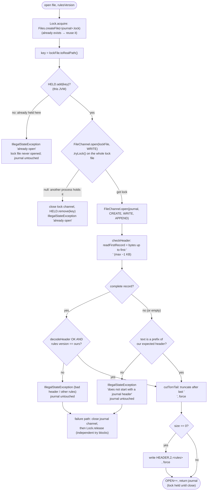
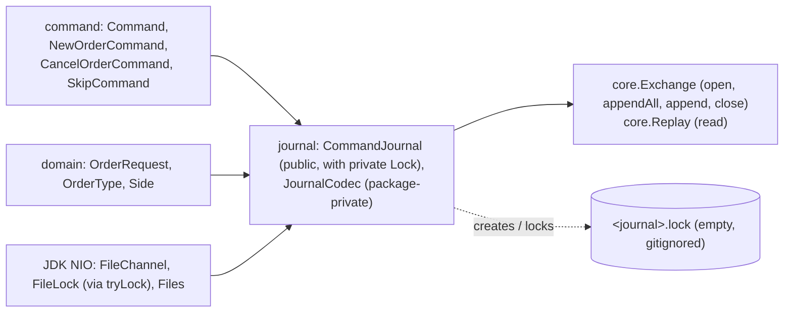

# 07 — Module: journal

> **Project:** ExchangeServer2 | Single-instrument limit order book: price-time matching engine, write-ahead journal with replay, single writer thread, plain TCP gateway | Stack: Java 17, Maven wrapper, JUnit 5 (+ JMH, PIT)
> **This guide:** the write-ahead journal: the text format (`JournalCodec`) and the file handling (`CommandJournal`): durable batch append, streaming read, torn-tail recovery, the header/version check, the exclusive lock file and fail-stop | **Prerequisites:** 01, 02, 07-modules/domain-and-commands | **Related:** 05, 06, 07-modules/exchange-and-replay, 08, 09, 11
> **Repo layout summary:** `pom.xml` + Maven wrapper (`mvnw`, `mvnw.cmd`) at the root; production code in `src/main/java/exchangeserver/` (packages `domain`, `book`, `engine`, `command`, `journal`, `core`, `gateway`, `client`, plus `Main`); tests mirror it in `src/test/java/exchangeserver/` (plus `bench/` JMH benchmarks and `testing/MutableClock`); design docs in `docs/` (`ExchangeServer2_Vision.md` = purpose/roadmap, `ExchangeServer2_Spec.md` = decisions D1–D65); these guides in `docs/understanding/`.

## Overview

The **journal** is a **write-ahead log** (WAL): a file where every input command is written, and forced to disk,
*before* the exchange acts on it. **[Verified]** Spec D12, D40, Vision §4 principle 5.

The sequenced input commands are the **source of truth**. The book is not saved anywhere: on restart it is
rebuilt by replaying the journal through the engine (guide 07-modules/exchange-and-replay).

Two classes:
- **`JournalCodec`** (package-private) is the text format: one comma-separated record per line, each ending in
  `\n`. Turning commands into text is *encoding*; turning text back into commands is *decoding*.
- **`CommandJournal`** (public) is the file.
  - It takes an exclusive lock, verifies the file, and cuts a half-written last record left by a crash.
  - It appends a batch with one write and one **fsync**. An fsync is a call that returns only once the OS has
    pushed the data to the physical disk. Java's version is `FileChannel.force`.
  - It streams the file back for replay.
  - After any write failure it refuses all further writes (**fail-stop**).

The lock lives in a second, always-empty file next to the journal, `<journal>.lock` (for example
`exchange.journal.lock`). It stays on disk after the exchange stops, and `.gitignore` ignores `*.journal.lock`.
**[Verified]** `src/main/java/exchangeserver/journal/CommandJournal.java:200-210`, `.gitignore`.

Example journal, captured from a real run during the survey **[Verified]**:

```
HEADER,2,1
NEW,1,2026-10-27T12:38:33.890909300Z,1,alice,a1,SELL,LIMIT,10,100
NEW,2,2026-10-27T12:38:34.862205500Z,2,bob,b1,BUY,LIMIT,4,101
NEW,3,2026-10-27T12:38:35.732225200Z,3,bob,b1,BUY,LIMIT,4,101
NEW,4,2026-10-27T12:38:36.154630600Z,4,bob,b2,BUY,LIMIT,1,200
CANCEL,5,2026-10-27T12:38:36.991832100Z,bob,1
CANCEL,6,2026-10-27T12:38:37.410921700Z,alice,1
```

Record 3 was rejected as a duplicate client order id and record 4 for the price band; record 5 was an unknown
cancel. They are all journalled anyway, because they are *state-dependent* outcomes that replay must reproduce
(Spec D13). Stateless rejects, such as a malformed line, never reach the journal.

## Responsibility

| Concern | Where | Decision |
|---|---|---|
| Format, with version numbers in the header | `JournalCodec` | D36 (plain text), D46 (header with the rules version) |
| Durability per batch | `CommandJournal.appendAll` | D37 revised by D52 (fsync per batch) |
| Torn-tail recovery | `CommandJournal.open` → `cutTornTail` | D38 |
| Refuse other rules / non-journals, untouched | `CommandJournal.open` → `checkHeader` | D46, **D64** |
| One process (and one open) at a time | `CommandJournal.open` → `Lock.acquire`; `close` → `Lock.release` | **D65** |
| Fail-stop | `CommandJournal.appendAll` (`failed` flag) | D39 |
| Streaming replay input | `CommandJournal.read` | D60 |

All **[Verified]** against the Spec decisions table and the class comment (`CommandJournal.java:27-45`).

## Public interface and who calls it

| Member | Visibility | Called by |
|---|---|---|
| `CommandJournal.open(path, rulesVersion)` | public static | `Exchange.open` (`src/main/java/exchangeserver/core/Exchange.java:76`), the `Exchange.quarantine` operator tool (`Exchange.java:97`) |
| `appendAll(List<Command>)` | public | `Exchange.process`: one call per batch (`Exchange.java:137`) |
| `append(Command)` | public | `Exchange` quarantine paths: the SKIP record (`Exchange.java:112`, `:180`) |
| `read(Consumer<Command>)` | public | `Replay.run` (verify pass) and `Replay.feed` (feed pass) (`src/main/java/exchangeserver/core/Replay.java:39`, `:50`); the quarantine tool (`Exchange.java:101`) |
| `close()` | public, idempotent | `Exchange.close` (`Exchange.java:243`), `Exchange.open` on failure (`Exchange.java:86`) |
| `getTruncatedBytesOnOpen()` | public | `Exchange.truncatedBytesOnOpen()` (`Exchange.java:229`); only tests read either |
| `openJournals()` | public static | tests (proves a handle was released) |
| `hasFailed()`, `getFile()` | public | `hasFailed`: tests; `getFile`: no caller **[Verified]** by grep |
| `Lock` (`acquire`, `release`) | private nested record | `open` and `close` only |
| `JournalCodec.*` | package-private | `CommandJournal` only; `JournalCodecTest` |

## The format: `JournalCodec`

```java
// src/main/java/exchangeserver/journal/JournalCodec.java:16-41 (trimmed)
/*
The journal's text format (D36), one record per line, ','-separated, every record ending in '\n':

    HEADER,<formatVersion>,<rulesVersion>                                                   (first record only)
    NEW,<seq>,<timestamp>,<orderId>,<participant>,<clientOrderId>,<side>,<type>,<quantity>,<price>
    CANCEL,<seq>,<timestamp>,<participant>,<targetOrderId>
    SKIP,<seq>,<timestamp>,<skippedSeq>

A MARKET order's price field is "-" (D26). Enums by name(); timestamps by Instant.toString() (ISO-8601, exact
to the nanosecond). Participant and client order id cannot contain ',' (Rules).
 */
final class JournalCodec {
    static final int FORMAT_VERSION = 2;
    static final String NO_PRICE = "-";
    static final char SEPARATOR = ',';
    static final char END_OF_RECORD = '\n';
    ...
}
```

**Two versions live in the header** **[Verified]**:
- `FORMAT_VERSION` (2) describes the *layout of the text*.
- The **rules version** (`domain.Rules.VERSION`, currently 1) describes the *business rules* the records were
  written under.

A mismatch in either refuses startup.

### Encoding

```java
// src/main/java/exchangeserver/journal/JournalCodec.java:68-98 (trimmed)
static String encode(Command command) {
    Objects.requireNonNull(command, "command");
    StringBuilder sb = new StringBuilder(96);
    if (command instanceof NewOrderCommand n) {
        OrderRequest r = n.request();
        sb.append(NEW)
                .append(SEPARATOR).append(n.sequenceNumber())
                .append(SEPARATOR).append(n.timestamp())
                ...
                .append(SEPARATOR).append(r.getPrice().isPresent() ? Long.toString(r.getPrice().getAsLong()) : NO_PRICE);
    } else if (command instanceof CancelOrderCommand c) {
        ...
    } else if (command instanceof SkipCommand s) {
        ...
    } else {
        throw new IllegalStateException("Unknown command type " + command.getClass());
    }
    return sb.append(END_OF_RECORD).toString();
}
```

- It uses an `instanceof` pattern chain rather than a pattern `switch`. **[Inferred]** Pattern matching in
  `switch` was only a preview feature in Java 17, so the chain is the idiomatic choice here.
- `-` stands for "no price". The in-memory sentinel −1 never reaches the file: the codec writes from
  `OrderRequest.getPrice()`, an `OptionalLong`. **[Verified]**
- `Instant.toString()` is exact to the nanosecond (`2026-01-01T10:00:00.123456789Z`) and contains no commas.
  **[Verified]** `JournalCodecTest.RoundTrip`.

### Decoding

```java
// src/main/java/exchangeserver/journal/JournalCodec.java:100-126
// record: one record without its '\n'. recordNumber: 1-based, header included, for the error message.
static Command decode(String record, long recordNumber) {
    String[] f = record.split(String.valueOf(SEPARATOR), -1);     // -1 keeps trailing empty fields
    try {
        return switch (f[0]) {
            case NEW -> {
                requireFieldCount(f, 10);
                OrderType type = OrderType.valueOf(f[7]);
                OptionalLong price = f[9].equals(NO_PRICE) ? OptionalLong.empty() : OptionalLong.of(Long.parseLong(f[9]));
                OrderRequest request = OrderRequest.of(f[4], f[5], Side.valueOf(f[6]), type, Long.parseLong(f[8]), price);
                yield new NewOrderCommand(Long.parseLong(f[1]), Instant.parse(f[2]), Long.parseLong(f[3]), request);
            }
            case CANCEL -> { requireFieldCount(f, 5); yield new CancelOrderCommand(...); }
            case SKIP -> { requireFieldCount(f, 4); yield new SkipCommand(...); }
            default -> throw new IllegalArgumentException("unknown record type " + f[0]);
        };
    } catch (IllegalArgumentException | DateTimeParseException | NullPointerException e) {
        // Includes NumberFormatException, enum valueOf and the request's own validation.
        throw new IllegalStateException("Corrupt journal record " + recordNumber + ": \"" + record + "\"", e);
    }
}
```

Line by line:

- **`split(",", -1)`.** Java's `split` drops trailing empty strings by default; `-1` keeps them. The field count
  is then exact, so `"…,100,"` has 11 fields and is refused rather than read as 10. **[Verified]** by the comment
  and the Java API.
- **Re-validation through `OrderRequest.of`.** Every stateless rule the gateway applied is applied again on read.
  A record such as `LIMIT,10,-1` (the in-memory sentinel) or `MARKET,10,100` is corrupt. **[Verified]**
  `JournalCodecTest.Corrupt` lists 19 such records.
- **Error translation.** Every parse failure becomes `IllegalStateException("Corrupt journal record N …")`. Per
  Spec D27, `IllegalStateException` means "our bug or corrupt data", never bad user input.
  - `N` is 1-based and counts the header as record 1. **[Inferred]** So it equals the line number an editor
    shows. **[Verified]** `CommandJournalTest.completeCorruptRecordIsNeverDropped` expects "record 3" for the
    third line.
- **`NullPointerException` in the catch.** **[Inferred]** It is defensive; nothing in `split`'s output can be
  `null`. See `15-open-questions.md`.

`decodeHeader` (`JournalCodec.java:51-66`) checks that the first field is `HEADER`, that there are exactly 3
fields, and that the format is 2, then returns the rules version. Anything else becomes "Bad journal header".
**[Verified]**

**Line endings.** The format is LF-only (`CommandJournalTest.recordsUseLfOnly`). If a tool converts the file to
CRLF, every record ends in `\r` and the last field no longer parses. **[Verified live]**: during the survey a
journal rewritten with CRLF failed startup with `Bad journal header "HEADER,2,9\r": For input string: "9\r"`.
Spec §8 lists this as a known limitation.

## The file: `CommandJournal`

### `open`: lock, then check, then change (D64, D65)

```java
// src/main/java/exchangeserver/journal/CommandJournal.java:71-103
// Opens the journal, creating it with a header if it is missing or empty. Lock, then check, then change:
// nothing is written to a file this journal does not own (D64, D65).
public static CommandJournal open(Path file, int rulesVersion) throws IOException {
    Objects.requireNonNull(file, "file");
    Lock lock = Lock.acquire(file);
    FileChannel channel = null;
    long truncated;
    try {
        channel = FileChannel.open(file, CREATE, WRITE, APPEND);            // APPEND: never overwrite history
        checkHeader(file, rulesVersion);
        truncated = cutTornTail(file);
        if (channel.size() == 0) {
            channel.write(ByteBuffer.wrap(JournalCodec.encodeHeader(rulesVersion).getBytes(UTF_8)));
            channel.force(true);
        }
    } catch (IOException | RuntimeException e) {
        try {
            if (channel != null) {
                channel.close();
            }
        } catch (IOException closeFailure) {
            e.addSuppressed(closeFailure);
        }
        try {
            lock.release();
        } catch (IOException releaseFailure) {
            e.addSuppressed(releaseFailure);
        }
        throw e;
    }
    OPEN.incrementAndGet();
    return new CommandJournal(file, channel, lock, truncated);
}
```



The order of these steps is the fix for two bugs found during the study-guide survey (Spec §10). **[Verified]**

- **D64: check before cut.**
  - *Before*, `open` cut the torn tail first. Pointing `--journal` at, say, a notes file with no final newline
    would cut its last line *and then* refuse it.
  - A one-line file with no newline was emptied and turned into a journal.
  - A journal written under other rules was also cut before being refused.
  - *Now* the header is checked first (`checkHeader`, `CommandJournal.java:256-269`), and a refused file is never
    modified.
  - `checkHeader` allows exactly one kind of incomplete first record: a **prefix** of the header this build would
    write, which is the trace of a crash while the journal was being created (`tornHeaderIsCutAndRewritten`
    writes `HEAD`). The empty file is the trivial prefix.

  Checked live **[Verified]**: a two-line non-journal file stays byte-for-byte unchanged after a refused start.
- **D65: lock first.** `Lock.acquire` runs **before** the journal channel is even opened
  (`CommandJournal.java:75`).
  - *Before D65*, `java -jar … --quarantine <seq>` could append a SKIP record to a journal that a running exchange
    was also writing. The two processes would interleave sequence numbers, and the next startup would fail on a gap
    or repeat.
  - *Now* the second opener is refused with "already open (a running exchange, or a --quarantine run)".

  **[Verified]**
- **Failure path.** If anything after `Lock.acquire` throws, `open` closes the journal channel (if it was opened)
  and releases the lock, in **two independent `try` blocks** (`CommandJournal.java:86-99`).
  - A failure to close the channel therefore cannot skip the release, and either failure is attached to the
    original exception with `addSuppressed`.
  - `OPEN` is incremented only on success. **[Verified]**
  - Covered by `otherRulesVersionIsRefusedAndTheFileIsReleased` and by `aSecondOpenIsRefusedUntilTheFirstCloses`,
    whose reopen after `close` only works if the lock was released.

### The lock, line by line (D65)

```java
// src/main/java/exchangeserver/journal/CommandJournal.java:198-252
// ---------- Exclusive access (D65) ----------

/*
The lock is on a separate "<journal>.lock" file that nothing else ever opens. On Linux and macOS Java's file
locks are POSIX locks, and closing ANY handle a process holds on a file drops all of that process's locks on
it; read(), the header check and the torn-tail cut open and close handles on the journal itself, so a lock on
the journal would vanish. For the same reason a second open in this JVM is refused by HELD before it opens the
lock file at all. The lock file stays after close (deleting it would race with the next opener); it is empty.
*/
private record Lock(Path key, FileChannel channel) {

    static Lock acquire(Path journal) throws IOException {
        Path lockFile = journal.resolveSibling(journal.getFileName() + ".lock");
        try {
            Files.createFile(lockFile);     // create-new: never opens, so never closes, an existing lock file
        } catch (FileAlreadyExistsException normalAfterTheFirstRun) {
            // reuse it
        }
        Path key = lockFile.toRealPath();   // one key however the journal path is spelled
        if (!HELD.add(key)) {
            throw alreadyOpen(journal);
        }
        FileChannel channel = null;
        try {
            channel = FileChannel.open(lockFile, WRITE);
            if (channel.tryLock() == null) {
                throw alreadyOpen(journal);
            }
            return new Lock(key, channel);
        } catch (IOException | RuntimeException e) {
            try {
                if (channel != null) {
                    channel.close();
                }
            } catch (IOException closeFailure) {
                e.addSuppressed(closeFailure);
            }
            HELD.remove(key);
            throw e;
        }
    }

    // Closing the channel releases the OS lock.
    void release() throws IOException {
        try {
            channel.close();
        } finally {
            HELD.remove(key);
        }
    }
    ...
}
```

The core problem: **POSIX record locks** (what Java's `FileLock` uses on Linux and macOS) belong to the *process
and file*, not to the handle. When a process closes **any** handle on a file, it loses **all** of its locks on that
file. The `FileLock` Javadoc warns about this. **[Verified]** by the code comment (`CommandJournal.java:201-205`).
**[Inferred, general knowledge]** This is the documented `fcntl` behaviour.

The journal opens and closes its own handles all the time: `read()` during replay, `readFirstRecord` in the header
check, `cutTornTail`. So a lock held *on the journal file itself* would silently disappear on POSIX. The design
answers that point by point:

| Line(s) | What | Why |
|---|---|---|
| `resolveSibling(name + ".lock")` (210) | The lock is on a separate file, `exchange.journal.lock` | Nothing else in the program ever opens this file, so no stray close can drop the lock |
| `Files.createFile` (212–215) | "Create new" semantics: it creates the file if missing and **fails** with `FileAlreadyExistsException` if it exists, which is caught and ignored | Creating it with an open-then-close would itself be a handle close on the lock file. `createFile` on an existing file opens nothing, so it can't drop a lock another `CommandJournal` in this JVM holds |
| `toRealPath()` (216) | Canonical path as the key | `x.journal`, `./x.journal` and an absolute path name the same lock |
| `HELD.add(key)` (217–219) | A static in-JVM set of held lock files (`CommandJournal.java:52-53`) | A second open *in the same JVM* is refused **before** it opens the lock file at all. Opening and then closing a second handle on the lock file would drop the first opener's POSIX lock. (Java would also throw `OverlappingFileLockException`, but only after the damaging open.) |
| `FileChannel.open(lockFile, WRITE).tryLock()` (222–225) | An exclusive lock on the whole lock file; `null` means another process holds it | The cross-process check |
| catch block (227–236) | On any failure: close the lock channel, then `HELD.remove(key)` | No leaked handle, and this JVM can try again later. Closing our own unlocked channel only affects *this* process's locks, and this process holds none on that file (HELD guaranteed that) |
| `release()` (241–247) | Close the channel (releases the OS lock), then always remove from `HELD` (`finally`) | Order: the OS lock goes first, then this JVM allows a new opener |

All **[Verified]** by reading the code; the "why" column restates the comment and Spec D65.

**`close()`** releases in the same spirit:

```java
// src/main/java/exchangeserver/journal/CommandJournal.java:185-196
// Idempotent.
@Override
public synchronized void close() throws IOException {
    if (channel.isOpen()) {
        OPEN.decrementAndGet();
        try {
            channel.close();
        } finally {
            lock.release();
        }
    }
}
```

The journal channel closes first and the lock is released afterwards, even if that close throws. No other opener
can get in while this journal's handle is still open. **[Verified]**

**The lock file stays on disk.** Deleting it on close would race with the next opener: process B could open the
old file while A deletes it, and then C creates a fresh one and also "gets the lock". It is empty, and
`*.journal.lock` is in `.gitignore`. **[Verified]** by the comment (`CommandJournal.java:205`) and `.gitignore`.
**[Inferred]** the race example.

#### History: the first D65 implementation (replaced)

The first version of D65, written earlier the same day, locked **one byte of the journal itself** at offset
`Long.MAX_VALUE − 1`, through the journal's own append channel.

- **Why that offset.** Windows locks are *mandatory*: a locked range cannot be read through any other handle,
  even in the same process. Locking real records would have blocked `read()` and the torn-tail cut. A byte far
  past any real data locked nothing real, yet still made two openers conflict.
- **What happened on Windows.** It passed the in-JVM tests and a live two-process check.
- **Why it failed on Linux/macOS.** There, the same lock is a POSIX lock and is dropped as soon as the process
  closes *any* handle on the journal, which `read()`, `readFirstRecord` and `cutTornTail` all do, even during
  `open` itself. So after `open`, a second process could lock the journal and append alongside the exchange.
- **How it was found.** A later review fork found it, citing POSIX `fcntl` semantics and the `FileLock` Javadoc.
  It was replaced by the separate lock file described above.

**[Verified]** from the coordinator's account of the rework and the current comment. The POSIX failure itself was
reasoned out, not observed: see `15-open-questions.md`.

### `appendAll`: one write, one fsync, per batch

```java
// src/main/java/exchangeserver/journal/CommandJournal.java:113-137
// All or none are encoded before anything is written: a command that cannot be encoded writes nothing.
public void appendAll(List<? extends Command> commands) throws IOException {
    if (failed) {
        throw new IllegalStateException("Journal failed earlier; restart to recover");
    }
    if (commands.isEmpty()) {
        return;
    }
    StringBuilder sb = new StringBuilder(commands.size() * 96);
    for (Command command : commands) {
        sb.append(JournalCodec.encode(command));
    }
    ByteBuffer records = ByteBuffer.wrap(sb.toString().getBytes(UTF_8));

    try {
        while (records.hasRemaining()) {
            channel.write(records);
        }
        channel.force(true);
    } catch (IOException | RuntimeException e) {
        // A partial record may be on disk, and a failed fsync cannot be retried safely.
        failed = true;
        throw e;
    }
}
```

1. **Encode everything first.** If one command cannot be encoded, nothing is written. That failure happens
   *before* the `try`, so it does **not** set `failed`. **[Verified]** `AppendAndRead.encodeFailureWritesNothing`.
2. **One write, one `force(true)`** for the whole batch. `force(true)` asks the OS to flush the file's data *and*
   its metadata (such as its size) to the device. This is the expensive call, about 1.5 ms on the dev disk
   (`CLAUDE.md`).
   - Smart batching amortises it: one fsync per batch instead of per command. Measured as 53× the throughput of
     fsync-per-command at 64 clients, with the same single-client latency (Spec §5, D52). **[Verified]** from the
     Spec. The benchmark was not re-run during the survey.
   - **[Inferred]** `force(true)` rather than `force(false)` because a growing append-only file needs its new
     size to be durable too; the code gives no reason.
3. **`while (records.hasRemaining())`.** One `write` call may write fewer bytes than requested, so it loops.
   **[Verified]**
4. **Fail-stop (D39).** After a failed write or fsync, `failed = true` and every later `appendAll` throws
   `IllegalStateException` until restart.
   - The comment gives two reasons: a partial record may already be on disk, and a failed fsync cannot safely be
     retried.
   - **[Inferred, general knowledge]** On Linux, after a failed fsync the kernel may mark the dirty pages clean.
     A retry can then "succeed" with data never written: the "fsyncgate" problem known from PostgreSQL.
   - The caller (`Exchange` → `ExchangeService`) treats any journal exception as fatal: the writer halts and the
     process exits with code 2 (guide 07-modules/exchange-service). **[Verified]**
5. **The caller's contract: write-ahead.** `appendAll` returns only after the data is on disk, and the caller
   must not process a command before that (`CommandJournal.java:31-32`). `Exchange.process` calls it once, before
   the engine loop. **[Verified]** `Exchange.java:137`.

### `read`: streaming bytes, not lines

```java
// src/main/java/exchangeserver/journal/CommandJournal.java:139-171
public void read(Consumer<? super Command> consumer) throws IOException {
    ByteArrayOutputStream record = new ByteArrayOutputStream(128);
    long recordNumber = 0;
    byte[] buffer = new byte[64 * 1024];

    try (InputStream in = new BufferedInputStream(Files.newInputStream(file), buffer.length)) {
        int n;
        while ((n = in.read(buffer)) != -1) {
            int start = 0;
            for (int i = 0; i < n; i++) {
                if (buffer[i] == JournalCodec.END_OF_RECORD) {
                    record.write(buffer, start, i - start);
                    recordNumber++;
                    String text = record.toString(UTF_8);
                    if (recordNumber == 1) {
                        JournalCodec.decodeHeader(text);        // validated by open(); skipped here
                    } else {
                        consumer.accept(JournalCodec.decode(text, recordNumber));
                    }
                    record.reset();
                    start = i + 1;
                }
            }
            record.write(buffer, start, n - start);
        }
    }
    // Read bytes, not lines: readLine() cannot tell a finished last record from a cut-off one.
    if (record.size() > 0) {
        throw new IllegalStateException("Journal record " + (recordNumber + 1) + " has no end of record: \""
                + record.toString(UTF_8) + "\"");
    }
}
```

- **Streaming.** Memory stays constant however big the journal is. Commands are handed to the consumer one at a
  time. **[Verified]** Spec D60; replay runs two passes over the file instead of loading a `List`.
- **Why scan bytes instead of `BufferedReader.readLine()`?** `readLine` returns the last line whether or not it
  ended in `\n`, so it cannot tell a complete record from one cut off by a crash. The byte scan keeps any
  leftover bytes and fails loudly if there are some. **[Verified]** by the comment and
  `Recovery.unterminatedRecordFoundByReadIsAnError`.
- **Records spanning the 64 KB buffer boundary** are handled by carrying the partial record across reads
  (`record.write(buffer, start, n - start)`). **[Verified]** `AppendAndRead.readHandlesRecordsSpanningBufferBoundaries`.
- **It opens (and closes) its own handle on the journal**, so it can run while the append channel is open. The
  poison-pill rebuild relies on this: it replays the journal in the middle of a live batch. **[Verified]**
  `CommandJournal.java:42-43`. That handle close is exactly what would have dropped a POSIX lock held on the
  journal file, which is why the lock lives in `<journal>.lock`.
- **A complete corrupt record is never skipped**: decode throws and the whole read fails (D38). Startup then
  fails, and an operator decides what to do. **[Verified]**

### Recovery: `cutTornTail` and the backwards block scan

```java
// src/main/java/exchangeserver/journal/CommandJournal.java:271-306 (trimmed)
private static long cutTornTail(Path file) throws IOException {
    try (FileChannel ch = FileChannel.open(file, CREATE, READ, WRITE)) {
        long size = ch.size();
        long end = endOfLastCompleteRecord(ch, size);
        if (end < size) {
            ch.truncate(end);
            ch.force(true);                 // the cut must be durable before new records follow it
        }
        return size - end;
    }
}

// Position just after the last '\n', or 0 if there is none. Scans backwards in blocks, so recovery costs
// the length of the last record, not of the file.
private static long endOfLastCompleteRecord(FileChannel ch, long size) throws IOException {
    ByteBuffer block = ByteBuffer.allocate(4096);
    long blockEnd = size;
    while (blockEnd > 0) {
        int length = (int) Math.min(block.capacity(), blockEnd);
        long blockStart = blockEnd - length;
        block.clear().limit(length);
        while (block.hasRemaining()) {
            if (ch.read(block, blockStart + block.position()) < 0) {
                throw new IOException("Journal shrank while being recovered");
            }
        }
        for (int i = length - 1; i >= 0; i--) {
            if (block.get(i) == JournalCodec.END_OF_RECORD) {
                return blockStart + i + 1;
            }
        }
        blockEnd = blockStart;
    }
    return 0;
}
```

- A **torn tail** is the bytes after the last `\n`: a record that a crash cut off mid-write. It was never fsynced
  as a whole, so it was never processed and never visible to anyone. Cutting it loses nothing that a client saw.
  **[Verified]** Spec §4 "visible ⇒ durable".
- It reads backwards in 4 KB blocks from the end until it finds a `\n`. Recovery therefore costs about the length
  of the last record, not of the file. **[Verified]** `Recovery.longTornTailAcrossScanBlocksIsCut` uses a
  10,000-byte tail spanning three blocks.
- The cut is fsynced before anything new is appended after it. **[Verified]**
- **Worked example [Verified]**, the same as `Recovery.tornLastRecordIsCutOnOpen`, and reproduced live during
  the survey:
  1. A crash leaves `…\nNEW,2,2026-01-01T10:0`, which is 21 bytes after the last `\n`.
  2. `open` cuts those 21 bytes, and `getTruncatedBytesOnOpen()` returns 21.
  3. The next append starts on a clean line.

  `Main` does not print the number (Spec §8), so in production the cut is silent.

## Lifecycle and failure states

```mermaid
stateDiagram-v2
    [*] --> Refused: open() fails (already open / bad header / other rules / not a journal)
    [*] --> Open: open() succeeds (lock file locked + in HELD, header verified, torn tail cut)
    Open --> Open: appendAll() ok (write + fsync)
    Open --> Failed: write/fsync throws (failed = true)
    Failed --> Failed: appendAll() → IllegalStateException
    Open --> Closed: close() (journal channel, then Lock.release)
    Failed --> Closed: close()
    Closed --> Closed: close() again (idempotent)
    Refused --> [*]: anything acquired was released
    Closed --> [*]: lock released; the empty .lock file stays on disk
```



`close()` is `synchronized` and idempotent; it decrements `OPEN` and releases the lock only if the channel was
open. **[Verified]** `CommandJournal.java:185-196`. **[Inferred]** It is synchronized because it is the one method
that tests, or an error path, may call from a thread other than the writer. In production only the writer thread
closes the journal (Spec D58).

`OPEN` and `openJournals()` exist because of a Windows trap. Java opens files on Windows with delete sharing, so
*deleting* a file proves nothing about whether its handle was closed. Tests count open journals instead.
**[Verified]** `CommandJournal.java:48-50`, Spec §1.5.

## Dependencies in and out



**[Verified]** by imports. The journal knows nothing about the engine, the book or threads.

## How it's tested

| Test class | Groups | Highlights |
|---|---|---|
| `journal/CommandJournalTest` | `Header` (new journal gets a header; no second header; other rules refused and released; file without header refused; **D64**: `fileThatIsNotAJournalIsRefusedUnchanged`, `textWithoutAnyRecordIsRefusedUnlessItStartsAHeader`, `otherRulesVersionWithATornTailIsRefusedUnchanged`; open/close counting), `AppendAndRead` (order, batch, empty batch, reopen appends, LF only, buffer boundaries, encode failure writes nothing), `Recovery` (torn record cut, torn header cut and rewritten, clean file cuts nothing, complete corrupt record never dropped, unterminated record found by read, long tail across scan blocks), **`Exclusive`** (D65, below), `FailStop` (closing the channel makes the next write fail; after that every append is refused) | File behaviour |
| `journal/JournalCodecTest` (10 tests) | `RoundTrip` (limit, market `-`, every priced type, cancel, skip), `Header` (round trip, other format refused, malformed headers), `Corrupt` (19 corrupt records → `IllegalStateException` mentioning "record 42"), `encodeRejectsNull` | Exact text of every record type |
| `core/ExchangeTest` | `Restart.tornTailFromACrashIsCutAndReported`, `journalFromOtherRulesIsRefused`, `PoisonPill.quarantineToolRefusesWhileTheExchangeIsRunning` | Journal behaviour seen from the exchange |

The `Exclusive` group (`src/test/java/exchangeserver/journal/CommandJournalTest.java:273-312`) **[Verified]**:
- `aSecondOpenIsRefusedUntilTheFirstCloses` (line 278) covers the in-JVM case.
  - A second `open` fails with "already open" and leaves `openJournals()` unchanged.
  - The first journal still appends and reads.
  - After `close`, a reopen works.
- `anotherProcessIsRefusedWhileTheJournalIsOpen` (line 296) covers the cross-process case.
  - The test opens the journal, appends, and calls `read()`. That step matters: on POSIX it opens and closes a
    handle on the journal, which would have dropped the first implementation's lock.
  - It then starts a **child JVM** running `exchangeserver.Main --journal <file> --quarantine 1` and asserts that
    the child exits 1 with "already open", and that the journal still has only the header and one order (no SKIP).
  - **It passes on Windows; it has not been run on Linux/macOS.** On Windows the old byte-range lock would also
    have passed, so this test only proves the POSIX fix when someone runs it on POSIX. See `15-open-questions.md`.

The regression tests added for D64/D65 (and D63 in the gateway) were run against the old code, restored from git,
and failed there. **[Verified]** Spec §10. The package is under PIT mutation testing. The expected survivors are
the removed `force()` calls (an fsync cannot be observed by a unit test) and log calls. **[Verified]** Spec §7.

## Key takeaways

- The journal is the source of truth: sequenced input commands, written and fsynced **before** they are processed
  (write-ahead). The book is rebuilt from it on restart.
- Plain text, one record per `\n`-terminated line. The header names the format version (2) and the rules version;
  either mismatch refuses startup.
- `open` locks first (D65), then opens the journal, verifies the header (D64), cuts a torn tail, and writes a
  header if the file is empty. A refused file is never modified, and every failure releases whatever was acquired.
- The lock is an OS lock on a separate, empty `<journal>.lock` file. It is guarded inside the JVM by the static
  `HELD` set, which refuses a second open before it touches the lock file. That is because, on Linux/macOS, closing
  *any* handle on a file drops the process's locks on it.
- `close()` closes the journal channel, then releases the lock. The lock file stays on disk (gitignored).
- `appendAll` encodes everything first, then does one write and one `force(true)` per batch. Any write/fsync
  failure fail-stops the journal until restart.
- `read` streams bytes, not lines, so an unterminated record is detected; a complete corrupt record is never
  dropped.
- Decoding re-applies the gateway's stateless rules through `OrderRequest.of`; corrupt data becomes
  `IllegalStateException` with a 1-based record number (the header is record 1).

## Common confusions

- **"A torn tail and a corrupt record are the same thing."** No. A torn tail is an *unterminated* last record, cut
  silently on open. A *complete* record that doesn't parse stops startup and is never dropped automatically.
- **"The lock is on the journal file."** Not any more. It is on `<journal>.lock`, a file nothing else opens. A lock
  on the journal itself would vanish on Linux/macOS the moment `read()` or the header check closed its own handle.
- **"Deleting a stale `.lock` file is needed after a crash."** No. The OS releases the lock when the process dies.
  The file's mere existence means nothing; only a held lock refuses an opener.
- **"`HELD` is redundant, because `tryLock` would throw `OverlappingFileLockException` in the same JVM anyway."**
  Java would throw, but only *after* opening a second handle on the lock file; closing that handle would then drop
  the first opener's POSIX lock. `HELD` refuses before any handle is opened.
- **"Encode failures fail-stop the journal."** They don't. Nothing was written, so `failed` stays false. Only
  write/fsync failures set it.
- **"`read()` skips the header."** It *validates* the header again and then skips it; the consumer never sees it.
- **"Record numbers start after the header."** They don't: the header is record 1, so "record 3" is the third line.
- **"The journal can be edited by hand on Windows."** Only if the editor keeps LF line endings; CRLF makes it
  unreadable.

## Questions to test yourself

1. Why does `open` check the header *before* cutting the torn tail? What went wrong when it was the other way round?
   <details><summary>Answer</summary>So a file it refuses is never changed (D64). Before, any file passed as `--journal` had its unterminated last line cut before being refused; a one-line file without a newline was emptied and turned into a journal; a journal of other rules was cut too.</details>
2. A file contains exactly `HEADER,2` (no newline). Rules version is 1. What does `open` do?
   <details><summary>Answer</summary>The first record is incomplete, and `HEADER,2` is a prefix of `HEADER,2,1\n`, so it is treated as a torn header: cut to 0 bytes (8 truncated) and a fresh header written.</details>
3. Why is the lock on a separate `<journal>.lock` file, created with `Files.createFile`, rather than on the journal itself? What did the first implementation do, and why did it break?
   <details><summary>Answer</summary>On Linux/macOS Java file locks are POSIX locks: closing any handle the process holds on a file drops all its locks on that file. `read()`, the header check and `cutTornTail` open and close handles on the journal, so a lock there would vanish. The first implementation locked one byte of the journal at `Long.MAX_VALUE − 1`, chosen so Windows' mandatory locks would not block the journal's own reads; it worked on Windows but was silently dropped on POSIX. The separate file is never opened by anything else, and `createFile` (create-new) never opens/closes an existing lock file, so no stray close can drop the lock.</details>
4. A batch of 50 commands is appended; the fsync throws. What happens to the next batch, and to the process?
   <details><summary>Answer</summary>`failed` is set; the next `appendAll` throws `IllegalStateException` ("restart to recover"). The writer thread halts, every waiting request is refused with HALTED, and `Main` exits with code 2. On restart the journal (possibly with a torn tail, which is cut) is the truth.</details>
5. Why doesn't `read()` use `BufferedReader.readLine()`?
   <details><summary>Answer</summary>`readLine` returns a final line whether or not it ended in `\n`, so a record cut off by a crash would look complete. Scanning bytes leaves unterminated bytes in the buffer, and `read` throws on them.</details>
6. What does the record `NEW,5,2026-01-01T10:00:00Z,5,alice,c9,BUY,LIMIT,10,-1` do on replay?
   <details><summary>Answer</summary>Decoding builds an `OrderRequest` with price −1, which fails validation (`IllegalArgumentException`), so decode throws `IllegalStateException("Corrupt journal record N …")` and startup fails. It is never skipped automatically.</details>
7. The exchange is running on `x.journal`. An operator runs `java -jar … --journal x.journal --quarantine 3` in another terminal. Walk through `Lock.acquire` in the second process.
   <details><summary>Answer</summary>`createFile(x.journal.lock)` throws `FileAlreadyExistsException` (ignored); `HELD` in the new JVM is empty, so `add` succeeds; `FileChannel.open(lockFile, WRITE).tryLock()` returns `null` because the exchange process holds the lock; the channel is closed, the key removed from `HELD`, and `IllegalStateException("… is already open …")` is thrown. `Main` prints "Quarantine failed: …" and exits 1; nothing is appended (this is exactly `Exclusive.anotherProcessIsRefusedWhileTheJournalIsOpen`). Two *servers* on the same journal fail the same way, unless they share a port, in which case the second fails earlier at the port bind.</details>
8. Inside one JVM, a test opens `x.journal` twice. Which line refuses the second open, and why must it be that line rather than `tryLock`?
   <details><summary>Answer</summary>`HELD.add(key)` returns false (`CommandJournal.java:217`), so `alreadyOpen` is thrown before the lock file is opened. If the second open reached `FileChannel.open(lockFile)`, then closing that handle after Java's `OverlappingFileLockException` would, on POSIX, drop the first journal's lock.</details>
