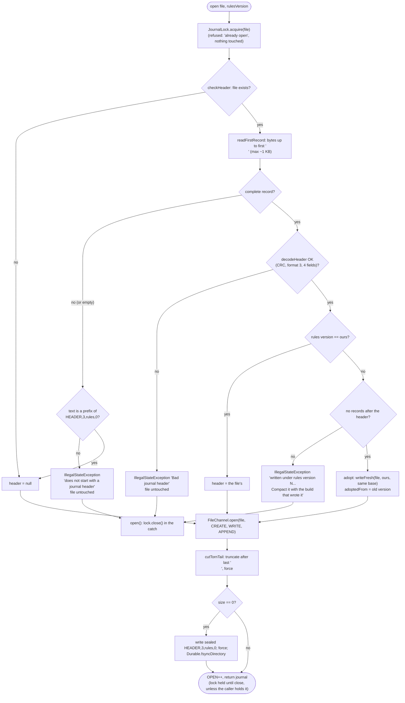
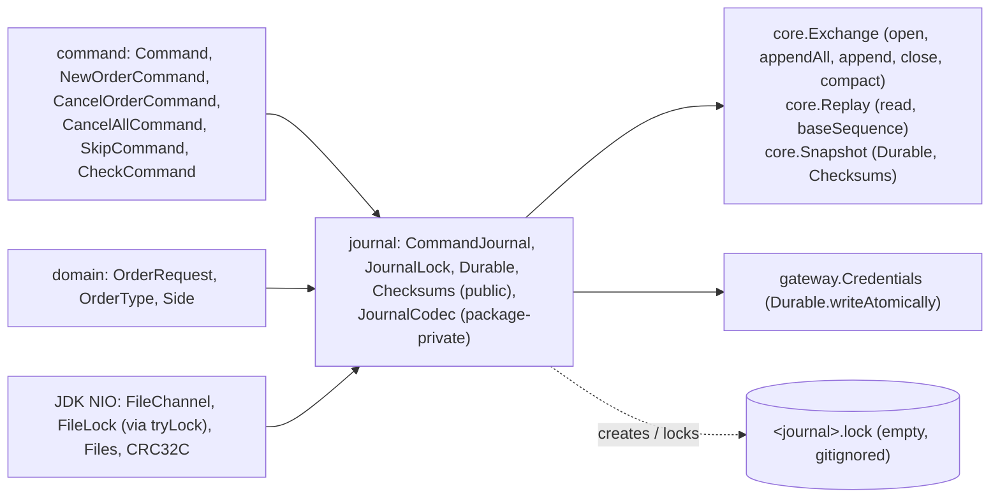

# 07 — Module: journal

> **Project:** ExchangeServer2 | Single-instrument limit order book: price-time matching engine, write-ahead journal with replay, single writer thread, TCP/TLS gateway with authenticated participants | Stack: Java 17, Maven wrapper, JUnit 5 (+ JMH, PIT)
> **This guide:** the write-ahead journal: the text format v3 with a checksum per record (`JournalCodec`, `Checksums`), the file handling (`CommandJournal`: durable batch append, streaming read, torn-tail recovery, header/version check, rules adoption for an empty journal, fail-stop), the exclusive lock (`JournalLock`) and crash-safe file operations (`Durable`) | **Prerequisites:** 01, 02, 07-modules/domain-and-commands | **Related:** 05, 06, 07-modules/exchange-and-replay, 08, 09, 11
> **Repo layout summary:** `pom.xml` + Maven wrapper (`mvnw`, `mvnw.cmd`) at the root; production code in `src/main/java/exchangeserver/` (packages `domain`, `book`, `engine`, `command`, `journal`, `core`, `gateway`, `client`, plus `Main`); tests mirror it in `src/test/java/exchangeserver/` (plus `bench/` JMH benchmarks and `testing/MutableClock`); design docs in `docs/` (`ExchangeServer2_Vision.md` = purpose/roadmap, `ExchangeServer2_Spec.md` = decisions D1–D77); these guides in `docs/understanding/`.

## Overview

The **journal** is a **write-ahead log** (WAL): a file where every input command is written, and forced to disk,
*before* the exchange acts on it. **[Verified]** Spec D12, D40, Vision §4 principle 5.

The sequenced input commands are the **source of truth**. The book is not saved in the journal: on restart it is
rebuilt by replaying the journal through the engine, starting from a **snapshot** if the journal continues from
one (Spec D71; guide 07-modules/exchange-and-replay).

Five classes:
- **`JournalCodec`** (package-private) is the text format: one comma-separated record per line, each ending in
  `,<crc>\n`. Turning commands into text is *encoding*; turning text back into commands is *decoding*.
- **`Checksums`** (public) computes the CRC-32C each record carries (Spec D69); the snapshot file uses it too.
- **`CommandJournal`** (public) is the file.
  - It takes an exclusive lock, verifies the file, adopts a new rules version if the journal is still empty, and
    cuts a half-written last record left by a crash.
  - It appends a batch with one write and one **fsync**. An fsync is a call that returns only once the OS has
    pushed the data to the physical disk. Java's version is `FileChannel.force`.
  - It streams the file back for replay.
  - After any write failure it refuses all further writes (**fail-stop**).
- **`JournalLock`** (public) is "one owner per journal" (Spec D65): an OS lock on a separate `<journal>.lock` file.
- **`Durable`** (public) holds the crash-safe file operations: atomic replace, a durable copy, and the directory
  fsync (Spec D69, D71).

Example journal, captured from a run of the real server on 2026-10-27 **[Verified]**:

```
HEADER,3,2,0,5d7826e0
NEW,1,2026-10-27T14:20:40.373493200Z,1,alice,a1,SELL,LIMIT,10,100,379beca7
NEW,2,2026-10-27T14:20:40.802670Z,2,alice,a2,BUY,LIMIT,5,100,f33577be
NEW,3,2026-10-27T14:20:41.217763100Z,3,bob,b1,BUY,LIMIT,4,100,bed0c339
CANCEL_ALL,4,2026-10-27T14:20:42.045241200Z,alice,2b6bb4a5
```

- The header says: format 3, rules version 2, base sequence 0 (no snapshot), then the header's own CRC.
- Record 2 was `CANCELLED SELF_TRADE_PREVENTED` (alice's buy met alice's ask). It is journalled anyway, because it
  is a *state-dependent* outcome that replay must reproduce (Spec D13). Stateless rejects, such as a malformed
  line, never reach the journal.
- Record 4 is the cancel-on-disconnect sent by the gateway when alice's `COD` session closed (Spec D72).
- After `--compact` the live journal became a single header with base 4, next to `exchange.journal.snapshot-4`
  and `exchange.journal.archive-1-4`. **[Verified]** observed in the same run.

## Responsibility

| Concern | Where | Decision |
|---|---|---|
| Format, versions and base in the header | `JournalCodec` | D36 (plain text), D46 (rules version), D69 (format 3), D71 (base sequence) |
| A checksum per record; a clear CRLF error | `JournalCodec.seal` / `unseal`, `Checksums` | **D69** |
| Durability per batch | `CommandJournal.appendAll` | D37 revised by D52 (fsync per batch) |
| A new file's directory entry is durable | `CommandJournal.openLocked` → `Durable.fsyncDirectory` | **D69** |
| Torn-tail recovery | `CommandJournal.openLocked` → `cutTornTail` | D38 |
| Refuse other rules / non-journals, untouched | `CommandJournal.checkHeader` | D46, **D64** |
| An empty journal adopts a new rules version | `CommandJournal.openLocked` → `writeFresh` | **D71** |
| One process (and one open) at a time | `JournalLock.acquire` / `close` | **D65** |
| Replace a journal atomically (compaction) | `CommandJournal.writeFresh` → `Durable.writeAtomically` | **D71** |
| Fail-stop | `CommandJournal.appendAll` (`failed` flag) | D39 |
| Streaming replay input | `CommandJournal.read` | D60 |

All **[Verified]** against the Spec decisions table and the class comment
(`src/main/java/exchangeserver/journal/CommandJournal.java:24-45`).

## Public interface and who calls it

| Member | Visibility | Called by |
|---|---|---|
| `CommandJournal.open(path, rulesVersion)` | public static | `Exchange.open` (`src/main/java/exchangeserver/core/Exchange.java:119`), the `Exchange.quarantine` operator tool (`Exchange.java:142`) |
| `CommandJournal.open(path, rulesVersion, heldLock)` | public static | `Exchange.compact`, which holds the lock itself (`Exchange.java:177`) |
| `CommandJournal.writeFresh(path, rules, base)` | public static | `Exchange.compact` (`Exchange.java:191`); `openLocked` (rules adoption) |
| `appendAll(List<Command>)` | public | `Exchange.process`: one call per batch (`Exchange.java:223`) |
| `append(Command)` | public | `Exchange` quarantine paths: the SKIP record (`Exchange.java:164`, `:280`) |
| `read(Consumer<Command>)` | public | `Replay.run` (verify pass, `src/main/java/exchangeserver/core/Replay.java:43`) and `Replay.feed` (`Replay.java:75`); the quarantine tool (`Exchange.java:147`) |
| `baseSequence()` | public | `Replay` (which snapshot to load, `Replay.java:60`), the quarantine tool (`Exchange.java:143`) |
| `adoptedRulesFrom()`, `getTruncatedBytesOnOpen()` | public | `Exchange.open`, for the startup recovery summary (`Exchange.java:125`) |
| `close()` | public, idempotent | `Exchange.close` (`Exchange.java:357`), `Exchange.open` on failure (`Exchange.java:131`) |
| `openJournals()` | public static | tests (proves a handle was released) |
| `hasFailed()` | public | tests |
| `JournalLock.acquire(path)` / `close()` | public | `CommandJournal.open`; `Exchange.compact` (`Exchange.java:175`) |
| `Durable.writeAtomically`, `copyDurably`, `fsyncDirectory` | public static | `CommandJournal`; `core.Snapshot.write` (`src/main/java/exchangeserver/core/Snapshot.java:76`); `Exchange.compact` (archive, `Exchange.java:190`); `gateway.Credentials.addUser` (`src/main/java/exchangeserver/gateway/Credentials.java:79`) |
| `Checksums.crcHex(text)` | public static | `JournalCodec`; `core.Snapshot` (`Snapshot.java:119`, `:128`) |
| `JournalCodec.*` | package-private | `CommandJournal` only; `JournalCodecTest` |

**[Verified]** by grep. The unused `getFile()` of earlier versions was removed.

## The format: `JournalCodec` (v3)

```java
// src/main/java/exchangeserver/journal/JournalCodec.java:18-53 (trimmed)
/*
The journal's text format (D36, D69), one record per line, ','-separated, every record ending in
",<crc>\n" where <crc> is the CRC-32C of the record's text before that last comma, as 8 lower-case hex digits:

    HEADER,<formatVersion>,<rulesVersion>,<baseSequence>                                    (first record only)
    NEW,<seq>,<timestamp>,<orderId>,<participant>,<clientOrderId>,<side>,<type>,<quantity>,<price>
    CANCEL,<seq>,<timestamp>,<participant>,<targetOrderId>
    CANCEL_ALL,<seq>,<timestamp>,<participant>
    SKIP,<seq>,<timestamp>,<skippedSeq>
    CHECK,<seq>,<timestamp>,<digest>

baseSequence: the last sequence number of the snapshot this journal continues from (0: from an empty exchange,
D71); the first record after the header has sequence baseSequence + 1. A MARKET order's price field is "-" (D26).
 */
final class JournalCodec {
    static final int FORMAT_VERSION = 3;
    ...
    static final String NO_PRICE = "-";
    static final char SEPARATOR = ',';
    static final char END_OF_RECORD = '\n';

    record Header(int rulesVersion, long baseSequence) {
    }
    ...
}
```

**Three things live in the header** **[Verified]**:
- `FORMAT_VERSION` (3) describes the *layout of the text*. Format 2 (no checksums, no base) is refused with
  "format version 2, this code reads 3" (`JournalCodecTest.Header.otherFormatVersionIsRefused`).
- The **rules version** (`domain.Rules.VERSION`, currently 2) describes the *business rules* the records were
  written under. A mismatch refuses startup, unless the journal has no records yet (rules adoption, below).
- The **base sequence** names the snapshot this journal continues from (0 = none). `Replay` loads
  `<journal>.snapshot-<base>` and expects the first record to be `base + 1` (guide 07-modules/exchange-and-replay).

The two new record types are `CANCEL_ALL` (cancel every resting order of one participant, D72) and `CHECK` (the
output digest of everything before it, D70; replay compares it and never feeds it to the engine).

### Sealing: the checksum per record (D69)

```java
// src/main/java/exchangeserver/journal/JournalCodec.java:165-187
// Appends ",<crc>" and the end of record.
static String seal(String text) {
    return text + SEPARATOR + Checksums.crcHex(text) + END_OF_RECORD;
}

// The record's text without its checksum; throws if the checksum is missing or wrong.
static String unseal(String record) {
    if (record.endsWith("\r")) {
        // D69: the decoder reads LF-terminated records; say so instead of a puzzling checksum error.
        throw new IllegalArgumentException("record ends with '\\r': the file was converted to CRLF line endings; "
                + "convert it back to LF (e.g. dos2unix) and restart");
    }
    int comma = record.lastIndexOf(SEPARATOR);
    if (comma < 0) {
        throw new IllegalArgumentException("no checksum");
    }
    String text = record.substring(0, comma);
    String crc = record.substring(comma + 1);
    if (!Checksums.crcHex(text).equals(crc)) {
        throw new IllegalArgumentException("checksum mismatch (expected " + Checksums.crcHex(text) + ", found " + crc + ")");
    }
    return text;
}
```

```java
// src/main/java/exchangeserver/journal/Checksums.java:8-18 (trimmed)
public final class Checksums {
    public static String crcHex(String text) {
        CRC32C crc = new CRC32C();
        crc.update(text.getBytes(UTF_8));
        return String.format("%08x", crc.getValue());
    }
}
```

- **Every record, the header included, is sealed.** `encodeHeader` and `encode` both end in `seal(...)`
  (`JournalCodec.java:58-60`, `:126`). **[Verified]**
- **Why a checksum.** Before D69 a bit flip that still parsed (a `5` becoming a `4` in a quantity) changed history
  silently. Now any changed character fails the CRC and the record is corrupt. **[Verified]** Spec D69;
  `JournalCodecTest.Corrupt.aChangedCharacterFailsTheChecksum` (`,100,` → `,900,` fails). CRC-32C (the Castagnoli
  polynomial, in the JDK since 9 as `java.util.zip.CRC32C`) detects all short burst errors; it is not a defence
  against deliberate tampering. **[Inferred, general knowledge]**
- **The checksum is the last field.** `unseal` takes everything after the *last* comma as the CRC, which works
  because no field can contain a comma (the participant and client-order-id patterns forbid it). **[Verified]**
- **CRLF gets its own message (D69, risk M7).** If a tool converts the file to CRLF, every record ends in `\r`.
  The decoder refuses it (tolerating `\r` would give one record two byte forms), but says *what happened* instead
  of reporting a puzzling checksum mismatch. **[Verified]** `JournalCodecTest.Corrupt.aCarriageReturnIsReportedAsALineEndingConversion`
  (for a record and for the header). Before D69 the same file failed with `Bad journal header "HEADER,2,9\r": For
  input string: "9\r"` (observed live during the survey). `.gitattributes` keeps `*.journal` out of git's
  line-ending conversion. **[Verified]** Spec D69.

### Encoding

```java
// src/main/java/exchangeserver/journal/JournalCodec.java:87-127 (trimmed)
static String encode(Command command) {
    Objects.requireNonNull(command, "command");
    StringBuilder sb = new StringBuilder(96);
    if (command instanceof NewOrderCommand n) {
        OrderRequest r = n.request();
        sb.append(NEW)
                .append(SEPARATOR).append(n.sequenceNumber())
                .append(SEPARATOR).append(n.timestamp())
                ...
                .append(SEPARATOR).append(r.getPrice().isPresent() ? Long.toString(r.getPrice().getAsLong()) : NO_PRICE);
    } else if (command instanceof CancelOrderCommand c) {
        ...
    } else if (command instanceof CancelAllCommand c) {
        ...
    } else if (command instanceof SkipCommand s) {
        ...
    } else if (command instanceof CheckCommand c) {
        ...
    } else {
        throw new IllegalStateException("Unknown command type " + command.getClass());
    }
    return seal(sb.toString());
}
```

- It uses an `instanceof` pattern chain rather than a pattern `switch`. **[Inferred]** Pattern matching in
  `switch` was only a preview feature in Java 17, so the chain is the idiomatic choice here.
- `-` stands for "no price". The in-memory sentinel −1 never reaches the file: the codec writes from
  `OrderRequest.getPrice()`, an `OptionalLong`. **[Verified]**
- `Instant.toString()` is exact to the nanosecond (`2026-01-01T10:00:00.123456789Z`) and contains no commas.
  **[Verified]** `JournalCodecTest.RoundTrip`, which also round-trips `CANCEL_ALL` and `CHECK`.

### Decoding

```java
// src/main/java/exchangeserver/journal/JournalCodec.java:129-163 (trimmed)
// record: one record without its '\n'. recordNumber: 1-based, header included, for the error message.
static Command decode(String record, long recordNumber) {
    try {
        String[] f = unseal(record).split(String.valueOf(SEPARATOR), -1);     // -1 keeps trailing empty fields
        return switch (f[0]) {
            case NEW -> {
                requireFieldCount(f, 10);
                OrderType type = OrderType.valueOf(f[7]);
                OptionalLong price = f[9].equals(NO_PRICE) ? OptionalLong.empty() : OptionalLong.of(Long.parseLong(f[9]));
                OrderRequest request = OrderRequest.of(f[4], f[5], Side.valueOf(f[6]), type, Long.parseLong(f[8]), price);
                yield new NewOrderCommand(Long.parseLong(f[1]), Instant.parse(f[2]), Long.parseLong(f[3]), request);
            }
            case CANCEL -> { requireFieldCount(f, 5); yield new CancelOrderCommand(...); }
            case CANCEL_ALL -> { requireFieldCount(f, 4); yield new CancelAllCommand(...); }
            case SKIP -> { requireFieldCount(f, 4); yield new SkipCommand(...); }
            case CHECK -> { requireFieldCount(f, 4); yield new CheckCommand(...); }
            default -> throw new IllegalArgumentException("unknown record type " + f[0]);
        };
    } catch (IllegalArgumentException | DateTimeParseException | NullPointerException e) {
        // Includes NumberFormatException, enum valueOf, checksum failures and the request's own validation.
        throw new IllegalStateException("Corrupt journal record " + recordNumber + ": \"" + record + "\"", e);
    }
}
```

Line by line:

- **`unseal` first.** The checksum (and the CRLF check) runs before any field is parsed, so a corrupted record
  is reported as corrupt even when it would happen to parse. **[Verified]**
- **`split(",", -1)`.** Java's `split` drops trailing empty strings by default; `-1` keeps them. The field count
  is then exact, so a record with an extra empty field is refused rather than read short. **[Verified]** by the
  comment and the Java API.
- **Re-validation through the record constructors.** A NEW record is rebuilt through `OrderRequest.of`, so every
  stateless rule the gateway applied is applied again on read; `CancelAllCommand` re-checks the participant
  pattern, `CheckCommand` the 16-hex-digit digest. A record such as `LIMIT,10,-1` (the in-memory sentinel),
  `MARKET,10,100`, `CANCEL_ALL,…,a b` or `CHECK,…,XYZ` is corrupt, even with a correct CRC. **[Verified]**
  `JournalCodecTest.Corrupt.isAnIllegalStateWithTheRecordNumber` seals 25 such records with a valid checksum so
  they exercise the parser, not just the CRC.
- **Error translation.** Every parse failure becomes `IllegalStateException("Corrupt journal record N …")`. Per
  Spec D27, `IllegalStateException` means "our bug or corrupt data", never bad user input. `N` is 1-based and
  counts the header as record 1, so it equals the line number an editor shows. **[Verified]**
  `CommandJournalTest.Recovery.completeCorruptRecordIsNeverDropped` expects "record 3" for the third line.
- **`NullPointerException` in the catch.** **[Inferred]** It is defensive; nothing in `split`'s output can be
  `null`. See `15-open-questions.md`.

`decodeHeader` (`JournalCodec.java:62-85`) unseals the record, checks the first field is `HEADER`, the format is 3,
there are exactly 4 fields and the base is not negative, and returns `Header(rulesVersion, baseSequence)`. Anything
else becomes `IllegalStateException("Bad journal header …")`. **[Verified]** `JournalCodecTest.Header`.

## The file: `CommandJournal`

### `open`: lock, then check, then change (D64, D65, D71)

```java
// src/main/java/exchangeserver/journal/CommandJournal.java:73-132 (trimmed)
public static CommandJournal open(Path file, int rulesVersion) throws IOException {
    Objects.requireNonNull(file, "file");
    JournalLock lock = JournalLock.acquire(file);
    try {
        return openLocked(file, rulesVersion, lock);
    } catch (IOException | RuntimeException e) {
        try { lock.close(); } catch (IOException releaseFailure) { e.addSuppressed(releaseFailure); }
        throw e;
    }
}

// For a caller that holds the journal's lock itself (compaction): closing this journal leaves it held.
public static CommandJournal open(Path file, int rulesVersion, JournalLock heldLock) throws IOException {
    Objects.requireNonNull(file, "file");
    Objects.requireNonNull(heldLock, "heldLock");
    return openLocked(file, rulesVersion, null);
}

// ownedLock: released by close(), or null if the caller holds the lock.
private static CommandJournal openLocked(Path file, int rulesVersion, JournalLock ownedLock) throws IOException {
    JournalCodec.Header header = checkHeader(file, rulesVersion);
    int adoptedFrom = 0;
    if (header != null && header.rulesVersion() != rulesVersion) {
        adoptedFrom = header.rulesVersion();            // checkHeader allowed it: no records yet
        writeFresh(file, rulesVersion, header.baseSequence());
        header = new JournalCodec.Header(rulesVersion, header.baseSequence());
    }

    FileChannel channel = FileChannel.open(file, CREATE, WRITE, APPEND);    // APPEND: never overwrite history
    long truncated;
    try {
        truncated = cutTornTail(file);
        if (channel.size() == 0) {
            channel.write(ByteBuffer.wrap(JournalCodec.encodeHeader(rulesVersion, 0).getBytes(UTF_8)));
            channel.force(true);
            Durable.fsyncDirectory(file);           // a new file's directory entry must be durable too
            header = new JournalCodec.Header(rulesVersion, 0);
        }
    } catch (IOException | RuntimeException e) {
        try { channel.close(); } catch (IOException closeFailure) { e.addSuppressed(closeFailure); }
        throw e;
    }
    OPEN.incrementAndGet();
    return new CommandJournal(file, channel, ownedLock, header.baseSequence(), truncated, adoptedFrom);
}

// Replaces `file` with a journal that holds only a header (compaction, D71). The caller must hold the lock.
public static void writeFresh(Path file, int rulesVersion, long baseSequence) throws IOException {
    Durable.writeAtomically(file, JournalCodec.encodeHeader(rulesVersion, baseSequence));
}
```



The order of these steps carries four decisions. **[Verified]**

- **D65: lock first.** `JournalLock.acquire` runs before the journal file is even read. A second opener (another
  JVM, a `--quarantine` or `--compact` run against a live exchange, or a second open in this JVM) is refused with
  "already open". Before D65, `--quarantine` could append a SKIP next to a running exchange, interleaving sequence
  numbers (the next startup failed on a gap). Details below.
- **D64: check before change.** The header is checked first, and a refused file is never modified.
  - *Before*, `open` cut the torn tail first: pointing `--journal` at a notes file with no final newline cut its last
    line *and then* refused it; a one-line file with no newline was emptied and turned into a journal; a journal
    of other rules was cut before being refused.
  - `checkHeader` (`CommandJournal.java:237-260`) allows exactly one kind of incomplete first record: a **prefix**
    of the header this build would write (with base 0), the trace of a crash while a brand-new journal was being
    created. The empty file is the trivial prefix. A journal written by `writeFresh` is never torn, because it is
    replaced atomically.
- **D71: an empty journal adopts a new rules version.** `checkHeader` refuses a journal of other rules **only if
  it has records** (`noRecords` compares the file size with the header's length + 1, `CommandJournal.java:253`).
  An empty one is rewritten atomically with this build's version and the *same base*, and `adoptedRulesFrom()`
  reports the old version. That is the way across a rules change: compact the journal with the *old* build
  (snapshot + empty journal), then start the new build. The error message for a journal *with* records now says
  exactly that. **[Verified]** `CommandJournalTest.Header.anEmptyJournalAdoptsANewRulesVersionAndKeepsItsBase`
  (base 9 survives; a second open no longer reports an adoption).
- **D69: a new journal's directory entry is fsynced.** When the file was empty and a header is written,
  `Durable.fsyncDirectory` makes the file's *creation* durable too. On Linux a crash right after creating a file
  can otherwise lose its directory entry even though its data was forced. **[Verified]** the comment;
  **[Inferred, general knowledge]** the Linux behaviour.
- **Failure path.** If `openLocked` throws, `open` closes the lock in its own `catch` (and `openLocked` closes the
  journal channel if it got that far). `OPEN` is incremented only on success. **[Verified]**
  `Header.otherRulesVersionIsRefusedAndTheFileIsReleased`: after the refusal, a reopen with the right rules works,
  which proves the lock was released.
- **The held-lock variant.** `open(file, rules, heldLock)` is for `Exchange.compact`, which must keep the journal
  to itself *while it replaces the file*: it holds a `JournalLock`, opens and replays the journal, closes it
  (the lock stays held, because `ownedLock` is null), archives it and calls `writeFresh`. **[Verified]**
  `Exchange.java:175-191`.

### `JournalLock`: one owner per journal (D65)

```java
// src/main/java/exchangeserver/journal/JournalLock.java:37-79 (trimmed)
public static JournalLock acquire(Path journal) throws IOException {
    Path lockFile = journal.resolveSibling(journal.getFileName() + ".lock");
    try {
        Files.createFile(lockFile);     // create-new: never opens, so never closes, an existing lock file
    } catch (FileAlreadyExistsException normalAfterTheFirstRun) {
        // reuse it
    }
    Path key = lockFile.toRealPath();   // one key however the journal path is spelled
    if (!HELD.add(key)) {
        throw alreadyOpen(journal);
    }
    FileChannel channel = null;
    try {
        channel = FileChannel.open(lockFile, WRITE);
        if (channel.tryLock() == null) {
            throw alreadyOpen(journal);
        }
        return new JournalLock(key, channel);
    } catch (IOException | RuntimeException e) {
        try { if (channel != null) channel.close(); } catch (IOException closeFailure) { e.addSuppressed(closeFailure); }
        HELD.remove(key);
        throw e;
    }
}

// Idempotent. Closing the channel releases the OS lock.
@Override
public synchronized void close() throws IOException {
    if (!channel.isOpen()) {
        return;
    }
    try {
        channel.close();
    } finally {
        HELD.remove(key);
    }
}
```

The core problem: **POSIX record locks** (what Java's `FileLock` uses on Linux and macOS) belong to the *process
and file*, not to the handle. When a process closes **any** handle on a file, it loses **all** of its locks on that
file. The `FileLock` Javadoc warns about this. **[Verified]** the class comment (`JournalLock.java:13-24`);
**[Inferred, general knowledge]** the documented `fcntl` behaviour. The journal opens and closes its own handles
all the time (`read()` during replay, `readFirstRecord`, `cutTornTail`), so a lock held *on the journal itself*
would silently disappear on POSIX. Hence:

| Line(s) | What | Why |
|---|---|---|
| `resolveSibling(name + ".lock")` (38) | The lock is on a separate file, `exchange.journal.lock` | Nothing else in the program ever opens this file, so no stray close can drop the lock |
| `Files.createFile` (39-43) | "Create new": creates the file if missing, **fails** with `FileAlreadyExistsException` if it exists (caught, ignored) | An open-then-close to create it would itself be a handle close on the lock file. `createFile` on an existing file opens nothing |
| `toRealPath()` (44) | Canonical path as the key | `x.journal`, `./x.journal` and an absolute path name the same lock |
| `HELD.add(key)` (45-47) | A static in-JVM set of held lock files (`JournalLock.java:27`) | A second acquire *in the same JVM* is refused **before** it opens the lock file. Opening and closing a second handle there would drop the first owner's POSIX lock. (Java would also throw `OverlappingFileLockException`, but only after the damaging open.) |
| `FileChannel.open(lockFile, WRITE).tryLock()` (50-53) | An exclusive lock on the whole lock file; `null` = another process holds it | The cross-process check |
| catch block (55-64) | On any failure: close the lock channel, then `HELD.remove(key)` | No leaked handle; this JVM can try again later. Closing our own unlocked channel only affects this process's locks, and it holds none on that file (`HELD` guaranteed that) |
| `close()` (68-79) | Close the channel (releases the OS lock), then always remove from `HELD` (`finally`); idempotent | The OS lock goes first, then this JVM allows a new owner |

`CommandJournal.close()` (`CommandJournal.java:220-233`) closes the journal channel first and then closes its
`JournalLock` (if it owns one), even if the channel close throws. **[Verified]**

**The lock file stays on disk.** Deleting it on close would race with the next opener: B could open the old file
while A deletes it, then C creates a fresh one and also "gets the lock". It is empty, and `*.journal.lock` is in
`.gitignore`. A leftover file after a crash is harmless: the OS releases the *lock* when the process dies, and only
a held lock refuses an opener. **[Verified]** the comment, `.gitignore`, and live on Windows: after a hard kill the
server restarted on the same journal next to the leftover 0-byte lock file. **[Inferred]** the race example.

**Tested on both platforms.** **[Verified]** Spec §11, D65:
- On Windows: `CommandJournalTest.Exclusive` (both tests below) and a live check (`--quarantine` against a running
  server refused with "already open", exit 1).
- **On Linux**, in Docker (`eclipse-temurin:17`, kernel 6.18 WSL2): the whole suite (446 tests) passed, including
  `Exclusive.anotherProcessIsRefusedWhileTheJournalIsOpen` with its child JVM, and a live check refused
  `--quarantine` while the server ran (`Quarantine failed: Journal /tmp/j.journal is already open …`, exit 1).
  The POSIX behaviour that motivated the separate lock file is therefore **verified on POSIX**, not just reasoned.
  macOS has not been run. Network file systems may implement locks differently. **[Inferred]**

#### History: the first D65 implementation (replaced)

The first version of D65 locked **one byte of the journal itself** at offset `Long.MAX_VALUE − 1`, through the
journal's own append channel. The offset was chosen because Windows locks are *mandatory* (a locked range cannot be
read through any other handle), so locking real records would have blocked `read()`. It passed every test on
Windows. On POSIX it would have been dropped as soon as the process closed *any* handle on the journal, which
`read()`, `readFirstRecord` and `cutTornTail` all do, even during `open`. A review found this from the `fcntl`
semantics; the lock moved to a separate file, then into its own `JournalLock` class so compaction can hold it.
**[Verified]** Spec D65. On Windows the old lock would also pass the child-JVM test; only the Linux run proves the
fix.

### `Durable`: crash-safe file operations (D69, D71)

```java
// src/main/java/exchangeserver/journal/Durable.java:23-63 (trimmed)
// Replaces `target` with `content` so that after a crash it holds either the old or the new content, never a
// mix: write a temporary file, fsync it, rename it over the target, fsync the directory.
public static void writeAtomically(Path target, String content) throws IOException {
    Path tmp = target.resolveSibling(target.getFileName() + ".tmp");
    try (FileChannel ch = FileChannel.open(tmp, CREATE, TRUNCATE_EXISTING, WRITE)) {
        ... write all bytes ...
        ch.force(true);
    }
    Files.move(tmp, target, ATOMIC_MOVE, REPLACE_EXISTING);
    fsyncDirectory(target);
}

// Copies `source` to `target` and fsyncs the copy (not atomic: for archives, which nothing reads back).
public static void copyDurably(Path source, Path target) throws IOException { ... }

// Makes a file's creation or rename durable: on Linux a new directory entry can be lost in a crash until the
// directory itself is fsynced. Windows cannot open a directory as a file and journals its metadata itself,
// so failing to open it is ignored there.
public static void fsyncDirectory(Path file) throws IOException {
    Path dir = file.toAbsolutePath().getParent();
    FileChannel ch;
    try {
        ch = FileChannel.open(dir, READ);
    } catch (IOException notSupportedHere) {
        return;
    }
    try (ch) {
        ch.force(true);
    } catch (IOException notSupportedHere) {
        // some platforms refuse fsync on a directory handle; nothing more can be done
    }
}
```

- **`writeAtomically`** is the classic recipe: write a temporary file, fsync it, **rename** it over the target
  (an atomic move replaces the directory entry in one step), fsync the directory so the rename itself is durable.
  After a crash the target holds either the old or the new content, never a mix. It is used for `writeFresh`
  (compaction and rules adoption), for snapshot files and for the users file. **[Verified]**
  `DurableTest.writeAtomicallyReplacesTheWholeFileAndLeavesNoTemporaryFile`.
- **`copyDurably`** archives the old journal during compaction (`<journal>.archive-<first>-<last>`): copy, fsync
  the copy, fsync the directory. Not atomic, because nothing reads an archive back. **[Verified]**
- **`fsyncDirectory` is best-effort.** On Linux it opens the directory and forces it. On Windows opening a
  directory as a file fails, which is ignored (NTFS journals its own metadata). Some platforms also refuse `force`
  on a directory handle; also ignored. **[Verified]** the code and comment;
  `DurableTest.fsyncingTheDirectoryIsHarmlessOnEveryPlatform`. **[Inferred, general knowledge]** the NTFS remark.
- **Crash safety of compaction (D71) rests on these.** The snapshot is written atomically, the archive durably,
  and only then is the journal atomically replaced; each journal names its snapshot by sequence number, so a
  half-done compaction leaves a stray file, never a journal without its snapshot. **[Verified]** Spec D71;
  `ExchangeTest.Compaction.aCrashAfterWritingTheSnapshotLeavesTheOldJournalInCharge`.

### `appendAll`: one write, one fsync, per batch

```java
// src/main/java/exchangeserver/journal/CommandJournal.java:142-166
// All or none are encoded before anything is written: a command that cannot be encoded writes nothing.
public void appendAll(List<? extends Command> commands) throws IOException {
    if (failed) {
        throw new IllegalStateException("Journal failed earlier; restart to recover");
    }
    if (commands.isEmpty()) {
        return;
    }
    StringBuilder sb = new StringBuilder(commands.size() * 112);
    for (Command command : commands) {
        sb.append(JournalCodec.encode(command));
    }
    ByteBuffer records = ByteBuffer.wrap(sb.toString().getBytes(UTF_8));

    try {
        while (records.hasRemaining()) {
            channel.write(records);
        }
        channel.force(true);
    } catch (IOException | RuntimeException e) {
        // A partial record may be on disk, and a failed fsync cannot be retried safely.
        failed = true;
        throw e;
    }
}
```

1. **Encode everything first.** If one command cannot be encoded, nothing is written. That failure happens
   *before* the `try`, so it does **not** set `failed`. **[Verified]** `AppendAndRead.encodeFailureWritesNothing`.
   The initial capacity grew from 96 to 112 per command to fit the 9-character checksum suffix. **[Inferred]**
2. **One write, one `force(true)`** for the whole batch (which may begin with a `CHECK`, D70). `force(true)` asks
   the OS to flush the file's data *and* its metadata (such as its size) to the device. This is the expensive call,
   about 1.5 ms on the dev disk (`CLAUDE.md`).
   - Smart batching amortises it: one fsync per batch instead of per command. Measured as 53× the throughput of
     fsync-per-command at 64 clients, with the same single-client latency (Spec §5, D52). **[Verified]** from the
     Spec.
   - **[Inferred]** `force(true)` rather than `force(false)` because a growing append-only file needs its new
     size to be durable too; the code gives no reason.
3. **`while (records.hasRemaining())`.** One `write` call may write fewer bytes than requested, so it loops.
   **[Verified]**
4. **Fail-stop (D39).** After a failed write or fsync, `failed = true` and every later `appendAll` throws
   `IllegalStateException` until restart.
   - The comment gives two reasons: a partial record may already be on disk, and a failed fsync cannot safely be
     retried.
   - **[Inferred, general knowledge]** On Linux, after a failed fsync the kernel may mark the dirty pages clean.
     A retry can then "succeed" with data never written: the "fsyncgate" problem known from PostgreSQL.
   - The caller (`Exchange` → `ExchangeService`) treats any journal exception as fatal: the writer halts and the
     process exits with code 2 (guide 07-modules/exchange-service). **[Verified]**
5. **The caller's contract: write-ahead.** `appendAll` returns only after the data is on disk, and the caller
   must not process a command before that (`CommandJournal.java:28-30`). `Exchange.process` calls it once, before
   the engine loop. **[Verified]** `Exchange.java:223`.

### `read`: streaming bytes, not lines

```java
// src/main/java/exchangeserver/journal/CommandJournal.java:168-200
// Streams every command, oldest first, header excluded. Memory stays constant whatever the journal size.
public void read(Consumer<? super Command> consumer) throws IOException {
    ByteArrayOutputStream record = new ByteArrayOutputStream(128);
    long recordNumber = 0;
    byte[] buffer = new byte[64 * 1024];

    try (InputStream in = new BufferedInputStream(Files.newInputStream(file), buffer.length)) {
        int n;
        while ((n = in.read(buffer)) != -1) {
            int start = 0;
            for (int i = 0; i < n; i++) {
                if (buffer[i] == JournalCodec.END_OF_RECORD) {
                    record.write(buffer, start, i - start);
                    recordNumber++;
                    String text = record.toString(UTF_8);
                    if (recordNumber == 1) {
                        JournalCodec.decodeHeader(text);        // validated by open(); skipped here
                    } else {
                        consumer.accept(JournalCodec.decode(text, recordNumber));
                    }
                    record.reset();
                    start = i + 1;
                }
            }
            record.write(buffer, start, n - start);
        }
    }
    // Read bytes, not lines: readLine() cannot tell a finished last record from a cut-off one.
    if (record.size() > 0) {
        throw new IllegalStateException("Journal record " + (recordNumber + 1) + " has no end of record: \""
                + record.toString(UTF_8) + "\"");
    }
}
```

- **Streaming.** Memory stays constant however big the journal is. Commands are handed to the consumer one at a
  time. **[Verified]** Spec D60; replay runs two passes over the file instead of loading a `List`. Since D71 the
  file only holds what happened since the last compaction.
- **Every record is checked again on read**, CRC included, because `decode` unseals it. **[Verified]**
- **Why scan bytes instead of `BufferedReader.readLine()`?** `readLine` returns the last line whether or not it
  ended in `\n`, so it cannot tell a complete record from one cut off by a crash. The byte scan keeps any leftover
  bytes and fails loudly if there are some. **[Verified]** by the comment and
  `Recovery.unterminatedRecordFoundByReadIsAnError`.
- **Records spanning the 64 KB buffer boundary** are handled by carrying the partial record across reads
  (`record.write(buffer, start, n - start)`). **[Verified]** `AppendAndRead.readHandlesRecordsSpanningBufferBoundaries`.
- **It opens (and closes) its own handle on the journal**, so it can run while the append channel is open. The
  poison-pill rebuild relies on this: it replays the journal in the middle of a live batch. **[Verified]**
  `CommandJournal.java:42-43`. That handle close is exactly what would have dropped a POSIX lock held on the journal
  file, which is why the lock lives in `<journal>.lock`.
- **A complete corrupt record is never skipped**: decode throws and the whole read fails (D38). Startup then
  fails, and an operator decides what to do. **[Verified]**

### Recovery: `cutTornTail` and the backwards block scan

```java
// src/main/java/exchangeserver/journal/CommandJournal.java:262-297 (trimmed)
private static long cutTornTail(Path file) throws IOException {
    try (FileChannel ch = FileChannel.open(file, CREATE, READ, WRITE)) {
        long size = ch.size();
        long end = endOfLastCompleteRecord(ch, size);
        if (end < size) {
            ch.truncate(end);
            ch.force(true);                 // the cut must be durable before new records follow it
        }
        return size - end;
    }
}

// Position just after the last '\n', or 0 if there is none. Scans backwards in blocks, so recovery costs
// the length of the last record, not of the file.
private static long endOfLastCompleteRecord(FileChannel ch, long size) throws IOException {
    ByteBuffer block = ByteBuffer.allocate(4096);
    long blockEnd = size;
    while (blockEnd > 0) {
        int length = (int) Math.min(block.capacity(), blockEnd);
        long blockStart = blockEnd - length;
        block.clear().limit(length);
        while (block.hasRemaining()) {
            if (ch.read(block, blockStart + block.position()) < 0) {
                throw new IOException("Journal shrank while being recovered");
            }
        }
        for (int i = length - 1; i >= 0; i--) {
            if (block.get(i) == JournalCodec.END_OF_RECORD) {
                return blockStart + i + 1;
            }
        }
        blockEnd = blockStart;
    }
    return 0;
}
```

- A **torn tail** is the bytes after the last `\n`: a record that a crash cut off mid-write. It was never fsynced
  as a whole, so it was never processed and never visible to anyone. Cutting it loses nothing that a client saw.
  **[Verified]** Spec §4 "visible ⇒ durable".
- It reads backwards in 4 KB blocks from the end until it finds a `\n`. Recovery therefore costs about the length
  of the last record, not of the file. **[Verified]** `Recovery.longTornTailAcrossScanBlocksIsCut` uses a
  10,000-byte tail spanning three blocks.
- The cut is fsynced before anything new is appended after it. **[Verified]**
- **Worked example [Verified]**, the same as `Recovery.tornLastRecordIsCutOnOpen`:
  1. A crash leaves `…\nNEW,2,2026-01-01T10:0`, which is 21 bytes after the last `\n`.
  2. `open` cuts those 21 bytes, and `getTruncatedBytesOnOpen()` returns 21.
  3. The next append starts on a clean line.

  Since D77 `Main` prints the number at startup ("Recovered through sequence N: replayed …, cut 21 torn bytes"),
  so the cut is no longer silent. **[Verified]** Spec D77.

## Lifecycle and failure states

```mermaid
stateDiagram-v2
    [*] --> Refused: open() fails (already open / bad header / CRC / other rules with records / not a journal)
    [*] --> Open: open() succeeds (lock held, header verified or adopted, torn tail cut)
    Open --> Open: appendAll() ok (write + fsync)
    Open --> Failed: write/fsync throws (failed = true)
    Failed --> Failed: appendAll() → IllegalStateException
    Open --> Closed: close() (journal channel, then its JournalLock if it owns one)
    Failed --> Closed: close()
    Closed --> Closed: close() again (idempotent)
    Refused --> [*]: anything acquired was released; the file is unchanged
    Closed --> [*]: lock released; the empty .lock file stays on disk
```



`close()` is `synchronized` and idempotent; it decrements `OPEN` and releases the lock only if the channel was
open. **[Verified]** `CommandJournal.java:220-233`. **[Inferred]** It is synchronized because it is the one method
that tests, or an error path, may call from a thread other than the writer. In production only the writer thread
closes the journal (Spec D58).

`OPEN` and `openJournals()` exist because of a Windows trap. Java opens files on Windows with delete sharing, so
*deleting* a file proves nothing about whether its handle was closed. Tests count open journals instead.
**[Verified]** `CommandJournal.java:48-50`, Spec §1.5.

## Dependencies in and out



**[Verified]** by imports. The journal knows nothing about the engine, the book or threads.

## How it's tested

| Test class | Groups | Highlights |
|---|---|---|
| `journal/CommandJournalTest` (25 tests) | `Header` (new journal gets a header; no second header; other rules refused and released; **D71** `anEmptyJournalAdoptsANewRulesVersionAndKeepsItsBase`; file without header refused; **D64**: `fileThatIsNotAJournalIsRefusedUnchanged`, `textWithoutAnyRecordIsRefusedUnlessItStartsAHeader`, `otherRulesVersionWithATornTailIsRefusedUnchanged`; open/close counting), `AppendAndRead` (order, batch, empty batch, reopen appends, LF only, buffer boundaries, encode failure writes nothing), `Recovery` (torn record cut, torn header cut and rewritten, clean file cuts nothing, complete corrupt record never dropped, unterminated record found by read, long tail across scan blocks), **`Exclusive`** (D65, below), `FailStop` | File behaviour |
| `journal/JournalCodecTest` (16 test methods) | `RoundTrip` (limit, market `-`, every priced type, cancel, cancel-all, skip, check: the exact sealed text), `Header` (round trip with the base, format 2 refused, malformed headers, an unsealed header refused), `Corrupt` (25 sealed corrupt records → `IllegalStateException` mentioning "record 42"; a changed character fails the checksum; a missing checksum; the CRLF message), `encodeRejectsNull` | Exact text of every record type |
| `journal/DurableTest` (3) | atomic replace leaves no `.tmp`, durable copy, directory fsync harmless on every platform | Crash-safe file operations |
| `core/ExchangeTest`, `core/ReplayTest` | `Restart.tornTailFromACrashIsCutAndReported`, `journalFromOtherRulesIsRefused`, `PoisonPill.quarantineToolRefusesWhileTheExchangeIsRunning`, `Compaction.*` (incl. the rules crossing and a crash after the snapshot), `Operations.recoveryReportsWhatItDid`, `Verify.aBaseSequenceNeedsItsSnapshot` | Journal behaviour seen from the exchange |

The `Exclusive` group (`src/test/java/exchangeserver/journal/CommandJournalTest.java:290-328`) **[Verified]**:
- `aSecondOpenIsRefusedUntilTheFirstCloses` (line 294) covers the in-JVM case: a second `open` fails with
  "already open" and leaves `openJournals()` unchanged; the first journal still appends and reads; after `close`, a
  reopen works.
- `anotherProcessIsRefusedWhileTheJournalIsOpen` (line 312) covers the cross-process case. The test opens the
  journal, appends, and calls `read()` (on POSIX that opens and closes a handle on the journal, which would have
  dropped the first implementation's lock). It then starts a **child JVM** running
  `exchangeserver.Main --journal <file> --quarantine 1` and asserts that the child exits 1 with "already open",
  and that the journal still has only the header and one order (no SKIP).
  **It passes on Windows and on Linux** (Docker run, Spec §11). On Windows the old byte-range lock would also have
  passed; the Linux run is what proves the fix.

The regression tests added for D64/D65 were run against the old code, restored from git, and failed there.
**[Verified]** Spec §10. The package is under PIT mutation testing. The expected survivors are the removed
`force()` calls and directory fsyncs (an fsync cannot be observed by a unit test), equivalent scan-loop
boundaries, and the branch of `JournalLock.acquire` where *another process* holds the lock, which only runs in the
child JVM that PIT does not instrument. **[Verified]** Spec §7.

## Key takeaways

- The journal is the source of truth: sequenced input commands, written and fsynced **before** they are processed
  (write-ahead). The book is rebuilt from it on restart, starting from the snapshot its header names.
- Format v3: one `\n`-terminated record per line, each ending in a CRC-32C of its text; the header names the
  format (3), the rules version and the base sequence. A changed character, a CRLF conversion (with a clear
  message) or a format/rules mismatch refuses startup.
- `open` locks first (D65), verifies the header before changing anything (D64), lets an *empty* journal adopt a
  new rules version (D71), cuts a torn tail, and writes (and directory-fsyncs) a header if the file is empty. A
  refused file is never modified, and every failure releases whatever was acquired.
- `JournalLock` is an OS lock on a separate, empty `<journal>.lock` file, guarded inside the JVM by the static
  `HELD` set. It is verified across processes on Windows **and Linux**. Compaction holds it while it replaces the
  journal.
- `Durable` replaces files atomically (temp + fsync + atomic move + directory fsync); compaction, snapshots and
  the users file depend on it.
- `appendAll` encodes everything first, then does one write and one `force(true)` per batch. Any write/fsync
  failure fail-stops the journal until restart.
- `read` streams bytes, not lines, so an unterminated record is detected; a complete corrupt record is never
  dropped. Decoding re-applies the stateless rules through the command and request constructors.

## Common confusions

- **"A torn tail and a corrupt record are the same thing."** No. A torn tail is an *unterminated* last record, cut
  on open (and reported at startup). A *complete* record that doesn't parse or fails its checksum stops startup and
  is never dropped automatically.
- **"The CRC protects the journal against tampering."** No: anyone can recompute a CRC. It catches accidental
  corruption (bit flips, partial edits).
- **"The lock is on the journal file."** Not any more. It is on `<journal>.lock`, a file nothing else opens. A lock
  on the journal itself would vanish on Linux/macOS the moment `read()` or the header check closed its own handle.
- **"A journal written under other rules can never be opened."** It can if it has no records: it adopts the new
  version. That is the compaction path across a rules change.
- **"Deleting a stale `.lock` file is needed after a crash."** No. The OS releases the lock when the process dies;
  only a held lock refuses an opener.
- **"`HELD` is redundant, because `tryLock` would throw `OverlappingFileLockException` in the same JVM anyway."**
  Java would throw, but only *after* opening a second handle on the lock file; closing that handle would then drop
  the first owner's POSIX lock. `HELD` refuses before any handle is opened.
- **"Encode failures fail-stop the journal."** They don't. Nothing was written, so `failed` stays false.
- **"Record numbers start after the header."** They don't: the header is record 1, so "record 3" is the third line.
- **"The journal can be edited by hand."** Only with LF line endings *and* a recomputed CRC for every changed
  record; otherwise startup refuses it.

## Questions to test yourself

1. Why does `open` check the header *before* cutting the torn tail? What went wrong when it was the other way round?
   <details><summary>Answer</summary>So a file it refuses is never changed (D64). Before, any file passed as `--journal` had its unterminated last line cut before being refused; a one-line file without a newline was emptied and turned into a journal; a journal of other rules was cut too.</details>
2. A file contains exactly `HEADER,3` (no newline). Rules version is 2. What does `open` do?
   <details><summary>Answer</summary>The first record is incomplete, and `HEADER,3` is a prefix of the sealed header `HEADER,3,2,0,<crc>\n`, so it is treated as a torn header: cut to 0 bytes (8 truncated) and a fresh header written (and the directory fsynced).</details>
3. A journal whose header says rules version 1 is opened by this build (rules 2). When is it refused, and when is it accepted?
   <details><summary>Answer</summary>Refused if it has any record after the header ("Compact it with the build that wrote it"). Accepted if it has none: it is rewritten atomically as `HEADER,3,2,<same base>` and `adoptedRulesFrom()` returns 1 (D71). That is what an old build's `--compact` leaves behind.</details>
4. Someone edits a NEW record's quantity from 5 to 4 in a text editor that keeps LF endings. What happens at the next start?
   <details><summary>Answer</summary>The CRC of the record no longer matches: `unseal` throws "checksum mismatch", decode reports `Corrupt journal record N`, and startup fails (D69). Before D69 the edit would have been replayed silently.</details>
5. Why is the lock on a separate `<journal>.lock` file, created with `Files.createFile`, rather than on the journal itself?
   <details><summary>Answer</summary>On Linux/macOS Java file locks are POSIX locks: closing any handle the process holds on a file drops all its locks on that file. `read()`, the header check and `cutTornTail` open and close handles on the journal, so a lock there would vanish. The separate file is never opened by anything else, and `createFile` (create-new) never opens/closes an existing lock file. This is verified on Linux: the child-JVM test and a live `--quarantine` were refused there.</details>
6. What does `Durable.writeAtomically` guarantee after a crash at any point, and which four steps give it?
   <details><summary>Answer</summary>The target holds either the old or the new content, never a mix. Write a temp file, fsync it, atomically rename it over the target, fsync the directory (so the rename itself is durable on Linux).</details>
7. A batch of 50 commands is appended; the fsync throws. What happens to the next batch, and to the process?
   <details><summary>Answer</summary>`failed` is set; the next `appendAll` throws `IllegalStateException` ("restart to recover"). The writer thread halts, every waiting request is refused with HALTED, and `Main` exits with code 2. On restart the journal (possibly with a torn tail, which is cut) is the truth.</details>
8. Why doesn't `read()` use `BufferedReader.readLine()`?
   <details><summary>Answer</summary>`readLine` returns a final line whether or not it ended in `\n`, so a record cut off by a crash would look complete. Scanning bytes leaves unterminated bytes in the buffer, and `read` throws on them.</details>
9. The exchange is running on `x.journal`. An operator runs `--compact` in another terminal. Walk through what happens.
   <details><summary>Answer</summary>`Exchange.compact` calls `JournalLock.acquire`: `createFile(x.journal.lock)` throws `FileAlreadyExistsException` (ignored); `HELD` in the new JVM is empty, so `add` succeeds; `tryLock()` returns `null` because the exchange process holds the lock; the channel is closed, the key removed, and "… is already open (a running exchange, or a --quarantine or --compact run)" is thrown. `Main` prints "Compaction failed: …" and exits 1; nothing is written.</details>
10. Inside one JVM, a test opens `x.journal` twice. Which line refuses the second open, and why must it be that line rather than `tryLock`?
    <details><summary>Answer</summary>`HELD.add(key)` returns false (`JournalLock.java:45`), so `alreadyOpen` is thrown before the lock file is opened. If the second open reached `FileChannel.open(lockFile)`, then closing that handle after Java's `OverlappingFileLockException` would, on POSIX, drop the first journal's lock.</details>
