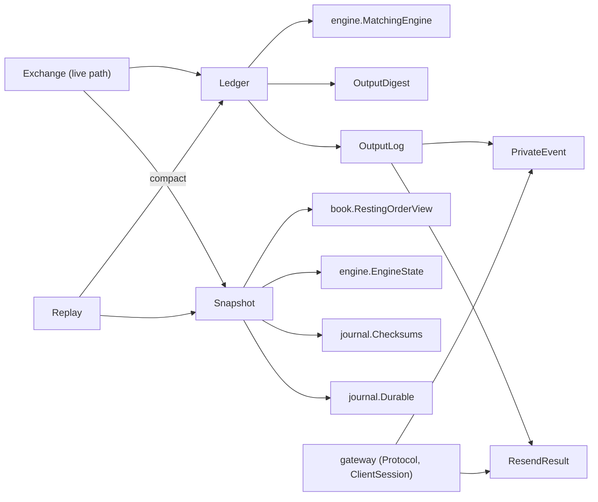
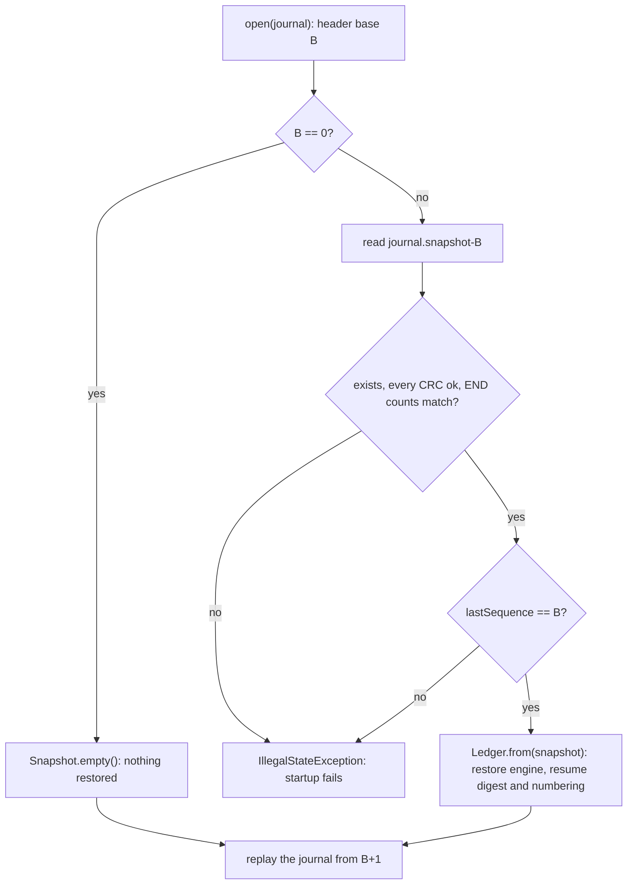

# 07 — Module: core (Ledger, output digest, private streams, snapshots)

> **Project:** ExchangeServer2 | Single-instrument limit order book: price-time matching engine, write-ahead journal with replay, single writer thread, TCP/TLS gateway with authenticated participants | Stack: Java 17, Maven wrapper, JUnit 5 (+ JMH, PIT)
> **This guide:** the part of `exchangeserver.core` that holds everything *derived* from the commands: `Ledger` (engine + digest + private streams), `OutputDigest` (D70), `OutputLog`, `PrivateEvent`, `ResendResult` (D73) and `Snapshot` (D71) | **Prerequisites:** 01, 06, 07-modules/engine, 07-modules/journal | **Related:** 05b, 07-modules/exchange-and-replay, 07-modules/gateway, 09, 10
> **Repo layout summary:** `pom.xml` + Maven wrapper (`mvnw`, `mvnw.cmd`) at the root; production code in `src/main/java/exchangeserver/` (packages `domain`, `book`, `engine`, `command`, `journal`, `core`, `gateway`, `client`, plus `Main`); tests mirror it in `src/test/java/exchangeserver/` (plus `bench/` JMH benchmarks and `testing/MutableClock`); design docs in `docs/` (`ExchangeServer2_Vision.md` = purpose/roadmap, `ExchangeServer2_Spec.md` = decisions D1–D77); these guides in `docs/understanding/`.

## Overview

The journal holds *inputs* (commands). Everything else the exchange knows is *derived* from them by running the
commands through the deterministic engine. Before the risk fixes of 2026-10-27, "everything else" was just the
`MatchingEngine` (book, counters, client-order-id map). Three things were added, and they all have the same
property: they are a pure function of the command sequence, so replay rebuilds them exactly.

| Derived thing | Class | Why it exists | Decision |
|---|---|---|---|
| Book, counters, last trade price, client-order-id map | `engine.MatchingEngine` | Matching | D12, D41 |
| A running digest of every engine output | `OutputDigest` | Detect that replay produced *different* outputs than the live run (a code change that alters behaviour) | D70 |
| Each participant's numbered private events (replies, maker fills, cancels) | `OutputLog`, `PrivateEvent` | A client that missed lines can ask for them again (`RESEND`) | D73 |

`Ledger` bundles the three so they are always built, applied and *replaced* together (after a poison pill the whole
ledger is rebuilt). `Snapshot` is a file holding a ledger's state at a sequence number, so recovery can start there
instead of at sequence 1 (D71).

Terms used below:
- **oseq** (output sequence number): the number of a private event within one participant's stream: 1, 2, 3, ...
- **Digest**: a 64-bit number summarising every output so far; two runs with identical outputs have identical
  digests.
- **CHECK record**: a journal record `CHECK,<seq>,<ts>,<digest>` written by the live run (see guide 07
  (modules/exchange-and-replay)); replay compares its own digest at that point.
- **Snapshot / compaction**: `--compact` writes a snapshot of the state after the journal's last command and
  replaces the journal by an empty one that names that snapshot as its *base*.

All of these classes are package-private except `PrivateEvent` and `ResendResult` (the gateway formats them), and
all are owned by the writer thread **[Verified]** (`src/main/java/exchangeserver/core/Ledger.java:13-22`).

## Dependencies



## Interface

| Member | Visibility | Called by | Thread |
|---|---|---|---|
| `Ledger.from(Snapshot, retention)` | package | `Replay.run`, `Replay.rebuild` | writer, or the starting thread during `open` |
| `Ledger.apply(Command) -> Applied(output, events)` | package | `Exchange.process`, `Replay.feed` | same |
| `Ledger.snapshot(lastSeq, lastOrderId, lastTs)` | package | `Exchange.compact` | tool thread |
| `Ledger.digest()`, `engine()`, `log()` | package | `Exchange`, `Replay`, tests | writer |
| `OutputDigest.update(EngineOutput)`, `hex()`, `resume(hex)` | package | `Ledger`, `Snapshot.read` | writer |
| `OutputLog.record(Command, EngineOutput)` | package | `Ledger.apply` | writer |
| `OutputLog.lastOseq(p)`, `since(p, from)`, `lastOseqs()`, `resume(...)` | package | `Exchange.read` (Attach/Resend), `Ledger` | writer |
| `PrivateEvent` (sealed: `OrderReply`, `CancelReply`, `MakerFill`) | public | `TcpGateway.onOutput`, `Protocol.lines` | writer |
| `ResendResult(events, firstAvailable, lastOseq)` | public | `ClientSession.resend` callback | writer |
| `Snapshot.write(path)`, `read(path)`, `path(journal, seq)`, `empty()` | package | `Exchange.compact`, `Replay.snapshotFor` | tool / starting thread |

## Ledger: one unit, rebuilt together

```java
// src/main/java/exchangeserver/core/Ledger.java:37-61
static Ledger from(Snapshot snapshot, int retention) {
    MatchingEngine engine = snapshot.lastSequence() == 0 ? new MatchingEngine() : MatchingEngine.restore(snapshot.engineState());
    return new Ledger(engine, OutputDigest.resume(snapshot.digest()), OutputLog.resume(retention, snapshot.lastOseqs()));
}

Applied apply(Command command) {
    EngineOutput output;
    if (command instanceof NewOrderCommand n) {
        output = engine.onNewOrder(n);
    } else if (command instanceof CancelOrderCommand c) {
        output = engine.onCancel(c);
    } else if (command instanceof CancelAllCommand c) {
        output = engine.onCancelAll(c);
    } else {
        throw new IllegalStateException("Not an engine command: " + command);
    }
    digest.update(output);
    return new Applied(output, log.record(command, output));
}

Snapshot snapshot(long lastSequence, long lastOrderId, Instant lastTimestamp) {
    var state = engine.exportState();
    return new Snapshot(lastSequence, Math.max(lastOrderId, state.lastOrderId()), lastTimestamp, state.lastTradePrice(),
            digest.hex(), state.orders(), log.lastOseqs());
}
```

Line by line:
- **`from`** builds a fresh ledger either from nothing (`Snapshot.empty()` has `lastSequence` 0) or from a
  snapshot: `MatchingEngine.restore` re-adds the resting orders in book order (see guide 07 (modules/engine)), the
  digest continues from the snapshot's value, and the output log continues each participant's numbering
  **[Verified]** (`Ledger.java:37-40`).
- **`apply`** is the only way a command changes derived state. The engine runs first; *only if it returns*
  (no exception) does the digest absorb the output and the log number the events. So a poison pill (engine throws)
  leaves the digest and the log untouched, and then `Exchange` throws the whole ledger away anyway
  **[Verified]** (`Ledger.java:42-55`; `Exchange.java:278-287`).
- **`snapshot`** exports the engine state and pairs it with the digest and the per-participant last oseq.
  `Math.max(lastOrderId, state.lastOrderId())`: the replay verifier's `lastOrderId` counts NEW records that were
  *skipped* (their ids were issued even though the engine never saw them), so it can be larger than the engine's
  own counter; the snapshot must keep the larger one so an id is never reused **[Verified]** (`Ledger.java:57-61`,
  `src/main/java/exchangeserver/core/Replay.java:103`).

Why one class: a poison-pill rebuild used to replace only the engine. With three derived things, replacing them one
by one would risk an engine at sequence 100 and a digest at sequence 120. Making the ledger the unit of replacement
makes that impossible by construction **[Verified — comment `Ledger.java:15-17`]**.

## OutputDigest (D70)

```java
// src/main/java/exchangeserver/core/OutputDigest.java:48-83 (trimmed)
void update(EngineOutput output) {
    StringBuilder sb = new StringBuilder(128);
    sb.append(output.sequenceNumber()).append('|').append(output.timestamp()).append('|');
    if (output instanceof OrderOutput o) {
        Response r = o.response();
        sb.append("O|").append(r.orderId()).append('|').append(r.clientOrderId()).append('|').append(r.status())
                .append('|').append(r.reason()).append('|').append(r.filledQuantity()).append('|')
                .append(r.remainingQuantity());
        for (Trade t : r.trades()) {
            sb.append("|T").append(t.price()).append(',').append(t.quantity()).append(',').append(t.buyOrderId())
                    .append(',').append(t.sellOrderId()).append(',').append(t.aggressorSide());
        }
        // ... passive fills as "|E...", cancels as "C|..." / "A|..."
    }
    for (LevelUpdate l : output.levelUpdates()) {
        sb.append("|L").append(l.side()).append(',').append(l.price()).append(',').append(l.volume())
                .append(',').append(l.orderCount());
    }
    sb.append('\n');
    for (byte b : sb.toString().getBytes(UTF_8)) {
        state ^= b & 0xff;
        state *= PRIME;
    }
}
```

- **What it is**: FNV-1a 64 (a simple, fast, non-cryptographic hash: XOR each byte in, multiply by a fixed prime)
  run continuously over a canonical text form of every output, in order **[Verified]** (`OutputDigest.java:17-28`).
  The state is the digest; `hex()` prints it as 16 hex digits (the format `CheckCommand` requires).
- **Canonical encoding, field by field**: the comment explains why it does not use `toString()` or `hashCode()`:
  Java does not promise their formats (a record's `hashCode` algorithm is unspecified), and a digest must be the
  same in every JVM and every future build that behaves the same **[Verified — comment `OutputDigest.java:21-22`]**.
- **What it covers**: sequence number, timestamp, the full response (id, client order id, status, reason, filled,
  remaining), every trade, every passive fill, every cancel result, every level update. So *any* behavioural
  difference visible in an output changes it **[Verified]** (`src/test/java/exchangeserver/core/OutputDigestTest.java:54`
  `eachFieldChangesTheDigest`, `:73` `cancelResultsAreInTheDigest`).
- **Order matters**: the same two outputs in the opposite order give a different digest (`OutputDigestTest.java:38`).
- **Not cryptographic**: it detects accidents (a code change), not an attacker who edits the journal and fixes up
  the CHECK records. The per-record CRC (D69) has the same scope **[Verified — comment; Inferred: the threat model]**.
- **Cost**: O(bytes of one output) per command, nothing per book size; compared with hashing the whole book at
  every CHECK, this keeps a CHECK free **[Inferred]**.

### Why digest outputs, not state? (D70)

`Rules.VERSION` catches deliberate rule changes. It does not catch an *accidental* behaviour change in code (a
different check order, a rounding change): replay would silently build a different book (risk M5 in guide 11). The
choices were (a) hash the book at each CHECK, or (b) hash every output. (b) is cheaper (no walk over the book) and
stricter: two runs can end with the same book but different trades in between, and (b) still catches that
**[Verified — Spec D70; Inferred: the "stricter" argument]**. The price: a divergence is detected only at the next
CHECK (every 10,000 commands by default), and only if it changes an output **[Verified — Spec §8]**.

## OutputLog and PrivateEvent (D73)

```java
// src/main/java/exchangeserver/core/OutputLog.java:58-76
List<PrivateEvent> record(Command command, EngineOutput output) {
    List<PrivateEvent> events = new ArrayList<>();
    if (output instanceof OrderOutput o && command instanceof NewOrderCommand n) {
        String p = n.request().getParticipant();
        events.add(add(new PrivateEvent.OrderReply(p, next(p), n.request().getSide(), n.request().getQuantity(), o.response())));
        for (Execution e : o.passiveFills()) {
            events.add(add(new PrivateEvent.MakerFill(e.participant(), next(e.participant()), e)));
        }
    } else if (output instanceof CancelOutput c && command instanceof CancelOrderCommand cc) {
        events.add(add(new PrivateEvent.CancelReply(cc.participant(), next(cc.participant()), c.result(), false)));
    } else if (output instanceof CancelAllOutput a && command instanceof CancelAllCommand) {
        for (CancelResult r : a.results()) {
            events.add(add(new PrivateEvent.CancelReply(a.participant(), next(a.participant()), r, true)));
        }
    } else {
        throw new IllegalStateException("Output " + output.getClass().getSimpleName() + " does not match " + command);
    }
    return events;
}
```

- **One output, several events, each numbered in its owner's stream.** A NEW gives the submitter an `OrderReply`
  first, then one `MakerFill` per passive fill, each going to the resting order's owner. A CANCEL gives the
  canceller a `CancelReply` (also for `UNKNOWN_ORDER`). A CANCEL_ALL gives one `CancelReply` per cancelled order,
  flagged `byCancelAll` **[Verified]** (`OutputLog.java:56-76`, `PrivateEvent.java:21-31`).
- **Numbering**: `next(p)` is that participant's last oseq + 1; `add` stores it as the new last and appends it to
  the participant's bounded deque, dropping the oldest beyond `retention` **[Verified]** (`OutputLog.java:106-118`).
  Within one output, an event is `add`ed before the next one is numbered, so two events for the same participant
  (a CANCEL_ALL of 3 orders) get consecutive numbers.
- **`OrderReply` carries the request's side and original quantity**: the TAKER `FILL` lines show `side=` and a
  `leaves=` that counts down from the original quantity, and the `Response` alone has neither **[Verified]**
  (`PrivateEvent.java:21-22`; `src/main/java/exchangeserver/gateway/Protocol.java:148-155`).

Worked example (seen live on 2026-10-27, guide 07 (modules/gateway)): alice rests a1 (oseq 1), her a2 is cancelled
by self-trade prevention (oseq 2), bob's buy fills 4 of a1 (bob's oseq 1; alice's MakerFill oseq 3), alice
disconnects with COD and CANCEL_ALL cancels a1's remaining 6 (oseq 4). After reconnecting, `RESEND 1` returned
those four events and `RESENT last=4` **[Verified — observed]**.

### Why the numbering is deterministic

- The events are computed from `(command, output)` only, and the outputs are deterministic (guide 08).
- The `streams` map is a `HashMap`, but it is only *looked up* by participant, never iterated while producing
  events. The one place that iterates it, `lastOseqs()`, copies into a `TreeMap` (sorted), so a snapshot file has
  the same bytes whatever the hash order **[Verified]** (`OutputLog.java:25-26`, `:99-104`).
- So after a restart, replaying the journal rebuilds the same per-participant numbers and the same retained events.
  `TcpGatewayTest.Resend.theStreamSurvivesARestart` (`src/test/java/exchangeserver/gateway/TcpGatewayTest.java:598`)
  logs in after a restart and gets `WELCOME participant=alice oseq=1` and a resend of that event.

### Retention and RESEND

```java
// src/main/java/exchangeserver/core/OutputLog.java:84-97
ResendResult since(String participant, long from) {
    Stream s = streams.get(participant);
    if (s == null) {
        return new ResendResult(List.of(), 1, 0);
    }
    long firstAvailable = s.recent.isEmpty() ? s.lastOseq + 1 : s.recent.peekFirst().oseq();
    List<PrivateEvent> events = new ArrayList<>();
    for (PrivateEvent e : s.recent) {
        if (e.oseq() >= from) {
            events.add(e);
        }
    }
    return new ResendResult(events, firstAvailable, s.lastOseq);
}
```

- Only the last `retention` events per participant are kept (`Exchange.Options.outputRetention`, default 1,000;
  `--resend-window` in `Main`) **[Verified]** (`src/main/java/exchangeserver/core/Exchange.java:62-74`).
- `firstAvailable` tells the gateway whether the request reaches further back than what is kept; the gateway then
  sends `ERROR RESEND_GAP first=<n>` before the events **[Verified]** (`src/main/java/exchangeserver/gateway/ClientSession.java:353-355`).
- After a snapshot, `resume` restores each participant's *number* but no events: `firstAvailable` becomes
  `lastOseq + 1`, so RESEND never reaches back past the last compaction **[Verified]** (`OutputLog.java:49-54`;
  `ExchangeTest.Compaction.outputNumberingContinuesAcrossACompaction`, `src/test/java/exchangeserver/core/ExchangeTest.java:459`).
- Memory: retention x number of participants. Participants are bounded by the users file (D74) **[Inferred]**.

## Snapshot (D71)

```
SNAPSHOT,1,<lastSequence>,<lastOrderId>,<lastTimestamp or ->,<lastTradePrice>,<digest>,<crc>
ORDER,<orderId>,<participant>,<clientOrderId>,<side>,<type>,<price>,<originalQty>,<filledQty>,<timestamp>,<crc>
OSEQ,<participant>,<lastOseq>,<crc>
END,<orderCount>,<participantCount>,<crc>
```

A real one, written by `--compact` in the live check (no resting orders; two participants):

```
SNAPSHOT,1,4,3,2026-10-27T14:20:42.045241200Z,100,88a18b6a6365ebe4,d7e6a970
OSEQ,alice,4,d1453b0b
OSEQ,bob,1,3d136969
END,0,2,6a6d3c70
```

**[Verified — observed]**.

- **File name** `<journal>.snapshot-<lastSequence>`: each journal's header names the base it needs, so several
  snapshots can coexist and a half-done compaction never leaves a journal pointing at a missing or wrong snapshot
  **[Verified]** (`src/main/java/exchangeserver/core/Snapshot.java:60-62`; Spec D71).
- **ORDER lines in book priority** (bids best first, then asks, time priority within a level): loading them in
  order restores time priority **[Verified]** (`Snapshot.java:36-38`).
- **Every line sealed with the journal's CRC-32C** (`Checksums.crcHex`), **an END line with counts**, and a write
  through `Durable.writeAtomically` (temp file, fsync, atomic rename, directory fsync) **[Verified]**
  (`Snapshot.java:64-77`, `:118-120`).
- **No rules version inside**: a snapshot is *state*, not commands to re-run, so a build with different rules can
  load it. That is how a `Rules.VERSION` change is crossed: compact with the old build, start the new one on the
  empty journal **[Verified — comment `Snapshot.java:37-38`, Spec D71]**.

### Reading and validation

```java
// src/main/java/exchangeserver/core/Snapshot.java:79-116 (trimmed)
static Snapshot read(Path file) throws IOException {
    if (!Files.exists(file)) {
        throw new IllegalStateException("Snapshot " + file + " is missing: the journal continues from it");
    }
    List<String> lines = Files.readAllLines(file, UTF_8);
    int n = 0;
    try {
        String[] h = fields(lines, n++, "SNAPSHOT", 7);
        // ... ORDER lines while they start with "ORDER,", OSEQ lines while they start with "OSEQ,"
        String[] end = fields(lines, n++, "END", 3);
        if (Long.parseLong(end[1]) != orders.size() || Long.parseLong(end[2]) != lastOseqs.size() || n != lines.size()) {
            throw new IllegalArgumentException("END does not match the records before it");
        }
        return new Snapshot(lastSequence, lastOrderId, lastTimestamp, lastTradePrice, digest, orders, lastOseqs);
    } catch (IllegalArgumentException | DateTimeParseException | IndexOutOfBoundsException e) {
        throw new IllegalStateException("Corrupt snapshot " + file + " at line " + n + ": " + e.getMessage(), e);
    }
}
```

- `fields` checks the CRC, the record type and the field count of each line (`Snapshot.java:122-136`).
- The reported line number is 1-based: `n` was already incremented when the failing `fields` call threw. The test
  first expected "line 1" for a corrupt first ORDER line and was corrected to "line 2" (header = line 1)
  **[Verified]** (`src/test/java/exchangeserver/core/SnapshotTest.java:46`).
- A corrupt snapshot stops startup; there is no fallback (no other state is trustworthy) **[Verified]**
  (`ExchangeTest.Compaction.aCorruptSnapshotStopsStartup`, `ExchangeTest.java:532`).
- `Replay.snapshotFor` also checks the snapshot's own `lastSequence` equals the header's base
  (`src/main/java/exchangeserver/core/Replay.java:59-69`).



## How it is tested

| Test class | What it pins down |
|---|---|
| `OutputLogTest` (`src/test/java/exchangeserver/core/OutputLogTest.java:26`) | numbering per participant with the requester first (`:41`), one number per CANCEL_ALL cancel (`:55`), retention and `firstAvailable` (`:64`), resuming after a snapshot (`:80`), a mismatched output is a bug (`:91`) |
| `OutputDigestTest` (`src/test/java/exchangeserver/core/OutputDigestTest.java:20`) | same outputs = same digest, order matters (`:38`); every output kind contributes (`:45`); every field changes it (`:54`); cancel results are in it (`:73`); resuming from hex (`:83`) |
| `SnapshotTest` (`src/test/java/exchangeserver/core/SnapshotTest.java:22`) | round trip and sorted OSEQ (`:37`); a changed character (`:46`); truncation caught by END (`:56`); a disagreeing END (`:65`); a missing file is explained (`:76`) |
| `ReplayTest.Check` (`src/test/java/exchangeserver/core/ReplayTest.java:183`) | a matching CHECK passes, a different one is DIVERGED, a different output changes the digest |
| `ExchangeTest.Compaction` (`ExchangeTest.java:412`) | restart from a snapshot rebuilds the same state, client-order-id scoping, numbering across compaction, chained compactions, crash after the snapshot write, rules crossing, poison rebuild from a snapshot, corrupt snapshot |

PIT (mutation testing) mutates this package. Its survivors here are explained in Spec §7: e.g. boundary mutants in
`Snapshot.fields`/`read` that only turn one `IllegalStateException` into another **[Verified — Spec §7]**.

## Key takeaways

- The ledger = engine + output digest + per-participant private streams; all three are pure functions of the
  commands and are always replaced together.
- `OutputDigest` is FNV-1a 64 over a field-by-field encoding of every output; CHECK records let replay prove it
  reproduced the live run (D70). It catches accidents, not attacks.
- `OutputLog` numbers each participant's events (oseq) deterministically; the requester's reply comes first, maker
  fills follow in match order (D73).
- RESEND reaches back `outputRetention` events and never past the last compaction.
- A snapshot is state (no rules inside), so it crosses a `Rules.VERSION` change; it is named by sequence number,
  sealed line by line, ends with an END record, and is written atomically (D71).
- A snapshot's `lastOrderId` is the larger of the verifier's and the engine's, so skipped NEW ids are never reused.

## Common confusions

- **"The digest is a hash of the book."** It is a hash of the *outputs* in order; two runs with the same final book
  but different trades along the way have different digests.
- **"A snapshot keeps the private events."** It keeps only each participant's last number; the retained events are
  rebuilt by replaying the journal *since* the snapshot.
- **"oseq is global."** It is per participant: alice's 3 and bob's 3 are unrelated.
- **"Market data is in the private stream."** TRADE and LEVEL lines are not numbered by oseq and have no resend; a
  subscriber re-SUBSCRIBEs for a fresh BOOK.
- **"Loading a snapshot re-checks the rules."** It does not; it re-adds resting orders through `OrderBook.add`
  (which checks book invariants) but not through the engine's rule checks.

## Questions to test yourself

1. Why must `Ledger.apply` update the digest only after the engine returns?
<details><summary>Answer</summary>If the engine throws (a poison pill), the live run produced no output for that command and the command is quarantined; replay skips it. Updating the digest first would make the live digest include an output replay never produces, and the next CHECK would report a false divergence. (Exchange also throws the ledger away after a poison pill, so nothing half-updated survives.)</details>

2. alice has oseq 5. A CANCEL_ALL cancels three of her orders. What are their numbers, and what does `RESEND 4` return if retention is 2?
<details><summary>Answer</summary>6, 7, 8. With retention 2 only 7 and 8 are kept, so `firstAvailable` = 7: the gateway sends `ERROR RESEND_GAP first=7`, then the events 7 and 8 marked `resend=1`, then `RESENT last=8`.</details>

3. Why does `lastOseqs()` return a `TreeMap`?
<details><summary>Answer</summary>The snapshot writes one OSEQ line per participant. Iterating the HashMap would make the file's line order depend on hash order; sorting makes the bytes deterministic (and the END count is easy to check).</details>

4. You change the engine so a POST_ONLY at the participant cap gets BOOK_FULL instead of MAX_OPEN_ORDERS, without bumping `Rules.VERSION`. What happens on the next restart with an old journal that contains such a reject?
<details><summary>Answer</summary>The replayed output differs (reason field), so the digest differs; the next CHECK after that command stops replay with `ReplayException(DIVERGED)`, and `Main` prints the compaction hint. Before D70 the book would have been silently identical here (a reject changes no book state) but the outputs differed.</details>

5. Compaction wrote `x.journal.snapshot-40` and crashed before replacing the journal. What does the next start use?
<details><summary>Answer</summary>The old journal is still in place with its old header base (say 0), so replay starts from nothing (or from its own older snapshot) and ignores snapshot-40; the stray file is harmless and is overwritten by the next compaction.</details>
