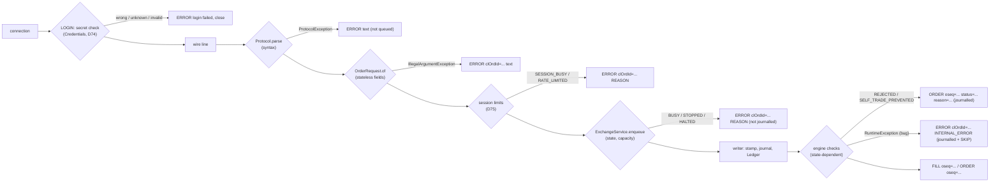

# 08 — Cross-cutting concerns

> **Project:** ExchangeServer2 | Single-instrument limit order book: price-time matching engine, write-ahead journal with replay, single writer thread, TCP/TLS gateway with authenticated participants | Stack: Java 17, Maven wrapper, JUnit 5 (+ JMH, PIT)
> **This guide:** error handling, logging, security, configuration, concurrency, performance and determinism, each traced across every package (as of the risk fixes D66–D77) | **Prerequisites:** 01, 05 | **Related:** 06, 07-modules/*, 09, 11
> **Repo layout summary:** `pom.xml` + Maven wrapper (`mvnw`, `mvnw.cmd`) at the root; production code in `src/main/java/exchangeserver/` (packages `domain`, `book`, `engine`, `command`, `journal`, `core`, `gateway`, `client`, plus `Main`); tests mirror it in `src/test/java/exchangeserver/` (plus `bench/` JMH benchmarks and `testing/MutableClock`); design docs in `docs/` (`ExchangeServer2_Vision.md` = purpose/roadmap, `ExchangeServer2_Spec.md` = decisions D1–D77); these guides in `docs/understanding/`.

## Overview

The module guides (07-*) explain one package at a time. This guide follows themes that cut across all of them:

1. **Error handling**: which exception means what, where it is caught, and what a client or operator finally sees.
2. **Logging and observability**: what is logged and printed, and what is still not reported.
3. **Security**: authentication, transport, and the limits that stop one client from hurting the others.
4. **Configuration**: the command-line flags and the settings records behind them.
5. **Concurrency**: every thread, what it owns, and every lock, `volatile`, counter and queue with the guarantee it gives.
6. **Performance**: measured numbers and the costs the newer features add.
7. **Determinism**: the rule that everything replay rebuilds depends only on the journalled commands.

A one-paragraph refresher, so this guide stands alone. Clients connect over TCP (optionally TLS). Per connection, a *reader thread* authenticates the session (`LOGIN <participant> <secret>`), parses each line, validates it (stateless checks), applies the session's limits and hands a request to `ExchangeService`, which puts it on one queue. A single *writer thread* (`exchange-writer`) takes batches, stamps each request with a sequence number, order id and timestamp (`Sequencer`), appends the batch to a text journal with one fsync (`CommandJournal`), then feeds each command to the `Ledger`: the matching engine plus a running digest of every output and a numbered private stream per participant. The gateway, as the `OutputListener`, sends each participant's private events to all its sessions and market data to subscribers, through bounded per-connection queues that a *sender thread* per connection writes. On restart the journal is replayed (from a snapshot, if the journal was compacted) through the same engine.

---

## 1. Error handling

### 1.1 The exception vocabulary

The rule is decision D27: **`IllegalArgumentException` means bad input; `IllegalStateException` means our own bug or a corrupt journal** [Verified — Spec D27].

| Exception | Meaning here | Typical thrower | Who catches it |
|---|---|---|---|
| `IllegalArgumentException` (IAE) | A caller passed something invalid (bad field, bad setting, non-positive id, weak secret) | `OrderRequest` constructor `src/main/java/exchangeserver/domain/OrderRequest.java:24-50`; command record constructors; `Settings` `src/main/java/exchangeserver/core/ExchangeService.java:65`; `Credentials` | Gateway turns it into `ERROR`; writer turns it into a refused request; `Main` tools print it |
| `IllegalStateException` (ISE) | An invariant broke (our bug) or the journal / snapshot / users file is corrupt or unusable | `OrderBook`, `PriceLevel`, `MatchingEngine` guards; `JournalCodec.decode` `src/main/java/exchangeserver/journal/JournalCodec.java:161`; `CommandJournal.open`; `Snapshot.read`; `JournalLock` ("already open") | Live: `Exchange.process` treats a throw from the engine as a poison pill. At startup: propagates, startup fails |
| `ReplayException` (an ISE) | Replay could not rebuild the state **at a known record**: kind `ENGINE_FAILURE` (the engine threw on that command) or `DIVERGED` (a CHECK digest differs) | `Replay.feed` `src/main/java/exchangeserver/core/Replay.java:82`, `93` | `Main.hint` picks the operator's advice from its kind |
| `ProtocolException` (package-private) | A malformed wire line | `Protocol.parse` `src/main/java/exchangeserver/gateway/Protocol.java:60` | `ClientSession.handle` → `ERROR <text>`, session survives |
| `ExchangeException` with a `Reason` | Why a request got no business result: `BUSY`, `STOPPED`, `HALTED`, `INTERNAL_ERROR` | `ExchangeService.enqueue`, `halt`, `Exchange.process` | The caller's future / callback |
| `IOException` | Real I/O failure (journal write, fsync, socket, keystore) | `CommandJournal`, `Durable`, sockets, `Tls` | Journal: fail-stop → writer halts. Socket: session closes |
| `SocketTimeoutException` | A session sent nothing within the login or idle timeout (D75) | the reader's blocking read | `ClientSession.readLoop` → `ERROR login timeout` / `idle timeout`, then a drained close |
| `Error` (e.g. `OutOfMemoryError`) | The JVM says "unrecoverable" | anywhere | Not caught by the poison-pill path; halts the writer |

`ReplayException` is new with the risk fixes; it carries the kind and the sequence number so the advice can fit (D77, L2):

```java
// src/main/java/exchangeserver/Main.java:186-197 (trimmed)
// L2: advice that fits the failure.
static String hint(Throwable e) {
    for (Throwable t = e; t != null; t = t.getCause()) {
        if (t instanceof ReplayException r) {
            return r.kind() == ReplayException.Kind.ENGINE_FAILURE
                    ? "Replay failed on command " + r.sequenceNumber() + " (a poison pill?). Inspect it, then run --quarantine "
                    + r.sequenceNumber() + " and start again."
                    : "This build replays the journal differently from the build that wrote it. Start the old build, run "
                    + "--compact, then start this build.";
        }
    }
    return "The journal was not changed.";
}
```

[Verified — tested by `MainTest`: a non-journal file gets "The journal was not changed.", a divergence gets the `--compact` advice.] Before D77 the poison-pill hint was printed for every startup failure, including a rules mismatch where quarantining is wrong (L2).

Some kinds of "no" are deliberately **not** exceptions:
- A cancel of an order that is gone or belongs to someone else returns `CancelResult` with status `UNKNOWN_ORDER` (D17, D48) [Verified — `src/main/java/exchangeserver/book/OrderBook.java:97-101`].
- A state-dependent rejection (duplicate client order id, price band, open-order or book cap, post-only would cross) is a `Response` with status `REJECTED` and a `Reason`; self-trade prevention is a `CANCELLED` with `Reason.SELF_TRADE_PREVENTED` (D67) [Verified — `src/main/java/exchangeserver/engine/MatchingEngine.java:186-245`; `src/main/java/exchangeserver/engine/Response.java:33`]. All are journalled and replayed (D13).
- A session-limit refusal (`SESSION_BUSY`, `RATE_LIMITED`) is an `ERROR` line from the gateway, never queued or journalled (D75).

### 1.2 Validation layers: who refuses what



"Validate at the right layer": stateless checks at the gateway, state-dependent checks in the engine, invariant violations throw (Vision §4.6) [Verified]. `OrderRequest` is the *only* field-validation layer (D47); the journal decoder reuses it, so replayed data meets the same rules [Verified — `src/main/java/exchangeserver/journal/JournalCodec.java:132-165`].

### 1.3 What the client sees, case by case

[Verified — formatting code; most lines observed in the live sessions on 2026-10-27]

| Situation | Wire reply | Where it is produced |
|---|---|---|
| Wrong secret, unknown participant, invalid name | `ERROR login failed`, then the connection closes (one attempt per connection) | `ClientSession.login` `src/main/java/exchangeserver/gateway/ClientSession.java:293-307` |
| Connecting while the journal is still replaying | `ERROR exchange is starting; retry shortly`, then close | `src/main/java/exchangeserver/gateway/ClientSession.java:230` |
| Unknown command / bad arity / bad number | `ERROR NEW takes 4 field(s), got 5` | `Protocol.parse` → `ClientSession.handle` |
| Trading before `LOGIN` | `ERROR LOGIN first` | `ClientSession.handle` |
| Invalid field (e.g. quantity 0) | `ERROR clOrdId=c1 Quantity must be positive` | `ClientSession.newOrder` `src/main/java/exchangeserver/gateway/ClientSession.java:329-340` |
| Too many requests in flight / too fast | `ERROR clOrdId=c3 SESSION_BUSY` / `ERROR clOrdId=c3 RATE_LIMITED` | `ClientSession.admit` `src/main/java/exchangeserver/gateway/ClientSession.java:279-291` |
| Queue full / stopping / halted / engine bug | `ERROR clOrdId=c1 BUSY` (`STOPPED`, `HALTED`, `INTERNAL_ERROR`) | `replyFailure` `src/main/java/exchangeserver/gateway/ClientSession.java:413-418` |
| State-dependent reject | `ORDER oseq=4 orderId=4 clOrdId=b2 status=REJECTED filled=0 remaining=1 reason=PRICE_OUTSIDE_BAND` | `Protocol.lines` |
| Self-trade prevented | `ORDER oseq=2 orderId=2 clOrdId=a2 status=CANCELLED filled=0 remaining=5 reason=SELF_TRADE_PREVENTED` | same |
| Cancel of unknown / foreign order | `CANCEL_REJECT oseq=1 orderId=1 reason=UNKNOWN_ORDER` | same |
| RESEND below what is retained | `ERROR RESEND_GAP first=<n>`, then the retained events, then `RESENT last=<n>` | `ClientSession.resend` `src/main/java/exchangeserver/gateway/ClientSession.java:342-360` |
| Silence past the timeout | `ERROR login timeout; disconnecting` / `ERROR idle timeout; disconnecting` | `ClientSession.readLoop` |
| Line over 256 bytes | `ERROR line longer than 256 bytes; disconnecting`, then a close once its requests in flight complete (D76) | `ClientSession.readLoop` |

The login answer is the same whatever was wrong, so a guesser cannot tell an unknown name from a wrong secret (D74).

### 1.4 The poison-pill policy: RuntimeException vs Error

The most important error-handling decision is still D51, now applied to the `Ledger` (engine + digest + private streams) instead of the bare engine:

```java
// src/main/java/exchangeserver/core/Exchange.java:236-251 (trimmed)
try {
    interceptor.beforeEngine(p.command);
    applied = ledger.apply(p.command);
} catch (RuntimeException bug) {
    quarantine(p.command, bug);                     // SKIP record + rebuild the ledger
    p.fail(new ExchangeException(ExchangeException.Reason.INTERNAL_ERROR,
            "command " + p.command.sequenceNumber() + " failed and was quarantined", bug));
    continue;
}
commandsSinceCheck++;
try {
    listener.onOutput(applied.output(), applied.events());
} catch (RuntimeException listenerBug) {
    LOG.log(Level.ERROR, "Output listener failed on command " + applied.output().sequenceNumber(), listenerBug);
}
p.complete(result(applied.output()));   // after the listener: the request's lines went out first (D76)
```

- **`RuntimeException` from the engine** = "this command triggers a bug". `quarantine` appends `SKIP <seq>` (fsynced) and rebuilds the **whole ledger** with `Replay.rebuild` from the snapshot the journal names plus every command before the poison (minus earlier skips) [Verified — `src/main/java/exchangeserver/core/Exchange.java:278-287`]. Rebuilding the digest and the output streams together with the engine keeps all three consistent: none of them saw the poison's partial effects.
- **`Error`** passes out of `process`, through the writer loop's `catch (Throwable t)`, and **halts** the exchange [Verified — `src/main/java/exchangeserver/core/ExchangeService.java:306`; test `ExchangeTest.errorsAreNotQuarantinedTheyPropagate`]. [Inferred] reason: an `Error` says the JVM itself is unhealthy, so a rebuild is not trustworthy.
- **A listener failure** is logged and ignored: the command already happened.
- **A throwing request callback** is now logged too (M9, D77): `enqueue` wraps the callback so a throw is reported instead of vanishing into a future nobody reads [Verified — `src/main/java/exchangeserver/core/ExchangeService.java:212-220`; test `ExchangeServiceTest.Robustness.aThrowingCallbackIsLoggedAndTheExchangeCarriesOn`].
- **At startup** the same engine failure is never quarantined automatically: `Replay.feed` wraps it in `ReplayException(ENGINE_FAILURE, seq)`, startup fails, and the operator inspects the record and runs `--quarantine <seq>` [Verified — Spec D51; `src/main/java/exchangeserver/core/Replay.java:91-95`].

### 1.5 Fail-stop

"Fail-stop over limping" is Vision principle 10 [Verified]. Three levels:

1. **Journal**: after a failed write or fsync, `failed = true` and every later append throws "Journal failed earlier; restart to recover" [Verified — `src/main/java/exchangeserver/journal/CommandJournal.java:145`, `163`].
2. **Writer thread**: any `Throwable` escaping the loop calls `halt`: state `HALTED`, every request in the batch and still queued is failed with `HALTED`, the journal closed [Verified — `src/main/java/exchangeserver/core/ExchangeService.java:286-360`].
3. **Process**: `Main` waits for the writer; on `HALTED` it prints the cause and exits 2 [Verified — `src/main/java/exchangeserver/Main.java:179-183`]. The journal is the truth on restart.

What a halt means for clients: commands in the failing batch are journalled, but their callers were told `HALTED`; they replay on restart. This "durable ⇒ visible" gap is by design (write-ahead). The client-side remedies are resending with the same client order id (D49, within one journal) and, since D73, logging in again and sending `RESEND <last oseq seen + 1>` to receive the outcome it missed [Verified — Spec §4, §8].

### 1.6 Corrupt or unexpected persistent data

| Condition | Behaviour | Where |
|---|---|---|
| Torn last record (no trailing `\n`) | Cut on open, fsynced; the cut is printed at startup (D77) | `CommandJournal.cutTornTail` `src/main/java/exchangeserver/journal/CommandJournal.java:263-274` |
| Complete record that does not parse, or whose CRC-32C does not match | `IllegalStateException("Corrupt journal record N: ...")`; startup fails; never dropped (D38, D69) | `JournalCodec.decode` / `unseal` `src/main/java/exchangeserver/journal/JournalCodec.java:132-185` |
| A record ending in `\r` (file converted to CRLF) | Refused with a message naming the CRLF conversion (D69) | `JournalCodec.unseal` `src/main/java/exchangeserver/journal/JournalCodec.java:171-176` |
| First record not a valid header / other rules with records | Refused **before** anything is cut or written (D64); an empty journal of other rules adopts this build's rules (D71) | `CommandJournal.checkHeader` `src/main/java/exchangeserver/journal/CommandJournal.java:241-260` |
| Journal already open (same JVM or another process) | Refused: "already open" (D65) | `JournalLock.acquire` `src/main/java/exchangeserver/journal/JournalLock.java:37-67` |
| Sequence gap/repeat, timestamp going backwards | `IllegalStateException` in replay's verify pass; nothing is fed | `Replay.Verifier` `src/main/java/exchangeserver/core/Replay.java:101-127` |
| Replay output differs from a CHECK record | `ReplayException(DIVERGED, seq)` (D70) | `Replay.feed` `src/main/java/exchangeserver/core/Replay.java:79-88` |
| Snapshot missing, truncated (no END), or a changed character | "Snapshot ... is missing" / "Corrupt snapshot ... at line N" (D71) | `Snapshot.read` |
| Users file missing or malformed | "No users file ...: create it with --add-user" / "Users file ... line N" | `Credentials.load` `src/main/java/exchangeserver/gateway/Credentials.java:56-60` |

---

## 2. Logging and observability

### 2.1 What is logged and printed

Logging uses `java.lang.System.Logger`, a small facade built into the JDK. With no logging library it routes to `java.util.logging`, whose default handler writes to **stderr** [Verified — observed in test logs: `SEVERE: Exchange halted`]. There is no logging configuration file [Verified].

| Where | Level | When |
|---|---|---|
| `src/main/java/exchangeserver/core/Exchange.java:249` | ERROR | The output listener threw (ignored) |
| `src/main/java/exchangeserver/core/Exchange.java:279` | ERROR | Engine failed on a command; quarantining it |
| `src/main/java/exchangeserver/core/ExchangeService.java:218` | ERROR | A request callback threw (M9) |
| `src/main/java/exchangeserver/core/ExchangeService.java:315` | WARNING | Closing the journal failed |
| `src/main/java/exchangeserver/core/ExchangeService.java:343` | ERROR | Exchange halted (with cause) |
| `src/main/java/exchangeserver/gateway/TcpGateway.java:178` | WARNING, **ERROR from the 10th consecutive failure** | `accept()` failed; exponential backoff 100 ms → 5 s (L6) |
| `src/main/java/exchangeserver/gateway/TcpGateway.java:259` | WARNING | A cancel-on-disconnect could not be submitted |
| `src/main/java/exchangeserver/gateway/TcpGateway.java:280` | INFO | "session N is too slow; disconnecting" |

`Main` prints plain lines: the listening line (address, port, TLS), the **recovery summary** (D77, L1), startup failures with a fitting hint, the halt cause, tool results (`--add-user`, `--quarantine`, `--compact`), and a warning when binding a non-loopback address without TLS [Verified — `src/main/java/exchangeserver/Main.java:118-158`]. Observed live:

```
ExchangeServer2 listening on 127.0.0.1:9137, journal ...\exchange.journal
Recovered through sequence 4 from snapshot 4: replayed 0 commands, cut 0 torn bytes
```

### 2.2 What is still not reported

- **Connections, logins and failed logins** are not logged. A failed-login count would be the first thing an operator watching for attacks wants [Inferred].
- **Rejects, BUSY, SESSION_BUSY and RATE_LIMITED refusals** are answered to the client, not logged.
- **Metrics**: none exported. The writer's `batches()`, `processed()`, `largestBatch()` are the only counters; they lag the replies (updated after a batch's futures complete) and are final only after `stop()` [Verified — `src/main/java/exchangeserver/core/ExchangeService.java:107-112`].

Observability (metrics, structured logs) stays on the Vision's candidate list [Verified — Vision §7].

---

## 3. Security

### 3.1 History in one paragraph

Vision v4 listed "authentication; TLS" as non-goals (wording added by the AI, per the user's notes), and a security review on 2026-10-27 found four gateway issues (LAN bind with no authentication, a memory flood, no timeouts, no fairness). The user first **deferred** all four, then the same day asked for **every risk to be fixed, deferred ones included**. They are now decisions D68, D74 and D75, and authentication and TLS have left the non-goals [Verified — Spec D74; Vision §6].

### 3.2 Authentication (D74)

- **Loopback by default.** `TcpGateway.Settings.defaults` binds `InetAddress.getLoopbackAddress()`; `--bind` widens it, and `Main` warns when that happens without TLS [Verified — `src/main/java/exchangeserver/gateway/TcpGateway.java:68-70`; `src/main/java/exchangeserver/Main.java:127-129`].
- **A secret per participant.** `LOGIN <participant> <secret> [COD]`; the secret is 8–64 printable ASCII characters without spaces [Verified — `src/main/java/exchangeserver/gateway/Credentials.java:38`]. The users file stores `participant:pbkdf2-sha256:<iterations>:<salt>:<hash>`; `--add-user` writes it atomically with 210,000 iterations and a random 16-byte salt [Verified — `src/main/java/exchangeserver/gateway/Credentials.java:36`, `72-80`]. *PBKDF2* (password-based key derivation) runs the secret through HMAC-SHA256 many times so a stolen file is expensive to brute-force; the salt makes equal secrets hash differently (tested: `CredentialsTest.theFileStoresSaltedHashesAndAnUpdateReplacesTheEntry`).
- **No oracle.** Verification compares in constant time and does the same work for an unknown participant, against a dummy entry:

```java
// src/main/java/exchangeserver/gateway/Credentials.java:82-87
public boolean verify(String participant, String secret) {
    Entry entry = participant == null ? null : entries.get(participant);
    Entry against = entry == null ? dummy : entry;      // same work either way
    byte[] candidate = pbkdf2(secret == null ? "" : secret, against.salt(), against.iterations());
    return MessageDigest.isEqual(candidate, against.hash()) && entry != null;
}
```

- **One attempt per connection**: a failed login answers `ERROR login failed` and closes [Verified — `src/main/java/exchangeserver/gateway/ClientSession.java:298-307`; test `TcpGatewayTest.Security.aWrongSecretIsRefusedAndDisconnects`].
- **Secrets are never logged**: `ClientMessage.Login.toString()` leaves the secret out (`Login[alice, COD]`) [Verified — `src/main/java/exchangeserver/gateway/ClientMessage.java:11-16`; test `ProtocolTest.Parse.loginNeverPrintsTheSecret`].
- **Ownership and hiding** are unchanged: a cancel only touches the session participant's own orders (D45), and someone else's order looks unknown (D48).

### 3.3 Transport (D74)

TLS is optional: `--tls-keystore server.p12` builds an `SSLContext` (TLSv1.3 and TLSv1.2 only) and the server socket becomes an `SSLServerSocket` [Verified — `src/main/java/exchangeserver/gateway/Tls.java:22-37`; `src/main/java/exchangeserver/gateway/TcpGateway.java:118-119`]. Keystore and truststore passwords come from the environment (`ES2_TLS_PASSWORD`, `ES2_TRUSTSTORE_PASSWORD`), never the command line, where other users could read them in the process list [Verified — `src/main/java/exchangeserver/gateway/Tls.java:52-58`]. `ClientMain --tls [--truststore FILE]` connects with TLS. Tested end to end with a keystore generated by `keytool` (`TcpGatewayTest.Security.tlsRoundTrip`). The acceptor sets a 2 s read timeout before answering "too many sessions", so a slow TLS handshake there cannot stall it [Verified — `src/main/java/exchangeserver/gateway/TcpGateway.java:188-196`].

### 3.4 Limits that stop one client hurting the others (D68, D75)

| Threat | Limit | Where |
|---|---|---|
| Idle or never-logging-in connections holding the 256 slots (M1) | Login timeout 10 s, idle timeout 300 s (socket read timeouts) | `src/main/java/exchangeserver/gateway/ClientSession.java:157`, `308` |
| One client pipelining until everyone gets BUSY (M2) | At most 1,000 requests in flight per session (`SESSION_BUSY`) | `ClientSession.admit` |
| A request flood (H2) | Token bucket: 1,000 requests/s, bursts of 2,000 (`RATE_LIMITED`) | same |
| Memory exhaustion through many names (H2) | Names need a secret (D74); a global cap of 1,000,000 resting orders (`BOOK_FULL`, D68) | `src/main/java/exchangeserver/domain/Rules.java:37` |
| An ever-growing id map and journal (H2, H3) | Compaction ends the client-order-id scope and bounds replay (D71) | `Exchange.compact` |
| A slow reader stalling the writer | Bounded outbound queue; a full one disconnects (D54, unchanged) | `ClientSession.send` |

```java
// src/main/java/exchangeserver/gateway/ClientSession.java:278-291
// D75: null if the request may go to the exchange, else why not.
private String admit() {
    if (inFlight.get() >= settings.maxInFlight()) {
        return "SESSION_BUSY";
    }
    long now = System.nanoTime();
    tokens = Math.min(settings.burst(), tokens + (now - lastRefillNanos) * settings.ratePerSecond() / 1e9);
    lastRefillNanos = now;
    if (tokens < 1) {
        return "RATE_LIMITED";
    }
    tokens -= 1;
    return null;
}
```

A *token bucket* holds up to `burst` tokens, refills at `ratePerSecond`, and each request spends one; it allows short bursts while bounding the average rate. It runs on the reader thread only, so its fields need no synchronisation [Verified — field comment `src/main/java/exchangeserver/gateway/ClientSession.java:79-80`].

### 3.5 What security still does not cover

- **No accounts or permissions**: a participant is a name and a secret; there are no roles, no read-only users, no per-participant limits beyond the order caps [Verified — Spec §8].
- **The users file is read once at startup**: adding or revoking a user needs a restart [Verified — `Credentials.load` is called only in `Main.serve`].
- **Rate limits are per session**, and a participant may open several sessions (up to the 256-session cap), so its effective rate is higher [Verified — Spec §8].
- **PBKDF2 runs on the reader thread**: 210,000 iterations cost on the order of 0.1 s of CPU per login [Inferred; not measured]. A login flood is bounded by the session cap and one attempt per connection, but it can still burn CPU.
- **Hostname verification** is not done by the client (plain `SSLSocketFactory` sockets do not verify host names); a client trusting a broad CA set could be fooled by another certificate from that CA [Inferred from JSSE behaviour].

---

## 4. Configuration

No configuration files; two environment variables (TLS passwords only) [Verified]. Everything else is a command-line flag that fills a settings record, or a constant.

| Flag | Default | Feeds |
|---|---|---|
| `--port N` | 9000 | `TcpGateway.Settings.port` |
| `--bind ADDR` | 127.0.0.1 | `TcpGateway.Settings.bindAddress` |
| `--journal FILE` | `exchange.journal` | `ExchangeService.start` |
| `--users FILE` | `exchange.users` | `Credentials.load` |
| `--tls-keystore FILE` | none (plain TCP) | `Tls.serverContext` (+ `ES2_TLS_PASSWORD`) |
| `--login-timeout S` / `--idle-timeout S` | 10 / 300 | `TcpGateway.Settings.withTimeouts` |
| `--max-in-flight N` | 1,000 | `TcpGateway.Settings.withFlowControl` |
| `--rate N` / `--burst N` | 1,000 / 2,000 | same |
| `--check-interval N` | 10,000 commands | `Exchange.Options.checkInterval` (D70) |
| `--resend-window N` | 1,000 events per participant | `Exchange.Options.outputRetention` (D73) |
| `--add-user NAME` | — (tool) | writes the users file; secret from the console or one line of stdin |
| `--quarantine SEQ` | — (tool) | appends a SKIP |
| `--compact` | — (tool) | snapshot + empty journal (D71) |

[Verified — `src/main/java/exchangeserver/Main.java:47-85`.] A UTF-8 byte-order mark in front of a piped secret (Windows PowerShell adds one) is dropped [Verified — `src/main/java/exchangeserver/Main.java:226-230`; found live].

Settings without a flag: queue capacity 100,000, max batch 1,000, linger 0 (`ExchangeService.Settings.defaults()` `src/main/java/exchangeserver/core/ExchangeService.java:69-70`); 256 sessions and 10,000 outbound lines per session (`TcpGateway.Settings.defaults`); 256-byte lines and 100-level SUBSCRIBE snapshots (`src/main/java/exchangeserver/gateway/Protocol.java:50`, `54`).

**Rules** (`src/main/java/exchangeserver/domain/Rules.java`) hold every rule replay depends on: `VERSION` 2, max quantity 1e9, max price, name patterns, band 10%, 10,000 open orders per participant, 1,000,000 resting orders. Changing one means bumping `Rules.VERSION`; the journal header records it, `CommandJournal.open` refuses a journal with records written under another version, and the way across is to compact with the old build, then start the new one (an empty journal adopts the new version, D71) [Verified — `src/main/java/exchangeserver/journal/CommandJournal.java:252-259`; test `ExchangeTest.Compaction.aRulesChangeIsCrossedWithAnEmptyCompactedJournal`].

---

## 5. Concurrency

### 5.1 Thread inventory

| Thread (name) | Count | Daemon? | Owns / does |
|---|---|---|---|
| `main` | 1 | no | Parses args, loads credentials, binds and starts accepting, opens + replays the journal, attaches the service, waits for the writer |
| `exchange-writer` | 1 | **no** | **Owns** `Exchange`, `Sequencer`, `CommandJournal`, `Ledger` (engine, book, digest, output log). Runs the `OutputListener` and request callbacks [Verified — `src/main/java/exchangeserver/core/ExchangeService.java:119`] |
| `gateway-acceptor` | 1 | yes | Accepts sockets (started **before** replay, D77), creates sessions [Verified — `src/main/java/exchangeserver/gateway/TcpGateway.java:144`] |
| `session-N-reader` | 1 per connection | yes | Login (PBKDF2), parsing, validation, limits, hand-in [Verified — `src/main/java/exchangeserver/gateway/ClientSession.java:91`] |
| `session-N-sender` | 1 per connection | yes | Writes the session's bounded outbound queue to the socket |
| ForkJoin common pool | JVM-managed | yes | Completes the *caller's* future in the future-returning API (D61) |
| `shutdown` | 1, at exit | — | Closes the gateway, stops the service, then ends the process with the documented code |

### 5.2 The single-writer rule

Only `exchange-writer` touches exchange state; nothing in `domain`, `book`, `engine`, `command`, `journal` or the ledger classes is synchronised [Verified — `src/main/java/exchangeserver/book/OrderBook.java:29`]. Reads go through the queue too: `Snapshot`, `Attach` and `Resend` are requests like any other (D57, D73) [Verified — `src/main/java/exchangeserver/core/Request.java:10-21`]. The replayed state is built on `main` before the writer starts; `Thread.start()` publishes it.

### 5.3 Every synchronisation point and the guarantee it gives

*Happens-before* is the Java Memory Model rule for what one thread is guaranteed to see of another's writes.

| Mechanism | Location | Guarantee |
|---|---|---|
| `LinkedBlockingQueue` put → take | `src/main/java/exchangeserver/core/ExchangeService.java:101` | The writer sees everything the producer put in the `Pending` (no `volatile` needed there) |
| `synchronized (lock)` in `enqueue`, `stop`, `halt`, `run` | `src/main/java/exchangeserver/core/ExchangeService.java:223`, `249`, `318`, `344` | Accepted requests are all ahead of the stop marker; nothing is accepted after it (D56) |
| `stop()` refuses the writer thread | `src/main/java/exchangeserver/core/ExchangeService.java:245-248` | A listener or callback calling `stop()` gets an `IllegalStateException` instead of waiting for itself (L6) |
| `whenCompleteAsync` hand-off (D61) | `src/main/java/exchangeserver/core/ExchangeService.java:170-180` | Callers get their own future; their continuations never run on the writer |
| **Listener before future (D76)** | `src/main/java/exchangeserver/core/Exchange.java:246-251` | When a request's callback runs, the lines its command produced were already offered to the sessions |
| **In-flight counter + `finishIfIdle`** (D76) | `src/main/java/exchangeserver/gateway/ClientSession.java:420-443` | A session closes exactly once, after the reader stopped and every request it handed in completed |
| **Attach read** (D73) | `src/main/java/exchangeserver/gateway/ClientSession.java:312-322` | The session joins its participant's routing on the writer thread, between two commands: the WELCOME's oseq and the first live event leave no gap |
| `volatile participant`, `cancelOnDisconnect`, `readerDone`, `farewell` | `src/main/java/exchangeserver/gateway/ClientSession.java:70-76` | Written by the reader, read by the writer or the last callback |
| `subscriptionLock` + numbered subscriptions | `src/main/java/exchangeserver/gateway/ClientSession.java:64`, `373-411` | SUBSCRIBE / its snapshot callback / UNSUBSCRIBE never interleave |
| `ConcurrentHashMap.compute*` | `src/main/java/exchangeserver/gateway/TcpGateway.java:223-263` | Session-set add and remove are atomic per participant; `removed` also learns whether it was the participant's last session (for cancel-on-disconnect) |
| `JournalLock` (`HELD` + OS lock on `<journal>.lock`) | `src/main/java/exchangeserver/journal/JournalLock.java:27`, `37-67` | One owner per journal, across processes; tested on Windows and Linux |

The D76 close logic in full, because it replaced the D63 barrier:

```java
// src/main/java/exchangeserver/gateway/ClientSession.java:420-443
// D76: counts the request in flight until its callback has run (after the request's own lines went out).
private <T> BiConsumer<T, Throwable> tracked(BiConsumer<T, Throwable> callback) {
    inFlight.incrementAndGet();
    return (value, failure) -> {
        try {
            callback.accept(value, failure);
        } finally {
            inFlight.decrementAndGet();
            finishIfIdle();
        }
    };
}

// Closes after the reader stopped and nothing is in flight; whichever of the two happens last does it.
private void finishIfIdle() {
    if (readerDone && inFlight.get() == 0 && finished.compareAndSet(false, true)) {
        String last = farewell;
        if (last != null) {
            send(last);
        }
        close();
    }
}
```

Why it is race-free [Inferred from the code]: the reader sets `readerDone` (volatile) and then checks the count; a callback decrements and then checks `readerDone`. Whichever runs second sees the other's write, so at least one of them closes, and the `compareAndSet` makes sure only one does.

### 5.4 Ordering guarantees worth memorising

- **A participant's private stream is in oseq order, requester's reply first.** For one command the listener sends the requester's `FILL`/`ORDER` lines, then the makers' fills, then market data [Verified — `src/main/java/exchangeserver/gateway/TcpGateway.java:286-310`; `OutputLog.record`].
- **A session closes after its requests complete**, during shutdown too, because every accepted request is processed or refused before the writer ends (D76; test `TcpGatewayTest.Session.quitDuringShutdownStillGetsTheRepliesOfAcceptedRequests`).
- **Cancel-on-disconnect runs in queue order**: the `CANCEL_ALL` is enqueued when the last COD session is removed, behind anything already queued [Verified — `src/main/java/exchangeserver/gateway/TcpGateway.java:254-262`].

### 5.5 Test seams for concurrency

`CommandInterceptor` (package-private, core) blocks or poisons the writer inside the engine step; `TcpGatewayTest.Hold` is an `OutputListener` wrapper that holds the writer once right after a chosen command's output, so requests stay in flight; `TcpGateway.drainingSessions()` lets a test wait until a session's reader has stopped [Verified — `src/test/java/exchangeserver/gateway/TcpGatewayTest.java:69`; `src/main/java/exchangeserver/gateway/TcpGateway.java:275`]. See guide 10.

---

## 6. Performance

The JMH numbers in Spec §5 were measured **before** the risk fixes and were not re-run (the benchmarks still compile) [Verified]. They showed a command costing ~0.65–1.1 µs, flat in book depth, against ~1.5 ms per fsync, which is why smart batching wins (53× per-command throughput at 64 clients).

What the fixes add, per command or per event [Inferred unless marked]:

| Cost | Size | Where |
|---|---|---|
| Output digest | One `StringBuilder` encoding of the output plus FNV-1a over its bytes: O(output size), allocation per command | `OutputDigest.update` `src/main/java/exchangeserver/core/OutputDigest.java:48-83` |
| Private events | One small record per reply / maker fill / cancel, kept in a bounded deque (1,000 per participant) | `OutputLog.record` |
| CHECK record | One extra journal record per 10,000 commands (inside an existing batch write) | `Exchange.process` [Verified] |
| FOK and at-cap fillability walk | One `RestingOrderView` copy per crossing resting order visited | `OrderBook.walk` `src/main/java/exchangeserver/book/OrderBook.java:149-158` |
| Login | PBKDF2 with 210,000 iterations: CPU on the reader thread, once per connection | `Credentials.verify` |
| TLS | Handshake per connection; encryption per line | JSSE |

What the fixes save: **recovery is bounded**. With snapshots, startup replays only the journal since the last compaction instead of all history, and the client-order-id map holds only one journal's ids plus resting orders (D71). The poison-pill rebuild also starts from the snapshot. A performance re-measurement is an open item (guide 15).

---

## 7. Determinism as a cross-cutting rule

Replay feeds journalled commands through the same engine, so **everything replay rebuilds must depend only on the ordered commands** (D12) [Verified]. Since the risk fixes, "everything" is the whole `Ledger`, not just the book:

| Rule | How it is honoured | Where |
|---|---|---|
| No clock in the engine | Timestamps come from the `Sequencer`; a trade's timestamp is the incoming command's | `src/main/java/exchangeserver/engine/MatchingEngine.java:234` |
| No counters in the engine | The `Sequencer` stamps ids and sequence numbers, including CANCEL_ALL and CHECK | `src/main/java/exchangeserver/command/Sequencer.java:9-19` |
| No hash-iteration order | Engine and book maps are only looked up; walks go through the `TreeMap` levels; the output log sorts participants for the snapshot | `src/main/java/exchangeserver/core/OutputLog.java:25-27`, `100` |
| The ledger is rebuilt as a unit | Engine, digest and output streams come from the same snapshot and the same commands, live and on replay | `src/main/java/exchangeserver/core/Ledger.java:22-55` |
| Output numbers are derived | oseq follows from the outputs alone, so replay rebuilds the same stream (D73) | `src/main/java/exchangeserver/core/OutputLog.java:58-81` |
| Divergence is detected | CHECK digests are compared during replay (D70) | `src/main/java/exchangeserver/core/Replay.java:79-88` |
| Session limits stay outside | Rate limits read `System.nanoTime` on the reader thread, never in the engine; refusals are never journalled | `src/main/java/exchangeserver/gateway/ClientSession.java:279-291` |
| Self-trade prevention is a rule | Journalled behaviour, so it lives in the engine and bumped `Rules.VERSION` to 2 | `src/main/java/exchangeserver/domain/Rules.java:21` |

It is tested directly: `MatchingEngineTest.Determinism` runs 2,000 seeded commands through two engines; `MatchingEngineTest.SnapshotState.exportThenRestoreBehavesIdentically` proves a restored engine continues identically; `ReplayTest.Check` and `ExchangeTest.Checkpoints` prove a CHECK passes on an unchanged history and stops on a changed one.

---

## Key takeaways

- **IAE = bad input, ISE = bug or corrupt data** (D27); `ReplayException` adds *where* replay failed and *why* (engine failure or divergence), and `Main.hint` gives advice that fits.
- **Live engine `RuntimeException` → quarantine + ledger rebuild**; `Error`, journal failure or startup failure → stop (exit 2 or 1).
- **A throwing callback is logged** now, not swallowed (M9).
- **Startup says what recovery did** (base snapshot, replayed, torn bytes, quarantined, rules adoption).
- **Security**: loopback by default, salted PBKDF2 secrets with a constant-time, no-oracle check, one attempt per connection, optional TLS with passwords from the environment, secrets never logged.
- **Session limits**: login/idle timeouts, an in-flight cap and a token-bucket rate limit, all refused at the gateway, never journalled; plus a global resting-order cap in the engine.
- **One writer thread** owns the whole ledger; the listener runs before the future (D76), so a session can close exactly when its requests are done.
- **Determinism now covers the digest and the private streams**, and divergence is detected at the next CHECK.
- **Performance numbers predate the fixes**: the per-command digest and event objects add allocation; compaction bounds recovery.

## Common confusions

- *"INTERNAL_ERROR means the order was not recorded."* It was journalled; a `SKIP` record follows it and replay passes over it.
- *"HALTED means the order did not happen."* Not necessarily: it may replay on restart. Resend with the same client order id, or log in and `RESEND` your private stream.
- *"RATE_LIMITED or SESSION_BUSY was journalled."* No: session limits are stateless refusals at the gateway.
- *"Two sessions of one participant have separate replies."* Since D73 every session of a participant receives the participant's whole private stream, numbered by oseq.
- *"The digest proves the code is unchanged."* It proves the **outputs** are unchanged up to the last CHECK; a change that alters nothing visible, or happens after the last CHECK, is not detected yet.
- *"TLS is on by default."* No: TLS needs `--tls-keystore`; the safe default is the loopback bind.
- *"A failed login reveals whether the name exists."* No: the same message, the same work (dummy hash), one attempt.

## Questions to test yourself

1. A client sends `LOGIN alice wrong-secret`, then `PING`. What does it receive?
<details><summary>Answer</summary>`ERROR login failed`, then the server closes the connection (one attempt per connection), so the `PING` is never answered. The same answer comes for an unknown name or an invalid one.</details>

2. Startup fails with a `ReplayException` of kind `DIVERGED` at sequence 20,001. What happened and what should the operator do?
<details><summary>Answer</summary>The CHECK record at 20,001 holds the output digest the live run produced; this build produced a different one while replaying the commands before it, so it processes old commands differently. Start the build that wrote the journal, run `--compact`, then start this build (it starts from the snapshot). `Main.hint` prints exactly that advice.</details>

3. Why can a session close safely after QUIT even while the exchange is shutting down, when D63 could not?
<details><summary>Answer</summary>D63 queued a snapshot read as a barrier, and the exchange refuses new requests once stopping, so the barrier failed at once and the session closed early. D76 counts requests in flight: every accepted request completes (processed or refused) before the writer ends, and the last completion, or the reader's end if later, closes the session.</details>

4. Where does a request's callback run relative to the lines its command produced, and why does that matter?
<details><summary>Answer</summary>After: `Exchange.process` calls the listener (which offers the lines) and then completes the future, whose callback runs. So when the in-flight count reaches zero in a callback, every reply line is already queued ahead of `BYE` and the close.</details>

5. Name three things that bound memory against a hostile client now.
<details><summary>Answer</summary>Any three of: participants need a secret (no free names); a global cap of 1,000,000 resting orders (`BOOK_FULL`); a per-session rate limit and in-flight cap; bounded outbound queues; compaction ends the client-order-id scope; the 256-session cap and login timeout.</details>

6. Why do the session limits not need to be journalled or deterministic?
<details><summary>Answer</summary>A refused request never reaches the queue, so nothing about it is replayed; replay only needs the commands that were accepted. The limits can therefore use the wall clock (`System.nanoTime`) on the reader thread without touching the engine's determinism.</details>

7. Which environment variables does the system read, and why not flags?
<details><summary>Answer</summary>`ES2_TLS_PASSWORD` (server keystore) and `ES2_TRUSTSTORE_PASSWORD` (client truststore). Command-line arguments are visible to other users in the process list; the environment is not.</details>

8. What does the shutdown hook do differently from before, and what was verified?
<details><summary>Answer</summary>After closing the gateway and stopping the service, it ends the process itself with `Runtime.halt(0)` (2 if halted, 1 on a failed stop), so a stop by signal exits with the documented code instead of the JVM's signal status. Verified on Linux in Docker: exit 0 after SIGINT and after SIGTERM.</details>
