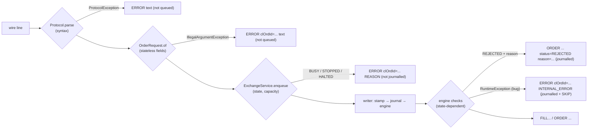
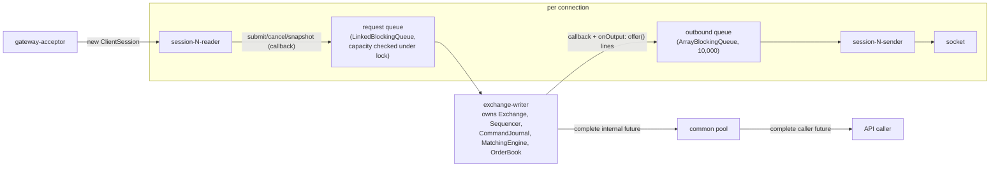

# 08 — Cross-cutting concerns

> **Project:** ExchangeServer2 | Single-instrument limit order book: price-time matching engine, write-ahead journal with replay, single writer thread, plain TCP gateway | Stack: Java 17, Maven wrapper, JUnit 5 (+ JMH, PIT)
> **This guide:** error handling, logging, security, configuration, concurrency, performance and determinism, each traced across every package | **Prerequisites:** 01, 05 | **Related:** 06, 07-modules/*, 09, 11
> **Repo layout summary:** `pom.xml` + Maven wrapper (`mvnw`, `mvnw.cmd`) at the root; production code in `src/main/java/exchangeserver/` (packages `domain`, `book`, `engine`, `command`, `journal`, `core`, `gateway`, `client`, plus `Main`); tests mirror it in `src/test/java/exchangeserver/` (plus `bench/` JMH benchmarks and `testing/MutableClock`); design docs in `docs/` (`ExchangeServer2_Vision.md` = purpose/roadmap, `ExchangeServer2_Spec.md` = decisions D1–D65); these guides in `docs/understanding/`.

## Overview

The module guides (07-*) explain one package at a time. This guide follows themes that cut across all of them:

1. **Error handling**: which exception means what, where it is caught, and what a client finally sees.
2. **Logging and observability**: what is logged, where it goes, and what is *not* reported.
3. **Security**: there is essentially none, by stated choice; the four known gaps.
4. **Configuration**: three command-line flags; everything else is a constant in code.
5. **Concurrency**: every thread, what it owns, and every lock, `volatile` and queue with the happens-before edge it gives.
6. **Performance**: measured numbers and where the time goes.
7. **Determinism**: the rule that the engine depends only on its input commands, which constrains code everywhere.

A one-paragraph refresher of the architecture, so this guide stands alone: clients send text lines over TCP. Per connection, a *reader thread* parses each line and validates it (stateless checks), then hands a request to `ExchangeService`, which puts it on one queue. A single *writer thread* (`exchange-writer`) takes batches from the queue, stamps each request with a sequence number, order id and timestamp (`Sequencer`), appends the whole batch to a text journal and fsyncs it (`CommandJournal`), then runs each command through the matching engine (`MatchingEngine` over `OrderBook`). Replies and market data are offered to per-connection bounded queues that a *sender thread* per connection writes to the socket. On restart the journal is replayed through the same engine.

---

## 1. Error handling

### 1.1 The exception vocabulary

The code uses a small, deliberate set of exception types. The rule is written down as decision D27: **`IllegalArgumentException` means bad input; `IllegalStateException` means our own bug or a corrupt journal** [Verified — Spec D27].

| Exception | Meaning here | Typical thrower | Who catches it |
|---|---|---|---|
| `IllegalArgumentException` (IAE) | A caller passed something invalid (bad field, bad setting, non-positive id) | `OrderRequest` constructor `src/main/java/exchangeserver/domain/OrderRequest.java:24-50`, command record constructors, `Settings` `src/main/java/exchangeserver/core/ExchangeService.java:64` | Gateway (`ClientSession.newOrder`) turns it into `ERROR`; writer turns it into a refused request |
| `IllegalStateException` (ISE) | An invariant broke (our bug) or the journal is corrupt / unusable | `OrderBook`, `PriceLevel`, `MatchingEngine` guards; `JournalCodec.decode`; `CommandJournal.open` | Live: `Exchange.process` treats it as a poison pill. At startup: propagates, startup fails |
| `ProtocolException` (package-private, extends `RuntimeException`) | A malformed wire line | `Protocol.parse` `src/main/java/exchangeserver/gateway/Protocol.java:52-121` | `ClientSession.handle` → `ERROR <text>` line, session survives |
| `ExchangeException` with a `Reason` | Why a request got no business result: `BUSY`, `STOPPED`, `HALTED`, `INTERNAL_ERROR` | `ExchangeService.enqueue`, `halt`, `Exchange.process` | The caller's future / callback |
| `IOException` | Real I/O failure (journal write, fsync, socket) | `CommandJournal`, sockets | Journal: fail-stop → writer halts. Socket: session closes |
| `Error` (e.g. `OutOfMemoryError`, `AssertionError`) | The JVM or a test says "unrecoverable" | anywhere | Not caught by the poison-pill path; halts the writer |

`ExchangeException`'s own comment states the client's next action for each reason [Verified]:

```java
// src/main/java/exchangeserver/core/ExchangeException.java:5-23 (trimmed)
BUSY            the queue is full (backpressure); nothing was journalled. Retry later.
STOPPED         the exchange is stopping or stopped; nothing was journalled.
HALTED          the exchange hit a failure it cannot continue from (journal I/O, or the writer thread died).
                The request may or may not be in the journal: after restart, resend with the same client
                order id and the duplicate check tells you (D49).
INTERNAL_ERROR  the engine failed on this command (a bug). The command was quarantined and the exchange
                carried on without it (D51).
public enum Reason { BUSY, STOPPED, HALTED, INTERNAL_ERROR }
```

Two kinds of "no" are deliberately **not** exceptions:
- A cancel of an order that is gone or belongs to someone else returns `CancelResult` with status `UNKNOWN_ORDER` (D17, D48) [Verified — `src/main/java/exchangeserver/book/OrderBook.java:97-101`].
- A state-dependent rejection (duplicate client order id, price band, open-order cap, post-only would cross) is a normal `Response` with status `REJECTED` and a `RejectReason` [Verified — `src/main/java/exchangeserver/engine/MatchingEngine.java:110-133`]. These are journalled and replayed (D13).

### 1.2 Validation layers: who rejects what



The principle is "validate at the right layer": stateless checks at the gateway, state-dependent checks in the engine, and invariant violations throw (Vision §4.6) [Verified]. `OrderRequest` is the *only* field-validation layer (D47) [Verified — Spec D47]; the journal decoder reuses it to rebuild requests, so the same rules apply to replayed data [Verified — `src/main/java/exchangeserver/journal/JournalCodec.java:101-126`].

### 1.3 What the client sees, case by case

All of these were observed in the live session on 2026-10-27 or are direct reads of the formatting code [Verified]:

| Situation | Wire reply | Where it is produced |
|---|---|---|
| Unknown command / bad arity / bad number | `ERROR NEW takes 4 field(s), got 5` | `Protocol.parse` → `ClientSession.handle` `src/main/java/exchangeserver/gateway/ClientSession.java:182-190` |
| Trading before `LOGIN` | `ERROR LOGIN first` | `ClientSession.handle` |
| Invalid field (e.g. quantity 0) | `ERROR clOrdId=c1 Quantity must be positive` | `ClientSession.newOrder` `src/main/java/exchangeserver/gateway/ClientSession.java:245-252` |
| Queue full / stopping / halted | `ERROR clOrdId=c1 BUSY` (or `STOPPED`, `HALTED`) | `failureLine` `src/main/java/exchangeserver/gateway/ClientSession.java:316-319` |
| Engine bug on this command | `ERROR clOrdId=c1 INTERNAL_ERROR` | same |
| State-dependent reject | `ORDER orderId=4 clOrdId=b2 status=REJECTED filled=0 remaining=1 reason=PRICE_OUTSIDE_BAND` | `Protocol.order` |
| Cancel of unknown / foreign order | `CANCEL_REJECT orderId=1 reason=UNKNOWN_ORDER` | `Protocol.cancel` |
| Line over 256 bytes | `ERROR line longer than 256 bytes; disconnecting`, then the server closes after earlier requests are answered (D63) | `ClientSession.readLoop` `src/main/java/exchangeserver/gateway/ClientSession.java:129-131` |

```java
// src/main/java/exchangeserver/gateway/ClientSession.java:316-319
private static String failureLine(String context, Throwable failure) {
    String reason = failure instanceof ExchangeException e ? e.getReason().name() : failure.getClass().getSimpleName();
    return Protocol.error(context + " " + reason);
}
```

Note the fallback: an unexpected exception type reaches the client as its simple class name, e.g. `ERROR orderId=0 IllegalArgumentException` if a non-positive cancel id ever got past the gateway check [Inferred from the code; the gateway checks `orderId <= 0` itself at `src/main/java/exchangeserver/gateway/ClientSession.java:211-213` so this path is defensive].

### 1.4 The poison-pill policy: RuntimeException vs Error

The single most important error-handling decision is in `Exchange.process` (D51). Everything in a batch is journalled first; then each command runs through the engine inside a `try` that catches only `RuntimeException`:

```java
// src/main/java/exchangeserver/core/Exchange.java:149-164 (trimmed)
EngineOutput output;
try {
    interceptor.beforeEngine(p.command);
    output = apply(p.command);
} catch (RuntimeException bug) {
    quarantine(p.command, bug);                     // SKIP record + rebuild the engine
    p.fail(new ExchangeException(ExchangeException.Reason.INTERNAL_ERROR,
            "command " + p.command.sequenceNumber() + " failed and was quarantined", bug));
    continue;
}
p.complete(output instanceof OrderOutput o ? o.response() : ((CancelOutput) output).result());
try {
    listener.onOutput(output);
} catch (RuntimeException listenerBug) {
    LOG.log(Level.ERROR, "Output listener failed on command " + output.sequenceNumber(), listenerBug);
}
```

- **`RuntimeException` from the engine** = "this command triggers a bug". The engine may be half-way through mutating the book, so it cannot be trusted. `quarantine` appends `SKIP <seq>` (fsynced), rebuilds a fresh engine by replaying every journalled command before the poison (minus earlier skips), and the batch continues [Verified — `src/main/java/exchangeserver/core/Exchange.java:178-189`]. Nobody else notices; the listener never hears of the poison.
- **`Error`** passes straight through `process`, out of the writer loop's `catch (Throwable t)`, and **halts** the exchange [Verified — `src/main/java/exchangeserver/core/ExchangeService.java:266-271`; test `ExchangeTest.errorsAreNotQuarantinedTheyPropagate`]. Why the split: an `Error` such as `OutOfMemoryError` says the JVM itself is in trouble, so a rebuild would likely fail too [Inferred; the Spec states the rule, not this reason].
- **A listener failure** is logged and ignored: the command already happened and was replied to [Verified — lines 160-164 above].
- **At startup** the same engine failure is *not* quarantined: replay propagates the exception, `Exchange.open` closes the journal, `Main` prints `Startup failed: ...` and exits 1. An operator inspects the record and runs `--quarantine <seq>` [Verified — Spec D51; `src/main/java/exchangeserver/core/Exchange.java:83-91`; `src/main/java/exchangeserver/Main.java:62-69`]. The stated reason: at startup the code cannot tell a poison pill from a record that succeeded under older code, and skipping the latter would silently diverge from what clients saw [Verified — Spec D51].

### 1.5 Fail-stop

"Fail-stop over limping" is Vision principle 10 [Verified]. It is implemented at three levels:

1. **Journal**: after any failed write or fsync, `failed = true` and every later `appendAll` throws `IllegalStateException("Journal failed earlier; restart to recover")` [Verified — `src/main/java/exchangeserver/journal/CommandJournal.java:114-137`]. The comment's reason: a partial record may be on disk and a failed fsync cannot be retried safely.
2. **Writer thread**: any `Throwable` escaping the loop (journal failure, `Error`, interrupt, a bug outside the engine) calls `halt`: state becomes `HALTED`, every request in the batch and still in the queue is failed with `HALTED`, the journal is closed [Verified — `src/main/java/exchangeserver/core/ExchangeService.java:246-283`, `302-319`].
3. **Process**: `Main` waits for the writer to end; if the state is `HALTED` it prints the cause and exits with code 2 [Verified — `src/main/java/exchangeserver/Main.java:85-90`]. The journal is the truth on restart.

What a halt means for clients: commands in the failing batch are already journalled, but their callers are told `HALTED`. They will be replayed on restart, so their effects reappear. This is the documented "durable ⇒ visible" gap; the client-side remedy is resending with the same client order id, which then answers `DUPLICATE_CLIENT_ORDER_ID` with the original order id (D49) [Verified — Spec §4, §8].

### 1.6 Corrupt or unexpected journal data

| Condition | Behaviour | Where |
|---|---|---|
| Torn last record (no trailing `\n`) | Cut on open, fsynced; size reported only via `getTruncatedBytesOnOpen()` | `CommandJournal.cutTornTail` `src/main/java/exchangeserver/journal/CommandJournal.java:272-284` |
| Complete record that doesn't parse | `IllegalStateException("Corrupt journal record N: ...")`; startup fails; never dropped (D38) | `JournalCodec.decode` `src/main/java/exchangeserver/journal/JournalCodec.java:122-124` |
| First record not a valid header / other rules version | Refused **before** anything is cut or written (D64) | `CommandJournal.checkHeader` `src/main/java/exchangeserver/journal/CommandJournal.java:258-269` |
| Journal already open (same JVM or another process) | Refused: "already open" (D65) | `CommandJournal.Lock.acquire` `src/main/java/exchangeserver/journal/CommandJournal.java:207-251` |
| Sequence gap/repeat, timestamp going backwards | `IllegalStateException` in replay's verify pass; nothing is fed | `Replay.Verifier` `src/main/java/exchangeserver/core/Replay.java:72-88` |
| File converted to CRLF | The header's last field becomes `"1\r"` → "Bad journal header" → startup fails | observed live 2026-10-27 [Verified] |

---

## 2. Logging and observability

### 2.1 What is logged

Logging uses `java.lang.System.Logger` (JDK 9+), a tiny logging facade built into the JDK. With no logging library on the classpath it routes to `java.util.logging`, whose default handler prints to **stderr** in a two-line format (timestamp + class + method, then `LEVEL: message`) [Verified — observed in the test log: `SEVERE: Exchange halted` with a stack trace]. There is no logging configuration file in the repo [Verified — no `logging.properties` exists].

Every log call in the production code [Verified]:

| Where | Level | When |
|---|---|---|
| `src/main/java/exchangeserver/core/Exchange.java:163` | ERROR | The output listener threw (ignored) |
| `src/main/java/exchangeserver/core/Exchange.java:179` | ERROR | Engine failed on a command; quarantining it |
| `src/main/java/exchangeserver/core/ExchangeService.java:275` | WARNING | Closing the journal failed |
| `src/main/java/exchangeserver/core/ExchangeService.java:303` | ERROR | Exchange halted (with cause) |
| `src/main/java/exchangeserver/gateway/TcpGateway.java:99` | WARNING | `accept()` failed; retrying after 100 ms |
| `src/main/java/exchangeserver/gateway/TcpGateway.java:177` | INFO | Used by `ClientSession.send` for "session N is too slow; disconnecting" |

`Main` additionally prints plain lines to stdout/stderr: the "listening on port" line, startup failures (with a hint about poison pills), the halt cause, shutdown problems, and quarantine success/failure [Verified — `src/main/java/exchangeserver/Main.java:42-89`].

### 2.2 What is *not* reported

- **Replay count and torn bytes.** `Exchange.replayedOnOpen()` and `truncatedBytesOnOpen()` exist but only tests read them; `Main` prints neither. In the live crash-recovery run on 2026-10-27, the server cut a 20-byte torn record and printed nothing about it [Verified — `src/main/java/exchangeserver/core/Exchange.java:224-230`; live run; Spec §8].
- **Connections and logins**: not logged.
- **Rejects, BUSY refusals, protocol errors**: answered to the client, not logged.
- **Metrics**: none exported. The only counters are the writer's `batches()`, `processed()`, `largestBatch()` (used by the benchmark and tests) [Verified — `src/main/java/exchangeserver/core/ExchangeService.java:101-106`]. Their comment notes they lag the replies: they are updated after `process()` returns, so a caller holding a result may still see old values; after `stop()` returns `true` they are final. That lag caused a flaky test (fixed this session; see guide 10).
- **Persistent acceptor failures** produce a warning every 100 ms with no alarm (Spec §8 open thread).

Observability is listed as a "next candidate" on the roadmap (Vision §7) [Verified].

---

## 3. Security

### 3.1 The stated position

"Authentication; TLS" and "production hardening beyond the learning goals" are listed as non-goals (Vision §6) [Verified]. A note in the user's own project memory says that this particular wording ("authentication; TLS" as a non-goal) was added by the AI when writing Vision v4, not by the user in the original v3 [Verified — project memory, 2026-10-27]. Whether it stays a non-goal is an open question for the user (guide 15).

### 3.2 What exists

- **Identity**: `LOGIN <participant>` with any name matching `[A-Za-z0-9_]{1,16}` [Verified — `src/main/java/exchangeserver/domain/Rules.java:26`; `ClientSession.login` `src/main/java/exchangeserver/gateway/ClientSession.java:225-243`]. No password, no check that the name is not already in use: two sessions can log in as the same participant, and both receive that participant's passive fills (by design; tested by `TcpGatewayTest.everySessionOfTheMakerHearsItsFill`).
- **Ownership**: a cancel carries the session's participant; `OrderBook.cancel` only cancels an order owned by that participant (D45) [Verified — `src/main/java/exchangeserver/book/OrderBook.java:97-107`].
- **Information hiding (D48)**: cancelling someone else's order returns `UNKNOWN_ORDER`, the same as a missing order, so a participant cannot probe which order ids are live [Verified — Spec D48; `src/main/java/exchangeserver/book/CancelStatus.java:3-8`].
- **Input bounds**: line length 256 bytes, enforced while reading so a client cannot make the server buffer more (`ClientSession.readLine`); fields bounded by regex and numeric limits in `Rules` [Verified — `src/main/java/exchangeserver/gateway/ClientSession.java:155-175`; `src/main/java/exchangeserver/domain/Rules.java:22-33`].
- **Resource caps**: 256 sessions, 10,000 queued outbound lines per session (a slow consumer is disconnected), 100,000 queued requests globally (beyond that `BUSY`), 10,000 resting orders per participant [Verified — `src/main/java/exchangeserver/gateway/TcpGateway.java:58-60`; `src/main/java/exchangeserver/core/ExchangeService.java:68-70`; `src/main/java/exchangeserver/domain/Rules.java:33`].

### 3.3 Known gaps (four deferred findings)

A security review on 2026-10-27 found four issues. **The user chose to defer all four**; none were fixed or written into the Spec [Verified — user's project memory]. They are restated here because they shape how the system can safely be run:

1. **Binds to all interfaces, no authentication.** `server.bind(new InetSocketAddress(port))` listens on every network interface [Verified — `src/main/java/exchangeserver/gateway/TcpGateway.java:67`]. Anyone on the LAN can log in as any participant, trade, cancel that participant's orders and read their maker fills. Cheapest mitigation noted: bind to `127.0.0.1` by default with a `--bind` flag.
2. **Memory-exhaustion flood.** Participant names are self-chosen, so the per-participant open-order cap can be bypassed with new names; the client-order-id map grows forever (D49); there is no rate limit. An `OutOfMemoryError` halts the writer, and because replay rebuilds the same state, restarts can fail too [Inferred for the restart effect; the map growth is Verified — `src/main/java/exchangeserver/engine/MatchingEngine.java:43`, `110-114`].
3. **No timeouts.** No socket read timeout, login timeout or idle timeout [Verified — no `setSoTimeout` in `src/main`]. 256 idle connections that never log in exhaust the session slots.
4. **No fairness.** One global queue; one client pipelining requests can fill it and make every other client receive `BUSY` [Verified — `src/main/java/exchangeserver/core/ExchangeService.java:192-193`].

There is no TLS: all traffic, including participant names, is plain ASCII [Verified].

---

## 4. Configuration

There are **no environment variables and no configuration files** [Verified — no `System.getenv`/`getProperty` in `src/main`]. Configuration is three command-line flags plus constants in code.

| Setting | Default | Where | Changeable without code change? |
|---|---|---|---|
| `--port` | 9000 | `src/main/java/exchangeserver/Main.java:29,35` | yes |
| `--journal` | `exchange.journal` (relative to the working directory) | `src/main/java/exchangeserver/Main.java:30,36` | yes |
| `--quarantine <seq>` | none (mode switch: append a SKIP and exit) | `src/main/java/exchangeserver/Main.java:37,47-58` | yes |
| Queue capacity | 100,000 | `ExchangeService.Settings.defaults()` `src/main/java/exchangeserver/core/ExchangeService.java:68-70` | no (API only) |
| Max batch size | 1,000 | same | no |
| Linger | 0 (smart batching) | same | no |
| Clock | `Clock.systemUTC()` | same | no |
| Max sessions | 256 | `src/main/java/exchangeserver/gateway/TcpGateway.java:58-60` | no |
| Outbound lines per session | 10,000 | same | no |
| Max line length | 256 bytes | `src/main/java/exchangeserver/gateway/Protocol.java:44` | no |
| Snapshot depth for SUBSCRIBE | 100 levels per side | `src/main/java/exchangeserver/gateway/Protocol.java:48` | no |
| Accept backoff | 100 ms | `src/main/java/exchangeserver/gateway/TcpGateway.java:46` | no |
| Shutdown wait | 10 s | `src/main/java/exchangeserver/Main.java:77` | no |
| Business rules (`VERSION` 1, max quantity 1e9, max price, name patterns, band 10%, open-order cap 10,000) | — | `src/main/java/exchangeserver/domain/Rules.java:19-33` | no, and **changing one requires bumping `Rules.VERSION`** |
| Journal format version | 2 | `src/main/java/exchangeserver/journal/JournalCodec.java:34` | no |

`Rules` is special: every rule that replay depends on lives there, and the journal header records `Rules.VERSION`. `CommandJournal.open` refuses a journal written under a different version, because replaying old commands under new rules would silently build a different book (D20, D46) [Verified — `src/main/java/exchangeserver/domain/Rules.java:5-16`; `src/main/java/exchangeserver/journal/CommandJournal.java:258-265`]. The way across a rule change would be "snapshot + fresh journal", but snapshots are not built yet, so in practice a rule change means starting a new journal and losing the old book [Verified — Spec §8].

---

## 5. Concurrency

### 5.1 Thread inventory

| Thread (name) | Count | Daemon? | Owns / does | Created at |
|---|---|---|---|---|
| `main` | 1 | no | Parses args, binds the gateway, opens + replays the journal, starts everything, then waits for the writer | `Main.main` |
| `exchange-writer` | 1 | **no** (so the JVM cannot exit with accepted work or an open journal) | **Owns** `Exchange`, `Sequencer`, `CommandJournal`, `MatchingEngine`, `OrderBook`. Runs reply callbacks and the `OutputListener` (the gateway's `onOutput`) | `src/main/java/exchangeserver/core/ExchangeService.java:112-114` |
| `gateway-acceptor` | 1 | yes | Accepts sockets, creates sessions | `src/main/java/exchangeserver/gateway/TcpGateway.java:79-81` |
| `session-N-reader` | 1 per connection | yes | Reads and parses lines, validates, hands requests to `ExchangeService` | `src/main/java/exchangeserver/gateway/ClientSession.java:62-65` |
| `session-N-sender` | 1 per connection | yes | Takes lines from the session's bounded outbound queue and writes them to the socket | same |
| ForkJoin common pool | JVM-managed | yes | Completes the *caller's* future in the future-returning API (D61) | `src/main/java/exchangeserver/core/ExchangeService.java:154-164` |
| `shutdown` | 1, at exit | — | Closes the gateway, calls `stop(10 s)` | `src/main/java/exchangeserver/Main.java:74-83` |



### 5.2 The single-writer rule

Only `exchange-writer` touches the exchange's state. Nothing in `domain`, `book`, `engine`, `command` or `journal` is synchronised, on purpose: "there is no second thread there to synchronise with" [Verified — `src/main/java/exchangeserver/core/ExchangeService.java:22-28`; `src/main/java/exchangeserver/book/OrderBook.java:29`]. Even reads go through the queue: `snapshot` is a request like any other (D57), so no other thread ever reads the book [Verified — `src/main/java/exchangeserver/core/Request.java:24-33`]. Tests obey the same rule: they inspect state through a future, never by reading the book from the test thread [Verified — CLAUDE.md "Single writer"].

The replayed state is built on the `main` thread *before* the writer starts; `Thread.start()` is the happens-before edge that publishes it to the writer [Verified — comment at `src/main/java/exchangeserver/core/ExchangeService.java:117-118`].

### 5.3 Every synchronisation point and the edge it gives

*Happens-before* is the Java Memory Model rule that decides what one thread is guaranteed to see of another's writes: if action A happens-before B, B sees everything A (and anything before A in its thread) wrote.

| Mechanism | Location | What it guarantees |
|---|---|---|
| `LinkedBlockingQueue` put → take | `src/main/java/exchangeserver/core/ExchangeService.java:97` | Everything the producer wrote into the `Pending` (request, attached callback) is visible to the writer. This is why `Pending`'s fields need no `volatile` [Verified — `src/main/java/exchangeserver/core/Pending.java:12-14`] |
| `synchronized (lock)` in `enqueue`, `stop`, `halt`, `run`'s final `STOPPED` | `src/main/java/exchangeserver/core/ExchangeService.java:187-197, 209-214, 278-280, 304-307` | State check + enqueue are atomic with `stop()`'s state flip + enqueue of `STOP`: every accepted request is ahead of `STOP`, nothing is accepted after it. "Refused" and "never lost" at once (D56) |
| `volatile state`, `haltCause` | `src/main/java/exchangeserver/core/ExchangeService.java:98-99` | Readable outside the lock (`state()`, `Main`'s halt check) |
| `volatile batches/processed/largestBatch` | `src/main/java/exchangeserver/core/ExchangeService.java:104-106` | Recent values only; **not** ordered with result futures (they are written after `process` returns). Final after `writer.join()` |
| `CompletableFuture.complete` → `get`/`join` | `Pending.result` | Publishes the result to whoever waits |
| `whenCompleteAsync` hand-off (D61) | `src/main/java/exchangeserver/core/ExchangeService.java:154-164` | The caller gets its own future, completed on the common pool, so caller continuations never run on (or block) the writer, and a caller cancelling its future cannot affect the writer |
| `writer.join()` in `stop()` / `awaitTermination()` | `src/main/java/exchangeserver/core/ExchangeService.java:215, 221` | Everything the writer did (including closing the journal and final stats) is visible |
| `ArrayBlockingQueue` outbound + `offer` (never `put`) | `src/main/java/exchangeserver/gateway/ClientSession.java:78-86` | The writer never blocks on a client: a full queue disconnects that client (D54) |
| `AtomicBoolean closed` | `ClientSession` | Exactly one close path runs |
| `volatile participant` | `src/main/java/exchangeserver/gateway/ClientSession.java:55` | Written by the reader at LOGIN, read by the writer when routing fills |
| `subscriptionLock` | `src/main/java/exchangeserver/gateway/ClientSession.java:276-314` | SUBSCRIBE (reader), its snapshot callback (writer) and UNSUBSCRIBE (reader) happen entirely before or after each other; numbered subscriptions mean only the latest SUBSCRIBE's snapshot is sent |
| `ConcurrentHashMap.compute` / `computeIfPresent` | `src/main/java/exchangeserver/gateway/TcpGateway.java:138-165` | Adding a session to a participant's set and dropping an emptied set cannot interleave |
| `synchronized close()` on the journal | `src/main/java/exchangeserver/journal/CommandJournal.java:187-196` | Idempotent close (closes the journal channel, then releases the lock); only the writer (or a single-threaded tool) uses the journal otherwise |
| In-JVM `HELD` set + OS lock on `<journal>.lock` (D65) | `src/main/java/exchangeserver/journal/CommandJournal.java:52-53, 207-251` | Not a memory-model edge: `HELD` (a concurrent set of lock-file real paths) refuses a second open in this JVM before it touches the lock file; the OS lock on the separate lock file excludes a second **process**. A separate file because on Linux/macOS closing any handle to a file drops the process's POSIX locks on it, and the journal's own handles are opened and closed by `read()`, the header check and the torn-tail cut |

### 5.4 Two ordering guarantees worth memorising

**Reply before market data.** The gateway uses the callback variants of `submit`/`cancel`. The callback is attached to the internal future *before* the request is queued, so it runs synchronously on the writer inside `p.complete(...)`, which happens *before* `listener.onOutput(output)` for the same command [Verified — `src/main/java/exchangeserver/core/ExchangeService.java:166-179`; `src/main/java/exchangeserver/core/Exchange.java:159-161`; test `ExchangeServiceTest.callbackRunsOnTheWriterBeforeTheListener`]. Hence a taker sees its `FILL ... TAKER` lines and `ORDER`, and only then do maker fills, `TRADE` and `LEVEL` lines go out.

**Answer before closing (D63).** When a session's reader stops (QUIT, end of stream, overlong line), it queues a depth-1 snapshot read whose callback sends `BYE` (for QUIT) and closes. The request queue is FIFO and processed in order, so that read completes after every request the session handed in, whose reply callbacks have already offered their lines [Verified — `src/main/java/exchangeserver/gateway/ClientSession.java:114-153`; Spec D63; tests `TcpGatewayTest.quitAnswersEveryEarlierRequestBeforeBye`, `endOfStreamStillGetsTheReplies`].

### 5.5 Known concurrency limits

- `stop()` called *from the writer thread* (e.g. inside a listener) would wait for its own end until the timeout (Spec §8) [Verified].
- Callbacks run on the writer and **must not block**; a throwing callback is swallowed silently by `CompletableFuture.whenComplete` (no log) [Inferred from `whenComplete` semantics; see guide 11].
- Thread-per-connection: two platform threads per client (512 at the 256-session cap) [Verified — Spec §6].

---

## 6. Performance

All numbers come from Spec §5 (laptop, Windows 11, JDK 17, JMH 1.37, one fork). They were **not re-run** while writing these guides [Verified that they are documented; not re-measured].

**Engine cost** (`MatchingBenchmark`, ns per op; the last two columns are two commands per op):

| levels per side | `bestLevelLookup` | `restAndTake` | `addAndCancel` |
|---|---|---|---|
| 10 | 7.9 | 2,131 | 1,334 |
| 1,000 | 15.8 | 2,234 | 1,297 |
| 100,000 | 18.5 | 2,169 | 1,534 |

Reading: a command costs about 0.65–1.1 µs, flat in book depth. The O(log L) `TreeMap.firstEntry` lookup is visible (8 → 18 ns) but under 2% of a command, which is why there is no cached best-level pointer (D59). The cost is allocation (records, lists, `Optional`, strings) and the client-order-id map, not the tree [Verified — Spec §5].

**Batching** (`BatchingBenchmark`, closed-loop clients, real fsync ≈ 1.5 ms on the dev disk):

| clients | mode | throughput (orders/ms) | p50 | p99 | avg batch |
|---|---|---|---|---|---|
| 1 | per command | 0.76 | 1.5 ms | 34 ms | 1 |
| 1 | smart | ~0.6 | 1.6 ms | 2.4 ms | 1 |
| 16 | per command | 0.83 | 19 ms | 31 ms | 1 |
| 16 | smart | 11.0 | 1.2 ms | 2.7 ms | 15 |
| 64 | per command | 0.81 | 152 ms | 186 ms | 1 |
| 64 | linger 1 ms | 4.1 | 20 ms | 38 ms | 64 |
| 64 | smart | 43.3 | 1.4 ms | 2.4 ms | 63 |

Reading [Verified — Spec §5]:
- **fsync dominates.** The engine takes ~1 µs per command; one fsync takes ~1,500 µs. Per-command fsync caps throughput at roughly one order per fsync whatever the load.
- **Smart batching** (take whatever is waiting, one fsync, then process) keeps single-client latency equal to one fsync and grows the batch with the load: 53× the per-command throughput at 64 clients.
- **Linger** (wait up to 1 ms for more) measured worse than both on Windows: every timed wait rounds up to the ~15.6 ms default Windows timer resolution, so "1 ms" actually waits ~16 ms.

Other performance-relevant facts:
- Recovery time is O(journal size): the whole journal is replayed on every start (no snapshots); it is streamed twice (verify, then feed) in constant memory (D60) [Verified].
- The client-order-id map only grows (D49), so memory grows with every order ever submitted [Verified — Spec §8].
- `OrderBook` operations: add O(log L), cancel and fill-removal O(1) plus O(log L) when a level empties, best-level lookup O(log L) [Verified — `src/main/java/exchangeserver/book/OrderBook.java:31-32`].
- Two platform threads per connection; writes flushed once per burst, not per line [Verified — `src/main/java/exchangeserver/gateway/ClientSession.java:323-343`].

---

## 7. Determinism as a cross-cutting rule

Replay feeds journalled commands through the same engine, so **the engine's behaviour must depend only on the ordered commands** (D12, Vision §4.4) [Verified]. This one rule explains many small choices in different packages:

| Rule | How it is honoured | Where |
|---|---|---|
| No clock in the engine | Timestamps come from the `Sequencer`; a trade's timestamp is the incoming command's timestamp (D34) | `src/main/java/exchangeserver/engine/MatchingEngine.java:148`; `src/main/java/exchangeserver/engine/Trade.java:8-13` |
| No counters in the engine | Order ids and sequence numbers are stamped by the `Sequencer`, the only clock reader and counter (D32) | `src/main/java/exchangeserver/command/Sequencer.java:9-19` |
| No hash-iteration order | Maps in the engine/book are only looked up; the set of touched levels is a `LinkedHashSet`, so level updates come out in the order levels were touched | `src/main/java/exchangeserver/book/OrderBook.java:44-45`; `src/main/java/exchangeserver/engine/MatchingEngine.java:25-26` |
| Rules fixed per journal | `Rules.VERSION` in the header; refused on mismatch (D46) | `src/main/java/exchangeserver/journal/CommandJournal.java:258-265` |
| Stamping on the writer | The queue carries unstamped requests; sequence order = queue order = processing order (D55) | `src/main/java/exchangeserver/core/Request.java:10-14` |
| State-dependent rejects journalled | So replay reproduces them (D13) | `src/main/java/exchangeserver/engine/RejectReason.java:3-8` |
| Market collar fixed at arrival | An order's own trades cannot move its collar, so the outcome depends only on state at arrival (D50) | `src/main/java/exchangeserver/engine/MatchingEngine.java:180-193` |
| The writer decides from its own state | A journalled command always reaches the engine, whatever happened to a caller's future (D61) | `src/main/java/exchangeserver/core/Exchange.java:139-144` |

It is tested directly: `MatchingEngineTest.Determinism.sameCommandsGiveIdenticalOutputs` runs 2,000 seeded commands through two fresh engines and compares every output [Verified — `src/test/java/exchangeserver/engine/MatchingEngineTest.java:605-627`], and restart tests compare the replayed book's snapshot with the live one.

What determinism does **not** protect against: a code change that alters matching behaviour without changing a rule constant. `Rules.VERSION` only catches deliberate rule changes; replaying an old journal through changed code can silently build a different book (Spec §8) [Verified].

---

## Key takeaways

- **IAE = bad input, ISE = our bug or a corrupt journal** (D27); state-dependent "no"s are normal results (`REJECTED`, `UNKNOWN_ORDER`), not exceptions.
- **Live engine `RuntimeException` → quarantine + rebuild** (only that caller gets `INTERNAL_ERROR`); **`Error`, journal failure or startup failure → stop** (halt and exit 2, or exit 1 at startup).
- **Fail-stop at three levels**: the journal refuses further appends, the writer halts and refuses everything, and the process exits 2.
- **Logging is minimal**: six log calls via `System.Logger` to stderr; replay counts and torn-tail cuts are not reported; no metrics beyond three lagging counters.
- **No security**: unauthenticated LOGIN, binds all interfaces, no TLS, no timeouts or fairness. Four findings were deferred by the user on 2026-10-27.
- **Configuration = three CLI flags**; everything else is a constant; changing a `Rules` constant requires bumping `Rules.VERSION`.
- **One writer thread owns all exchange state**; other threads communicate only through the request queue (in) and bounded outbound queues and futures (out).
- **Two ordering guarantees**: a reply goes before the market data it caused; a session closes only after its requests are answered (D63).
- **fsync, not matching, is the cost**: ~1.5 ms vs ~1 µs, hence smart batching.
- **Determinism** is why there is no clock, counter or hash-order dependence in the engine.

## Common confusions

- *"INTERNAL_ERROR means the order was not recorded."* It **was** journalled (write-ahead happens before processing) and a `SKIP` record follows it; replay passes over it. The exchange carried on without it.
- *"HALTED means the order did not happen."* Not necessarily: commands in the failing batch were journalled and will be replayed on restart. Resend with the same client order id to find out (D49).
- *"The open-order cap protects memory."* It is per participant, and participant names are free to choose, so it does not bound total memory (deferred finding 2).
- *"`volatile` stats are up to date when my future completes."* They are written after the batch's futures complete; read them after `stop()` for exact values.
- *"Logging shows what happened at startup."* It shows nothing about replay or torn-tail cuts; only failures print.
- *"Locks in the book would be safer."* There is nothing to lock against: only one thread ever touches it, and adding locks would hide, not fix, a violation of the single-writer rule.

## Questions to test yourself

1. A client sends `NEW c1 BUY LIMIT 0 100`. Which layer rejects it, what exactly does the client receive, and is anything journalled?
<details><summary>Answer</summary>`Protocol.parse` accepts the syntax (0 is a valid number); `OrderRequest.of` throws `IllegalArgumentException("Quantity must be positive")` in `ClientSession.newOrder`, which sends `ERROR clOrdId=c1 Quantity must be positive`. Nothing reaches the queue, so nothing is journalled.</details>

2. The engine throws `IllegalStateException` on command 6 in a batch holding commands 5, 6, 7. What does the journal contain afterwards, and who is told what?
<details><summary>Answer</summary>Records 5, 6, 7 (written before processing), then `SKIP,8,...,6`. The engine is rebuilt from everything before 6; command 7 runs on the rebuilt engine. Caller 6 gets `INTERNAL_ERROR`; callers 5 and 7 get normal results; the listener hears about 5 and 7 only.</details>

3. Why does the poison-pill path catch `RuntimeException` but not `Error`?
<details><summary>Answer</summary>[Inferred] A `RuntimeException` from the engine signals a bug triggered by that command, which a rebuild without it can recover from. An `Error` (e.g. `OutOfMemoryError`) signals a broken JVM, where rebuilding is unsafe, so the exchange halts (fail-stop). The rule itself is Spec D51; test `errorsAreNotQuarantinedTheyPropagate`.</details>

4. Which happens-before edge lets the writer see the request a reader thread created, without any `volatile` field in `Pending`?
<details><summary>Answer</summary>The `BlockingQueue`'s put → take: actions before `queue.add` in the producer happen-before actions after `queue.take` in the writer.</details>

5. Name every way to configure the running server without recompiling.
<details><summary>Answer</summary>`--port`, `--journal` and (as a separate mode) `--quarantine <seq>`. No environment variables or config files exist.</details>

6. Why is the market collar computed once at arrival instead of from the latest trade during the match loop?
<details><summary>Answer</summary>So the order's own trades cannot widen (or move) its collar (Spec D50). It also keeps the outcome a function of the state at arrival, which is easy to reason about and replay.</details>

7. A colleague runs the server on a shared office network. What can another person on that network do, and what is the cheapest mitigation noted?
<details><summary>Answer</summary>Connect, `LOGIN` as any participant (no authentication), trade and cancel as them, and receive their maker fills; also flood memory or the queue. Cheapest mitigation noted in the deferred findings: bind to `127.0.0.1` by default and add a `--bind` flag (`TcpGateway.java:67`).</details>

8. Why does the README's crash-recovery story not mention how much of the journal was cut?
<details><summary>Answer</summary>Because nothing reports it: `Exchange.truncatedBytesOnOpen()` exists but `Main` never prints it (Spec §8 open thread; observed live).</details>
