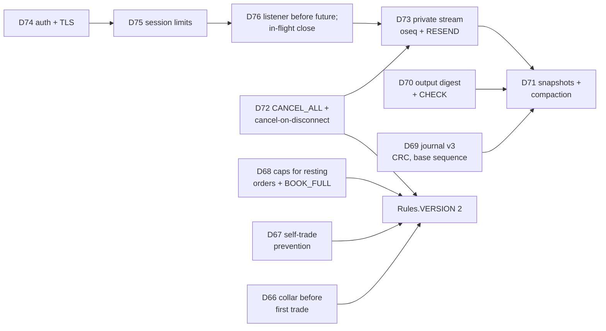
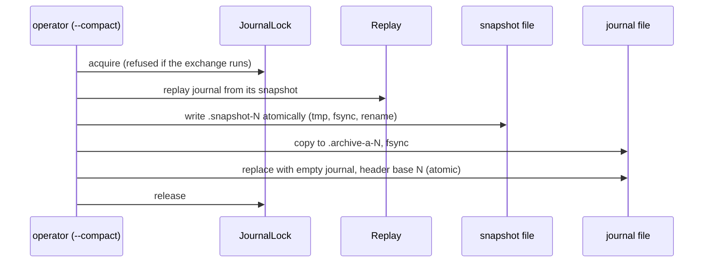

# 09b — Design decisions, part 2: the risk fixes (records 27–38, D66–D77)

> **Project:** ExchangeServer2 | Single-instrument limit order book: price-time matching engine, write-ahead journal with replay, single writer thread, TCP/TLS gateway with authenticated participants | Stack: Java 17, Maven wrapper, JUnit 5 (+ JMH, PIT)
> **This guide:** decision records for D66–D77, made on 2026-10-27 to fix every risk in guide 11 (including the security findings first deferred that day): what was decided, why, what the user chose, the alternatives and the costs | **Prerequisites:** 09 (index), 09a, 11 | **Related:** 08, 10, 07-modules/*
> **Repo layout summary:** `pom.xml` + Maven wrapper (`mvnw`, `mvnw.cmd`) at the root; production code in `src/main/java/exchangeserver/` (packages `domain`, `book`, `engine`, `command`, `journal`, `core`, `gateway`, `client`, plus `Main`); tests mirror it in `src/test/java/exchangeserver/` (plus `bench/` JMH benchmarks and `testing/MutableClock`); design docs in `docs/` (`ExchangeServer2_Vision.md` = purpose/roadmap, `ExchangeServer2_Spec.md` = decisions D1–D77); these guides in `docs/understanding/`.

## Overview

On 2026-10-27 the user asked for **every risk** in guide 11 to be fixed, including the four security findings deferred earlier the same day. Four choices were genuinely the user's and were asked first; the answers, all the recommended options, were:

| Question | Chosen | Not chosen |
|---|---|---|
| Authentication (H1) | Credentials file + loopback bind by default + optional TLS | No TLS; mandatory TLS |
| Self-trade policy (M10) | Cancel the incoming remainder | Cancel the resting order; cancel both; keep allowing self-trades |
| Missed fills (M3, M8) | Numbered private stream with RESEND + opt-in cancel-on-disconnect | Opt-in cancel-on-disconnect only; always cancel on disconnect |
| Delivery | A branch with commits, and a Linux run in Docker | No commits; no Linux run |

[Verified — the question and answers in the session; Spec D67, D72, D73, D74.] Everything else was decided by the AI and recorded as Spec D66–D77, each with its reason. Labels as in 09a: **[Verified — Spec Dnn]** where the Spec states it, **[Verified — path:line]** for code, **[Inferred]** for reconstruction, **⚠ Gap** for a weak spot.

These records interlock more than the earlier ones. The private stream (D73) needs the listener to run before the future (D76); snapshots (D71) must carry the stream's numbers and the output digest (D70); cancel-on-disconnect (D72) is a journalled command so that replay rebuilds the stream; and the session limits (D75) share the in-flight count with D76. The figure shows the dependencies.



### Index

| # | Decision | Spec | Risk fixed (guide 11) |
|---|---|---|---|
| 27 | Market collar before the first trade, anchored on the touch | D66 | M10 |
| 28 | Self-trade prevention: cancel the incoming remainder | D67 | M10 |
| 29 | Caps only for orders that would rest; a global `BOOK_FULL` cap | D68 | H2, M10 |
| 30 | Journal format v3: CRC per record, directory fsync, CRLF message | D69 | M6, M7 |
| 31 | An output digest checked by CHECK records | D70 | M5 |
| 32 | Snapshots and offline compaction | D71 | H3, H2 |
| 33 | CANCEL_ALL and opt-in cancel-on-disconnect | D72 | M8 |
| 34 | A numbered private stream per participant, with RESEND | D73 | M3, M8 |
| 35 | Authentication and transport | D74 | H1 |
| 36 | Per-session limits | D75 | M1, M2, H2 |
| 37 | Listener first, then the future; close when nothing is in flight | D76 | M10 (D63 in shutdown) |
| 38 | Operations: say what happened, advise what fits | D77 | L1, L2, L3, L6, M9 |

---

## 27. Market collar before the first trade (D66)

**Decision.** With no trade yet, a MARKET order's collar is anchored on the best price on the side it trades against: ±10%, with the same floor/ceil rounding as after the first trade. Priced orders still have no band before the first trade [Verified — Spec D66; `src/main/java/exchangeserver/engine/MatchingEngine.java:270-290`].

```java
// src/main/java/exchangeserver/engine/MatchingEngine.java:274-290 (trimmed)
long matchLimit(Order order) {
    if (order.hasPrice()) {
        return order.getPrice();
    }
    long reference = lastTradePrice;
    if (reference == 0) {
        Optional<PriceLevel> touch = book.bestLevel(order.getSide().opposite());
        if (touch.isEmpty()) {
            return order.getSide() == Side.BUY ? Long.MAX_VALUE : 0;     // nothing to trade with anyway
        }
        reference = touch.get().getPrice();
    }
    return order.getSide() == Side.BUY
            ? reference * (100 + Rules.PRICE_BAND_PERCENT) / 100
            : (reference * (100 - Rules.PRICE_BAND_PERCENT) + 99) / 100;
}
```

**Why.** [Verified — Spec D66] The first market order used to have no limit and could sweep a thin book (100, then 500). The touch is the best price that exists, and the rule is the same as after the first trade.

**Alternatives not taken.** [Inferred] Refuse market orders before the first trade (simple, but unfriendly at the open); require an operator-set reference price (a new journalled input); band priced orders against the touch too (no reference a limit order could sensibly be "wrong" against before any trade).

**Trade-offs and consequences.** An engine behaviour change, so `Rules.VERSION` became 2 [Verified — `src/main/java/exchangeserver/domain/Rules.java:19-21`]. If the touch itself is an outlier (one far order), the collar is anchored on it [Inferred]. The old test that asserted a full sweep was inverted: `MatchingEngineTest.Market.beforeTheFirstTradeTheCollarIsAnchoredOnTheTouch`.

---

## 28. Self-trade prevention: cancel the incoming remainder (D67)

**Decision.** The match loop stops when the head of the best opposite level belongs to the incoming order's participant. The remainder is `CANCELLED` with `Reason.SELF_TRADE_PREVENTED`, for every order type (a LIMIT does not rest, since it would cross its own order). The FOK pre-check walks resting orders the same way and stops at the own order [Verified — Spec D67; `src/main/java/exchangeserver/engine/MatchingEngine.java:216-244`, `299-316`].

```java
// src/main/java/exchangeserver/engine/MatchingEngine.java:220-227 (trimmed)
Optional<PriceLevel> best = book.bestLevel(restingSide);
if (best.isEmpty() || !crosses(order.getSide(), limit, best.get().getPrice())) {
    break;
}
if (order.getParticipant().equals(book.headParticipant(restingSide))) {
    selfTradePrevented = true;      // D67: stop here; the remainder is cancelled below
    break;
}
```

**Why.** [Verified — Spec D67] Self-trades create false volume (wash trades). Cancelling the incoming side is the simplest deterministic policy and leaves resting liquidity, with its time priority, alone. It **stops** rather than skipping over the own order: skipping would let the order trade behind its own resting order, breaking price-time priority. Chosen by the user.

**Alternatives not taken.** [Verified — the options offered] Cancel the resting order (removes liquidity others may be relying on); cancel both; keep allowing self-trades. [Inferred] Decrement-and-cancel (reduce both by the overlap, used by some venues) was not offered.

**Trade-offs and consequences.**
- `Reason` replaced `RejectReason`, because a reason can now go with CANCELLED; `Response` enforces the pairing [Verified — `src/main/java/exchangeserver/engine/Reason.java:26-28`; `src/main/java/exchangeserver/engine/Response.java:33-38`].
- The book gained a read-only walk (`walk`, `headParticipant`) so the engine can see owners without touching nodes (keeps D44) [Verified — `src/main/java/exchangeserver/book/OrderBook.java:149-171`].
- A participant whose own order sits at the touch cannot trade through it, even against better-priced orders of others behind it; it must cancel first [Verified — test `SelfTrade.itStopsRatherThanSkippingToWorsePrices`].

---

## 29. Caps only for orders that would rest; a global cap (D68)

**Decision.** The per-participant cap (10,000) and a new global cap (`MAX_RESTING_ORDERS` = 1,000,000, reject reason `BOOK_FULL`) apply only to an order that would **rest**. A LIMIT that fully trades on arrival is accepted at a cap; POST_ONLY at a cap is rejected, since it never trades on arrival [Verified — Spec D68; `src/main/java/exchangeserver/engine/MatchingEngine.java:192-201`].

**Why.** [Verified — Spec D68] The old per-participant cap was checked on arrival and refused orders that would never rest. And participant names were free, so many names could fill memory; the global cap bounds the book whatever the number of participants (H2). Authentication (D74) bounds the names too.

**Alternatives not taken.** [Inferred] Let it trade and cancel only the remainder at the cap (a status that is neither REJECTED nor plain CANCELLED, and a partial trade the client did not expect); cap memory instead of order count (not deterministic across JVMs).

**Trade-offs and consequences.** Deciding "would it fully trade?" needs the fillability walk at a cap: O(crossing orders), and only at a cap [Verified — `src/main/java/exchangeserver/engine/MatchingEngine.java:299-316`]. Tests reach `BOOK_FULL` through a package-private `Limits` seam with tiny caps instead of a million orders [Verified — `src/main/java/exchangeserver/engine/MatchingEngine.java:50-53`].

---

## 30. Journal format v3: checksums, directory fsync, a clear CRLF error (D69)

**Decision.** Every record ends with `,<crc>`, the CRC-32C of its text; the header is `HEADER,3,<rules>,<baseSequence>`. A new file's directory entry is fsynced. A record ending in `\r` is reported as a line-ending conversion. `.gitattributes` keeps journals out of git's line-ending conversion [Verified — Spec D69; `src/main/java/exchangeserver/journal/JournalCodec.java:166-186`; `src/main/java/exchangeserver/journal/Durable.java:47-63`].

**Why.** [Verified — Spec D69] A bit flip that still parsed changed history silently (M6). On Linux, a crash right after creating a file can lose its directory entry unless the directory is fsynced. A CRLF-converted journal failed with a puzzling header error (M7).

**Alternatives not taken.** [Verified — Spec D69] Tolerate `\r\n` (two byte forms of one record make checksums and comparisons ambiguous). [Inferred] A binary format; a whole-file checksum (cannot say which record is bad and does not survive appends).

**Trade-offs and consequences.**
- v2 journals cannot be opened by this build; there is no migration, because they predate snapshots [Verified — Spec §8].
- CRC-32C detects accidents, not tampering; anyone who can edit the file can recompute it [Inferred].
- Windows cannot open a directory as a file, so the directory fsync is best-effort and silently skipped there; NTFS journals its own metadata [Verified — `src/main/java/exchangeserver/journal/Durable.java:47-63`].

---

## 31. An output digest checked by CHECK records (D70)

**Decision.** `OutputDigest` keeps FNV-1a 64 over a canonical text encoding of every engine output, in order. Every `checkInterval` (10,000) commands, the writer journals `CHECK,<seq>,<ts>,<digest>`, stamped at the start of a batch so it covers every earlier command. Replay compares each CHECK with its own digest and stops with `ReplayException(DIVERGED)` [Verified — Spec D70; `src/main/java/exchangeserver/core/OutputDigest.java:48-83`; `src/main/java/exchangeserver/core/Exchange.java:200-203`; `src/main/java/exchangeserver/core/Replay.java:79-88`].

**Why.** [Verified — Spec D70] `Rules.VERSION` catches deliberate rule changes, not a code change that makes old commands behave differently; replay used to build a different book silently (M5). Digesting **outputs** costs O(1) per command and changes if any reject, fill, price or level update differs.

**Alternatives not taken.** [Inferred] Digest the whole state at each CHECK (O(book + id map) each time, and it needs a canonical ordering of a hash map); store every output and compare (large); hash the code (detects changes that matter not at all, and misses none: too blunt).

**Trade-offs and consequences.**
- Detection happens only at the next CHECK after a divergence, and only if the change alters an output [Verified — Spec §8].
- The encoding is written field by field, not `toString()` or `hashCode()`, whose formats Java does not promise to keep [Verified — `src/main/java/exchangeserver/core/OutputDigest.java:15-26`].
- FNV-1a is not cryptographic; it detects accidents [Verified — same comment].
- The digest is part of the `Ledger`, so a poison-pill rebuild recomputes it along with the engine [Verified — `src/main/java/exchangeserver/core/Ledger.java:22-55`].

---

## 32. Snapshots and offline compaction (D71)

**Decision.** `--compact` (exchange stopped, journal lock held) replays the journal, writes `<journal>.snapshot-<last>` (CRC per record, an END record, written atomically), copies the journal to `<journal>.archive-<first>-<last>`, and atomically replaces it with an empty journal whose header names `<last>` as its base. Recovery loads the snapshot the header names, then replays only the journal. A client order id is unique per participant within one journal; after compaction only resting orders keep theirs (**revises D49**). An empty journal written under other rules adopts this build's version (how a rules change is crossed) [Verified — Spec D71; `src/main/java/exchangeserver/core/Exchange.java:167-194`].

**Why.** [Verified — Spec D71] Recovery time, the id map and the poison-pill rebuild grew with all history (H3), and a rules change could not be crossed without losing the book. Crash-safe at every step: the old journal stays in charge until the atomic replace, and each journal names its snapshot by sequence number, so a half-done compaction leaves a stray file, never a journal without its snapshot.



**Alternatives not taken.** [Inferred] Online rotation while running (a writer-thread step that must swap journals mid-stream; deferred, Spec §8); keeping the id map in the snapshot (keeps D49's forever guarantee, but the map never shrinks, which was the problem).

**Trade-offs and consequences.**
- D49's guarantee (a resend after a crash is caught as a duplicate) now holds within a journal: compaction is an end-of-day operation [Verified — Spec D71].
- Compaction must be run by the build that wrote the journal (the new build refuses a journal with records under other rules) [Verified — `src/main/java/exchangeserver/journal/CommandJournal.java:252-259`].
- A snapshot is state, not inputs: it does not depend on `Rules`, which is what lets it cross a rules change. The archives keep every input [Verified — `Snapshot` header comment].
- Snapshots and archives are never deleted automatically [Verified].

---

## 33. CANCEL_ALL and opt-in cancel-on-disconnect (D72)

**Decision.** `LOGIN <p> <secret> COD` asks for cancel-on-disconnect. When the last session of a participant that asked for it closes, the gateway submits a journalled `CANCEL_ALL <p>`; the engine cancels that participant's resting orders in book priority; the cancels go to the participant's private stream [Verified — Spec D72; `src/main/java/exchangeserver/gateway/TcpGateway.java:239-263`; `src/main/java/exchangeserver/engine/MatchingEngine.java:136-156`].

**Why.** [Verified — Spec D72] A disconnected client kept market risk on the book (M8). As a journalled command it replays like any other. Opt-in, because some clients want their orders to survive a reconnect. Chosen by the user.

**Alternatives not taken.** [Verified — the options offered] Always cancel on disconnect. [Inferred] A cancel-on-disconnect with a grace period (needs a timer, which the engine must not read; it would have to live in the gateway).

**Trade-offs and consequences.**
- A clean shutdown closes sessions first, so COD participants' orders are cancelled then too; a crash does not run it [Verified — Spec D72; `Main` shutdown hook closes the gateway before stopping the service].
- The cancellation walks the whole book to find the participant's orders (deterministic order, O(book)); there is no per-participant index [Verified — `src/main/java/exchangeserver/engine/MatchingEngine.java:140-149`].

---

## 34. A numbered private stream per participant, with RESEND (D73)

**Decision.** `OutputLog` (in the `Ledger`, on the writer thread) numbers each participant's private events 1, 2, 3, … (`oseq`): the requester's reply first, then makers' fills, plus cancel replies. They go to **every** session of that participant, and the last `outputRetention` (1,000) are kept. `WELCOME` reports the latest oseq; an `Attach` read joins the stream with no gap. `RESEND <n>` repeats retained events from n (marked `resend=1`) or reports `RESEND_GAP first=`. The numbering is derived from the commands, so replay rebuilds it; a snapshot keeps each participant's last number [Verified — Spec D73; `src/main/java/exchangeserver/core/OutputLog.java:58-98`; `src/main/java/exchangeserver/gateway/ClientSession.java:342-360`].

**Why.** [Verified — Spec D73] A fill for a participant with no open session was lost (M3, M8). Deriving the stream from the journal instead of storing outputs keeps "inputs are the source of truth". All sessions of a participant see one stream, which is what makes one numbering meaningful. Chosen by the user.

**Alternatives not taken.** [Inferred] Store every output durably (a second log to keep consistent); regenerate a resend by replaying the journal on demand (expensive, on the writer); per-session numbering (a reconnecting client is a new session).

**Trade-offs and consequences.**
- Replies used to go only to the requesting session; now every session of the participant receives them (a deliberate behaviour change) [Verified — test `TcpGatewayTest.Trading.everySessionOfAParticipantSeesItsWholeStream`].
- RESEND reaches back at most 1,000 events and never past the last compaction; market data has no resend [Verified — Spec §8].
- Memory: up to 1,000 events per participant ever seen in this journal [Inferred].

---

## 35. Authentication and transport (D74)

**Decision.** The gateway binds 127.0.0.1 unless `--bind` says otherwise. `LOGIN` needs a secret, checked against a users file of salted PBKDF2-HMAC-SHA256 hashes (210,000 iterations; `--add-user` writes it): one attempt per connection, the same answer whatever was wrong, a constant-time compare with a dummy hash for unknown names. TLS 1.3/1.2 with `--tls-keystore` (password in `ES2_TLS_PASSWORD`) [Verified — Spec D74; `src/main/java/exchangeserver/gateway/Credentials.java:82-87`; `src/main/java/exchangeserver/gateway/Tls.java:22-37`].

**Why.** [Verified — Spec D74] Anyone who could reach the port could act as any participant (H1). Loopback by default makes the safe setting the default; PBKDF2 makes a stolen file expensive; TLS keeps secrets and fills off the wire when the gateway is exposed. Authentication and TLS left the Vision's non-goals [Verified — Vision §6]. Chosen by the user.

**Alternatives not taken.** [Verified — the options offered] No TLS (secrets in clear text when bound to a network); mandatory TLS (also on localhost). [Inferred] Client certificates (mutual TLS) instead of secrets; bcrypt/argon2 (not in the JDK, which would add the first runtime dependency).

**Trade-offs and consequences.**
- Every LOGIN costs a PBKDF2 computation on the reader thread [Inferred: of the order of 0.1 s]; tests use 1,000 iterations through `Credentials.of` to stay fast [Verified — `src/test/java/exchangeserver/gateway/TcpGatewayTest.java`].
- The users file is read once at startup; no permissions beyond "may act as this participant" [Verified].
- Secrets never appear in logs: `Login.toString()` omits them [Verified — `src/main/java/exchangeserver/gateway/ClientMessage.java:11-16`].
- A Windows PowerShell pipe adds a UTF-8 byte-order mark to a piped secret; `--add-user` drops it (found live) [Verified — `src/main/java/exchangeserver/Main.java:224-230`].

---

## 36. Per-session limits (D75)

**Decision.** Login timeout 10 s and idle timeout 300 s (socket read timeouts); at most `maxInFlight` (1,000) requests handed in and not completed (`SESSION_BUSY`); a token-bucket rate limit (1,000/s, burst 2,000; `RATE_LIMITED`). Refusals are stateless: never queued, never journalled [Verified — Spec D75; `src/main/java/exchangeserver/gateway/ClientSession.java:278-291`].

**Why.** [Verified — Spec D75] Idle connections could hold the 256 session slots forever (M1); one pipelining client could fill the global queue so everyone got BUSY (M2); a flood could grow the journal and the id map (H2). The rate limit uses `System.nanoTime` on the reader thread: outside the engine, so determinism is untouched.

**Alternatives not taken.** [Inferred] Per-participant limits (need shared state across sessions); a fair scheduler on the writer (round-robin between sessions) instead of refusals (complex, and it changes processing order away from arrival order).

**Trade-offs and consequences.** A participant with several sessions gets several budgets (bounded by the session cap) [Verified — Spec §8]. A PING keeps an idle session alive; a client that only listens to market data must ping at least every 5 minutes [Inferred from the idle timeout].

---

## 37. Listener first, then the future; close when nothing is in flight (D76, revises D63)

**Decision.** `Exchange.process` calls the listener (which sends the command's lines) before completing the request's future. A session counts requests in flight (`tracked` wraps every callback); when its reader stops, it closes once the count reaches zero [Verified — Spec D76; `src/main/java/exchangeserver/core/Exchange.java:246-251`; `src/main/java/exchangeserver/gateway/ClientSession.java:420-443`].

**Why.** [Verified — Spec D76] D63 queued a snapshot read as a barrier, which the exchange refuses once it is stopping, so a session closing during shutdown lost the replies of requests accepted before the stop. Every accepted request completes before the writer ends, so the count reaches zero. The count also serves D75's in-flight limit. The order flip is consistent with D73, which moved the reply into the private stream; the callback is left with only refusals and bookkeeping.

**Alternatives not taken.** [Inferred] Keep the barrier but let reads through while stopping (they would be queued behind the stop marker and never processed); a dedicated barrier request type (same shutdown problem).

**Trade-offs and consequences.**
- The test that asserted "reply before listener" was renamed and inverted: `ExchangeServiceTest.HandIn.listenerRunsOnTheWriterBeforeTheCallback` [Verified].
- A regression test holds the writer, stops the exchange, then sends QUIT and checks the ORDER still arrives before BYE [Verified — `src/test/java/exchangeserver/gateway/TcpGatewayTest.java:214`].

---

## 38. Operations: say what happened, advise what fits (D77)

**Decision.** A bundle of operator-facing fixes [Verified — Spec D77]:
- Startup prints a recovery summary: base snapshot, last sequence, commands replayed, torn bytes cut, quarantined set, rules adoption (L1).
- The poison-pill hint is printed only for an engine failure on a record; a divergence gets the compaction advice (L2) [Verified — `src/main/java/exchangeserver/Main.java:186-197`].
- `--quarantine` refuses a command already quarantined (L3).
- `stop()` on the writer thread throws instead of waiting for itself (L6).
- A throwing request callback is logged (M9).
- The acceptor backs off exponentially and logs ERROR after 10 consecutive failures (L6).
- The gateway accepts before replay and answers "starting" (L6).
- The shutdown hook ends the process itself with 0 (2 if halted), so a stop by signal exits 0 [Verified — `src/main/java/exchangeserver/Main.java:159-177`; verified on Linux in Docker: exit 0 after SIGINT and SIGTERM].

**Why.** [Verified — Spec D77] The operator could not tell what recovery did, got advice that did not fit, and a signal exit used the JVM's signal status (130 or 143) instead of the documented 0.

**Trade-offs.** `Runtime.halt` in the hook skips any other shutdown hooks (there are none in the code) [Inferred]. Connections, logins and refusals are still not logged (guide 08).

---

## Key takeaways

- Four choices were the user's (authentication model, self-trade policy, missed-fill recovery, delivery); all chose the recommended option. The rest are AI decisions recorded in Spec D66–D77 with reasons.
- **Engine policy changes bumped `Rules.VERSION` to 2**: collar before the first trade, self-trade prevention, caps for resting orders only, a global cap, CANCEL_ALL.
- **Durability got stronger**: CRC per record, directory fsync, a clear CRLF error, and CHECK digests that catch a replay producing different outputs.
- **History is bounded**: snapshots + offline compaction; client order ids are now unique per journal (revises D49).
- **Clients can recover**: a numbered private stream per participant with RESEND, and opt-in cancel-on-disconnect.
- **The gateway is no longer open**: loopback by default, secrets with PBKDF2, optional TLS, timeouts, in-flight and rate limits.
- **D76 replaced D63's barrier** with an in-flight count, which needed the listener to run before the future.

## Common confusions

- *"Self-trade prevention skips my own order."* It **stops** at it: the remainder is cancelled; skipping would break price-time priority.
- *"The caps reject any LIMIT at the cap."* Only one that would rest; a fully filling LIMIT is accepted.
- *"Compaction loses history."* The journal is archived; the snapshot is a checkpoint of derived state.
- *"RESEND can replay market data."* Only the participant's private events, at most 1,000 back, never past a compaction.
- *"TLS is enabled by the new security."* Only with `--tls-keystore`; the default protection is the loopback bind plus secrets.
- *"Rate limits are deterministic engine rules."* They live on the reader thread and are never journalled; a refused request never existed for replay.

## Questions to test yourself

1. Alice rests a sell of 3 at 100; Bob rests a sell of 2 at 100 behind her; Alice sends a buy IOC for 5 at 100. What happens?
<details><summary>Answer</summary>The head of the best ask level is Alice's own order, so matching stops at once (D67): no trade, the IOC is CANCELLED with remaining 5 and reason SELF_TRADE_PREVENTED. Bob's order is not reached: the loop stops, it does not skip.</details>

2. Why can a snapshot cross a `Rules.VERSION` change when the journal cannot?
<details><summary>Answer</summary>The journal holds inputs that would be re-run under the new rules and could produce a different book; the snapshot holds the resulting state, which is not re-run. Compact with the old build, then the new build starts from the snapshot and its empty journal adopts the new version (D71).</details>

3. Which two earlier decisions were revised, and how?
<details><summary>Answer</summary>D49 (client order ids unique forever) became unique per journal plus resting orders (D71); D63 (close after a barrier read) became close when the in-flight count reaches zero (D76). Also D74 removed authentication and TLS from the Vision's non-goals.</details>

4. Why does the CHECK record digest outputs rather than state?
<details><summary>Answer</summary>Outputs are produced anyway, so digesting them is O(1) per command and needs no canonical ordering of maps; any behaviour change that matters to clients changes an output. A state digest would cost O(book + id map) per CHECK.</details>

5. Why is CANCEL_ALL a journalled command instead of the gateway sending one CANCEL per order?
<details><summary>Answer</summary>The gateway cannot read the book (single writer), and the engine must decide which orders exist at the moment it runs. As one journalled command it replays identically, including the cancel replies in the participant's private stream (D72, D73).</details>
