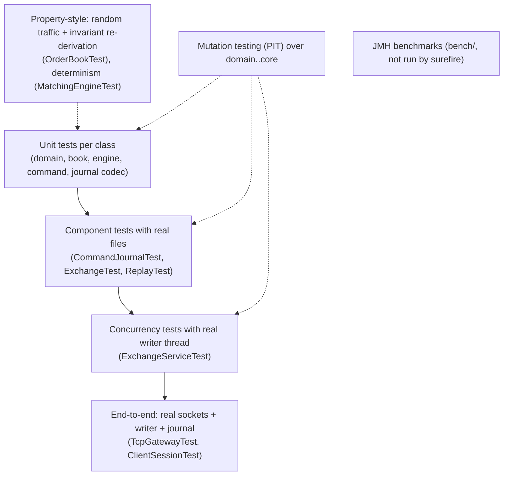

# 10 — Testing

> **Project:** ExchangeServer2 | Single-instrument limit order book: price-time matching engine, write-ahead journal with replay, single writer thread, plain TCP gateway | Stack: Java 17, Maven wrapper, JUnit 5 (+ JMH, PIT)
> **This guide:** test strategy, seams, how to run and write tests, what is and isn't covered, mutation-testing results, and the critical untested paths | **Prerequisites:** 03, 04 | **Related:** 07-modules/*, 08, 11, 14
> **Repo layout summary:** `pom.xml` + Maven wrapper (`mvnw`, `mvnw.cmd`) at the root; production code in `src/main/java/exchangeserver/` (packages `domain`, `book`, `engine`, `command`, `journal`, `core`, `gateway`, `client`, plus `Main`); tests mirror it in `src/test/java/exchangeserver/` (plus `bench/` JMH benchmarks and `testing/MutableClock`); design docs in `docs/` (`ExchangeServer2_Vision.md` = purpose/roadmap, `ExchangeServer2_Spec.md` = decisions D1–D65); these guides in `docs/understanding/`.

## Overview

The suite is large relative to the code: about 4,300 lines of tests for about 3,300 lines of production code. It is the main evidence that the code behaves as the Spec says. Status as of 2026-10-27:

- **334 tests, all green**, on a clean build with `-Xlint:all` and no warnings [Verified — Spec header; the 333-test run was observed directly in this session, and the parent session added the 334th test (`CommandJournalTest.Exclusive.anotherProcessIsRefusedWhileTheJournalIsOpen`) afterwards].
- **History worth knowing:** the Spec used to say "326 tests, all green (three consecutive runs)". The first full run while writing these guides gave **325/326**: `ExchangeServiceTest$Batching.waitingRequestsShareOneBatch` failed with `expected: <50> but was: <1>`. Re-running that class alone passed 8/8, so it was an intermittent (flaky) failure [Verified — observed]. The cause and fix are in §6.
- **Mutation testing** (PIT, explained in §5): final run 496 mutations, 454 killed (92%), test strength 94%, line coverage 94% for the mutated packages (see §5) [Verified — observed].

The testing rules are written in CLAUDE.md and Spec §1 [Verified]:
1. One test class per production class, `@Nested` groups per behaviour; tests mirror the main packages.
2. Every wait in a concurrent test has a timeout; never synchronise with `Thread.sleep`.
3. After a behavioural change, run `-Pmutation` and explain survivors in Spec §7.
4. Expected noise: tests that inject poison pills or fatal errors log stack traces ("simulated engine bug", `OutOfMemoryError: simulated`). These are not failures.

---

## 1. Strategy

### 1.1 Layers of tests



| Layer | What it proves | Example |
|---|---|---|
| Unit | Each class's contract, including its refusals | `PriceLevelTest.Unlink.refusesASentinel` |
| Invariant / property | The book's invariants hold after every one of 30,000 random commands (3 seeds × 10,000), all five order types, wrong-owner cancels included; every trade has exactly one passive fill | `src/test/java/exchangeserver/book/OrderBookTest.java:254-299` |
| Determinism | The same 2,000 commands give equal outputs from two fresh engines | `src/test/java/exchangeserver/engine/MatchingEngineTest.java:601-627` |
| Durability / recovery | Visible ⇒ durable; restart rebuilds the identical book; torn tail cut; corrupt record never dropped; version refused | `ExchangeTest.LivePath.visibleImpliesDurable` (`src/test/java/exchangeserver/core/ExchangeTest.java:80`), `ExchangeTest.Restart.*`, `CommandJournalTest.Recovery.*` |
| Concurrency | Each caller gets its own result; stop never loses a request; BUSY backpressure; halt refuses everything; batching shapes | `ExchangeServiceTest.*` |
| End to end | The protocol, routing, ordering of lines, subscription races, restart behind a new gateway | `TcpGatewayTest.*` |
| Regression | One test per review/survey finding, each checked to fail on the old code | Spec §9, §10 |

### 1.2 Test classes and sizes

Counts are annotated test methods (`@Test`, `@ParameterizedTest`, `@RepeatedTest`); parameterized and repeated tests expand into more executions, which is how they add up to 334 [Verified — grep of `src/test`].

| Package | Test class | Methods | Notable groups (`@Nested`) |
|---|---|---|---|
| domain | `RulesTest` | 6 | band edges, overflow at max price |
| domain | `OrderRequestTest` | 16 | `Factories`, `Validation` |
| domain | `OrderTest` | 8 | `Construction`, `Price`, `Fill` |
| book | `PriceLevelTest` | 21 | `AddOrder`, `FillHead`, `Unlink` |
| book | `OrderBookTest` | 21 | `Add`, `FillBest`, `Cancel`, `OpenOrders`, `LevelUpdates`, `InvariantsUnderRandomTraffic` |
| engine | `MatchingEngineTest` | 54 | `Limit`, `Ioc`, `Fok`, `Market`, `PostOnly`, `Cancel`, `Risk`, `Outputs`, `Snapshot`, `Guards`, `Determinism` |
| engine | `ResponseTest` | 9 | constructor invariants |
| command | `SequencerTest` | 18 | `Stamping`, `InvalidInputUsesUpNothing`, `Clock`, `Resume`, `CommandValidation` |
| journal | `JournalCodecTest` | 10 | `RoundTrip`, `Header`, `Corrupt` |
| journal | `CommandJournalTest` | 24 | `Header`, `AppendAndRead`, `Recovery`, `Exclusive`, `FailStop` |
| core | `ReplayTest` | 10 | verify/feed passes |
| core | `ExchangeTest` | 23 | `LivePath`, `Restart`, `PoisonPill` |
| core | `ExchangeServiceTest` | 20 | `HandIn`, `Stop`, `Backpressure`, `Failures`, `Batching` |
| gateway | `ProtocolTest` | 13 | `Parse`, `Format` |
| gateway | `ClientSessionTest` | 5 | `ReadLine` |
| gateway | `TcpGatewayTest` | 23 | `Session`, `Trading`, `MarketData` |
| — | `bench/MatchingBenchmark`, `bench/BatchingBenchmark` | (JMH) | excluded from surefire |

There is no test class for `Main`, `ClientMain`, `ExchangeClient` (used as a test helper), `TcpGateway` beyond `TcpGatewayTest`, or the small records and enums (exercised indirectly) [Verified].

---

## 2. Test seams

A *seam* is a place where a test can change or observe behaviour without editing production code. All of these are package-private or test-only, so production callers cannot use them [Verified].

| Seam | Where | Used for |
|---|---|---|
| `CommandInterceptor` (package-private functional interface, `NONE` in production) | `src/main/java/exchangeserver/core/CommandInterceptor.java:5-17` | Runs before the engine processes each command, live and during replay. Tests throw from it (poison pill) or block in it (hold the writer) |
| `Gate` (an interceptor that blocks on any order whose client order id starts with `HOLD`) | `src/test/java/exchangeserver/core/ExchangeServiceTest.java:88-108` | Holds the writer mid-batch so the test can queue requests behind it: batching shapes, BUSY, cancelled futures |
| `POISON` (throws `IllegalStateException("simulated engine bug")` for client order ids starting with `POISON`) | `src/test/java/exchangeserver/core/ExchangeTest.java:55-59` | Drives the poison-pill policy, live and on restart |
| `MutableClock` (a `java.time.Clock` tests can set, advance or move backwards; thread-safe) | `src/test/java/exchangeserver/testing/MutableClock.java` | Deterministic timestamps; backwards-clock tests |
| `OrderBook.checkInvariants()`, `ordersAt(side, price)` | `src/main/java/exchangeserver/book/OrderBook.java:177-234` | Re-derive every book invariant from scratch; walk a level's list both ways |
| `MatchingEngine.book()`, `MatchingEngine(OrderBook)` constructor | `src/main/java/exchangeserver/engine/MatchingEngine.java:52-59, 101-104` | Inspect the book behind an engine (same package only) |
| `Exchange.engine()`, `Exchange.process(batch, listener)`, `Pending` | `src/main/java/exchangeserver/core/Exchange.java:118, 237` | Hand-build a batch (e.g. poison in the middle of one) |
| `ExchangeService.start(..., interceptor)` (package-private overload) | `src/main/java/exchangeserver/core/ExchangeService.java:125-133` | Start the service with an interceptor |
| `CommandJournal.openJournals()` (count of open journals in this JVM) | `src/main/java/exchangeserver/journal/CommandJournal.java:105-107` | Prove a journal handle was released. On Windows, deleting a file proves nothing, because Java opens files with delete sharing |
| `TcpGateway.participantsRegistered()`, `subscriberCount()` | `src/main/java/exchangeserver/gateway/TcpGateway.java:168-174` | Registry leaks, subscription state |
| `TcpGateway(0)` (port 0 = OS picks a free port) | `src/test/java/exchangeserver/gateway/TcpGatewayTest.java:42` | Parallel-safe end-to-end tests |
| `ExchangeClient` (`await`, `awaitPrefix`, `linesUntil`, `isClosedByServer`, `field`) | `src/main/java/exchangeserver/client/ExchangeClient.java` | Line client with timeouts that keeps lines it skipped |
| `@TempDir` (JUnit creates and deletes a temporary directory per test) | every journal-touching test | Isolated journal files |

The `Gate` pattern, in full, because many concurrency tests rely on it:

```java
// src/test/java/exchangeserver/core/ExchangeServiceTest.java:88-108 (trimmed)
private static final class Gate implements CommandInterceptor {
    final CountDownLatch reached = new CountDownLatch(1);
    final CountDownLatch release = new CountDownLatch(1);

    @Override
    public void beforeEngine(exchangeserver.command.Command command) {
        if (command instanceof NewOrderCommand n && n.request().getClientOrderId().startsWith("HOLD")) {
            reached.countDown();
            if (!release.await(WAIT.toSeconds(), TimeUnit.SECONDS)) {
                throw new IllegalStateException("gate never released");
            }
        }
    }
    void awaitReached() throws InterruptedException {
        assertTrue(reached.await(WAIT.toSeconds(), TimeUnit.SECONDS), "writer never reached the gate");
    }
}
```

Typical use: submit a `HOLD` order, `awaitReached()` (the writer is now blocked *inside* processing, after journalling that batch), submit more requests (they queue up), then `release.countDown()`.

---

## 3. Running tests

All commands run from the repo root. Use `mvnw.cmd` on Windows and `./mvnw` elsewhere. Don't run two Maven builds at once: they share `target/` [Verified — CLAUDE.md].

| Goal | Command | Notes |
|---|---|---|
| Everything | `mvnw.cmd test` | ~1–2 min; ends `Tests run: 334, Failures: 0 ...` and `BUILD SUCCESS` |
| One class (with all its `@Nested` groups) | `mvnw.cmd test -Dtest=MatchingEngineTest` | [Verified — CLAUDE.md; used in this session] |
| One method | `mvnw.cmd test -Dtest=RulesTest#oppositeSide` | [Verified — CLAUDE.md] |
| One `@Nested` group | `mvnw.cmd test "-Dtest=MatchingEngineTest$Market"` | Nested classes compile to `Outer$Inner`; quote the argument so the shell doesn't expand `$` [Inferred — standard surefire/JUnit 5 behaviour, not run in this session] |
| One method in a group | `mvnw.cmd test "-Dtest=MatchingEngineTest$Market#emptyBookCancelsAll"` | [Inferred, as above] |
| Several classes | `mvnw.cmd test "-Dtest=CommandJournalTest,ExchangeTest,TcpGatewayTest"` | [Verified — used in this session] |
| Mutation testing | `mvnw.cmd -Pmutation test` | Several minutes; report at `target/pit-reports/index.html` |
| Clean first | `mvnw.cmd clean test` | Needed after restoring files with older timestamps: Maven compiles incrementally by modification time, and a stale class was the cause of a false alarm in this session [Verified — CLAUDE.md] |

On Windows, if a `clean` fails with "Failed to delete ...\target\pit-reports", some process (even a shell whose working directory is inside `target/`) holds the folder [Verified — happened in this session].

Reading the output: per-class lines like `Tests run: 24, Failures: 0, Errors: 0, Skipped: 0 -- in exchangeserver.core.ExchangeServiceTest`, then a summary. Stack traces for "simulated engine bug" and `OutOfMemoryError: simulated` are expected. In the IDE (IntelliJ: File › Open › `pom.xml`) the `@Nested` groups show as a tree.

---

## 4. Writing a new test

Follow the house style. A template for an engine behaviour:

```java
// in src/test/java/exchangeserver/engine/MatchingEngineTest.java, inside the existing class
@Nested
class SelfTrade {                                   // one @Nested group per behaviour

    @Test
    void sameParticipantOrdersStillTrade() {        // the name states the behaviour as a sentence
        limit("a", SELL, 100, 5);                   // existing helpers stamp seq/id like the sequencer
        Response r = limit("a", BUY, 100, 5);
        assertEquals(OrderStatus.FILLED, r.status());
        assertEquals(1, r.trades().size());
    }
}
```

Checklist [Verified as house style, from the existing tests and CLAUDE.md]:
1. **Put it in the test class that mirrors the production class** (same package, so package-private seams are visible).
2. **Use a `@Nested` group per behaviour**, and name tests as statements (`refusesASecondUnlink`, `bandIsInclusiveAroundTheLastTrade`).
3. **Use the class's helpers.** `MatchingEngineTest` has `limit/ioc/fok/market/postOnly/cancel` that stamp sequence numbers and ids [Verified — `src/test/java/exchangeserver/engine/MatchingEngineTest.java:37-80`].
4. **Concurrency:** every wait has a timeout (`f.get(WAIT...)`, `latch.await(WAIT...)`, `ExchangeClient.await(..., WAIT)`); use `Gate` rather than sleeps; inspect state through a future (`service.snapshot(...)`), never by reading the book from the test thread; read writer stats only after `stop()`.
5. **Files:** use `@TempDir`; prove a handle was released with `CommandJournal.openJournals()`, not by deleting the file.
6. **Book changes:** call `checkInvariants()` (book package) after mutations.
7. **Regression tests:** put the old code back and confirm the test fails (the project's practice in Spec §9/§10), then add a comment naming the finding or D-number.
8. **Afterwards:** run `-Pmutation`; explain any new survivors in Spec §7.

---

## 5. Mutation testing (PIT)

**What it is.** PIT (pitest) makes small automatic changes ("mutants") to the compiled production code, e.g. `<` → `<=`, removing a method call, returning `0`, and reruns the tests that cover each change. A mutant is **killed** if some test fails, and **survives** if all tests still pass. A survivor shows either a missing test or a change that cannot be observed. It is "breaking the code on purpose", automated [Verified — `pom.xml:126-169` comment].

**Scope.** Packages `domain`, `book`, `engine`, `command`, `journal`, `core` (`pom.xml:143-150`). **Not mutated: `gateway`, `client`, `Main`.** The gateway is covered only by end-to-end tests [Verified — Spec §7].

**Results** [Verified — Spec §7 and runs observed in this session]:

| run | mutations | killed | test strength | line coverage |
|---|---|---|---|---|
| first (rewrite) | 476 | 432 (91%) | 94% | 94% |
| after code-review fixes | 478 | 444 (93%) | 95% | 95% |
| after survey fixes D63/D64 and the first D65 (2026-10-27) | 486 | 450 (93%) | 95% | 95% (846/891 lines) |
| **final: after the D65 rework to `<journal>.lock` (2026-10-27)** | **496** | **454 (92%)** | **94%** | **94% (864/920 lines)** |

*Test strength* = killed ÷ mutants that some test covers. In the final run 15 mutants had no covering test at all (11 before the rework). The rework's 10 new mutants: the in-JVM paths are killed; the 3 in `Lock.acquire`'s "another process holds the lock" branch have **no coverage**, because that branch only runs inside the child JVM of `CommandJournalTest.anotherProcessIsRefusedWhileTheJournalIsOpen`, which PIT does not instrument.

**The survivors, by kind** [Verified — PIT report observed; classification follows Spec §7]:

| Kind | Survivors | Why it survives |
|---|---|---|
| Not observable by a unit test | Removed `force()` (fsync) in `open`, `cutTornTail`, `appendAll`; removed log calls (`Exchange.quarantine`, `ExchangeService.halt`, `run` [no coverage], `Exchange.process` listener-failure log [no coverage]); removed `addSuppressed` (`Exchange.open`, `CommandJournal.open`); `awaitTermination` (only `Main` calls it; no coverage) | Durability needs a power cut to test; logs aren't asserted |
| Equivalent (no behaviour change) | `<=` vs `<` where a second check throws anyway (`OrderBook.add`, `PriceLevel.addOrder` overflow guard, `PriceLevel.fillHead`); linger and journal scan-loop boundaries that only change an extra iteration (`ExchangeService.linger` ×2, `run`, `cutTornTail`, `endOfLastCompleteRecord`); `StringBuilder` initial capacity in `appendAll`; the 1,024-byte header-length cap in `readFirstRecord` | Equivalent mutants can't be killed |
| Test support / cosmetic | `OrderBook.checkInvariants` boundaries ×4 (test-only code); `toString` (`Order`, `PriceLevel`, `OrderRequest`); `OrderRequest.hashCode` → 0 (still correct, just slow); `OrderRequest.equals` `this == o` shortcut; `CommandJournal.getFile` (unused); the callback-less `ExchangeService.cancel` future variant (no test calls it) | Not worth a test, or (for `getFile`) dead code |

**A survivor that was briefly killable.** "Removed `channel.close()` on the failed-open path" is unobservable (the open-journal counter only counts successful opens). With the *first* D65 (lock on the journal itself) a leaked channel kept the lock, so a reopen killed it; after the rework the lock lives on a separate channel, so it survives again, with its `channel != null` guard. The reopen line in `CommandJournalTest.otherRulesVersionIsRefusedAndTheFileIsReleased` now kills "removed `lock.release()`" instead [Verified — final PIT report; `src/test/java/exchangeserver/journal/CommandJournalTest.java:72-80`].

---

## 6. The flaky test and its fix

**Symptom.** In a full run, `waitingRequestsShareOneBatch` failed with `expected: <50> but was: <1>`; it passed 8/8 when run alone [Verified — observed].

**Cause.** The writer loop updates its statistics **after** `exchange.process(batch, ...)` returns, but each request's future is completed **inside** `process`:

```java
// src/main/java/exchangeserver/core/ExchangeService.java:259-264
if (!batch.isEmpty()) {
    exchange.process(batch, listener);      // completes every future in the batch
    batches++;                              // ...then updates the stats
    processed += batch.size();
    largestBatch = Math.max(largestBatch, batch.size());
}
```

A test thread woken by the last future could read `largestBatch` before the writer had updated it. Under full-suite load that window was wide enough to be hit once. The same race existed in five assertions across `ExchangeServiceTest` [Verified — code; the timing explanation is Inferred but consistent with the observed failure and passes].

**Fix (tests only).** Each of those tests now calls `assertTrue(service.stop(WAIT))` before reading the stats. `stop()` joins the writer thread, and `Thread.join` is a happens-before edge, so the final values are visible. A class comment records the rule, and the production field comment now says the stats lag the replies [Verified — `src/test/java/exchangeserver/core/ExchangeServiceTest.java:38-40`; `src/main/java/exchangeserver/core/ExchangeService.java:101-106`]. One consequence: `manyThreadsEachGetTheirOwnResult` now expects `threads * each + 1` processed, because the snapshot read it makes before stopping is counted too.

**Lesson.** "N runs green" is weak evidence for concurrent code. The Spec's "three consecutive full runs" claim hid this flake.

---

## 7. Coverage map: what is and isn't tested

| Area | Covered by | Gaps |
|---|---|---|
| Order types × fill outcomes (LIMIT/IOC/FOK/MARKET/POST_ONLY × full/partial/none) | `MatchingEngineTest` groups per type, "all six price relations" | — |
| Risk checks (duplicate, band, collar, cap, post-only cross) | `MatchingEngineTest.Risk`, `Market`, `PostOnly` | Interaction of the cap with a fully fillable LIMIT is tested as a rule, not questioned |
| Book invariants | Unit tests + 30,000 random commands with full re-derivation | — |
| Journal format, torn tail, corrupt record, version, header-before-cut (D64) | `JournalCodecTest`, `CommandJournalTest.Header/Recovery` | **CRLF-converted journal**: no test (observed live: startup fails) |
| Journal exclusivity (D65) | `CommandJournalTest.Exclusive` (in-JVM, plus a child JVM running `Main --quarantine` after the holder has called `read()`), `ExchangeTest.quarantineToolRefusesWhileTheExchangeIsRunning` | Run on **Windows only**; the POSIX behaviour that motivated the redesign is untested |
| Fail-stop | `CommandJournalTest.FailStop`, `ExchangeServiceTest.Failures` | A real disk error (tests simulate with a closed channel / thrown `Error`) |
| Replay & recovery | `ReplayTest`, `ExchangeTest.Restart` | Very large journals (time/memory) |
| Poison pill | `ExchangeTest.PoisonPill`, `ExchangeServiceTest.Failures.poisonIsQuarantinedAndTheServiceCarriesOn` | — |
| Service concurrency (hand-in, stop races, BUSY, halt, batching, D61) | `ExchangeServiceTest` | `stop()` called from the writer itself (documented limitation) |
| Protocol parse/format | `ProtocolTest` | — |
| Gateway end to end (login, trading, routing, market data, subscription races, D63 QUIT/EOF, restart) | `TcpGatewayTest`, `ClientSessionTest` | See §8 |

---

## 8. Critical untested paths

Each item below was checked by searching `src/test` for the relevant names, constants and messages on 2026-10-27 [Verified unless marked].

1. **`Main` end to end.** Argument parsing, startup failure (exit 1), halt (exit 2), clean stop via the shutdown hook (exit 0). The only automated run of `Main` is the `--quarantine` refusal in `CommandJournalTest.Exclusive.anotherProcessIsRefusedWhileTheJournalIsOpen` (child JVM, expects exit 1 and "already open"). In this session, the startup and refusal paths were exercised by hand, but **a clean Ctrl+C shutdown was never exercised** (the server was only hard-killed).
2. **Linux/macOS.** Nothing has been run off Windows. That matters most for D65 (POSIX lock semantics were the reason for the redesign) and for anything timing-related (Windows timer resolution shaped the batching numbers).
3. **Slow-consumer disconnect** (`ClientSession.send` when the outbound queue is full). No test constructs a gateway with a small `outboundCapacity`; both `TcpGatewayTest` gateways use `new TcpGateway(0)` with the 10,000-line default [Verified — `src/test/java/exchangeserver/gateway/TcpGatewayTest.java:42, 414`].
4. **"Too many sessions"** (the 257th connection gets `ERROR too many sessions`). Not tested.
5. **Acceptor back-off** after a transient `accept()` failure (Spec §9 finding 2 says "not unit-testable; reviewed").
6. **A listener that throws.** `Exchange.process` logs and ignores it; PIT reports that log call as having no coverage, and no test passes a throwing listener [Verified — PIT report; grep].
7. **Halt while the listener or callbacks are running**, and requests whose callbacks were already run when a later command halts.
8. **The gateway under mutation.** `gateway`, `client` and `Main` are excluded from PIT, so their test strength is unknown.
9. **`ClientMain`** (interactive console client): no test.
10. **Benchmarks**: the JMH numbers in Spec §5 were not re-run for these guides.
11. **CRLF journal** (see §7) and **double `SKIP`** of the same command (accepted; observed live).

---

## 9. Test-side smells

- **A spin-wait without a deadline**: `racingStopNeverLosesARequest` busy-waits `while (handedIn.get() < producers * each / 3) Thread.onSpinWait();` with no timeout. If the producers died early, the test would hang instead of failing, which breaks the project's own "every wait has a timeout" rule [Verified — `src/test/java/exchangeserver/core/ExchangeServiceTest.java:348-350`]. The other two spin-waits do have deadlines [Verified — `src/test/java/exchangeserver/core/ExchangeServiceTest.java:279-282`; `src/test/java/exchangeserver/gateway/TcpGatewayTest.java:168-171`].
- **`Thread.sleep(50)` to shape a batch** in `lingerCollectsLateArrivalsIntoTheSameBatch`. The Spec allows it explicitly, because it only affects batching inside a 300 ms linger window, never correctness. It could still flake on a very slow machine (if the sleep overran the window, the assertion `batches == 1` would fail) [Verified — `src/test/java/exchangeserver/core/ExchangeServiceTest.java:525`; the flake risk is Inferred].
- **`ExchangeClient.linesUntil`** uses `skipped.removeAll(lines)`, which removes **every** equal string, so a duplicate line (e.g. two `PONG`s) skipped earlier could vanish [Verified — `src/main/java/exchangeserver/client/ExchangeClient.java:86-97`; impact Inferred]. It lives in production code because `ExchangeClient` doubles as the test client.
- **Timing-based end-to-end tests.** `quitAnswersEveryEarlierRequestBeforeBye` relies on 200 requests arriving faster than the writer can answer them, to show the old bug. Against the old code it failed reliably in this session (1 of 200 replies arrived), but it is a probabilistic reproduction [Verified — observed; Inferred about robustness].
- **Assertions on log noise.** None: expected stack traces in the output are not asserted, so a real unexpected one would go unnoticed if the test still passed [Inferred].

---

## Key takeaways

- **334 tests**, one class per production class with `@Nested` behaviour groups, from unit to real-socket end-to-end; plus PIT at **92% killed / 94% strength** (final run, 496 mutations).
- **Seams**: `CommandInterceptor` (the `Gate` and `POISON` patterns), `MutableClock`, package-private `checkInvariants`/`ordersAt`/`engine()`/`book()`, `openJournals()`.
- **The strongest tests** are the 30,000-command random invariant test, the determinism test, and the restart-equality tests.
- **A flaky test hid behind "326 green"**: stats are written after futures complete; read them after `stop()`.
- **Regression tests are proven** by running them against the old code (all 7 survey tests failed there).
- **Biggest gaps**: `Main`/shutdown/exit codes, Linux/macOS (incl. D65), slow-consumer and too-many-sessions paths, throwing listeners, and the unmutated gateway.
- Use `mvnw.cmd clean test` after swapping files; use `-Dtest=Class#method` for one test.

## Common confusions

- *"Line coverage 95% means 95% of the code is tested."* It is 95% of lines in the **mutated packages only**; `gateway`, `client` and `Main` are excluded.
- *"A surviving mutant is a bug."* Many are equivalent or unobservable (fsync, logs); the Spec classifies each kind.
- *"`Thread.sleep` is banned."* For *synchronisation* it is; one sleep only shapes a batch inside a 300 ms window.
- *"The 334th test is a unit test."* It starts a child JVM running `exchangeserver.Main --quarantine`, so it also covers part of `Main`.
- *"Green once means not flaky."* The batching test passed 8/8 alone and still failed under full-suite load.

## Questions to test yourself

1. Why must `ExchangeServiceTest` read `largestBatch()` after `stop()` rather than after awaiting all futures?
<details><summary>Answer</summary>The writer updates the stats after `exchange.process` returns, while futures complete inside `process`. A completed future gives no happens-before edge to the later stats write; `stop()` joins the writer thread, which does.</details>

2. How does a test hold the writer thread in the middle of processing, and what state is the journal in at that moment?
<details><summary>Answer</summary>Submit an order whose client order id starts with `HOLD` to a service started with a `Gate` interceptor; `beforeEngine` blocks on a latch. The interceptor runs after the batch was journalled and fsynced, so the held command (and its batch) is already on disk.</details>

3. Which PIT survivors are expected and why can't a unit test kill "removed call to `FileChannel::force`"?
<details><summary>Answer</summary>Removing an fsync changes nothing observable unless the machine loses power between the write and the OS flushing it; a unit test can't simulate that. Other expected ones: log calls, `addSuppressed`, equivalent boundary mutants, test-only `checkInvariants`, `toString`/`hashCode`.</details>

4. How would you run only the market-order tests?
<details><summary>Answer</summary>`mvnw.cmd test "-Dtest=MatchingEngineTest$Market"` (nested class name with `$`, quoted). Not run in this session; check the output lists only the `Market` tests.</details>

5. Name three production behaviours with no automated test and how you would test one of them.
<details><summary>Answer</summary>Any three of: slow-consumer disconnect, too-many-sessions refusal, a throwing listener, clean shutdown via the hook/exit codes, acceptor back-off. E.g. slow consumer: create `new TcpGateway(0, 256, 5)`, connect a raw socket that never reads, subscribe, generate enough market data to overflow 5 lines, assert the server closes the connection (and that other clients still trade).</details>

6. What does `CommandJournal.openJournals()` give you that deleting the journal file in a test doesn't?
<details><summary>Answer</summary>Proof that the channel was closed: on Windows Java opens files with delete sharing, so a file can be deleted while still open; the counter decrements only on close.</details>
