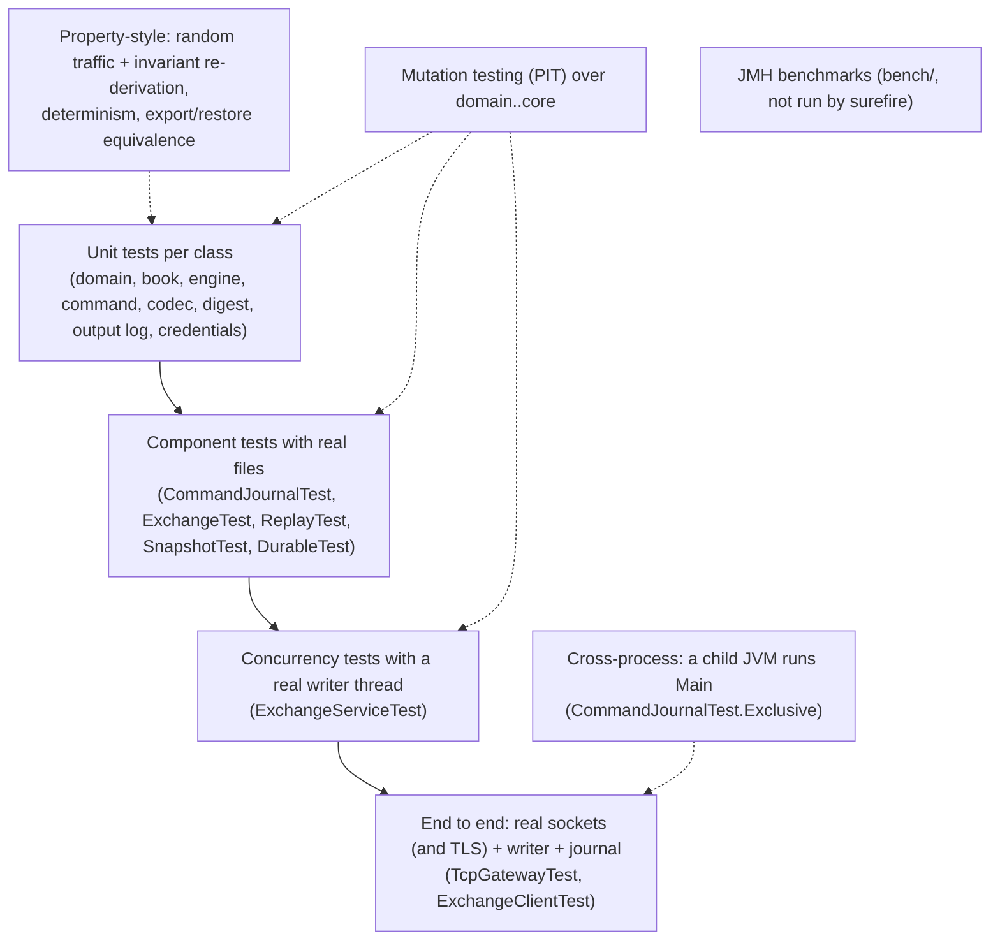

# 10 — Testing

> **Project:** ExchangeServer2 | Single-instrument limit order book: price-time matching engine, write-ahead journal with replay, single writer thread, TCP/TLS gateway with authenticated participants | Stack: Java 17, Maven wrapper, JUnit 5 (+ JMH, PIT)
> **This guide:** test strategy, seams, how to run and write tests, what is and isn't covered, mutation testing, and the paths still untested (as of the risk fixes D66–D77) | **Prerequisites:** 03, 04 | **Related:** 07-modules/*, 08, 09b, 11, 14
> **Repo layout summary:** `pom.xml` + Maven wrapper (`mvnw`, `mvnw.cmd`) at the root; production code in `src/main/java/exchangeserver/` (packages `domain`, `book`, `engine`, `command`, `journal`, `core`, `gateway`, `client`, plus `Main`); tests mirror it in `src/test/java/exchangeserver/` (plus `bench/` JMH benchmarks and `testing/MutableClock`); design docs in `docs/` (`ExchangeServer2_Vision.md` = purpose/roadmap, `ExchangeServer2_Spec.md` = decisions D1–D77); these guides in `docs/understanding/`.

## Overview

The suite is the main evidence that the code behaves as the Spec says. Status on 2026-10-27, after the risk fixes:

- **453 tests, all green on Windows; the suite also passed on Linux (446 tests at the time)**, on a clean build with `-Xlint:all` and no warnings [Verified — observed: Windows locally; Linux in an `eclipse-temurin:17` Docker container, where the repo was copied, `mvnw` converted to LF, and `./mvnw -B test` run].
- 23 test classes (one per production class that has behaviour of its own) with 387 annotated test methods; parameterized and repeated tests expand them to 453 executions [Verified — grep of `src/test`].
- **Mutation testing** (PIT, §5): final run **702 mutations, 644 killed (92%), test strength 94%, line coverage 94% (1290/1368)** [Verified — observed]. Earlier runs on the same day are in the table in §5.

History worth knowing. The Spec once said "326 tests, all green (three consecutive full runs)"; the first full run while writing these guides gave 325/326 because of a flaky test (§6). Lesson: "N runs green" is weak evidence for concurrent code.

The testing rules are in CLAUDE.md and Spec §1 [Verified]:
1. One test class per production class, `@Nested` groups per behaviour; tests mirror the main packages.
2. Every wait in a concurrent test has a timeout; never synchronise with `Thread.sleep`.
3. After a behavioural change, run `-Pmutation` and explain survivors in Spec §7.
4. Expected noise: tests that inject poison pills or fatal errors log stack traces ("simulated engine bug", `OutOfMemoryError: simulated`, "callback bug"). These are not failures.

---

## 1. Strategy

### 1.1 Layers of tests



| Layer | What it proves | Example |
|---|---|---|
| Unit | Each class's contract, including its refusals | `ResponseTest.selfTradePreventedGoesWithCancelledOnly` |
| Invariant / property | The book's invariants hold after every one of 30,000 random commands, all five order types | `src/test/java/exchangeserver/book/OrderBookTest.java:293` |
| Determinism | Same commands → equal outputs; a restored engine behaves like the original | `src/test/java/exchangeserver/engine/MatchingEngineTest.java:818`; `MatchingEngineTest.SnapshotState` |
| Durability / recovery | Visible ⇒ durable; restart and compaction rebuild the same state; checksums, CRLF, torn tails, divergence | `ExchangeTest.Restart`, `ExchangeTest.Compaction`, `ExchangeTest.Checkpoints`, `JournalCodecTest.Corrupt`, `ReplayTest.Check` |
| Concurrency | Own results per caller; stop never loses a request; BUSY; halt; batching; callback errors; listener-before-callback | `ExchangeServiceTest.*` |
| End to end | Protocol, routing, the private stream, security, limits, cancel-on-disconnect, subscription races | `TcpGatewayTest.*` |
| Cross-process | `--quarantine` is refused while another JVM holds the journal (the POSIX lock question) | `src/test/java/exchangeserver/journal/CommandJournalTest.java:312` |
| Regression | One test per review/survey finding | Spec §9, §10, §11 |

### 1.2 Test classes

| Package | Test class | Methods | `@Nested` groups (new ones in **bold**) |
|---|---|---|---|
| (root) | **`MainTest`** | 2 | operator hints (L2) |
| domain | `RulesTest`, `OrderRequestTest`, `OrderTest` | 6, 16, 8 | `Factories`, `Validation`, `Construction`, `Price`, `Fill` |
| book | `PriceLevelTest` | 22 | `AddOrder`, `FillHead`, `Unlink` (+ `nextNode`) |
| book | `OrderBookTest` | 24 | `Add`, `FillBest`, `Cancel`, `OpenOrders`, `LevelUpdates`, **`Walk`**, `InvariantsUnderRandomTraffic` |
| engine | `MatchingEngineTest` | 73 | `Limit`, `Ioc`, `Fok`, `Market`, `PostOnly`, `Cancel`, `Risk`, **`SelfTrade`**, **`Caps`**, **`CancelAll`**, **`SnapshotState`**, `Outputs`, `Snapshot`, `Guards`, `Determinism` |
| engine | `ResponseTest` | 10 | reason pairing (D67) |
| command | `SequencerTest` | 21 | `Stamping`, `InvalidInputUsesUpNothing`, `Clock`, `Resume`, `CommandValidation` (+ CANCEL_ALL, CHECK) |
| journal | `JournalCodecTest` | 16 | `RoundTrip`, `Header`, `Corrupt` (+ checksum, CRLF) |
| journal | `CommandJournalTest` | 25 | `Header` (+ rules adoption), `AppendAndRead`, `Recovery`, `Exclusive`, `FailStop` |
| journal | **`DurableTest`** | 3 | atomic write, copy, directory fsync |
| core | `ReplayTest` | 15 | **`Verify`**, **`Feed`**, **`Check`** |
| core | `ExchangeTest` | 36 | `LivePath`, `Restart`, `PoisonPill`, **`Checkpoints`**, **`Compaction`**, **`Operations`** |
| core | `ExchangeServiceTest` | 24 | `HandIn`, `Stop`, `Backpressure`, `Failures`, `Batching`, **`Robustness`** |
| core | **`OutputDigestTest`**, **`OutputLogTest`**, **`SnapshotTest`** | 5, 5, 6 | digest sensitivity; numbering and retention; snapshot file round trip and corruption |
| gateway | `ProtocolTest` | 17 | `Parse`, `Format` (oseq lines, LOGIN with secret, RESEND) |
| gateway | `ClientSessionTest` | 5 | `ReadLine` |
| gateway | **`CredentialsTest`** | 5 | verify, salted file, weak input, missing or corrupt file |
| gateway | `TcpGatewayTest` | 40 | `Session`, **`Security`**, **`Limits`**, `Trading`, **`Resend`**, **`CancelOnDisconnect`**, `MarketData` |
| client | **`ExchangeClientTest`** | 3 | `linesUntil` consumes exactly its lines (L4) |
| — | `bench/MatchingBenchmark`, `bench/BatchingBenchmark` | (JMH) | excluded from surefire; still compile |

No test class: `ClientMain`, `Tls` (covered end to end by `TcpGatewayTest.Security.tlsRoundTrip`), `JournalLock` (covered by `CommandJournalTest.Exclusive`), `Ledger` (covered through `ReplayTest` and `ExchangeTest`), and small records and enums [Verified].

---

## 2. Test seams

A *seam* is a place where a test can change or observe behaviour without editing production code. All are package-private or test-only [Verified].

| Seam | Where | Used for |
|---|---|---|
| `CommandInterceptor` (package-private, `NONE` in production) | `src/main/java/exchangeserver/core/CommandInterceptor.java:5-17` | Runs before the engine on each command, live and during replay. Tests throw from it (poison pill) or block in it |
| `Gate` interceptor (blocks on client order ids starting `HOLD`) | `src/test/java/exchangeserver/core/ExchangeServiceTest.java:88` | Hold the writer mid-batch (batching shapes, BUSY, cancelled futures) |
| `POISON` interceptor | `src/test/java/exchangeserver/core/ExchangeTest.java:55` | Drive the poison-pill policy |
| **`Hold` listener** (an `OutputListener` wrapper that blocks once, right after the output of the command it was armed for) | `src/test/java/exchangeserver/gateway/TcpGatewayTest.java:69` | Gateway tests cannot reach the package-private interceptor; holding the writer *after* a command keeps later requests in flight (in-flight limit, D76 during shutdown) |
| **`MatchingEngine.Limits`** (package-private constructor with small caps) | `src/main/java/exchangeserver/engine/MatchingEngine.java:50-53`, `73` | Reach `MAX_OPEN_ORDERS` and `BOOK_FULL` with a handful of orders instead of a million |
| **`TcpGateway.drainingSessions()`** | `src/main/java/exchangeserver/gateway/TcpGateway.java:275`; `ClientSession.draining()` `src/main/java/exchangeserver/gateway/ClientSession.java:111` | Wait until a session's reader stopped (QUIT read) while requests are still in flight |
| **`Credentials.of(map, 1_000)`** | `src/test/java/exchangeserver/gateway/TcpGatewayTest.java:52` | Few PBKDF2 iterations so hundreds of logins stay fast |
| **`Exchange.Options(checkInterval, retention)`** | `Exchange.open(..., options)` | CHECK every command or two; tiny RESEND retention to provoke `RESEND_GAP` |
| `MutableClock` | `src/test/java/exchangeserver/testing/MutableClock.java` | Deterministic timestamps |
| `OrderBook.checkInvariants()`, `ordersAt()` | `src/main/java/exchangeserver/book/OrderBook.java:211`, `226` | Re-derive every book invariant from scratch |
| `MatchingEngine.book()`, `Exchange.engine()`, `Exchange.digest()`, `Exchange.process(batch, listener)`, `Pending` | `src/main/java/exchangeserver/engine/MatchingEngine.java:174`; `src/main/java/exchangeserver/core/Exchange.java:198`, `347`, `351` | Inspect state on the owning thread; hand-build a batch |
| `ExchangeService.start(..., interceptor)` | `src/main/java/exchangeserver/core/ExchangeService.java:130` | Start the service with an interceptor |
| `CommandJournal.openJournals()` | `src/main/java/exchangeserver/journal/CommandJournal.java:134` | Prove a handle was released (deleting a file proves nothing on Windows) |
| `TcpGateway.participantsRegistered()`, `subscriberCount()` | `src/main/java/exchangeserver/gateway/TcpGateway.java:266`, `270` | Registry leaks, subscription state |
| `ExchangeClient` (timed `await`, `linesUntil`, `isClosedByServer`; TLS via a `SocketFactory`) | `src/main/java/exchangeserver/client/ExchangeClient.java` | Line client for end-to-end tests |
| `keytool` from `java.home` | `TcpGatewayTest.Security.tlsRoundTrip` | Generate a self-signed PKCS#12 keystore for the TLS test |

The `Hold` listener, because the gateway tests that need a busy writer rely on it:

```java
// src/test/java/exchangeserver/gateway/TcpGatewayTest.java:69-91 (trimmed)
private static final class Hold implements OutputListener {
    volatile OutputListener next = NONE;
    volatile boolean armed;
    final CountDownLatch reached = new CountDownLatch(1);
    final CountDownLatch release = new CountDownLatch(1);

    @Override
    public void onOutput(EngineOutput output, List<PrivateEvent> events) {
        next.onOutput(output, events);
        if (armed) {
            armed = false;
            reached.countDown();
            try {
                release.await(WAIT.toSeconds(), TimeUnit.SECONDS);
            } catch (InterruptedException e) {
                Thread.currentThread().interrupt();
            }
        }
    }
}
```

Because the listener runs **before** the request's future completes (D76), holding it keeps that request, and everything queued behind it, in flight.

---

## 3. Running tests

From the repo root; `mvnw.cmd` on Windows, `./mvnw` elsewhere. Never two Maven builds at once (shared `target/`).

| Goal | Command |
|---|---|
| Everything | `mvnw.cmd test` (ends `Tests run: 453, Failures: 0 ...`, `BUILD SUCCESS`) |
| One class with its groups | `mvnw.cmd test -Dtest=MatchingEngineTest` |
| One method | `mvnw.cmd test -Dtest=RulesTest#oppositeSide` |
| One `@Nested` group | `mvnw.cmd test "-Dtest=MatchingEngineTest$SelfTrade"` (quote it: `$`) [Inferred — standard surefire behaviour] |
| Several classes | `mvnw.cmd test "-Dtest=ExchangeTest,ReplayTest,CommandJournalTest"` [Verified — used] |
| Mutation testing | `mvnw.cmd -Pmutation test` → `target/pit-reports/index.html` |
| Clean first | `mvnw.cmd clean test` (after restoring files with older timestamps) |
| Linux, from Windows | Docker: copy the repo into an `eclipse-temurin:17` container, `sed -i 's/\r$//' mvnw`, `./mvnw -B test` [Verified — done on 2026-10-27] |

`.gitattributes` now pins `mvnw` to LF, so a fresh clone works on Linux even when Windows git has `core.autocrlf` on [Verified — `.gitattributes`].

---

## 4. Writing a new test

House style, with an example from the self-trade group:

```java
// src/test/java/exchangeserver/engine/MatchingEngineTest.java (trimmed)
@Nested
class SelfTrade {                                   // one @Nested group per behaviour

    @Test
    void aLimitThatWouldCrossItsOwnOrderIsCancelledNotRested() {
        limit("a", SELL, 100, 5);                   // helpers stamp seq/id like the sequencer
        Response r = limit("a", BUY, 100, 5);
        assertEquals(OrderStatus.CANCELLED, r.status());
        assertEquals(Reason.SELF_TRADE_PREVENTED, r.reason());
        assertEquals(5, book.volumeAt(SELL, 100), "the resting order is untouched");
    }
}
```

Checklist [Verified as house style]:
1. **Mirror the production class** (same package, so package-private seams are visible).
2. **One `@Nested` group per behaviour**; test names are statements.
3. **Use the helpers**: `MatchingEngineTest` has `submit/limit/ioc/fok/market/postOnly/cancel` [Verified — `src/test/java/exchangeserver/engine/MatchingEngineTest.java:39-74`]; `TcpGatewayTest` has `login(participant[, " COD"])`, `restart(settings..., hold)`.
4. **Concurrency:** every wait has a timeout; hold the writer with `Gate` (core) or `Hold` (gateway), never a sleep; inspect state through a future; read writer stats only after `stop()`.
5. **Files:** `@TempDir`; write journals with **LF** (`Files.writeString(file, String.join("\n", lines) + "\n", UTF_8)`), because `Files.write(path, lines)` uses CRLF on Windows and the journal now refuses CRLF (this tripped a test during the fixes) [Verified — `src/test/java/exchangeserver/core/ExchangeTest.java:402`]. A tampered record must get a recomputed CRC (`Checksums.crcHex`) unless the test is about the checksum.
6. **Gateway logins** need a secret from the test's `Credentials`.
7. **Regression tests:** prove they fail on the old code where the API allows it (Spec §9/§10 practice).
8. **Afterwards:** run `-Pmutation`; explain new survivors in Spec §7.

---

## 5. Mutation testing (PIT)

**What it is.** PIT makes small automatic changes ("mutants") to the compiled production code (`<` → `<=`, remove a call, return `0`) and reruns the covering tests. A mutant is **killed** if a test fails; a **survivor** means a missing test or an unobservable change.

**Scope.** `domain`, `book`, `engine`, `command`, `journal`, `core` [Verified — `pom.xml:143-150`]. **Not mutated: `gateway`, `client`, `Main`** (covered by end-to-end tests only).

**Results** [Verified — Spec §7 and runs observed on 2026-10-27]:

| run | mutations | killed | test strength | line coverage |
|---|---|---|---|---|
| first (rewrite) | 476 | 432 (91%) | 94% | 94% |
| after code-review fixes | 478 | 444 (93%) | 95% | 95% |
| after survey fixes D63–D65 | 496 | 454 (92%) | 94% | 94% |
| first run after the risk fixes D66–D77 (before the gap-closing tests below) | 705 | 640 (91%) | 93% | 94% (1290/1369) |
| **final** (after the PIT-driven tests) | 702 | 644 (92%) | 94% | 94% (1290/1368) |

The first post-fix run pointed at real gaps, which got tests: a CANCEL_ALL or CHECK record with an extra field; FOK volume **behind** the participant's own order must not count (`SelfTrade.volumeBehindItsOwnOrderDoesNotMakeAFokFillable`); CANCEL_ALL's sequence check; every output field changes the digest (`OutputDigestTest.eachFieldChangesTheDigest`, `cancelResultsAreInTheDigest`). One equivalent mutant was removed by simplifying code (`selfTradePrevented && remaining > 0` → `selfTradePrevented`), and a dead overload (`ExchangeService.start(path, listener)`) was deleted [Verified — Spec §7, §11].

**Survivors, by kind** [Verified — PIT report; classification as in Spec §7]:
- **Unobservable by a unit test**: removed `force()` and `fsyncDirectory` calls (journal, `Durable`); removed log calls; `addSuppressed`; `awaitTermination`.
- **Covered only in a child JVM**: `JournalLock.acquire`'s "another process holds the lock" branch runs only in the child JVM of `anotherProcessIsRefusedWhileTheJournalIsOpen`, which PIT does not instrument (no coverage).
- **Equivalent**: boundaries where a second check throws anyway, scan-loop and linger boundaries, `StringBuilder` capacities, snapshot reader boundaries that both end in "corrupt", the fillability walk's early-stop boundary, the `matchLimit` branch for an empty opposite side (nothing trades either way).
- **Test support / cosmetic**: `checkInvariants` boundaries, `toString`, `hashCode` → 0.

---

## 6. The flaky test and its fix (survey, 2026-10-27)

**Symptom.** In a full run `waitingRequestsShareOneBatch` failed with `expected: <50> but was: <1>`; alone it passed 8/8.

**Cause.** The writer updates `batches`, `processed`, `largestBatch` **after** `exchange.process` returns, but each request's future completes **inside** `process`, so a test thread woken by the last future could read stale stats [Verified — `src/main/java/exchangeserver/core/ExchangeService.java:296-305`; timing Inferred].

**Fix (tests only).** Read stats after `assertTrue(service.stop(WAIT))`: `stop()` joins the writer, a happens-before edge. The class comment states the rule [Verified — `src/test/java/exchangeserver/core/ExchangeServiceTest.java:40-42`].

---

## 7. Coverage map

| Area | Covered by | Gaps |
|---|---|---|
| Order types × outcomes | `MatchingEngineTest` per type | — |
| Risk checks, caps (D68), collar (D66) | `Risk`, `Caps` (small `Limits`), `Market` | The real 1,000,000 cap (tested only through the seam) |
| Self-trade prevention (D67) | `MatchingEngineTest.SelfTrade`, `TcpGatewayTest.Trading.selfTradeIsPreventedOverTheWire` | — |
| Book invariants | Unit tests + 30,000 random commands | Random traffic does not include CANCEL_ALL |
| Journal format v3 (CRC, CRLF, header, rules adoption) | `JournalCodecTest`, `CommandJournalTest.Header` | Directory fsync (unobservable) |
| Journal exclusivity (D65) | `CommandJournalTest.Exclusive` (in-JVM and a child JVM), `ExchangeTest.PoisonPill.quarantineToolRefusesWhileTheExchangeIsRunning` | macOS not run; network file systems |
| Replay, CHECK digests (D70) | `ReplayTest`, `ExchangeTest.Checkpoints` | A real code change between builds (simulated by tampering) |
| Snapshots, compaction (D71) | `SnapshotTest`, `ExchangeTest.Compaction` (restart equality, id scope, oseq continuity, chains, crash after snapshot, rules crossing, poison after compaction, corrupt snapshot) | A crash **during** the atomic rename (relies on the OS) |
| Private stream, RESEND (D73) | `OutputLogTest`, `TcpGatewayTest.Resend`, `ExchangeTest.Operations` | — |
| Cancel-on-disconnect (D72) | `TcpGatewayTest.CancelOnDisconnect` | COD during a clean shutdown (only by reasoning) |
| Authentication, TLS (D74) | `CredentialsTest`, `TcpGatewayTest.Security` | TLS with a real CA and hostname checks; `--bind` to a non-loopback address |
| Session limits (D75) | `TcpGatewayTest.Limits` | Limits under many concurrent sessions |
| D76 close after in-flight | `TcpGatewayTest.Session.quitAnswersEveryEarlierRequestBeforeBye`, `endOfStreamStillGetsTheReplies`, `quitDuringShutdownStillGetsTheRepliesOfAcceptedRequests` | — |
| Operations (D77) | `MainTest` (hints), `ExchangeTest.Operations`, `ExchangeServiceTest.Robustness` | The recovery summary line itself (printed by `Main`, not asserted) |

---

## 8. Untested or only hand-checked paths

Checked against `src/test` on 2026-10-27 [Verified unless marked]:

1. **`Main` as a whole.** `MainTest` covers `hint`; the child-JVM test covers the `--quarantine` refusal. The server mode, `--add-user` and `--compact` were exercised **by hand** (live on Windows: login refusal, oseq lines, cancel-on-disconnect with RESEND, compaction refused while running then done after the stop, restart from the snapshot). The exit code after a **signal** was checked by hand on Linux in Docker: 0 after SIGINT and after SIGTERM. **Windows Ctrl+C itself was never exercised** [Verified — hand runs].
2. **macOS**: never run. **Linux**: the full suite (446 green) and a live `--quarantine` refusal against a running server [Verified].
3. **Slow-consumer disconnect** and **"too many sessions"**: still no test.
4. **Acceptor back-off and its ERROR after 10 failures**: not unit-testable; reviewed.
5. **A throwing listener**: logged and ignored; still no test (a throwing *callback* is now tested).
6. **The gateway under mutation**: excluded from PIT.
7. **`ClientMain`**: no test.
8. **Benchmarks**: not re-run after the fixes; they still compile (part of the test sources). Allocation per command grew (digest encoding, event records), so the Spec §5 numbers are optimistic [Inferred].
9. **Network file systems** for the journal lock: never tried; locks there are unreliable in general [Inferred].

**Regression notes.** The D66 test inverted an old one: `withoutAReferencePriceSweepsEveryLevel` asserted the full sweep that D66 removes, and was replaced by `beforeTheFirstTradeTheCollarIsAnchoredOnTheTouch` [Verified]. Two Windows findings came from running things, not reading code: PowerShell's `Files.write`-style CRLF (a test that wrote a journal with `Files.write` was refused by the new CRLF check) and PowerShell's byte-order mark on piped stdin (`--add-user` rejected the secret until the BOM was dropped) [Verified — observed].

---

## 9. Test-side smells

- **`Thread.sleep(50)` shapes a linger batch** in `lingerCollectsLateArrivalsIntoTheSameBatch`; allowed by the Spec, and the assertion holds whether or not the sleep "worked", so it is not flaky, but it does not prove linger either [Verified — `src/test/java/exchangeserver/core/ExchangeServiceTest.java:528`; the "does not prove" point is Inferred].
- **Bounded spin-waits** remain in three places (all with deadlines now, L5) [Verified — `src/test/java/exchangeserver/core/ExchangeServiceTest.java:282`; `src/test/java/exchangeserver/gateway/TcpGatewayTest.java:235`, `279`].
- **Probabilistic reproductions**: `quitAnswersEveryEarlierRequestBeforeBye` shows the old bug by racing 200 requests against one QUIT; the deterministic version is the `Hold`-based shutdown test [Verified].
- **Log noise is not asserted**, except the one test that captures the callback-failure log [Verified].

---

## Key takeaways

- **453 tests, green on Windows (and on Linux)**; 23 test classes, `@Nested` groups per behaviour.
- **New seams**: the `Hold` listener (gateway), `MatchingEngine.Limits` (small caps), `drainingSessions()`, `Credentials.of(map, 1_000)`, `Exchange.Options`.
- **The cross-process lock test now ran on Linux**, the platform whose POSIX lock semantics motivated it.
- **Mutation testing found real gaps after the fixes** (FOK volume behind an own order, digest fields, codec field counts); they now have tests. Final numbers: Spec §7.
- **Still untested**: Windows Ctrl+C, macOS, slow-consumer and too-many-sessions paths, a throwing listener, TLS with a real CA, the gateway under mutation; benchmarks not re-run.
- **Write journals in tests with LF and valid CRCs**; log in with a test secret.

## Common confusions

- *"453 tests means 453 `@Test` methods."* 387 annotated methods; parameterized and repeated ones expand to 453 executions.
- *"The child-JVM test proves the lock everywhere."* It proves it on the OS it runs on: now Windows and Linux, not macOS or network file systems.
- *"`Hold` and `Gate` are the same."* `Gate` blocks *inside* the engine step (core tests); `Hold` blocks *after* the output in the listener (gateway tests), which keeps the request's future incomplete.
- *"Line coverage 94% covers the gateway."* PIT's numbers are for the mutated packages only.

## Questions to test yourself

1. Why does `TcpGatewayTest` need `Hold` instead of the `Gate` interceptor?
<details><summary>Answer</summary>`CommandInterceptor` is package-private in `core`, so gateway tests cannot pass one. `Hold` wraps the gateway's `OutputListener` (public), and because the listener runs before the request's future completes (D76), blocking it keeps that request in flight.</details>

2. How does `quitDuringShutdownStillGetsTheRepliesOfAcceptedRequests` make the old D63 bug deterministic?
<details><summary>Answer</summary>It holds the writer after bob's order, queues alice's order, starts `stop()` and waits for state STOPPING, sends alice's QUIT and waits until `drainingSessions() == 1` (QUIT was read), then releases. Under D63 the barrier read would have been refused while stopping and the session closed at once; under D76 the session waits for a1's completion and the ORDER arrives before BYE.</details>

3. A new test writes a journal with `Files.write(path, lines, UTF_8)` and startup fails with a CRLF message. Why?
<details><summary>Answer</summary>`Files.write` with a list of lines uses the platform line separator, CRLF on Windows. Journal format v3 refuses a record ending in `\r` (D69). Join with `"\n"` and use `Files.writeString`.</details>

4. Which mutants are expected to survive or be uncovered because of where code runs?
<details><summary>Answer</summary>The `JournalLock.acquire` branch for "another process holds the lock" runs only in the child JVM, which PIT does not instrument; fsync/directory-fsync removals and log calls are unobservable in a unit test.</details>

5. Name two things verified only by hand on 2026-10-27, and how you would automate one.
<details><summary>Answer</summary>Exit 0 after SIGINT/SIGTERM (Linux, Docker); `--compact` and restart from the snapshot through `Main`. To automate the exit code: a test that starts `Main` in a child JVM (as the lock test does), waits for "Recovered", sends `ProcessHandle.destroy()` (SIGTERM on Linux) and asserts `exitValue() == 0`; on Windows `destroy` is not a console signal, so it would need to be Linux-only.</details>
