# ExchangeServer2 — Study guides (full context)

> Generated by `build-full-context.java` from 28 guides (about 111370 words). Do not edit by hand: edit the guides, then run
> `java docs/understanding/build-full-context.java` from the repo root.

## Table of contents

- [00 — Start Here](#guide-00-start-here) — `00-START-HERE.md` (2369 words)
- [01 — The Big Picture](#guide-01-big-picture) — `01-big-picture.md` (3526 words)
- [02 — Tech Stack](#guide-02-tech-stack) — `02-tech-stack.md` (5815 words)
- [03 — Codebase Map](#guide-03-codebase-map) — `03-codebase-map.md` (3788 words)
- [04 — Running and Tooling](#guide-04-running-and-tooling) — `04-running-and-tooling.md` (5710 words)
- [05 — Core flows (index)](#guide-05-core-flows) — `05-core-flows.md` (973 words)
- [05a — Core flows, part 1: trading, cancels, market data, resend](#guide-05a-core-flows-trading) — `05a-core-flows-trading.md` (4722 words)
- [05b — Core flows, part 2: startup, recovery, compaction, poison pills, shutdown](#guide-05b-core-flows-lifecycle) — `05b-core-flows-lifecycle.md` (4196 words)
- [06 — Data and state](#guide-06-data-and-state) — `06-data-and-state.md` (3162 words)
- [07 — Module: domain and command](#guide-07-modules-domain-and-commands) — `07-modules/domain-and-commands.md` (5053 words)
- [07 — Module: book](#guide-07-modules-book) — `07-modules/book.md` (4566 words)
- [07 — Module: engine](#guide-07-modules-engine) — `07-modules/engine.md` (7247 words)
- [07 — Module: journal](#guide-07-modules-journal) — `07-modules/journal.md` (7406 words)
- [07 — Module: core (Exchange, Replay and their helpers)](#guide-07-modules-exchange-and-replay) — `07-modules/exchange-and-replay.md` (3386 words)
- [07 — Module: core (Ledger, output digest, private streams, snapshots)](#guide-07-modules-ledger-and-snapshots) — `07-modules/ledger-and-snapshots.md` (3271 words)
- [07 — Module: core (ExchangeService, the single-writer thread)](#guide-07-modules-exchange-service) — `07-modules/exchange-service.md` (2213 words)
- [07 — Module: gateway (TcpGateway, ClientSession, Protocol, Credentials, Tls)](#guide-07-modules-gateway) — `07-modules/gateway.md` (4220 words)
- [07 — Module: client and Main (ExchangeClient, ClientMain, Main)](#guide-07-modules-client-and-main) — `07-modules/client-and-main.md` (2565 words)
- [08 — Cross-cutting concerns](#guide-08-cross-cutting) — `08-cross-cutting.md` (5788 words)
- [09 — Design decisions (index)](#guide-09-design-decisions) — `09-design-decisions.md` (1320 words)
- [09a — Design decisions, part 1: the foundations (records 1–26)](#guide-09a-design-decisions-foundations) — `09a-design-decisions-foundations.md` (7297 words)
- [09b — Design decisions, part 2: the risk fixes (records 27–38, D66–D77)](#guide-09b-design-decisions-risk-fixes) — `09b-design-decisions-risk-fixes.md` (4133 words)
- [10 — Testing](#guide-10-testing) — `10-testing.md` (3449 words)
- [11 — Risks and smells](#guide-11-risks-and-smells) — `11-risks-and-smells.md` (3439 words)
- [12 — Change Recipes](#guide-12-change-recipes) — `12-change-recipes.md` (3096 words)
- [13 — Glossary](#guide-13-glossary) — `13-glossary.md` (3485 words)
- [14 — Exercises](#guide-14-exercises) — `14-exercises.md` (3164 words)
- [15 — Open Questions](#guide-15-open-questions) — `15-open-questions.md` (2011 words)


---

<a id="guide-00-start-here"></a>

<!-- source: docs/understanding/00-START-HERE.md -->

# 00 — Start Here

> **Project:** ExchangeServer2 | Single-instrument limit order book: price-time matching engine, write-ahead journal with replay, single writer thread, TCP/TLS gateway with authenticated participants | Stack: Java 17, Maven wrapper, JUnit 5 (+ JMH, PIT)
> **This guide:** what the project is, who these guides are for, reading order and study time, how to study them with an AI, the labelling convention, which code state they describe | **Prerequisites:** none | **Related:** 01, 13, 14, 15
> **Repo layout summary:** `pom.xml` + Maven wrapper (`mvnw`, `mvnw.cmd`) at the root; production code in `src/main/java/exchangeserver/` (packages `domain`, `book`, `engine`, `command`, `journal`, `core`, `gateway`, `client`, plus `Main`); tests mirror it in `src/test/java/exchangeserver/` (plus `bench/` JMH benchmarks and `testing/MutableClock`); design docs in `docs/` (`ExchangeServer2_Vision.md` = purpose/roadmap, `ExchangeServer2_Spec.md` = decisions D1–D77); these guides in `docs/understanding/`.

## Overview

ExchangeServer2 is a small but complete **trading exchange for one instrument**, written in plain Java 17 with no
runtime dependencies. Clients connect over TCP (optionally TLS), log in with a secret, and type text lines such as
`NEW a1 SELL LIMIT 10 100` ("sell 10 at 100, my id for this order is a1"). The exchange keeps an **order book**
(all buy and sell orders that are waiting), matches incoming orders against it by **price-time priority** (best
price first; at the same price, first come first served), and tells everyone involved what happened.

Behind that simple surface sit the design problems real exchanges have to solve, which is the point of the
project (Vision §1, **[Verified]** `docs/ExchangeServer2_Vision.md`):

- **Durability:** every accepted command is written to a **journal** (an append-only text file, every record with
  a checksum) and forced to disk with `fsync` *before* it has any effect. This is **write-ahead logging**.
- **Recovery:** after a crash, the state is rebuilt by **replaying** the journal through the same matching code,
  starting from the latest **snapshot** if the journal was compacted; **CHECK** records prove the replay produced
  the same outputs as the live run.
- **Determinism:** for replay to rebuild the identical book, the matching engine must depend only on its input
  commands: no clock, no random numbers, no counters of its own.
- **Concurrency:** exactly one thread (the **writer thread**, named `exchange-writer`) touches the book; every
  other thread hands requests to it through one queue.
- **Networking and security:** a thread-per-connection gateway with authentication, timeouts, per-session limits,
  a numbered private message stream per participant that a reconnecting client can ask to have resent, and no way
  for a slow client to stall the exchange.

The code was written entirely by an AI coding agent on 2026-10-27 at the owner's request, as a rewrite of the
owner's earlier hand-written project, and then extended the same day to fix every risk found while these guides
were being written (**[Verified]** Vision §2–§3, Spec §10–§11, `CLAUDE.md`). The owner is the intended reader of
these guides.

## Who these guides are for

You are a capable developer who did not write this code and wants to understand it the way its author would:

1. **Explain** how it works and why it is shaped this way.
2. **Predict** what it does for a given input (a line typed by a client, a crash at a given moment).
3. **Change** it with confidence (which files to touch, which invariants to keep, which tests to add).
4. **Debug** it (which thread does what, where to put a breakpoint, what a log line means).

You do not need prior knowledge of exchanges; guide 13 (glossary) defines every term, and each guide defines terms
on first use.

## Reading order and study time

Times are for careful reading with the repo open, including the self-test questions. Halve them for a skim.

| # | Guide | What you get | Time |
|---|---|---|---|
| 00 | START-HERE (this) | Orientation | 10 min |
| 01 | big-picture | The problem, features, architecture diagram, the 10 things to know first | 45 min |
| 02 | tech-stack | Java 17 features, concurrency, NIO, security (PBKDF2, TLS), Maven/JUnit/JMH/PIT/Docker, as used here | 75 min |
| 03 | codebase-map | Every file and what it is for; conventions | 35 min |
| 04 | running-and-tooling | Users, build, run, test, debug, operator tools, with real output | 50 min (+40 min doing it) |
| 05 | core-flows | Index of the flows; read 05a and 05b | 5 min |
| 05a | core-flows-trading | Order, fill, private stream, cancel, market data, RESEND, with sequence diagrams | 90 min |
| 05b | core-flows-lifecycle | Startup and recovery, compaction, poison pills, shutdown and halt | 75 min |
| 06 | data-and-state | Data models, journal and snapshot formats, wire protocol, where state lives | 60 min |
| 07 | modules/domain-and-commands | `Rules`, `OrderRequest`, `Order`, `Sequencer`, commands | 45 min |
| 07 | modules/book | `OrderBook`, `PriceLevel`, linked lists with sentinels, invariants | 60 min |
| 07 | modules/engine | `MatchingEngine`: order types, risk checks, self-trade prevention, outputs | 75 min |
| 07 | modules/journal | `CommandJournal`, `JournalCodec`, `JournalLock`: fsync, checksums, torn tail, lock | 60 min |
| 07 | modules/exchange-and-replay | `Exchange`, `Replay`: the live path, poison pills, the compaction tool | 60 min |
| 07 | modules/ledger-and-snapshots | `Ledger`: output digest and CHECK records, private streams (oseq, RESEND), snapshots | 60 min |
| 07 | modules/exchange-service | `ExchangeService`: writer thread, queue, batching, shutdown | 75 min |
| 07 | modules/gateway | `TcpGateway`, `ClientSession`, `Protocol`, `Credentials`, `Tls` | 90 min |
| 07 | modules/client-and-main | `ExchangeClient`, `ClientMain`, `Main` | 30 min |
| 08 | cross-cutting | Errors, logging, security, config, concurrency, performance | 45 min |
| 09 | design-decisions | How to read the decision records; index | 5 min |
| 09a | design-decisions-foundations | Decision records D1–D65 | 45 min |
| 09b | design-decisions-risk-fixes | Decision records D66–D77 | 30 min |
| 10 | testing | Strategy, seams, coverage, how to write a test | 45 min |
| 11 | risks-and-smells | Ranked honest review | 40 min |
| 12 | change-recipes | Step-by-step "how do I…" | 40 min |
| 13 | glossary | Every term, linked to code | reference |
| 14 | exercises | Self-checks, predict-then-verify, tracing, hands-on, break-it | 4–8 h |
| 15 | open-questions | What could not be determined | 15 min |

Total: roughly 22–28 hours including the exercises. A good three-day plan: day 1 = 00–05; day 2 = 06–07 (all
modules); day 3 = 08–15 with the exercises.

**Minimum path** if you only have two hours: 01 → 05 (the new-order and restart flows) → 11.

## How to use these guides with an AI assistant

The guides are written so that an AI that **cannot see the repository** can still tutor you:

1. Paste `AI-TUTOR-PROMPT.md` first. It tells the AI to act as a tutor for this project, to treat the guides as
   the source of truth, to say when a question goes beyond them, and to separate **[Verified]** facts,
   **[Inferred]** claims and its own general knowledge.
2. Then attach either one guide (best for focused study) or `FULL-CONTEXT.md` (all guides joined in reading order
   with a table of contents, for AIs that accept one large attachment).
3. `FULL-CONTEXT.md` is generated. After editing any guide, regenerate it from the repository root:

   ```
   java docs/understanding/build-full-context.java
   ```

   (Java 11+ runs a single `.java` file directly; the JDK 17 you already need for the project is enough.)

4. When the AI and a guide disagree with the real code, the code wins. Every guide cites `path:LINE` so you can
   check in seconds.

## The labelling convention

Every non-trivial claim carries one of two labels:

- **[Verified]**: read in the code or the design docs, or seen when the program or the tests ran. It comes with a
  citation: a repo-relative `path:LINE` (for example `src/main/java/exchangeserver/core/Exchange.java:198`), or a
  design-doc reference such as "Spec D52" (decision 52 in `docs/ExchangeServer2_Spec.md`) or "Spec §5".
  "[Verified — observed]" means seen running.
- **[Inferred]**: reasoning about intent or behaviour that the code or docs do not state outright. Treat it as a
  well-founded hypothesis; several exercises in guide 14 ask you to confirm or refute one.

Anything that could not be determined is listed in guide 15 (open questions) rather than guessed.

A note on "why": this project is unusual in that most design reasons are **written down** in the Spec as numbered
decisions (D1–D77). Where a guide gives a reason with a D-number, the reason itself is **[Verified]** (it is what
the author recorded); whether the reason is *good* is a separate matter discussed in guides 09 and 11.

## What state of the code these guides describe

These guides describe the code on branch `fix/risks` as of 2026-10-27 (**[Verified]** git and Spec §10–§11):

1. **The rewrite** (initial commit `b3091a8`): roadmap steps 1–7 (order book, order types, journal and replay,
   single writer thread, TCP gateway, risk checks and market data, benchmarks, poison-pill recovery).
2. **Fixes found while surveying the code** (Spec §10, D63–D65): a flaky test, replies lost on `QUIT`, the journal
   opener cutting the last line of a file that was not a journal, and no lock against a second process.
3. **"Fix all the risks"** (Spec §11, D66–D77), which closed every item of the original guide 11:
   - **Engine** (`Rules.VERSION` 2): self-trade prevention (an incoming order never trades with its own
     participant's resting order; its remainder is cancelled, D67), resting caps only for orders that would rest
     plus a global `BOOK_FULL` cap (D68), a market-order collar before the first trade anchored on the best opposite
     price (D66), and `CANCEL_ALL` (D72).
   - **Journal format v3**: a CRC-32C on every record, directory fsync, a clear error for CRLF-converted files
     (D69); `CHECK` records holding a digest of every output so far, compared on replay (D70).
   - **Snapshots and compaction**: `--compact` writes the state to a snapshot and starts an empty journal that
     continues from it (D71).
   - **Private stream**: replies and fills are numbered per participant (`oseq=`), sent to every session of that
     participant, and can be asked for again with `RESEND` (D73); opt-in cancel-on-disconnect (`COD`, D72).
   - **Security and limits**: the gateway listens on 127.0.0.1 by default, `LOGIN` needs a secret checked against
     salted PBKDF2 hashes, TLS is optional (D74); login and idle timeouts, a per-session in-flight cap and a rate
     limit (D75).
   - **Operations**: a session closes only when nothing it sent is still in flight, even during shutdown (D76);
     startup prints what recovery did, failure hints fit the failure, and a stop by signal exits 0 (D77).
- Test status: **453 tests, all green on Windows**; the suite also passed on Linux (446 tests at the time; Linux run in Docker, `eclipse-temurin:17`)
  (**[Verified — observed]**).
- If you are reading this after further commits, check `git log` and the Spec's decision table: anything past D77
  is newer than these guides.

## Key takeaways

- ExchangeServer2 is a one-instrument exchange: authenticated gateway → one queue → one writer thread → journal
  (fsync) → deterministic matching engine → order book, with numbered private replies and public market data out.
- Its purpose is learning: every design choice is meant to be justified, and the justifications are recorded as
  D-numbers in `docs/ExchangeServer2_Spec.md`.
- Read 01 → 05 first; the module guides (07) go deep once you have the flows.
- **[Verified]** = cited from code/docs or observed running; **[Inferred]** = reasoned. Unknowns live in guide 15.
- The guides describe branch `fix/risks` with decisions up to D77; 453 tests pass on Windows; the suite also passed on Linux.
- With an AI: paste `AI-TUTOR-PROMPT.md`, then a guide or `FULL-CONTEXT.md`; regenerate the latter with
  `java docs/understanding/build-full-context.java`.

## Common confusions

- **"The exchange" means three different classes.** `Exchange` is the single-threaded core (stamp, journal,
  process); `ExchangeService` wraps it with the writer thread and queue; `Main` starts the whole process. Guide 03
  has the full map.
- **"Order id" vs "client order id".** The order id is a number the exchange assigns (1, 2, 3, …); the client order
  id (`clOrdId`, e.g. `a1`) is chosen by the client and must be unique per participant within one journal (until
  the next compaction; a resting order keeps its id across it).
- **"Sequence number" vs "order id" vs "oseq".** Every journalled record (new order, cancel, cancel-all, skip,
  check) gets the next sequence number; only new orders get an order id; `oseq` numbers one participant's private
  messages (1, 2, 3, … per participant).
- **The Vision and the Spec are different documents.** Vision = purpose, principles, roadmap. Spec = exact code
  state and decisions. These guides explain both but neither replaces them.

## Questions to test yourself

1. Name the five design problems this project exists to practise.
   <details><summary>Answer</summary>Durability (write-ahead journal with fsync and checksums), recovery (replay,
   from a snapshot when compacted, verified by CHECK records), determinism (engine depends only on its inputs),
   concurrency (single writer thread fed by a queue), networking and security (an authenticated gateway with
   limits that a slow client cannot stall).</details>
2. A guide says "**[Verified]** Spec D52". What does that tell you, and what does it not tell you?
   <details><summary>Answer</summary>That the stated reason is what the author recorded as decision 52 in
   `docs/ExchangeServer2_Spec.md`. It does not tell you the reason is correct or still current; guides 09 and 11
   judge that separately.</details>
3. What is the difference between an order id, a sequence number and an oseq?
   <details><summary>Answer</summary>Order id: assigned by the exchange to each new order. Sequence number: assigned
   to every journalled record, in order. Oseq: the number of a message in one participant's private stream (its
   replies, fills and cancels), used for `RESEND`.</details>
4. Which three groups of changes do the guides describe on top of the initial commit?
   <details><summary>Answer</summary>The survey fixes (D63–D65 plus a flaky test), and the "fix all the risks"
   work (D66–D77: engine policy, journal v3 with checksums and CHECK digests, snapshots and compaction, the numbered
   private stream with RESEND and cancel-on-disconnect, authentication/TLS/limits, operations).</details>
5. You edited guide 08. What must you run so an AI using `FULL-CONTEXT.md` sees the change?
   <details><summary>Answer</summary>`java docs/understanding/build-full-context.java` from the repository root.</details>


---

<a id="guide-01-big-picture"></a>

<!-- source: docs/understanding/01-big-picture.md -->

# 01 — The Big Picture

> **Project:** ExchangeServer2 | Single-instrument limit order book: price-time matching engine, write-ahead journal with replay, single writer thread, TCP/TLS gateway with authenticated participants | Stack: Java 17, Maven wrapper, JUnit 5 (+ JMH, PIT)
> **This guide:** the problem the project solves, its features, a high-level architecture, and the 10 things you must know first | **Prerequisites:** 00 | **Related:** 03, 05, 06, 09
> **Repo layout summary:** `pom.xml` + Maven wrapper (`mvnw`, `mvnw.cmd`) at the root; production code in `src/main/java/exchangeserver/` (packages `domain`, `book`, `engine`, `command`, `journal`, `core`, `gateway`, `client`, plus `Main`); tests mirror it in `src/test/java/exchangeserver/` (plus `bench/` JMH benchmarks and `testing/MutableClock`); design docs in `docs/` (`ExchangeServer2_Vision.md` = purpose/roadmap, `ExchangeServer2_Spec.md` = decisions D1–D77); these guides in `docs/understanding/`.

## Overview

An **exchange** is a service where buyers and sellers of one thing (here: a single unnamed instrument) send
**orders**, and the exchange pairs them into **trades**. ExchangeServer2 implements the core of one: a
**limit order book** with a **price-time priority matching engine**, made durable by a **write-ahead journal**,
driven by **one writer thread**, and reachable over a **TCP (optionally TLS) line protocol** with authenticated
participants.

The project's stated purpose is learning: "a hands-on way to understand production-grade software systems",
where "depth of understanding matters more than feature count" (**[Verified]** `docs/ExchangeServer2_Vision.md`
§1). Its non-goals are just as telling: one instrument only, no multi-threaded matching, no replication, no FIX
protocol, no production hardening beyond the learning goals (**[Verified]** Vision §6). Authentication and TLS used
to be non-goals; they were built on 2026-10-27 (Spec D74).

This guide gives you the shape of the whole system. Guide 05 traces each flow in detail; guide 07 opens each
module.

## The problem, in exchange terms

Some vocabulary first (all of it is also in guide 13, the glossary):

- **Order:** "buy (or sell) *quantity* units at a price no worse than *price*". The client gives it its own id,
  the **client order id** (`clOrdId`), and the exchange assigns an **order id**.
- **Participant:** the trading identity a session logs in as (e.g. `alice`), with a secret.
- **Order book:** all orders currently waiting, split into **bids** (buy orders, best = highest price) and **asks**
  (sell orders, best = lowest price). An order that waits in the book is **resting**; its owner is the **maker**.
- **Price level:** all resting orders on one side at one price, in arrival order.
- **Crossing / matching:** an incoming buy **crosses** a resting ask if the ask's price is at or below the buy's
  limit (and mirror-image for sells). The incoming order is the **aggressor** or **taker**.
- **Price-time priority:** the best price trades first; within a price, the order that arrived first trades first.
- **Trade price:** always the *resting* order's price (**[Verified]** `src/main/java/exchangeserver/engine/Trade.java:10`).
- **Self-trade:** a trade between two orders of the same participant. Here it is prevented: the incoming
  order's remainder is cancelled instead (Spec D67).

A small example, observed running on 2026-10-27 against the final code (**[Verified — observed]**). Alice logs in
asking for cancel-on-disconnect (`COD`), rests a sell, then tries to buy against her own order; Bob buys part of
hers; Alice quits; a second session of Alice asks for everything she missed:

```
mallory > LOGIN alice guessed-secret
mallory < ERROR login failed
mallory < (closed)
alice > LOGIN alice alice-secret COD
alice < WELCOME participant=alice oseq=0
alice > NEW a1 SELL LIMIT 10 100
alice < ORDER oseq=1 orderId=1 clOrdId=a1 status=RESTED filled=0 remaining=10
alice > NEW a2 BUY LIMIT 5 100
alice < ORDER oseq=2 orderId=2 clOrdId=a2 status=CANCELLED filled=0 remaining=5 reason=SELF_TRADE_PREVENTED
bob > NEW b1 BUY LIMIT 4 100
bob < FILL oseq=1 orderId=3 clOrdId=b1 side=BUY price=100 qty=4 leaves=0 liquidity=TAKER
bob < ORDER oseq=1 orderId=3 clOrdId=b1 status=FILLED filled=4 remaining=0
alice < FILL oseq=3 orderId=1 clOrdId=a1 side=SELL price=100 qty=4 leaves=6 liquidity=MAKER
alice > QUIT
alice < BYE
alice < (closed)
bob > SUBSCRIBE
bob < SUBSCRIBED
bob < BOOK seq=4 last=100 bids=- asks=-
alice2 > LOGIN alice alice-secret
alice2 < WELCOME participant=alice oseq=4
alice2 > RESEND 1
alice2 < ORDER oseq=1 orderId=1 clOrdId=a1 status=RESTED filled=0 remaining=10 resend=1
alice2 < ORDER oseq=2 orderId=2 clOrdId=a2 status=CANCELLED filled=0 remaining=5 reason=SELF_TRADE_PREVENTED resend=1
alice2 < FILL oseq=3 orderId=1 clOrdId=a1 side=SELL price=100 qty=4 leaves=6 liquidity=MAKER resend=1
alice2 < CANCELLED oseq=4 orderId=1 qty=6 reason=CANCEL_ALL resend=1
alice2 < RESENT last=4
```

Read it line by line:

1. A wrong secret gets the same `ERROR login failed` whatever was wrong, and the connection closes (one attempt
   per connection, Spec D74).
2. Alice's sell of 10 at 100 rests. Her private message number (`oseq`) 1 is its outcome.
3. Her buy at 100 would trade with her own sell: it is **CANCELLED** with `SELF_TRADE_PREVENTED`, nothing trades.
4. Bob's buy of 4 trades at 100 against Alice's order. Bob hears a TAKER `FILL` and his `ORDER`; Alice hears a
   MAKER `FILL` (her `oseq` 3).
5. Alice quits. Because she logged in with `COD` and it was her last session, the gateway submits a journalled
   `CANCEL_ALL alice`: her remaining 6 are cancelled, so Bob's book snapshot shows an empty book.
6. A new session of Alice sees `oseq=4` in `WELCOME` and asks `RESEND 1`: every private message is repeated,
   marked `resend=1`, including the cancel she missed while away.

## Features

| Feature | What it means here | Where |
|---|---|---|
| Five order types | `LIMIT` (rest the remainder), `IOC` (cancel the remainder), `FOK` (all now or nothing), `MARKET` (no price, trades inside a collar), `POST_ONLY` (rests only, rejected if it would cross) | **[Verified]** `src/main/java/exchangeserver/domain/OrderType.java:5-9` |
| Cancel and cancel-all | Only the owner can cancel; someone else's order looks unknown; `CANCEL_ALL` cancels all of one participant's orders | **[Verified]** `src/main/java/exchangeserver/book/OrderBook.java:97-108`, `src/main/java/exchangeserver/engine/MatchingEngine.java:136`, Spec D48, D72 |
| Risk checks | Duplicate client order id, ±10% price band around the last trade, market collar (also before the first trade), 10,000 resting orders per participant and 1,000,000 in total (only for orders that would rest), self-trade prevention | **[Verified]** `src/main/java/exchangeserver/domain/Rules.java:21-37`, `src/main/java/exchangeserver/engine/MatchingEngine.java:178`, Spec D66–D68 |
| Market data | Trades and level-2 updates (one line per changed price level) for subscribers; a snapshot (`BOOK`) on subscribe | **[Verified]** `src/main/java/exchangeserver/gateway/TcpGateway.java:286-310` |
| Private stream + RESEND | Replies and fills numbered per participant (`oseq`), sent to all of its sessions, the last 1,000 repeatable on request | **[Verified]** `src/main/java/exchangeserver/core/OutputLog.java:23-26`, Spec D73 |
| Write-ahead journal | Every command is appended (with a CRC-32C) and fsynced before it has any effect | **[Verified]** `src/main/java/exchangeserver/core/Exchange.java:223`, Spec D69 |
| Replay, CHECKs, snapshots | Restart rebuilds the state from the latest snapshot plus the journal; CHECK digests prove replay matched the live run; `--compact` writes a snapshot and an empty journal | **[Verified]** `src/main/java/exchangeserver/core/Replay.java:39`, `src/main/java/exchangeserver/core/Exchange.java:174-194`, Spec D70, D71 |
| Torn-tail recovery | A half-written last record from a crash is cut on open | **[Verified]** `src/main/java/exchangeserver/journal/CommandJournal.java:110` |
| Poison-pill handling | A command that crashes the engine is quarantined with a `SKIP` record | **[Verified]** `src/main/java/exchangeserver/core/Exchange.java:278-287`, Spec D51 |
| Smart batching | The writer takes everything already queued, one fsync per batch | **[Verified]** `src/main/java/exchangeserver/core/ExchangeService.java:293-300`, Spec D52 |
| Backpressure | A full queue refuses with `BUSY` instead of blocking; per session, `SESSION_BUSY` and `RATE_LIMITED` | **[Verified]** `src/main/java/exchangeserver/core/ExchangeService.java:228`, `src/main/java/exchangeserver/gateway/ClientSession.java:279-291` |
| Security | Loopback bind by default, `LOGIN <p> <secret>` against salted PBKDF2 hashes, optional TLS, login and idle timeouts | **[Verified]** `src/main/java/exchangeserver/gateway/TcpGateway.java:68-70`, `src/main/java/exchangeserver/gateway/Credentials.java:82-87`, Spec D74, D75 |
| Console client | Type protocol lines, see server lines; TLS optional | **[Verified]** `src/main/java/exchangeserver/client/ClientMain.java` |
| Benchmarks, mutation testing | JMH micro-benchmarks; PIT mutation testing | **[Verified]** `pom.xml:93-169` |

## Architecture

### Components and threads

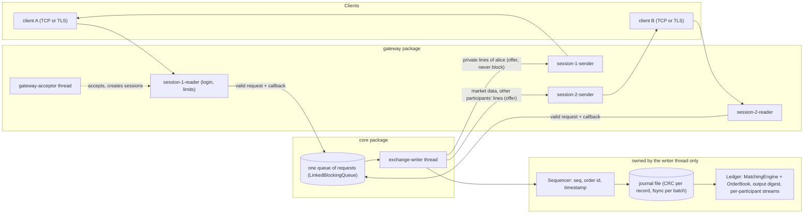

**[Verified]** thread names: `exchange-writer` (`src/main/java/exchangeserver/core/ExchangeService.java:119`),
`gateway-acceptor` (`src/main/java/exchangeserver/gateway/TcpGateway.java:144`), `session-N-reader` and
`session-N-sender` (`src/main/java/exchangeserver/gateway/ClientSession.java:91-92`).

### The one live path

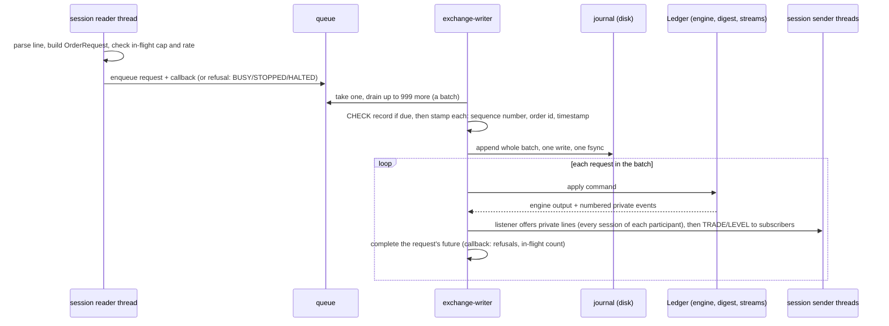

The heart of this path is `Exchange.process` (**[Verified]**):

```java
// src/main/java/exchangeserver/core/Exchange.java:198-252 (trimmed)
void process(List<Pending<?>> batch, OutputListener listener) throws IOException {
    List<Command> commands = new ArrayList<>(batch.size() + 1);
    if (commandsSinceCheck >= options.checkInterval()) {
        commands.add(sequencer.stampCheck(ledger.digest()));       // D70: covers every command before it
        commandsSinceCheck = 0;
    }
    // stamp each request: NEW, CANCEL or CANCEL_ALL (an invalid one is refused, never journalled)
    journal.appendAll(commands);                // durable before any effect
    for (Pending<?> p : batch) {
        if (p.refused) {
            continue;
        }
        if (p.command == null) {
            p.complete(read(p.request));
            continue;
        }
        Ledger.Applied applied;
        try {
            interceptor.beforeEngine(p.command);
            applied = ledger.apply(p.command);
        } catch (RuntimeException bug) {
            quarantine(p.command, bug);         // poison pill: SKIP record + rebuild the ledger
            p.fail(new ExchangeException(ExchangeException.Reason.INTERNAL_ERROR,
                    "command " + p.command.sequenceNumber() + " failed and was quarantined", bug));
            continue;
        }
        commandsSinceCheck++;
        listener.onOutput(applied.output(), applied.events());     // (a throw is logged)
        p.complete(result(applied.output()));   // after the listener: the request's lines went out first (D76)
    }
}
```

### Restart

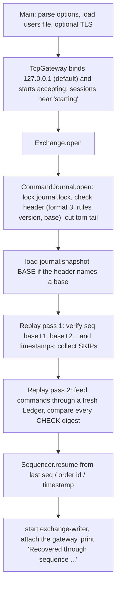

**[Verified]** `src/main/java/exchangeserver/Main.java:120-157`, `src/main/java/exchangeserver/core/Exchange.java:116`,
`src/main/java/exchangeserver/journal/CommandJournal.java:75-127`, `src/main/java/exchangeserver/core/Replay.java:39-70`.

### Packages and their dependencies

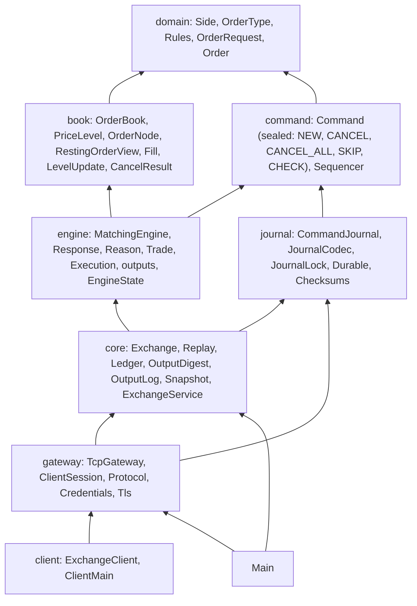

Arrows mean "depends on". **[Verified]** from the import lists of each file. `gateway` uses `journal.Durable` to
write the users file atomically (`src/main/java/exchangeserver/gateway/Credentials.java:72-80`); `client` uses only
`gateway.Tls` to build a TLS socket factory (`src/main/java/exchangeserver/client/ClientMain.java:3`), otherwise it
just speaks the text protocol.

## The 10 things you must know first

**1. One thread owns all mutable exchange state.** **[Verified]** The `exchange-writer` thread alone touches the
`Exchange`, `Sequencer`, `CommandJournal`, `Ledger`, `MatchingEngine` and `OrderBook`; none of those classes is
thread-safe, on purpose (`CLAUDE.md`, "Single writer"; class comments such as
`src/main/java/exchangeserver/book/OrderBook.java:30`). Every other thread reaches state only through the queue,
including reads (a book snapshot, a participant's latest `oseq`, a `RESEND`) (Spec D57, D73). If you ever read the
book from another thread, you have a data race.

**2. The order of operations is stamp → journal (fsync) → engine → listener → future.** **[Verified]**
`src/main/java/exchangeserver/core/Exchange.java:198-252`. Nothing in a batch is processed before the whole batch
is on disk. The listener (which sends the request's own lines, then market data) runs before the request's future
completes, so a callback that runs knows its lines were already offered (Spec D76). Within one command, the
requester's reply comes before the makers' fills and the market data (Spec D53, D73).

**3. "Visible ⇒ durable" holds; "durable ⇒ visible" does not.** **[Verified]** Spec §4. No client ever sees the
effect of a command that is not on disk. But a crash *after* the fsync and *before* the reply leaves journalled
commands whose clients heard nothing; on restart they are replayed anyway. Clients reconcile two ways: resend with
the same client order id (the duplicate check returns the original order id, D49), or log in again and `RESEND`
from the last `oseq` they saw (D73).

**4. The engine is deterministic, and that is load-bearing.** **[Verified]** `CLAUDE.md` ("Determinism is
load-bearing"); `src/main/java/exchangeserver/engine/MatchingEngine.java:29-30`. The engine reads no clock and
counts nothing: sequence numbers, order ids and timestamps come from the `Sequencer`
(`src/main/java/exchangeserver/command/Sequencer.java:11`), and a trade's timestamp is the incoming command's
timestamp (`src/main/java/exchangeserver/engine/Trade.java:10-12`). Replay depends on this, and now *checks* it:
every 10,000 commands a `CHECK` record stores a digest of every output so far, and replay stops with "diverged" if
it produces different outputs (Spec D70).

**5. Validation is split by kind.** **[Verified]** *Stateless* checks (syntax, field ranges, name patterns, the
session's rate and in-flight limits) happen at the gateway; a request failing them gets `ERROR` and never reaches
the queue or the journal. *State-dependent* checks (duplicate client order id, price band, resting caps, post-only
would cross, self-trade prevention) happen in the engine after journalling, so replay reproduces them (Spec D13,
D47; `src/main/java/exchangeserver/engine/Reason.java:5-9`).

**6. Book invariants are protected by Java package visibility.** **[Verified]** Every mutator of `PriceLevel` is
package-private, so the engine (another package) can read levels but must call `OrderBook.add`, `fillBest` or
`cancel`, which keep the invariants: an id is in the id map iff the order rests; no empty price levels; the book is
never crossed after a command (Spec D44; `src/main/java/exchangeserver/book/OrderBook.java:21-28`). Read access
for the engine goes through copies (`RestingOrderView`).

**7. Every rule replay depends on lives in `Rules`, and changing one means bumping `Rules.VERSION`.**
**[Verified]** `src/main/java/exchangeserver/domain/Rules.java:7-21`; the current version is 2. The journal header
stores it (`HEADER,3,2,0,<crc>` = format 3, rules 2, base sequence 0), and opening a journal with records written
under another version fails. The way across a rules change: compact with the old build (leaving an empty journal),
then start the new build, which adopts the empty journal (Spec D46, D71).

**8. Poison pills are quarantined live, never at startup.** **[Verified]** Spec D51;
`src/main/java/exchangeserver/core/Exchange.java:278-287`. If the engine throws a `RuntimeException` on a command
while running, the exchange appends `SKIP <seq>`, rebuilds the ledger by replaying everything before that command
(from the snapshot), and carries on; the caller gets `INTERNAL_ERROR`. If replay fails at startup, startup fails
with a hint naming the command; an operator inspects it and runs `--quarantine <seq>`. An `Error` (e.g.
`OutOfMemoryError`) or a journal I/O failure halts the exchange (process exit code 2).

**9. Batching is "smart": no timer.** **[Verified]** `src/main/java/exchangeserver/core/ExchangeService.java:293-300`,
Spec D52. The writer blocks for one request, then drains whatever else is already waiting (up to 1,000 in total),
journals them with one fsync, and processes them. Under light load a batch is one request; under load, batches grow
by themselves. Measured on the author's laptop: 43 orders/ms with 64 clients versus 0.8 orders/ms with an fsync per
command (Spec §5).

**10. The writer never waits for a client, and a client cannot hog the exchange.** **[Verified]**
`src/main/java/exchangeserver/gateway/ClientSession.java:116-124`, Spec D54, D75. Lines for a client go into that
client's bounded outbound queue (10,000 lines) with a non-blocking `offer`; if it is full, the client is
disconnected. A separate sender thread per client writes to the socket. On the way in, each session may have at
most 1,000 requests in flight and 1,000 per second (bursts of 2,000), and must log in within 10 s and say something
at least every 300 s.

## Where to go next

- Guide 02 if any of records, sealed interfaces, `CompletableFuture`, `FileChannel.force`, PBKDF2, TLS or JUnit 5
  `@Nested` is unfamiliar.
- Guide 03 for a file-by-file map.
- Guide 04 to build, run and poke at it.
- Guide 05 for the end-to-end flows.

## Key takeaways

- One instrument, five order types, price-time priority; trade price is always the resting order's price; no
  self-trades.
- Pipeline: authenticated gateway (stateless checks, limits) → one queue → writer thread: stamp → journal + fsync →
  ledger → listener (private stream, market data) → future.
- Single writer thread; no locks inside the engine or book; reads go through the queue too.
- Write-ahead journal + deterministic engine = restart by replay, from a snapshot when compacted; CHECK digests
  prove the replay matched; the `Rules.VERSION` header guards against replaying under changed rules.
- Each participant has a numbered private stream (`oseq`), delivered to all its sessions and resendable.
- Poison pills: quarantined live (SKIP + rebuild), refused at startup until an operator quarantines them.
- Smart batching: one fsync per batch, batch size grows with load, no timer.
- Most reasons are recorded in the Spec as D-numbers (D1–D77).

## Common confusions

- **"Is the journal a log of what happened (trades)?"** No. It logs *inputs* (commands), not outputs. Trades,
  replies, market data and even the private stream's `oseq` numbers are re-derived by replay (Spec D12, D73, Vision
  principle 5). The only derived value journalled is the CHECK digest, which replay compares rather than uses.
- **"Rejected orders are not journalled."** Only *stateless* rejects (bad syntax, bad field, over a session limit)
  are not journalled. State-dependent rejects (duplicate id, price band, caps, post-only cross) and self-trade
  cancellations are journalled and replayed, because they depend on the book state at that moment.
- **"The listener runs on another thread."** No: the `OutputListener` and the gateway's request callbacks both run
  on the writer thread (**[Verified]** `src/main/java/exchangeserver/core/OutputListener.java:9-12`). They only
  offer lines to queues, which is why they are cheap enough to run there.
- **"A reply goes only to the session that sent the order."** Not any more: a participant's private stream goes to
  every session logged in as that participant, so two sessions of Alice see the same `ORDER` line (Spec D73). Only
  refusals (`ERROR ... BUSY`, `RATE_LIMITED`, `SESSION_BUSY`) go to the requesting session alone.
- **"A market order trades at any price before the first trade."** Not any more: before the first trade its
  collar is ±10% around the best opposite price (Spec D66); after it, ±10% around the last trade (D50).
- **"Disconnecting cancels my orders."** Only if the participant logged in with `COD` and the closing session was
  its last one (Spec D72). Otherwise resting orders stay.

## Questions to test yourself

1. Bob sends `NEW b1 BUY LIMIT 4 101` against a single resting ask of 10 at 100 from Alice. At what price is the
   trade, and who learns about it?
   <details><summary>Answer</summary>At 100, the resting price. Bob's sessions get a TAKER `FILL` and an
   `ORDER ... FILLED` (his next `oseq`); every session of Alice gets a MAKER `FILL` with `leaves=6` (her next
   `oseq`); subscribers get `TRADE` and a `LEVEL` update for the ask at 100 (now 6).</details>
2. Why must the matching engine never call `Instant.now()`?
   <details><summary>Answer</summary>Replay feeds journalled commands through the engine again after a restart. A
   clock read inside the engine would give different values on replay, so trades (and anything depending on time)
   would differ from what clients saw, and the next CHECK would report a divergence. All timestamps are stamped by
   the `Sequencer` before journalling.</details>
3. A client's order is rejected for `PRICE_OUTSIDE_BAND`. Is it in the journal? What about an order refused with
   `RATE_LIMITED`?
   <details><summary>Answer</summary>The band reject is in the journal (state-dependent: it depends on the last
   trade price). The rate-limited order never reaches the queue: the session refuses it with `ERROR` before
   handing it in.</details>
4. Alice has a resting sell at 100 and sends a buy at 100. What happens?
   <details><summary>Answer</summary>Matching stops at her own resting order: no trade, and her buy's remainder is
   cancelled with `ORDER ... status=CANCELLED ... reason=SELF_TRADE_PREVENTED` (Spec D67). Her sell stays.</details>
5. Alice's client was offline when her order was filled. How does she find out?
   <details><summary>Answer</summary>After logging in again, `WELCOME` reports her latest `oseq`; she sends
   `RESEND <first oseq she has not seen>` and gets the missed lines marked `resend=1`, followed by `RESENT last=N`
   (or `ERROR RESEND_GAP first=M` if they are older than the retained 1,000 events or than the last compaction).</details>
6. What are the two conditions under which the exchange halts rather than quarantining?
   <details><summary>Answer</summary>A journal I/O failure (write or fsync), or any `Throwable` that is not a
   `RuntimeException` from the engine step (an `Error` such as `OutOfMemoryError`, an interrupt, or a bug outside
   the engine). The process then exits with code 2.</details>


---

<a id="guide-02-tech-stack"></a>

<!-- source: docs/understanding/02-tech-stack.md -->

# 02 — Tech Stack

> **Project:** ExchangeServer2 | Single-instrument limit order book: price-time matching engine, write-ahead journal with replay, single writer thread, TCP/TLS gateway with authenticated participants | Stack: Java 17, Maven wrapper, JUnit 5 (+ JMH, PIT)
> **This guide:** every language feature, JDK library and tool this code depends on: what it does here, why it was likely chosen, and the minimum you need to know to read the code | **Prerequisites:** 01 | **Related:** 04, 07-modules/*, 08, 10
> **Repo layout summary:** `pom.xml` + Maven wrapper (`mvnw`, `mvnw.cmd`) at the root; production code in `src/main/java/exchangeserver/` (packages `domain`, `book`, `engine`, `command`, `journal`, `core`, `gateway`, `client`, plus `Main`); tests mirror it in `src/test/java/exchangeserver/` (plus `bench/` JMH benchmarks and `testing/MutableClock`); design docs in `docs/` (`ExchangeServer2_Vision.md` = purpose/roadmap, `ExchangeServer2_Spec.md` = decisions D1–D77); these guides in `docs/understanding/`.

## Overview

The stack is deliberately small:

| Layer | What | Version | Scope |
|---|---|---|---|
| Language/runtime | Java (JDK) | 17 (`maven.compiler.release` 17) | everything |
| Build | Apache Maven via the Maven Wrapper | wrapper 3.3.2, Maven 3.9.16 | build |
| Tests | JUnit Jupiter (JUnit 5) | 5.11.4 (BOM) | test |
| Benchmarks | JMH (Java Microbenchmark Harness) | 1.37 | test, profile `bench` |
| Mutation testing | PIT (pitest) + JUnit 5 plugin | 1.17.4 / 1.2.1 | profile `mutation` |
| Linux runs | Docker image `eclipse-temurin:17` | — | manual check, not part of the build |

**[Verified]** `pom.xml:13-19`, `pom.xml:33-52`, `pom.xml:132-141`, `.mvn/wrapper/maven-wrapper.properties`.
The JDK used on the dev machine is Temurin 17.0.20.1, and the Linux container ran the same version
(**[Verified — observed]**, `java -version` on 2026-10-27).

There are **no runtime dependencies**: the shipped jar contains only the project's own classes. No web framework,
no logging library, no database, no JSON, no crypto library. Networking is `java.net` sockets (and `javax.net.ssl`
for TLS), the journal is a text file written through `java.nio`, password hashing uses the JDK's
`SecretKeyFactory`, logging is `System.Logger`. The Vision records that Spring Boot was considered and dropped on
2026-10-24 in favour of a plain TCP gateway (**[Verified]** Vision §8).

**[Inferred]** Why so bare: the project is a learning exercise about durability, determinism and concurrency;
frameworks would hide exactly the mechanisms it wants to make visible (an fsync, a queue hand-off, a thread
boundary, a checksum). The Vision's principle "Measure before optimizing" and the absence of any third-party
runtime code are consistent with that.

The rest of this guide goes feature by feature. For each: **here** (where and how it is used), **why** (likely
reason), **minimum** (what you must know to read the code).

## 1. Java 17 language features

### 1.1 Records, with compact constructors

**Here.** Almost every immutable value is a `record`: commands (`NewOrderCommand`, `CancelOrderCommand`,
`CancelAllCommand`, `SkipCommand`, `CheckCommand`), engine outputs (`Response`, `Trade`, `Execution`, `OrderOutput`,
`CancelOutput`, `CancelAllOutput`, `BookSnapshot`, `EngineState`), book results (`Fill`, `LevelUpdate`,
`CancelResult`, `RestingOrderView`), private events (`PrivateEvent.OrderReply` …), requests (`Request.Submit` …),
parsed client messages, `Snapshot`, and settings (`ExchangeService.Settings`, `TcpGateway.Settings`,
`Exchange.Options`). Validation lives in the **compact constructor** (a constructor without a parameter list that
runs before the fields are assigned):

```java
// src/main/java/exchangeserver/command/NewOrderCommand.java:8-20
public record NewOrderCommand(long sequenceNumber, Instant timestamp, long orderId, OrderRequest request)
        implements Command {

    public NewOrderCommand {
        Objects.requireNonNull(timestamp, "timestamp");
        Objects.requireNonNull(request, "request");
        if (sequenceNumber <= 0) {
            throw new IllegalArgumentException("Sequence number must be positive");
        }
        if (orderId <= 0) {
            throw new IllegalArgumentException("Order id must be positive");
        }
    }
}
```

Compact constructors are also used to **defensively copy** lists, e.g. `trades = List.copyOf(trades);` in
`Response` (**[Verified]** `src/main/java/exchangeserver/engine/Response.java:21`), so a record cannot be changed
through a list the caller still holds.

A record may also override a generated method. `ClientMessage.Login` overrides `toString()` so the secret never
appears if a parsed message is logged (**[Verified]** `src/main/java/exchangeserver/gateway/ClientMessage.java:11-17`).

**Why.** **[Verified]** Spec §2 invariants: "An invalid `Order`, `OrderRequest`, `Command`, `Response`, `Trade` or
`CancelResult` cannot be constructed." Records give immutability plus generated `equals`/`hashCode`, which the
tests rely on heavily (e.g. comparing whole `BookSnapshot`s or whole output lists for determinism).

**Minimum.** A record's fields are final; accessors are named like the field (`command.sequenceNumber()`, not
`getSequenceNumber()`); `equals` compares all components; in a compact constructor you may reassign the parameter
(`bids = List.copyOf(bids)`) before the implicit field assignment.

Not everything is a record: `Order` (mutable: its filled quantity changes) and `OrderRequest` (private
constructor plus named factories) are ordinary final classes (**[Verified]**
`src/main/java/exchangeserver/domain/Order.java:16`, `src/main/java/exchangeserver/domain/OrderRequest.java:15`).

### 1.2 Sealed interfaces

**Here.** Closed sets of variants:

| Sealed type | Variants | File |
|---|---|---|
| `Command` | `NewOrderCommand`, `CancelOrderCommand`, `CancelAllCommand`, `SkipCommand`, `CheckCommand` | `src/main/java/exchangeserver/command/Command.java:11` |
| `Request<R>` | `Submit`, `Cancel`, `CancelAll`, `Snapshot`, `Attach`, `Resend` | `src/main/java/exchangeserver/core/Request.java:22` |
| `EngineOutput` | `OrderOutput`, `CancelOutput`, `CancelAllOutput` | `src/main/java/exchangeserver/engine/EngineOutput.java:14` |
| `PrivateEvent` | `OrderReply`, `CancelReply`, `MakerFill` | `src/main/java/exchangeserver/core/PrivateEvent.java:15` |
| `ClientMessage` | `Login`, `NewOrder`, `Cancel`, `Resend`, `Subscribe`, `Unsubscribe`, `Ping`, `Quit` | `src/main/java/exchangeserver/gateway/ClientMessage.java:9` |

```java
// src/main/java/exchangeserver/command/Command.java:11-16
public sealed interface Command permits NewOrderCommand, CancelOrderCommand, CancelAllCommand, SkipCommand, CheckCommand {
    long sequenceNumber();
    Instant timestamp();
}
```

**Why.** **[Verified]** the comment above it: "The Java type is the kind tag; the journal writes it as a word"
(`src/main/java/exchangeserver/command/Command.java:8`). Sealing documents that no other kind exists.

**Minimum.** `sealed ... permits A, B` means only the listed classes may implement it. In Java 17 the compiler
does **not** yet use this to check `instanceof` chains for exhaustiveness (see 1.4), so the code ends such chains
with a `throw` (**[Verified]** `src/main/java/exchangeserver/journal/JournalCodec.java:124`,
`src/main/java/exchangeserver/core/Ledger.java:51`).

### 1.3 Pattern matching for `instanceof`

**Here.** Everywhere a sealed type is dispatched:

```java
// src/main/java/exchangeserver/core/Ledger.java:42-55
Applied apply(Command command) {
    EngineOutput output;
    if (command instanceof NewOrderCommand n) {
        output = engine.onNewOrder(n);
    } else if (command instanceof CancelOrderCommand c) {
        output = engine.onCancel(c);
    } else if (command instanceof CancelAllCommand c) {
        output = engine.onCancelAll(c);
    } else {
        throw new IllegalStateException("Not an engine command: " + command);
    }
    digest.update(output);
    return new Applied(output, log.record(command, output));
}
```

**Minimum.** `x instanceof T t` tests the type and binds `t` (already cast) in the true branch. Final in Java 16.

### 1.4 Switch expressions, arrows and `yield`

**Here.** Over enums and strings: the outcome switch in the engine, the journal decoder, the protocol parser and
`Main`'s argument parsing.

```java
// src/main/java/exchangeserver/engine/MatchingEngine.java:242-260
OrderStatus status = switch (type) {
    case LIMIT, POST_ONLY -> {
        if (remaining == 0) {
            yield OrderStatus.FILLED;
        }
        if (selfTradePrevented) {
            yield OrderStatus.CANCELLED;
        }
        book.add(order);
        yield OrderStatus.RESTED;
    }
    case IOC, MARKET -> remaining > 0 ? OrderStatus.CANCELLED : OrderStatus.FILLED;
    case FOK -> {
        if (remaining != 0) {
            throw new IllegalStateException("Fillable FOK " + order.getOrderId() + " left " + remaining);
        }
        yield OrderStatus.FILLED;
    }
};
```

**Why.** **[Verified]** Spec D24 and the class comment: "The outcome, as a switch over OrderType with no default
(the compiler rejects a missed type)" (`src/main/java/exchangeserver/engine/MatchingEngine.java:36`). A switch
*expression* over an enum must be exhaustive, so adding a sixth `OrderType` breaks the build here until it is
handled. That is a deliberate compile-time safety net.

**Minimum.** `case A, B -> expr` has no fall-through. A block arm returns its value with `yield`. A switch
*expression* must cover every enum constant (or have `default`).

**Why `instanceof` chains rather than `switch` over sealed types?** **[General knowledge]** Pattern matching for
`switch` (`case NewOrderCommand n ->`) was only a *preview* feature in Java 17 (JEP 406) and became final in Java
21 (JEP 441). With `maven.compiler.release` 17 and no `--enable-preview`, the code cannot use it. **[Inferred]**
This is why dispatch over sealed types uses `instanceof` chains plus a final `throw`, losing the exhaustiveness check
that enum switches get. Guide 12 (change recipes) lists every chain you must update when adding a variant.

### 1.5 Other small features

- `var` appears only once, in `Ledger.snapshot` (`var state = engine.exportState();`); elsewhere types are spelled
  out (**[Verified]** by search in `src/main`).
- `List.of`, `List.copyOf`, `Set.copyOf`, `Map.copyOf` (immutable collections) are used for outputs and defensive
  copies.
- `Optional` / `OptionalLong`: `OrderBook.bestLevel` returns `Optional<PriceLevel>`; a request's price is an
  `OptionalLong` (empty for MARKET) so the "no price" sentinel `-1` never leaks out of the domain package
  (**[Verified]** `src/main/java/exchangeserver/domain/OrderRequest.java:11-12`, `116`; Spec D26).
- `java.util.function.Predicate` as a visitor: `OrderBook.walk(side, visitor)` stops when the visitor returns
  `false` (**[Verified]** used by the engine's fillability check, cancel-all and snapshot export).
- Text blocks are not used; class documentation is in `/* ... */` block comments at the top of each file.

## 2. Concurrency (`java.util.concurrent` and the memory model)

You need these to read `core.ExchangeService` and the `gateway` package. Guide 07-modules/exchange-service goes
deeper.

### 2.1 Happens-before, `volatile`, `synchronized` (the minimum)

**[General knowledge]** In Java, a write by one thread is guaranteed visible to another thread only if there is a
**happens-before** edge between them. The edges this code relies on:

| Edge | Where it is used here |
|---|---|
| `Thread.start()`: everything before it is visible to the started thread | The journal is replayed on the caller's thread, then the writer is started: **[Verified]** comment at `src/main/java/exchangeserver/core/ExchangeService.java:124-125` |
| `Thread.join()`: everything the thread did is visible after `join` returns | Stats are read after `stop()` in tests (**[Verified]** `src/test/java/exchangeserver/core/ExchangeServiceTest.java:40-41`) |
| `BlockingQueue` put → take | A `Pending` request needs no `volatile` fields (**[Verified]** `src/main/java/exchangeserver/core/Pending.java:12-13`) |
| `CompletableFuture` complete → `get`/`join`/continuation | Results flow back to callers the same way |
| `volatile` write → read | `ExchangeService.state`, `haltCause`, stats (`src/main/java/exchangeserver/core/ExchangeService.java:104-112`); `ClientSession.participant` (`src/main/java/exchangeserver/gateway/ClientSession.java:70`) |
| `synchronized` unlock → lock of the same monitor | `ExchangeService`'s hand-in lock (`src/main/java/exchangeserver/core/ExchangeService.java:223`); `ClientSession.subscriptionLock` (`src/main/java/exchangeserver/gateway/ClientSession.java:64`) |
| Atomic variables | `ClientSession.inFlight` (`AtomicInteger`) counts requests in flight across the reader thread and the writer's callbacks (`src/main/java/exchangeserver/gateway/ClientSession.java:74`, Spec D76) |

**Minimum.** `volatile` gives visibility of single reads/writes, not atomicity of `x++` (fine here because only the
writer thread writes the stats). `synchronized (lock) { ... }` gives mutual exclusion plus visibility. An
`AtomicInteger`'s `incrementAndGet`/`decrementAndGet` are atomic and visible across threads.

### 2.2 `BlockingQueue`: `LinkedBlockingQueue`, `ArrayBlockingQueue`, `drainTo`

**Here.**
- The exchange's single request queue is an **unbounded** `LinkedBlockingQueue`; its capacity (100,000) is
  enforced by hand under the lock, so `stop()` can always add its stop marker without blocking (**[Verified]**
  `src/main/java/exchangeserver/core/ExchangeService.java:101`, `228`; Spec D56).
- The writer takes one request (blocking) and then `drainTo(batch, max - 1)` takes whatever else is already
  waiting without blocking. That pair *is* smart batching:

```java
// src/main/java/exchangeserver/core/ExchangeService.java:292-294
batch.clear();
batch.add(queue.take());
queue.drainTo(batch, settings.maxBatchSize() - 1);
```

- Each client session's outbound queue is a **bounded** `ArrayBlockingQueue` (10,000 lines); producers call
  non-blocking `offer`, which returns `false` when full (**[Verified]**
  `src/main/java/exchangeserver/gateway/ClientSession.java:89`, `120`).

**Minimum.** `put`/`take` block; `offer`/`poll` don't (or wait with a timeout); `drainTo` moves up to *n* waiting
elements in one call.

### 2.3 `CompletableFuture`

**Here.** Each request carries a `CompletableFuture` (in `Pending.result`) that the writer completes. Three
subtleties matter:

1. **Callbacks attached with `whenComplete` run on the completing thread** if the future is not yet done when
   they are attached. The gateway's callbacks are attached *before* the request is queued, so they run on the
   `exchange-writer` thread, **after** the listener for that command (Spec D76: `Exchange.process` calls the
   listener, then completes the future). If the request is refused at once, the callback runs on the caller's
   thread instead (**[Verified]** `src/main/java/exchangeserver/core/ExchangeService.java:182-185`, `211-221`).
2. **A callback that throws would vanish**, because `whenComplete` captures the exception in a derived future
   nobody reads. The service wraps each callback and logs a throw as `Request callback failed` (Spec D77, M9):

```java
// src/main/java/exchangeserver/core/ExchangeService.java:212-221
if (onDone != null) {
    pending.result.whenComplete((value, failure) -> {
        // whenComplete would capture a throw in a future nobody reads: log it instead (M9).
        try {
            onDone.accept(value, failure);
        } catch (RuntimeException | Error callbackBug) {
            LOG.log(Level.ERROR, "Request callback failed", callbackBug);
        }
    });
}
```

3. **The futures returned to ordinary callers are separate futures**, completed asynchronously on the
   **common ForkJoinPool** (the JVM-wide shared thread pool used by `*Async` methods without an executor):

```java
// src/main/java/exchangeserver/core/ExchangeService.java:170-180
private static <R> CompletableFuture<R> handOff(CompletableFuture<R> internal) {
    CompletableFuture<R> mine = new CompletableFuture<>();
    internal.whenCompleteAsync((value, failure) -> {
        if (failure != null) {
            mine.completeExceptionally(failure);
        } else {
            mine.complete(value);
        }
    });
    return mine;
}
```

**Why.** **[Verified]** Spec D61: with a shared future, a caller's `cancel()` or `orTimeout()` made the writer skip a
command it had already journalled (so the live book differed from the replayed one), and a caller's blocking
continuation ran on the writer thread and stalled the exchange.

**Minimum.** `complete`/`completeExceptionally` the first time wins; later calls are no-ops (that is why
`Pending.fail` is safe to call on an already-completed request, `src/main/java/exchangeserver/core/Pending.java:32-35`).
`whenComplete` vs `whenCompleteAsync`: same thread vs a pool thread.

### 2.4 Concurrent collections and atomics

- `ConcurrentHashMap.newKeySet()` for the gateway's `sessions` and `subscribers` sets; `ConcurrentHashMap.compute`
  / `computeIfPresent` to add/remove a session to/from its participant's set atomically, dropping the entry when it
  empties (**[Verified]** `src/main/java/exchangeserver/gateway/TcpGateway.java:107-108`, `223-255`; Spec §9 finding
  6). `compute` runs the function atomically per key, so an add cannot slip into a set that a concurrent remove is
  dropping. The same `computeIfPresent` tells `removed()` whether the closing session was the participant's last,
  which decides cancel-on-disconnect (Spec D72).
- `JournalLock.HELD` is a static `ConcurrentHashMap.newKeySet()` of lock-file paths held in this JVM
  (`src/main/java/exchangeserver/journal/JournalLock.java:27`).
- `AtomicBoolean closed` in `ClientSession` (`compareAndSet` makes `close()` idempotent), `AtomicLong` session ids,
  `AtomicInteger OPEN` counting open journals for tests (**[Verified]**
  `src/main/java/exchangeserver/gateway/ClientSession.java:63`, `src/main/java/exchangeserver/gateway/TcpGateway.java:106`,
  `src/main/java/exchangeserver/journal/CommandJournal.java:50`).

### 2.5 Threads

Plain `java.lang.Thread`s with names, no executors (except the common pool used by `whenCompleteAsync`). The
writer is **non-daemon** (the JVM must not exit with accepted requests unprocessed); the acceptor and session
threads are **daemon** (they must not keep the JVM alive) (**[Verified]**
`src/main/java/exchangeserver/core/ExchangeService.java:119-121`, `src/main/java/exchangeserver/gateway/TcpGateway.java:144-145`,
`src/main/java/exchangeserver/gateway/ClientSession.java:91-94`).

### 2.6 `Runtime.halt` in a shutdown hook

**Here.** `Main` registers a shutdown hook (a thread the JVM runs when it is asked to exit, including on Ctrl+C or
SIGTERM). The hook closes the gateway, stops the service, then ends the process itself with
`Runtime.getRuntime().halt(status)`: 0 normally, 1 if the writer did not stop in time, 2 if it had halted
(**[Verified]** `src/main/java/exchangeserver/Main.java:159-177`).

**Why.** **[General knowledge]** When the JVM shuts down because of a signal, its exit status is normally derived
from the signal (130 for SIGINT, 143 for SIGTERM on Linux), not from `main` returning. `halt` sets the status
explicitly and skips any remaining hooks. **[Verified — observed]** In Docker on Linux, the server exited with 0
after SIGINT and after SIGTERM (Spec D77).

**Minimum.** `System.exit` runs shutdown hooks; `Runtime.halt` does not and stops at once; calling `halt` as the
hook's last act is therefore safe only because there is nothing left to do.

## 3. Files and durability (`java.nio`, `java.util.zip`)

### 3.1 `FileChannel`, `force`, `truncate`, atomic moves

**Here.** The journal is opened with `FileChannel.open(file, CREATE, WRITE, APPEND)`: `APPEND` means every write
goes to the current end of file, so history cannot be overwritten (**[Verified]**
`src/main/java/exchangeserver/journal/CommandJournal.java:107`). After writing a batch, `channel.force(true)` asks
the OS to flush the data (and, with `true`, file metadata such as size) to the storage device: this is the
**fsync** (**[Verified]** `src/main/java/exchangeserver/journal/CommandJournal.java:160`). Recovery opens a second
channel and `truncate`s the file to just after the last `\n` (**[Verified]**
`src/main/java/exchangeserver/journal/CommandJournal.java:263-274`).

`journal.Durable` adds two crash-safe operations (Spec D69, D71):

- `writeAtomically(target, content)`: write a temporary file, `force` it, then `Files.move(tmp, target,
  ATOMIC_MOVE, REPLACE_EXISTING)`, then fsync the directory. After a crash the target holds the old or the new
  content, never a mix. Used for snapshots, the empty journal compaction leaves, and the users file
  (**[Verified]** `src/main/java/exchangeserver/journal/Durable.java:25-36`).
- `fsyncDirectory(file)`: open the parent directory and `force` it, so a newly created or renamed file's
  directory entry survives a crash on Linux. Windows cannot open a directory as a file; that failure is ignored
  (**[Verified]** `src/main/java/exchangeserver/journal/Durable.java:50-63`).

**Minimum.** `write` returning does not mean the data is on disk; only `force` does. One `force` cost about
1.5 ms on the author's disk (**[Verified]** Spec §5), which is why batching matters. Reading uses separate
`InputStream`s (`Files.newInputStream`), so replay can read while the append channel is open. A rename is atomic
on one file system, which is what makes write-then-rename safe.

### 3.2 `CRC32C` checksums

**Here.** Every journal record and every snapshot line ends with `,<crc>`: the CRC-32C of the text before it, as 8
hex digits (**[Verified]** `src/main/java/exchangeserver/journal/Checksums.java:13-17`,
`src/main/java/exchangeserver/journal/JournalCodec.java:166-187`):

```java
// src/main/java/exchangeserver/journal/Checksums.java:13-17
public static String crcHex(String text) {
    CRC32C crc = new CRC32C();
    crc.update(text.getBytes(UTF_8));
    return String.format("%08x", crc.getValue());
}
```

**Why.** **[Verified]** Spec D69: before, a bit flip that still parsed (a `100` turned into `900`) would silently
change history. **Minimum.** `java.util.zip.CRC32C` (Java 9+) is a checksum, good at catching accidental
corruption, not a security measure.

The output digest (`core.OutputDigest`) is a different tool for a different job: an FNV-1a 64-bit hash over a
canonical text encoding of every engine output, kept running across commands so a `CHECK` record can store "the
digest of everything so far" (**[Verified]** `src/main/java/exchangeserver/core/OutputDigest.java:27-28`, `80-81`;
Spec D70).

### 3.3 `FileLock` and the `<journal>.lock` file (D65)

**Here.** To stop two processes (e.g. a running exchange and an operator's `--quarantine` or `--compact` run) from
writing the same journal, `CommandJournal.open` first acquires a `JournalLock`: an exclusive lock on a **separate,
empty file next to the journal**, `<journal>.lock` (e.g. `exchange.journal.lock`), taken before the journal is
opened at all:

```java
// src/main/java/exchangeserver/journal/JournalLock.java:37-66 (trimmed)
public static JournalLock acquire(Path journal) throws IOException {
    Path lockFile = journal.resolveSibling(journal.getFileName() + ".lock");
    try {
        Files.createFile(lockFile);     // create-new: never opens, so never closes, an existing lock file
    } catch (FileAlreadyExistsException normalAfterTheFirstRun) {
        // reuse it
    }
    Path key = lockFile.toRealPath();   // one key however the journal path is spelled
    if (!HELD.add(key)) {
        throw alreadyOpen(journal);
    }
    FileChannel channel = null;
    try {
        channel = FileChannel.open(lockFile, WRITE);
        if (channel.tryLock() == null) {
            throw alreadyOpen(journal);
        }
        return new JournalLock(key, channel);
    } catch (IOException | RuntimeException e) {
        // close the channel, leave HELD, rethrow
    }
}
```

`close()` closes the lock channel (which releases the OS lock) and removes the key from `HELD`; the empty lock file
stays on disk (**[Verified]** `src/main/java/exchangeserver/journal/JournalLock.java:70-79`; `.gitignore` ignores
`*.journal.lock`). Compaction holds a `JournalLock` itself while it replaces the journal file (Spec D71).

**Why a separate file: OS lock semantics differ.** **[Verified]** the design comment at
`src/main/java/exchangeserver/journal/JournalLock.java:13-23` and Spec D65:

| | Windows | Linux / macOS (POSIX `fcntl` locks) |
|---|---|---|
| Strength | **Mandatory**: a locked range cannot be read or written through any *other* handle, even in the same process | **Advisory**: only stops others who also ask for the lock |
| Owner | The handle (channel) that took it | The **whole process** |
| Released when | That handle closes | **Any** handle the process has on that file closes |

The journal itself is opened and closed constantly: the header check, the torn-tail cut and every `read()`
(replay, the poison-pill rebuild) use their own short-lived handles. Under POSIX semantics, the first of those
closes would silently drop a lock held on the journal. Under Windows semantics, a lock on the journal's *data*
would block those reads. A lock file that **nothing else ever opens or closes** avoids both. That is also why the
lock file is created with `Files.createFile` (create-new, which fails without opening an existing file), and why a
second acquire **in the same JVM** is refused by the in-memory `HELD` set before it touches the lock file: opening
and closing a second channel on it would, on POSIX, drop the first holder's lock.

History: the first version of D65 locked one byte at `Long.MAX_VALUE - 1` *of the journal itself*. It passed on
Windows but would have vanished on Linux/macOS at the first `read()`; it was replaced by the lock file the same day
(**[Verified]** Spec D65).

**Minimum.** `FileChannel.tryLock()` returns `null` if **another process** holds an overlapping lock, and throws
`OverlappingFileLockException` if **this JVM** already holds one on that file through another channel. A lock is
released when its channel closes, or when the process dies. **[Verified — observed]** the child-JVM test
`CommandJournalTest.Exclusive.anotherProcessIsRefusedWhileTheJournalIsOpen` passes on Windows and on Linux (Docker),
and a live `--quarantine` against a running server was refused on both ("already open").

### 3.4 Charsets

Every byte/char conversion names a charset: `UTF_8` for the journal, snapshots and the users file, `US_ASCII` for
the wire protocol (**[Verified]** e.g. `src/main/java/exchangeserver/journal/CommandJournal.java:18`,
`src/main/java/exchangeserver/gateway/ClientSession.java:26`). **Why:** **[Verified]** `CLAUDE.md`: the dev
machine's default charset is windows-1252, so relying on the default would make the code behave differently across
machines. A related trap, **[Verified — observed]**: Windows PowerShell pipes text to a program with a UTF-8
byte-order mark (`ef bb bf`) in front, which broke `--add-user` until `Main` learned to drop it
(`src/main/java/exchangeserver/Main.java:222-230`).

## 4. Networking (`java.net`, `javax.net.ssl`)

### 4.1 Sockets and timeouts

**Here.** Blocking, thread-per-connection sockets: a `ServerSocket` bound to `new InetSocketAddress(bindAddress,
port)`, where the bind address is the loopback address (127.0.0.1) unless `--bind` says otherwise, `SO_REUSEADDR`
on, `TCP_NODELAY` on each accepted socket (disables Nagle's algorithm, which would otherwise delay small writes to
batch them) (**[Verified]** `src/main/java/exchangeserver/gateway/TcpGateway.java:68-70`, `123-124`, `188`). Each
session has a reader thread doing byte-by-byte `read()` from a `BufferedInputStream`, and a sender thread writing
through a `BufferedWriter`, flushing once per burst.

**Socket read timeouts.** `socket.setSoTimeout(ms)` (the `SO_TIMEOUT` option) makes a blocking `read()` throw
`SocketTimeoutException` after that long without data. The session sets the login timeout (10 s) before login and
the idle timeout (300 s) after it; the exception ends the session with an `ERROR ... timeout` line (**[Verified]**
`src/main/java/exchangeserver/gateway/ClientSession.java:157`, `166-168`, `308`; Spec D75).

**Why.** **[Verified]** Spec §6 and Vision §5: "TCP or TLS, line protocol, thread-per-connection". **[Inferred]**
Blocking I/O with two threads per client is the simplest model to reason about; NIO or virtual threads are listed as
a future candidate (Vision §7).

**Minimum.** Closing a socket's input or output stream closes the whole socket (which is why the reader never uses
try-with-resources on the input stream: **[Verified]** `src/main/java/exchangeserver/gateway/ClientSession.java:153-154`).
A blocked `read()` is woken by closing the socket from another thread, or by the read timeout.

### 4.2 TLS with JSSE

**Here.** TLS is optional, enabled by giving the server a PKCS#12 keystore (`--tls-keystore`, password in the
`ES2_TLS_PASSWORD` environment variable). `gateway.Tls` builds the JDK objects (**[Verified]**
`src/main/java/exchangeserver/gateway/Tls.java:22-50`):

- **Server:** `KeyStore.getInstance("PKCS12")` loads the key and certificate; a `KeyManagerFactory` turns it into
  key managers; `SSLContext.getInstance("TLS")` is initialised with them. The gateway then creates an
  `SSLServerSocket` from the context and limits it to TLS 1.3 and 1.2 (**[Verified]**
  `src/main/java/exchangeserver/gateway/TcpGateway.java:118-119`).
- **Client:** a `TrustManagerFactory` initialised with a truststore (or `null` for the JDK's default trusted
  certificates); the context's `SocketFactory` is passed to `ExchangeClient` (`ClientMain --tls [--truststore F]`,
  password in `ES2_TRUSTSTORE_PASSWORD`).

**Why.** **[Verified]** Spec D74: with `--bind` the gateway is reachable from the network, and without TLS secrets
and fills would cross it in clear text. Passwords come from the environment because command-line arguments are
visible to other users in the process list (`src/main/java/exchangeserver/gateway/Tls.java:13-17`).

**Minimum.** **[General knowledge]** JSSE (Java Secure Socket Extension) is the JDK's TLS implementation; the
handshake happens lazily on the first read or write of an `SSLSocket`, so with blocking sockets it runs on the
session's reader thread. The test `TcpGatewayTest.Security.tlsRoundTrip` creates a keystore with the JDK's
`keytool` and logs in over TLS.

### 4.3 Password hashing: PBKDF2 with `SecretKeyFactory`

**Here.** The users file stores, per participant, `participant:pbkdf2-sha256:<iterations>:<salt>:<hash>`.
`Credentials` hashes a secret with `SecretKeyFactory.getInstance("PBKDF2WithHmacSHA256")`, a random 16-byte salt
from `SecureRandom`, and 210,000 iterations by default; verification compares with `MessageDigest.isEqual`
(constant time) and does the same amount of work for an unknown participant (**[Verified]**
`src/main/java/exchangeserver/gateway/Credentials.java:36`, `82-87`, `120-135`):

```java
// src/main/java/exchangeserver/gateway/Credentials.java:126-135 (trimmed)
private static byte[] pbkdf2(String secret, byte[] salt, int iterations) {
    PBEKeySpec spec = new PBEKeySpec(secret.toCharArray(), salt, iterations, HASH_BITS);
    try {
        return SecretKeyFactory.getInstance("PBKDF2WithHmacSHA256").generateSecret(spec).getEncoded();
    } finally {
        spec.clearPassword();
    }
}
```

**Why.** **[Verified]** Spec D74 and the class comment (`src/main/java/exchangeserver/gateway/Credentials.java:22-33`):
the secret itself is never stored; salt plus many iterations make a stolen file expensive to brute-force; constant
time and equal work keep timing from revealing which names exist.

**Minimum.** **[General knowledge]** PBKDF2 repeats an HMAC many times on purpose, so each guess costs the attacker
the same work. Tests use `Credentials.of(map, 1_000)` (few iterations) because they log in hundreds of times.

### 4.4 The token bucket (rate limiting)

**Here.** Each session holds `tokens` (up to `burst`, 2,000 by default) that refill at `ratePerSecond` (1,000)
using `System.nanoTime()`; a request takes one token or is refused with `RATE_LIMITED`; a separate check refuses
with `SESSION_BUSY` when 1,000 requests are in flight (**[Verified]**
`src/main/java/exchangeserver/gateway/ClientSession.java:279-291`; Spec D75).

**Minimum.** **[General knowledge]** A token bucket allows short bursts up to its size while capping the long-run
rate. It reads a clock, which is fine here: the gateway is outside the deterministic engine, and refused requests
are never journalled.

## 5. Time: `java.time.Clock` injection

**Here.** The `Sequencer` takes a `Clock` and is the only class in the exchange core that reads it (**[Verified]**
`src/main/java/exchangeserver/command/Sequencer.java:22`, `86-93`). Production passes `Clock.systemUTC()`
(`src/main/java/exchangeserver/core/ExchangeService.java:70`); tests pass a `MutableClock` they can move, even
backwards (**[Verified]** `src/test/java/exchangeserver/testing/MutableClock.java`). Timestamps are `Instant`s,
written to the journal with `Instant.toString()` (ISO-8601, nanosecond precision).

**Why.** **[Verified]** Spec D32/D33: the sequencer owns all stamps, and a clock that steps backwards reuses the
previous timestamp; an injected clock makes that testable.

## 6. Logging: `System.Logger`

**Here.** Three classes log, all through `System.getLogger(...)`: `Exchange`, `ExchangeService`, `TcpGateway`
(**[Verified]** `src/main/java/exchangeserver/core/Exchange.java:60`,
`src/main/java/exchangeserver/core/ExchangeService.java:94`, `src/main/java/exchangeserver/gateway/TcpGateway.java:99`).
Everything else communicates through return values and exceptions; `Main` prints with `System.out`/`System.err`.

**Minimum.** **[General knowledge]** `System.Logger` (Java 9+) is a logging facade built into the JDK. With no
logging library on the classpath it routes to `java.util.logging`, whose default console handler prints `INFO` and
above to **stderr** in a two-line format (`<date> <class> <method>` then `LEVEL: message`). You see that format in
the test output: `SEVERE: Exchange halted` followed by a stack trace (**[Verified — observed]**; `ERROR` maps to
`SEVERE`). `ExchangeServiceTest` captures log records with a `java.util.logging.Handler` to prove a throwing callback
is logged.

## 7. Build: Maven and the Maven Wrapper

**Here.** `pom.xml` is the only build file. The **Maven Wrapper** (`mvnw`, `mvnw.cmd`,
`.mvn/wrapper/maven-wrapper.properties`) downloads Maven 3.9.16 on first use, so no local Maven install is needed
(**[Verified]** `CLAUDE.md`, README). Key settings (**[Verified]** `pom.xml`):

- `maven.compiler.release` 17 and UTF-8 source encoding (`pom.xml:14-16`).
- `-Xlint:all` minus `processing` (`pom.xml:62-65`); the project rule is "keep the build warning-free"
  (`CLAUDE.md`).
- Surefire (the test runner plugin) **excludes** `exchangeserver/bench/**` so benchmarks never run as tests
  (`pom.xml:68-77`).
- The jar manifest's `Main-Class` is `exchangeserver.Main`, so `java -jar` works (`pom.xml:78-89`).
- Profile `bench`: runs JMH via `exec-maven-plugin` in the `verify` phase, with `skipTests`; options come from
  `-Djmh.args="..."` (`pom.xml:95-125`).
- Profile `mutation`: runs PIT in the `test` phase on packages `domain`, `book`, `engine`, `command`, `journal`,
  `core` (not `gateway`, `client`, `Main`) with 4 threads (`pom.xml:127-169`).

`.gitattributes` keeps journals and snapshots out of git's line-ending conversion and checks `mvnw` out with LF, so
the wrapper script runs under `sh` on Linux even when `core.autocrlf` is on (**[Verified]** `.gitattributes`).

**Minimum.** A **profile** is a named block of extra build configuration switched on with `-P<id>`. Maven
compiles **incrementally by file timestamp**: a source file restored with an *older* modification time than its
`.class` file is not recompiled. **[Verified]** this happened during the 2026-10-27 survey (a jar silently kept old
classes); `CLAUDE.md` says to use `clean` after swapping files.

## 8. Testing: JUnit 5 (Jupiter)

**Here.** Every test class uses these features (**[Verified]** across `src/test/java`):

| Feature | Meaning | Example |
|---|---|---|
| `@Test` | a test method | everywhere |
| `@Nested` | an inner (non-static) class grouping tests by behaviour; shares the outer instance's fields | `MatchingEngineTest.SelfTrade`, `.Caps`, `TcpGatewayTest.Security`… |
| `@TempDir Path dir` | JUnit creates and deletes a temporary directory per test | journals in `ExchangeTest`, `CommandJournalTest` |
| `@ParameterizedTest` + `@ValueSource` | one test body, many inputs | `OrderRequestTest.Validation`, `JournalCodecTest.Corrupt` |
| `@RepeatedTest(5)` | run the same test 5 times | `ExchangeServiceTest.Stop.racingStopNeverLosesARequest` |
| `@BeforeEach` / `@AfterEach` | setup / teardown | `TcpGatewayTest` starts a gateway on port 0 |
| `assertThrows`, `assertInstanceOf` | exceptions and types | widely |

The project convention: **one test class per production class, `@Nested` groups per behaviour; every wait in a
concurrent test has a timeout** (**[Verified]** `CLAUDE.md`, Spec §1.2). Guide 10 covers the strategy. Some tests
start a **child JVM** with `ProcessBuilder` (the cross-process lock test runs `Main --quarantine` and checks its exit code) or run the JDK's `keytool`
(TLS keystore).

## 9. JMH (benchmarks)

**Here.** Two benchmarks in `src/test/java/exchangeserver/bench`: `MatchingBenchmark` (engine cost per command at
10 / 1,000 / 100,000 price levels) and `BatchingBenchmark` (throughput and latency of fsync-per-command vs linger vs
smart batching with 1/16/64 client threads). The JMH annotation processor generates the harness code at test-compile
time (`jmh-generator-annprocess`, `pom.xml:46-51`).

**Why.** **[Verified]** Vision principle 7 "Measure before optimizing" and Spec §5: the results decided D59 (no cached
best-level pointer) and D52 (smart batching).

**Minimum.** `@State` holds per-thread or per-benchmark state, `@Setup(Level.Iteration)` rebuilds it, `@Param`
runs the benchmark once per listed value, and the return value of a `@Benchmark` method is consumed so the JIT cannot
delete the work. **[Verified]** not run on 2026-10-27; the numbers in the guides come from Spec §5 and predate the
D66–D77 changes.

## 10. PIT (mutation testing)

**Here.** `mvnw.cmd -Pmutation test` makes hundreds of small changes ("mutants") to the bytecode, e.g. `<` to
`<=`, removing a method call, returning 0, and reruns the tests against each. A mutant the tests catch is **killed**;
one they don't is a **survivor**, i.e. a behaviour no test pins down. Report: `target/pit-reports/index.html`
(**[Verified]** README, `pom.xml:127-169`). A run during the D66–D77 work generated 705 mutations and killed 640
(91%) (**[Verified — observed]**); Spec §7 holds the latest recorded numbers and the explanation of each surviving
kind.

**Why.** **[Verified]** pom comment: "the spec's 'break the code on purpose', automated" (`pom.xml:126`). The
project rule is to run it after any behavioural change and explain survivors (`CLAUDE.md`).

## 11. Docker (the Linux run)

**Here.** Not part of the build. On 2026-10-27 the whole suite was run on Linux with the official image
`eclipse-temurin:17`: the repo is mounted read-only, copied inside the container without `target/`, `mvnw` is
converted to LF, and `./mvnw -B test` runs; a second script built the jar, started the server, tried `--quarantine`
against it, and sent SIGINT and SIGTERM (**[Verified — observed]**, Spec §11; command in `CLAUDE.md`).

**Why.** **[Verified]** Spec D65 and §11: POSIX file locks and signal exit codes behave differently from Windows;
the only way to know is to run there. Result: 446 tests green, the lock refused a second process, exit 0 after both
signals.

## Key takeaways

- Java 17 with zero runtime dependencies; Maven Wrapper; JUnit 5; JMH and PIT only in opt-in profiles; Docker for
  the Linux check.
- Records with validating compact constructors make invalid values unconstructable; sealed interfaces close the set
  of commands, requests, outputs, private events and messages.
- Enum `switch` expressions are exhaustive by compiler; sealed-type dispatch uses `instanceof` chains ending in a
  `throw` because pattern `switch` is not final in Java 17.
- The concurrency toolkit: one `LinkedBlockingQueue` (+ `drainTo` = smart batching), per-session
  `ArrayBlockingQueue` with `offer`, `CompletableFuture`s (caller futures handed off via the common pool, D61;
  callbacks logged if they throw), `volatile`/`synchronized`/atomics for the few shared fields.
- Durability = `FileChannel` in `APPEND` mode + `force(true)` per batch, CRC-32C per record, write-then-rename for
  snapshots and the compacted journal, directory fsync; a `FileLock` on a separate `<journal>.lock` keeps a second
  process out on every OS.
- Security = PBKDF2 (`SecretKeyFactory`) hashed secrets with constant-time compare, JSSE TLS from a PKCS#12
  keystore, socket read timeouts, a token-bucket rate limit.
- All charsets are explicit; the clock is injected; logging is `System.Logger` → `java.util.logging` on stderr; the
  shutdown hook ends with `Runtime.halt(status)`.
- Maven compiles by timestamp: after swapping files, build with `clean`.

## Common confusions

- **"`whenComplete` runs on a pool thread."** Only `whenCompleteAsync` does. `whenComplete` runs on whichever
  thread completes the future (here: the writer), or immediately on the caller if already complete.
- **"`write` to a `FileChannel` makes data durable."** No: only `force` does. A crash between `write` and `force`
  may lose the data, or may keep part of it (hence torn-tail recovery).
- **"The CRC protects against tampering."** No: anyone who edits a record can recompute its CRC. It catches
  accidents (bit flips, truncated writes); the CHECK digest catches a different accident, a replay that behaves
  differently.
- **"The journal file is locked."** The lock is on `<journal>.lock`, an empty sibling file; the journal itself is
  never locked. The lock file staying on disk after a stop is normal.
- **"A Java `FileLock` behaves the same everywhere."** No: on Linux/macOS it is per process and is dropped when *any*
  handle on that file closes; on Windows it is per handle and mandatory.
- **"TLS is on by default."** No: it is enabled only with `--tls-keystore`. The default protection is binding to
  127.0.0.1, so nothing outside the machine can connect.
- **"`sealed` makes `instanceof` chains exhaustive."** Not in Java 17. Only enum switch expressions get that check
  here.
- **"Benchmarks run with `mvnw test`."** They are excluded from Surefire and run only with `-Pbench verify`.

## Questions to test yourself

1. Why is the exchange's request queue unbounded when the exchange enforces a capacity of 100,000?
   <details><summary>Answer</summary>So `stop()` can always add its stop marker without blocking on a full queue;
   the capacity is enforced by checking `queue.size()` under the same lock as the state check, and a full queue
   refuses with BUSY (Spec D56).</details>
2. A gateway callback and a caller's `thenAccept` are both attached to request results. On which threads do they
   run, and in what order relative to the listener?
   <details><summary>Answer</summary>The gateway callback is attached with `whenComplete` to the internal future
   before enqueueing, so it runs on the `exchange-writer` thread right after that command's listener call (D76), or
   on the caller's thread if refused at once. A caller's `thenAccept` is attached to its own handed-off future,
   completed by `whenCompleteAsync` on the common ForkJoinPool, so it runs off the writer.</details>
3. Why does `JournalLock` lock a separate `<journal>.lock` file instead of the journal itself? Give the Linux
   reason and the Windows reason.
   <details><summary>Answer</summary>Linux/macOS: POSIX locks belong to the process and are dropped when any handle
   on the file closes; the header check, the torn-tail cut and every `read()` open and close handles on the journal,
   so a lock on it would vanish almost at once. Windows: locks are mandatory, so a lock on the journal's records would
   block those same reads and the truncate. A lock file that nothing else opens or closes has neither problem.</details>
4. What does `Durable.writeAtomically` guarantee after a crash, and which steps give that guarantee?
   <details><summary>Answer</summary>The target holds either its old content or the complete new content. The new
   content goes to a temporary file that is fsynced; an atomic rename then replaces the target; the directory is
   fsynced so the rename itself survives (on Linux).</details>
5. Why does `Credentials.verify` hash the secret even when the participant does not exist?
   <details><summary>Answer</summary>So a wrong name and a wrong secret cost the same time and get the same answer;
   otherwise an attacker could time logins to learn which participant names exist.</details>
6. Without the `Runtime.halt` call in `Main`'s shutdown hook, what exit status would the server report after
   SIGTERM on Linux?
   <details><summary>Answer</summary>Normally 143 (128 + signal 15), the JVM's signal exit status. The hook's
   explicit `halt(0)` makes it 0; observed in Docker.</details>
7. You replaced `CommandJournal.java` with an older backup and ran `mvnw.cmd package`. The jar still behaves like
   the newer code. Why, and what is the fix?
   <details><summary>Answer</summary>Maven's incremental compiler compares timestamps; the restored source is older
   than its `.class` file, so it is not recompiled. Run `mvnw.cmd clean package`.</details>


---

<a id="guide-03-codebase-map"></a>

<!-- source: docs/understanding/03-codebase-map.md -->

# 03 — Codebase Map

> **Project:** ExchangeServer2 | Single-instrument limit order book: price-time matching engine, write-ahead journal with replay, single writer thread, TCP/TLS gateway with authenticated participants | Stack: Java 17, Maven wrapper, JUnit 5 (+ JMH, PIT)
> **This guide:** a guided tour of the directories, entry points, conventions, and a one-line purpose for every file; what is generated vs hand-written | **Prerequisites:** 01 | **Related:** 02, 04, 07-modules/*, 10, 13
> **Repo layout summary:** `pom.xml` + Maven wrapper (`mvnw`, `mvnw.cmd`) at the root; production code in `src/main/java/exchangeserver/` (packages `domain`, `book`, `engine`, `command`, `journal`, `core`, `gateway`, `client`, plus `Main`); tests mirror it in `src/test/java/exchangeserver/` (plus `bench/` JMH benchmarks and `testing/MutableClock`); design docs in `docs/` (`ExchangeServer2_Vision.md` = purpose/roadmap, `ExchangeServer2_Spec.md` = decisions D1–D77); these guides in `docs/understanding/`.

## Overview

The repository is a single Maven module. Size (**[Verified]**, `wc -l` on 2026-10-27, branch `fix/risks`):
62 production files (~5,700 lines) in 8 packages plus `Main`, and 26 test files (~5,700 lines, including 2
benchmarks and one test helper). Git history: `b3091a8` "Initial Commit" (the rewrite), `d930e53` (survey fixes
D63–D65 and these guides), `5fb7602` (fixes for every risk of the review, D66–D77).

```
ExchangeServer2/
├── pom.xml                       build: Java 17, JUnit 5, profiles bench (JMH) and mutation (PIT)
├── mvnw, mvnw.cmd, .mvn/wrapper/  Maven Wrapper (downloads Maven 3.9.16)
├── README.md                     one-page intro, users, commands, a sample session
├── CLAUDE.md                     instructions for AI agents working in the repo (commands, architecture, rules)
├── .gitignore                    target/, *.journal, *.journal.lock, IDE files
├── .gitattributes                journals/snapshots never line-ending-converted; mvnw always LF
├── docs/
│   ├── ExchangeServer2_Vision.md purpose, working style, principles, roadmap (roadmap lives only here)
│   ├── ExchangeServer2_Spec.md   exact code state, decisions D1–D77, journal format, measurements, open threads
│   └── understanding/            these study guides
└── src/
    ├── main/java/exchangeserver/
    │   ├── Main.java             process entry point (server, --add-user, --quarantine, --compact)
    │   ├── domain/               orders and the rules
    │   ├── book/                 the order book data structure
    │   ├── engine/               matching logic and its outputs
    │   ├── command/              stamped commands + the Sequencer
    │   ├── journal/              the write-ahead log file, its lock, checksums, durable file writes
    │   ├── core/                 the live path, replay, ledger, snapshots, the writer thread
    │   ├── gateway/              TCP/TLS server, sessions, credentials, wire protocol
    │   └── client/               a line client (tests + interactive console)
    └── test/java/exchangeserver/ one test class per production class, plus bench/ and testing/
```

Not in the repo (ignored, **[Verified]** `.gitignore`): `target/` (all build output), `*.journal` (runtime
journals), `*.journal.lock` (the empty lock file next to each journal, D65). Snapshot and archive files
(`<journal>.snapshot-N`, `<journal>.archive-A-B`) and the users file (`exchange.users`) are runtime data too
(**[Inferred]** not matched by `*.journal`, so keep them out of commits yourself).

## Entry points

| Entry point | How it is started | What it does |
|---|---|---|
| `exchangeserver.Main` (server) | `java -jar target/exchange-server2-2.0.0-SNAPSHOT.jar [--port N] [--bind ADDR] [--journal FILE] [--users FILE] [--tls-keystore FILE] ...` | Loads the users file, binds the gateway (127.0.0.1 by default) and starts accepting, replays the journal (from its snapshot), starts the writer thread, prints the recovery summary, waits; exit codes 0 clean stop (signals included), 1 startup failure, 2 halted (**[Verified]** `src/main/java/exchangeserver/Main.java:23-41`, `120-184`) |
| `Main --add-user <p>` | `java -jar ... --users exchange.users --add-user alice` | Asks for a secret (console, or one line of standard input) and writes its salted PBKDF2 hash to the users file (**[Verified]** `src/main/java/exchangeserver/Main.java:94-100`) |
| `Main --quarantine <seq>` | `java -jar ... --journal FILE --quarantine 7` | Operator tool: appends `SKIP 7` to the journal (refused while the exchange runs) (**[Verified]** `src/main/java/exchangeserver/Main.java:101-107`) |
| `Main --compact` | `java -jar ... --journal FILE --compact` | Operator tool: snapshot + archive + empty journal (refused while the exchange runs) (**[Verified]** `src/main/java/exchangeserver/Main.java:108-116`) |
| `exchangeserver.client.ClientMain` | `java -cp target/exchange-server2-2.0.0-SNAPSHOT.jar exchangeserver.client.ClientMain [host] [port] [--tls [--truststore FILE]]` | Interactive console: type protocol lines, see every server line prefixed with `< ` (**[Verified]** `src/main/java/exchangeserver/client/ClientMain.java:12-20`) |
| JMH benchmarks | `mvnw.cmd -Pbench verify -Djmh.args="MatchingBenchmark ..."` | `org.openjdk.jmh.Main` runs the `@Benchmark` methods in `src/test/java/exchangeserver/bench` (**[Verified]** `pom.xml:95-125`) |
| Tests | `mvnw.cmd test` | Surefire runs every JUnit 5 test except `bench/**` |

There is no other `main` method (**[Verified]** by search). For programmatic use (tests, tools), the API entry
points are `ExchangeService.start(...)` (multi-threaded service), `Exchange.open(...)` (single-threaded core),
`Exchange.compact(...)` and `Exchange.quarantine(...)` (tools).

## How the packages layer

Dependencies flow one way, from the network inward (**[Verified]** from imports):

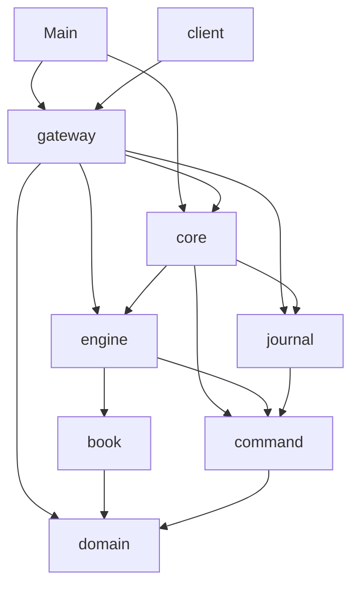

Reading tip: start at the bottom (`domain`, `book`) and work up; each layer only uses what is below it. `gateway`
uses `journal` only for `Durable` (writing the users file atomically). `client` uses only `gateway.Tls` (to build a
TLS socket factory) and otherwise talks to the server purely through the text protocol.

## Conventions you will see everywhere

1. **A block comment at the top of every class** explains its purpose, invariants, threading and the decisions it
   implements, e.g. `src/main/java/exchangeserver/book/OrderBook.java:19-35`. Method-level comments are short and
   explain *why*, not *what*. **[Verified]**
2. **Decision numbers in comments**: `(D44)`, `(D73)` refer to the decision table in
   `docs/ExchangeServer2_Spec.md` §3; `(M9)`, `(L6)` refer to risk items of the review (Spec §11); `(step 4A)` and
   "roadmap step N" refer to the roadmap in Vision §7. Comments citing a "threads guide" (4.3, 4.4, Lab 6) or "Spec
   v8"/"v3" refer to documents in the owner's **original project** (`Exchange Server/New Learnings/...`,
   `Exchange Server/src/docs/...`), not to this repo (**[Verified]** Spec §1.6).
3. **Visibility as an ownership tool**: mutators that only one class may call are package-private (`PriceLevel`'s
   `addOrder`, `fillHead`, `nextNode`, `unlink`; `OrderNode` entirely), so the compiler, not convention, keeps other
   packages out (**[Verified]** Spec D44). Read access across packages goes through copies (`RestingOrderView`,
   `Fill`).
4. **Package-private test seams** instead of mocks: `core.CommandInterceptor` (inject a failure or block the writer),
   `OrderBook.checkInvariants()` and `ordersAt()`, `MatchingEngine.book()` and the `MatchingEngine.Limits`
   constructor (small resting caps), `Exchange.engine()` and `digest()`,
   `TcpGateway.participantsRegistered()`/`subscriberCount()`/`drainingSessions()`, `Credentials.of(map, iterations)`.
   Tests live in the same package to reach them. **[Verified]** `CLAUDE.md` ("Test seams").
5. **Records for values, final classes for everything else**; no inheritance hierarchies besides sealed interfaces.
6. **Dispatch over sealed types with `instanceof` chains ending in a `throw`** (Java 17 has no final pattern
   `switch`); **exhaustive `switch` expressions over enums** (guide 02, §1.4).
7. **Exceptions by meaning** (**[Verified]** Spec D27): `IllegalArgumentException` = bad input from outside;
   `IllegalStateException` = our own bug or a corrupt journal/snapshot; `ReplayException` (a subclass) = replay
   failed at a known record, with a kind (`ENGINE_FAILURE`, `DIVERGED`); `ExchangeException` with a `Reason` = a
   request got no business result (BUSY, STOPPED, HALTED, INTERNAL_ERROR).
8. **Explicit charsets** everywhere (`UTF_8` for files, `US_ASCII` for the wire).
9. **Every persisted line carries a CRC-32C** (journal records, snapshot lines) and every replaced file is written
   with write-then-rename (`journal.Durable`).
10. **Tests: one test class per production class, `@Nested` groups per behaviour, every concurrent wait has a
    timeout**; test names are sentences (`aWrongSecretIsRefusedAndDisconnects`) (**[Verified]** `CLAUDE.md`).
11. **Getter style is mixed by kind**: classic `getX()` on the two domain classes (`Order`, `OrderRequest`) and
    `PriceLevel`; record-style `x()` on records and most other APIs (`lastTradePrice()`, `state()`, `recovery()`).
    **[Inferred]** the domain classes kept the style of the original hand-written project.

## Every file, with its purpose

### Root and docs

| File | Purpose |
|---|---|
| `pom.xml` | Maven build: Java 17 release, UTF-8, `-Xlint:all`, JUnit BOM 5.11.4, JMH 1.37 (test scope), Surefire excluding `bench/**`, jar `Main-Class`, profiles `bench` and `mutation` |
| `mvnw`, `mvnw.cmd` | Maven Wrapper scripts (Unix / Windows), vendored from Apache; not hand-written |
| `.mvn/wrapper/maven-wrapper.properties` | Wrapper config: Maven 3.9.16 distribution URL |
| `.gitignore` | Ignores `target/`, `*.journal`, `*.journal.lock`, IDE and OS files |
| `.gitattributes` | `*.journal` and `*.journal.*` are `-text` (never converted to CRLF, D69); `mvnw` always checked out with LF |
| `README.md` | Short intro, users, build/run commands, a sample session, operator tools, package table |
| `CLAUDE.md` | Agent instructions: commands, architecture across files, test rules, Windows environment notes |
| `docs/ExchangeServer2_Vision.md` | Purpose, working style, engineering principles, roadmap, non-goals, glossary |
| `docs/ExchangeServer2_Spec.md` | Current state per class, invariants, decisions D1–D77, journal and snapshot format, benchmark and mutation results, open threads, review fixes (§9–§11) |
| `docs/understanding/*` | These study guides, `AI-TUTOR-PROMPT.md`, generated `FULL-CONTEXT.md` and its generator `build-full-context.java` |

### `src/main/java/exchangeserver/` (production)

| File | Lines | Purpose |
|---|---|---|
| `Main.java` | 238 | Parses every option; tools `--add-user`, `--quarantine`, `--compact`; server: users, TLS, gateway, service, recovery summary, failure hints, shutdown hook ending with `halt(status)` |
| **domain/** | | |
| `domain/Side.java` | 10 | `BUY`/`SELL`, `opposite()` |
| `domain/OrderType.java` | 23 | `LIMIT`, `IOC`, `FOK`, `MARKET`, `POST_ONLY`; `canRest()` true only for LIMIT and POST_ONLY |
| `domain/Rules.java` | 48 | Every rule replay depends on: `VERSION` (2), max quantity/price, name patterns, band percent, per-participant and global resting caps, `withinBand` |
| `domain/OrderRequest.java` | 147 | A client's order before stamping; the only field-validation layer (D47); factories per type; price as `OptionalLong` |
| `domain/Order.java` | 110 | An accepted order: request + order id + timestamp; tracks filled quantity; `fill(q)` |
| **book/** | | |
| `book/OrderBook.java` | 272 | Bids/asks `TreeMap`s of levels, id → node map, per-participant open counts, changed-level set; `add`, `fillBest`, `cancel`, `drainLevelUpdates`, read-only `walk`/`restingOrders`/`headParticipant`; invariant checker for tests |
| `book/PriceLevel.java` | 165 | One price on one side: doubly linked list with sentinels, total volume, count; mutators package-private |
| `book/OrderNode.java` | 35 | Package-private list node (order, prev, next, level); sentinels only via `sentinel()` |
| `book/RestingOrderView.java` | 20 | Record: an immutable copy of one resting order (for the fillability walk, cancel-all, snapshots) |
| `book/Fill.java` | 13 | Record: what `fillBest` did to one resting order (immutable copy) |
| `book/LevelUpdate.java` | 11 | Record: a level's state after a command (volume 0 = gone); level-2 market data |
| `book/CancelResult.java` | 25 | Record: `CANCELLED` with quantity, or `UNKNOWN_ORDER` |
| `book/CancelStatus.java` | 12 | Enum `CANCELLED`, `UNKNOWN_ORDER` (not owning = unknown, D48) |
| **engine/** | | |
| `engine/MatchingEngine.java` | 333 | Price-time matching: pre-checks (duplicate id, band, resting caps, FOK, post-only), matching loop with self-trade prevention, outcome switch, cancel-all, snapshot, state export/restore; deterministic |
| `engine/Response.java` | 57 | Record: what the submitter is told; constructor rejects contradictions (D22) |
| `engine/Reason.java` | 29 | Why an order did not simply trade/rest: five reject reasons + `SELF_TRADE_PREVENTED` (with CANCELLED) |
| `engine/Trade.java` | 27 | Record: price, qty, buy/sell order ids, aggressor side, timestamp (= incoming command's) |
| `engine/Execution.java` | 13 | Record: a passive (maker) fill addressed to the resting order's owner |
| `engine/EngineOutput.java` | 25 | Sealed interface for everything one command produced |
| `engine/OrderOutput.java` | 22 | Output of a new order: response, passive fills, level updates |
| `engine/CancelOutput.java` | 27 | Output of a cancel: result, level updates |
| `engine/CancelAllOutput.java` | 29 | Output of a cancel-all: one result per cancelled order, level updates (D72) |
| `engine/BookSnapshot.java` | 20 | Record: book as of a command (seq, last trade price, best-first levels) |
| `engine/EngineState.java` | 22 | Record: counters, last trade price and resting orders, for snapshots (D71) |
| `engine/OrderStatus.java` | 9 | `FILLED`, `RESTED`, `CANCELLED`, `REJECTED` |
| **command/** | | |
| `command/Command.java` | 16 | Sealed interface: a stamped, journalled record |
| `command/NewOrderCommand.java` | 21 | Record: seq, timestamp, order id, request |
| `command/CancelOrderCommand.java` | 24 | Record: seq, timestamp, participant, target order id |
| `command/CancelAllCommand.java` | 21 | Record: seq, timestamp, participant (cancel-on-disconnect, D72) |
| `command/SkipCommand.java` | 25 | Record: seq, timestamp, skipped seq (quarantine marker, D51) |
| `command/CheckCommand.java` | 29 | Record: seq, timestamp, 16-hex-digit output digest (D70); compared on replay, never fed |
| `command/Sequencer.java` | 94 | The only clock reader and counter: stamps seq, order id, non-decreasing timestamp; `resume` after replay |
| **journal/** | | |
| `journal/JournalCodec.java` | 194 | Text format v3: `HEADER`/`NEW`/`CANCEL`/`CANCEL_ALL`/`SKIP`/`CHECK` records with CRCs, encode/decode, CRLF message |
| `journal/CommandJournal.java` | 317 | The write-ahead log: lock, header check (adopts new rules if empty), torn-tail cut, `appendAll` (one write + fsync), streaming `read`, base sequence, fail-stop, `writeFresh` |
| `journal/JournalLock.java` | 84 | One owner per journal: OS lock on `<journal>.lock` + in-JVM `HELD` set (D65) |
| `journal/Durable.java` | 64 | Crash-safe file operations: write-then-rename, durable copy, directory fsync |
| `journal/Checksums.java` | 18 | CRC-32C of a record's text, 8 hex digits (D69) |
| **core/** | | |
| `core/Exchange.java` | 359 | Single-threaded live path: CHECK when due, stamp → journal → ledger → listener → future; poison-pill quarantine + rebuild; `open` (replay), static `quarantine` and `compact` tools; `Options`, `Recovery`, `Compaction` |
| `core/Replay.java` | 131 | From the snapshot: verify pass, then feed a `Ledger` and compare CHECKs; `rebuild` for the poison pill |
| `core/Ledger.java` | 74 | Engine + output digest + output log, rebuilt together; `apply`, `snapshot` |
| `core/OutputDigest.java` | 88 | Running FNV-1a 64 over a canonical encoding of every engine output (D70) |
| `core/OutputLog.java` | 123 | Numbers each participant's private events (oseq) and keeps the last `retention` for RESEND (D73) |
| `core/PrivateEvent.java` | 32 | Sealed: `OrderReply`, `CancelReply`, `MakerFill` (one message of a participant's stream) |
| `core/ResendResult.java` | 12 | Record: retained events from an oseq, first retained, latest |
| `core/Snapshot.java` | 137 | State after a sequence number; file `<journal>.snapshot-N` with CRC lines and an END record (D71) |
| `core/ReplayException.java` | 37 | Replay failed at a record: `ENGINE_FAILURE` (poison pill) or `DIVERGED` (CHECK mismatch) |
| `core/ExchangeService.java` | 360 | The writer thread, the queue, hand-in lock, states, batching, stop/halt; callbacks logged if they throw; `recovery()` |
| `core/Request.java` | 57 | Sealed: `Submit`, `Cancel`, `CancelAll` (journalled), `Snapshot`, `Attach`, `Resend` (reads) |
| `core/Pending.java` | 36 | A request in flight with its own future; `command`, `refused` set by the writer |
| `core/ExchangeException.java` | 42 | Refusal/failure with `Reason`: BUSY, STOPPED, HALTED, INTERNAL_ERROR |
| `core/OutputListener.java` | 24 | Hook called with each command's output and private events on the writer thread (the gateway implements it) |
| `core/CommandInterceptor.java` | 17 | Package-private test seam run before each engine step |
| **gateway/** | | |
| `gateway/TcpGateway.java` | 320 | `Settings`; (TLS) server socket + acceptor thread with back-off; session registry; `OutputListener` routing private events and market data; cancel-on-disconnect |
| `gateway/ClientSession.java` | 475 | One connection: reader thread (login, parse, validate, limits, hand in), sender thread (bounded queue → socket), timeouts, subscribe, resend, close when nothing is in flight (D76) |
| `gateway/Credentials.java` | 150 | Users file of salted PBKDF2 hashes; `load`, `addUser`, constant-time `verify` (D74) |
| `gateway/Tls.java` | 67 | Server and client `SSLContext`s from PKCS#12 files; passwords from the environment |
| `gateway/Protocol.java` | 217 | The wire protocol: documentation, parser, line formatters (with `oseq`), limits (256-byte lines, snapshot depth 100) |
| `gateway/ClientMessage.java` | 40 | Sealed: one parsed client line (`Login` hides its secret in `toString`) |
| `gateway/ProtocolException.java` | 11 | A malformed line (answered with `ERROR`) |
| **client/** | | |
| `client/ExchangeClient.java` | 174 | Minimal line client (plain or TLS socket factory): background reader thread, `send`, `await`, `linesUntil`, `field` parser |
| `client/ClientMain.java` | 78 | Interactive console client; `--tls`, `--truststore` |

### `src/test/java/exchangeserver/` (tests and tools)

| File | Lines | What it covers |
|---|---|---|
| `MainTest.java` | 53 | Startup failure hints fit the failure (L2): no poison-pill advice for a corrupt file; compaction advice for a divergence |
| `domain/OrderRequestTest.java` | 140 | Factories, every validation rule, equality |
| `domain/OrderTest.java` | 95 | Construction, price for MARKET, fill/overfill |
| `domain/RulesTest.java` | 54 | Band edges and overflow, max price × quantity fits a long; also `Side.opposite`, `OrderType.canRest` |
| `book/PriceLevelTest.java` | 256 | Append, fillHead, unlink (head/middle/tail/only), `nextNode`, sentinel and foreign-node guards |
| `book/OrderBookTest.java` | 337 | add/fillBest/cancel, open counts, level updates, read-only views, `walk`/`restingOrders`/`headParticipant`, 3 × 10,000 random commands with `checkInvariants()` after each |
| `command/SequencerTest.java` | 196 | Stamping (incl. cancel-all and check), invalid input uses no numbers, backwards clock, resume, command record validation |
| `engine/MatchingEngineTest.java` | 865 | Every order type, collar before the first trade, cancels, risk checks, self-trade prevention, caps, cancel-all, snapshot state export/restore, outputs, guards, determinism |
| `engine/ResponseTest.java` | 87 | `Response` consistency rules (incl. `SELF_TRADE_PREVENTED` only with CANCELLED), `Trade` validation |
| `journal/JournalCodecTest.java` | 195 | Round trips of every record, header with base, corrupt records, checksum mismatch, CRLF message |
| `journal/CommandJournalTest.java` | 343 | Header (D64 refusals, rules adoption), append/read, recovery (torn tail), exclusive lock (incl. a child JVM running `Main --quarantine`), fail-stop |
| `journal/DurableTest.java` | 40 | Write-then-rename replaces the whole file and leaves no temporary file; copy; directory fsync is harmless |
| `core/ReplayTest.java` | 217 | Verify pass (gaps, repeats, backwards time, missing snapshot), feed and rebuild, CHECK match / divergence |
| `core/ExchangeTest.java` | 608 | Live path, restart equality, torn tail, rules version, poison pills, quarantine tool, CHECKs, compaction (restart, id scope, oseq continuity, crash safety, rules crossing, corrupt snapshot), recovery report, cancel-all |
| `core/ExchangeServiceTest.java` | 636 | Hand-in from many threads, D61 future hand-off, listener before callback (D76), stop/race, backpressure, halt, batching, logged callback failure, stop from the writer refused |
| `core/OutputLogTest.java` | 97 | Numbering per participant, cancel-all events, retention and RESEND ranges, resume after a snapshot |
| `core/OutputDigestTest.java` | 92 | Same outputs → same digest; every field and every output kind changes it; resume from hex |
| `core/SnapshotTest.java` | 88 | File round trip, changed character, truncation, wrong END, missing file, empty snapshot |
| `gateway/ProtocolTest.java` | 159 | Parsing and formatting of every message (login with secret, RESEND, oseq lines, resend marker) |
| `gateway/ClientSessionTest.java` | 59 | `readLine` limits and line endings |
| `gateway/CredentialsTest.java` | 68 | Verify, salted file, update, weak secrets refused, missing/corrupt file messages |
| `gateway/TcpGatewayTest.java` | 769 | End to end over real sockets: sessions, QUIT/EOF/shutdown replies, security (loopback, wrong secret, TLS round trip), limits (timeouts, rate, in-flight), trading, private stream, RESEND, cancel-on-disconnect, market data, restart |
| `client/ExchangeClientTest.java` | 57 | `linesUntil` consumes exactly the lines it returns (L4); timeouts keep lines; `field` |
| `testing/MutableClock.java` | 44 | A `Clock` tests can set and move, even backwards |
| `bench/MatchingBenchmark.java` | 100 | JMH: best-level lookup, rest-and-take, add-and-cancel at 10 / 1,000 / 100,000 levels |
| `bench/BatchingBenchmark.java` | 93 | JMH: per-command vs linger vs smart batching, closed-loop clients |

Production classes **without** a test class of their own (**[Verified]** by comparing the trees): small records
and enums tested through their users (`Fill`, `LevelUpdate`, `CancelResult`, `RestingOrderView`, `Execution`,
`Reason`, outputs, `EngineState`, `OrderNode`, command records, `Request`, `Pending`, `PrivateEvent`,
`ResendResult`, `ReplayException`, `ExchangeException`, `ClientMessage`), plus `Ledger` (through `ReplayTest` and
`ExchangeTest`), `JournalLock` (through `CommandJournalTest`), `Tls` (through `TcpGatewayTest`) and `ClientMain`.
Guide 10 discusses the gaps.

## Generated vs hand-written

| Kind | Files |
|---|---|
| Hand-written (by the AI author, 2026-10-27) | everything under `src/`, `pom.xml`, `README.md`, `CLAUDE.md`, `.gitattributes`, `docs/*.md` |
| Vendored | `mvnw`, `mvnw.cmd`, `.mvn/wrapper/maven-wrapper.properties` (Apache Maven Wrapper 3.3.2) |
| Generated at build time (in `target/`, ignored) | `target/classes`, `target/test-classes`, the JMH harness classes generated by the annotation processor, `target/exchange-server2-2.0.0-SNAPSHOT.jar`, `target/surefire-reports/`, `target/pit-reports/`, `target/bench/*.journal` |
| Generated by script | `docs/understanding/FULL-CONTEXT.md` (from the guides, by `docs/understanding/build-full-context.java`) |
| Runtime data | `*.journal` (default `exchange.journal` in the working directory), `*.journal.lock` (D65), `*.journal.snapshot-N` and `*.journal.archive-A-B` (D71), the users file (default `exchange.users`) |

## Key takeaways

- One Maven module, 8 packages + `Main`, ~5.7k production lines, ~5.7k test lines; no runtime dependencies.
- Packages layer inward: `gateway` → `core` → `engine`/`journal` → `book`/`command` → `domain`; `client` uses only
  `gateway.Tls`.
- Entry points: `Main` (server, or the `--add-user`, `--quarantine`, `--compact` tools), `ClientMain` (console), JMH
  via `-Pbench`.
- Every class opens with a block comment; D-numbers point to the Spec; M/L numbers to review risks; "threads guide"
  and "Spec v8" point to the original project.
- Package-private visibility enforces ownership and provides test seams; no mocking library.
- One test class per production class with `@Nested` groups; 453 tests in total (387 annotated methods; parameterized and repeated ones expand).
- Only `target/`, `FULL-CONTEXT.md` and runtime files (journal, lock, snapshots, archives, users) are generated;
  the wrapper is vendored.

## Common confusions

- **`core.Exchange` vs `core.ExchangeService` vs `core.Ledger`.** `Exchange` is the single-threaded core (no
  threads, no queue; tests and tools call it directly). `ExchangeService` owns the writer thread and the queue and
  calls `Exchange.process` for each batch. `Ledger` is what `Exchange` feeds commands into: the engine plus the
  output digest and the per-participant streams.
- **`domain.Order` vs `domain.OrderRequest` vs `command.NewOrderCommand`.** Request = validated client intent, not
  yet stamped. Command = request + sequence number + order id + timestamp (what is journalled). Order = the engine's
  mutable working object built from a command (what rests in the book).
- **`engine.Execution` vs `engine.Trade` vs `book.Fill` vs `core.PrivateEvent.MakerFill`.** `Fill` is the book's
  report to the engine about one resting order; `Trade` is public (market data and the taker's response);
  `Execution` is the maker's fill as the engine reports it; `MakerFill` wraps an `Execution` with the maker's
  `oseq` for the private stream.
- **`journal.Checksums` vs `core.OutputDigest`.** The first protects each stored record against corruption; the
  second summarises all outputs so far, so replay can prove it produced the same history.
- **`client` is not used by the server.** It is a test/interactive tool that lives in `src/main` so it ships in the
  jar.

## Questions to test yourself

1. You want to change what a market order may trade at. Which package and file?
   <details><summary>Answer</summary>`engine/MatchingEngine.java` (`matchLimit`), plus `domain/Rules.java` if the
   band percentage changes (and then `Rules.VERSION` must be bumped).</details>
2. Why can't the engine call `PriceLevel.fillHead` directly?
   <details><summary>Answer</summary>It is package-private in `book`; the engine is in `engine`. It must call
   `OrderBook.fillBest`, which also removes an exhausted order and an emptied level, keeping the book invariants
   (Spec D44).</details>
3. Where does a participant's `oseq` counter live, and which thread changes it?
   <details><summary>Answer</summary>In `core.OutputLog`, inside the `Ledger`, changed only by the
   `exchange-writer` thread as each command's output is recorded.</details>
4. Which files on disk belong to one journal named `exchange.journal` after a compaction at sequence 4?
   <details><summary>Answer</summary>`exchange.journal` (now just a header with base 4), `exchange.journal.lock`
   (empty), `exchange.journal.snapshot-4`, and `exchange.journal.archive-1-4` (the old journal). Observed in the
   live run on 2026-10-27.</details>
5. Which test would you open to see how a TLS connection is set up end to end?
   <details><summary>Answer</summary>`gateway/TcpGatewayTest.java`, `Security.tlsRoundTrip`: it creates a keystore
   with `keytool`, starts a TLS gateway and logs in through `ExchangeClient` with a TLS socket factory.</details>


---

<a id="guide-04-running-and-tooling"></a>

<!-- source: docs/understanding/04-running-and-tooling.md -->

# 04 — Running and Tooling

> **Project:** ExchangeServer2 | Single-instrument limit order book: price-time matching engine, write-ahead journal with replay, single writer thread, TCP/TLS gateway with authenticated participants | Stack: Java 17, Maven wrapper, JUnit 5 (+ JMH, PIT)
> **This guide:** install, every setting, users and TLS, build, run, operator tools, tests (Windows and Linux), mutation testing, benchmarks, debugging and "deployment", with the real output observed on 2026-10-27 | **Prerequisites:** 01, 03 | **Related:** 02, 05, 08, 10, 14
> **Repo layout summary:** `pom.xml` + Maven wrapper (`mvnw`, `mvnw.cmd`) at the root; production code in `src/main/java/exchangeserver/` (packages `domain`, `book`, `engine`, `command`, `journal`, `core`, `gateway`, `client`, plus `Main`); tests mirror it in `src/test/java/exchangeserver/` (plus `bench/` JMH benchmarks and `testing/MutableClock`); design docs in `docs/` (`ExchangeServer2_Vision.md` = purpose/roadmap, `ExchangeServer2_Spec.md` = decisions D1–D77); these guides in `docs/understanding/`.

## Overview

You need only a **JDK 17**. The Maven Wrapper downloads Maven itself, and the project has no runtime dependencies
and no database. What you configure:

- **command-line flags** of `Main` (port, bind address, journal, users file, TLS keystore, timeouts, limits, and
  three operator tools);
- **a users file** of participants and hashed secrets, written with `--add-user`;
- **two environment variables**, only for TLS passwords (`ES2_TLS_PASSWORD`, `ES2_TRUSTSTORE_PASSWORD`);
- **constants in the code** for everything else (listed below).

Commands are shown for Windows (`mvnw.cmd`, the author's and owner's platform). On macOS/Linux use `./mvnw` and
`/` paths. Outputs marked **[Verified — observed]** were seen on 2026-10-27, on Windows 11 with Temurin 17.0.20.1,
or in a Linux container (`eclipse-temurin:17`).

## 1. Install

1. Install a JDK 17 (e.g. Eclipse Temurin 17) and make sure `java -version` prints 17. **[Verified — observed]**:

   ```
   openjdk version "17.0.20.1" 2026-08-18
   OpenJDK Runtime Environment Temurin-17.0.20.1+1 (build 17.0.20.1+1)
   ```

2. Clone or open the repository. In IntelliJ: *File > Open > `pom.xml`* (**[Verified]** README).
3. The first `mvnw.cmd` call downloads Maven 3.9.16 and the dependencies (JUnit, JMH; PIT only with `-Pmutation`)
   into your user Maven cache; it needs internet access once.

## 2. Settings: everything that can be configured

### 2.1 Command-line flags (`Main`)

`Main` documents its own usage at the top of the file (**[Verified]** `src/main/java/exchangeserver/Main.java:25-40`):

```
java -jar exchange-server2.jar [--port 9000] [--bind 127.0.0.1] [--journal exchange.journal]
                               [--users exchange.users] [--tls-keystore FILE]
                               [--login-timeout 10] [--idle-timeout 300] [--max-in-flight 1000]
                               [--rate 1000] [--burst 2000] [--check-interval 10000] [--resend-window 1000]
java -jar exchange-server2.jar --users exchange.users --add-user <participant>    (asks for the secret)
java -jar exchange-server2.jar --journal exchange.journal --quarantine <seq>
java -jar exchange-server2.jar --journal exchange.journal --compact
```

| Flag | Default | Effect |
|---|---|---|
| `--port N` | `9000` | TCP port. `0` picks a free port (used by tests). |
| `--bind ADDR` | `127.0.0.1` (loopback) | Address to listen on. Anything not loopback reaches the network: use it with TLS; without TLS `Main` prints a warning that secrets cross the network in clear text (**[Verified]** `src/main/java/exchangeserver/Main.java:127-129`, Spec D74). |
| `--journal FILE` | `exchange.journal` in the current directory | The journal. Created with a header if missing or empty. Must have been written under the same `Rules.VERSION` (2), unless it has no records yet (then it adopts this build's version, D71). |
| `--users FILE` | `exchange.users` in the current directory | The users file (participant + salted PBKDF2 hash). **Required**: the server does not start without it. |
| `--tls-keystore FILE` | none (plain TCP) | A PKCS#12 keystore; enables TLS 1.3/1.2. Password from the `ES2_TLS_PASSWORD` environment variable. |
| `--login-timeout S` | `10` | Seconds a new connection has to complete `LOGIN`. |
| `--idle-timeout S` | `300` | Seconds a logged-in session may stay silent (`PING` keeps it alive). |
| `--max-in-flight N` | `1000` | Requests a session may have handed in and not yet completed (`SESSION_BUSY` beyond). |
| `--rate N`, `--burst N` | `1000`, `2000` | Token bucket per session: requests per second, and the burst size (`RATE_LIMITED` beyond). |
| `--check-interval N` | `10000` | Commands between `CHECK` records (output digest, D70). |
| `--resend-window N` | `1000` | Private events kept per participant for `RESEND` (D73). |
| `--add-user P` | — | Tool: ask for P's secret, write its hash to the users file, exit. |
| `--quarantine SEQ` | — | Tool: append `SKIP,<next seq>,<now>,SEQ` to the journal and exit. Refused if no NEW/CANCEL/CANCEL_ALL record has that sequence number, if it is already quarantined, or if the journal is open elsewhere. |
| `--compact` | — | Tool: snapshot + archive + empty journal (D71), exit. Refused if the journal is open elsewhere. |

**[Verified]** `src/main/java/exchangeserver/Main.java:48-117`. Any parse error prints
`Usage: see the comment at the top of Main.java (...)` and exits 1.

### 2.2 Environment variables

| Variable | Used by | When |
|---|---|---|
| `ES2_TLS_PASSWORD` | `Main` (server) | Only with `--tls-keystore` |
| `ES2_TRUSTSTORE_PASSWORD` | `ClientMain` | Only with `--tls --truststore FILE` |

**[Verified]** `src/main/java/exchangeserver/Main.java:126`, `src/main/java/exchangeserver/client/ClientMain.java:12-20`,
`src/main/java/exchangeserver/gateway/Tls.java:52-58`. Why not flags: command-line arguments are visible to other
users in the process list (`src/main/java/exchangeserver/gateway/Tls.java:15-17`). A missing variable fails with
`Set the ES2_TLS_PASSWORD environment variable to the keystore password`.

### 2.3 Constants in the code

| Setting | Value | Where |
|---|---|---|
| Queue capacity (requests waiting for the writer) | 100,000 | `src/main/java/exchangeserver/core/ExchangeService.java:70` (`Settings.defaults()`) |
| Max batch size | 1,000 | same line |
| Linger (group-commit wait) | 0 = off (smart batching; kept only for benchmarks, D52) | same line |
| Clock | `Clock.systemUTC()` | same line |
| Max sessions | 256 | `src/main/java/exchangeserver/gateway/TcpGateway.java:69` |
| Outbound queue per session | 10,000 lines | same line |
| Max line length (excluding `\r\n`) | 256 bytes | `src/main/java/exchangeserver/gateway/Protocol.java:50` |
| Snapshot depth on SUBSCRIBE | 100 levels per side | `src/main/java/exchangeserver/gateway/Protocol.java:54` |
| Accept back-off after a failed `accept()` | 100 ms doubling to 5 s; ERROR log after 10 failures in a row | `src/main/java/exchangeserver/gateway/TcpGateway.java:100-102` |
| PBKDF2 iterations for `--add-user` | 210,000 | `src/main/java/exchangeserver/gateway/Credentials.java:36` |
| Secret format | 8–64 printable ASCII characters, no spaces | `src/main/java/exchangeserver/gateway/Credentials.java:38` |
| Shutdown wait for the writer | 10 s | `src/main/java/exchangeserver/Main.java:163` |
| `Rules.VERSION` | 2 | `src/main/java/exchangeserver/domain/Rules.java:21` |
| Max order quantity | 1,000,000,000 | `src/main/java/exchangeserver/domain/Rules.java:24` |
| Max price | `Long.MAX_VALUE / 1e9` ≈ 9,223,372,036 | `src/main/java/exchangeserver/domain/Rules.java:26` |
| Participant name | `[A-Za-z0-9_]{1,16}` | `src/main/java/exchangeserver/domain/Rules.java:28` |
| Client order id | `[A-Za-z0-9_.-]{1,32}` | `src/main/java/exchangeserver/domain/Rules.java:29` |
| Price band | ±10% of the last trade | `src/main/java/exchangeserver/domain/Rules.java:34` |
| Resting orders per participant | 10,000 | `src/main/java/exchangeserver/domain/Rules.java:35` |
| Resting orders in total | 1,000,000 | `src/main/java/exchangeserver/domain/Rules.java:37` |

All **[Verified]** at the cited lines. **[Inferred]** The design treats rule values as code on purpose: they are part
of what the journal's rules version certifies (Spec D20, D46), so they must not drift per deployment. Changing any
`Rules` value requires bumping `Rules.VERSION`.

## 3. Build

```
mvnw.cmd package                    compile, run all tests, build the jar
mvnw.cmd package -DskipTests        build the jar without tests (what the live runs used)
mvnw.cmd clean package -DskipTests  same, from scratch
```

Output: `target/exchange-server2-2.0.0-SNAPSHOT.jar`. The jar's manifest names `exchangeserver.Main`
(**[Verified]** `pom.xml:78-89`), and the jar also contains the client classes.

The compiler runs with `-Xlint:all` (minus annotation-processing notes); the project rule is "keep the build
warning-free" (**[Verified]** `pom.xml:62-65`, `CLAUDE.md`).

**Stale-build trap.** Maven's compiler plugin recompiles a source only if it is newer than its `.class`. If you
restore an older copy of a file (for example with PowerShell's `Copy-Item`, which keeps the old modification time),
the jar keeps the *newer* compiled code and nothing warns you. **[Verified]**: this happened on 2026-10-27 and made a
live test exercise old code. Use `mvnw.cmd clean ...` after swapping files.

**Do not run two Maven builds at once**: they share `target/` (**[Verified]** `CLAUDE.md`).

## 4. Run the server and a client

### 4.1 Create users

```
java -jar target/exchange-server2-2.0.0-SNAPSHOT.jar --users exchange.users --add-user alice
```

In a terminal it asks `Secret for alice:` and `Again:` without echo; without a terminal (a script) it reads one
line from standard input (**[Verified]** `src/main/java/exchangeserver/Main.java:212-232`). **[Verified — observed]**
from PowerShell:

```
PS> "alice-secret" | java -jar target\exchange-server2-2.0.0-SNAPSHOT.jar --users exchange.users --add-user alice
Saved alice in C:\...\exchange.users
```

and the file holds one line per participant, no secret (**[Verified — observed]**, truncated):

```
alice:pbkdf2-sha256:210000:gJDXXBPuB1OYmFalrdCSx...
bob:pbkdf2-sha256:210000:Z/guAtluKSh/bT+M9ErbwA=...
```

A trap fixed on 2026-10-27: Windows PowerShell pipes text to a program with a UTF-8 byte-order mark
(`ef bb bf`) in front; before `Main` learned to drop it, the command above failed with
`Adding the user failed: A secret is 8 to 64 printable ASCII characters without spaces` (**[Verified — observed]**).
Running `--add-user` again for an existing participant replaces its secret.

### 4.2 Start the server

```
java -jar target/exchange-server2-2.0.0-SNAPSHOT.jar --port 9000 --journal exchange.journal --users exchange.users
```

**[Verified — observed]** output on a fresh journal (two lines on stdout, then nothing until shutdown):

```
ExchangeServer2 listening on 127.0.0.1:9137, journal C:\...\exchange.journal
Recovered through sequence 0: replayed 0 commands, cut 0 torn bytes
```

The second line is the recovery summary (Spec D77): the last sequence number, the snapshot it started from if any,
how many commands were replayed, how many torn bytes were cut, plus the quarantined commands and a rules adoption
when there are any (**[Verified]** `src/main/java/exchangeserver/Main.java:152-157`). The gateway starts accepting
before replay; a client that connects during a long replay gets `ERROR exchange is starting; retry shortly`
(**[Verified]** `src/main/java/exchangeserver/Main.java:139`,
`src/main/java/exchangeserver/gateway/ClientSession.java:230`).

With TLS (**[Verified]** from code; the TLS path is exercised by `TcpGatewayTest.Security.tlsRoundTrip`, not by a
manual run):

```
set ES2_TLS_PASSWORD=...
java -jar target/exchange-server2-2.0.0-SNAPSHOT.jar --bind 0.0.0.0 --tls-keystore server.p12 --users exchange.users
```

### 4.3 Files next to the journal

| File | Created by | What it is |
|---|---|---|
| `exchange.journal` | the first start | The write-ahead log (format v3, a CRC per record) |
| `exchange.journal.lock` | the first start | Empty. While the exchange runs it holds an exclusive OS lock on it, so a second exchange, `--quarantine` or `--compact` on the same journal is refused with "already open" (D65). Left on disk on purpose (deleting it could race with the next opener); a leftover from a killed process does not block the next start, because the OS releases the lock when the process dies |
| `exchange.journal.snapshot-N` | `--compact` | The state after sequence N (D71) |
| `exchange.journal.archive-A-B` | `--compact` | The journal records A..B that the snapshot replaced |
| `exchange.journal.tmp`, `*.snapshot-N.tmp` | write-then-rename | Only during an atomic write; normally gone |

**[Verified]** `src/main/java/exchangeserver/journal/JournalLock.java:37-54`,
`src/main/java/exchangeserver/core/Exchange.java:174-194`, `src/main/java/exchangeserver/journal/Durable.java:25-36`.
**[Verified — observed]** on Windows a hard-killed server left the lock file behind and restarted normally.

### 4.4 Connect a client

```
java -cp target/exchange-server2-2.0.0-SNAPSHOT.jar exchangeserver.client.ClientMain localhost 9000
java -cp target/exchange-server2-2.0.0-SNAPSHOT.jar exchangeserver.client.ClientMain host 9000 --tls --truststore ca.p12
```

It prints `Connected to localhost:9000. Try: LOGIN alice <secret> / NEW c1 BUY LIMIT 10 100 / SUBSCRIBE / QUIT`
(plus ` (TLS)` with `--tls`), then echoes each server line prefixed with `< ` (**[Verified]**
`src/main/java/exchangeserver/client/ClientMain.java:65`). Without `--truststore`, `--tls` trusts the JDK's default
certificates. Any raw TCP tool also works for plain TCP (telnet, `nc`, PowerShell's `System.Net.Sockets.TcpClient`):
the protocol is ASCII lines ending in `\n` (`\r\n` accepted).

The protocol in one screen (**[Verified]** `src/main/java/exchangeserver/gateway/Protocol.java:20-44`):

```
Client -> server
    LOGIN <participant> <secret> [COD]          COD: cancel my resting orders when my last session closes (D72)
    NEW <clOrdId> <BUY|SELL> <LIMIT|IOC|FOK|POST_ONLY> <quantity> <price>
    NEW <clOrdId> <BUY|SELL> MARKET <quantity>
    CANCEL <orderId>
    RESEND <oseq>                               private events from oseq on, as far as still retained (D73)
    SUBSCRIBE | UNSUBSCRIBE | PING | QUIT
Server -> client
  Private stream, numbered per participant (oseq), sent to every session of that participant (D73):
    FILL oseq= orderId= clOrdId= side= price= qty= leaves= liquidity=TAKER|MAKER   (one per trade, both sides)
    ORDER oseq= orderId= clOrdId= status= filled= remaining= [reason=]           (the outcome of a NEW)
    CANCELLED oseq= orderId= qty= [reason=CANCEL_ALL]   CANCEL_REJECT oseq= orderId= reason=UNKNOWN_ORDER
    (a line repeated by RESEND ends with resend=1)
  Session:
    WELCOME participant=<p> oseq=<latest>       RESENT last=<latest>      ERROR RESEND_GAP first=<oldest retained>
    BOOK seq= last= bids=<price>x<qty>,... asks=...
    TRADE seq= price= qty= aggressor=          LEVEL seq= side= price= qty= orders=   (qty=0: level gone)
    SUBSCRIBED  UNSUBSCRIBED  PONG  BYE
    ERROR <text>
QUIT: every request sent before it is answered first, then BYE, then the server closes the connection.
```

### 4.5 A real session

**[Verified — observed]** 2026-10-27 against a fresh journal, driven by a script with several TCP connections
(`>` is what a client sent, `<` what it received; `mallory` is a connection trying Alice's name):

```
mallory > LOGIN alice guessed-secret
mallory < ERROR login failed
mallory < (closed)
alice > LOGIN alice alice-secret COD
alice < WELCOME participant=alice oseq=0
bob > LOGIN bob bob-secret!
bob < WELCOME participant=bob oseq=0
alice > NEW a1 SELL LIMIT 10 100
alice < ORDER oseq=1 orderId=1 clOrdId=a1 status=RESTED filled=0 remaining=10
alice > NEW a2 BUY LIMIT 5 100
alice < ORDER oseq=2 orderId=2 clOrdId=a2 status=CANCELLED filled=0 remaining=5 reason=SELF_TRADE_PREVENTED
bob > NEW b1 BUY LIMIT 4 100
bob < FILL oseq=1 orderId=3 clOrdId=b1 side=BUY price=100 qty=4 leaves=0 liquidity=TAKER
bob < ORDER oseq=1 orderId=3 clOrdId=b1 status=FILLED filled=4 remaining=0
alice < FILL oseq=3 orderId=1 clOrdId=a1 side=SELL price=100 qty=4 leaves=6 liquidity=MAKER
alice > QUIT
alice < BYE
alice < (closed)
bob > SUBSCRIBE
bob < SUBSCRIBED
bob < BOOK seq=4 last=100 bids=- asks=-
alice2 > LOGIN alice alice-secret
alice2 < WELCOME participant=alice oseq=4
alice2 > RESEND 1
alice2 < ORDER oseq=1 orderId=1 clOrdId=a1 status=RESTED filled=0 remaining=10 resend=1
alice2 < ORDER oseq=2 orderId=2 clOrdId=a2 status=CANCELLED filled=0 remaining=5 reason=SELF_TRADE_PREVENTED resend=1
alice2 < FILL oseq=3 orderId=1 clOrdId=a1 side=SELL price=100 qty=4 leaves=6 liquidity=MAKER resend=1
alice2 < CANCELLED oseq=4 orderId=1 qty=6 reason=CANCEL_ALL resend=1
alice2 < RESENT last=4
alice2 > QUIT
alice2 < BYE
alice2 < (closed)
bob > QUIT
bob < BYE
bob < (closed)
```

Things worth noticing (each is explained in guides 05 and 07):

- A wrong secret gets the same `ERROR login failed` as an unknown name, and the connection closes: one attempt per
  connection (Spec D74).
- Each participant has its own `oseq` sequence: Bob's first message is `oseq=1` although Alice is already at 2.
- `a2` would have traded with Alice's own resting sell: cancelled with `SELF_TRADE_PREVENTED`, nothing traded (D67).
  It still used up order id 2, which is why `b1` gets 3.
- Alice logged in with `COD`; when her last session quit, the gateway submitted a journalled `CANCEL_ALL alice`, so
  Bob's snapshot shows an empty book (D72).
- `RESEND 1` returned every private event, including the cancel she missed while away (D73).

The journal after that session (**[Verified — observed]**, plain text, each record ending with its CRC-32C):

```
HEADER,3,2,0,5d7826e0
NEW,1,2026-10-27T14:20:40.373493200Z,1,alice,a1,SELL,LIMIT,10,100,379beca7
NEW,2,2026-10-27T14:20:40.802670Z,2,alice,a2,BUY,LIMIT,5,100,f33577be
NEW,3,2026-10-27T14:20:41.217763100Z,3,bob,b1,BUY,LIMIT,4,100,bed0c339
CANCEL_ALL,4,2026-10-27T14:20:42.045241200Z,alice,2b6bb4a5
```

The header says format 3, rules version 2, base sequence 0 (no snapshot). The self-trade-prevented `a2` is
journalled because its outcome depended on the book; the failed login, `SUBSCRIBE`, `RESEND` and `QUIT` are not.

### 4.6 Compaction (snapshot + fresh journal)

**[Verified — observed]**, same journal as above. While the server was running:

```
> java -jar ... --journal exchange.journal --compact
Compaction failed: Journal C:\...\exchange.journal is already open (a running exchange, or a --quarantine or --compact run)
(exit code 1)
```

After stopping it:

```
> java -jar ... --journal exchange.journal --compact
Compacted through sequence 4: 0 resting orders in C:\...\exchange.journal.snapshot-4; old journal archived as C:\...\exchange.journal.archive-1-4
```

Files afterwards: `exchange.journal` (22 bytes: just the header, base 4), `exchange.journal.archive-1-4` (297
bytes), `exchange.journal.lock` (0), `exchange.journal.snapshot-4` (135), `exchange.users` (192). The snapshot:

```
SNAPSHOT,1,4,3,2026-10-27T14:20:42.045241200Z,100,88a18b6a6365ebe4,d7e6a970
OSEQ,alice,4,d1453b0b
OSEQ,bob,1,3d136969
END,0,2,6a6d3c70
```

(last sequence 4, last order id 3, last timestamp, last trade price 100, output digest; no resting orders; the last
`oseq` of each participant; an END record with the counts.) The restart then printed:

```
Recovered through sequence 4 from snapshot 4: replayed 0 commands, cut 0 torn bytes
```

When to compact (**[Verified]** README, Spec D71): at the end of a trading day (it bounds recovery time and ends
the scope of client order ids: after it, only resting orders keep theirs), and before moving to a build with a new
`Rules.VERSION` (compact with the **old** build, then start the new one, which adopts the empty journal). Compaction
itself replays the journal, so it must run with the build that wrote it.

### 4.7 Restart and crash recovery

**[Verified — observed]** earlier the same day (before the D66–D77 changes, so the lines had no `oseq` and the
journal no CRCs): a server was hard-killed, half a record was appended to simulate a crash mid-write, and the
restart cut the torn record, rebuilt the book and the last trade price, and continued the counters (next sequence 7,
next order id 5). With the final code the cut is reported in the recovery line (`cut N torn bytes`).

### 4.8 Startup failures (exit code 1)

`Main` prints `Startup failed: <message>` and then a hint that fits the failure (Spec D77; **[Verified]**
`src/main/java/exchangeserver/Main.java:143-149`, `186-198`):

| Failure | Message (from code) | Hint |
|---|---|---|
| No users file | `No users file C:\...\exchange.users: create it with --add-user <participant> --users ...` | (none: fails before the gateway is created) |
| Journal written under other rules, with records | `Journal ... was written under rules version 1; this build uses 2. Compact it with the build that wrote it (--compact); this build can then start from the compacted journal and its snapshot.` | `The journal was not changed.` |
| Not a journal | `Bad journal header "keep me": ...` or `Journal ... does not start with a journal header: "..."` | `The journal was not changed.` |
| CRLF-converted journal | `Bad journal header "...": record ends with '\r': the file was converted to CRLF line endings; convert it back to LF (e.g. dos2unix) and restart` | `The journal was not changed.` |
| Changed record (checksum) | `Corrupt journal record N: "..."` | `The journal was not changed.` |
| Engine throws on a replayed command | `Replay failed on command N (...)` | `Replay failed on command N (a poison pill?). Inspect it, then run --quarantine N and start again.` |
| A CHECK digest differs | `Replay diverged before CHECK N: ...` | `This build replays the journal differently from the build that wrote it. Start the old build, run --compact, then start this build.` |
| Journal open elsewhere | `Journal ... is already open (a running exchange, or a --quarantine or --compact run)` | `The journal was not changed.` |

**[Verified]** messages at `src/main/java/exchangeserver/gateway/Credentials.java:58`,
`src/main/java/exchangeserver/journal/CommandJournal.java:248`, `255-257`,
`src/main/java/exchangeserver/journal/JournalCodec.java:83`, `174-175`,
`src/main/java/exchangeserver/core/Replay.java:82`, `93`. Before the D69 change, a CRLF journal and a non-journal
file were observed failing with older wording; the hints are covered by `MainTest`.

### 4.9 Quarantining a poison pill

If startup fails while replaying one command, the hint names it. After inspecting the record:

```
java -jar target/exchange-server2-2.0.0-SNAPSHOT.jar --journal exchange.journal --quarantine 7
```

Output on success: `Quarantined command 7 in C:\...\exchange.journal`. The journal gains `SKIP,<next seq>,<now>,7`
with its CRC; the next startup skips record 7. A second `--quarantine 7` is refused
(`Command 7 is already quarantined`). While a server has the journal open the tool is refused (D65);
**[Verified — observed]** on Linux in Docker:

```
Quarantine failed: Journal /tmp/j.journal is already open (a running exchange, or a --quarantine or --compact run)
exit: 1
```

### 4.10 Stopping, and exit codes

| How it ends | Exit code | What happens |
|---|---|---|
| Ctrl+C / SIGINT / SIGTERM | **0** | Shutdown hook: close the gateway (drop connections; COD participants' last sessions close, so their `CANCEL_ALL` is accepted before the stop), `stop()` the service (refuse new requests, process everything already accepted, close the journal), wait up to 10 s, then `Runtime.halt(0)` (**[Verified]** `src/main/java/exchangeserver/Main.java:159-177`). **[Verified — observed]** on Linux in Docker: exit status 0 after SIGINT and after SIGTERM. On Windows Ctrl+C was not exercised. |
| Writer not stopped within 10 s | 1 | `Writer thread did not stop within 10 s` |
| Halt (journal I/O failure, `Error` in the engine, writer interrupted) | 2 | `Exchange halted: <cause>` on stderr, `System.exit(2)`; the hook then halts with 2 (**[Verified]** `src/main/java/exchangeserver/Main.java:179-183`) |
| Bad arguments, startup failure, failed tool | 1 | One-line message on stderr |
| Hard kill (`kill -9`, Task Manager) | n/a | Nothing runs; the journal is the truth; restart replays it |

A practical trap, **[Verified — observed]** in Docker: a server started in the background (`java ... &`) from a
non-interactive bash script **ignores SIGINT** (POSIX: background jobs without job control start with SIGINT
ignored; the process's `SigIgn` mask showed signal 2), so `kill -INT` does nothing there. Use `set -m` in the
script, or SIGTERM.

## 5. Tests

```
mvnw.cmd test                                           all tests
mvnw.cmd test -Dtest=MatchingEngineTest                 one class, including its @Nested groups
mvnw.cmd test -Dtest=RulesTest#oppositeSide             one test method
mvnw.cmd test "-Dtest=ExchangeServiceTest,TcpGatewayTest"   several classes
```

**[Verified]** commands from `CLAUDE.md`; the multi-class form was used during the work. In PowerShell, quote `-D`
arguments containing commas, `#` or `$`. **[Inferred]** a single nested group can be selected as
`"-Dtest=ExchangeServiceTest`$Batching"` (Surefire treats nested classes as `Outer$Inner`); not tried.

Expected end of output (**[Verified — observed]** on Windows; the Linux run, before the last 7 tests were added, showed 446):

```
[INFO] Tests run: 453, Failures: 0, Errors: 0, Skipped: 0
[INFO] BUILD SUCCESS
```

In the Linux container the test phase took about 55 s (**[Verified — observed]** `Total time: 54.691 s`).

**Expected noise** (not failures, **[Verified]** `CLAUDE.md` and observed): tests that inject poison pills or fatal
errors log stack traces, e.g. `SEVERE: Exchange halted` with `java.lang.OutOfMemoryError: simulated`, and
`simulated engine bug`; the callback test logs `Request callback failed`. Under PowerShell, anything a native program
writes to stderr is shown as `NativeCommandError`; that is PowerShell's wrapping, not a failure. Some tests start a
child JVM or run `keytool`, so a JDK (not just a JRE) must be the `java` on the path.

**Reports:** `target/surefire-reports/` (one `.txt` and `.xml` per test class). Only the last run's reports are
kept, so to study an intermittent failure save each run's console output.

### 5.1 Running the suite on Linux (Docker)

**[Verified — observed]** on 2026-10-27 with Docker Desktop (WSL2 backend): a script mounted the repo read-only at
`/src`, copied it without `target/` and `.git/` into `/w`, converted `mvnw` to LF, and ran `./mvnw -B test`; 446 tests
passed (Spec §11). An equivalent one-liner (**[Inferred]** equivalent to that script; replace the path):

```
docker run --rm -v "S:\path\to\ExchangeServer2:/src:ro" eclipse-temurin:17 bash -c "mkdir -p /w && (cd /src && tar --exclude=./target --exclude=./.git -cf - .) | tar -xf - -C /w && cd /w && sed -i 's/\r$//' mvnw && chmod +x mvnw && ./mvnw -B test"
```

Why copy: the container must not write the Windows `target/` while another build might use it, and `mvnw` checked
out with CRLF would not run under `sh` (`.gitattributes` now forces LF for `mvnw` on new checkouts).

## 6. Mutation testing (PIT)

```
mvnw.cmd -Pmutation test
```

Runs the normal tests, then PIT over `domain`, `book`, `engine`, `command`, `journal`, `core` with 4 threads; takes
several minutes. Report: `target/pit-reports/index.html` (**[Verified]** `pom.xml:127-169`, README). The project
rule: after a behavioural change, run it and explain survivors in Spec §7; fsync (`force`), directory fsync and log
calls are expected survivors because no unit test can observe them, and the branch of `JournalLock.acquire` where
another process holds the lock runs only in a child JVM that PIT does not instrument (**[Verified]** `CLAUDE.md`,
Spec §7).

## 7. Benchmarks (JMH)

```
mvnw.cmd -Pbench verify -Djmh.args="MatchingBenchmark -f 1 -wi 3 -w 1s -i 5 -r 1s"
mvnw.cmd -Pbench verify -Djmh.args="BatchingBenchmark -f 1 -wi 2 -w 2s -i 3 -r 3s -t 16"
```

`-f` forks, `-wi`/`-w` warm-up iterations/time, `-i`/`-r` measured iterations/time, `-t` threads (= simulated
clients for `BatchingBenchmark`). The `bench` profile skips tests. `BatchingBenchmark` writes real journals under
`target/bench/` because the cost of fsync is the point (**[Verified]**
`src/test/java/exchangeserver/bench/BatchingBenchmark.java:25-39`). **Not run** on 2026-10-27; recorded results are
in Spec §5 and predate D66–D77 (e.g. a command costs ~0.65–1.1 µs; smart batching reaches 43 orders/ms with 64
clients).

## 8. Debugging

### 8.1 Threads you will see (names are set in code)

| Thread | Daemon? | Role | Where |
|---|---|---|---|
| `main` | no | Runs `Main`, then waits in `awaitTermination()` | `src/main/java/exchangeserver/Main.java:179` |
| `exchange-writer` | **no** | The single writer: batches, journal, ledger, listener, callbacks | `src/main/java/exchangeserver/core/ExchangeService.java:119-121` |
| `gateway-acceptor` | yes | `accept()` loop | `src/main/java/exchangeserver/gateway/TcpGateway.java:144-145` |
| `session-N-reader` | yes | Login, parses lines from client N, limits, hands in requests | `src/main/java/exchangeserver/gateway/ClientSession.java:91`, `93` |
| `session-N-sender` | yes | Writes client N's outbound queue to its socket | `src/main/java/exchangeserver/gateway/ClientSession.java:92`, `94` |
| `ForkJoinPool.commonPool-worker-*` | yes | Completes futures handed to API callers (D61) | `src/main/java/exchangeserver/core/ExchangeService.java:170-180` |
| `shutdown` | no | The shutdown hook | `src/main/java/exchangeserver/Main.java:159-177` |

A thread dump (`jstack <pid>` or `jcmd <pid> Thread.print`) shows instantly where each is blocked. An idle exchange
has `exchange-writer` waiting in `LinkedBlockingQueue.take`, readers in a socket read (with a timeout), senders in
`ArrayBlockingQueue.take`. **[Inferred]** from the code paths; not captured.

### 8.2 Good breakpoints

| To see… | Break at |
|---|---|
| A batch being stamped and journalled | `src/main/java/exchangeserver/core/Exchange.java:198` (`process`) and `:223` (`journal.appendAll`) |
| One order being matched | `src/main/java/exchangeserver/engine/MatchingEngine.java:178` (`process`), the loop at `:219`, self-trade stop at `:225` |
| What a client line becomes | `src/main/java/exchangeserver/gateway/ClientSession.java:211` (`handle`) |
| A login | `src/main/java/exchangeserver/gateway/ClientSession.java:293` (`login`) |
| Lines leaving for a client | `ClientSession.send` at `src/main/java/exchangeserver/gateway/ClientSession.java:116` |
| Replay at startup | `src/main/java/exchangeserver/core/Replay.java:39` (`run`) |
| A poison pill | `src/main/java/exchangeserver/core/Exchange.java:278` (`quarantine`) |
| Compaction | `src/main/java/exchangeserver/core/Exchange.java:174` (`compact`) |

Caution: **a breakpoint on the writer thread freezes the whole exchange** (by design nothing else touches the
book), and if it sits long enough every client's requests pile up until `SESSION_BUSY` or BUSY, and silent sessions
hit their idle timeout. Prefer "suspend thread" over "suspend all", and prefer tests with the `CommandInterceptor`
seam for reproducible pauses (guide 10).

To debug a running jar from an IDE, start it with the standard JDWP agent (**[General knowledge]**):

```
java -agentlib:jdwp=transport=dt_socket,server=y,suspend=n,address=127.0.0.1:5005 -jar target/exchange-server2-2.0.0-SNAPSHOT.jar
```

### 8.3 Logs

Only three classes log, through `System.Logger`, which (with no logging library) goes to `java.util.logging` and
prints to **stderr** (**[Verified]** guide 02 §6). `Main` prints its startup lines and failures directly.

| Message | Level | Meaning | Source |
|---|---|---|---|
| `Engine failed on command N; quarantining it` + stack trace | ERROR (shown as `SEVERE`) | A poison pill was quarantined live | `src/main/java/exchangeserver/core/Exchange.java:279` |
| `Output listener failed on command N` | ERROR | The gateway's listener threw; ignored | `src/main/java/exchangeserver/core/Exchange.java:249` |
| `Request callback failed` | ERROR | A request callback threw; logged instead of vanishing (D77) | `src/main/java/exchangeserver/core/ExchangeService.java:218` |
| `Exchange halted` + cause | ERROR | Writer halted; process will exit 2 | `src/main/java/exchangeserver/core/ExchangeService.java:343` |
| `Closing the journal failed` | WARNING | | `src/main/java/exchangeserver/core/ExchangeService.java:315` |
| `accept failed N time(s) in a row; retrying` | WARNING, ERROR from the 10th | Accept error (e.g. too many open files); back-off 100 ms doubling to 5 s | `src/main/java/exchangeserver/gateway/TcpGateway.java:178-181` |
| `cancel-on-disconnect for P failed: ...` | WARNING | The CANCEL_ALL was refused (e.g. the exchange is stopping) | `src/main/java/exchangeserver/gateway/TcpGateway.java:259` |
| `session N is too slow; disconnecting` | INFO | A client's outbound queue filled | `src/main/java/exchangeserver/gateway/ClientSession.java:121` |

There is no request log and no metrics. Secrets are never logged (`ClientMessage.Login.toString` omits them). To
change log levels, pass a `java.util.logging` config file with `-Djava.util.logging.config.file=...`
(**[General knowledge]**).

### 8.4 Inspecting state

- **The journal is the best debugging tool**: plain text, one command per line, in processing order, each with a
  CRC. Replaying it in a test (`Exchange.open(path, clock)` then `snapshot(depth)`) rebuilds the exact book. After
  a compaction, look at the snapshot file and the archive too.
- **The live book**: `SUBSCRIBE` from any client gives a `BOOK` snapshot (best 100 levels per side).
- **A participant's history**: log in as it and `RESEND 1` (up to the retained 1,000 events since the last
  compaction).
- From code (tests): go through the queue (`service.snapshot(depth)`, `service.resend(p, n)`), never read the
  `OrderBook` from another thread (**[Verified]** `CLAUDE.md`, "Single writer").

## 9. Windows-specific notes

**[Verified]** from `CLAUDE.md`, Spec §1.5 and observations unless marked:

- The default charset is windows-1252; the code always passes a charset, and the build sets UTF-8. Do the same in
  any code you add.
- **Never write Java sources with Windows PowerShell's `Set-Content -Encoding utf8`**: it adds a byte-order mark,
  which `javac` rejects. Use an editor, or `[IO.File]::WriteAllText(path, text, New-Object Text.UTF8Encoding($false))`.
- PowerShell pipes text to programs with a byte-order mark (`--add-user` now strips it), and `Set-Content`/`Out-File`
  write CRLF line endings: fatal for a journal, which now says so explicitly (§4.8). `.gitattributes` keeps git from
  converting journals.
- Java opens files with delete sharing on Windows, so deleting a file does not prove it was closed; tests use
  `CommandJournal.openJournals()` instead.
- File locks differ by OS: on Windows they are mandatory and belong to a handle; on Linux/macOS they are advisory,
  belong to the process, and are dropped when *any* handle on the file closes. That is why the exchange locks a
  separate `<journal>.lock` file that nothing else opens (D65; guide 02 §3.3). The cross-process test has run on both.
- Windows cannot open a directory as a file, so the directory fsync after creating or renaming a file is skipped
  there (NTFS journals its metadata itself) (**[Verified]** `src/main/java/exchangeserver/journal/Durable.java:46-63`).
- One fsync costs ~1.5 ms on the dev disk; timed waits round up to the ~15.6 ms Windows timer (why the linger
  batching mode measured badly, Spec §5).
- The stale-build trap (§3).

## 10. Deployment

There is no container image, service definition or CI configuration (**[Verified]** no such files in the repo); the
Docker run in §5.1 is a manual check. The deliverable is the jar, a users file and a journal. **[Inferred]** a real
deployment would need at least: a process supervisor that restarts on exit code 2 (but not blindly on exit 1, which
needs an operator); the journal, snapshots and archives on a durable local disk with a backup policy; a scheduled
`--compact` while the exchange is stopped (e.g. end of day); TLS with a proper certificate if `--bind` exposes the
port; protection of the users file and of the TLS password in the environment.

## Key takeaways

- Only JDK 17 is needed; the wrapper fetches Maven.
- Before the first start, create the users file with `--add-user`; the server binds 127.0.0.1 unless `--bind` says
  otherwise; TLS with `--tls-keystore` and `ES2_TLS_PASSWORD`.
- Flags cover port, bind, journal, users, TLS, timeouts, per-session limits, CHECK interval and RESEND window; rule
  values are code constants certified by `Rules.VERSION` (2).
- Startup prints `Recovered through sequence N [from snapshot B]: replayed R commands, cut T torn bytes`.
- Operator tools: `--quarantine <seq>` and `--compact`, both refused while the exchange runs; compaction leaves a
  snapshot and an archive next to the journal.
- Exit codes: 0 clean stop (observed after SIGINT and SIGTERM on Linux), 1 startup or tool failure, 2 halted.
- Tests: `mvnw.cmd test` → 453 green on Windows (446 in the Linux run); stack traces from simulated failures are expected noise.
- Debug by thread name; a breakpoint on `exchange-writer` freezes the exchange; the journal (plus snapshot) is the
  best state inspector.

## Common confusions

- **"The server starts without users."** No: `Credentials.load` fails if the users file is missing, and `Main` exits
  1 with a hint to run `--add-user`.
- **"`--bind 0.0.0.0` is enough to go on the network."** It works, but without `--tls-keystore` secrets and fills
  travel in clear text; `Main` warns about it.
- **"Exit code 1 means the exchange crashed."** No: 1 means it never started (or a tool refused). A running exchange
  that fails halts with exit code 2.
- **"The tool printed `Quarantined command 7`, so the poison is gone."** The poison record stays in the journal
  (history is annotated, never edited); a `SKIP` record after it tells replay to pass over it. Compaction later moves
  it into the archive.
- **"A leftover `exchange.journal.lock` means the exchange is still running."** No: the file always stays. Only a
  live OS lock on it means "in use".
- **"After `--compact` the history is gone."** It is in `exchange.journal.archive-A-B`; the snapshot plus the new
  journal replace it for recovery, but nothing is deleted.
- **"`kill -INT` from my script did nothing, so the shutdown hook is broken."** Background jobs of a
  non-interactive shell ignore SIGINT; use SIGTERM or `set -m`.
- **"`-DskipTests` skips compiling tests."** It skips running them; test sources (and the JMH processor) still
  compile. **[General knowledge]** (`-Dmaven.test.skip=true` skips both.)

## Questions to test yourself

1. You start the jar twice on the same journal with different ports. What happens to the second?
   <details><summary>Answer</summary>It binds its port and starts accepting, then `CommandJournal.open` fails to
   take the lock on `exchange.journal.lock` and throws `IllegalStateException("... is already open ...")`; `Main`
   closes the gateway, prints `Startup failed: ...` and `The journal was not changed.`, and exits 1 (D65).</details>
2. In the session above, why does `b1` get order id 3 although only one order rests before it?
   <details><summary>Answer</summary>Order ids are issued by the sequencer to every journalled new order, including
   Alice's self-trade-prevented `a2` (id 2). State-dependent outcomes are journalled and use up an id.</details>
3. Which lines of the session produced no journal record, and why?
   <details><summary>Answer</summary>The failed `LOGIN`, the `LOGIN`s, `SUBSCRIBE`, `RESEND`, `QUIT`: session-level
   messages and reads never reach the journal. The `CANCEL_ALL` that `COD` triggered is journalled, although no
   client typed it.</details>
4. A colleague runs `--compact` with the new build (rules version 3) on a journal written under rules version 2.
   What happens, and what should they do?
   <details><summary>Answer</summary>`CommandJournal.open` refuses: the journal has records written under another
   rules version, and compaction replays them. They must compact with the build that wrote the journal (rules 2);
   the new build then adopts the empty compacted journal and starts from the snapshot.</details>
5. Alice's client reconnects after a network cut and sees `WELCOME participant=alice oseq=12`. Its last line was
   `oseq=9`. What should it send, and what can it receive?
   <details><summary>Answer</summary>`RESEND 10`. It gets the events 10–12 marked `resend=1` and `RESENT last=12`;
   if some were older than the retained window (or than the last compaction), first `ERROR RESEND_GAP first=N`.</details>
6. How do you make `MatchingEngineTest` stop at the start of every order match in your IDE without freezing any
   real clients?
   <details><summary>Answer</summary>Run the test in debug mode with a breakpoint at `MatchingEngine.process`
   (`src/main/java/exchangeserver/engine/MatchingEngine.java:178`); the engine tests call the engine directly on the
   test thread, with no writer thread or sockets involved.</details>


---

<a id="guide-05-core-flows"></a>

<!-- source: docs/understanding/05-core-flows.md -->

# 05 — Core flows (index)

> **Project:** ExchangeServer2 | Single-instrument limit order book: price-time matching engine, write-ahead journal with replay, single writer thread, TCP/TLS gateway with authenticated participants | Stack: Java 17, Maven wrapper, JUnit 5 (+ JMH, PIT)
> **This guide:** Index of the six end-to-end flows, split across 05a (trading, cancels, market data, resend) and 05b (startup, recovery, compaction, poison pills, shutdown) | **Prerequisites:** 01, 03 | **Related:** 05a, 05b, 06, 07-modules/*
> **Repo layout summary:** `pom.xml` + Maven wrapper (`mvnw`, `mvnw.cmd`) at the root; production code in `src/main/java/exchangeserver/` (packages `domain`, `book`, `engine`, `command`, `journal`, `core`, `gateway`, `client`, plus `Main`); tests mirror it in `src/test/java/exchangeserver/` (plus `bench/` JMH benchmarks and `testing/MutableClock`); design docs in `docs/` (`ExchangeServer2_Vision.md` = purpose/roadmap, `ExchangeServer2_Spec.md` = decisions D1–D77); these guides in `docs/understanding/`.

## Overview

The six flows are traced in two files, each kept under ~8,000 words so it can be pasted into an AI on its own:

- **`05a-core-flows-trading.md`**: flows 1–3, what happens to client requests while the exchange is running (login, trading, cancels, cancel-on-disconnect, market data, RESEND).
- **`05b-core-flows-lifecycle.md`**: flows 4–6, how the exchange starts, recovers, compacts its history, survives its own bugs, and stops.

Every flow is described against the code as of 2026-10-27, after the risk fixes recorded as decisions D63–D77 in the Spec. **[Verified]** that code was read for each step, and that the transcripts were captured from a live run that day (Windows) or from a Linux container (exit codes).

## The path every request takes

```
client line --TCP/TLS--> session reader thread: parse, authenticate (LOGIN), stateless checks, session limits
          --queue-->     exchange-writer thread: [CHECK] + stamp -> journal (one fsync per batch)
                                                 -> Ledger.apply (engine + output digest + numbered private events)
                                                 -> OutputListener (private stream to the participant's sessions,
                                                    market data to subscribers)
                                                 -> complete the request's future (refusals, in-flight count)
          --queues-->    session sender threads: write lines to sockets
```

Three facts make this path work, and every flow below relies on them:

1. **One writer thread** owns the sequencer, journal, engine and book; other threads reach them only through the queue (Spec D21, D55). **[Verified]** `src/main/java/exchangeserver/core/ExchangeService.java:286-323`.
2. **Write-ahead:** nothing is processed before its batch is fsynced. **[Verified]** `src/main/java/exchangeserver/core/Exchange.java:223`.
3. **Listener first, then the future (D76):** a request's own lines are offered to the session queues before its callback runs. **[Verified]** `src/main/java/exchangeserver/core/Exchange.java:246-251`.

## The six flows

| # | Flow | File | One-line summary |
|---|---|---|---|
| 1 | A NEW order that trades | 05a | LOGIN (secret, Attach read → `WELCOME oseq=`) → parse → `OrderRequest` → session limits → queue → stamp → fsync → `Ledger.apply` → listener sends the numbered FILL/ORDER lines to every session of each participant, then TRADE/LEVEL → callback reports only refusals |
| 2 | CANCEL and CANCEL_ALL | 05a | Owner-only cancel (someone else's id looks unknown), level update; cancel-on-disconnect submits a journalled CANCEL_ALL when a COD participant's last session closes |
| 3 | SUBSCRIBE, UNSUBSCRIBE, RESEND | 05a | Reads through the queue: the snapshot + subscription (no gap, no duplicate) and the replay of retained private events |
| 4 | Startup, crash recovery, compaction | 05b | Credentials, TLS, bind, accept ("starting"), lock + header check + torn-tail cut, snapshot + two-pass replay with CHECK comparison, sequencer resume, recovery summary; `--compact` writes a snapshot and an empty journal |
| 5 | Poison pills | 05b | Live: SKIP + rebuild from the snapshot + carry on. At startup: `ReplayException`, the right hint, operator `--quarantine` |
| 6 | Shutdown, halt, backpressure, closing a connection | 05b | Signal → hook → close gateway → `stop()` → drain → exit 0 (verified on Linux after SIGINT and SIGTERM); halt → exit 2; BUSY, SESSION_BUSY, RATE_LIMITED; timeouts; close after in-flight requests complete (D76) |

## Key takeaways

- Every request crosses three kinds of thread: a session reader, the single writer, a session sender.
- The reader thread does everything that needs no exchange state: parsing, authentication, field validation, rate and in-flight limits. Nothing it refuses is journalled.
- The writer thread stamps, journals (one fsync per batch), then applies each command to the Ledger and calls the listener before completing the request's future.
- Private lines (FILL, ORDER, CANCELLED, CANCEL_REJECT) carry a per-participant number, `oseq`, and go to every session of that participant; RESEND repeats retained ones.
- Market data (TRADE, LEVEL) goes only to subscribers and carries the command sequence number.
- Recovery = snapshot (if the journal names one) + replay of the journal since it; CHECK records prove the replay matched the live run.
- Every exit path has a defined result: 0 clean stop (signals included), 1 startup or tool failure, 2 halt.

## Common confusions

- **"The reply goes to the session that sent the order."** Since D73 it goes to every session logged in as that participant, numbered in its private stream. Only refusals (BUSY, RATE_LIMITED, …) go to the sending session alone.
- **"The callback sends the ORDER line."** No: the listener does; the callback only reports refusals and keeps the in-flight count (D76).
- **"oseq and seq are the same counter."** `seq` numbers journal records for the whole exchange; `oseq` numbers one participant's private events.

## Questions to test yourself

1. Which three facts does every flow rely on?
<details><summary>Answer</summary>One writer thread owns all exchange state; write-ahead (fsync before processing); the listener runs before the request's future completes (D76).</details>

2. Where does a RATE_LIMITED refusal come from, and is it journalled?
<details><summary>Answer</summary>From the session's reader thread (`ClientSession.admit`), before anything is queued; it is never journalled.</details>

3. What line tells a client the latest number of its private stream when it logs in?
<details><summary>Answer</summary>`WELCOME participant=<p> oseq=<latest>`; it comes from an Attach read on the writer thread, so no event can fall between it and the first live event.</details>


---

<a id="guide-05a-core-flows-trading"></a>

<!-- source: docs/understanding/05a-core-flows-trading.md -->

# 05a — Core flows, part 1: trading, cancels, market data, resend

> **Project:** ExchangeServer2 | Single-instrument limit order book: price-time matching engine, write-ahead journal with replay, single writer thread, TCP/TLS gateway with authenticated participants | Stack: Java 17, Maven wrapper, JUnit 5 (+ JMH, PIT)
> **This guide:** Step-by-step traces of flow 1 (login and a NEW order that trades), flow 2 (CANCEL, CANCEL_ALL and cancel-on-disconnect) and flow 3 (SUBSCRIBE/UNSUBSCRIBE and RESEND), with the data shape at each step | **Prerequisites:** 01, 05 (helpful: 02, 06) | **Related:** 05b, 06, 07-modules/gateway, 07-modules/exchange-service, 07-modules/exchange-and-replay, 07-modules/engine, 07-modules/book
> **Repo layout summary:** `pom.xml` + Maven wrapper (`mvnw`, `mvnw.cmd`) at the root; production code in `src/main/java/exchangeserver/` (packages `domain`, `book`, `engine`, `command`, `journal`, `core`, `gateway`, `client`, plus `Main`); tests mirror it in `src/test/java/exchangeserver/` (plus `bench/` JMH benchmarks and `testing/MutableClock`); design docs in `docs/` (`ExchangeServer2_Vision.md` = purpose/roadmap, `ExchangeServer2_Spec.md` = decisions D1–D77); these guides in `docs/understanding/`.

## Overview

This guide follows client requests through a running exchange, from the bytes a client sends to the lines it gets back, naming every method and file touched. Terms used throughout (also in guide 13):

- **Participant**: a trading identity (`alice`). A **session** is one TCP connection logged in as a participant; a participant may have several.
- **Private stream** (D73): the participant's own events (replies to its requests, fills on its resting orders, cancels), numbered 1, 2, 3, … by **oseq**, sent to *every* session of that participant.
- **Market data**: TRADE and LEVEL lines, sent to sessions that subscribed; they carry the command **seq** (the journal's sequence number), not an oseq.
- **Ledger**: the writer thread's derived state, rebuilt as one unit: the engine (book and counters), the running **output digest** (D70) and the **output log** that numbers private events (D73).
- **In flight**: a request a session has handed to the exchange and whose callback has not run yet (D75, D76).

### The three threads a request crosses

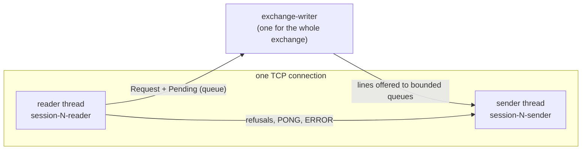

**[Verified]** thread names: `src/main/java/exchangeserver/gateway/ClientSession.java:91-92`, `src/main/java/exchangeserver/core/ExchangeService.java:119`.

### The running example (seen live, 2026-10-27, Windows)

Two users were created with `--add-user` (PBKDF2 hashes in `exchange.users`), the server was started, and four raw TCP clients sent these lines. **[Verified]** captured output:

```
mallory > LOGIN alice guessed-secret
mallory < ERROR login failed
mallory < (closed)
alice > LOGIN alice alice-secret COD
alice < WELCOME participant=alice oseq=0
bob > LOGIN bob bob-secret!
bob < WELCOME participant=bob oseq=0
alice > NEW a1 SELL LIMIT 10 100
alice < ORDER oseq=1 orderId=1 clOrdId=a1 status=RESTED filled=0 remaining=10
alice > NEW a2 BUY LIMIT 5 100
alice < ORDER oseq=2 orderId=2 clOrdId=a2 status=CANCELLED filled=0 remaining=5 reason=SELF_TRADE_PREVENTED
bob > NEW b1 BUY LIMIT 4 100
bob < FILL oseq=1 orderId=3 clOrdId=b1 side=BUY price=100 qty=4 leaves=0 liquidity=TAKER
bob < ORDER oseq=1 orderId=3 clOrdId=b1 status=FILLED filled=4 remaining=0
alice < FILL oseq=3 orderId=1 clOrdId=a1 side=SELL price=100 qty=4 leaves=6 liquidity=MAKER
alice > QUIT
alice < BYE
bob > SUBSCRIBE
bob < SUBSCRIBED
bob < BOOK seq=4 last=100 bids=- asks=-
alice2 > LOGIN alice alice-secret
alice2 < WELCOME participant=alice oseq=4
alice2 > RESEND 1
alice2 < ORDER oseq=1 orderId=1 clOrdId=a1 status=RESTED filled=0 remaining=10 resend=1
alice2 < ORDER oseq=2 orderId=2 clOrdId=a2 status=CANCELLED filled=0 remaining=5 reason=SELF_TRADE_PREVENTED resend=1
alice2 < FILL oseq=3 orderId=1 clOrdId=a1 side=SELL price=100 qty=4 leaves=6 liquidity=MAKER resend=1
alice2 < CANCELLED oseq=4 orderId=1 qty=6 reason=CANCEL_ALL resend=1
alice2 < RESENT last=4
```

And the journal it left (each record ends with its CRC-32C, D69):

```
HEADER,3,2,0,5d7826e0
NEW,1,2026-10-27T14:20:40.373493200Z,1,alice,a1,SELL,LIMIT,10,100,379beca7
NEW,2,2026-10-27T14:20:40.802670Z,2,alice,a2,BUY,LIMIT,5,100,f33577be
NEW,3,2026-10-27T14:20:41.217763100Z,3,bob,b1,BUY,LIMIT,4,100,bed0c339
CANCEL_ALL,4,2026-10-27T14:20:42.045241200Z,alice,2b6bb4a5
```

Read the story: mallory's guess is refused and disconnected; alice logs in asking for cancel-on-disconnect (`COD`); her buy a2 would have traded with her own sell a1, so self-trade prevention cancels it; bob's buy trades 4 against a1; when alice quits, her last session is gone, so the gateway submits a journalled `CANCEL_ALL` (record 4) that removes the rest of a1; when she logs in again, `WELCOME oseq=4` tells her four events exist, and `RESEND 1` repeats all of them.

---

## Flow 1 — Login, then a NEW order that trades

**Trigger:** a client sends `LOGIN bob bob-secret!`, then `NEW b1 BUY LIMIT 4 100` while alice's `a1 SELL 10 @ 100` rests. **Final effect:** a NEW record is fsynced; the book changes; bob's sessions get `FILL … TAKER` and `ORDER … FILLED` (his oseq 1); alice's sessions get `FILL … MAKER` (her oseq 3); subscribers get TRADE and LEVEL.

### Sequence diagram

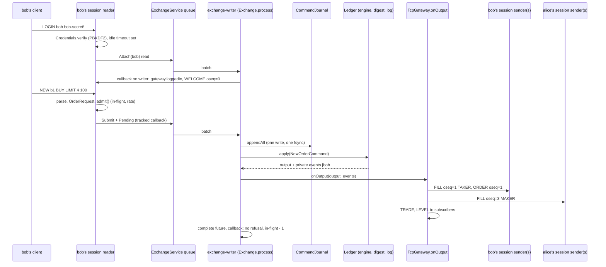

### Step by step

**Step 1 — the session exists.** The acceptor thread accepted the socket, set `TCP_NODELAY`, refused it if 256 sessions were open, and started a `ClientSession` with a sender and a reader thread. If the server has a TLS keystore, the server socket is an `SSLServerSocket` and the handshake happens on the reader's first read. **[Verified]** `src/main/java/exchangeserver/gateway/TcpGateway.java:113-129` (TLS server socket), `TcpGateway.java:164-205` (accept loop).

**Step 2 — reading a line with a login timeout.** The reader sets a socket read timeout of `loginTimeout` (10 s by default) before reading anything, and reads byte by byte up to `\n` (a trailing `\r` is dropped; over 256 bytes is an error). **[Verified]** `src/main/java/exchangeserver/gateway/ClientSession.java:152-182`, `ClientSession.java:186-204`.

*Data shape:* the text line `LOGIN bob bob-secret!`.

**Step 3 — parse.** `Protocol.parse` splits on single spaces and builds a `ClientMessage`: here `Login("bob", "bob-secret!", false)`; a fourth token `COD` sets `cancelOnDisconnect`. `ClientMessage.Login.toString()` leaves the secret out, so a logged message never shows it. **[Verified]** `src/main/java/exchangeserver/gateway/Protocol.java:60-100`, `src/main/java/exchangeserver/gateway/ClientMessage.java:12-17`.

**Step 4 — authenticate (D74).** `login` allows one attempt per connection; checks the name pattern and the secret against `Credentials`; on any failure it answers the same `ERROR login failed` and stops reading (the session closes after its in-flight requests, of which there are none). On success the read timeout becomes `idleTimeout` (300 s), and an **Attach read** is handed to the exchange. **[Verified]** `src/main/java/exchangeserver/gateway/ClientSession.java:293-327`.

```java
// src/main/java/exchangeserver/gateway/ClientSession.java:303-326 (trimmed)
String requested = login.participant();
if (!Rules.PARTICIPANT.matcher(requested).matches() || !gateway.authenticate(requested, login.secret())) {
    send(Protocol.error("login failed"));       // the same answer whatever was wrong (D74)
    return false;
}
socket.setSoTimeout((int) settings.idleTimeout().toMillis());
cancelOnDisconnect = login.cancelOnDisconnect();
participant = requested;
// On the writer thread, before any later output: register for routing, then report the latest oseq (D73).
service.attach(requested, tracked((lastOseq, failure) -> {
    if (failure != null) {
        replyFailure("LOGIN", failure);
        return;
    }
    gateway.loggedIn(this);
    if (closed.get()) {
        gateway.removed(this);
        return;
    }
    send(Protocol.welcome(requested, lastOseq));
}));
```

`Credentials.verify` runs PBKDF2-HMAC-SHA256 with the participant's salt and iteration count (210,000 for users created with `--add-user`) and compares in constant time; an unknown participant is checked against a dummy entry so it costs the same. **[Verified]** `src/main/java/exchangeserver/gateway/Credentials.java:82-87`.

*Why an Attach read, not a direct registration?* The Attach request goes through the queue like a command, so its callback runs on the writer thread *between* two commands: the session is registered for routing and told the latest oseq at one point in the stream. Every private event after it reaches the session, none before it is counted twice: no gap, no duplicate (D73). **[Verified]** `src/main/java/exchangeserver/core/Request.java:43-47`, `src/main/java/exchangeserver/core/Exchange.java:255-261`; **[Inferred]** the no-gap argument (it mirrors the one for SUBSCRIBE, flow 3).

**Step 5 — `NEW b1 BUY LIMIT 4 100`: parse and validate.** The reader now handles a `NewOrder`. Before anything reaches the exchange: the session must be logged in; `admit()` applies the per-session limits (D75); then `OrderRequest.of` applies every stateless field rule (D47). **[Verified]** `src/main/java/exchangeserver/gateway/ClientSession.java:236-253`, `ClientSession.java:329-340`.

```java
// src/main/java/exchangeserver/gateway/ClientSession.java:279-291
private String admit() {
    if (inFlight.get() >= settings.maxInFlight()) {
        return "SESSION_BUSY";
    }
    long now = System.nanoTime();
    tokens = Math.min(settings.burst(), tokens + (now - lastRefillNanos) * settings.ratePerSecond() / 1e9);
    lastRefillNanos = now;
    if (tokens < 1) {
        return "RATE_LIMITED";
    }
    tokens -= 1;
    return null;
}
```

`admit` is a token bucket: tokens refill at `ratePerSecond` (1,000) up to `burst` (2,000); each request spends one. It reads the clock (`System.nanoTime`), which is fine: it runs on the reader thread, outside the engine, so replay determinism is untouched. A refusal is an `ERROR clOrdId=b1 RATE_LIMITED` (or `SESSION_BUSY`) line and nothing is queued or journalled. **[Verified]** code; regression tests `TcpGatewayTest.Limits.requestsBeyondTheRateAreRefusedWithoutReachingTheJournal`, `requestsBeyondTheInFlightLimitAreRefused`.

*Data shape:* `ClientMessage.NewOrder("b1", BUY, LIMIT, 4, OptionalLong.of(100))` → `OrderRequest{participant=bob, clOrdId=b1, BUY, LIMIT, qty 4, price 100}`.

**Step 6 — hand-in with a tracked callback.** `service.submit(request, tracked(...))`. `tracked` increments the session's in-flight count now and decrements it after the callback has run; the callback itself only reports a refusal, because the FILL and ORDER lines come through the private stream. **[Verified]** `src/main/java/exchangeserver/gateway/ClientSession.java:337-339`, `ClientSession.java:421-431`.

`ExchangeService.enqueue` wraps the callback so a throw inside it is logged (M9), then, under one lock, refuses with HALTED/STOPPED/BUSY or adds the `Pending` to the queue. A refusal completes the future on the reader thread, outside the lock. **[Verified]** `src/main/java/exchangeserver/core/ExchangeService.java:211-238`.

*Data shape:* `Pending{request = Request.Submit(OrderRequest), result = CompletableFuture<Response>, command = null, refused = false}` in a `LinkedBlockingQueue`.

**Step 7 — the writer takes a batch.** It blocks on `take()`, then drains whatever else is waiting, up to 1,000 (smart batching, D52). **[Verified]** `src/main/java/exchangeserver/core/ExchangeService.java:286-305`.

**Step 8 — stamp (and maybe CHECK).** `Exchange.process` first stamps a `CHECK` record if `checkInterval` (10,000) commands have been applied since the last one; it carries the current output digest and so asserts "every command before me produced these outputs" (D70). Then each request is stamped by the `Sequencer`, the only clock reader and counter: bob's order becomes `NewOrderCommand(seq 3, ts, orderId 3, request)`. A request whose stamping throws is marked `refused` and never journalled. **[Verified]** `src/main/java/exchangeserver/core/Exchange.java:198-221`.

```java
// src/main/java/exchangeserver/core/Exchange.java:199-223 (trimmed)
List<Command> commands = new ArrayList<>(batch.size() + 1);
if (commandsSinceCheck >= options.checkInterval()) {
    commands.add(sequencer.stampCheck(ledger.digest()));       // D70: covers every command before it
    commandsSinceCheck = 0;
}
for (Pending<?> p : batch) {
    try {
        if (p.request instanceof Request.Submit s) {
            p.command = sequencer.stampNewOrder(s.order());
        } else if (p.request instanceof Request.Cancel c) {
            p.command = sequencer.stampCancel(c.participant(), c.orderId());
        } else if (p.request instanceof Request.CancelAll c) {
            p.command = sequencer.stampCancelAll(c.participant());
        }
    } catch (RuntimeException invalid) {
        p.refused = true;                   // refused before stamping: uses up no number, never journalled
        p.fail(invalid);
        continue;
    }
    if (p.command != null) {
        commands.add(p.command);
    }
}

journal.appendAll(commands);                // durable before any effect
```

**Step 9 — journal: one write, one fsync.** `CommandJournal.appendAll` encodes every command first (a failing encode writes nothing), writes them in one buffer and calls `force(true)`. Each record is sealed with `,<crc32c>\n` (D69). A failed write or fsync fail-stops the journal and halts the writer (flow 6). **[Verified]** `src/main/java/exchangeserver/journal/CommandJournal.java:143-166`, `src/main/java/exchangeserver/journal/JournalCodec.java:166-168`.

*Data shape on disk:* `NEW,3,2026-10-27T14:20:41.217763100Z,3,bob,b1,BUY,LIMIT,4,100,bed0c339`.

**Step 10 — apply to the Ledger.** For each non-refused request: a read (no command) is answered from the ledger at once; a command goes through the test seam (`interceptor`, a no-op in production) and `ledger.apply`, which runs the engine, folds the output into the digest, and numbers the private events. **[Verified]** `src/main/java/exchangeserver/core/Exchange.java:225-252`, `src/main/java/exchangeserver/core/Ledger.java:42-55`.

```java
// src/main/java/exchangeserver/core/Ledger.java:42-55
Applied apply(Command command) {
    EngineOutput output;
    if (command instanceof NewOrderCommand n) {
        output = engine.onNewOrder(n);
    } else if (command instanceof CancelOrderCommand c) {
        output = engine.onCancel(c);
    } else if (command instanceof CancelAllCommand c) {
        output = engine.onCancelAll(c);
    } else {
        throw new IllegalStateException("Not an engine command: " + command);
    }
    digest.update(output);
    return new Applied(output, log.record(command, output));
}
```

**Step 11 — the engine matches.** `MatchingEngine.onNewOrder` checks the order id and sequence number increase (D35), builds the `Order`, and runs `process` in three parts. **[Verified]** `src/main/java/exchangeserver/engine/MatchingEngine.java:111-125`, `MatchingEngine.java:178-263`.

1. *Checks that change nothing* (`MatchingEngine.java:182-214`): duplicate client order id (the id is recorded even if a later check rejects); price band ±10% around the last trade (none before the first trade); **resting caps only for an order that would rest** (D68: at the participant cap or with 1,000,000 orders in the book, a LIMIT that would fully trade now is still accepted; POST_ONLY is rejected because it never trades on arrival); FOK fillability; POST_ONLY would cross.
2. *The match loop* (`MatchingEngine.java:216-237`): while the order has quantity, take the best opposite level; stop if it does not cross the order's limit; **stop if the head of that level belongs to the same participant (self-trade prevention, D67)**; otherwise `book.fillBest` fills the head order by up to the remainder and returns an immutable `Fill`, and the engine records a `Trade` (at the resting price, with the incoming command's timestamp) and an `Execution` for the maker.
3. *Outcome* (`MatchingEngine.java:239-262`): an exhaustive switch over the order type. A LIMIT/POST_ONLY remainder rests unless self-trade prevention stopped the loop, in which case it is CANCELLED with reason `SELF_TRADE_PREVENTED`; IOC and MARKET remainders are CANCELLED (with that reason if it applied); a FOK cannot have a remainder here.

```java
// src/main/java/exchangeserver/engine/MatchingEngine.java:218-228 (trimmed)
boolean selfTradePrevented = false;
while (order.getRemainingQuantity() > 0) {
    Optional<PriceLevel> best = book.bestLevel(restingSide);
    if (best.isEmpty() || !crosses(order.getSide(), limit, best.get().getPrice())) {
        break;
    }
    if (order.getParticipant().equals(book.headParticipant(restingSide))) {
        selfTradePrevented = true;      // D67: stop here; the remainder is cancelled below
        break;
    }
    Fill fill = book.fillBest(restingSide, order.getRemainingQuantity());
```

In the running example: `a2 BUY 5 @ 100` meets `a1` (alice's own) at the head of the 100 ask, so it stops before trading and is CANCELLED with the reason; `b1 BUY 4 @ 100` meets `a1`, which is not bob's, and fills 4. **[Verified]** live transcript; tests `MatchingEngineTest.SelfTrade.*`.

The market collar (D50, D66) is the limit of a MARKET order: ±10% around the last trade, or, before the first trade, around the best opposite price (the touch), so a first market order cannot sweep a thin book. **[Verified]** `src/main/java/exchangeserver/engine/MatchingEngine.java:274-289`.

*Data shape:* `OrderOutput(seq 3, ts, Response(orderId 3, "b1", FILLED, reason null, filled 4, remaining 0, [Trade(100, 4, buy 3, sell 1, BUY, ts)]), passiveFills [Execution(alice, 1, "a1", SELL, 100, 4, leaves 6)], levelUpdates [LevelUpdate(SELL, 100, 6, 1)])`.

**Step 12 — digest and numbering.** `OutputDigest.update` feeds a canonical text encoding of the output (every field: response, trades, executions, level updates, cancel results) into a running FNV-1a 64 hash (D70). `OutputLog.record` turns the output into numbered private events, requester's reply first, then the makers' fills in match order, and keeps the last `outputRetention` (1,000) per participant for RESEND. **[Verified]** `src/main/java/exchangeserver/core/OutputDigest.java:48-83`, `src/main/java/exchangeserver/core/OutputLog.java:58-76`.

```java
// src/main/java/exchangeserver/core/OutputLog.java:58-65 (trimmed)
List<PrivateEvent> record(Command command, EngineOutput output) {
    List<PrivateEvent> events = new ArrayList<>();
    if (output instanceof OrderOutput o && command instanceof NewOrderCommand n) {
        String p = n.request().getParticipant();
        events.add(add(new PrivateEvent.OrderReply(p, next(p), n.request().getSide(), n.request().getQuantity(), o.response())));
        for (Execution e : o.passiveFills()) {
            events.add(add(new PrivateEvent.MakerFill(e.participant(), next(e.participant()), e)));
        }
```

*Data shape:* `[OrderReply(bob, oseq 1, BUY, 4, Response…), MakerFill(alice, oseq 3, Execution…)]`. Alice is at 3 because her a1 reply was 1 and her a2 reply was 2.

**Step 13 — listener, then the future (D76).** `Exchange.process` calls `listener.onOutput(output, events)` and only afterwards completes the request's future, which runs the callback (on the writer thread). A throwing listener is logged and ignored. **[Verified]** `src/main/java/exchangeserver/core/Exchange.java:245-251`.

**Step 14 — the gateway routes.** `TcpGateway.onOutput` sends each private event's lines to every session registered for its participant, then, if anyone subscribed and the output has trades or level updates, the TRADE and LEVEL lines to every subscriber. **[Verified]** `src/main/java/exchangeserver/gateway/TcpGateway.java:285-310`.

```java
// src/main/java/exchangeserver/gateway/TcpGateway.java:286-296 (trimmed)
public void onOutput(EngineOutput output, List<PrivateEvent> events) {
    for (PrivateEvent e : events) {
        Set<ClientSession> owners = sessionsByParticipant.get(e.participant());
        if (owners != null) {
            List<String> lines = Protocol.lines(e, false);
            for (ClientSession s : owners) {
                s.sendAll(lines);
            }
        }
    }
```

`Protocol.lines` turns an `OrderReply` into one taker FILL per trade (with `leaves` counting down from the order quantity) followed by the ORDER line, all with the same oseq; a `MakerFill` into one MAKER FILL. **[Verified]** `src/main/java/exchangeserver/gateway/Protocol.java:145-166`.

`ClientSession.send` only *offers* the line to a bounded queue (10,000 lines); if it is full, the session is disconnected instead of blocking the writer (D54). **[Verified]** `src/main/java/exchangeserver/gateway/ClientSession.java:116-124`.

**Step 15 — the callback.** `p.complete(response)` runs bob's tracked callback: no failure, so nothing is sent; in-flight goes down by one, and if the reader had stopped and this was the last request in flight, the session closes now (flow 6). **[Verified]** `src/main/java/exchangeserver/gateway/ClientSession.java:421-442`.

**Step 16 — the sender writes.** Each session's sender thread takes lines from its queue, writes them with `\n`, and flushes when the queue is empty (once per burst). **[Verified]** `src/main/java/exchangeserver/gateway/ClientSession.java:446-466`.

### Why the taker's lines come before the maker's and before market data

Within one command, `OutputLog.record` lists the requester's reply first and makers' fills after it, and `onOutput` sends private events before market data; all of this runs on the one writer thread, which offers lines to the session queues in that order. Each session's sender preserves its queue order. So bob sees FILL then ORDER, and a subscriber sees TRADE then LEVEL, never the reverse. Across different sessions, delivery order depends on the sender threads and the network. **[Verified]** code order; **[Inferred]** the cross-session statement.

### Variations of flow 1 (same path, different exit)

| Situation | Where it exits | What the client sees |
|---|---|---|
| Wrong secret or unknown name | step 4 | `ERROR login failed`, connection closed (one attempt per connection) |
| No LOGIN for 10 s | step 2 | `ERROR login timeout; disconnecting`, closed |
| Syntax error | step 3 | `ERROR <reason>`, session continues |
| Not logged in | step 5 | `ERROR LOGIN first` |
| Over the rate or in-flight limit | step 5 | `ERROR clOrdId=… RATE_LIMITED` / `SESSION_BUSY` |
| Invalid field (quantity 0, bad clOrdId) | step 5 | `ERROR clOrdId=… <message>` |
| Exchange queue full / stopping / halted | step 6 | `ERROR clOrdId=… BUSY` / `STOPPED` / `HALTED` |
| Duplicate clOrdId, band, caps, post-only cross | step 11 | `ORDER … status=REJECTED reason=…` (journalled, numbered) |
| Own order at the head | step 11 | `ORDER … status=CANCELLED … reason=SELF_TRADE_PREVENTED` |
| The engine throws (a bug) | step 10 | `ERROR clOrdId=… INTERNAL_ERROR`; the command is quarantined (flow 5) |

**[Verified]** the code paths cited in each step; the first, fourth and seventh rows were also seen live or in `TcpGatewayTest`.

---

## Flow 2 — CANCEL, CANCEL_ALL and cancel-on-disconnect

### 2a. CANCEL

**Trigger:** `CANCEL 1` from a session logged in as alice. **Final effect:** a CANCEL record is journalled; if order 1 rests and is alice's, it leaves the book (its level too, if emptied), alice's sessions get `CANCELLED oseq=… orderId=1 qty=…`, subscribers get a LEVEL update; otherwise she gets `CANCEL_REJECT oseq=… orderId=1 reason=UNKNOWN_ORDER`.

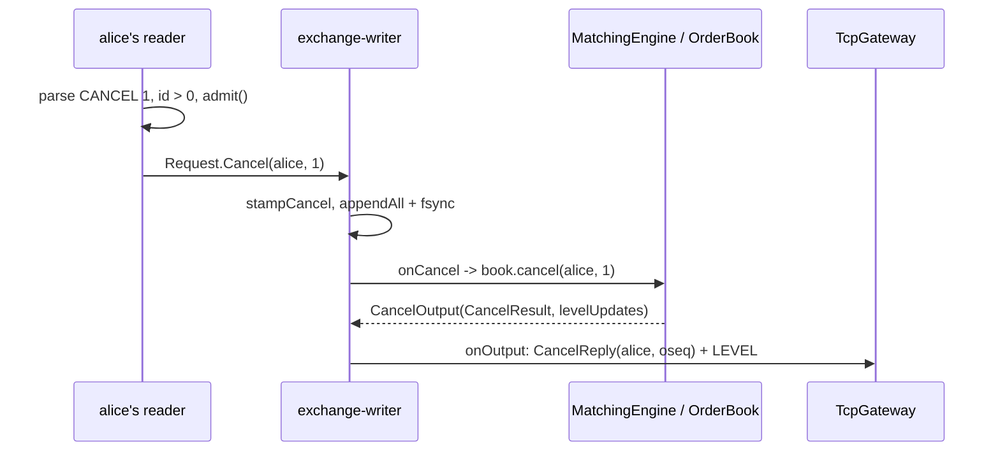

1. The reader parses `Cancel(1)`, refuses an id ≤ 0 locally, applies `admit()`, and hands in `cancel(p, id, tracked(...))`. **[Verified]** `src/main/java/exchangeserver/gateway/ClientSession.java:254-259`.
2. The writer stamps `CancelOrderCommand(seq, ts, alice, 1)` and journals it. **[Verified]** `src/main/java/exchangeserver/core/Exchange.java:208-209`.
3. `MatchingEngine.onCancel` checks the sequence number and calls `OrderBook.cancel(participant, id)`. The book returns `UNKNOWN_ORDER` if the id is not resting **or belongs to someone else** (D48: a distinct "not yours" answer would reveal which ids are live). Otherwise it removes the node through the single removal path, which also removes an emptied level and decrements the participant's open-order count. **[Verified]** `src/main/java/exchangeserver/engine/MatchingEngine.java:127-133`, `src/main/java/exchangeserver/book/OrderBook.java:98-108`, `OrderBook.java:111-128`.
4. `OutputLog.record` numbers a `CancelReply` for the *canceller* (even an UNKNOWN_ORDER answer is part of its stream); the gateway formats `CANCELLED oseq=… orderId= qty=` or `CANCEL_REJECT oseq=… orderId= reason=UNKNOWN_ORDER`. **[Verified]** `src/main/java/exchangeserver/core/OutputLog.java:66-67`, `src/main/java/exchangeserver/gateway/Protocol.java:180-184`.

### 2b. CANCEL_ALL and cancel-on-disconnect (D72)

**Trigger:** the last session of a participant that logged in with `COD` closes, for any reason (QUIT, end of stream, slow-consumer disconnect, gateway shutdown). **Final effect:** a `CANCEL_ALL,<seq>,<ts>,<participant>` record is journalled; every resting order of that participant leaves the book; one `CancelReply(byCancelAll=true)` per order is numbered into its private stream (waiting for RESEND); subscribers get LEVEL updates.

```java
// src/main/java/exchangeserver/gateway/TcpGateway.java:246-262 (trimmed)
boolean[] wasLast = {false};
sessionsByParticipant.computeIfPresent(p, (k, mine) -> {
    mine.remove(session);
    wasLast[0] = mine.isEmpty();
    return mine.isEmpty() ? null : mine;
});
ExchangeService s = service;
if (wasLast[0] && session.cancelOnDisconnect() && s != null) {
    s.cancelAll(p, (results, failure) -> {
        if (failure != null) {
            LOG.log(Level.WARNING, "cancel-on-disconnect for " + p + " failed: " + failure);
        }
    });
}
```

1. `ClientSession.close()` calls `TcpGateway.removed`, which drops the session from the participant's set atomically (`computeIfPresent`) and learns whether it was the last one. **[Verified]** `src/main/java/exchangeserver/gateway/ClientSession.java:133-141`, `src/main/java/exchangeserver/gateway/TcpGateway.java:239-263`.
2. The writer stamps `CancelAllCommand` and journals it like any input; replay re-runs it. **[Verified]** `src/main/java/exchangeserver/core/Exchange.java:210-211`.
3. `MatchingEngine.onCancelAll` collects the participant's order ids by walking the book (bids best first, then asks, time priority within a level: a deterministic order, never a hash map), then cancels each. **[Verified]** `src/main/java/exchangeserver/engine/MatchingEngine.java:136-155`.
4. Each result becomes a `CancelReply` with `byCancelAll`, formatted `CANCELLED oseq=… orderId= qty= reason=CANCEL_ALL`. **[Verified]** `src/main/java/exchangeserver/core/OutputLog.java:68-71`, `src/main/java/exchangeserver/gateway/Protocol.java:182`.

In the running example alice's QUIT left no other alice session, so record 4 cancelled the 6 left of a1, and her reconnected session saw it as oseq 4 through RESEND. Without `COD`, orders stay (test `TcpGatewayTest.CancelOnDisconnect.withoutCodOrdersStay`). **[Verified]** live run and tests.

*Clean shutdown:* the shutdown hook closes the gateway first (every session closes, so COD participants trigger CANCEL_ALL), then stops the service; requests accepted before `stop()` are processed, so COD orders are cancelled on a clean stop. A crash cancels nothing. **[Inferred]** from the hook order (`src/main/java/exchangeserver/Main.java:159-177`) and D56; not exercised by a test.

---

## Flow 3 — SUBSCRIBE, UNSUBSCRIBE and RESEND (reads through the queue)

Reads do not change state, but they still go through the writer's queue: only the writer may touch the book or the output log (single writer, D57), and the queue gives each read an exact position between commands.

### 3a. SUBSCRIBE and UNSUBSCRIBE

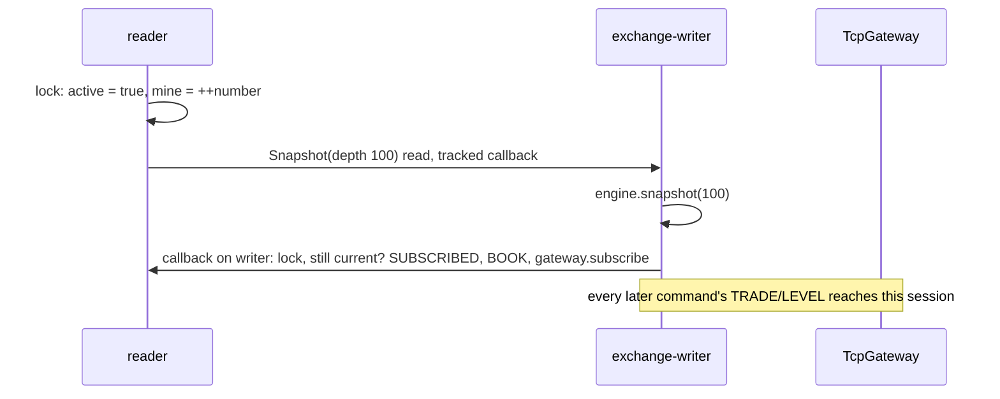

1. `subscribe` takes `subscriptionLock`, refuses if already active, marks it active and takes a new subscription number, then queues a depth-100 snapshot read (D62). **[Verified]** `src/main/java/exchangeserver/gateway/ClientSession.java:373-384`.
2. The writer answers the read from `engine.snapshot(100)`; the callback runs on the writer, between commands. Under the lock it checks the number is still current and the subscription still active (an UNSUBSCRIBE may have overtaken it), then sends `SUBSCRIBED`, `BOOK seq= last= bids= asks=` and joins the subscribers. Because this happens at one point in the command stream, the first LEVEL the session gets belongs to the first command after the snapshot: no gap, no duplicate. **[Verified]** `ClientSession.java:385-402`, `src/main/java/exchangeserver/core/Exchange.java:255-258`.
3. `UNSUBSCRIBE` (reader thread, under the same lock) clears the flag, leaves the subscribers and sends `UNSUBSCRIBED`. **[Verified]** `ClientSession.java:405-411`.

The lock and the number handle two races: an UNSUBSCRIBE arriving before the snapshot callback (the callback then sends nothing), and SUBSCRIBE/UNSUBSCRIBE/SUBSCRIBE (only the current number's callback acts, so one BOOK). **[Verified]** comment `ClientSession.java:363-372`; test `TcpGatewayTest.MarketData.rapidSubscribeUnsubscribeEndsConsistent`.

In the running example bob subscribed after alice's CANCEL_ALL: `BOOK seq=4 last=100 bids=- asks=-` (the book is empty; the last trade, 100, remains the band reference). **[Verified]** live.

### 3b. RESEND (D73)

**Trigger:** `RESEND <n>` from a logged-in session. **Final effect:** the session gets every retained private event of its participant with oseq ≥ n, each line marked `resend=1`, then `RESENT last=<latest>`; if n is older than the oldest retained event, first `ERROR RESEND_GAP first=<oldest>`.

```java
// src/main/java/exchangeserver/gateway/ClientSession.java:348-360 (trimmed)
service.resend(p, from, tracked((ResendResult result, Throwable failure) -> {
    if (failure != null) {
        replyFailure("RESEND", failure);
        return;
    }
    if (from < result.firstAvailable() && from <= result.lastOseq()) {
        send(Protocol.error("RESEND_GAP first=" + result.firstAvailable()));
    }
    for (PrivateEvent e : result.events()) {
        sendAll(Protocol.lines(e, true));
    }
    send("RESENT last=" + result.lastOseq());
}));
```

1. The reader refuses n ≤ 0, applies `admit()`, and queues a `Request.Resend(participant, n)` read. **[Verified]** `src/main/java/exchangeserver/gateway/ClientSession.java:260-261`, `ClientSession.java:342-347`.
2. On the writer, `OutputLog.since(participant, n)` returns the retained events with oseq ≥ n, the first retained number and the latest number. The log keeps the last `outputRetention` (1,000) events per participant; after a restart they are rebuilt by replay, but a compaction keeps only the numbers, not the events (D71). **[Verified]** `src/main/java/exchangeserver/core/OutputLog.java:84-97`, `OutputLog.java:50-54`.
3. The callback sends the events in order, before any later live event (it runs on the writer at its queue position). Events produced between the WELCOME and the RESEND may arrive twice (once live, once resent); the client deduplicates by oseq. **[Verified]** code; **[Inferred]** the duplicate case.

*Data shape:* `ResendResult(events [OrderReply#1, OrderReply#2, MakerFill#3, CancelReply#4], firstAvailable 1, lastOseq 4)`.

Tests: `TcpGatewayTest.Resend.aReconnectingClientRecoversAMakerFillItMissed`, `eventsTooOldToRetainAreReportedAsAGap`, `theStreamSurvivesARestart`. **[Verified]**

---

## Key takeaways

- A session must log in with a secret (PBKDF2, one attempt per connection); WELCOME reports the participant's latest oseq from an Attach read, placed exactly in the command stream.
- The reader thread refuses everything it can without exchange state: syntax, fields, rate (token bucket) and in-flight limits; refusals are never journalled.
- The writer stamps (CHECK first when due), journals with one fsync, applies each command to the Ledger (engine + digest + numbered events), calls the listener, and only then completes the future (D76).
- Private events go to every session of the participant, numbered by oseq; the requester's reply comes before the makers' fills, and private lines before market data.
- Self-trade prevention stops the match loop at the participant's own resting order and cancels the remainder with `SELF_TRADE_PREVENTED`.
- CANCEL returns UNKNOWN_ORDER for someone else's order; CANCEL_ALL is a journalled command, and cancel-on-disconnect submits it when a COD participant's last session closes.
- SUBSCRIBE and RESEND are reads through the queue: each sees one exact point of the history, so no gap or duplicate within it.

## Common confusions

- **"The ORDER line is sent by the request's callback."** It is sent by the listener from the private stream; the callback only reports refusals and decrements the in-flight count.
- **"A second session of alice does not see the first session's replies."** It does: the private stream goes to every session of the participant (D73).
- **"Self-trade prevention skips my order and trades with the next one."** It stops; skipping would break price-time priority (D67).
- **"RESEND can reach any old event."** Only the last 1,000 per participant, and never past the last compaction; older requests get `RESEND_GAP`.
- **"A refused request still uses a sequence number."** Gateway refusals never reach the writer; a request that fails stamping is marked `refused` and uses up no number.

## Questions to test yourself

1. Alice is logged in on two sessions. Session 1 sends `NEW x BUY LIMIT 1 90`. What does session 2 see?
<details><summary>Answer</summary>The same `ORDER oseq=<n> … clOrdId=x …` line: the reply is a private event for participant alice and goes to every alice session (D73).</details>

2. Bob's buy at 101 crosses alice's ask at 100 (head of the level) and bob's own ask at 100 behind it. What happens to a 5-lot when alice's order has 2?
<details><summary>Answer</summary>It trades 2 with alice, then the head of the level is bob's own order: matching stops, and the remaining 3 is CANCELLED with `SELF_TRADE_PREVENTED`.</details>

3. Why is the RATE_LIMITED check allowed to read the clock when the engine may not?
<details><summary>Answer</summary>It runs on the session reader thread before anything is journalled; its result is never an input to replay, so determinism is unaffected.</details>

4. Alice logged in with COD and has two resting orders. Her only session drops. What appears in the journal, and how does she learn about it later?
<details><summary>Answer</summary>A `CANCEL_ALL,<seq>,<ts>,alice,<crc>` record; two `CancelReply` events numbered into her stream. When she logs in again, `WELCOME oseq=` shows the higher number and `RESEND <n>` repeats `CANCELLED … reason=CANCEL_ALL resend=1` lines.</details>

5. An UNSUBSCRIBE arrives on the reader before the snapshot callback of the preceding SUBSCRIBE runs. What does the client hear?
<details><summary>Answer</summary>Only `UNSUBSCRIBED`: the callback sees the subscription withdrawn (under the lock) and sends nothing.</details>


---

<a id="guide-05b-core-flows-lifecycle"></a>

<!-- source: docs/understanding/05b-core-flows-lifecycle.md -->

# 05b — Core flows, part 2: startup, recovery, compaction, poison pills, shutdown

> **Project:** ExchangeServer2 | Single-instrument limit order book: price-time matching engine, write-ahead journal with replay, single writer thread, TCP/TLS gateway with authenticated participants | Stack: Java 17, Maven wrapper, JUnit 5 (+ JMH, PIT)
> **This guide:** Step-by-step traces of flow 4 (startup, crash recovery, compaction, crossing a rules change), flow 5 (poison pills, live and at startup) and flow 6 (shutdown, halt, backpressure, timeouts, closing a connection), with the data shape at each step | **Prerequisites:** 01, 05a (helpful: 06) | **Related:** 05a, 06, 07-modules/journal, 07-modules/exchange-and-replay, 07-modules/exchange-service, 07-modules/client-and-main, 08-cross-cutting
> **Repo layout summary:** `pom.xml` + Maven wrapper (`mvnw`, `mvnw.cmd`) at the root; production code in `src/main/java/exchangeserver/` (packages `domain`, `book`, `engine`, `command`, `journal`, `core`, `gateway`, `client`, plus `Main`); tests mirror it in `src/test/java/exchangeserver/` (plus `bench/` JMH benchmarks and `testing/MutableClock`); design docs in `docs/` (`ExchangeServer2_Vision.md` = purpose/roadmap, `ExchangeServer2_Spec.md` = decisions D1–D77); these guides in `docs/understanding/`.

## Overview

Guide 05a followed requests through a running exchange. This guide covers how the exchange *gets* running, how it rebuilds itself after a crash, how it keeps its history bounded, what it does when its own engine throws, and how it stops. Terms (also in guide 13):

- **Journal**: the append-only text file of stamped commands (`HEADER`, then `NEW` / `CANCEL` / `CANCEL_ALL` / `SKIP` / `CHECK`, each ending in a CRC-32C). With the snapshot it names, it is the only exchange state on disk.
- **Snapshot** (D71): `<journal>.snapshot-<seq>`, the state after command `seq`; the journal header's **base sequence** names the snapshot it continues from (0: none).
- **Replay**: feeding the journalled commands, in order, through a fresh **Ledger** (engine + output digest + output log); outputs are not delivered.
- **CHECK** (D70): a journal record carrying the digest of every output before it; replay must reproduce it.
- **Torn tail**: bytes after the last `\n`, left by a crash in the middle of a write.
- **Poison pill / quarantine / SKIP**: a journalled command that makes the engine throw; a `SKIP` record tells replay to pass over it.
- **Halt / fail-stop**: the writer stops for good after a failure it cannot continue from; the process exits 2.

---

## Flow 4 — Startup, crash recovery, compaction

**Trigger:** `java -jar target/exchange-server2-2.0.0-SNAPSHOT.jar --port 9000 --journal exchange.journal --users exchange.users`. **Final effect:** the book, counters, last trade price, client-order-id map, output digest and every participant's oseq numbering are what they were after the last journalled command; new commands continue the numbering; clients can log in.

### Sequence diagram

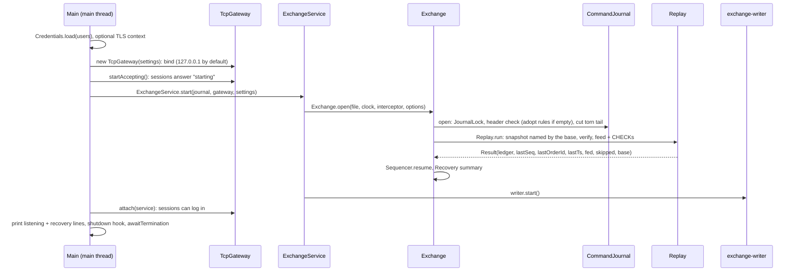

### Step by step

**Step 1 — arguments and tools (`Main.main`).** Options: `--port`, `--bind`, `--journal`, `--users`, `--tls-keystore`, the session limits, `--check-interval`, `--resend-window`; the tools `--add-user`, `--quarantine`, `--compact` run and exit. An unknown option or a missing value prints usage and exits 1. **[Verified]** `src/main/java/exchangeserver/Main.java:66-118`.

**Step 2 — credentials, TLS, bind.** `serve` loads the users file (missing file: a message telling the operator to run `--add-user`), builds a TLS context if `--tls-keystore` is given (password from `ES2_TLS_PASSWORD`), warns when binding a non-loopback address without TLS, and creates the gateway, which binds at once (127.0.0.1 unless `--bind`). Any failure here exits 1. **[Verified]** `src/main/java/exchangeserver/Main.java:120-138`, `src/main/java/exchangeserver/gateway/TcpGateway.java:113-129`.

**Step 3 — accept before replay (L6).** `gateway.startAccepting()` starts the acceptor *before* the journal is replayed; until `attach`, a session answers any request with `ERROR exchange is starting; retry shortly` and closes, instead of leaving the client in silence. **[Verified]** `src/main/java/exchangeserver/Main.java:139`, `src/main/java/exchangeserver/gateway/ClientSession.java:228-232`; test `TcpGatewayTest.Session.beforeTheExchangeIsAttachedSessionsAreToldItIsStarting`.

**Step 4 — `ExchangeService.start` → `Exchange.open` (main thread).** Opening and replaying run on the calling thread; only then is the writer started (`Thread.start()` hands the replayed state to it with a happens-before edge). `Exchange.open` creates the journal, ledger and sequencer itself and closes the journal if anything fails. **[Verified]** `src/main/java/exchangeserver/core/ExchangeService.java:124-136`, `src/main/java/exchangeserver/core/Exchange.java:116-137`.

**Step 5 — `CommandJournal.open`: lock, check, change.** **[Verified]** `src/main/java/exchangeserver/journal/CommandJournal.java:75-127`.

```java
// src/main/java/exchangeserver/journal/CommandJournal.java:98-116 (trimmed)
private static CommandJournal openLocked(Path file, int rulesVersion, JournalLock ownedLock) throws IOException {
    JournalCodec.Header header = checkHeader(file, rulesVersion);
    int adoptedFrom = 0;
    if (header != null && header.rulesVersion() != rulesVersion) {
        adoptedFrom = header.rulesVersion();            // checkHeader allowed it: no records yet
        writeFresh(file, rulesVersion, header.baseSequence());
        header = new JournalCodec.Header(rulesVersion, header.baseSequence());
    }

    FileChannel channel = FileChannel.open(file, CREATE, WRITE, APPEND);    // APPEND: never overwrite history
    long truncated;
    try {
        truncated = cutTornTail(file);
        if (channel.size() == 0) {
            channel.write(ByteBuffer.wrap(JournalCodec.encodeHeader(rulesVersion, 0).getBytes(UTF_8)));
            channel.force(true);
            Durable.fsyncDirectory(file);           // a new file's directory entry must be durable too
```

1. **Lock first** (D65, `JournalLock.acquire`, `src/main/java/exchangeserver/journal/JournalLock.java:37-66`): add the lock file's real path to an in-JVM set (`HELD`), then `tryLock()` the whole of `<journal>.lock` through a channel nothing else ever opens. A second open, in this JVM or another process, is refused with "already open". The separate file matters on Linux/macOS, where closing *any* handle on a locked file drops the process's locks on it. **[Verified]** on Windows and Linux (cross-process test passed in a Linux container; live `--quarantine` against a running server refused on both).
2. **Check the header before changing anything** (D64, `checkHeader`, `CommandJournal.java:241-260`): a complete first record must be a valid v3 header (checksum included). A header of *other* rules is accepted only if the journal has no records yet: the header is then rewritten atomically with this build's rules, keeping the base sequence (D71: "adopted"). Anything else, including a file that is not a journal, is refused and left untouched.
3. **Cut a torn tail** after the last `\n` and fsync the cut (D38).
4. **Write a header** if the file is empty, fsync it and fsync the directory (D69).

*Data shape:* a `CommandJournal{file, channel (APPEND), lock, baseSequence, truncatedBytesOnOpen, adoptedRulesFrom, failed=false}`.

**Step 6 — `Replay.run`: snapshot, verify, feed.** **[Verified]** `src/main/java/exchangeserver/core/Replay.java:39-48`.

```java
// src/main/java/exchangeserver/core/Replay.java:39-48
static Result run(CommandJournal journal, Path journalFile, long stopBefore, CommandInterceptor interceptor,
                  int retention) throws IOException {
    Snapshot snapshot = snapshotFor(journal, journalFile);
    Verifier verifier = new Verifier(snapshot);
    journal.read(verifier);
    Ledger ledger = Ledger.from(snapshot, retention);
    long fed = feed(journal, ledger, stopBefore, verifier.skipped, interceptor);
    return new Result(ledger, verifier.lastSequenceNumber, verifier.lastOrderId, verifier.lastTimestamp, fed,
            Set.copyOf(verifier.skipped), journal.baseSequence());
}
```

- *Snapshot* (`Replay.java:59-69`): base 0 means the empty snapshot; otherwise `<journal>.snapshot-<base>` is read (each line checksummed, an END record proving it is complete) and must hold that sequence number.
- *Pass 1, verify* (`Replay.java:101-130`): sequence numbers exactly `base+1, base+2, …`; timestamps never decrease; remember the last sequence number, timestamp, last order id from NEW records (skipped ones included: those ids were issued) and the set of skipped sequence numbers. Nothing is fed if any of this fails.
- *Pass 2, feed* (`Replay.java:72-99`): start a `Ledger` from the snapshot (engine restored with time priority, digest and oseq numbering resumed), then feed every NEW/CANCEL/CANCEL_ALL below `stopBefore` that is not skipped. At each CHECK record, the replayed digest must equal the recorded one, or replay stops with `ReplayException(DIVERGED, seq)` (D70). An engine exception becomes `ReplayException(ENGINE_FAILURE, seq)`.

```java
// src/main/java/exchangeserver/core/Replay.java:80-95 (trimmed)
if (command instanceof CheckCommand check) {
    if (!check.digest().equals(ledger.digest())) {
        throw new ReplayException(ReplayException.Kind.DIVERGED, seq, "Replay diverged before CHECK " + seq
                + ": the journal recorded output digest " + check.digest() + ", this build produced "
                + ledger.digest() + ". This build processes the old commands differently; start it from a "
                + "snapshot written by the build that wrote this journal (--compact).", null);
    }
    return;
}
try {
    interceptor.beforeEngine(command);      // the test seam stands in for the engine here
    ledger.apply(command);
} catch (RuntimeException e) {
    throw new ReplayException(ReplayException.Kind.ENGINE_FAILURE, seq, "Replay failed on command " + seq
            + " (" + e.getMessage() + ")", e);
}
```

Because the engine depends only on its commands (no clock, counters, randomness or hash order, D12), the same commands rebuild the same book, last trade price, client-order-id map, digest and oseq numbers. **[Verified]** code; tests `ExchangeTest.Restart.*`, `ExchangeTest.Checkpoints.*`, `TcpGatewayTest.Resend.theStreamSurvivesARestart`.

*Data shape:* `Replay.Result(ledger, lastSequenceNumber, lastOrderId, lastTimestamp, fed, skipped, baseSequence)`.

**Step 7 — resume the sequencer.** It continues at `lastSequenceNumber + 1` and `lastOrderId + 1`, and never stamps a timestamp earlier than the last journalled one. **[Verified]** `src/main/java/exchangeserver/command/Sequencer.java:40-46`, `src/main/java/exchangeserver/core/Exchange.java:122-123`.

**Step 8 — start the writer, attach, report (L1).** `ExchangeService.start` starts the non-daemon `exchange-writer`; `Main` attaches the service to the gateway (now LOGIN works) and prints two lines: where it listens, and what recovery did. **[Verified]** `src/main/java/exchangeserver/Main.java:150-157`. Seen live after a compaction:

```
ExchangeServer2 listening on 127.0.0.1:9137, journal ...\live3\exchange.journal
Recovered through sequence 4 from snapshot 4: replayed 0 commands, cut 0 torn bytes
```

The summary also names quarantined commands and a rules adoption when there are any. **[Verified]** live; `Exchange.Recovery` at `src/main/java/exchangeserver/core/Exchange.java:78-80`.

**Step 9 — hook and wait.** `Main` registers the shutdown hook (flow 6) and blocks in `service.awaitTermination()`. **[Verified]** `src/main/java/exchangeserver/Main.java:159-183`.

### Startup failures

Any failure in steps 4–7 closes the gateway, prints `Startup failed: <message>` and a hint chosen by `Main.hint`, and exits 1 (L2, D77): an `ENGINE_FAILURE` gets the `--quarantine <seq>` advice, a `DIVERGED` gets the compaction advice, anything else (locked journal, other rules with records, not a journal, corrupt record, checksum mismatch, CRLF conversion, sequence gap, missing snapshot) gets "The journal was not changed." **[Verified]** `src/main/java/exchangeserver/Main.java:140-149`, `Main.java:186-198`; tests `MainTest`.

### Crash recovery, seen running

Earlier the same day (before D69 changed the format), the server was hard-killed, half a record appended, and the server restarted: the torn bytes were cut, the book and counters came back, and new commands continued the numbering. With D77 the cut is now reported in the recovery line. **[Verified]** live (format v2 then); `ExchangeTest.Operations.recoveryReportsWhatItDid` checks the report.

### What a crash can and cannot lose

| Crash moment | After restart | Client's view |
|---|---|---|
| Before the batch's fsync returned | Records missing or torn (cut) | Nobody was answered: consistent |
| After fsync, before the lines were sent | Commands are replayed and take effect | Client heard nothing; on reconnect `WELCOME oseq=` shows the higher number and `RESEND` delivers the events (D73); a resend of the same clOrdId is rejected as DUPLICATE with the original id (D49, within one journal) |
| While compacting | The old journal is still in charge (see 4b) | Nothing visible changed |

**[Verified]** Spec §4 failure model; RESEND path in 05a flow 3.

### 4b. Compaction (`--compact`, D71)

**Trigger:** `java -jar … --journal exchange.journal --compact`, run while the exchange is stopped. **Final effect:** `<journal>.snapshot-<last>` holds the state after the last command; the old journal is copied to `<journal>.archive-<first>-<last>`; the journal is replaced atomically by one that holds only `HEADER,3,<rules>,<last>`. Recovery afterwards costs the snapshot plus the journal since it, not all history.

```java
// src/main/java/exchangeserver/core/Exchange.java:174-193 (trimmed)
public static Compaction compact(Path journalFile) throws IOException {
    try (JournalLock lock = JournalLock.acquire(journalFile)) {
        Replay.Result replay;
        try (CommandJournal journal = CommandJournal.open(journalFile, Rules.VERSION, lock)) {
            replay = Replay.run(journal, journalFile, Long.MAX_VALUE, CommandInterceptor.NONE,
                    Options.defaults().outputRetention());
        }
        if (replay.lastSequenceNumber() == replay.baseSequence()) {
            return null;
        }
        long last = replay.lastSequenceNumber();
        Snapshot snapshot = replay.ledger().snapshot(last, replay.lastOrderId(), replay.lastTimestamp());
        Path snapshotFile = Snapshot.path(journalFile, last);
        snapshot.write(snapshotFile);
        Path archive = journalFile.resolveSibling(journalFile.getFileName() + ".archive-"
                + (replay.baseSequence() + 1) + "-" + last);
        Durable.copyDurably(journalFile, archive);
        CommandJournal.writeFresh(journalFile, Rules.VERSION, last);
        return new Compaction(last, snapshot.orders().size(), snapshotFile, archive);
    }
}
```

1. Take the journal's lock for the whole operation (a running exchange makes it fail: "already open").
2. Replay the journal fully (with its snapshot, CHECKs verified).
3. Write the snapshot: header line (last sequence, last order id, last timestamp, last trade price, digest), one ORDER line per resting order in book priority, one OSEQ line per participant (sorted), END with counts; written to a temporary file, fsynced, atomically renamed, directory fsynced (`Durable.writeAtomically`, `src/main/java/exchangeserver/journal/Durable.java:25-36`).
4. Copy the journal to the archive and fsync it.
5. Replace the journal atomically with a header-only journal whose base is `last` (`CommandJournal.writeFresh`, `CommandJournal.java:130-132`).

**Why it is crash-safe:** until step 5 the old journal (with its old base) is untouched and still names its own snapshot, so a crash leaves at most stray new files; after step 5 the new journal names a snapshot that is already durable. Each snapshot's name carries its sequence number, so no file is ever overwritten under a journal that needs it. **[Verified]** code; test `ExchangeTest.Compaction.aCrashAfterWritingTheSnapshotLeavesTheOldJournalInCharge`; **[Inferred]** the general argument.

**What compaction ends:** the client-order-id map keeps only resting orders' ids (an id is unique per participant within one journal, revising D49), and RESEND cannot reach events before it (the snapshot keeps each participant's last oseq, not the events). **[Verified]** `ExchangeTest.Compaction.clientOrderIdsAreScopedToTheJournalExceptForRestingOrders`, `outputNumberingContinuesAcrossACompaction`.

Seen live: `--compact` while the server ran was refused (`Compaction failed: Journal … is already open …`, exit 1); after the stop it printed `Compacted through sequence 4: 0 resting orders in …snapshot-4; old journal archived as …archive-1-4`, and the snapshot read:

```
SNAPSHOT,1,4,3,2026-10-27T14:20:42.045241200Z,100,88a18b6a6365ebe4,d7e6a970
OSEQ,alice,4,d1453b0b
OSEQ,bob,1,3d136969
END,0,2,6a6d3c70
```

**[Verified]** live run.

### 4c. Crossing a rules change

`Rules.VERSION` (now 2) is in every journal header; a journal with records written under other rules is refused, because replaying it under new rules would silently build a different book (D46). The way across (D71): run `--compact` **with the old build** (its journal is now empty, naming a snapshot), then start the new build: `CommandJournal.open` sees an empty journal of other rules, rewrites its header with the new version, and the recovery line says `journal moved from rules N`. The snapshot is state, not commands, so the new rules never re-judge old orders. **[Verified]** `CommandJournal.java:99-105`, `CommandJournal.java:252-258`; tests `CommandJournalTest.Header.anEmptyJournalAdoptsANewRulesVersionAndKeepsItsBase`, `ExchangeTest.Compaction.aRulesChangeIsCrossedWithAnEmptyCompactedJournal`.

---

## Flow 5 — Poison pills, live and at startup

### 5a. Live: quarantine, rebuild from the snapshot, carry on

**Trigger:** within a batch, `ledger.apply` throws a `RuntimeException` on command *k*. **Final effect:** a durable `SKIP` record for *k*; the ledger rebuilt to the state just before *k*; the rest of the batch processed; the caller of *k* gets `INTERNAL_ERROR`; nobody else notices.

```mermaid
sequenceDiagram
    participant W as exchange-writer
    participant X as Exchange.process
    participant J as CommandJournal
    participant R as Replay.rebuild
    W->>X: process(batch k-1, k, k+1)
    X->>J: appendAll(k-1, k, k+1) + fsync
    X->>X: apply(k-1): listener, then future
    X->>X: apply(k) throws RuntimeException
    X->>J: append SKIP(next seq, skips k) + fsync
    X->>R: rebuild: snapshot + every command before k, minus skipped
    X->>X: ledger = rebuilt; fail k with INTERNAL_ERROR
    X->>X: apply(k+1) on the rebuilt ledger
```

```java
// src/main/java/exchangeserver/core/Exchange.java:278-287 (trimmed)
private void quarantine(Command poison, RuntimeException cause) throws IOException {
    LOG.log(Level.ERROR, "Engine failed on command " + poison.sequenceNumber() + "; quarantining it", cause);
    journal.append(sequencer.stampSkip(poison.sequenceNumber()));
    skipped.add(poison.sequenceNumber());
    ledger = Replay.rebuild(journal, journalFile, poison.sequenceNumber(), skipped, interceptor, options.outputRetention());
}
```

1. The engine may have thrown half-way through *k*, so the old ledger is discarded, not rolled back. The whole ledger is replaced, so engine, digest and oseq numbering cannot disagree.
2. The SKIP gets the next sequence number *after the whole batch* (the batch was stamped first), with its own fsync.
3. `Replay.rebuild` starts from the journal's snapshot and feeds every command before *k* minus the skip set, in one pass (the journal was verified at open; only this thread has appended since). **[Verified]** `src/main/java/exchangeserver/core/Replay.java:52-57`; test `ExchangeTest.Compaction.aPoisonAfterACompactionRebuildsFromTheSnapshot`.
4. *k*'s outputs were never sent (the listener runs only after `apply` returns), so the rebuilt history is exactly what clients saw. **[Verified]** `src/main/java/exchangeserver/core/Exchange.java:235-251`.

An `Error` (out of memory, stack overflow) is not caught here: it propagates and halts the writer (flow 6). **[Verified]** `Exchange.java:239` catches `RuntimeException` only.

### 5b. At startup: stop, then the operator decides

**Trigger:** replay throws `ReplayException(ENGINE_FAILURE, k)` on a command with no SKIP. **Final effect:** startup fails (exit 1) with the hint `Replay failed on command k (a poison pill?). Inspect it, then run --quarantine k and start again.`; after `--quarantine k` the next start skips it.

A failing record is never skipped automatically at startup: the code cannot tell a true poison from a command that succeeded under older code and whose effects clients saw (D51). `Exchange.quarantine` opens the journal (refused while the exchange runs: lock), reads every record, requires *k* to be a NEW, CANCEL or CANCEL_ALL, **refuses a command already quarantined** (L3), and appends `SKIP(last+1, ts, k)`. **[Verified]** `src/main/java/exchangeserver/core/Exchange.java:141-166`, `src/main/java/exchangeserver/Main.java:101-107`; tests `ExchangeTest.PoisonPill.*`, `ExchangeTest.Operations.quarantineRefusesACommandAlreadyQuarantined`.

A `DIVERGED` replay is different: no single record is at fault; the build changed. The hint says to compact with the old build first (4c). A record that does not even parse cannot be quarantined: `journal.read` throws on it first, and startup always stops (D38).

---

## Flow 6 — Shutdown, halt, backpressure, timeouts, closing a connection

### 6a. The service state machine

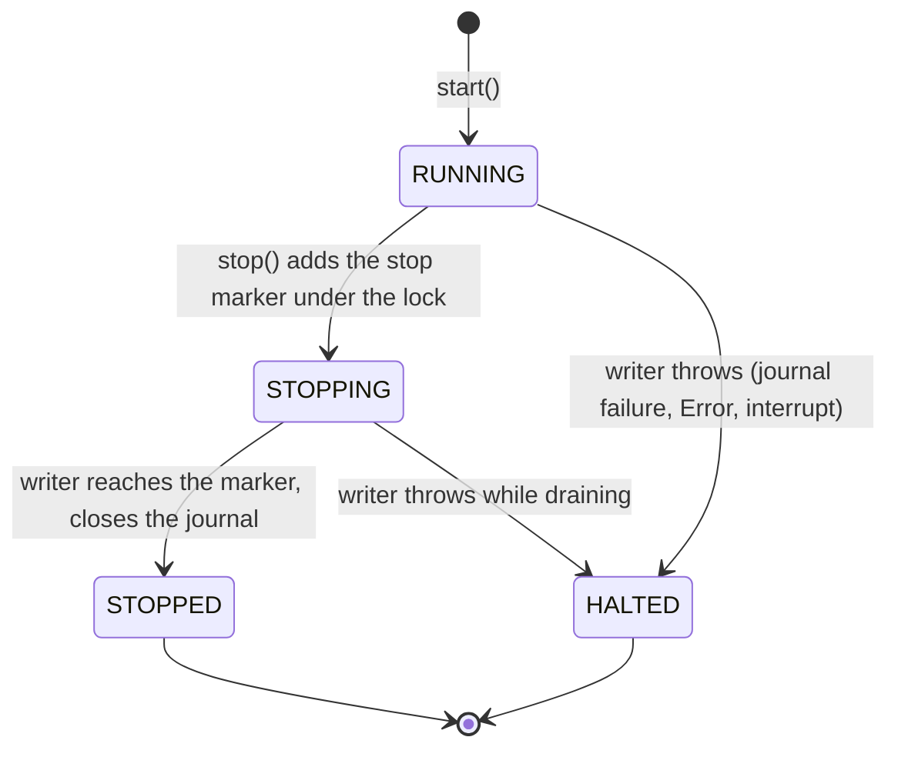

"Refused" and "never lost" hold together because the state check and the enqueue share one lock with `stop()`'s state flip and marker (D56). `stop()` refuses to run on the writer thread itself (it would wait for its own end, L6). **[Verified]** `src/main/java/exchangeserver/core/ExchangeService.java:211-257`.

### 6b. Clean shutdown (Ctrl+C, SIGTERM)

```java
// src/main/java/exchangeserver/Main.java:159-177 (trimmed)
Runtime.getRuntime().addShutdownHook(new Thread(() -> {
    int status = 0;
    try {
        gateway.close();
        if (!service.stop(Duration.ofSeconds(10))) {
            System.err.println("Writer thread did not stop within 10 s");
            status = 1;
        }
    } catch (IOException | InterruptedException e) {
        System.err.println("Shutdown: " + e);
        status = 1;
    }
    if (service.state() == ExchangeService.State.HALTED) {
        status = 2;
    }
    System.out.flush();
    System.err.flush();
    Runtime.getRuntime().halt(status);     // the documented code, whatever started the shutdown
}, "shutdown"));
```

1. Close the gateway: the server socket closes and every session is closed at once (`closeNow`). Each close runs `TcpGateway.removed`, so participants that asked for cancel-on-disconnect get their `CANCEL_ALL` queued now, ahead of the stop marker (05a flow 2b). **[Verified]** `src/main/java/exchangeserver/gateway/TcpGateway.java:313-319`; **[Inferred]** COD on shutdown from the order of calls.
2. `stop(10 s)`: STOPPING, marker queued; the writer processes everything accepted before it, then closes the journal (releasing the lock) as its last act and sets STOPPED (D58). **[Verified]** `ExchangeService.java:245-257`, `ExchangeService.java:286-323`.
3. `Runtime.halt(status)` ends the process with the documented code: 0, or 1 if the writer did not stop in time, or 2 if halted. Without it, a JVM ending on a signal reports the signal's status (130 for SIGINT, 143 for SIGTERM). **[Verified]** in a Linux container: exit status 0 after SIGINT and after SIGTERM.

### 6c. Halt

**Trigger:** the writer catches any `Throwable` that escaped `Exchange.process`: a journal I/O error (or the fail-stopped journal's refusal), an `Error`, a failure while appending a SKIP, an interrupt. **Final effect:** HALTED, everyone waiting refused, journal closed, process exits 2. **[Verified]** `src/main/java/exchangeserver/core/ExchangeService.java:306-311`, `ExchangeService.java:342-359`, `src/main/java/exchangeserver/Main.java:179-183`.

```java
// src/main/java/exchangeserver/core/ExchangeService.java:342-358 (trimmed)
private void halt(Throwable cause, List<Pending<?>> batch) {
    LOG.log(Level.ERROR, "Exchange halted", cause);
    synchronized (lock) {
        haltCause = cause;
        state = State.HALTED;           // from here on enqueue() refuses, so the drain below is final
    }
    ExchangeException refusal = new ExchangeException(ExchangeException.Reason.HALTED, "exchange halted", cause);
    for (Pending<?> p : batch) {
        p.fail(refusal);                // no-op for those already completed
    }
    List<Pending<?>> left = new ArrayList<>();
    queue.drainTo(left);
    for (Pending<?> p : left) {
        if (p != stopMarker) {
            p.fail(refusal);
        }
    }
}
```

The batch that failed may be journalled while its callers were told HALTED; on restart those commands replay (durable ⇒ visible does not hold). Clients reconcile with `RESEND` after logging in again (D73) or by resending with the same client order id (D49). **[Verified]** Spec §4.

### 6d. Backpressure and limits

| Refusal | Where | Scope | Journalled? |
|---|---|---|---|
| `BUSY` | `ExchangeService.enqueue`, queue at 100,000 | whole exchange | no |
| `STOPPED` / `HALTED` | `ExchangeService.enqueue` | whole exchange | no |
| `SESSION_BUSY` | `ClientSession.admit`, 1,000 requests in flight | one session | no |
| `RATE_LIMITED` | `ClientSession.admit`, token bucket 1,000/s, burst 2,000 | one session | no |
| slow consumer | `ClientSession.send`, outbound queue of 10,000 lines full | one session, disconnected | no |

**[Verified]** `src/main/java/exchangeserver/core/ExchangeService.java:222-233`, `src/main/java/exchangeserver/gateway/ClientSession.java:116-124`, `ClientSession.java:279-291`. The per-session limits (D75) stop one pipelining client from filling the global queue so that everyone gets BUSY.

### 6e. Timeouts (D75)

The reader's socket read timeout is the login timeout (10 s) until a successful LOGIN, then the idle timeout (300 s; any line, PING included, resets it). On expiry the session sends `ERROR login timeout; disconnecting` or `ERROR idle timeout; disconnecting` and closes after its in-flight requests. **[Verified]** `src/main/java/exchangeserver/gateway/ClientSession.java:157`, `ClientSession.java:166-168`, `ClientSession.java:308`; tests `TcpGatewayTest.Limits.aConnectionThatNeverLogsInIsDisconnected`, `anIdleSessionIsDisconnected`.

### 6f. Closing a connection only after its requests complete (D76)

**Trigger:** the reader stops: QUIT, end of stream, an overlong line, a failed login, a timeout. **Final effect:** every request the session handed in completes and its lines go out; then `BYE` (for QUIT); then the connection closes. A broken connection (I/O error) closes at once.

```java
// src/main/java/exchangeserver/gateway/ClientSession.java:421-442 (trimmed)
private <T> BiConsumer<T, Throwable> tracked(BiConsumer<T, Throwable> callback) {
    inFlight.incrementAndGet();
    return (value, failure) -> {
        try {
            callback.accept(value, failure);
        } finally {
            inFlight.decrementAndGet();
            finishIfIdle();
        }
    };
}

private void finishIfIdle() {
    if (readerDone && inFlight.get() == 0 && finished.compareAndSet(false, true)) {
        String last = farewell;
        if (last != null) {
            send(last);
        }
        close();
    }
}
```

How it works: every request a session hands in is counted until its callback has run, and since D76 a callback runs only after the listener has offered the request's lines. When the reader stops it sets `readerDone` and tries `finishIfIdle`; the last callback to bring the count to zero also tries it; the compare-and-set makes exactly one of them close. This also holds during shutdown: requests accepted before `stop()` are still processed, and refused ones complete at once. The D63 version (queue a snapshot read as a barrier) did not, because the exchange refuses reads once stopping. **[Verified]** code; tests `TcpGatewayTest.Session.quitAnswersEveryEarlierRequestBeforeBye`, `endOfStreamStillGetsTheReplies`, `quitDuringShutdownStillGetsTheRepliesOfAcceptedRequests`.

---

## Key takeaways

- Startup = credentials and TLS → bind → accept ("starting") → lock → header check (adopt rules if the journal is empty) → torn-tail cut → snapshot + verify + feed with CHECK comparison → sequencer resume → attach → recovery summary.
- The journal names its snapshot by sequence number; recovery costs the snapshot plus the journal since it.
- `--compact` (exchange stopped) writes the snapshot, archives the journal and atomically replaces it with an empty one; it is crash-safe at every step and is the only way across a rules change.
- A CHECK mismatch (`DIVERGED`) means this build behaves differently from the one that wrote the journal; an `ENGINE_FAILURE` at startup is a poison pill for the operator to quarantine.
- Live poison pill: SKIP (fsynced), rebuild the whole ledger from the snapshot, carry on; the caller gets INTERNAL_ERROR.
- A signal-triggered stop exits 0 (verified on Linux); a halt exits 2; startup and tool failures exit 1.
- Sessions close only after their in-flight requests complete, during shutdown too; refusals at every level are stateless and never journalled.

## Common confusions

- **"Compaction can run next to the exchange."** No: it takes the journal's lock; a running exchange makes it fail.
- **"A snapshot depends on the rules version."** It is state, not commands; that is why it can carry the book across a rules change.
- **"RESEND after a compaction reaches the old events."** The snapshot keeps each participant's last oseq, not the events.
- **"A DIVERGED replay can be quarantined."** No single record is at fault; compact with the old build instead.
- **"Exit code 0 after Ctrl+C is automatic."** It is enforced by the hook's `Runtime.halt(status)`; without it the JVM reports the signal's status.

## Questions to test yourself

1. The journal's header says base 120 and `exchange.journal.snapshot-120` is missing. What happens at startup?
<details><summary>Answer</summary>`Snapshot.read` fails with "Snapshot … is missing: the journal continues from it"; startup stops with exit 1 and the hint "The journal was not changed."</details>

2. A crash hits compaction after the snapshot was written but before the journal was replaced. What does the next start load?
<details><summary>Answer</summary>The old journal, with its old base and snapshot, exactly as before; the new snapshot file is a stray (the next compaction overwrites or reuses it). Tested by `aCrashAfterWritingTheSnapshotLeavesTheOldJournalInCharge`.</details>

3. Commands 10, 11, 12 share a batch; the engine throws on 11. What new record appears, and what state does 12 run against?
<details><summary>Answer</summary>`SKIP,13,<ts>,11,<crc>`. Command 12 runs on a ledger rebuilt from the snapshot plus every command below 11 (minus earlier skips), i.e. the state after 10.</details>

4. You upgrade to a build with `Rules.VERSION` 3. What are the steps, and what does the new build print?
<details><summary>Answer</summary>Stop the old build, run `--compact` with it, start the new build. The empty journal adopts rules 3; the recovery line ends with ", journal moved from rules 2".</details>

5. A client sends NEW and then QUIT while the operator presses Ctrl+C. Does it get its ORDER line?
<details><summary>Answer</summary>If the NEW was accepted before `stop()`, yes: it is processed, the listener sends the ORDER line, its callback brings the in-flight count to zero and only then the session sends BYE and closes (D76). The gateway's `closeNow` during shutdown can still drop lines already queued, since shutdown closes connections.</details>


---

<a id="guide-06-data-and-state"></a>

<!-- source: docs/understanding/06-data-and-state.md -->

# 06 — Data and state

> **Project:** ExchangeServer2 | Single-instrument limit order book: price-time matching engine, write-ahead journal with replay, single writer thread, TCP/TLS gateway with authenticated participants | Stack: Java 17, Maven wrapper, JUnit 5 (+ JMH, PIT)
> **This guide:** The data models (domain, commands, book, engine outputs, core, gateway), every file format (journal, snapshot, users file), the wire protocol, where every piece of state lives and who may touch it, how state changes over time, the validation layers, what persists, and how versions replace migrations | **Prerequisites:** 01, 02 | **Related:** 05, 05a, 05b, 07-modules/*, 13
> **Repo layout summary:** `pom.xml` + Maven wrapper (`mvnw`, `mvnw.cmd`) at the root; production code in `src/main/java/exchangeserver/` (packages `domain`, `book`, `engine`, `command`, `journal`, `core`, `gateway`, `client`, plus `Main`); tests mirror it in `src/test/java/exchangeserver/` (plus `bench/` JMH benchmarks and `testing/MutableClock`); design docs in `docs/` (`ExchangeServer2_Vision.md` = purpose/roadmap, `ExchangeServer2_Spec.md` = decisions D1–D77); these guides in `docs/understanding/`.

## Overview

There is no database. The exchange keeps its state in memory, owned by one writer thread, and persists only **inputs**: a write-ahead journal of stamped commands, plus, after a compaction, a snapshot of the state at one sequence number (D71). Everything else (the book, the counters, the client-order-id map, the output digest, every participant's numbered private stream) is derived by feeding those inputs through the same deterministic engine. A users file holds the participants' salted password hashes (D74). This guide lists every data shape and file format, says where each piece of state lives and which thread may touch it, and how it changes.

Notation: **[Verified]** = read in the code or seen running (cited); **[Inferred]** = reasoning about intent or behaviour.

---

## 1. Data models

### 1.1 Domain (`exchangeserver.domain`)

| Type | Shape | Notes |
|---|---|---|
| `Side` | `BUY`, `SELL`, `opposite()` | |
| `OrderType` | `LIMIT`, `IOC`, `FOK`, `MARKET`, `POST_ONLY`; `canRest()` = LIMIT or POST_ONLY | |
| `Rules` | constants every replayed decision depends on | `VERSION` 2, `MAX_ORDER_QUANTITY` 1e9, `MAX_PRICE`, participant pattern `[A-Za-z0-9_]{1,16}`, client-order-id pattern `[A-Za-z0-9_.-]{1,32}`, `PRICE_BAND_PERCENT` 10, `MAX_OPEN_ORDERS_PER_PARTICIPANT` 10,000, `MAX_RESTING_ORDERS` 1,000,000, `withinBand` |
| `OrderRequest` | participant, clientOrderId, side, type, quantity, price (none for MARKET) | the only field-validation layer (D47); immutable |
| `Order` | orderId, the request's fields, timestamp, mutable `filledQuantity` | built only from an `OrderRequest` |

**[Verified]** `src/main/java/exchangeserver/domain/Rules.java:21-44`.

### 1.2 Commands (`exchangeserver.command`): what the journal stores

```java
// src/main/java/exchangeserver/command/Command.java:11
public sealed interface Command permits NewOrderCommand, CancelOrderCommand, CancelAllCommand, SkipCommand, CheckCommand {
```

| Record | Fields | Meaning |
|---|---|---|
| `NewOrderCommand` | seq, timestamp, orderId, request | a new order |
| `CancelOrderCommand` | seq, timestamp, participant, orderId (the target) | a cancel |
| `CancelAllCommand` | seq, timestamp, participant | cancel every resting order of one participant (D72) |
| `SkipCommand` | seq, timestamp, skippedSequenceNumber | quarantine an earlier command (D51) |
| `CheckCommand` | seq, timestamp, digest (16 hex) | "the outputs of every command before me digest to this" (D70) |

All are records validated in their constructors; every one gets a sequence number from the `Sequencer`, so the journal numbers 1, 2, 3, … without gaps (only NEW uses up an order id). **[Verified]** `src/main/java/exchangeserver/command/Command.java:11`, `src/main/java/exchangeserver/command/CancelAllCommand.java:10`, `src/main/java/exchangeserver/command/CheckCommand.java:16`, `src/main/java/exchangeserver/command/Sequencer.java:48-76`.

### 1.3 Book (`exchangeserver.book`)

- `OrderBook`: `bids` (`TreeMap` in reverse price order) and `asks`, each price → `PriceLevel`; `orders`: id → `OrderNode` (O(1) cancel); `openOrders`: participant → count; `changed`: a `LinkedHashSet` of touched levels, drained into level updates after each command. **[Verified]** `src/main/java/exchangeserver/book/OrderBook.java:41-46`.
- `PriceLevel`: a doubly linked list of `OrderNode`s with sentinels, plus `totalVolume` and `orderCount`; mutators are package-private (D44).
- Read-only copies handed out: `Fill` (what `fillBest` did), `LevelUpdate` (side, price, volume, orderCount; volume 0 = gone), `CancelResult` (`CANCELLED` or `UNKNOWN_ORDER`), `RestingOrderView` (one resting order: id, participant, clOrdId, side, type, price, original, filled, timestamp) for walks, cancel-all and snapshots. **[Verified]** `src/main/java/exchangeserver/book/RestingOrderView.java:14`, `OrderBook.java:149-171`.

### 1.4 Engine outputs (`exchangeserver.engine`)

| Type | Shape |
|---|---|
| `Response` | orderId, clientOrderId, status (`FILLED`/`RESTED`/`CANCELLED`/`REJECTED`), `reason`, filled, remaining, trades; the constructor rejects contradictions |
| `Reason` | rejects: `DUPLICATE_CLIENT_ORDER_ID`, `PRICE_OUTSIDE_BAND`, `MAX_OPEN_ORDERS`, `BOOK_FULL`, `POST_ONLY_WOULD_CROSS`; cancel: `SELF_TRADE_PREVENTED` (D67) |
| `Trade` | price, quantity, buyOrderId, sellOrderId, aggressorSide, timestamp (the incoming command's) |
| `Execution` | a fill on a resting order, addressed to its owner |
| `EngineOutput` (sealed) | `OrderOutput(seq, ts, response, passiveFills, levelUpdates)`, `CancelOutput(seq, ts, result, levelUpdates)`, `CancelAllOutput(seq, ts, participant, results, levelUpdates)` |
| `BookSnapshot` | the top levels for SUBSCRIBE |
| `EngineState` | lastSequenceNumber, lastOrderId, lastTradePrice, resting orders: what a snapshot stores of the engine (D71) |

**[Verified]** `src/main/java/exchangeserver/engine/Response.java:15`, `src/main/java/exchangeserver/engine/EngineOutput.java:14`, `src/main/java/exchangeserver/engine/EngineState.java:14`.

### 1.5 Core (`exchangeserver.core`)

| Type | Shape | Notes |
|---|---|---|
| `Request<R>` (sealed) | `Submit`, `Cancel`, `CancelAll` (become commands); `Snapshot`, `Attach`, `Resend` (reads) | what a caller hands in; R is the result type |
| `Pending<R>` | request, its own `CompletableFuture`, the stamped command, `refused` | one per request, never shared |
| `PrivateEvent` (sealed) | `OrderReply(participant, oseq, side, quantity, response)`, `CancelReply(participant, oseq, result, byCancelAll)`, `MakerFill(participant, oseq, execution)` | one numbered message of a participant's private stream (D73) |
| `ResendResult` | events, firstAvailable, lastOseq | the answer to RESEND |
| `Ledger` | engine + `OutputDigest` + `OutputLog` | rebuilt as a unit (replay, poison rebuild) |
| `Snapshot` | lastSequence, lastOrderId, lastTimestamp, lastTradePrice, digest, orders, lastOseqs | the state after `lastSequence` (D71) |
| `Exchange.Recovery` | base, lastSequence, replayed, truncatedBytes, quarantined, adoptedRulesFrom | what startup did (L1) |

**[Verified]** `src/main/java/exchangeserver/core/Request.java:21-56`, `src/main/java/exchangeserver/core/PrivateEvent.java:15-31`, `src/main/java/exchangeserver/core/Snapshot.java:41-42`, `src/main/java/exchangeserver/core/Exchange.java:78-80`.

### 1.6 Gateway (`exchangeserver.gateway`)

- `ClientMessage` (sealed): `Login(participant, secret, cancelOnDisconnect)` (its `toString` hides the secret), `NewOrder`, `Cancel`, `Resend`, `Subscribe`, `Unsubscribe`, `Ping`, `Quit`. Syntax only.
- `Credentials`: participant → (iterations, salt, PBKDF2 hash).
- `TcpGateway.Settings`: bind address, port, credentials, TLS context, session limits, timeouts, flow control.

**[Verified]** `src/main/java/exchangeserver/gateway/ClientMessage.java:9-40`, `src/main/java/exchangeserver/gateway/Credentials.java:34-48`.

### 1.7 Class diagram (the main relations)

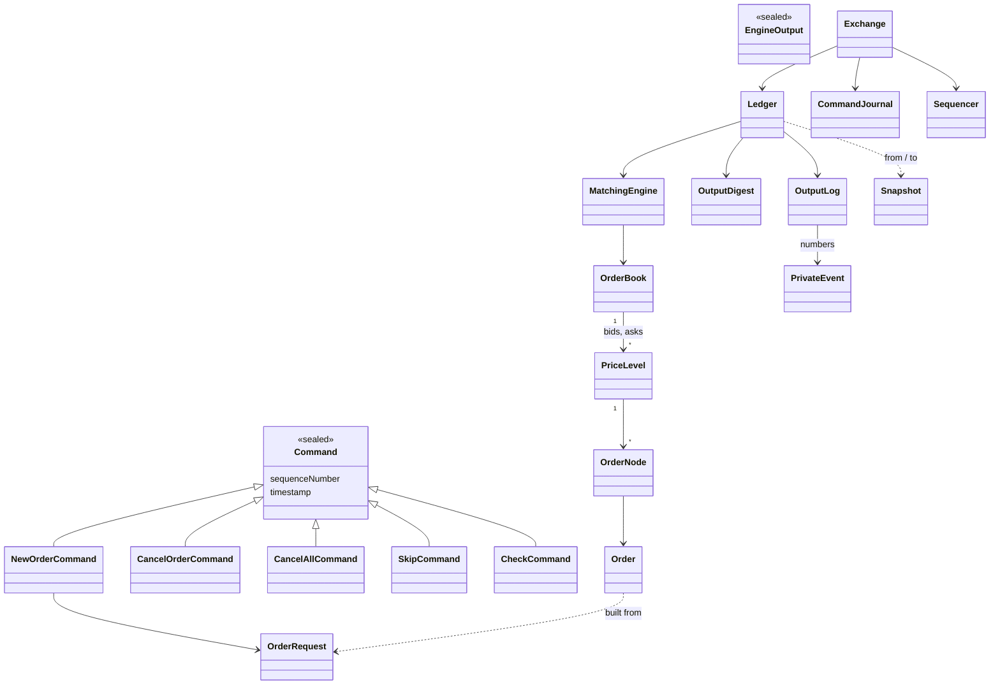

---

## 2. The journal file (format v3, D69)

```
HEADER,3,<rulesVersion>,<baseSequence>,<crc>
NEW,<seq>,<timestamp>,<orderId>,<participant>,<clientOrderId>,<side>,<type>,<quantity>,<price or ->,<crc>
CANCEL,<seq>,<timestamp>,<participant>,<targetOrderId>,<crc>
CANCEL_ALL,<seq>,<timestamp>,<participant>,<crc>
SKIP,<seq>,<timestamp>,<skippedSeq>,<crc>
CHECK,<seq>,<timestamp>,<outputDigest>,<crc>
```

**[Verified]** `src/main/java/exchangeserver/journal/JournalCodec.java:18-35`.

- Every record ends with `,<crc>\n`, where `<crc>` is the CRC-32C of the text before that comma, as 8 lower-case hex digits. A changed character makes the record corrupt; startup stops with the record number (D69). **[Verified]** `JournalCodec.java:166-187`.
- Records are LF-only. A record ending in `\r` (a CRLF conversion by an editor or git) is reported as such; `.gitattributes` keeps `*.journal` and its siblings out of git's line-ending conversion. **[Verified]** `JournalCodec.java:172-175`.
- `baseSequence` names the snapshot the journal continues from (0: none); the first record is `baseSequence + 1` (D71).
- Timestamps are `Instant.toString()`; a MARKET order's price is `-`.

A real journal (2026-10-27): **[Verified]** live run.

```
HEADER,3,2,0,5d7826e0
NEW,1,2026-10-27T14:20:40.373493200Z,1,alice,a1,SELL,LIMIT,10,100,379beca7
NEW,2,2026-10-27T14:20:40.802670Z,2,alice,a2,BUY,LIMIT,5,100,f33577be
NEW,3,2026-10-27T14:20:41.217763100Z,3,bob,b1,BUY,LIMIT,4,100,bed0c339
CANCEL_ALL,4,2026-10-27T14:20:42.045241200Z,alice,2b6bb4a5
```

Neighbours of the journal: `exchange.journal.lock` (empty; holds the OS lock while a process has the journal open, D65), `exchange.journal.snapshot-<seq>` and `exchange.journal.archive-<first>-<last>` (after compactions).

## 3. The snapshot file (D71)

```
SNAPSHOT,1,<lastSequence>,<lastOrderId>,<lastTimestamp or ->,<lastTradePrice>,<digest>,<crc>
ORDER,<orderId>,<participant>,<clientOrderId>,<side>,<type>,<price>,<originalQty>,<filledQty>,<timestamp>,<crc>
OSEQ,<participant>,<lastOseq>,<crc>
END,<orderCount>,<participantCount>,<crc>
```

**[Verified]** `src/main/java/exchangeserver/core/Snapshot.java:27-40`, `Snapshot.java:64-77`.

- ORDER lines are in book priority (bids best first, then asks best first, time priority within a level), so loading them in order restores time priority; partial fills are kept (`filledQty`).
- OSEQ lines are sorted by participant, so the file is the same bytes whatever the hash map's iteration order.
- END proves the file is complete; it is written to a temporary file, fsynced and renamed atomically.
- The snapshot depends on no rule: it is state, not commands to re-run. That is what lets a rules change be crossed.

A real snapshot (no resting orders left, two participants): **[Verified]** live run.

```
SNAPSHOT,1,4,3,2026-10-27T14:20:42.045241200Z,100,88a18b6a6365ebe4,d7e6a970
OSEQ,alice,4,d1453b0b
OSEQ,bob,1,3d136969
END,0,2,6a6d3c70
```

## 4. The users file (D74)

```
<participant>:pbkdf2-sha256:<iterations>:<salt base64>:<hash base64>
```

One line per participant, written atomically by `--add-user` (which asks for the secret, or reads one line from standard input, dropping a UTF-8 byte-order mark that Windows PowerShell adds). The secret itself is never stored: PBKDF2-HMAC-SHA256 with a random 16-byte salt and 210,000 iterations. Lines starting with `#` are comments. **[Verified]** `src/main/java/exchangeserver/gateway/Credentials.java:18-31`, `Credentials.java:72-80`, `src/main/java/exchangeserver/Main.java:212-232`; seen live: `alice:pbkdf2-sha256:210000:gJDXXBPuB1OYmFalrdCSx...`.

A secret is 8 to 64 printable ASCII characters without spaces (the protocol separates fields with spaces). **[Verified]** `Credentials.java:38`.

---

## 5. The wire protocol

ASCII lines ending in `\n` (`\r\n` accepted), at most 256 bytes, tokens separated by single spaces (D53). **[Verified]** `src/main/java/exchangeserver/gateway/Protocol.java:18-46`.

### Client → server

| Line | Meaning |
|---|---|
| `LOGIN <participant> <secret> [COD]` | authenticate; `COD` = cancel my orders when my last session closes |
| `NEW <clOrdId> <BUY\|SELL> <LIMIT\|IOC\|FOK\|POST_ONLY> <qty> <price>` | priced order |
| `NEW <clOrdId> <BUY\|SELL> MARKET <qty>` | market order |
| `CANCEL <orderId>` | cancel own order |
| `RESEND <oseq>` | repeat retained private events from oseq on |
| `SUBSCRIBE`, `UNSUBSCRIBE`, `PING`, `QUIT` | market data, keep-alive, leave |

### Server → client

| Line | Stream |
|---|---|
| `FILL oseq= orderId= clOrdId= side= price= qty= leaves= liquidity=TAKER\|MAKER` | private, numbered |
| `ORDER oseq= orderId= clOrdId= status= filled= remaining= [reason=]` | private, numbered |
| `CANCELLED oseq= orderId= qty= [reason=CANCEL_ALL]`, `CANCEL_REJECT oseq= orderId= reason=UNKNOWN_ORDER` | private, numbered |
| `… resend=1` | a private line repeated by RESEND |
| `WELCOME participant= oseq=`, `RESENT last=`, `ERROR RESEND_GAP first=` | session |
| `BOOK seq= last= bids=<p>x<q>,… asks=…` | market data snapshot (top 100 levels) |
| `TRADE seq= price= qty= aggressor=`, `LEVEL seq= side= price= qty= orders=` | market data (qty=0: level gone) |
| `SUBSCRIBED`, `UNSUBSCRIBED`, `PONG`, `BYE`, `ERROR <text>` | session |

The private stream is sent to every session of the participant (D73). `oseq` counts one participant's events; `seq` counts journal records for the whole exchange, so market data has gaps (commands without public effects).

---

## 6. Where state lives and who may touch it

| State | Where | Owner thread | Persisted? |
|---|---|---|---|
| Book (levels, nodes, id map, open counts) | `OrderBook` in `MatchingEngine` in `Ledger` | exchange-writer | rebuilt by replay; in snapshots |
| Client-order-id map | `MatchingEngine.orderIdByClientOrderId` | exchange-writer | rebuilt (since the last snapshot) |
| Last order id, last seq, last trade price | `MatchingEngine` | exchange-writer | rebuilt; in snapshots |
| Output digest | `OutputDigest` in `Ledger` | exchange-writer | checked by CHECK records; in snapshots |
| Private streams (lastOseq + last 1,000 events per participant) | `OutputLog` in `Ledger` | exchange-writer | numbers rebuilt and in snapshots; events rebuilt only since the last snapshot |
| Sequencer counters, last timestamp | `Sequencer` | exchange-writer | rebuilt from the journal |
| Skip set, commands since the last CHECK | `Exchange` | exchange-writer | skip set rebuilt; CHECK counter not |
| Request queue, state, halt cause | `ExchangeService` | any thread, under `lock` | no |
| Journal channel, fail-stop flag | `CommandJournal` | exchange-writer (opened by the starting thread) | the file is the persistence |
| Lock | `JournalLock` (`HELD` in-JVM set + OS lock on `<journal>.lock`) | owning journal / compaction | no |
| Sessions, participants → sessions, subscribers | `TcpGateway` (concurrent sets and map) | reader threads, writer thread | no |
| Per-session: participant, COD flag, in-flight count, reader-done, outbound queue, subscription flags, rate tokens | `ClientSession` | reader (tokens), writer and reader (rest, via volatile/atomic/lock) | no |
| Credentials | `Credentials` (immutable) | any | the users file |

**[Verified]** fields: `src/main/java/exchangeserver/engine/MatchingEngine.java:56-61`, `src/main/java/exchangeserver/core/Exchange.java:86-94`, `src/main/java/exchangeserver/gateway/TcpGateway.java:104-111`, `src/main/java/exchangeserver/gateway/ClientSession.java:60-82`, `src/main/java/exchangeserver/journal/JournalLock.java:27-30`.

---

## 7. How state changes over time

### 7.1 An order's lifecycle

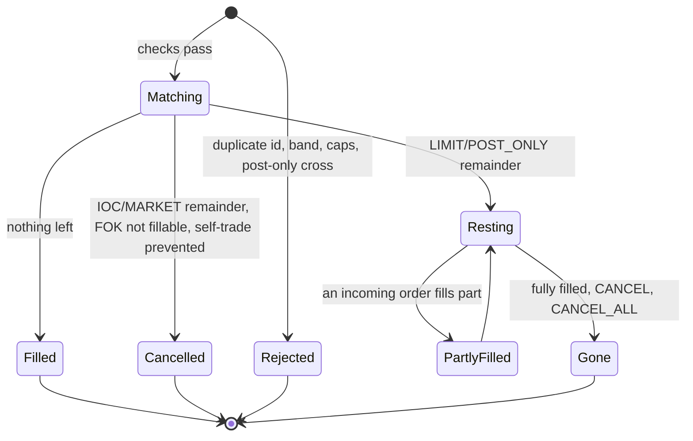

**[Verified]** `src/main/java/exchangeserver/engine/MatchingEngine.java:178-263`, `MatchingEngine.java:127-155`.

### 7.2 The service

`RUNNING` → `STOPPING` (after `stop()`, everything accepted is still processed) → `STOPPED`; or `RUNNING`/`STOPPING` → `HALTED` (journal failure, `Error`): everything waiting is refused, exit 2. **[Verified]** `src/main/java/exchangeserver/core/ExchangeService.java:245-257`, `ExchangeService.java:342-359`.

### 7.3 A connection (session)

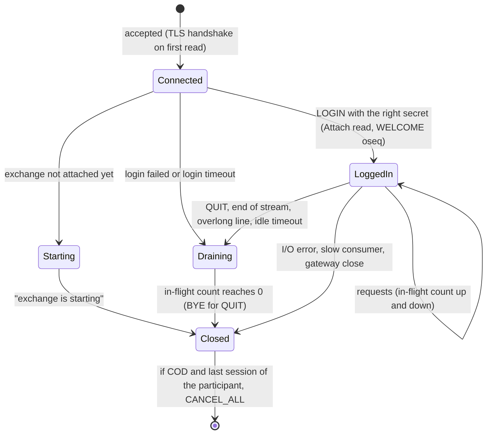

**[Verified]** `src/main/java/exchangeserver/gateway/ClientSession.java:152-182`, `ClientSession.java:293-327`, `ClientSession.java:421-442`, `src/main/java/exchangeserver/gateway/TcpGateway.java:239-263`.

### 7.4 The journal and its snapshots over time

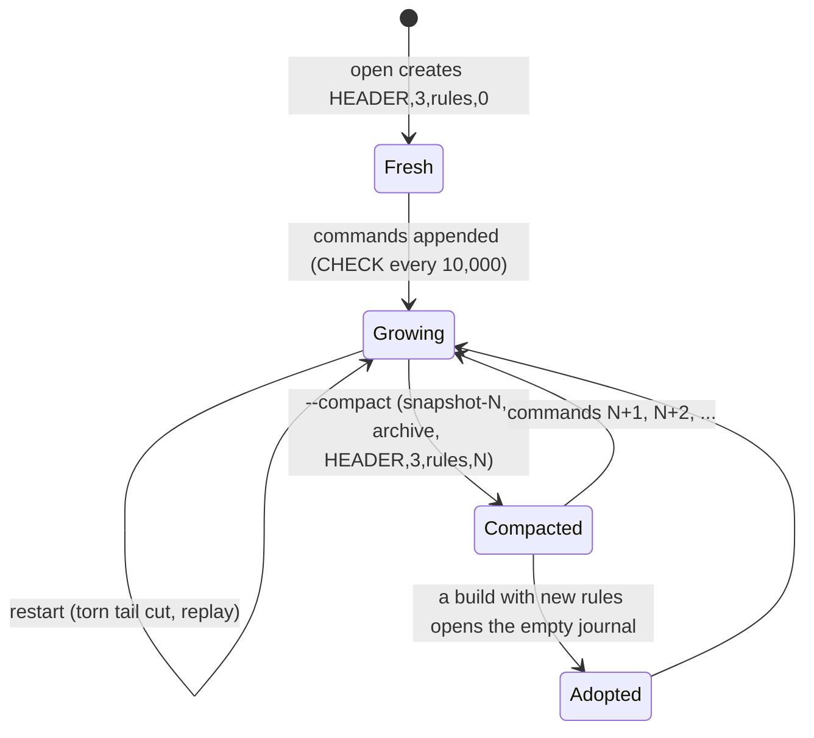

**[Verified]** `src/main/java/exchangeserver/journal/CommandJournal.java:98-132`, `src/main/java/exchangeserver/core/Exchange.java:174-194`.

---

## 8. Validation layers

| Layer | Where | Checks | On failure |
|---|---|---|---|
| Line framing | `ClientSession.readLine` | ≤ 256 bytes | ERROR, disconnect after in-flight |
| Syntax | `Protocol.parse` | message type, arity, numbers, enums | ERROR, session continues |
| Authentication | `ClientSession.login`, `Credentials.verify` | name pattern, secret (PBKDF2, constant time) | `ERROR login failed`, disconnect |
| Session limits | `ClientSession.admit`, timeouts | in-flight, rate, login/idle time | ERROR (`SESSION_BUSY`, `RATE_LIMITED`, timeout) |
| Fields | `OrderRequest` | participant, clOrdId, side, type, quantity, price | ERROR, never queued |
| Hand-in | `ExchangeService.enqueue`, `Request` constructors | state, queue capacity, depth > 0, oseq > 0 | BUSY / STOPPED / HALTED |
| Stamping | `Sequencer` + command constructors | valid command | refused, never journalled |
| State-dependent | `MatchingEngine.process` | duplicate id, band, caps, post-only, self-trade | REJECTED or CANCELLED with a reason, journalled |
| Invariants | records' constructors, `OrderBook`, `PriceLevel` | contradictions, bugs | exception (poison-pill path) |
| Storage | `JournalCodec`, `Snapshot.read`, `Replay` | checksums, header, gaps, timestamps, CHECK digests | startup fails, file untouched |

**[Verified]** the cited classes; see guide 05a for the request path through them.

---

## 9. What persists, what is rebuilt, what is lost

| On disk | Rebuilt at startup | Lost on restart |
|---|---|---|
| journal (inputs), snapshot-N (state at N), archives (old journals), users file, lock file (empty) | book, counters, client-order-id map (since the snapshot), digest, oseq numbers, retained private events (since the snapshot), skip set | sessions, subscriptions, queued lines, requests in flight that were not journalled, rate tokens |

A restart rebuilds the identical book and the identical private-stream numbering; a client recovers what it missed with RESEND after logging in again. **[Verified]** tests `ExchangeTest.Restart.*`, `TcpGatewayTest.Resend.theStreamSurvivesARestart`.

---

## 10. "Migrations": versions instead of schema changes

There is no schema to migrate. Three version numbers decide what can be read:

| Version | Where | Changes when | Effect |
|---|---|---|---|
| `JournalCodec.FORMAT_VERSION` (3) | journal header | the record format changes | a journal of another format is refused (v2 journals from before D69 cannot be opened) |
| `Rules.VERSION` (2) | journal header | any rule replay depends on | a journal of other rules with records is refused; an empty one adopts the new rules |
| `Snapshot.FORMAT_VERSION` (1) | snapshot header | the snapshot format changes | a snapshot of another format is refused |

**[Verified]** `src/main/java/exchangeserver/journal/JournalCodec.java:41`, `src/main/java/exchangeserver/domain/Rules.java:21`, `src/main/java/exchangeserver/core/Snapshot.java:44`.

The way across a rules change is a compaction with the old build, then the new build (guide 05b, flow 4c). A code change that alters behaviour without a rules bump is caught by the next CHECK record (`DIVERGED`, D70) and needs the same procedure.

---

## Key takeaways

- Only inputs persist: a checksummed journal of stamped commands, plus a snapshot of the state at the journal's base sequence; everything else is derived.
- Five command records: NEW, CANCEL, CANCEL_ALL (journalled like any input), SKIP (quarantine), CHECK (an output digest assertion).
- The Ledger (engine + output digest + output log) is the writer's derived state and is always rebuilt as one unit.
- Private events are numbered per participant (oseq) and retained (1,000) for RESEND; the numbering survives restarts and compactions.
- All exchange state belongs to the writer thread; sessions, the gateway's maps and the service's queue are the only state touched by other threads.
- Validation happens in layers, from line framing to CHECK digests; nothing the gateway refuses is journalled.
- Three version numbers (journal format, rules, snapshot format) replace migrations; compaction is the bridge across a rules change.

## Common confusions

- **"The snapshot replaces the journal."** It replaces the journal's *past*: the journal after compaction holds only a header naming the snapshot, then new commands.
- **"CHECK records are inputs."** They are assertions about outputs; replay compares them and never feeds them to the engine.
- **"oseq is stored in the journal."** It is derived from the commands by `OutputLog`; only snapshots store each participant's last number.
- **"The lock file must be deleted after a crash."** The OS lock dies with the process; the empty file is reused.
- **"The users file stores secrets."** It stores salted PBKDF2 hashes only.

## Questions to test yourself

1. Which of these are on disk: the book, the client-order-id map, the oseq numbering, the journal, the users file?
<details><summary>Answer</summary>The journal and the users file (plus snapshots). The book and the oseq numbering are also inside a snapshot after a compaction; the client-order-id map is never stored (after a snapshot only resting orders' ids are rebuilt from the ORDER lines).</details>

2. Why are OSEQ lines sorted in the snapshot?
<details><summary>Answer</summary>The output log keeps them in a hash map; sorting makes the file the same bytes regardless of iteration order (determinism, and stable checksums).</details>

3. A record `NEW,…,LIMIT,10,100,379beca7` has its quantity edited to 11. What happens at startup?
<details><summary>Answer</summary>The CRC-32C no longer matches: decoding fails with "Corrupt journal record <n>", startup stops, and the file is not changed.</details>

4. Which thread may read `OutputLog`, and how does a session get data from it?
<details><summary>Answer</summary>Only the exchange-writer. A session queues an Attach or Resend read; its callback runs on the writer and offers lines to the session's outbound queue.</details>


---

<a id="guide-07-modules-domain-and-commands"></a>

<!-- source: docs/understanding/07-modules/domain-and-commands.md -->

# 07 — Module: domain and command

> **Project:** ExchangeServer2 | Single-instrument limit order book: price-time matching engine, write-ahead journal with replay, single writer thread, TCP/TLS gateway with authenticated participants | Stack: Java 17, Maven wrapper, JUnit 5 (+ JMH, PIT)
> **This guide:** the value types every other package is built on (`domain`: `Side`, `OrderType`, `Rules`, `OrderRequest`, `Order`) and the stamped inputs plus their stamper (`command`: `Command`, `NewOrderCommand`, `CancelOrderCommand`, `CancelAllCommand`, `SkipCommand`, `CheckCommand`, `Sequencer`) | **Prerequisites:** 01, 02 | **Related:** 06, 07-modules/engine, 07-modules/journal, 07-modules/exchange-and-replay, 09, 12
> **Repo layout summary:** `pom.xml` + Maven wrapper (`mvnw`, `mvnw.cmd`) at the root; production code in `src/main/java/exchangeserver/` (packages `domain`, `book`, `engine`, `command`, `journal`, `core`, `gateway`, `client`, plus `Main`); tests mirror it in `src/test/java/exchangeserver/` (plus `bench/` JMH benchmarks and `testing/MutableClock`); design docs in `docs/` (`ExchangeServer2_Vision.md` = purpose/roadmap, `ExchangeServer2_Spec.md` = decisions D1–D77); these guides in `docs/understanding/`.

## Overview

These two small packages (about 490 lines together) define *what an order is* and *what an input to the
exchange is*. Almost every rule that can make a request invalid lives here, and the only component allowed to
read the clock or count lives here too.

- **`domain`**: plain business values.
  - `Side` is `BUY` or `SELL`.
  - `OrderType` is one of the five order types.
  - `Rules` holds every limit and constant that replay depends on.
  - `OrderRequest` is a client's order **before** the exchange accepts it. It is the only place fields are
    validated.
  - `Order` is an accepted order: a request plus an id and a timestamp. It is the one mutable object, because it
    tracks how much has been filled.
- **`command`**: the **commands**. A command is a stamped, journalled input, and commands are the system's
  source of truth.
  - There are five kinds. Three are engine inputs: `NewOrderCommand`, `CancelOrderCommand` and
    `CancelAllCommand` (cancel every resting order of one participant, used for cancel-on-disconnect, Spec D72).
    Two are bookkeeping that replay reads but never feeds to the engine: `SkipCommand` (quarantine a poison pill,
    D51) and `CheckCommand` (a digest of every output so far, D70).
  - `Sequencer` stamps them with a sequence number, a timestamp and (for new orders) an order id.

Two project terms appear throughout:

- **Replay.** On restart, the exchange rebuilds its state by feeding every journalled command through the same
  matching engine again (see guide 07-modules/exchange-and-replay). Anything replay depends on must therefore be
  deterministic and must not change silently. That requirement is why `Rules` exists and why only the
  `Sequencer` reads the clock.
- **Stateless vs state-dependent validation.** A *stateless* check needs only the request itself (is the
  quantity positive?). A *state-dependent* check needs the book (is this client order id already used?). The
  stateless checks live in `OrderRequest`; the state-dependent ones live in the engine (guide
  07-modules/engine). **[Verified]** Spec D47, Vision §4 principle 6.

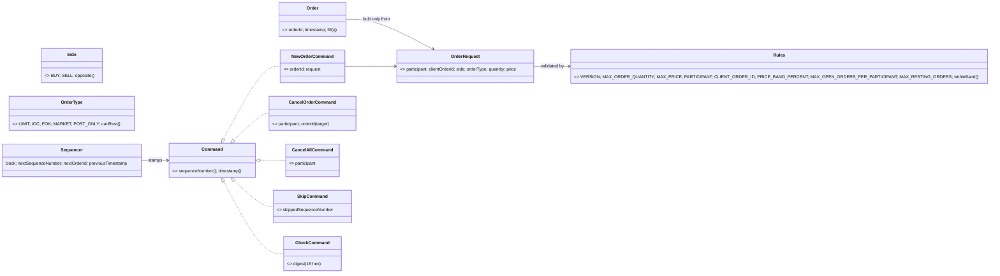

## Responsibility

| Type | Responsibility | Mutable? |
|---|---|---|
| `Side` | Which side of the book; `opposite()` | no |
| `OrderType` | The five order types; `canRest()` says which may sit on the book | no |
| `Rules` | One home for every limit replay depends on, plus the price-band arithmetic | no |
| `OrderRequest` | The only field-validation layer (stateless) | no |
| `Order` | An accepted order inside the engine and book; tracks `filledQuantity` | **yes** (only `fill`) |
| `Command` + 5 records | Stamped, journalled inputs; validated in their constructors | no |
| `Sequencer` | The only clock reader and the only counter | yes (writer thread only) |

## Public interface and who calls it

| Member | Visibility | Called by |
|---|---|---|
| `Side.opposite()` | public | `MatchingEngine.process` (`restingSide`), `MatchingEngine.matchLimit` (the touch, D66), `MatchingEngine.fillability` |
| `OrderType.canRest()` | public | `OrderBook.add` (guard), `MatchingEngine.process` (the resting caps, D68) |
| `Rules.*` constants | public | `OrderRequest`, `CancelOrderCommand`, `CancelAllCommand`, `ClientSession.login` and `Credentials` (participant pattern), `MatchingEngine` (band, caps via `Limits.RULES`, collar), `Exchange` (`Rules.VERSION` to open, compact and quarantine the journal) |
| `Rules.withinBand(price, ref)` | public | `MatchingEngine.process` (band check) |
| `OrderRequest.of(..., OptionalLong)` | public | `ClientSession.newOrder` (`src/main/java/exchangeserver/gateway/ClientSession.java:332`), `JournalCodec.decode` (`src/main/java/exchangeserver/journal/JournalCodec.java:138`), `MatchingEngine.restore` (rebuilding resting orders from a snapshot, `src/main/java/exchangeserver/engine/MatchingEngine.java:89`) |
| `OrderRequest.limit/ioc/fok/postOnly/market` | public | tests, benchmarks |
| `OrderRequest.rawPrice()` | package-private | `Order` constructor only |
| `new Order(id, request, ts)` | public | `MatchingEngine.onNewOrder`, `MatchingEngine.restore` |
| `Order.fill(q)` | public | `PriceLevel.fillHead` (resting side), `MatchingEngine.process` (incoming side), `MatchingEngine.restore` (re-applying a snapshot's filled quantity) |
| `Sequencer.stampNewOrder/stampCancel/stampCancelAll` | public | `Exchange.process` (`src/main/java/exchangeserver/core/Exchange.java:207`, `:209`, `:211`) |
| `Sequencer.stampCheck` | public | `Exchange.process`, at the start of a batch when a CHECK is due (`Exchange.java:201`) |
| `Sequencer.stampSkip` | public | `Exchange.quarantine` (both the static operator tool, `Exchange.java:164`, and the live poison-pill path, `Exchange.java:280`) |
| `Sequencer.resume(...)` | public static | `Exchange.open` (after replay, `Exchange.java:122`), `Exchange.quarantine` (static tool, `Exchange.java:163`) |

All of the above is **[Verified]** by reading the call sites.

## Internal walkthrough: `domain`

### `Side` and `OrderType`

```java
// src/main/java/exchangeserver/domain/Side.java:3-10
public enum Side {
    BUY,
    SELL;

    public Side opposite() {
        return this == BUY ? SELL : BUY;
    }
}
```

```java
// src/main/java/exchangeserver/domain/OrderType.java:3-23 (trimmed)
/*
LIMIT      match what crosses now, rest the remainder.
IOC        match what crosses now, cancel the remainder.
FOK        fill completely now or do nothing.
MARKET     no price; match at any price inside the market collar (Rules), cancel the remainder.
POST_ONLY  rest without matching; rejected if it would cross on arrival.
 */
public enum OrderType {
    LIMIT, IOC, FOK, MARKET, POST_ONLY;

    // Only these two ever rest on the book.
    public boolean canRest() {
        return this == LIMIT || this == POST_ONLY;
    }
}
```

**[Verified]** The comment block is the clearest one-line definition of each type. IOC means "immediate or
cancel" and FOK means "fill or kill". `canRest()` drives two distinct things:
1. `OrderBook.add` refuses any other type, which is a bug guard.
2. Only `LIMIT` and `POST_ONLY` are subject to the resting caps (per participant and for the whole book), and
   then only when they would actually rest (Spec D68; guide 07-modules/engine). That is a business rule.

### `Rules`: everything replay depends on

```java
// src/main/java/exchangeserver/domain/Rules.java:17-47 (trimmed)
public final class Rules {

    // 2: self-trade prevention (D67), caps only for orders that would rest + BOOK_FULL (D68), market collar before
    //    the first trade anchored on the opposite touch (D66), CANCEL_ALL (D72).
    public static final int VERSION = 2;

    // Stateless (checked by OrderRequest, i.e. at the gateway).
    public static final long MAX_ORDER_QUANTITY = 1_000_000_000L;
    // Notional (price x quantity) can never overflow a long.
    public static final long MAX_PRICE = Long.MAX_VALUE / MAX_ORDER_QUANTITY;
    // No ',' or whitespace: they separate fields in the journal and in the wire protocol.
    public static final Pattern PARTICIPANT = Pattern.compile("[A-Za-z0-9_]{1,16}");
    public static final Pattern CLIENT_ORDER_ID = Pattern.compile("[A-Za-z0-9_.-]{1,32}");

    // State-dependent (checked by the engine).
    public static final int PRICE_BAND_PERCENT = 10;
    public static final int MAX_OPEN_ORDERS_PER_PARTICIPANT = 10_000;
    // All participants together (D68): bounds the book's memory however many participants exist.
    public static final int MAX_RESTING_ORDERS = 1_000_000;

    // Exact integer comparison, no rounding: price * 100 vs reference * (100 +- band).
    // Cannot overflow: both prices are <= MAX_PRICE (~9.2e9), times at most 110.
    public static boolean withinBand(long price, long referencePrice) {
        return price * 100 <= referencePrice * (100 + PRICE_BAND_PERCENT)
                && price * 100 >= referencePrice * (100 - PRICE_BAND_PERCENT);
    }
}
```

Line by line:

- **`VERSION` (line 21) is 2.** **[Verified]** It is written into the journal header, and `CommandJournal.open`
  refuses a journal *with records* whose header names another version (Spec D46). Replay feeds *old* commands
  through *today's* code. If, say, `MAX_ORDER_QUANTITY` shrank, an old valid order would fail decoding or be
  rejected differently, and the rebuilt book would differ from what clients saw. The class comment
  (`Rules.java:5-16`) says exactly this.
  - **Why 2 [Verified]** (`Rules.java:19-21`): version 2 changed what the engine does with the same commands:
    self-trade prevention (D67), the caps applying only to orders that would rest plus the new `BOOK_FULL` cap
    (D68), the market collar before the first trade (D66) and the new `CANCEL_ALL` command (D72). A version-1
    journal replayed under version 2 could build a different book, so it is refused.
  - **How a rules change is crossed [Verified]** (Spec D71): compact the journal with the *old* build (a
    snapshot plus an empty journal); an empty journal adopts the new build's version when it is opened (guide
    07-modules/journal).
  - **Caveat [Verified]** (Spec D70, §8): the version catches *deliberate* rule changes. A code change that alters
    outputs without touching `Rules` is now caught at the next `CHECK` record, whose output digest replay must
    reproduce; it is no longer silent, but it is detected only at a CHECK and only if an output differs.
- **`MAX_RESTING_ORDERS` (line 37) = 1,000,000.** **[Verified]** A cap on resting orders across *all*
  participants (Spec D68). The per-participant cap alone did not bound memory, because participant names used to
  be free (now they need credentials, D74). The engine rejects a resting order at this cap with `BOOK_FULL`.
- **`MAX_PRICE` (line 26) = `Long.MAX_VALUE / 1_000_000_000` = 9,223,372,036.** **[Verified]**
  `RulesTest.maxPriceTimesMaxQuantityFitsInALong` checks it. So `price * quantity` can never overflow a `long`,
  whatever the inputs. A consequence **[Inferred]**: prices are integer "ticks" (no decimals anywhere), with a
  ceiling of about 9.2 billion ticks.
- **The two patterns (lines 28–29).** They exclude `,` (the journal's field separator) and spaces (the wire
  protocol's token separator). So a participant or client order id can never corrupt either format. **[Verified]**
  by the comment, by `JournalCodec` splitting on `,` and by `Protocol.parse` splitting on a single space.
- **`withinBand` (lines 44–47).** It compares `price × 100` with `reference × 110` and `reference × 90` in
  integers, so there's no floating point and no rounding. Both edges are inclusive.
  - **Worked example [Verified by arithmetic]:** with last trade 105, the band is `[94.5, 115.5]` in real
    numbers. For integer prices 95 is the lowest allowed (`9500 >= 9450`) and 115 the highest
    (`11500 <= 11550`). 94 is out (`9400 < 9450`) and 116 is out (`11600 > 11550`).
  - **Overflow note [Verified]:** `MAX_PRICE × 110 ≈ 1.01e12`, far below `Long.MAX_VALUE`.
    `RulesTest.bandDoesNotOverflowAtTheMaximumPrice` covers it.

### `OrderRequest`: the only field-validation layer

```java
// src/main/java/exchangeserver/domain/OrderRequest.java:24-74 (trimmed)
private OrderRequest(String participant, String clientOrderId, Side side, OrderType orderType, long quantity, long price) {
    if (participant == null || !Rules.PARTICIPANT.matcher(participant).matches()) {
        throw new IllegalArgumentException("Invalid participant: " + participant);
    }
    if (clientOrderId == null || !Rules.CLIENT_ORDER_ID.matcher(clientOrderId).matches()) { ... }
    if (side == null) { ... }
    if (orderType == null) { ... }
    if (quantity <= 0) { ... }
    if (quantity > Rules.MAX_ORDER_QUANTITY) { ... }
    if (orderType != OrderType.MARKET) {
        if (price <= 0) { ... }
        if (price > Rules.MAX_PRICE) { ... }
    }
    ...
}

// The general factory: the price is present for every type except MARKET.
public static OrderRequest of(String participant, String clientOrderId, Side side, OrderType orderType,
                              long quantity, OptionalLong price) {
    Objects.requireNonNull(price, "price");
    if (orderType == OrderType.MARKET) {
        if (price.isPresent()) {
            throw new IllegalArgumentException("A market order has no price");
        }
        return new OrderRequest(participant, clientOrderId, side, orderType, quantity, Order.NO_PRICE);
    }
    if (price.isEmpty()) {
        throw new IllegalArgumentException("A " + orderType + " order needs a price");
    }
    return new OrderRequest(participant, clientOrderId, side, orderType, quantity, price.getAsLong());
}
```

Key design points:

1. **The constructor is private.** Every route in goes through a factory, so every instance has passed every
   check. "An invalid `OrderRequest` cannot exist" is enforced by the type, not by convention. **[Verified]**
   `OrderRequest.java:24`.
2. **One rule set, three users.** **[Verified]**
   - The gateway builds requests with `of(...)`: `ClientSession.java:332`.
   - The journal decoder builds them with `of(...)` too (guide 07-modules/journal).
   - `MatchingEngine.restore` rebuilds each resting order of a snapshot through `of(...)` (`MatchingEngine.java:89`),
     so even a snapshot's orders pass the stateless rules.

   So a journalled record is re-validated on replay by the *same* rules as the gateway applied. The class comment
   calls this "reuse, not a third copy of the rules" (`OrderRequest.java:9`).
3. **A market order has no price in the API.** `getPrice()` returns `OptionalLong`, empty for `MARKET`
   (`OrderRequest.java:116-118`). Internally the field holds the sentinel `Order.NO_PRICE = -1`
   (`Order.java:18`), but only `Order`'s constructor can see it, through the package-private `rawPrice()`
   (`OrderRequest.java:121-123`). **[Verified]** Spec D25/D26 record this choice.
4. **`equals`/`hashCode` cover every field** (`OrderRequest.java:126-140`). **[Verified]**
   `OrderRequestTest.equalityCoversEveryField`. **[Inferred]** These matter for tests that compare decoded
   journal records with the originals, and for `NewOrderCommand` (a record), whose `equals` delegates to the
   request's.

`IllegalArgumentException` means "bad input from outside". **[Verified]** Spec D27:
`IllegalArgumentException` = bad input; `IllegalStateException` = our bug or a corrupt journal. The gateway
catches the `IllegalArgumentException` and answers `ERROR clOrdId=… <message>`, so the request never reaches the
queue (guide 07-modules/gateway).

### `Order`: an accepted order

```java
// src/main/java/exchangeserver/domain/Order.java:30-103 (trimmed)
public Order(long orderId, OrderRequest request, Instant timestamp) {
    Objects.requireNonNull(request, "request");
    Objects.requireNonNull(timestamp, "timestamp");
    if (orderId <= 0) {
        throw new IllegalArgumentException("Order id must be positive");
    }
    this.orderId = orderId;
    this.participant = request.getParticipant();
    ...
    this.price = request.rawPrice();
    this.originalQuantity = request.getQuantity();
    this.timestamp = timestamp;
}

public boolean hasPrice() { return orderType != OrderType.MARKET; }

// A market order has no price; asking for one is a bug.
public long getPrice() {
    if (!hasPrice()) {
        throw new IllegalStateException("Order " + orderId + " is a market order and has no price");
    }
    return price;
}

public long getRemainingQuantity() { return originalQuantity - filledQuantity; }

public void fill(long quantity) {
    if (quantity <= 0) { throw new IllegalArgumentException("Fill quantity must be positive"); }
    if (quantity > getRemainingQuantity()) { throw new IllegalArgumentException("Cannot overfill order " + orderId); }
    filledQuantity += quantity;
}
```

- **The only constructor takes a request** (Spec D47). So `Order` re-checks only what a request cannot know:
  the id and the timestamp. **[Verified]**
- **Its single mutable field is `filledQuantity`** (`Order.java:28`); "remaining" is derived from it. **[Verified]**
- **An `Order` holds no references to the book, level or node.** "An Order does not know where it is stored"
  (`Order.java:13`). The book wraps it in an `OrderNode` instead (guide 07-modules/book). **[Verified]**
- **`getPrice()` throws for `MARKET`.** Code that forgets the "market has no price" case fails loudly instead of
  matching at price −1. **[Verified]**
- **Who calls `fill`.** It is called on the resting order (inside `PriceLevel.fillHead`) and on the incoming
  order (in `MatchingEngine.process`). Both pass the same quantity per trade. **[Verified]** by reading both.

## Internal walkthrough: `command`

### The sealed `Command` interface and its five records

```java
// src/main/java/exchangeserver/command/Command.java:11-16
public sealed interface Command permits NewOrderCommand, CancelOrderCommand, CancelAllCommand, SkipCommand, CheckCommand {
    long sequenceNumber();
    Instant timestamp();
}
```

A **sealed interface** (Java 17) lists every allowed implementation, so the compiler knows the full set. A
**record** is an immutable data class; a *compact constructor* (`public NewOrderCommand { ... }`) runs
validation before the fields are assigned. Commands are immutable, so "the object that is logged and the object
that is processed cannot differ" (`Command.java:7-8`). **[Verified]**

```java
// src/main/java/exchangeserver/command/NewOrderCommand.java:8-21 (trimmed)
public record NewOrderCommand(long sequenceNumber, Instant timestamp, long orderId, OrderRequest request)
        implements Command {
    public NewOrderCommand {
        Objects.requireNonNull(timestamp, "timestamp");
        Objects.requireNonNull(request, "request");
        if (sequenceNumber <= 0) { throw new IllegalArgumentException("Sequence number must be positive"); }
        if (orderId <= 0) { throw new IllegalArgumentException("Order id must be positive"); }
    }
}
```

```java
// src/main/java/exchangeserver/command/CancelOrderCommand.java:8-23 (trimmed)
// orderId is the target; a cancel is not issued an id of its own (D32).
public record CancelOrderCommand(long sequenceNumber, Instant timestamp, String participant, long orderId)
        implements Command {
    public CancelOrderCommand {
        Objects.requireNonNull(timestamp, "timestamp");
        if (sequenceNumber <= 0) { ... }
        if (participant == null || !Rules.PARTICIPANT.matcher(participant).matches()) { ... }
        if (orderId <= 0) { ... }
    }
}
```

```java
// src/main/java/exchangeserver/command/SkipCommand.java:14-24 (trimmed)
public record SkipCommand(long sequenceNumber, Instant timestamp, long skippedSequenceNumber) implements Command {
    public SkipCommand {
        Objects.requireNonNull(timestamp, "timestamp");
        if (sequenceNumber <= 0) { ... }
        if (skippedSequenceNumber <= 0 || skippedSequenceNumber >= sequenceNumber) {
            throw new IllegalArgumentException("Can only skip an earlier command, not " + skippedSequenceNumber);
        }
    }
}
```

```java
// src/main/java/exchangeserver/command/CancelAllCommand.java:8-21 (trimmed)
// Cancels every resting order of one participant (cancel-on-disconnect, D72). An input like any other: journalled
// before it is processed, replayed on restart.
public record CancelAllCommand(long sequenceNumber, Instant timestamp, String participant) implements Command {
    public CancelAllCommand {
        Objects.requireNonNull(timestamp, "timestamp");
        if (sequenceNumber <= 0) { ... }
        if (participant == null || !Rules.PARTICIPANT.matcher(participant).matches()) { ... }
    }
}
```

```java
// src/main/java/exchangeserver/command/CheckCommand.java:16-29 (trimmed)
public record CheckCommand(long sequenceNumber, Instant timestamp, String digest) implements Command {

    private static final Pattern HEX16 = Pattern.compile("[0-9a-f]{16}");

    public CheckCommand {
        Objects.requireNonNull(timestamp, "timestamp");
        if (sequenceNumber <= 0) { ... }
        if (digest == null || !HEX16.matcher(digest).matches()) {
            throw new IllegalArgumentException("Digest must be 16 lower-case hex digits: " + digest);
        }
    }
}
```

- **`NewOrderCommand`** carries the issued `orderId` and the validated request.
- **`CancelOrderCommand`** carries the participant, needed for the ownership check (Spec D45, D48), and the
  *target* order id. A cancel does not consume an order id. **[Verified]**
- **`CancelAllCommand`** carries only the participant whose resting orders are all cancelled (Spec D72). The
  gateway issues it when the last session of a participant that logged in with `COD` closes. It is an input like
  any other: journalled first, replayed on restart, and it consumes a sequence number but no order id.
  **[Verified]** `CancelAllCommand.java:8-9`.
- **`SkipCommand`** is the quarantine marker of the poison-pill policy (Spec D51). It names an *earlier*
  sequence number that replay must not feed to the engine. The skipped record stays in the file: "history is
  never edited, only annotated" (`SkipCommand.java:11`). **[Verified]** The constructor's "only earlier"
  check makes a self-skip or a forward skip impossible. **[Verified]**
- **`CheckCommand`** is a checkpoint (Spec D70): "the digest of every engine output for the commands before this
  one is `digest`" (`CheckCommand.java:9-10`). The live exchange writes one every `checkInterval` commands; replay
  recomputes the digest and stops if it differs. `HEX16` (`CheckCommand.java:18`) requires exactly 16 *lower-case*
  hex digits: the digest is a 64-bit value printed with `%016x`, so any other spelling cannot be one. It is never
  fed to the engine. **[Verified]**

Only the first three are engine inputs. `SkipCommand` and `CheckCommand` are bookkeeping that replay reads and
acts on (skip a command; compare a digest) but never feeds to the engine. **[Verified]** `Replay.feed`
(`src/main/java/exchangeserver/core/Replay.java`, guide 07-modules/exchange-and-replay).

There is no command for reads (snapshots, attach, resend). Reads are never stamped or journalled (guide
07-modules/exchange-and-replay). **[Verified]** `ExchangeTest.interceptorSeesEveryCommandLiveInOrder` asserts
that only the two orders and the cancel got sequence numbers.

### `Sequencer`: the only clock reader and counter

```java
// src/main/java/exchangeserver/command/Sequencer.java:20-94 (trimmed)
public final class Sequencer {
    private final Clock clock;
    private long nextSequenceNumber;
    private long nextOrderId;
    private Instant previousTimestamp;

    public Sequencer(Clock clock) { this(clock, 1, 1, Instant.MIN); }

    public static Sequencer resume(Clock clock, long lastSequenceNumber, long lastOrderId, Instant lastTimestamp) {
        if (lastSequenceNumber < 0 || lastOrderId < 0) {
            throw new IllegalArgumentException("Counters cannot be negative");
        }
        return new Sequencer(clock, lastSequenceNumber + 1, lastOrderId + 1,
                lastTimestamp == null ? Instant.MIN : lastTimestamp);
    }

    public NewOrderCommand stampNewOrder(OrderRequest request) {
        Objects.requireNonNull(request, "request");     // before stamping: a null must not use up numbers
        Instant timestamp = nextTimestamp();
        return new NewOrderCommand(nextSequenceNumber++, timestamp, nextOrderId++, request);
    }

    public CancelOrderCommand stampCancel(String participant, long orderId) {
        CancelOrderCommand command = new CancelOrderCommand(nextSequenceNumber, nextTimestamp(), participant, orderId);
        nextSequenceNumber++;                           // only once the command is valid
        return command;
    }

    public CancelAllCommand stampCancelAll(String participant) {
        CancelAllCommand command = new CancelAllCommand(nextSequenceNumber, nextTimestamp(), participant);
        nextSequenceNumber++;
        return command;
    }

    public CheckCommand stampCheck(String digest) {
        CheckCommand command = new CheckCommand(nextSequenceNumber, nextTimestamp(), digest);
        nextSequenceNumber++;
        return command;
    }

    public SkipCommand stampSkip(long skippedSequenceNumber) {
        SkipCommand command = new SkipCommand(nextSequenceNumber, nextTimestamp(), skippedSequenceNumber);
        nextSequenceNumber++;
        return command;
    }

    private Instant nextTimestamp() {
        Instant now = clock.instant();
        if (now.isBefore(previousTimestamp)) {
            now = previousTimestamp;
        }
        previousTimestamp = now;
        return now;
    }
}
```

The tricky parts, line by line:

1. **Two counters, both starting at 1** (`Sequencer.java:27-29`). Every command gets the next sequence number;
   only new orders get the next order id. **[Verified]**
   - Example: NEW, CANCEL, NEW is stamped seq 1/2/3 with order ids 1 and 2.
   - `SequencerTest.onlyNewOrdersUseUpOrderIds` checks this.
   - CANCEL_ALL, CHECK and SKIP also take a sequence number and no order id.
     `SequencerTest.CommandValidation.cancelAllAndCheckUseSequenceNumbersButNoOrderIds` checks the first two.
2. **"Only once valid" ordering.** `stampCancel`, `stampCancelAll`, `stampCheck` and `stampSkip` build the
   record first, which runs its validation, and increment `nextSequenceNumber` only afterwards
   (`Sequencer.java:55-56`, `61-62`, `67-68`, `73-74`). An invalid cancel (bad participant, order id ≤ 0) or
   cancel-all (bad participant) therefore throws without using a number, and the journal keeps its sequence
   numbers contiguous. **[Verified]** `SequencerTest.InvalidInputUsesUpNothing`, and
   `cancelAllAndCheckUseSequenceNumbersButNoOrderIds` (an invalid `stampCancelAll` leaves the next number at 3).
   - Why it matters more now: `Exchange.process` stamps a whole batch before journalling it, and a CHECK at the
     start of a batch (D70). A number used up by an invalid request would leave a gap that replay refuses.
   - `stampNewOrder` uses the opposite style: post-increments inside the constructor call. That is safe because
     the only failure its constructor could raise on real input (a null request) is checked *before*
     (`Sequencer.java:49`). **[Verified]** by reading.
   - **[Inferred]** `nextTimestamp()` is still called before an invalid cancel throws, so `previousTimestamp` may
     move forward for a command that is never issued. That is harmless, because timestamps only need to be
     non-decreasing.
3. **The backwards clock (Spec D33).** If the wall clock steps back (an NTP correction, a VM pause),
   `nextTimestamp` reuses the previous timestamp instead of going backwards (`Sequencer.java:86-93`). Equal
   timestamps are allowed. **[Verified]** `SequencerTest.Clock`.
   - Why it matters: replay *verifies* that timestamps never decrease and refuses a journal where they do (guide
     07-modules/exchange-and-replay). So a backwards stamp would make the next restart fail.
4. **`resume` continues after a replayed journal** (Spec D41). The caller passes the last sequence number, the
   last *new-order* id and the last timestamp. **[Verified]** The comment at `Sequencer.java:38-39` explains why
   it must be the last NEW record's id rather than the last record's id field: a cancel's id field is a target,
   not an issued id. `ExchangeTest.nextOrderIdComesFromTheLastNewOrderNotTheLastRecord` covers this. After a
   compaction (D71) the counters come from the snapshot plus whatever the journal added since, so numbering
   continues across the compaction. **[Verified]** `ExchangeTest.Compaction.restartAfterCompactionRebuildsTheSameState`.
5. **The clock is injected.** The `Clock` is a constructor parameter, so tests pass `MutableClock` (a clock tests
   can move, even backwards; `src/test/java/exchangeserver/testing/MutableClock.java`). **[Verified]**
6. **Not thread-safe, by design.** It is called only from the writer thread. Because stamping happens there,
   *sequence order equals queue order equals processing order* without any lock (`Sequencer.java:16-17`; Spec
   D55). **[Verified]**

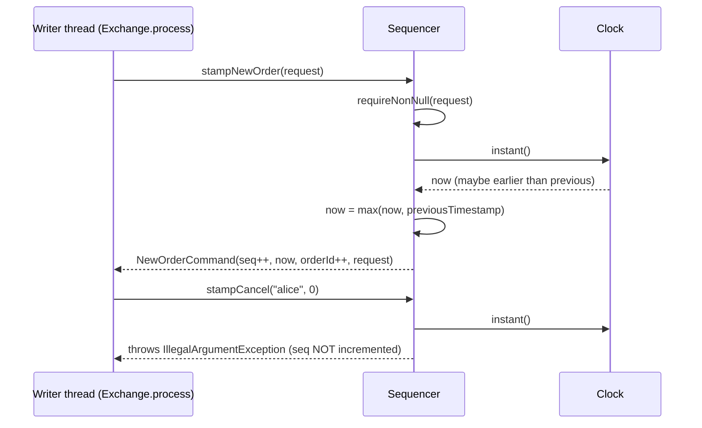

## Dependencies in and out

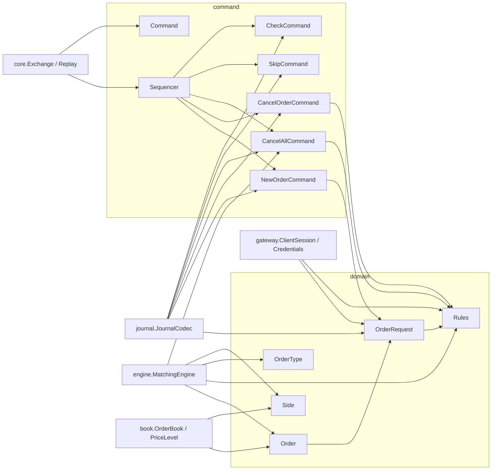

**[Verified]** by imports. `domain` depends on nothing but the JDK. `command` depends only on `domain`. They are
the foundation layer.

## How it's tested

| Test class | `@Nested` groups / notable tests | What it pins down |
|---|---|---|
| `domain/OrderRequestTest` (16 tests) | `Factories` (each typed factory sets its type; `of` matches the typed factories; market with price and priced type without price are refused); `Validation` (parameterised quantity/price must be positive; limits inclusive; patterns); `equalityCoversEveryField` | The stateless rule set |
| `domain/OrderTest` (8) | `Construction`, `Price` (market has no price and says so), `Fill` (partial then full, cannot overfill, must be positive) | The one mutable object |
| `domain/RulesTest` (6) | `bandIsInclusiveAtBothEdges`, `bandComparesExactlyWithoutRounding`, `bandDoesNotOverflowAtTheMaximumPrice`, `maxPriceTimesMaxQuantityFitsInALong`, `oppositeSide`, `onlyLimitAndPostOnlyRest` | Arithmetic edges; also `Side` and `OrderType` |
| `command/SequencerTest` (21) | `Stamping`, `InvalidInputUsesUpNothing`, `Clock` (backwards step reuses the previous timestamp; resumes once it catches up; equal timestamps allowed), `Resume`, `CommandValidation` (the records' constructors: `cancelAllCommand`, `checkCommandNeedsSixteenHexDigits` including upper-case refused, `cancelAllAndCheckUseSequenceNumbersButNoOrderIds`, the skip rule) | Counters, clock policy, record validation |

**[Verified]** Test counts come from counting `@Test`/`@ParameterizedTest` annotations; parameterised tests run
more cases than that. Two deviations from "one test class per production class" **[Verified]**: `Side` and
`OrderType` are tested in `RulesTest`, and the five command records in `SequencerTest.CommandValidation`. Both
packages are included in PIT mutation testing (`pom.xml` `targetClasses`). **[Verified]**

## Key takeaways

- `OrderRequest` is the **only** field-validation layer. Its private constructor makes an invalid request
  impossible, and both the gateway and the journal decoder build requests through it.
- `Order` is the only mutable domain object, and only `filledQuantity` changes. A market order has no price
  (`hasPrice()` is false, `getPrice()` throws).
- `Rules` holds every constant replay depends on. Changing one means bumping `Rules.VERSION` (now 2, for D66–D68
  and D72); an old journal with records is then refused, and the way across is compaction with the old build.
- `MAX_PRICE × MAX_ORDER_QUANTITY` fits in a `long`; the band check is exact integer arithmetic, inclusive at both
  edges.
- Commands are immutable records under a sealed interface: three engine inputs (NEW, CANCEL, CANCEL_ALL) and
  two pieces of bookkeeping replay reads but never feeds (SKIP, CHECK). Reads are not commands.
- `Sequencer` is the single source of sequence numbers, order ids and timestamps. It never moves a timestamp
  backwards and never uses up a number for an invalid input.
- Only new orders consume order ids; cancels carry a *target* id; a SKIP names an earlier sequence number and never
  deletes history.

## Common confusions

- **"Is `Order` validated twice?"** No. `Order` checks only the id and the timestamp; everything else was checked
  when the `OrderRequest` was built (Spec D47).
- **"Does the order id equal the sequence number?"** Only by coincidence. The two counters diverge as soon as a
  cancel or skip is stamped, which uses a sequence number but no order id.
- **"A rejected order doesn't get an order id, right?"** Wrong. The order id is stamped before the engine runs,
  so a state-dependent reject (duplicate client order id, band, cap, post-only cross) still uses up an order id
  and a sequence number, and is journalled. Only *stateless* rejects (refused at the gateway) use nothing.
- **"`Order.NO_PRICE` is −1, so a market order trades at −1?"** No. The sentinel never leaves the domain package
  through a public API; `getPrice()` throws for market orders, and the engine uses a separate "match limit"
  (guide 07-modules/engine).
- **"`Rules.VERSION` protects against any behaviour change."** No, only against deliberate changes to `Rules`.
  Other behaviour changes are caught later and differently: at the next `CHECK` record, if an output differs
  (Spec D70).
- **"A CHECK is an engine command, like a cancel."** No. It takes a sequence number, but replay only compares
  its digest; the engine never sees it.

## Questions to test yourself

1. Why is `OrderRequest`'s constructor private, and which two production call sites build requests?
   <details><summary>Answer</summary>So that every instance has passed every check: factories are the only way in. The gateway (`ClientSession.newOrder` via `OrderRequest.of`) and the journal decoder (`JournalCodec.decode` via `OrderRequest.of`) both build requests, so replay re-applies the same stateless rules as the gateway.</details>
2. Stamp, in order: NEW, CANCEL (participant "bob", order 1), CANCEL (participant "bad name", order 1), NEW. What sequence numbers and order ids result?
   <details><summary>Answer</summary>NEW → seq 1, id 1. CANCEL → seq 2. The invalid cancel throws `IllegalArgumentException` from the record constructor before the increment, so it uses no number. NEW → seq 3, id 2.</details>
3. The clock reads 10:00:05, then 10:00:03, then 10:00:06. Which timestamps are stamped, and why does it matter?
   <details><summary>Answer</summary>10:00:05, 10:00:05 (the previous one is reused), 10:00:06. Replay refuses a journal whose timestamps decrease, so a backwards stamp would make the next restart fail.</details>
4. The last trade was 200. Which integer prices pass `Rules.withinBand`?
   <details><summary>Answer</summary>`price×100 ≤ 200×110 = 22000` and `price×100 ≥ 200×90 = 18000`, so 180 to 220 inclusive.</details>
5. Why must `Sequencer.resume` take the last NEW record's order id rather than the last record's id field?
   <details><summary>Answer</summary>The last record may be a CANCEL, whose id field is the target order, not an issued id. Taking it would reuse or skip ids; the engine refuses a non-increasing id (D35), so startup or the next order would fail.</details>
6. Can a `SkipCommand` skip itself or a later command? Where is that enforced?
   <details><summary>Answer</summary>No. Its compact constructor requires `0 < skippedSequenceNumber < sequenceNumber` (`SkipCommand.java:21-23`).</details>
7. Why do the participant and client-order-id patterns exclude commas and spaces?
   <details><summary>Answer</summary>Commas separate journal fields and spaces separate wire-protocol tokens; an id containing either could corrupt or be mis-parsed by those formats.</details>
8. A batch arrives with a CHECK due, then NEW, CANCEL_ALL ("alice"), NEW; the sequencer is at seq 10, order id 4. What is stamped?
   <details><summary>Answer</summary>CHECK seq 10 (stamped first, so its digest covers everything before it), NEW seq 11 id 4, CANCEL_ALL seq 12 (no order id), NEW seq 13 id 5.</details>
9. Why did `Rules.VERSION` go from 1 to 2, and what must an operator do to move a version-1 journal to this build?
   <details><summary>Answer</summary>Version 2 changes what the engine does with the same commands (self-trade prevention, caps only for orders that would rest plus BOOK_FULL, the market collar before the first trade, CANCEL_ALL), so replaying a version-1 journal could build a different book. In general the way across is to compact with the old build (snapshot + empty journal) and start the new build, whose open adopts the empty journal. (Format v2 journals from before this change also fail the format check, Spec §8.)</details>


---

<a id="guide-07-modules-book"></a>

<!-- source: docs/understanding/07-modules/book.md -->

# 07 — Module: book

> **Project:** ExchangeServer2 | Single-instrument limit order book: price-time matching engine, write-ahead journal with replay, single writer thread, TCP/TLS gateway with authenticated participants | Stack: Java 17, Maven wrapper, JUnit 5 (+ JMH, PIT)
> **This guide:** the order book data structure (`OrderBook`, `PriceLevel`, `OrderNode`) and its small result types (`Fill`, `LevelUpdate`, `CancelResult`, `CancelStatus`, `RestingOrderView`), its invariants and how they are kept, and the read-only walks the engine uses for self-trade prevention, cancel-all and snapshots | **Prerequisites:** 01, 07-modules/domain-and-commands | **Related:** 06, 07-modules/engine, 09, 10
> **Repo layout summary:** `pom.xml` + Maven wrapper (`mvnw`, `mvnw.cmd`) at the root; production code in `src/main/java/exchangeserver/` (packages `domain`, `book`, `engine`, `command`, `journal`, `core`, `gateway`, `client`, plus `Main`); tests mirror it in `src/test/java/exchangeserver/` (plus `bench/` JMH benchmarks and `testing/MutableClock`); design docs in `docs/` (`ExchangeServer2_Vision.md` = purpose/roadmap, `ExchangeServer2_Spec.md` = decisions D1–D77); these guides in `docs/understanding/`.

## Overview

An **order book** is the list of orders waiting to trade (**resting** orders), grouped by side and price:
- the **bids** are buy orders, best = highest price first;
- the **asks** are sell orders, best = lowest price first.

Inside one price, orders queue in arrival order, which is **time priority**. Together that gives
**price-time priority**: better price first, then earlier arrival.

The `book` package is a data structure with a few hard rules (**invariants**) and no business logic:
- It does not decide whether two orders match. That is the engine's job (guide 07-modules/engine).
- It *carries out* what the engine decides, through exactly three mutating entry points: `add`, `fillBest` and
  `cancel`.
- It lets the engine *look* at individual resting orders only through copies: `walk`, `restingOrders` and
  `headParticipant` hand out `RestingOrderView` records or a participant name, never the `Order` objects inside
  the book (added for Spec D67, D71, D72).

**[Verified]** Spec D44 and Vision §4 principles 2 and 9.

The physical shape:

- **Each side** is a `TreeMap<Long, PriceLevel>`, a sorted map keyed by price. The bid map uses
  `Comparator.reverseOrder()`, so `firstEntry()` is the best price on both sides. **[Verified]**
  `src/main/java/exchangeserver/book/OrderBook.java:41-42`.
- **Each `PriceLevel`** is a hand-written **doubly linked list with sentinels**: dummy `head` and `tail` nodes
  that are never removed, so linking and unlinking need no special cases for the ends. **[Verified]** Spec D6, D7.
- **An id map `orderId → OrderNode`** lets a cancel find an order's node in O(1) and unlink it in O(1).
  **[Verified]** `OrderBook.java:43`, Spec D1, D5.

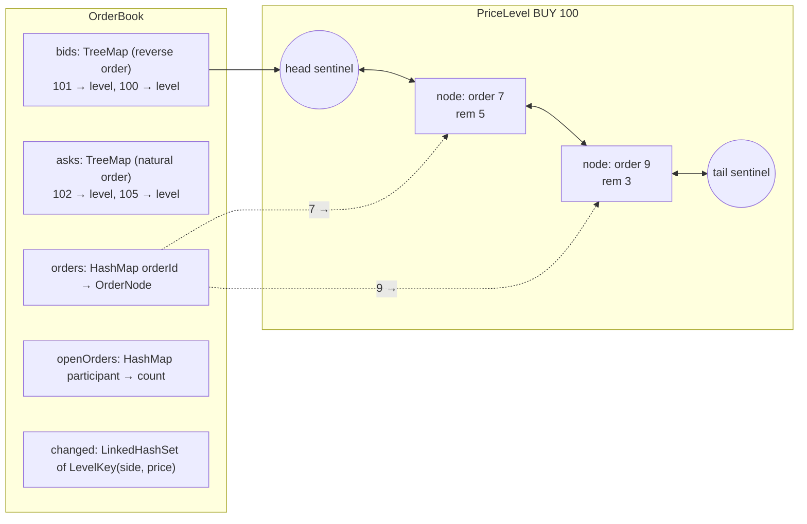

## Responsibility

| Type | What it is | Visibility |
|---|---|---|
| `OrderBook` | Owns the lifecycle of every resting order (Spec D1); the only mutator of levels | public class |
| `PriceLevel` | Orders at one price on one side, in time priority. **Public getters only; every mutator is package-private** | public class |
| `OrderNode` | One list node: `order`, `prev`, `next`, `level` | package-private class |
| `Fill` | Immutable record of what `fillBest` did to one resting order | public record |
| `LevelUpdate` | Immutable record: one level's state after a command (level-2 market data); volume 0 = gone | public record |
| `CancelResult` / `CancelStatus` | Outcome of a cancel: `CANCELLED` (with quantity) or `UNKNOWN_ORDER` | public record / enum |
| `RestingOrderView` | Immutable copy of one resting order (id, owner, client order id, side, type, price, original and filled quantity, timestamp) | public record |

"Level-2 market data" (L2) means aggregated volume per price level, as opposed to individual orders.

## Public interface and who calls it

| Member | Visibility | Called by |
|---|---|---|
| `OrderBook.add(Order)` | public | `MatchingEngine.process` (rests a LIMIT/POST_ONLY remainder), `MatchingEngine.restore` (reloads a snapshot's orders) |
| `OrderBook.fillBest(Side, maxQty) → Fill` | public | `MatchingEngine.process` (the match loop) |
| `OrderBook.cancel(participant, orderId) → CancelResult` | public | `MatchingEngine.onCancel`, `MatchingEngine.onCancelAll` (once per collected id) |
| `OrderBook.drainLevelUpdates()` | public | `MatchingEngine.onNewOrder` / `onCancel` / `onCancelAll` (once per command), `restore` (to discard the reload's updates) |
| `OrderBook.bestLevel(Side)` | public | `MatchingEngine.process` (match loop, post-only check), `MatchingEngine.matchLimit` (the touch, D66); `MatchingBenchmark` |
| `OrderBook.levels(Side)` | public | `MatchingEngine.levels` (snapshot) |
| `OrderBook.walk(Side, Predicate<RestingOrderView>)` | public | `MatchingEngine.fillability` (self-trade-aware FOK/cap check, D67/D68), `MatchingEngine.onCancelAll` (D72), `restingOrders` |
| `OrderBook.restingOrders()` | public | `MatchingEngine.exportState` (snapshots, D71) |
| `OrderBook.headParticipant(Side)` | public | `MatchingEngine.process` (self-trade check in the match loop, D67) |
| `OrderBook.openOrders(participant)` | public | `MatchingEngine.process` (participant cap) |
| `OrderBook.restingOrderCount()` | public | `MatchingEngine(OrderBook)` constructor (must be 0), `MatchingEngine.process` (`BOOK_FULL` cap, D68) |
| `volumeAt`, `levelCount`, `isResting` | public | tests only **[Verified]** by grep |
| `OrderBook.ordersAt`, `checkInvariants()` | package-private | tests only (test seams) |
| `PriceLevel.getSide/getPrice/getTotalVolume/getOrderCount/isEmpty` | public | engine (read-only) and `OrderBook` |
| `PriceLevel.addOrder/headNode/nextNode/fillHead/unlink` | package-private | `OrderBook` only |

Because the engine is in another package, the compiler stops it from calling `PriceLevel` mutators. That is the
"ownership enforced by packages" rule from `CLAUDE.md`. **[Verified]** Spec D44.

## The invariants

The class comment lists them, and `checkInvariants()` re-derives them from scratch:

```java
// src/main/java/exchangeserver/book/OrderBook.java:23-28 (trimmed comment)
Every mutation goes through four methods (add, fillBest, cancel, and the private removeNode they share), so
these invariants have exactly one place to hold:
1. An id is in `orders` iff its order is linked in a level.
2. No empty level is ever left in `bids` or `asks` (eager removal, D10).
3. openOrders.get(p) == number of resting orders owned by p (absent when 0).
4. Every level touched since the last drainLevelUpdates() is in `changed`.
```

```java
// src/main/java/exchangeserver/book/PriceLevel.java:20-25 (comment)
1. totalVolume == sum of remaining quantity over the linked nodes.
2. orderCount  == number of linked nodes.
3. node.level == this  <=>  node is linked in this level.
4. Every linked order has remaining > 0, except the head between fillHead() exhausting it and
   OrderBook unlinking it (both inside one OrderBook.fillBest call).
```

Plus, from `checkInvariants` (`OrderBook.java:226-267`): levels are strictly ordered on each side, and the book
is never **crossed**, meaning the best bid is below the best ask. **[Verified]** The "never crossed" invariant
holds because the engine always matches before resting; the book itself does not enforce it on `add`.
**[Inferred]** from reading `add`, which has no cross check.

## Internal walkthrough: `PriceLevel`

### Construction and the sentinels

```java
// src/main/java/exchangeserver/book/PriceLevel.java:28-41 (trimmed)
public final class PriceLevel {
    private final Side side;
    private final long price;
    private final OrderNode head = OrderNode.sentinel();
    private final OrderNode tail = OrderNode.sentinel();
    private long totalVolume;
    private int orderCount;

    PriceLevel(Side side, long price) {
        this.side = side;
        this.price = price;
        head.next = tail;
        tail.prev = head;
    }
```

```java
// src/main/java/exchangeserver/book/OrderNode.java:18-35 (trimmed)
final class OrderNode {
    final Order order;
    OrderNode prev;
    OrderNode next;
    PriceLevel level;

    OrderNode(Order order) {
        this.order = Objects.requireNonNull(order, "A real node must wrap an order");
    }
    private OrderNode() { this.order = null; }
    static OrderNode sentinel() { return new OrderNode(); }
}
```

`order == null` holds **if and only if** the node is a sentinel. That is enforced by construction: the
real-node constructor rejects null, and sentinels can only come from `sentinel()`. **[Verified]**
`OrderNode.java:12-13, 24-34`. Every real linked node therefore has a non-null `prev` and `next`, at worst a
sentinel, which is why link and unlink have no `if (node == head)` branches.

### `addOrder`: append at the tail, checks first

```java
// src/main/java/exchangeserver/book/PriceLevel.java:64-87
OrderNode addOrder(Order order) {
    // All checks before any mutation.
    if (order.getSide() != side || order.getPrice() != price) { throw new IllegalStateException(...); }
    if (order.getRemainingQuantity() <= 0) { throw new IllegalStateException(...); }
    if (order.getRemainingQuantity() > Long.MAX_VALUE - totalVolume) { throw new IllegalStateException(...); }

    OrderNode node = new OrderNode(order);
    OrderNode last = tail.prev;
    node.prev = last;
    node.next = tail;
    last.next = node;
    tail.prev = node;
    node.level = this;

    totalVolume += order.getRemainingQuantity();
    orderCount++;
    return node;
}
```

- It returns the node so `OrderBook` can store it in the id map. **[Verified]**
- It adds the order's *remaining* quantity, not the original. A partially filled incoming order that rests adds
  only what is left (`PriceLevelTest.addsRemainingNotOriginalQuantity`). **[Verified]**
- **Overflow guard.** It makes sure `totalVolume` can never wrap round. **[Verified]** **[Inferred]** It is
  practically unreachable, since at most 10,000 orders per participant × 1e9 each per participant. Spec §7 lists
  the related `<=`/`<` mutant as equivalent.

### `fillHead`: fill, never remove

```java
// src/main/java/exchangeserver/book/PriceLevel.java:104-121
long fillHead(long maxQuantity) {
    if (maxQuantity <= 0) { throw new IllegalArgumentException("Fill quantity must be positive"); }
    OrderNode first = headNode();
    if (first == null) { throw new IllegalStateException("Fill on empty level " + side + " " + price); }
    Order order = first.order;
    if (order.getRemainingQuantity() == 0) { throw new IllegalStateException("Exhausted order ... left at the head ..."); }

    long quantity = Math.min(order.getRemainingQuantity(), maxQuantity);
    order.fill(quantity);
    totalVolume -= quantity;
    return quantity;
}
```

It fills the head order by `min(remaining, maxQuantity)` and subtracts that from `totalVolume`, but **does not
unlink an exhausted head**: "that is OrderBook's job, so the id map and the list change together" (Spec D3).
**[Verified]** This leaves a deliberate, short window where invariant 4 is broken: the head has remaining 0. The
window closes inside the same `OrderBook.fillBest` call (below).

### `unlink`: O(1) removal, shared by fills and cancels

```java
// src/main/java/exchangeserver/book/PriceLevel.java:124-142
void unlink(OrderNode node) {
    if (node.order == null) { throw new IllegalStateException("Cannot unlink a sentinel"); }
    if (node.level != this) { throw new IllegalStateException("Order ... is not linked in level ..."); }

    node.prev.next = node.next;
    node.next.prev = node.prev;

    // 0 for a filled order (fillHead already subtracted it); the live remainder for a cancel.
    totalVolume -= node.order.getRemainingQuantity();
    orderCount--;

    node.prev = null;
    node.next = null;
    node.level = null;
}
```

The key arithmetic is `totalVolume -= remaining`:
- For a **fill-removal**, `fillHead` already subtracted the filled quantity and the remaining is 0, so this
  subtracts 0.
- For a **cancel**, the remaining is still on the books, so this subtracts it.

One line serves both paths (Spec D2). **[Verified]** Nulling the links (Spec D8) makes a second `unlink` of the
same node fail loudly (`node.level != this`), and so does unlinking a node from another level.
`PriceLevelTest.Unlink.refusesASecondUnlink`, `refusesANodeFromAnotherLevel` and `refusesASentinel` cover this.
**[Verified]**

## Internal walkthrough: `OrderBook`

### `add`: all-or-nothing

```java
// src/main/java/exchangeserver/book/OrderBook.java:49-74
public void add(Order order) {
    if (!order.getOrderType().canRest()) { throw new IllegalStateException("A " + ... + " order never rests: " ...); }
    if (order.getRemainingQuantity() <= 0) { throw new IllegalStateException(... "has nothing left to rest"); }
    if (orders.containsKey(order.getOrderId())) { throw new IllegalStateException("Duplicate order id " ...); }  // D15

    TreeMap<Long, PriceLevel> side = sideOf(order.getSide());
    PriceLevel level = side.get(order.getPrice());
    boolean newLevel = level == null;
    if (newLevel) {
        level = new PriceLevel(order.getSide(), order.getPrice());
    }
    OrderNode node = level.addOrder(order);         // throws before linking anything
    if (newLevel) {
        side.put(order.getPrice(), level);          // only now: a failed add must not leave an empty level
    }

    orders.put(order.getOrderId(), node);
    openOrders.merge(order.getParticipant(), 1, Integer::sum);
    changed.add(new LevelKey(order.getSide(), order.getPrice()));
}
```

The **ordering** is the point. A new level is created but put into the tree only *after* `addOrder` succeeded.
If `addOrder` threw (wrong price, overflow), the tree would otherwise keep an empty level and break invariant 2.
After `addOrder` returns, the remaining statements (`put`, `merge`, `add`) cannot fail on valid state.
**[Verified]** `OrderBookTest.Add.duplicateIdThrowsAndChangesNothing`, `refusesTypesThatNeverRest` and
`refusesAnExhaustedOrder`. **[Inferred]** Only an `OutOfMemoryError` could interrupt them, and an `Error` halts
the exchange anyway.

### `fillBest`: fill, remove the exhausted order, remove an emptied level

```java
// src/main/java/exchangeserver/book/OrderBook.java:78-95
public Fill fillBest(Side side, long maxQuantity) {
    Map.Entry<Long, PriceLevel> best = sideOf(side).firstEntry();
    if (best == null) { throw new IllegalStateException("Fill on empty side " + side); }
    PriceLevel level = best.getValue();
    OrderNode head = level.headNode();
    Order order = head.order;

    long quantity = level.fillHead(maxQuantity);
    changed.add(new LevelKey(side, level.getPrice()));
    if (order.getRemainingQuantity() == 0) {
        removeNode(head);
    }

    return new Fill(order.getOrderId(), order.getParticipant(), order.getClientOrderId(), side,
            level.getPrice(), quantity, order.getRemainingQuantity());
}
```

Line by line:
1. `side` is the side **of the book being hit**, the resting side, not the incoming order's side. The comment
   on `bestLevel` says the same (`OrderBook.java:178`). **[Verified]**
2. It remembers `head` and `order` before filling, because the head may be unlinked during the call.
3. `fillHead` fills; then, if the order is exhausted, `removeNode` unlinks it, drops it from the id map,
   decrements the owner's open-order count, and drops the level if it emptied. That closes the invariant-4 window
   inside this one call (Spec D4 revised by D44). **[Verified]**
4. It returns an **immutable copy** (`Fill`), so the engine learns the resting order's id, owner, client order
   id, price, filled quantity and leaves (what is left) without ever holding the `Order` object that sits in the
   book. **[Verified]** `Fill.java:5-9`. `level.getPrice()` is still valid after the level left the tree, because
   the object still exists.

### `cancel`: owner-only, unknown otherwise

```java
// src/main/java/exchangeserver/book/OrderBook.java:98-108
public CancelResult cancel(String participant, long orderId) {
    OrderNode node = orders.get(orderId);
    if (node == null || !node.order.getParticipant().equals(participant)) {
        return CancelResult.unknown(orderId);
    }
    long remaining = node.order.getRemainingQuantity();
    changed.add(new LevelKey(node.order.getSide(), node.order.getPrice()));
    removeNode(node);
    return CancelResult.cancelled(orderId, remaining);
}
```

- Someone else's order looks exactly like a missing one: the result is `UNKNOWN_ORDER`, never a "not owner"
  status. A distinct status would let any participant probe which order ids are live (Spec D48). **[Verified]**
- `UNKNOWN_ORDER` is a normal return value, not an exception, because racing a fill is ordinary: you cancel an
  order that just filled (Spec D17). **[Verified]** `CancelResult.java:5`.
- An unknown cancel touches no level, so no level update is produced
  (`OrderBookTest.LevelUpdates.unknownCancelTouchesNothing`). **[Verified]**

### `removeNode`: the single removal path

```java
// src/main/java/exchangeserver/book/OrderBook.java:111-128
private void removeNode(OrderNode node) {
    Order order = node.order;
    PriceLevel level = node.level;
    if (level == null || orders.get(order.getOrderId()) != node) {
        throw new IllegalStateException("Order " + order.getOrderId() + " is not resting");
    }
    level.unlink(node);
    orders.remove(order.getOrderId());
    openOrders.computeIfPresent(order.getParticipant(), (p, n) -> n == 1 ? null : n - 1);

    if (level.isEmpty()) {
        PriceLevel removed = sideOf(level.getSide()).remove(level.getPrice());
        if (removed != level) {
            throw new IllegalStateException("Removed the wrong level at " + ...);   // D18
        }
    }
}
```

- **One path for fills and cancels** (Spec D2), so invariants 1–3 are maintained in exactly one place.
- `computeIfPresent` returning `null` removes the map entry when the count reaches zero, which keeps invariant 3
  ("absent when 0"). **[Verified]**
- **Eager level removal** (Spec D10, D14). An emptied level leaves the tree immediately. **D18:** it checks that
  `TreeMap.remove` returned *this* level object, as a guard against a corrupted tree. **[Verified]**

### `drainLevelUpdates`: deterministic L2 output

```java
// src/main/java/exchangeserver/book/OrderBook.java:131-144
public List<LevelUpdate> drainLevelUpdates() {
    if (changed.isEmpty()) {
        return List.of();
    }
    List<LevelUpdate> updates = new ArrayList<>(changed.size());
    for (LevelKey key : changed) {
        PriceLevel level = sideOf(key.side()).get(key.price());
        updates.add(level == null
                ? new LevelUpdate(key.side(), key.price(), 0, 0)
                : new LevelUpdate(key.side(), key.price(), level.getTotalVolume(), level.getOrderCount()));
    }
    changed.clear();
    return updates;
}
```

- `changed` is a `LinkedHashSet<LevelKey>`, so each touched level appears **once**, in the order it was **first**
  touched. Iteration order is insertion order, never hash order, which keeps outputs deterministic across runs
  and replays. **[Verified]** `OrderBook.java:45-46`. A plain `HashSet` would iterate in an order that depends on
  hash codes; still repeatable in practice for these keys, but the code avoids relying on that. **[Inferred]**
- The update carries the **absolute** state after the command (not a delta); a vanished level is reported as
  volume 0, orders 0 (`LevelUpdate.java:7`). **[Verified]**
- The engine drains once per command, so every output's level updates belong to that command only. **[Verified]**
  `MatchingEngine.onNewOrder`/`onCancel`.

### Read walks: `walk`, `restingOrders`, `headParticipant`

Self-trade prevention, cancel-all and snapshots need to see *individual* resting orders (who owns the next order
in line, which orders belong to one participant, every order in priority order). The engine must not hold the
`Order` objects that live in the book, so the book hands out copies.

```java
// src/main/java/exchangeserver/book/OrderBook.java:146-176
// Visits the resting orders of `side` in priority order (best level first, time priority within a level) until
// the visitor returns false. Read-only: the visitor gets copies. Deterministic: it walks the levels, never a
// hash map.
public void walk(Side side, Predicate<RestingOrderView> visitor) {
    for (PriceLevel level : sideOf(side).values()) {
        for (OrderNode n = level.headNode(); n != null; n = level.nextNode(n)) {
            if (!visitor.test(view(n.order))) {
                return;
            }
        }
    }
}

// Every resting order: bids best first, then asks best first, each level in time priority.
public List<RestingOrderView> restingOrders() {
    List<RestingOrderView> all = new ArrayList<>(orders.size());
    walk(Side.BUY, all::add);
    walk(Side.SELL, all::add);
    return all;
}

// The owner of the order that would trade next on `side`, or null if that side is empty (D67).
public String headParticipant(Side side) {
    Map.Entry<Long, PriceLevel> best = sideOf(side).firstEntry();
    return best == null ? null : best.getValue().headNode().order.getParticipant();
}

private static RestingOrderView view(Order o) {
    return new RestingOrderView(o.getOrderId(), o.getParticipant(), o.getClientOrderId(), o.getSide(),
            o.getOrderType(), o.getPrice(), o.getOriginalQuantity(), o.getFilledQuantity(), o.getTimestamp());
}
```

```java
// src/main/java/exchangeserver/book/PriceLevel.java:94-100
// The node after `node` in time priority, or null at the end. `node` must be linked here.
OrderNode nextNode(OrderNode node) {
    if (node.level != this) {
        throw new IllegalStateException("Order " + node.order.getOrderId() + " is not linked in level " + side + " " + price);
    }
    return node.next == tail ? null : node.next;
}
```

Line by line:
1. **Priority order.** The outer loop walks the `TreeMap` values (best price first, because the bid map is
   reversed); the inner loop follows `next` pointers from the head (time priority). That is exactly the order in
   which the match loop would meet the orders. **[Verified]** `OrderBookTest.Walk.visitsInPriorityOrderAndStopsWhenAsked`.
2. **Stop early.** A visitor that returns `false` ends the walk at once, so the engine's fillability check stops
   at the first non-crossing level or at the participant's own order without visiting the rest. **[Verified]**
3. **Deterministic.** It iterates the levels and the lists, never the `orders` `HashMap`. Cancel-all and the
   snapshot file therefore list orders in the same order on every run and every replay (D12). **[Verified]** by the
   comment and the code. `MatchingEngine.onCancelAll` relies on this for the order of its level updates.
4. **Copies, not handles.** Each visit builds a new `RestingOrderView`; `view` reads the order's fields, and
   `RestingOrderView.remainingQuantity()` derives the remainder (`RestingOrderView.java:17-19`). **[Verified]**
   The cost is one small allocation per visited order, which is fine for the occasional walk (FOK, a cap check,
   cancel-all, compaction), not for the hot match loop, which uses `headParticipant` instead. **[Inferred]**
5. **Do not mutate while walking.** The walk follows live `next` pointers. A visitor that cancelled orders would
   unlink nodes under the iteration. `onCancelAll` therefore collects ids first and cancels afterwards (guide
   07-modules/engine). **[Inferred]** from the code; nothing enforces it.
6. **`nextNode` guards foreign nodes** like `unlink` does: a node linked elsewhere (or not at all) fails loudly
   instead of walking another list. **[Verified]** `PriceLevelTest.nextNodeWalksInTimePriorityAndRefusesForeignNodes`.
7. **`restingOrders`: bids, then asks.** That is the order of the ORDER lines in a snapshot file; reloading them
   in this order through `add` rebuilds every level in time priority (guide 07-modules/engine, `restore`).
   **[Verified]** `OrderBookTest.Walk.restingOrdersAreCopiesBidsFirst` (it also checks the filled quantity of a
   partly filled order).
8. **`headParticipant` is O(log L)**, the same cost as `bestLevel`, and allocates nothing. It returns `null` for an
   empty side (`OrderBookTest.Walk.headParticipantIsWhoTradesNext`). **[Verified]**

### Read-only views

`levels(side)` returns `Collections.unmodifiableCollection(sideOf(side).values())`: best first, and removal
through the view is rejected. `PriceLevel` exposes no public mutators, so the view is read-only twice over.
**[Verified]** `OrderBook.java:185-187`; `OrderBookTest.levelViewsAreReadOnly`. It is a *live* view, not a copy.
**[Inferred]** Iterating it while the book changes would be unsafe, but only the writer thread ever does either.

## Worked example

The bids at 100 hold order 7 (alice, 5 left) then order 9 (bob, 3 left), so `totalVolume = 8` and
`orderCount = 2`. An incoming SELL IOC for 6 at 100 arrives.

| Step | Call | Effect |
|---|---|---|
| 1 | `fillBest(BUY, 6)` | head = order 7; `fillHead(6)` fills `min(5,6)=5`; totalVolume 8→3; `changed += (BUY,100)`; order 7 has 0 left → `removeNode`: `unlink` subtracts 0 (totalVolume stays 3), count 2→1; id 7 leaves the map; alice's count drops (entry removed if it was 1); level not empty. Returns `Fill(7, alice, …, 100, qty 5, leaves 0)` |
| 2 | `fillBest(BUY, 1)` | head = order 9; fills 1; totalVolume 3→2; order 9 has 2 left, stays. Returns `Fill(9, bob, …, 100, qty 1, leaves 2)` |
| 3 | `drainLevelUpdates()` | `[LevelUpdate(BUY, 100, 2, 1)]` (one entry although touched twice) |
| 4 | later, `cancel("bob", 9)` | `changed += (BUY,100)`; `removeNode`: `unlink` subtracts the live remainder 2 → 0, count 0; level empty → removed from the tree (D18 check). Returns `CANCELLED, qty 2` |
| 5 | `drainLevelUpdates()` | `[LevelUpdate(BUY, 100, 0, 0)]`: the level is gone |

**[Verified]** by tracing the code. Compare `OrderBookTest.FillBest.exhaustedOrderAndEmptiedLevelLeaveTheBook`
and `LevelUpdates.removedLevelReportsZero`.

```mermaid
sequenceDiagram
    participant E as MatchingEngine
    participant B as OrderBook
    participant L as PriceLevel (BUY 100)
    E->>B: fillBest(BUY, 6)
    B->>L: headNode() → node(7)
    B->>L: fillHead(6)
    L-->>B: 5 (order 7 now has 0 left; still linked)
    B->>B: changed.add(BUY,100)
    B->>B: removeNode(node 7)
    B->>L: unlink(node 7)  (totalVolume -= 0)
    B->>B: orders.remove(7); openOrders--; level empty? no
    B-->>E: Fill(7, alice, ..., qty 5, leaves 0)
```

## Complexity

**[Verified]** from the class comment (`OrderBook.java:32-33`) and Spec D59:

| Operation | Cost |
|---|---|
| add | O(log L): tree lookup for the level, where L = levels on that side |
| cancel / fill-removal of a node | O(1), plus O(log L) when the level empties |
| best-level lookup | O(log L); measured at 8–18 ns from 10 to 100,000 levels, under 2% of a ~1 µs command, so no cached pointer (D59) |

## Dependencies in and out

```mermaid
flowchart LR
    domain["domain: Order, Side, OrderType"] --> book
    book["book: OrderBook, PriceLevel, OrderNode,<br/>Fill, LevelUpdate, CancelResult, CancelStatus, RestingOrderView"]
    book --> engine["engine.MatchingEngine (only production caller of OrderBook)"]
    book --> core["core.Snapshot / OutputDigest / OutputLog (RestingOrderView, CancelResult, LevelUpdate)"]
    book --> gw["gateway.Protocol (formats CancelResult, LevelUpdate)"]
    book --> bench["bench.MatchingBenchmark (bestLevel)"]
```

**[Verified]** `book` imports only `domain` and the JDK. `LevelUpdate`, `CancelResult` and `CancelStatus` also
travel outwards inside engine outputs to the gateway; `RestingOrderView` travels inside `EngineState` into the
snapshot file (`core.Snapshot`).

## How it's tested

| Test class | Groups | Highlights |
|---|---|---|
| `book/PriceLevelTest` (22 tests) | `AddOrder`, `FillHead`, `Unlink` (middle, head, tail-then-append, only node, filled order subtracts nothing, links cleared, second unlink refused, foreign node refused, sentinel refused), `nextNodeWalksInTimePriorityAndRefusesForeignNodes`, `realNodeNeedsAnOrder` | Every link/unlink edge, the `totalVolume` arithmetic, the walk step |
| `book/OrderBookTest` (24 tests) | `Add`, `FillBest`, `Cancel` (incl. `cancelInTheMiddleKeepsTimePriority`), `OpenOrders`, `LevelUpdates`, `Walk` (priority order and early stop; copies with bids first and the filled quantity; `headParticipant`), `levelViewsAreReadOnly`, `InvariantsUnderRandomTraffic` | Public behaviour and invariants |

The flagship test is `InvariantsUnderRandomTraffic.tenThousandRandomCommands`
(`src/test/java/exchangeserver/book/OrderBookTest.java:295-335`). **[Verified]** For 3 seeds × 10,000 commands
(30,000 in total):
- it drives a real `MatchingEngine` with random order types, sides and prices in 95–105;
- about a quarter of the commands are cancels; a fifth of those are sent by a randomly chosen participant (usually
  not the owner);
- after **every** command it calls `checkInvariants()` and asserts that traded quantity equals passive-fill
  quantity.

`checkInvariants()` and `ordersAt()` are package-private test seams. `ordersAt` walks each level forwards and
backwards and fails if the two walks disagree, which catches broken `prev` pointers. **[Verified]**
`OrderBook.java:211-223`. The package is under PIT mutation testing; Spec §7 lists the surviving `book` mutants
as equivalent or test-support only. **[Verified]**

## Key takeaways

- Each side is a `TreeMap` keyed by price (bids reversed), so `firstEntry()` is always the best level; each level
  is a sentinel-bounded doubly linked list in time priority.
- The engine can **read** levels but cannot **change** them: `PriceLevel` mutators are package-private (D44).
- All mutation goes through `add`, `fillBest` and `cancel`, and all removal through `removeNode` (D2), so each
  invariant has one place to hold.
- `fillHead` never removes; `fillBest` removes an exhausted order and an emptied level in the same call (D3, D4/D44).
- `unlink` subtracts the remaining quantity: 0 for a filled order, the live remainder for a cancel.
- `add` is all-or-nothing: a new level enters the tree only after the order was linked.
- Cancel is owner-only, and someone else's order reads as `UNKNOWN_ORDER` (D48).
- Level updates are drained once per command, deduplicated, in first-touched order (`LinkedHashSet`), as absolute
  values.
- To look at individual orders the engine gets **copies** (`RestingOrderView`) from `walk`/`restingOrders`, in
  priority order, or just the next owner from `headParticipant`; never the live `Order`.

## Common confusions

- **"`fillBest(side, …)` takes the incoming order's side."** No: it takes the side of the book being filled.
  The engine passes `order.getSide().opposite()`.
- **"Cancelling subtracts twice from `totalVolume`."** No. For a cancel, `fillHead` never ran, so `unlink`'s
  subtraction of the remainder is the only one.
- **"The book prevents crossing."** It doesn't check. The engine never rests an order that still crosses, and
  `checkInvariants` (tests) verifies the outcome.
- **"`LevelUpdate` is a delta."** It is the absolute state of the level after the command; 0 means gone.
- **"`levels()` returns a copy."** It's a live, unmodifiable view.
- **"`walk` lets the engine change orders it visits."** No: each visit gets a fresh `RestingOrderView` copy. And
  a visitor must not change the book either (cancel-all collects ids first).
- **"`restingOrders()` iterates the id map."** No: it walks the levels (bids, then asks), so its order is the book
  priority order, the same on every run.

## Questions to test yourself

1. Why does `OrderBook.add` put a new `PriceLevel` into the tree only after `addOrder` returns?
   <details><summary>Answer</summary>If `addOrder` threw (wrong price/side, exhausted order, overflow), a level already in the tree would be empty, breaking "no empty levels". Putting it in last makes `add` all-or-nothing.</details>
2. A level holds one order with 4 left. `fillBest` fills 4. Trace `totalVolume` through `fillHead` and `unlink`.
   <details><summary>Answer</summary>4 → 0 in `fillHead` (subtracts the filled 4). `unlink` subtracts the remaining, which is now 0, so it stays 0. Then the empty level is removed from the tree.</details>
3. Bob cancels Alice's resting order 12. What does he get, and why not a "not owner" reply?
   <details><summary>Answer</summary>`CancelResult(UNKNOWN_ORDER, 12, 0)`. A distinct status would reveal which ids are live to any participant; the caller's next action is the same either way (D48).</details>
4. One command touches BUY 100, then SELL 101, then BUY 100 again. What does `drainLevelUpdates` return, and in what order?
   <details><summary>Answer</summary>Two updates, BUY 100 then SELL 101 (first-touched order, deduplicated by the `LinkedHashSet`), each with the level's absolute volume and order count after the command (0/0 if it emptied).</details>
5. When is invariant 4 ("every linked order has remaining > 0") temporarily false?
   <details><summary>Answer</summary>Inside one `OrderBook.fillBest` call, between `PriceLevel.fillHead` exhausting the head and `removeNode` unlinking it.</details>
6. What does the D18 check in `removeNode` protect against?
   <details><summary>Answer</summary>Against removing the wrong object from the tree: it asserts `TreeMap.remove(price)` returned exactly the level being emptied, failing loudly if the tree and the level disagree.</details>
7. Asks: 100 → [x (2), alice (3)], 101 → [y (5)]. In what order does `walk(SELL, …)` visit them, and what does `headParticipant(SELL)` return?
   <details><summary>Answer</summary>x, alice, y (best price first, time priority within it); `headParticipant(SELL)` is "x", the owner of the head of the best level.</details>
8. Why does `walk` hand out `RestingOrderView` copies instead of the `Order` objects?
   <details><summary>Answer</summary>The engine must never hold an object that sits in the book (the same reason `fillBest` returns a `Fill`): it could change it behind the book's invariants. Copies keep ownership with the book (D44).</details>


---

<a id="guide-07-modules-engine"></a>

<!-- source: docs/understanding/07-modules/engine.md -->

# 07 — Module: engine

> **Project:** ExchangeServer2 | Single-instrument limit order book: price-time matching engine, write-ahead journal with replay, single writer thread, TCP/TLS gateway with authenticated participants | Stack: Java 17, Maven wrapper, JUnit 5 (+ JMH, PIT)
> **This guide:** the matching engine (`MatchingEngine`): how it processes new orders, cancels and cancel-alls, its risk checks and self-trade prevention, state export/restore for snapshots, and the output types it produces (`Response`, `Reason`, `Trade`, `Execution`, `EngineOutput`/`OrderOutput`/`CancelOutput`/`CancelAllOutput`, `OrderStatus`, `BookSnapshot`, `EngineState`) | **Prerequisites:** 01, 07-modules/domain-and-commands, 07-modules/book | **Related:** 05, 06, 07-modules/exchange-and-replay, 07-modules/gateway, 09
> **Repo layout summary:** `pom.xml` + Maven wrapper (`mvnw`, `mvnw.cmd`) at the root; production code in `src/main/java/exchangeserver/` (packages `domain`, `book`, `engine`, `command`, `journal`, `core`, `gateway`, `client`, plus `Main`); tests mirror it in `src/test/java/exchangeserver/` (plus `bench/` JMH benchmarks and `testing/MutableClock`); design docs in `docs/` (`ExchangeServer2_Vision.md` = purpose/roadmap, `ExchangeServer2_Spec.md` = decisions D1–D77); these guides in `docs/understanding/`.

## Overview

`MatchingEngine` implements **price-time-priority matching** for one instrument. An incoming order trades
against the best opposite price first, and within a price against the oldest resting order first.

It decides *what* a match means. The book (guide 07-modules/book) carries it out. **[Verified]**
`src/main/java/exchangeserver/engine/MatchingEngine.java:27`.

The engine's contract with the rest of the system is **determinism**. Its behaviour depends only on the commands
it is given, in order:
- no clock;
- no counter of its own (ids, sequence numbers and timestamps all arrive inside the command);
- no randomness;
- no reliance on hash-iteration order (its `HashMap` is only looked up; anything it iterates is walked through
  the book's levels).

**[Verified]** `MatchingEngine.java:29-30`, Spec D12. Determinism is what makes **replay** work: on restart the
same journalled commands are fed through a fresh engine and must rebuild the identical book, and since D70 the
replay must also reproduce a digest of every output the live run wrote (guide 07-modules/exchange-and-replay).

It has three command entry points, each returning an **output** record:
- `onNewOrder(NewOrderCommand) → OrderOutput` holds the submitter's `Response`, the **passive fills** (fills on
  resting orders, addressed to their owners) and the **level updates** (L2 market data).
- `onCancel(CancelOrderCommand) → CancelOutput` holds the `CancelResult` and the level updates.
- `onCancelAll(CancelAllCommand) → CancelAllOutput` (Spec D72) holds one `CancelResult` per cancelled order and
  the level updates.

`snapshot(depth)` is a read. `exportState()` and the static `restore(EngineState)` move the engine's whole state
into and out of a snapshot file (Spec D71).

```mermaid
classDiagram
    direction LR
    class MatchingEngine {
      -OrderBook book
      -Limits limits
      -Map~ClientOrderKey,Long~ orderIdByClientOrderId
      -long lastOrderId
      -long lastSequenceNumber
      -long lastTradePrice
      +onNewOrder(NewOrderCommand) OrderOutput
      +onCancel(CancelOrderCommand) CancelOutput
      +onCancelAll(CancelAllCommand) CancelAllOutput
      +snapshot(int) BookSnapshot
      +exportState() EngineState
      +restore(EngineState)$ MatchingEngine
    }
    class EngineOutput { <<sealed>> sequenceNumber(); timestamp(); trades(); passiveFills(); levelUpdates() }
    class OrderOutput { <<record>> response; passiveFills; levelUpdates }
    class CancelOutput { <<record>> result: CancelResult; levelUpdates }
    class CancelAllOutput { <<record>> participant; results; levelUpdates }
    class Response { <<record>> orderId; clientOrderId; status; reason; filled; remaining; trades }
    class Reason { <<enum>> 5 rejects + SELF_TRADE_PREVENTED; isReject() }
    class Trade { <<record>> price; quantity; buyOrderId; sellOrderId; aggressorSide; timestamp }
    class Execution { <<record>> participant; orderId; clientOrderId; side; price; quantity; leaves }
    class BookSnapshot { <<record>> sequenceNumber; lastTradePrice; bids; asks }
    class EngineState { <<record>> lastSequenceNumber; lastOrderId; lastTradePrice; orders }
    EngineOutput <|.. OrderOutput
    EngineOutput <|.. CancelOutput
    EngineOutput <|.. CancelAllOutput
    OrderOutput --> Response
    OrderOutput --> Execution
    Response --> Trade
    Response --> Reason
    MatchingEngine --> OrderOutput
    MatchingEngine --> CancelOutput
    MatchingEngine --> CancelAllOutput
    MatchingEngine --> BookSnapshot
    MatchingEngine --> EngineState
```

## Responsibility

- Turn each `NewOrderCommand` into an outcome. The four outcomes are `FILLED`, `RESTED`, `CANCELLED` and
  `REJECTED` (Spec D23); the client's next action differs for each.
- Apply the **state-dependent** checks. These are journalled (the command is), so replay reproduces them
  (Spec D13). `Reason` lists five rejects and one cancel reason (`Reason.java:12-24`):
  - `DUPLICATE_CLIENT_ORDER_ID`, `PRICE_OUTSIDE_BAND`, `MAX_OPEN_ORDERS`, `BOOK_FULL` (D68),
    `POST_ONLY_WOULD_CROSS` → status `REJECTED`;
  - `SELF_TRADE_PREVENTED` (D67) → status `CANCELLED`.
- Never let a participant trade with itself (Spec D67).
- Guard its own inputs: reject a non-increasing order id or sequence number before any mutation (Spec D35).
- Produce everything a command caused, so the caller can route it and digest it.
- Export and restore its state for snapshots (Spec D71).

All **[Verified]**.

## Public interface and who calls it

| Member | Visibility | Called by |
|---|---|---|
| `new MatchingEngine()` | public | `Ledger.from` for an empty history (`src/main/java/exchangeserver/core/Ledger.java:38`), `restore`, tests |
| `MatchingEngine.restore(EngineState)` | public static | `Ledger.from` when the journal continues from a snapshot (`Ledger.java:38`) |
| `exportState()` | public | `Ledger.snapshot` for compaction (`Ledger.java:58`) |
| `new MatchingEngine(OrderBook)` | public | tests and `MatchingBenchmark` only; throws unless the book is empty |
| `MatchingEngine(OrderBook, Limits)` | package-private | tests only (the `Limits` seam) |
| `onNewOrder`, `onCancel`, `onCancelAll` | public | `Ledger.apply` (`Ledger.java:45`, `:47`, `:49`), used both live (`Exchange.process`) and in replay (`Replay.feed`) |
| `snapshot(depth)` | public | `Exchange.read` for a `Snapshot` request (`src/main/java/exchangeserver/core/Exchange.java:257`) |
| `lastTradePrice()`, `lastSequenceNumber()` | public | tests (grep) |
| `book()` | package-private | tests in `engine` only; "Reading it from another thread is a data race" |
| `matchLimit(Order)` | package-private | `process`; visible to tests |
| `crosses(side, limit, restingPrice)` | static, package-private | `process`, `fillability`; `MatchingEngineTest.crossesIsInclusiveOnBothSides` |

**[Verified]** by reading the call sites. Since D70 the engine is always wrapped in a `core.Ledger` (engine +
output digest + private-event log, rebuilt together; guide 07-modules/exchange-and-replay). The single-argument
constructor exists "for tests that inspect the book"; production uses the no-argument one, "so no caller keeps a
reference that could change the book behind the engine's back" (`MatchingEngine.java:67-71`).

## Internal walkthrough

### State, and the `Limits` seam

```java
// src/main/java/exchangeserver/engine/MatchingEngine.java:43-61
private record ClientOrderKey(String participant, String clientOrderId) {
}

// How much an order could trade right now, and whether its own resting order is in the way (D67).
private record Fillability(long quantity, boolean blockedBySelf) {
}

// The resting caps (D68). Always Rules' values in production; a smaller pair lets tests reach BOOK_FULL
// without a million orders.
record Limits(int maxOpenOrdersPerParticipant, int maxRestingOrders) {
    static final Limits RULES = new Limits(Rules.MAX_OPEN_ORDERS_PER_PARTICIPANT, Rules.MAX_RESTING_ORDERS);
}

private final OrderBook book;
private final Limits limits;
private final Map<ClientOrderKey, Long> orderIdByClientOrderId = new HashMap<>();
private long lastOrderId;
private long lastSequenceNumber;
private long lastTradePrice;        // 0 = no trade yet; the reference for the band and the collar
```

- `orderIdByClientOrderId` remembers every `(participant, clientOrderId)` used since the journal began, mapped to
  the order id it got. It grows with every new order, but **only until the next compaction**: after a snapshot the
  map holds just the resting orders' ids (Spec D71, which revises D49's "forever"). **[Verified]**
  `EngineState.java:9-11`, `restore` below.
- `lastTradePrice` is the reference for the price band and the market collar; 0 means "no trade yet".
  **[Verified]**
- **`Limits` is a test seam.** Production always uses `Limits.RULES` (the public constructors pass it,
  `MatchingEngine.java:69-71`). The package-private constructor lets `MatchingEngineTest.Caps` use
  `new Limits(2, 3)` to reach the per-participant and `BOOK_FULL` caps without a million orders. **[Verified]**
  Replay always uses `RULES`, so the seam cannot make a replay differ. **[Inferred]** from the call sites.

### `onNewOrder`, `onCancel`, `onCancelAll`

```java
// src/main/java/exchangeserver/engine/MatchingEngine.java:111-155
public OrderOutput onNewOrder(NewOrderCommand command) {
    // D35: catches any id reuse, including ids that already left the book. Before any mutation.
    if (command.orderId() <= lastOrderId) {
        throw new IllegalStateException("Order id " + command.orderId() + " is not above the last one, " + lastOrderId);
    }
    checkSequence(command.sequenceNumber());
    lastOrderId = command.orderId();
    lastSequenceNumber = command.sequenceNumber();

    Order order = new Order(command.orderId(), command.request(), command.timestamp());
    List<Execution> passiveFills = new ArrayList<>();
    Response response = process(order, passiveFills);
    return new OrderOutput(command.sequenceNumber(), command.timestamp(), response, passiveFills,
            book.drainLevelUpdates());
}

public CancelOutput onCancel(CancelOrderCommand command) {
    checkSequence(command.sequenceNumber());
    lastSequenceNumber = command.sequenceNumber();

    CancelResult result = book.cancel(command.participant(), command.orderId());
    return new CancelOutput(command.sequenceNumber(), command.timestamp(), result, book.drainLevelUpdates());
}

// Cancels every resting order of the participant, in book priority order (D72).
public CancelAllOutput onCancelAll(CancelAllCommand command) {
    checkSequence(command.sequenceNumber());
    lastSequenceNumber = command.sequenceNumber();

    List<Long> ids = new ArrayList<>();
    for (Side side : Side.values()) {
        book.walk(side, o -> {
            if (o.participant().equals(command.participant())) {
                ids.add(o.orderId());
            }
            return true;
        });
    }
    List<CancelResult> results = new ArrayList<>(ids.size());
    for (long id : ids) {
        results.add(book.cancel(command.participant(), id));
    }
    return new CancelAllOutput(command.sequenceNumber(), command.timestamp(), command.participant(), results,
            book.drainLevelUpdates());
}
```

- **Guards first.** An order id at or below the last one is rejected *before any mutation*. That also catches an
  id that already left the book, which the book's own duplicate check (`add`) cannot see. **[Verified]**
  `MatchingEngineTest.Guards.orderIdMustIncreaseAndAViolationChangesNothing`; `ReplayTest.Feed.reusedOrderIdIsCaughtByTheEngine`.
- Every command type checks its sequence number, `onCancelAll` included (`MatchingEngineTest.CancelAll.itsSequenceNumberMustIncreaseLikeAnyCommand`
  asserts the book is unchanged after the refusal). **[Verified]**
- These guards throw `IllegalStateException` (a bug or a corrupt journal, Spec D27), not a reject. **[Verified]**
- **[Inferred]** `lastOrderId`/`lastSequenceNumber` are advanced *before* `process` runs. If `process` then throws
  half-way (a poison pill), the engine is in an unknown state. That is exactly why the live path throws the whole
  ledger away and rebuilds a new one by replay (Spec D51; guide 07-modules/exchange-and-replay).
- Level updates are drained once per command, so each output carries exactly that command's L2 changes.
  **[Verified]**

**`onCancelAll`, line by line (D72):**
1. It walks bids then asks (`Side.values()` is `BUY, SELL`) and collects the ids of the participant's resting
   orders. `book.walk` visits in **book priority** (best price first, time priority within it), so the result
   order is deterministic and the same on replay. **[Verified]** guide 07-modules/book.
2. Only *then* does it cancel each id. Cancelling inside the walk would unlink the nodes the walk is following;
   collecting first keeps the walk read-only. **[Inferred]** from the code shape.
3. Each `book.cancel(participant, id)` goes through the normal owner-checked cancel, so every result is
   `CANCELLED` with the remainder. Level updates accumulate in the book's `changed` set and are drained once, in
   first-touched order. **[Verified]**
   `MatchingEngineTest.CancelAll.cancelsOnlyThatParticipantsOrdersInBookPriority`: with a's orders at bid 100, bid
   99 and ask 101 (and b's at bid 99), the results come back as ids 4 (bid 100), 1 (bid 99), 3 (ask 101), b's order
   stays, and the updates are `(BUY,100,0,0)`, `(BUY,99,2,1)`, `(SELL,101,0,0)`.
4. A participant with nothing resting gets an empty result list; the command is still journalled and still
   consumes a sequence number. **[Verified]** `aParticipantWithNothingRestingGetsNoResults`.

Who sends it: the gateway, when the last session of a participant that logged in with `COD` closes (guide
07-modules/gateway). The cancels then appear in that participant's private stream (`CANCELLED … reason=CANCEL_ALL`)
for `RESEND` (Spec D73).

### `process`: three phases (Spec D24)

The class comment summarises it (`MatchingEngine.java:32-36`):

```text
Processing a new order (D24):
  1. Checks that change nothing: duplicate client order id, price band, resting caps (only for an order that would
     rest, D68), FOK fillability, post-only cross. A failed check returns before any mutation.
  2. The shared matching loop. It stops at the participant's own resting order (self-trade prevention, D67).
  3. The outcome, as a switch over OrderType with no default (the compiler rejects a missed type).
```

```mermaid
flowchart TD
    S([process order]) --> D{"clientOrderId already used?<br/>(putIfAbsent records it either way)"}
    D -- yes --> R1[REJECTED DUPLICATE_CLIENT_ORDER_ID<br/>orderId = ORIGINAL id]
    D -- no --> BAND{"priced AND lastTrade > 0<br/>AND NOT withinBand?"}
    BAND -- yes --> R2[REJECTED PRICE_OUTSIDE_BAND]
    BAND -- no --> LIM["limit = matchLimit(order)"]
    LIM --> CAP{"canRest type AND (participant at cap<br/>OR book full) AND it would rest?"}
    CAP -- yes --> R3[REJECTED MAX_OPEN_ORDERS or BOOK_FULL]
    CAP -- no --> FOK{"FOK AND fillability short?"}
    FOK -- yes --> C1["CANCELLED, nothing traded, book unchanged<br/>(reason SELF_TRADE_PREVENTED if its own order blocked it)"]
    FOK -- no --> PO{"POST_ONLY AND best opposite<br/>level crosses (≤ / ≥)?"}
    PO -- yes --> R4[REJECTED POST_ONLY_WOULD_CROSS]
    PO -- no --> LOOP
    subgraph LOOP [2. match loop]
      L1{"remaining > 0 AND best opposite<br/>level exists AND crosses(limit)?"} -- yes --> SELF{"head of that level<br/>is the same participant?"}
      SELF -- no --> L2["fill = book.fillBest(restingSide, remaining)<br/>order.fill(qty); lastTradePrice = fill.price<br/>add Trade + Execution"] --> L1
    end
    SELF -- yes --> STP["selfTradePrevented = true; stop"]
    L1 -- no --> OUT{"3. switch (orderType)"}
    STP --> OUT
    OUT -- "LIMIT / POST_ONLY" --> O1["remaining 0 → FILLED<br/>else STP → CANCELLED<br/>else book.add → RESTED"]
    OUT -- "IOC / MARKET" --> O2["remaining > 0 ? CANCELLED : FILLED"]
    OUT -- FOK --> O3["remaining must be 0 → FILLED<br/>(else IllegalStateException)"]
```

#### Phase 1: checks that change nothing

```java
// src/main/java/exchangeserver/engine/MatchingEngine.java:178-214
private Response process(Order order, List<Execution> passiveFills) {
    Side restingSide = order.getSide().opposite();
    OrderType type = order.getOrderType();

    // 1. Checks that change nothing (except remembering the client order id, which every order uses up).
    Long original = orderIdByClientOrderId.putIfAbsent(
            new ClientOrderKey(order.getParticipant(), order.getClientOrderId()), order.getOrderId());
    if (original != null) {
        return rejected(original, order, Reason.DUPLICATE_CLIENT_ORDER_ID);
    }
    if (order.hasPrice() && lastTradePrice > 0 && !Rules.withinBand(order.getPrice(), lastTradePrice)) {
        return rejected(order.getOrderId(), order, Reason.PRICE_OUTSIDE_BAND);
    }

    long limit = matchLimit(order);
    if (type.canRest()) {
        // D68: the caps bound what rests, so an order that will fully trade now is not refused.
        boolean atParticipantCap = book.openOrders(order.getParticipant()) >= limits.maxOpenOrdersPerParticipant();
        boolean bookFull = book.restingOrderCount() >= limits.maxRestingOrders();
        if ((atParticipantCap || bookFull)
                && (type == OrderType.POST_ONLY || fillability(order, limit).quantity() < order.getRemainingQuantity())) {
            return rejected(order.getOrderId(), order, atParticipantCap ? Reason.MAX_OPEN_ORDERS : Reason.BOOK_FULL);
        }
    }
    if (type == OrderType.FOK) {
        Fillability f = fillability(order, limit);
        if (f.quantity() < order.getRemainingQuantity()) {
            return new Response(order.getOrderId(), order.getClientOrderId(), OrderStatus.CANCELLED,
                    f.blockedBySelf() ? Reason.SELF_TRADE_PREVENTED : null, 0, order.getRemainingQuantity(), List.of());
        }
    }
    if (type == OrderType.POST_ONLY) {
        Optional<PriceLevel> best = book.bestLevel(restingSide);
        if (best.isPresent() && crosses(order.getSide(), limit, best.get().getPrice())) {
            return rejected(order.getOrderId(), order, Reason.POST_ONLY_WOULD_CROSS);
        }
    }
    ...
```

Why this order:

1. **The duplicate check comes first and records the id at the same time.** `putIfAbsent` returns the existing
   value or inserts the new one. So **every** order uses up its client order id, even one rejected later for the
   band or a cap (Spec D49). **[Verified]** `MatchingEngineTest.Risk.aRejectedOrderStillUsesUpItsClientOrderId`.
   - The duplicate reply carries the **original** order id. A client that never got a reply (crash, halt) can
     resend with the same client order id after a restart and learn the original's id instead of creating a
     second order. **[Verified]** Spec D49, `Response.java:11`. Since D71 that holds **within one journal**: after
     a compaction only resting orders keep their ids.
   - **[Inferred]** Putting it first makes the answer to "is this a resend?" independent of whatever the book
     looks like now; the other checks depend on current state.
2. **Price band (D50).** It applies only to priced orders and only after the first trade (`lastTradePrice > 0`).
   It uses `Rules.withinBand`: ±10%, inclusive, exact integer math. **[Verified]** A priced order has no band
   before the first trade (`Risk.noBandBeforeTheFirstTrade`); only market orders get a collar then (D66, below).
3. **The match limit is computed next**, because the cap check and the FOK check need it.
4. **Resting caps (D68).** They apply only to types that can rest (LIMIT, POST_ONLY), and only to an order that
   **would actually rest**:
   - `atParticipantCap`: the participant already has `maxOpenOrdersPerParticipant` (10,000) resting orders;
     `bookFull`: the whole book holds `maxRestingOrders` (1,000,000).
   - If either holds, a POST_ONLY is always rejected (it never trades on arrival, so it would rest), and a LIMIT
     is rejected only if `fillability` says it cannot trade its whole quantity right now.
   - The reason is `MAX_OPEN_ORDERS` if the participant is at its cap, else `BOOK_FULL`.
   - **Before D68** the participant cap was checked on arrival for every resting type, so a LIMIT that would have
     filled completely was still refused. **[Verified]** Spec D68; `Caps.atTheParticipantCapAFullyFillableLimitIsAccepted`,
     `atTheParticipantCapARemainderThatWouldRestIsRejected` (rejected *before any trade*: the ask is untouched),
     `aPostOnlyAtTheCapIsRejected`, `aFullBookRejectsWhatWouldRestButNotWhatTrades`.
   - Why a global cap: participant names used to be free, so a flood under many names could fill memory (risk H2);
     the global cap bounds the book whatever the number of participants. **[Verified]** Spec D68.
5. **FOK pre-check** (below). A FOK that cannot fill completely is answered `CANCELLED` (not `REJECTED`) with no
   trades, and the book is unchanged. If its own resting order is what stopped it, the reason is
   `SELF_TRADE_PREVENTED`; if there simply isn't enough volume, there is no reason. **[Verified]**
   `SelfTrade.aFokThatOnlyItsOwnOrderWouldCompleteIsKilledWithTheReason`, `aFokShortOfVolumeWithoutItsOwnOrderHasNoReason`.
6. **Post-only.** If the best opposite level **crosses** the order's price, it is rejected; it is not repriced, or
   "slid" (Spec D29). `crosses` is inclusive, so an **equal price counts as crossing**. A post-only that would
   cross its *own* order is rejected the same way (`POST_ONLY_WOULD_CROSS`, not a self-trade reason). **[Verified]**
   `MatchingEngineTest.PostOnly.equalPriceCountsAsCrossingAndIsRejected`.

```java
// src/main/java/exchangeserver/engine/MatchingEngine.java:265-268
private static Response rejected(long orderId, Order order, Reason reason) {
    return new Response(orderId, order.getClientOrderId(), OrderStatus.REJECTED, reason,
            0, order.getRemainingQuantity(), List.of());
}
```

A reject reports `filled = 0` and `remaining = the full quantity`. **[Verified]**

#### The one definition of "crosses" (D28) and the match limit (D50, D66)

```java
// src/main/java/exchangeserver/engine/MatchingEngine.java:274-295
long matchLimit(Order order) {
    if (order.hasPrice()) {
        return order.getPrice();
    }
    long reference = lastTradePrice;
    if (reference == 0) {
        Optional<PriceLevel> touch = book.bestLevel(order.getSide().opposite());
        if (touch.isEmpty()) {
            return order.getSide() == Side.BUY ? Long.MAX_VALUE : 0;     // nothing to trade with anyway
        }
        reference = touch.get().getPrice();
    }
    return order.getSide() == Side.BUY
            ? reference * (100 + Rules.PRICE_BAND_PERCENT) / 100
            : (reference * (100 - Rules.PRICE_BAND_PERCENT) + 99) / 100;
}

static boolean crosses(Side incomingSide, long limit, long restingPrice) {
    return incomingSide == Side.BUY ? restingPrice <= limit : restingPrice >= limit;
}
```

- **Match limit.** This is the worst price the order may trade at.
  - For a priced order it is the order's price.
  - For a market order it is the **collar**: the same ±10% band around a reference price. It is computed **once,
    on arrival**, so the order's own trades (which update `lastTradePrice` inside the loop) cannot widen it.
    **[Verified]** `MatchingEngineTest.Market.collarIsFixedAtArrivalNotMovedByItsOwnTrades`.
  - **The reference** is the last trade price. **Before the first trade** it is the **touch**: the best price on
    the side the market order trades against (Spec D66). Before D66 a market order with no trade yet had no limit
    at all and could sweep a thin book (100, then 500). **[Verified]** the comment at `MatchingEngine.java:270-273`.
  - Only if that side is empty does the limit stay unbounded (`Long.MAX_VALUE` for a buy, 0 for a sell). Nothing
    can trade then anyway, so the value does not matter (PIT lists that branch as an equivalent mutant). **[Verified]**
- **Worked example, before the first trade (D66).** Asks: 100, 110, 500 (1 each). A MARKET BUY for 3 arrives.
  The touch is 100, so the collar is `100 × 110 / 100 = 110`. It trades at 100 and 110 and stops; 500 is untouched;
  the remainder (1) is `CANCELLED`. **[Verified]**
  `Market.beforeTheFirstTradeTheCollarIsAnchoredOnTheTouch`.
- **Sell side.** Bids: 101, 91, 90. A MARKET SELL for 3: the touch is 101, the collar
  `(101 × 90 + 99) / 100 = 9189 / 100 = 91` (90.9 rounded **up**, inward). It trades at 101 and 91; 90 stays.
  **[Verified]** `Market.beforeTheFirstTradeASellCollarRoundsInwardFromTheTouch`.
- **Collar rounding, after a trade.** The last trade is 105, so the real band is [94.5, 115.5].
  - BUY collar = `105 × 110 / 100 = 11550 / 100 = 115`. Integer division floors 115.5 down, inward.
  - SELL collar = `(105 × 90 + 99) / 100 = 9549 / 100 = 95`. The `+ 99` turns integer division into a ceiling:
    94.5 rounds up to 95, inward.
  - `Rules.withinBand` gives exactly the same edges: 115 passes (`11500 ≤ 11550`), 116 fails; 95 passes
    (`9500 ≥ 9450`), 94 fails.

  So a market order trades in exactly the range a limit order may be priced in. The code comment says
  "floor / ceil keep the collar exactly equal to Rules.withinBand" (`MatchingEngine.java:273`).
  `Market.buyCollarStopsAtReferencePlusBand` and `sellCollarRoundsInward` cover it. **[Verified]**
- **Crosses.** A buy crosses an ask *at or below* its limit; a sell crosses a bid *at or above* it. Every caller
  uses this one function (Spec D28). **[Verified]**

#### `fillability`: the read-only pre-walk (FOK and caps)

```java
// src/main/java/exchangeserver/engine/MatchingEngine.java:297-315
// Walks the crossing resting orders in priority order, changes nothing. Stops at the order's own resting
// order, as the matching loop would (D67).
private Fillability fillability(Order order, long limit) {
    long needed = order.getRemainingQuantity();
    long[] quantity = {0};
    boolean[] self = {false};
    book.walk(order.getSide().opposite(), resting -> {
        if (!crosses(order.getSide(), limit, resting.price())) {
            return false;
        }
        if (resting.participant().equals(order.getParticipant())) {
            self[0] = true;
            return false;
        }
        quantity[0] += resting.remainingQuantity();
        return quantity[0] < needed;
    });
    return new Fillability(Math.min(quantity[0], needed), self[0]);
}
```

Line by line:
1. `needed` is what the order wants to trade now.
2. `quantity` and `self` are one-element arrays because a lambda can only capture effectively final locals; the
   array is final, its slot is not. A common Java idiom. **[Verified]**
3. `book.walk` visits the opposite side's resting orders **one order at a time**, in priority order (best price
   first, oldest first within a price), handing out `RestingOrderView` copies (guide 07-modules/book).
4. The first order whose price does **not** cross ends the walk: every later order is at a worse price. **[Verified]**
5. **The participant's own order ends the walk too, and sets `self`.** That is exactly where the match loop
   would stop (self-trade prevention, below), so volume *behind* the own order must not count, however large.
   **[Verified]** `SelfTrade.volumeBehindItsOwnOrderDoesNotMakeAFokFillable`: x 2, a 3, y 5 at 100; a FOK BUY
   for 5 from a is `CANCELLED SELF_TRADE_PREVENTED`, although 7 shares from others rest at that price. Without
   stopping here, the pre-check would call it fillable, the loop would stop after 2, and the FOK's bug guard
   (`Fillable FOK … left 3`) would throw. The pre-check and the loop must agree on where matching ends.
6. Otherwise it adds the order's remainder and continues only while it still has less than `needed`, so the walk
   stops as soon as the answer is known. **[Verified]**
7. It returns `min(quantity, needed)` (so "fillable" is `quantity == needed`) and whether its own order blocked
   it. It reads, never writes, so a FOK that will not fill leaves the book untouched; no undo is needed.
   **[Verified]** `Fok.notEnoughVolumeKillsItWithNoTradesAndNoChange` and `volumeBeyondItsPriceDoesNotCount`.

Before D67/D68 this was `canBeFilled`, which summed whole **levels**; it now walks **orders**, because the own
order may sit in the middle of a level. The cost is one small copy per visited order, only for FOK and for orders
that hit a cap. **[Inferred]**

#### Phase 2: the match loop, with self-trade prevention (D67)

```java
// src/main/java/exchangeserver/engine/MatchingEngine.java:216-237
// 2. Match. A post-only order that got here crosses nothing, so the loop ends at once.
List<Trade> trades = new ArrayList<>();
boolean selfTradePrevented = false;
while (order.getRemainingQuantity() > 0) {
    Optional<PriceLevel> best = book.bestLevel(restingSide);
    if (best.isEmpty() || !crosses(order.getSide(), limit, best.get().getPrice())) {
        break;
    }
    if (order.getParticipant().equals(book.headParticipant(restingSide))) {
        selfTradePrevented = true;      // D67: stop here; the remainder is cancelled below
        break;
    }
    Fill fill = book.fillBest(restingSide, order.getRemainingQuantity());
    order.fill(fill.quantity());
    lastTradePrice = fill.price();

    long buyId = order.getSide() == Side.BUY ? order.getOrderId() : fill.restingOrderId();
    long sellId = order.getSide() == Side.BUY ? fill.restingOrderId() : order.getOrderId();
    trades.add(new Trade(fill.price(), fill.quantity(), buyId, sellId, order.getSide(), order.getTimestamp()));
    passiveFills.add(new Execution(fill.participant(), fill.restingOrderId(), fill.clientOrderId(),
            restingSide, fill.price(), fill.quantity(), fill.leavesQuantity()));
}
```

Each iteration looks at the head of the best opposite level:
- **Self-trade check (D67).** If that head order belongs to the incoming order's participant, matching **stops**.
  It does not skip the own order to trade with others behind it: skipping would break price-time priority.
  **[Verified]** Spec D67; `SelfTrade.itStopsRatherThanSkippingToWorsePrices` (own ask at 100, another at 101: a
  BUY LIMIT 101 trades nothing, the 101 ask stays). `book.headParticipant` costs the same as `bestLevel` and
  allocates nothing (guide 07-modules/book).
- The policy, chosen by the user: **cancel the incoming remainder**; the resting order and its time priority are
  untouched. "Cancel resting" and "cancel both" were the alternatives. **[Verified]** Spec D67.
- Otherwise it fills against that head and records two views of the same fill:

| | `Trade` (public) | `Execution` (private, to the resting order's owner) |
|---|---|---|
| Price | the **resting** level's price (`Trade.java:10`) | same |
| Who | buy order id, sell order id, aggressor side | owner participant, resting order id, client order id, leaves |
| Timestamp | the **incoming command's** timestamp (D34): reading a clock here would make replay produce different trades | — |

The incoming order is the **aggressor** (also called the *taker*); the resting order is the *maker*. The trade
price is always the resting price, so a buy at 105 that meets an ask at 100 trades at 100: **price improvement**
for the aggressor. **[Verified]** `Limit.tradesAtTheRestingPrice`. Others ahead of the own order still trade:
x 2, a 3, y 4 at 100; an IOC BUY 9 from a trades 2 with x and is `CANCELLED SELF_TRADE_PREVENTED` with 7 left.
**[Verified]** `SelfTrade.tradesWithOthersAheadThenStopsAtItsOwnOrder`.

#### Phase 3: the outcome, an exhaustive switch

```java
// src/main/java/exchangeserver/engine/MatchingEngine.java:239-262
// 3. Outcome. A remainder stopped by self-trade prevention never rests: it would cross its own order.
long remaining = order.getRemainingQuantity();
Reason reason = selfTradePrevented ? Reason.SELF_TRADE_PREVENTED : null;    // the loop only stops there with a remainder
OrderStatus status = switch (type) {
    case LIMIT, POST_ONLY -> {
        if (remaining == 0) {
            yield OrderStatus.FILLED;
        }
        if (selfTradePrevented) {
            yield OrderStatus.CANCELLED;
        }
        book.add(order);
        yield OrderStatus.RESTED;
    }
    case IOC, MARKET -> remaining > 0 ? OrderStatus.CANCELLED : OrderStatus.FILLED;
    case FOK -> {
        if (remaining != 0) {
            throw new IllegalStateException("Fillable FOK " + order.getOrderId() + " left " + remaining);
        }
        yield OrderStatus.FILLED;
    }
};
return new Response(order.getOrderId(), order.getClientOrderId(), status, reason,
        order.getFilledQuantity(), remaining, trades);
```

- A **switch expression** over an enum with no `default` must cover every constant, or it doesn't compile. Add a
  sixth `OrderType` and this line fails to build until you decide its outcome (Spec D24). **[Verified]** Java
  language rule, and the code comment at `MatchingEngine.java:36`.
- **A LIMIT stopped by self-trade prevention does not rest.** Its price crosses its own resting order, so resting
  it would leave the book crossed. It is `CANCELLED` with `SELF_TRADE_PREVENTED`. **[Verified]**
  `SelfTrade.aLimitThatWouldCrossItsOwnOrderIsCancelledNotRested`: own ask 100 × 5, own BUY LIMIT 100 × 5 →
  CANCELLED, remaining 5, no trades, the ask untouched and nothing resting on the bid.
- **The reason is set whenever the loop stopped at the own order.** It never stops there with nothing left (the
  loop condition is `remaining > 0`), so the earlier `&& remaining > 0` was dropped as redundant (PIT reported it
  as an equivalent mutant). **[Verified]** the comment at `MatchingEngine.java:241`.
- IOC and MARKET: a remainder is `CANCELLED` (reason `SELF_TRADE_PREVENTED` if that is why it stopped).
  **[Verified]** `SelfTrade.aMarketOrderIsCancelledWithTheReason`.
- `RESTED` means "the remainder is now on the book". A LIMIT that partly filled and rested reports both
  `filled > 0` and `RESTED`. **[Verified]** `Limit.partialFillRestsTheRemainder`.
- The FOK branch is a **bug guard**: the pre-walk promised enough volume before the own order, so leftover
  quantity means the code is wrong. **[Verified]**

The outcome table (Spec §2) **[Verified]**:

| Type | Fully fills now | Partly fills now | Nothing crosses | Stopped at its own order |
|---|---|---|---|---|
| LIMIT | FILLED | RESTED (remainder rests) | RESTED | CANCELLED, `SELF_TRADE_PREVENTED` |
| IOC | FILLED | CANCELLED (remainder) | CANCELLED | CANCELLED, `SELF_TRADE_PREVENTED` |
| FOK | FILLED | *(cannot happen)* CANCELLED, all, no trades | CANCELLED | CANCELLED, all, `SELF_TRADE_PREVENTED` |
| MARKET | FILLED | CANCELLED (remainder) | CANCELLED | CANCELLED, `SELF_TRADE_PREVENTED` |
| POST_ONLY | *(rejected)* | *(rejected)* | RESTED | *(rejected, `POST_ONLY_WOULD_CROSS`)* |

### Worked example

Asks: 100 × 3 (order 1, alice), 101 × 5 (order 2, alice), 103 × 4 (order 3, carol). No trade yet. Bob sends
`NEW b1 BUY LIMIT 7 101` (stamped as order 4).

| Step | What happens |
|---|---|
| checks | `(bob, b1)` is new and recorded → 4; no band yet (`lastTradePrice == 0`); `matchLimit` = 101; LIMIT can rest, but bob is far below both caps, so no fillability walk |
| loop 1 | best ask 100 crosses (100 ≤ 101); head is alice ≠ bob → `fillBest(SELL, 7)` fills order 1 by 3 (exhausted, removed, level 100 removed); `lastTradePrice = 100`; Trade(100, 3, buy 4, sell 1, BUY) |
| loop 2 | best ask 101 crosses; head alice ≠ bob → `fillBest(SELL, 4)` fills order 2 by 4, leaving 1; `lastTradePrice = 101`; Trade(101, 4, buy 4, sell 2, BUY) |
| loop 3 | remaining 0 → loop ends |
| outcome | LIMIT, remaining 0 → `FILLED`; `Response(4, "b1", FILLED, null, filled 7, remaining 0, [2 trades])` |
| outputs | passive fills: Execution(alice, 1, …, 100, 3, leaves 0), Execution(alice, 2, …, 101, 4, leaves 1); level updates: (SELL,100,0,0), (SELL,101,1,1) |

Had **alice** sent that order instead, the loop would have stopped at once (her own order 1 is the head) and the
order would be `CANCELLED SELF_TRADE_PREVENTED`, remaining 7. The next priced order must now be within ±10% of
**101**, so 91 to 111 inclusive (`withinBand`). **[Verified]** by tracing the code.

### State export and restore (Spec D71)

```java
// src/main/java/exchangeserver/engine/MatchingEngine.java:81-109
// An engine that continues from a snapshot (D71). The orders go back in the given order, which is book
// priority, so time priority survives; only their client order ids are remembered.
public static MatchingEngine restore(EngineState state) {
    MatchingEngine engine = new MatchingEngine();
    for (RestingOrderView v : state.orders()) {
        if (v.orderId() > state.lastOrderId()) {
            throw new IllegalStateException("Snapshot order " + v.orderId() + " is above the last order id " + state.lastOrderId());
        }
        OrderRequest request = OrderRequest.of(v.participant(), v.clientOrderId(), v.side(), v.orderType(),
                v.originalQuantity(), OptionalLong.of(v.price()));
        Order order = new Order(v.orderId(), request, v.timestamp());
        if (v.filledQuantity() > 0) {
            order.fill(v.filledQuantity());
        }
        engine.book.add(order);
        if (engine.orderIdByClientOrderId.putIfAbsent(new ClientOrderKey(v.participant(), v.clientOrderId()), v.orderId()) != null) {
            throw new IllegalStateException("Snapshot repeats client order id " + v.participant() + "/" + v.clientOrderId());
        }
    }
    engine.book.drainLevelUpdates();
    engine.lastOrderId = state.lastOrderId();
    engine.lastSequenceNumber = state.lastSequenceNumber();
    engine.lastTradePrice = state.lastTradePrice();
    return engine;
}

public EngineState exportState() {
    return new EngineState(lastSequenceNumber, lastOrderId, lastTradePrice, book.restingOrders());
}
```

```java
// src/main/java/exchangeserver/engine/EngineState.java:14-21
public record EngineState(long lastSequenceNumber, long lastOrderId, long lastTradePrice, List<RestingOrderView> orders) {
    public EngineState {
        if (lastSequenceNumber < 0 || lastOrderId < 0 || lastTradePrice < 0) {
            throw new IllegalArgumentException("Counters and prices cannot be negative");
        }
        orders = List.copyOf(orders);
    }
}
```

Line by line:
1. **Export** is the three counters plus `book.restingOrders()`: every resting order as a `RestingOrderView`,
   bids best first then asks best first, each level in time priority (guide 07-modules/book). `core.Ledger`
   wraps it with the output digest and the per-participant output numbers to write the snapshot file. **[Verified]**
2. **Restore rebuilds each order through the normal front door.** `OrderRequest.of` re-applies the stateless
   rules, `new Order` checks the id, and the snapshot's **filled quantity** is re-applied with `order.fill`, so a
   partly filled order comes back with the same remainder. **[Verified]**
3. **Time priority survives by insertion order.** `book.add` appends to the tail of a level, and the views arrive
   in priority order, so the first order of each level is added first and is the head again. **[Verified]**
   `SnapshotState.exportThenRestoreBehavesIdentically`: after `a` 5 and `b` 3 at 100 and a partial fill, the
   restored engine gives the same snapshot, and the *same* next command produces an *equal* `OrderOutput` (same
   fills, same order).
4. **Only the resting orders' client order ids come back.** The map is rebuilt from the views, so after a
   compaction a participant can reuse the client order id of an order that is gone, but not of one still resting.
   A repeat inside the snapshot is a corrupt snapshot and throws. **[Verified]**
   `SnapshotState.restingClientOrderIdsAreStillDuplicatesAfterARestore`; Spec D71.
5. **The level updates produced by reloading are drained and discarded**: nobody should receive market data for
   a reload. **[Verified]**
6. **Counters come last**, from the state. `lastTradePrice` restores the band reference
   (`exportThenRestoreBehavesIdentically` checks a price 50 is still `PRICE_OUTSIDE_BAND`); `lastOrderId` and
   `lastSequenceNumber` keep the D35 guards working (`counterViolationsStillFailAfterARestore`). **[Verified]**
7. An order id above `lastOrderId` is a corrupt snapshot and throws. **[Verified]** Caps are not applied on
   restore: the orders were accepted under the rules of their time. **[Inferred]** `book.add` has no cap.

### Output types

```java
// src/main/java/exchangeserver/engine/Response.java:15-56 (trimmed)
public record Response(long orderId, String clientOrderId, OrderStatus status, Reason reason,
                       long filledQuantity, long remainingQuantity, List<Trade> trades) {
    public Response {
        Objects.requireNonNull(clientOrderId, "clientOrderId");
        Objects.requireNonNull(status, "status");
        trades = List.copyOf(trades);
        long traded = 0;
        for (Trade t : trades) { traded += t.quantity(); }
        if (traded != filledQuantity) { throw new IllegalStateException("Trades add up to ..."); }
        if (remainingQuantity < 0) { throw new IllegalStateException("Negative remaining quantity"); }
        if ((status == OrderStatus.REJECTED) != (reason != null && reason.isReject())) {
            throw new IllegalStateException("A reject reason goes with REJECTED and nothing else");
        }
        if (reason == Reason.SELF_TRADE_PREVENTED && status != OrderStatus.CANCELLED) {
            throw new IllegalStateException("SELF_TRADE_PREVENTED goes with CANCELLED only");
        }
        switch (status) {
            case FILLED -> { if (remainingQuantity != 0) throw ... }
            case RESTED, CANCELLED -> { if (remainingQuantity == 0) throw ... }
            case REJECTED -> { if (filledQuantity != 0) throw ... }
        }
    }
}
```

```java
// src/main/java/exchangeserver/engine/Reason.java:12-28 (trimmed)
public enum Reason {
    DUPLICATE_CLIENT_ORDER_ID, PRICE_OUTSIDE_BAND, MAX_OPEN_ORDERS, BOOK_FULL, POST_ONLY_WOULD_CROSS,
    SELF_TRADE_PREVENTED;

    public boolean isReject() {
        return this != SELF_TRADE_PREVENTED;
    }
}
```

`Reason` replaced the former `RejectReason` when a reason stopped being only about rejects; the field is
`Response.reason` (was `rejectReason`). The constructor makes contradictory responses **unconstructable**
(Spec D22). **[Verified]** It enforces:
- `filled` equals the sum of the trade quantities;
- `remaining ≥ 0`;
- `REJECTED` if and only if the reason is a *reject* reason (`isReject()`);
- `SELF_TRADE_PREVENTED` only with `CANCELLED` (which may follow trades with others: filled > 0 is allowed);
- `FILLED` means nothing remains; `RESTED`/`CANCELLED` mean something remains; `REJECTED` means nothing traded.

A bug therefore fails *inside the engine* (as a poison pill) instead of reaching a client. `ResponseTest` checks
each rule, including `selfTradePreventedGoesWithCancelledOnly`. **[Verified]**

| Record | Fields / rules | File |
|---|---|---|
| `Trade` | price > 0, quantity > 0, aggressor and timestamp non-null | `Trade.java:15-26` |
| `Execution` | a passive fill for the resting order's owner; the aggressor learns its own fills from its `Response` | `Execution.java:5-12` |
| `EngineOutput` | sealed: `OrderOutput`, `CancelOutput` or `CancelAllOutput`; exposes `trades()`, `passiveFills()`, `levelUpdates()` uniformly | `EngineOutput.java:14-25` |
| `OrderOutput` | `trades()` delegates to `response.trades()`; lists copied | `OrderOutput.java:9-22` |
| `CancelOutput` | `trades()` and `passiveFills()` are always empty | `CancelOutput.java:10-27` |
| `CancelAllOutput` | `(seq, ts, participant, results, levelUpdates)`; `trades()`/`passiveFills()` empty; lists copied (D72) | `CancelAllOutput.java:10-29` |
| `BookSnapshot` | `(sequenceNumber, lastTradePrice, bids, asks)`, levels best first, lists copied; seq 0 = empty history, lastTradePrice 0 = none | `BookSnapshot.java:7-20` |
| `EngineState` | counters ≥ 0, orders copied; the snapshot payload (D71) | `EngineState.java:14-21` |

All **[Verified]**. `List.copyOf` in the compact constructors makes the lists immutable, so a record that has
left the writer thread can be read safely by other threads. **[Inferred]** That matters because outputs travel to
gateway sessions, and into the output digest and the private-event log (guide 07-modules/exchange-and-replay).

`snapshot(depth)` returns up to `depth` levels per side, best first, plus `lastSequenceNumber` (the last command
the engine *processed*) and `lastTradePrice`. A depth ≤ 0 throws. **[Verified]** `MatchingEngine.java:157-163,
323-332`. The gateway asks for depth 100 (Spec D62).

## Dependencies in and out

```mermaid
flowchart LR
    domain["domain: Order, OrderRequest, OrderType, Rules, Side"] --> engine
    book["book: OrderBook, PriceLevel, Fill, LevelUpdate,<br/>CancelResult, RestingOrderView"] --> engine
    command["command: NewOrderCommand, CancelOrderCommand, CancelAllCommand"] --> engine
    engine["engine.MatchingEngine + output records"] --> core["core.Ledger (live via Exchange, restart via Replay),<br/>core.OutputDigest, core.OutputLog, core.Snapshot"]
    engine --> gateway["gateway (formats Response, Trade,<br/>Execution, BookSnapshot)"]
    engine --> bench["bench.MatchingBenchmark"]
```

**[Verified]** by imports. The engine never sees the journal, the clock, threads or sockets.

## Determinism, concretely

**[Verified]** Spec D12; `MatchingEngine.java:29-30`.

| Possible source of nondeterminism | How it is avoided |
|---|---|
| Wall clock | Timestamps arrive in the command; trades copy the command's timestamp (D34) |
| Ids / sequence numbers | Arrive in the command (stamped by `Sequencer`) |
| Hash iteration order | `orderIdByClientOrderId` and the book's maps are only looked up; walks (fillability, cancel-all, export) go through the book's levels; touched levels are kept in a `LinkedHashSet` |
| Randomness | None |
| Test seams | `Limits` is always `RULES` outside tests |

`MatchingEngineTest.Determinism.sameCommandsGiveIdenticalOutputs` runs 2,000 seeded random commands through two
fresh engines and asserts the output lists are `equals`. **[Verified]** In production the same property is checked
continuously: every `CHECK` record holds a digest of all outputs, and replay must reproduce it (Spec D70).

## How it's tested

| Test class | Groups (tests) | Highlights |
|---|---|---|
| `engine/MatchingEngineTest` (73 tests) | `Limit` (incl. `allSixPriceRelationsBetweenSidesAndPrices`), `Ioc`, `Fok`, `Market` (D66 collar from the touch on both sides, collar rounding, collar fixed at arrival), `PostOnly`, `Cancel`, `Risk` (duplicate gives the original id, band inclusive, band on every priced type, cap only on resting types), `SelfTrade` (8: cancelled not rested, trades with others ahead, stops rather than skipping, market, FOK blocked by self, volume behind its own order, FOK short without a reason, others unaffected), `Caps` (4, with `Limits(2, 3)`), `CancelAll` (3), `SnapshotState` (3), `Outputs`, `Snapshot`, `Guards`, `Determinism`; plus `crossesIsInclusiveOnBothSides`, `onlyRejectedResponsesCarryAReason` | Every order type × outcome, every reason |
| `engine/ResponseTest` (10 tests) | consistency rules incl. `selfTradePreventedGoesWithCancelledOnly`, list copying, `Trade` validation | The "cannot construct a contradiction" rule |
| `book/OrderBookTest.InvariantsUnderRandomTraffic` | 30,000 random engine commands with `checkInvariants()` after each | Exercises the engine and the book together |
| `core/OutputDigestTest`, `core/ReplayTest.Check` | each output field changes the digest; a changed history stops replay | The engine's outputs as replay must reproduce them |

The test helpers stamp commands "like the sequencer would", incrementing `seq` and `id` locally
(`src/test/java/exchangeserver/engine/MatchingEngineTest.java:39-45`). `Caps` has its own small engine and
counters (`MatchingEngineTest.java:580-589`). **[Verified]** The package is under PIT mutation testing; the
surviving `engine` mutants are equivalent (the empty-touch branch of `matchLimit`, boundaries inside the
fillability walk that only change how far it reads) or test support (Spec §7). **[Verified]**

## Key takeaways

- The engine is deterministic: everything it needs, including ids and timestamps, is in the command. That is what
  lets replay rebuild the identical book, and since D70 replay proves it with an output digest.
- New-order processing has three phases: checks that change nothing → the shared match loop → an exhaustive
  `switch` over `OrderType`.
- The client order id is recorded first with `putIfAbsent`, so every order uses its id up; a duplicate is rejected
  **with the original order id** (D49), within one journal (D71).
- Band (±10% of the last trade, priced orders, none before the first trade); market collar (the same range around
  the last trade, or around the **touch** before the first trade (D66), fixed at arrival, rounded inward).
- Resting caps (per participant and `BOOK_FULL`) apply only to an order that would rest; a LIMIT that fully trades
  is accepted at the cap (D68).
- **Self-trade prevention** stops matching at the participant's own resting order and cancels the remainder with
  `SELF_TRADE_PREVENTED`; a LIMIT then does not rest; the FOK pre-walk stops at the same place (D67).
- `crosses` is the single, inclusive definition of crossing; a post-only at an equal price is rejected.
- `onCancelAll` collects the participant's ids by walking the book, then cancels them, in book priority (D72).
- `exportState`/`restore` move the counters and every resting order through a snapshot, preserving time priority
  and only the resting orders' client order ids (D71).
- `Response`'s constructor rejects any self-contradictory outcome, including a misplaced reason, so engine bugs
  fail fast.

## Common confusions

- **"A FOK that can't fill is REJECTED."** No, it's `CANCELLED` with no trades (with `SELF_TRADE_PREVENTED` if its
  own order is what stopped it). `REJECTED` is only for the five reject reasons.
- **"Self-trade prevention skips my order and trades with the next one."** No: matching *stops* at the own order;
  orders behind it (even at the same price) are not reached.
- **"Self-trade prevention cancels my resting order."** No: the resting order is untouched; the *incoming*
  remainder is cancelled.
- **"`SELF_TRADE_PREVENTED` means nothing traded."** Not necessarily: the order may have traded with others ahead
  of its own order first (`filled > 0`, status `CANCELLED`).
- **"The duplicate reject's orderId is the new order's id."** No: it is the *original* order's id. The new
  order's own id is used up silently, leaving a gap in issued ids.
- **"Market orders have no price protection before the first trade."** They do since D66: the collar is anchored
  on the opposite touch.
- **"At the cap every LIMIT is refused."** Only one that would rest; one that trades fully now is accepted (D68).
- **"The collar moves as the market order trades."** No, `matchLimit` is computed once before the loop.
- **"`RESTED` means nothing traded."** It means the remainder rests; `filledQuantity` may be positive.
- **"The engine journals rejects."** The engine never touches the journal. State-dependent rejects end up in the
  journal because the *command* was journalled before the engine ran (guide 07-modules/exchange-and-replay).
- **"`restore` replays the old commands."** No: it reloads the resting orders and counters directly; no command
  is re-run, which is why a snapshot does not depend on `Rules`.

## Questions to test yourself

1. The last trade is 200. Which prices may a LIMIT BUY carry, and up to what price may a MARKET BUY trade? A MARKET SELL?
   <details><summary>Answer</summary>LIMIT: 180–220 inclusive (`withinBand`). MARKET BUY collar: `200×110/100 = 220`. MARKET SELL collar: `(200×90 + 99)/100 = 18099/100 = 180`. Both equal the band edges.</details>
2. No trade has happened yet. Asks: 100 × 1, 110 × 1, 500 × 1. A MARKET BUY for 3 arrives. Outcome?
   <details><summary>Answer</summary>The collar is anchored on the touch (D66): `100×110/100 = 110`. It trades 100 and 110 and is `CANCELLED` with 1 remaining; 500 is untouched.</details>
3. Alice is at exactly 10,000 resting orders. She sends a LIMIT BUY that would fully fill against resting asks from others. What happens? And a POST_ONLY?
   <details><summary>Answer</summary>The LIMIT is accepted and FILLED: the cap only applies to an order that would rest (D68; `fillability` shows it trades fully). The POST_ONLY is `REJECTED MAX_OPEN_ORDERS`: it never trades on arrival, so it would rest.</details>
4. Asks at 100: x × 2, then alice × 3, then y × 5. Alice sends IOC BUY 9 at 100. Outcome? And FOK BUY 5 at 100?
   <details><summary>Answer</summary>IOC: trades 2 with x, stops at her own order: `CANCELLED SELF_TRADE_PREVENTED`, filled 2, remaining 7; her ask and y's stay. FOK: `fillability` stops at her own order with 2 counted, sets `blockedBySelf`, so `CANCELLED SELF_TRADE_PREVENTED`, filled 0, book unchanged; y's 5 behind her order do not count.</details>
5. Best ask is 100 and it is alice's own. Alice sends a LIMIT BUY 100 × 5. Why is it cancelled instead of resting?
   <details><summary>Answer</summary>Matching stops at once (self-trade prevention). Resting a bid at 100 against her own ask at 100 would leave the book crossed, so the remainder is CANCELLED with `SELF_TRADE_PREVENTED` (D67).</details>
6. Best ask is 100. A POST_ONLY BUY at 100 arrives. Outcome?
   <details><summary>Answer</summary>`REJECTED POST_ONLY_WOULD_CROSS`: `crosses(BUY, 100, 100)` is true (inclusive).</details>
7. Bob's order `x` was rejected for PRICE_OUTSIDE_BAND with order id 9. He resends `x` with a valid price in the same journal. Outcome? And after a compaction?
   <details><summary>Answer</summary>Same journal: `REJECTED DUPLICATE_CLIENT_ORDER_ID` with orderId 9 (D49). After a compaction the map holds only resting orders' ids; order 9 never rested, so `x` is accepted (D71).</details>
8. Alice has bids at 100 and 99 and an ask at 101; bob has a bid at 99. A `CANCEL_ALL alice` arrives. In what order are her orders cancelled, and which level updates come out?
   <details><summary>Answer</summary>Book priority: bid 100, bid 99, ask 101. Updates in first-touched order: (BUY,100,0,0), (BUY,99, bob's volume, 1), (SELL,101,0,0). Bob's order stays.</details>
9. Why does `restore` re-apply `filledQuantity` with `order.fill`, and why does insertion order matter?
   <details><summary>Answer</summary>A partly filled resting order must come back with the same remainder (and `Execution` leaves). `book.add` appends at a level's tail, so adding the views in priority order rebuilds each level with the same head and the same time priority.</details>
10. Why does the trade carry the incoming command's timestamp rather than "now"?
    <details><summary>Answer</summary>Determinism (D34): replay must produce identical trades, so no clock can be read inside the engine; the incoming order is also what caused the trade.</details>
11. What prevents a contributor from adding a new `OrderType` and forgetting its outcome?
    <details><summary>Answer</summary>The outcome is a switch *expression* over `OrderType` with no default; a missing constant is a compile error.</details>


---

<a id="guide-07-modules-journal"></a>

<!-- source: docs/understanding/07-modules/journal.md -->

# 07 — Module: journal

> **Project:** ExchangeServer2 | Single-instrument limit order book: price-time matching engine, write-ahead journal with replay, single writer thread, TCP/TLS gateway with authenticated participants | Stack: Java 17, Maven wrapper, JUnit 5 (+ JMH, PIT)
> **This guide:** the write-ahead journal: the text format v3 with a checksum per record (`JournalCodec`, `Checksums`), the file handling (`CommandJournal`: durable batch append, streaming read, torn-tail recovery, header/version check, rules adoption for an empty journal, fail-stop), the exclusive lock (`JournalLock`) and crash-safe file operations (`Durable`) | **Prerequisites:** 01, 02, 07-modules/domain-and-commands | **Related:** 05, 06, 07-modules/exchange-and-replay, 08, 09, 11
> **Repo layout summary:** `pom.xml` + Maven wrapper (`mvnw`, `mvnw.cmd`) at the root; production code in `src/main/java/exchangeserver/` (packages `domain`, `book`, `engine`, `command`, `journal`, `core`, `gateway`, `client`, plus `Main`); tests mirror it in `src/test/java/exchangeserver/` (plus `bench/` JMH benchmarks and `testing/MutableClock`); design docs in `docs/` (`ExchangeServer2_Vision.md` = purpose/roadmap, `ExchangeServer2_Spec.md` = decisions D1–D77); these guides in `docs/understanding/`.

## Overview

The **journal** is a **write-ahead log** (WAL): a file where every input command is written, and forced to disk,
*before* the exchange acts on it. **[Verified]** Spec D12, D40, Vision §4 principle 5.

The sequenced input commands are the **source of truth**. The book is not saved in the journal: on restart it is
rebuilt by replaying the journal through the engine, starting from a **snapshot** if the journal continues from
one (Spec D71; guide 07-modules/exchange-and-replay).

Five classes:
- **`JournalCodec`** (package-private) is the text format: one comma-separated record per line, each ending in
  `,<crc>\n`. Turning commands into text is *encoding*; turning text back into commands is *decoding*.
- **`Checksums`** (public) computes the CRC-32C each record carries (Spec D69); the snapshot file uses it too.
- **`CommandJournal`** (public) is the file.
  - It takes an exclusive lock, verifies the file, adopts a new rules version if the journal is still empty, and
    cuts a half-written last record left by a crash.
  - It appends a batch with one write and one **fsync**. An fsync is a call that returns only once the OS has
    pushed the data to the physical disk. Java's version is `FileChannel.force`.
  - It streams the file back for replay.
  - After any write failure it refuses all further writes (**fail-stop**).
- **`JournalLock`** (public) is "one owner per journal" (Spec D65): an OS lock on a separate `<journal>.lock` file.
- **`Durable`** (public) holds the crash-safe file operations: atomic replace, a durable copy, and the directory
  fsync (Spec D69, D71).

Example journal, captured from a run of the real server on 2026-10-27 **[Verified]**:

```
HEADER,3,2,0,5d7826e0
NEW,1,2026-10-27T14:20:40.373493200Z,1,alice,a1,SELL,LIMIT,10,100,379beca7
NEW,2,2026-10-27T14:20:40.802670Z,2,alice,a2,BUY,LIMIT,5,100,f33577be
NEW,3,2026-10-27T14:20:41.217763100Z,3,bob,b1,BUY,LIMIT,4,100,bed0c339
CANCEL_ALL,4,2026-10-27T14:20:42.045241200Z,alice,2b6bb4a5
```

- The header says: format 3, rules version 2, base sequence 0 (no snapshot), then the header's own CRC.
- Record 2 was `CANCELLED SELF_TRADE_PREVENTED` (alice's buy met alice's ask). It is journalled anyway, because it
  is a *state-dependent* outcome that replay must reproduce (Spec D13). Stateless rejects, such as a malformed
  line, never reach the journal.
- Record 4 is the cancel-on-disconnect sent by the gateway when alice's `COD` session closed (Spec D72).
- After `--compact` the live journal became a single header with base 4, next to `exchange.journal.snapshot-4`
  and `exchange.journal.archive-1-4`. **[Verified]** observed in the same run.

## Responsibility

| Concern | Where | Decision |
|---|---|---|
| Format, versions and base in the header | `JournalCodec` | D36 (plain text), D46 (rules version), D69 (format 3), D71 (base sequence) |
| A checksum per record; a clear CRLF error | `JournalCodec.seal` / `unseal`, `Checksums` | **D69** |
| Durability per batch | `CommandJournal.appendAll` | D37 revised by D52 (fsync per batch) |
| A new file's directory entry is durable | `CommandJournal.openLocked` → `Durable.fsyncDirectory` | **D69** |
| Torn-tail recovery | `CommandJournal.openLocked` → `cutTornTail` | D38 |
| Refuse other rules / non-journals, untouched | `CommandJournal.checkHeader` | D46, **D64** |
| An empty journal adopts a new rules version | `CommandJournal.openLocked` → `writeFresh` | **D71** |
| One process (and one open) at a time | `JournalLock.acquire` / `close` | **D65** |
| Replace a journal atomically (compaction) | `CommandJournal.writeFresh` → `Durable.writeAtomically` | **D71** |
| Fail-stop | `CommandJournal.appendAll` (`failed` flag) | D39 |
| Streaming replay input | `CommandJournal.read` | D60 |

All **[Verified]** against the Spec decisions table and the class comment
(`src/main/java/exchangeserver/journal/CommandJournal.java:24-45`).

## Public interface and who calls it

| Member | Visibility | Called by |
|---|---|---|
| `CommandJournal.open(path, rulesVersion)` | public static | `Exchange.open` (`src/main/java/exchangeserver/core/Exchange.java:119`), the `Exchange.quarantine` operator tool (`Exchange.java:142`) |
| `CommandJournal.open(path, rulesVersion, heldLock)` | public static | `Exchange.compact`, which holds the lock itself (`Exchange.java:177`) |
| `CommandJournal.writeFresh(path, rules, base)` | public static | `Exchange.compact` (`Exchange.java:191`); `openLocked` (rules adoption) |
| `appendAll(List<Command>)` | public | `Exchange.process`: one call per batch (`Exchange.java:223`) |
| `append(Command)` | public | `Exchange` quarantine paths: the SKIP record (`Exchange.java:164`, `:280`) |
| `read(Consumer<Command>)` | public | `Replay.run` (verify pass, `src/main/java/exchangeserver/core/Replay.java:43`) and `Replay.feed` (`Replay.java:75`); the quarantine tool (`Exchange.java:147`) |
| `baseSequence()` | public | `Replay` (which snapshot to load, `Replay.java:60`), the quarantine tool (`Exchange.java:143`) |
| `adoptedRulesFrom()`, `getTruncatedBytesOnOpen()` | public | `Exchange.open`, for the startup recovery summary (`Exchange.java:125`) |
| `close()` | public, idempotent | `Exchange.close` (`Exchange.java:357`), `Exchange.open` on failure (`Exchange.java:131`) |
| `openJournals()` | public static | tests (proves a handle was released) |
| `hasFailed()` | public | tests |
| `JournalLock.acquire(path)` / `close()` | public | `CommandJournal.open`; `Exchange.compact` (`Exchange.java:175`) |
| `Durable.writeAtomically`, `copyDurably`, `fsyncDirectory` | public static | `CommandJournal`; `core.Snapshot.write` (`src/main/java/exchangeserver/core/Snapshot.java:76`); `Exchange.compact` (archive, `Exchange.java:190`); `gateway.Credentials.addUser` (`src/main/java/exchangeserver/gateway/Credentials.java:79`) |
| `Checksums.crcHex(text)` | public static | `JournalCodec`; `core.Snapshot` (`Snapshot.java:119`, `:128`) |
| `JournalCodec.*` | package-private | `CommandJournal` only; `JournalCodecTest` |

**[Verified]** by grep. The unused `getFile()` of earlier versions was removed.

## The format: `JournalCodec` (v3)

```java
// src/main/java/exchangeserver/journal/JournalCodec.java:18-53 (trimmed)
/*
The journal's text format (D36, D69), one record per line, ','-separated, every record ending in
",<crc>\n" where <crc> is the CRC-32C of the record's text before that last comma, as 8 lower-case hex digits:

    HEADER,<formatVersion>,<rulesVersion>,<baseSequence>                                    (first record only)
    NEW,<seq>,<timestamp>,<orderId>,<participant>,<clientOrderId>,<side>,<type>,<quantity>,<price>
    CANCEL,<seq>,<timestamp>,<participant>,<targetOrderId>
    CANCEL_ALL,<seq>,<timestamp>,<participant>
    SKIP,<seq>,<timestamp>,<skippedSeq>
    CHECK,<seq>,<timestamp>,<digest>

baseSequence: the last sequence number of the snapshot this journal continues from (0: from an empty exchange,
D71); the first record after the header has sequence baseSequence + 1. A MARKET order's price field is "-" (D26).
 */
final class JournalCodec {
    static final int FORMAT_VERSION = 3;
    ...
    static final String NO_PRICE = "-";
    static final char SEPARATOR = ',';
    static final char END_OF_RECORD = '\n';

    record Header(int rulesVersion, long baseSequence) {
    }
    ...
}
```

**Three things live in the header** **[Verified]**:
- `FORMAT_VERSION` (3) describes the *layout of the text*. Format 2 (no checksums, no base) is refused with
  "format version 2, this code reads 3" (`JournalCodecTest.Header.otherFormatVersionIsRefused`).
- The **rules version** (`domain.Rules.VERSION`, currently 2) describes the *business rules* the records were
  written under. A mismatch refuses startup, unless the journal has no records yet (rules adoption, below).
- The **base sequence** names the snapshot this journal continues from (0 = none). `Replay` loads
  `<journal>.snapshot-<base>` and expects the first record to be `base + 1` (guide 07-modules/exchange-and-replay).

The two new record types are `CANCEL_ALL` (cancel every resting order of one participant, D72) and `CHECK` (the
output digest of everything before it, D70; replay compares it and never feeds it to the engine).

### Sealing: the checksum per record (D69)

```java
// src/main/java/exchangeserver/journal/JournalCodec.java:165-187
// Appends ",<crc>" and the end of record.
static String seal(String text) {
    return text + SEPARATOR + Checksums.crcHex(text) + END_OF_RECORD;
}

// The record's text without its checksum; throws if the checksum is missing or wrong.
static String unseal(String record) {
    if (record.endsWith("\r")) {
        // D69: the decoder reads LF-terminated records; say so instead of a puzzling checksum error.
        throw new IllegalArgumentException("record ends with '\\r': the file was converted to CRLF line endings; "
                + "convert it back to LF (e.g. dos2unix) and restart");
    }
    int comma = record.lastIndexOf(SEPARATOR);
    if (comma < 0) {
        throw new IllegalArgumentException("no checksum");
    }
    String text = record.substring(0, comma);
    String crc = record.substring(comma + 1);
    if (!Checksums.crcHex(text).equals(crc)) {
        throw new IllegalArgumentException("checksum mismatch (expected " + Checksums.crcHex(text) + ", found " + crc + ")");
    }
    return text;
}
```

```java
// src/main/java/exchangeserver/journal/Checksums.java:8-18 (trimmed)
public final class Checksums {
    public static String crcHex(String text) {
        CRC32C crc = new CRC32C();
        crc.update(text.getBytes(UTF_8));
        return String.format("%08x", crc.getValue());
    }
}
```

- **Every record, the header included, is sealed.** `encodeHeader` and `encode` both end in `seal(...)`
  (`JournalCodec.java:58-60`, `:126`). **[Verified]**
- **Why a checksum.** Before D69 a bit flip that still parsed (a `5` becoming a `4` in a quantity) changed history
  silently. Now any changed character fails the CRC and the record is corrupt. **[Verified]** Spec D69;
  `JournalCodecTest.Corrupt.aChangedCharacterFailsTheChecksum` (`,100,` → `,900,` fails). CRC-32C (the Castagnoli
  polynomial, in the JDK since 9 as `java.util.zip.CRC32C`) detects all short burst errors; it is not a defence
  against deliberate tampering. **[Inferred, general knowledge]**
- **The checksum is the last field.** `unseal` takes everything after the *last* comma as the CRC, which works
  because no field can contain a comma (the participant and client-order-id patterns forbid it). **[Verified]**
- **CRLF gets its own message (D69, risk M7).** If a tool converts the file to CRLF, every record ends in `\r`.
  The decoder refuses it (tolerating `\r` would give one record two byte forms), but says *what happened* instead
  of reporting a puzzling checksum mismatch. **[Verified]** `JournalCodecTest.Corrupt.aCarriageReturnIsReportedAsALineEndingConversion`
  (for a record and for the header). Before D69 the same file failed with `Bad journal header "HEADER,2,9\r": For
  input string: "9\r"` (observed live during the survey). `.gitattributes` keeps `*.journal` out of git's
  line-ending conversion. **[Verified]** Spec D69.

### Encoding

```java
// src/main/java/exchangeserver/journal/JournalCodec.java:87-127 (trimmed)
static String encode(Command command) {
    Objects.requireNonNull(command, "command");
    StringBuilder sb = new StringBuilder(96);
    if (command instanceof NewOrderCommand n) {
        OrderRequest r = n.request();
        sb.append(NEW)
                .append(SEPARATOR).append(n.sequenceNumber())
                .append(SEPARATOR).append(n.timestamp())
                ...
                .append(SEPARATOR).append(r.getPrice().isPresent() ? Long.toString(r.getPrice().getAsLong()) : NO_PRICE);
    } else if (command instanceof CancelOrderCommand c) {
        ...
    } else if (command instanceof CancelAllCommand c) {
        ...
    } else if (command instanceof SkipCommand s) {
        ...
    } else if (command instanceof CheckCommand c) {
        ...
    } else {
        throw new IllegalStateException("Unknown command type " + command.getClass());
    }
    return seal(sb.toString());
}
```

- It uses an `instanceof` pattern chain rather than a pattern `switch`. **[Inferred]** Pattern matching in
  `switch` was only a preview feature in Java 17, so the chain is the idiomatic choice here.
- `-` stands for "no price". The in-memory sentinel −1 never reaches the file: the codec writes from
  `OrderRequest.getPrice()`, an `OptionalLong`. **[Verified]**
- `Instant.toString()` is exact to the nanosecond (`2026-01-01T10:00:00.123456789Z`) and contains no commas.
  **[Verified]** `JournalCodecTest.RoundTrip`, which also round-trips `CANCEL_ALL` and `CHECK`.

### Decoding

```java
// src/main/java/exchangeserver/journal/JournalCodec.java:129-163 (trimmed)
// record: one record without its '\n'. recordNumber: 1-based, header included, for the error message.
static Command decode(String record, long recordNumber) {
    try {
        String[] f = unseal(record).split(String.valueOf(SEPARATOR), -1);     // -1 keeps trailing empty fields
        return switch (f[0]) {
            case NEW -> {
                requireFieldCount(f, 10);
                OrderType type = OrderType.valueOf(f[7]);
                OptionalLong price = f[9].equals(NO_PRICE) ? OptionalLong.empty() : OptionalLong.of(Long.parseLong(f[9]));
                OrderRequest request = OrderRequest.of(f[4], f[5], Side.valueOf(f[6]), type, Long.parseLong(f[8]), price);
                yield new NewOrderCommand(Long.parseLong(f[1]), Instant.parse(f[2]), Long.parseLong(f[3]), request);
            }
            case CANCEL -> { requireFieldCount(f, 5); yield new CancelOrderCommand(...); }
            case CANCEL_ALL -> { requireFieldCount(f, 4); yield new CancelAllCommand(...); }
            case SKIP -> { requireFieldCount(f, 4); yield new SkipCommand(...); }
            case CHECK -> { requireFieldCount(f, 4); yield new CheckCommand(...); }
            default -> throw new IllegalArgumentException("unknown record type " + f[0]);
        };
    } catch (IllegalArgumentException | DateTimeParseException | NullPointerException e) {
        // Includes NumberFormatException, enum valueOf, checksum failures and the request's own validation.
        throw new IllegalStateException("Corrupt journal record " + recordNumber + ": \"" + record + "\"", e);
    }
}
```

Line by line:

- **`unseal` first.** The checksum (and the CRLF check) runs before any field is parsed, so a corrupted record
  is reported as corrupt even when it would happen to parse. **[Verified]**
- **`split(",", -1)`.** Java's `split` drops trailing empty strings by default; `-1` keeps them. The field count
  is then exact, so a record with an extra empty field is refused rather than read short. **[Verified]** by the
  comment and the Java API.
- **Re-validation through the record constructors.** A NEW record is rebuilt through `OrderRequest.of`, so every
  stateless rule the gateway applied is applied again on read; `CancelAllCommand` re-checks the participant
  pattern, `CheckCommand` the 16-hex-digit digest. A record such as `LIMIT,10,-1` (the in-memory sentinel),
  `MARKET,10,100`, `CANCEL_ALL,…,a b` or `CHECK,…,XYZ` is corrupt, even with a correct CRC. **[Verified]**
  `JournalCodecTest.Corrupt.isAnIllegalStateWithTheRecordNumber` seals 25 such records with a valid checksum so
  they exercise the parser, not just the CRC.
- **Error translation.** Every parse failure becomes `IllegalStateException("Corrupt journal record N …")`. Per
  Spec D27, `IllegalStateException` means "our bug or corrupt data", never bad user input. `N` is 1-based and
  counts the header as record 1, so it equals the line number an editor shows. **[Verified]**
  `CommandJournalTest.Recovery.completeCorruptRecordIsNeverDropped` expects "record 3" for the third line.
- **`NullPointerException` in the catch.** **[Inferred]** It is defensive; nothing in `split`'s output can be
  `null`. See `15-open-questions.md`.

`decodeHeader` (`JournalCodec.java:62-85`) unseals the record, checks the first field is `HEADER`, the format is 3,
there are exactly 4 fields and the base is not negative, and returns `Header(rulesVersion, baseSequence)`. Anything
else becomes `IllegalStateException("Bad journal header …")`. **[Verified]** `JournalCodecTest.Header`.

## The file: `CommandJournal`

### `open`: lock, then check, then change (D64, D65, D71)

```java
// src/main/java/exchangeserver/journal/CommandJournal.java:73-132 (trimmed)
public static CommandJournal open(Path file, int rulesVersion) throws IOException {
    Objects.requireNonNull(file, "file");
    JournalLock lock = JournalLock.acquire(file);
    try {
        return openLocked(file, rulesVersion, lock);
    } catch (IOException | RuntimeException e) {
        try { lock.close(); } catch (IOException releaseFailure) { e.addSuppressed(releaseFailure); }
        throw e;
    }
}

// For a caller that holds the journal's lock itself (compaction): closing this journal leaves it held.
public static CommandJournal open(Path file, int rulesVersion, JournalLock heldLock) throws IOException {
    Objects.requireNonNull(file, "file");
    Objects.requireNonNull(heldLock, "heldLock");
    return openLocked(file, rulesVersion, null);
}

// ownedLock: released by close(), or null if the caller holds the lock.
private static CommandJournal openLocked(Path file, int rulesVersion, JournalLock ownedLock) throws IOException {
    JournalCodec.Header header = checkHeader(file, rulesVersion);
    int adoptedFrom = 0;
    if (header != null && header.rulesVersion() != rulesVersion) {
        adoptedFrom = header.rulesVersion();            // checkHeader allowed it: no records yet
        writeFresh(file, rulesVersion, header.baseSequence());
        header = new JournalCodec.Header(rulesVersion, header.baseSequence());
    }

    FileChannel channel = FileChannel.open(file, CREATE, WRITE, APPEND);    // APPEND: never overwrite history
    long truncated;
    try {
        truncated = cutTornTail(file);
        if (channel.size() == 0) {
            channel.write(ByteBuffer.wrap(JournalCodec.encodeHeader(rulesVersion, 0).getBytes(UTF_8)));
            channel.force(true);
            Durable.fsyncDirectory(file);           // a new file's directory entry must be durable too
            header = new JournalCodec.Header(rulesVersion, 0);
        }
    } catch (IOException | RuntimeException e) {
        try { channel.close(); } catch (IOException closeFailure) { e.addSuppressed(closeFailure); }
        throw e;
    }
    OPEN.incrementAndGet();
    return new CommandJournal(file, channel, ownedLock, header.baseSequence(), truncated, adoptedFrom);
}

// Replaces `file` with a journal that holds only a header (compaction, D71). The caller must hold the lock.
public static void writeFresh(Path file, int rulesVersion, long baseSequence) throws IOException {
    Durable.writeAtomically(file, JournalCodec.encodeHeader(rulesVersion, baseSequence));
}
```

```mermaid
flowchart TD
    A([open file, rulesVersion]) --> L["JournalLock.acquire(file)<br/>(refused: 'already open', nothing touched)"]
    L --> H{"checkHeader: file exists?"}
    H -- no --> NEW["header = null"]
    H -- yes --> FR["readFirstRecord: bytes up to first '\n' (max ~1 KB)"]
    FR --> HC{"complete record?"}
    HC -- "no (or empty)" --> HP{"text is a prefix of<br/>HEADER,3,rules,0?"}
    HP -- no --> X3["IllegalStateException<br/>'does not start with a journal header'<br/>file untouched"]
    HP -- yes --> NEW
    HC -- yes --> DH{"decodeHeader OK<br/>(CRC, format 3, 4 fields)?"}
    DH -- no --> X2["IllegalStateException 'Bad journal header'<br/>file untouched"]
    DH -- yes --> RV{"rules version == ours?"}
    RV -- yes --> CH["header = the file's"]
    RV -- no --> NR{"no records after the header?"}
    NR -- no --> X4["IllegalStateException 'written under rules version N...<br/>Compact it with the build that wrote it'"]
    NR -- yes --> AD["adopt: writeFresh(file, ours, same base)<br/>adoptedFrom = old version"]
    NEW & CH & AD --> CHN["FileChannel.open(file, CREATE, WRITE, APPEND)"]
    CHN --> CUT["cutTornTail: truncate after last '\n', force"]
    CUT --> E{"size == 0?"}
    E -- yes --> W["write sealed HEADER,3,rules,0; force;<br/>Durable.fsyncDirectory"]
    E -- no --> OK
    W --> OK(["OPEN++, return journal<br/>(lock held until close, unless the caller holds it)"])
    X2 & X3 & X4 --> REL["open(): lock.close() in the catch"]
```

The order of these steps carries four decisions. **[Verified]**

- **D65: lock first.** `JournalLock.acquire` runs before the journal file is even read. A second opener (another
  JVM, a `--quarantine` or `--compact` run against a live exchange, or a second open in this JVM) is refused with
  "already open". Before D65, `--quarantine` could append a SKIP next to a running exchange, interleaving sequence
  numbers (the next startup failed on a gap). Details below.
- **D64: check before change.** The header is checked first, and a refused file is never modified.
  - *Before*, `open` cut the torn tail first: pointing `--journal` at a notes file with no final newline cut its last
    line *and then* refused it; a one-line file with no newline was emptied and turned into a journal; a journal
    of other rules was cut before being refused.
  - `checkHeader` (`CommandJournal.java:237-260`) allows exactly one kind of incomplete first record: a **prefix**
    of the header this build would write (with base 0), the trace of a crash while a brand-new journal was being
    created. The empty file is the trivial prefix. A journal written by `writeFresh` is never torn, because it is
    replaced atomically.
- **D71: an empty journal adopts a new rules version.** `checkHeader` refuses a journal of other rules **only if
  it has records** (`noRecords` compares the file size with the header's length + 1, `CommandJournal.java:253`).
  An empty one is rewritten atomically with this build's version and the *same base*, and `adoptedRulesFrom()`
  reports the old version. That is the way across a rules change: compact the journal with the *old* build
  (snapshot + empty journal), then start the new build. The error message for a journal *with* records now says
  exactly that. **[Verified]** `CommandJournalTest.Header.anEmptyJournalAdoptsANewRulesVersionAndKeepsItsBase`
  (base 9 survives; a second open no longer reports an adoption).
- **D69: a new journal's directory entry is fsynced.** When the file was empty and a header is written,
  `Durable.fsyncDirectory` makes the file's *creation* durable too. On Linux a crash right after creating a file
  can otherwise lose its directory entry even though its data was forced. **[Verified]** the comment;
  **[Inferred, general knowledge]** the Linux behaviour.
- **Failure path.** If `openLocked` throws, `open` closes the lock in its own `catch` (and `openLocked` closes the
  journal channel if it got that far). `OPEN` is incremented only on success. **[Verified]**
  `Header.otherRulesVersionIsRefusedAndTheFileIsReleased`: after the refusal, a reopen with the right rules works,
  which proves the lock was released.
- **The held-lock variant.** `open(file, rules, heldLock)` is for `Exchange.compact`, which must keep the journal
  to itself *while it replaces the file*: it holds a `JournalLock`, opens and replays the journal, closes it
  (the lock stays held, because `ownedLock` is null), archives it and calls `writeFresh`. **[Verified]**
  `Exchange.java:175-191`.

### `JournalLock`: one owner per journal (D65)

```java
// src/main/java/exchangeserver/journal/JournalLock.java:37-79 (trimmed)
public static JournalLock acquire(Path journal) throws IOException {
    Path lockFile = journal.resolveSibling(journal.getFileName() + ".lock");
    try {
        Files.createFile(lockFile);     // create-new: never opens, so never closes, an existing lock file
    } catch (FileAlreadyExistsException normalAfterTheFirstRun) {
        // reuse it
    }
    Path key = lockFile.toRealPath();   // one key however the journal path is spelled
    if (!HELD.add(key)) {
        throw alreadyOpen(journal);
    }
    FileChannel channel = null;
    try {
        channel = FileChannel.open(lockFile, WRITE);
        if (channel.tryLock() == null) {
            throw alreadyOpen(journal);
        }
        return new JournalLock(key, channel);
    } catch (IOException | RuntimeException e) {
        try { if (channel != null) channel.close(); } catch (IOException closeFailure) { e.addSuppressed(closeFailure); }
        HELD.remove(key);
        throw e;
    }
}

// Idempotent. Closing the channel releases the OS lock.
@Override
public synchronized void close() throws IOException {
    if (!channel.isOpen()) {
        return;
    }
    try {
        channel.close();
    } finally {
        HELD.remove(key);
    }
}
```

The core problem: **POSIX record locks** (what Java's `FileLock` uses on Linux and macOS) belong to the *process
and file*, not to the handle. When a process closes **any** handle on a file, it loses **all** of its locks on that
file. The `FileLock` Javadoc warns about this. **[Verified]** the class comment (`JournalLock.java:13-24`);
**[Inferred, general knowledge]** the documented `fcntl` behaviour. The journal opens and closes its own handles
all the time (`read()` during replay, `readFirstRecord`, `cutTornTail`), so a lock held *on the journal itself*
would silently disappear on POSIX. Hence:

| Line(s) | What | Why |
|---|---|---|
| `resolveSibling(name + ".lock")` (38) | The lock is on a separate file, `exchange.journal.lock` | Nothing else in the program ever opens this file, so no stray close can drop the lock |
| `Files.createFile` (39-43) | "Create new": creates the file if missing, **fails** with `FileAlreadyExistsException` if it exists (caught, ignored) | An open-then-close to create it would itself be a handle close on the lock file. `createFile` on an existing file opens nothing |
| `toRealPath()` (44) | Canonical path as the key | `x.journal`, `./x.journal` and an absolute path name the same lock |
| `HELD.add(key)` (45-47) | A static in-JVM set of held lock files (`JournalLock.java:27`) | A second acquire *in the same JVM* is refused **before** it opens the lock file. Opening and closing a second handle there would drop the first owner's POSIX lock. (Java would also throw `OverlappingFileLockException`, but only after the damaging open.) |
| `FileChannel.open(lockFile, WRITE).tryLock()` (50-53) | An exclusive lock on the whole lock file; `null` = another process holds it | The cross-process check |
| catch block (55-64) | On any failure: close the lock channel, then `HELD.remove(key)` | No leaked handle; this JVM can try again later. Closing our own unlocked channel only affects this process's locks, and it holds none on that file (`HELD` guaranteed that) |
| `close()` (68-79) | Close the channel (releases the OS lock), then always remove from `HELD` (`finally`); idempotent | The OS lock goes first, then this JVM allows a new owner |

`CommandJournal.close()` (`CommandJournal.java:220-233`) closes the journal channel first and then closes its
`JournalLock` (if it owns one), even if the channel close throws. **[Verified]**

**The lock file stays on disk.** Deleting it on close would race with the next opener: B could open the old file
while A deletes it, then C creates a fresh one and also "gets the lock". It is empty, and `*.journal.lock` is in
`.gitignore`. A leftover file after a crash is harmless: the OS releases the *lock* when the process dies, and only
a held lock refuses an opener. **[Verified]** the comment, `.gitignore`, and live on Windows: after a hard kill the
server restarted on the same journal next to the leftover 0-byte lock file. **[Inferred]** the race example.

**Tested on both platforms.** **[Verified]** Spec §11, D65:
- On Windows: `CommandJournalTest.Exclusive` (both tests below) and a live check (`--quarantine` against a running
  server refused with "already open", exit 1).
- **On Linux**, in Docker (`eclipse-temurin:17`, kernel 6.18 WSL2): the whole suite (446 tests) passed, including
  `Exclusive.anotherProcessIsRefusedWhileTheJournalIsOpen` with its child JVM, and a live check refused
  `--quarantine` while the server ran (`Quarantine failed: Journal /tmp/j.journal is already open …`, exit 1).
  The POSIX behaviour that motivated the separate lock file is therefore **verified on POSIX**, not just reasoned.
  macOS has not been run. Network file systems may implement locks differently. **[Inferred]**

#### History: the first D65 implementation (replaced)

The first version of D65 locked **one byte of the journal itself** at offset `Long.MAX_VALUE − 1`, through the
journal's own append channel. The offset was chosen because Windows locks are *mandatory* (a locked range cannot be
read through any other handle), so locking real records would have blocked `read()`. It passed every test on
Windows. On POSIX it would have been dropped as soon as the process closed *any* handle on the journal, which
`read()`, `readFirstRecord` and `cutTornTail` all do, even during `open`. A review found this from the `fcntl`
semantics; the lock moved to a separate file, then into its own `JournalLock` class so compaction can hold it.
**[Verified]** Spec D65. On Windows the old lock would also pass the child-JVM test; only the Linux run proves the
fix.

### `Durable`: crash-safe file operations (D69, D71)

```java
// src/main/java/exchangeserver/journal/Durable.java:23-63 (trimmed)
// Replaces `target` with `content` so that after a crash it holds either the old or the new content, never a
// mix: write a temporary file, fsync it, rename it over the target, fsync the directory.
public static void writeAtomically(Path target, String content) throws IOException {
    Path tmp = target.resolveSibling(target.getFileName() + ".tmp");
    try (FileChannel ch = FileChannel.open(tmp, CREATE, TRUNCATE_EXISTING, WRITE)) {
        ... write all bytes ...
        ch.force(true);
    }
    Files.move(tmp, target, ATOMIC_MOVE, REPLACE_EXISTING);
    fsyncDirectory(target);
}

// Copies `source` to `target` and fsyncs the copy (not atomic: for archives, which nothing reads back).
public static void copyDurably(Path source, Path target) throws IOException { ... }

// Makes a file's creation or rename durable: on Linux a new directory entry can be lost in a crash until the
// directory itself is fsynced. Windows cannot open a directory as a file and journals its metadata itself,
// so failing to open it is ignored there.
public static void fsyncDirectory(Path file) throws IOException {
    Path dir = file.toAbsolutePath().getParent();
    FileChannel ch;
    try {
        ch = FileChannel.open(dir, READ);
    } catch (IOException notSupportedHere) {
        return;
    }
    try (ch) {
        ch.force(true);
    } catch (IOException notSupportedHere) {
        // some platforms refuse fsync on a directory handle; nothing more can be done
    }
}
```

- **`writeAtomically`** is the classic recipe: write a temporary file, fsync it, **rename** it over the target
  (an atomic move replaces the directory entry in one step), fsync the directory so the rename itself is durable.
  After a crash the target holds either the old or the new content, never a mix. It is used for `writeFresh`
  (compaction and rules adoption), for snapshot files and for the users file. **[Verified]**
  `DurableTest.writeAtomicallyReplacesTheWholeFileAndLeavesNoTemporaryFile`.
- **`copyDurably`** archives the old journal during compaction (`<journal>.archive-<first>-<last>`): copy, fsync
  the copy, fsync the directory. Not atomic, because nothing reads an archive back. **[Verified]**
- **`fsyncDirectory` is best-effort.** On Linux it opens the directory and forces it. On Windows opening a
  directory as a file fails, which is ignored (NTFS journals its own metadata). Some platforms also refuse `force`
  on a directory handle; also ignored. **[Verified]** the code and comment;
  `DurableTest.fsyncingTheDirectoryIsHarmlessOnEveryPlatform`. **[Inferred, general knowledge]** the NTFS remark.
- **Crash safety of compaction (D71) rests on these.** The snapshot is written atomically, the archive durably,
  and only then is the journal atomically replaced; each journal names its snapshot by sequence number, so a
  half-done compaction leaves a stray file, never a journal without its snapshot. **[Verified]** Spec D71;
  `ExchangeTest.Compaction.aCrashAfterWritingTheSnapshotLeavesTheOldJournalInCharge`.

### `appendAll`: one write, one fsync, per batch

```java
// src/main/java/exchangeserver/journal/CommandJournal.java:142-166
// All or none are encoded before anything is written: a command that cannot be encoded writes nothing.
public void appendAll(List<? extends Command> commands) throws IOException {
    if (failed) {
        throw new IllegalStateException("Journal failed earlier; restart to recover");
    }
    if (commands.isEmpty()) {
        return;
    }
    StringBuilder sb = new StringBuilder(commands.size() * 112);
    for (Command command : commands) {
        sb.append(JournalCodec.encode(command));
    }
    ByteBuffer records = ByteBuffer.wrap(sb.toString().getBytes(UTF_8));

    try {
        while (records.hasRemaining()) {
            channel.write(records);
        }
        channel.force(true);
    } catch (IOException | RuntimeException e) {
        // A partial record may be on disk, and a failed fsync cannot be retried safely.
        failed = true;
        throw e;
    }
}
```

1. **Encode everything first.** If one command cannot be encoded, nothing is written. That failure happens
   *before* the `try`, so it does **not** set `failed`. **[Verified]** `AppendAndRead.encodeFailureWritesNothing`.
   The initial capacity grew from 96 to 112 per command to fit the 9-character checksum suffix. **[Inferred]**
2. **One write, one `force(true)`** for the whole batch (which may begin with a `CHECK`, D70). `force(true)` asks
   the OS to flush the file's data *and* its metadata (such as its size) to the device. This is the expensive call,
   about 1.5 ms on the dev disk (`CLAUDE.md`).
   - Smart batching amortises it: one fsync per batch instead of per command. Measured as 53× the throughput of
     fsync-per-command at 64 clients, with the same single-client latency (Spec §5, D52). **[Verified]** from the
     Spec.
   - **[Inferred]** `force(true)` rather than `force(false)` because a growing append-only file needs its new
     size to be durable too; the code gives no reason.
3. **`while (records.hasRemaining())`.** One `write` call may write fewer bytes than requested, so it loops.
   **[Verified]**
4. **Fail-stop (D39).** After a failed write or fsync, `failed = true` and every later `appendAll` throws
   `IllegalStateException` until restart.
   - The comment gives two reasons: a partial record may already be on disk, and a failed fsync cannot safely be
     retried.
   - **[Inferred, general knowledge]** On Linux, after a failed fsync the kernel may mark the dirty pages clean.
     A retry can then "succeed" with data never written: the "fsyncgate" problem known from PostgreSQL.
   - The caller (`Exchange` → `ExchangeService`) treats any journal exception as fatal: the writer halts and the
     process exits with code 2 (guide 07-modules/exchange-service). **[Verified]**
5. **The caller's contract: write-ahead.** `appendAll` returns only after the data is on disk, and the caller
   must not process a command before that (`CommandJournal.java:28-30`). `Exchange.process` calls it once, before
   the engine loop. **[Verified]** `Exchange.java:223`.

### `read`: streaming bytes, not lines

```java
// src/main/java/exchangeserver/journal/CommandJournal.java:168-200
// Streams every command, oldest first, header excluded. Memory stays constant whatever the journal size.
public void read(Consumer<? super Command> consumer) throws IOException {
    ByteArrayOutputStream record = new ByteArrayOutputStream(128);
    long recordNumber = 0;
    byte[] buffer = new byte[64 * 1024];

    try (InputStream in = new BufferedInputStream(Files.newInputStream(file), buffer.length)) {
        int n;
        while ((n = in.read(buffer)) != -1) {
            int start = 0;
            for (int i = 0; i < n; i++) {
                if (buffer[i] == JournalCodec.END_OF_RECORD) {
                    record.write(buffer, start, i - start);
                    recordNumber++;
                    String text = record.toString(UTF_8);
                    if (recordNumber == 1) {
                        JournalCodec.decodeHeader(text);        // validated by open(); skipped here
                    } else {
                        consumer.accept(JournalCodec.decode(text, recordNumber));
                    }
                    record.reset();
                    start = i + 1;
                }
            }
            record.write(buffer, start, n - start);
        }
    }
    // Read bytes, not lines: readLine() cannot tell a finished last record from a cut-off one.
    if (record.size() > 0) {
        throw new IllegalStateException("Journal record " + (recordNumber + 1) + " has no end of record: \""
                + record.toString(UTF_8) + "\"");
    }
}
```

- **Streaming.** Memory stays constant however big the journal is. Commands are handed to the consumer one at a
  time. **[Verified]** Spec D60; replay runs two passes over the file instead of loading a `List`. Since D71 the
  file only holds what happened since the last compaction.
- **Every record is checked again on read**, CRC included, because `decode` unseals it. **[Verified]**
- **Why scan bytes instead of `BufferedReader.readLine()`?** `readLine` returns the last line whether or not it
  ended in `\n`, so it cannot tell a complete record from one cut off by a crash. The byte scan keeps any leftover
  bytes and fails loudly if there are some. **[Verified]** by the comment and
  `Recovery.unterminatedRecordFoundByReadIsAnError`.
- **Records spanning the 64 KB buffer boundary** are handled by carrying the partial record across reads
  (`record.write(buffer, start, n - start)`). **[Verified]** `AppendAndRead.readHandlesRecordsSpanningBufferBoundaries`.
- **It opens (and closes) its own handle on the journal**, so it can run while the append channel is open. The
  poison-pill rebuild relies on this: it replays the journal in the middle of a live batch. **[Verified]**
  `CommandJournal.java:42-43`. That handle close is exactly what would have dropped a POSIX lock held on the journal
  file, which is why the lock lives in `<journal>.lock`.
- **A complete corrupt record is never skipped**: decode throws and the whole read fails (D38). Startup then
  fails, and an operator decides what to do. **[Verified]**

### Recovery: `cutTornTail` and the backwards block scan

```java
// src/main/java/exchangeserver/journal/CommandJournal.java:262-297 (trimmed)
private static long cutTornTail(Path file) throws IOException {
    try (FileChannel ch = FileChannel.open(file, CREATE, READ, WRITE)) {
        long size = ch.size();
        long end = endOfLastCompleteRecord(ch, size);
        if (end < size) {
            ch.truncate(end);
            ch.force(true);                 // the cut must be durable before new records follow it
        }
        return size - end;
    }
}

// Position just after the last '\n', or 0 if there is none. Scans backwards in blocks, so recovery costs
// the length of the last record, not of the file.
private static long endOfLastCompleteRecord(FileChannel ch, long size) throws IOException {
    ByteBuffer block = ByteBuffer.allocate(4096);
    long blockEnd = size;
    while (blockEnd > 0) {
        int length = (int) Math.min(block.capacity(), blockEnd);
        long blockStart = blockEnd - length;
        block.clear().limit(length);
        while (block.hasRemaining()) {
            if (ch.read(block, blockStart + block.position()) < 0) {
                throw new IOException("Journal shrank while being recovered");
            }
        }
        for (int i = length - 1; i >= 0; i--) {
            if (block.get(i) == JournalCodec.END_OF_RECORD) {
                return blockStart + i + 1;
            }
        }
        blockEnd = blockStart;
    }
    return 0;
}
```

- A **torn tail** is the bytes after the last `\n`: a record that a crash cut off mid-write. It was never fsynced
  as a whole, so it was never processed and never visible to anyone. Cutting it loses nothing that a client saw.
  **[Verified]** Spec §4 "visible ⇒ durable".
- It reads backwards in 4 KB blocks from the end until it finds a `\n`. Recovery therefore costs about the length
  of the last record, not of the file. **[Verified]** `Recovery.longTornTailAcrossScanBlocksIsCut` uses a
  10,000-byte tail spanning three blocks.
- The cut is fsynced before anything new is appended after it. **[Verified]**
- **Worked example [Verified]**, the same as `Recovery.tornLastRecordIsCutOnOpen`:
  1. A crash leaves `…\nNEW,2,2026-01-01T10:0`, which is 21 bytes after the last `\n`.
  2. `open` cuts those 21 bytes, and `getTruncatedBytesOnOpen()` returns 21.
  3. The next append starts on a clean line.

  Since D77 `Main` prints the number at startup ("Recovered through sequence N: replayed …, cut 21 torn bytes"),
  so the cut is no longer silent. **[Verified]** Spec D77.

## Lifecycle and failure states

```mermaid
stateDiagram-v2
    [*] --> Refused: open() fails (already open / bad header / CRC / other rules with records / not a journal)
    [*] --> Open: open() succeeds (lock held, header verified or adopted, torn tail cut)
    Open --> Open: appendAll() ok (write + fsync)
    Open --> Failed: write/fsync throws (failed = true)
    Failed --> Failed: appendAll() → IllegalStateException
    Open --> Closed: close() (journal channel, then its JournalLock if it owns one)
    Failed --> Closed: close()
    Closed --> Closed: close() again (idempotent)
    Refused --> [*]: anything acquired was released; the file is unchanged
    Closed --> [*]: lock released; the empty .lock file stays on disk
```

`close()` is `synchronized` and idempotent; it decrements `OPEN` and releases the lock only if the channel was
open. **[Verified]** `CommandJournal.java:220-233`. **[Inferred]** It is synchronized because it is the one method
that tests, or an error path, may call from a thread other than the writer. In production only the writer thread
closes the journal (Spec D58).

`OPEN` and `openJournals()` exist because of a Windows trap. Java opens files on Windows with delete sharing, so
*deleting* a file proves nothing about whether its handle was closed. Tests count open journals instead.
**[Verified]** `CommandJournal.java:48-50`, Spec §1.5.

## Dependencies in and out

```mermaid
flowchart LR
    command["command: Command, NewOrderCommand, CancelOrderCommand,<br/>CancelAllCommand, SkipCommand, CheckCommand"] --> journal
    domain["domain: OrderRequest, OrderType, Side"] --> journal
    journal["journal: CommandJournal, JournalLock, Durable, Checksums (public),<br/>JournalCodec (package-private)"] --> core["core.Exchange (open, appendAll, append, close, compact)<br/>core.Replay (read, baseSequence)<br/>core.Snapshot (Durable, Checksums)"]
    journal --> gw["gateway.Credentials (Durable.writeAtomically)"]
    jdk["JDK NIO: FileChannel, FileLock (via tryLock), Files, CRC32C"] --> journal
    journal -. "creates / locks" .-> lockfile[("&lt;journal&gt;.lock (empty, gitignored)")]
```

**[Verified]** by imports. The journal knows nothing about the engine, the book or threads.

## How it's tested

| Test class | Groups | Highlights |
|---|---|---|
| `journal/CommandJournalTest` (25 tests) | `Header` (new journal gets a header; no second header; other rules refused and released; **D71** `anEmptyJournalAdoptsANewRulesVersionAndKeepsItsBase`; file without header refused; **D64**: `fileThatIsNotAJournalIsRefusedUnchanged`, `textWithoutAnyRecordIsRefusedUnlessItStartsAHeader`, `otherRulesVersionWithATornTailIsRefusedUnchanged`; open/close counting), `AppendAndRead` (order, batch, empty batch, reopen appends, LF only, buffer boundaries, encode failure writes nothing), `Recovery` (torn record cut, torn header cut and rewritten, clean file cuts nothing, complete corrupt record never dropped, unterminated record found by read, long tail across scan blocks), **`Exclusive`** (D65, below), `FailStop` | File behaviour |
| `journal/JournalCodecTest` (16 test methods) | `RoundTrip` (limit, market `-`, every priced type, cancel, cancel-all, skip, check: the exact sealed text), `Header` (round trip with the base, format 2 refused, malformed headers, an unsealed header refused), `Corrupt` (25 sealed corrupt records → `IllegalStateException` mentioning "record 42"; a changed character fails the checksum; a missing checksum; the CRLF message), `encodeRejectsNull` | Exact text of every record type |
| `journal/DurableTest` (3) | atomic replace leaves no `.tmp`, durable copy, directory fsync harmless on every platform | Crash-safe file operations |
| `core/ExchangeTest`, `core/ReplayTest` | `Restart.tornTailFromACrashIsCutAndReported`, `journalFromOtherRulesIsRefused`, `PoisonPill.quarantineToolRefusesWhileTheExchangeIsRunning`, `Compaction.*` (incl. the rules crossing and a crash after the snapshot), `Operations.recoveryReportsWhatItDid`, `Verify.aBaseSequenceNeedsItsSnapshot` | Journal behaviour seen from the exchange |

The `Exclusive` group (`src/test/java/exchangeserver/journal/CommandJournalTest.java:290-328`) **[Verified]**:
- `aSecondOpenIsRefusedUntilTheFirstCloses` (line 294) covers the in-JVM case: a second `open` fails with
  "already open" and leaves `openJournals()` unchanged; the first journal still appends and reads; after `close`, a
  reopen works.
- `anotherProcessIsRefusedWhileTheJournalIsOpen` (line 312) covers the cross-process case. The test opens the
  journal, appends, and calls `read()` (on POSIX that opens and closes a handle on the journal, which would have
  dropped the first implementation's lock). It then starts a **child JVM** running
  `exchangeserver.Main --journal <file> --quarantine 1` and asserts that the child exits 1 with "already open",
  and that the journal still has only the header and one order (no SKIP).
  **It passes on Windows and on Linux** (Docker run, Spec §11). On Windows the old byte-range lock would also have
  passed; the Linux run is what proves the fix.

The regression tests added for D64/D65 were run against the old code, restored from git, and failed there.
**[Verified]** Spec §10. The package is under PIT mutation testing. The expected survivors are the removed
`force()` calls and directory fsyncs (an fsync cannot be observed by a unit test), equivalent scan-loop
boundaries, and the branch of `JournalLock.acquire` where *another process* holds the lock, which only runs in the
child JVM that PIT does not instrument. **[Verified]** Spec §7.

## Key takeaways

- The journal is the source of truth: sequenced input commands, written and fsynced **before** they are processed
  (write-ahead). The book is rebuilt from it on restart, starting from the snapshot its header names.
- Format v3: one `\n`-terminated record per line, each ending in a CRC-32C of its text; the header names the
  format (3), the rules version and the base sequence. A changed character, a CRLF conversion (with a clear
  message) or a format/rules mismatch refuses startup.
- `open` locks first (D65), verifies the header before changing anything (D64), lets an *empty* journal adopt a
  new rules version (D71), cuts a torn tail, and writes (and directory-fsyncs) a header if the file is empty. A
  refused file is never modified, and every failure releases whatever was acquired.
- `JournalLock` is an OS lock on a separate, empty `<journal>.lock` file, guarded inside the JVM by the static
  `HELD` set. It is verified across processes on Windows **and Linux**. Compaction holds it while it replaces the
  journal.
- `Durable` replaces files atomically (temp + fsync + atomic move + directory fsync); compaction, snapshots and
  the users file depend on it.
- `appendAll` encodes everything first, then does one write and one `force(true)` per batch. Any write/fsync
  failure fail-stops the journal until restart.
- `read` streams bytes, not lines, so an unterminated record is detected; a complete corrupt record is never
  dropped. Decoding re-applies the stateless rules through the command and request constructors.

## Common confusions

- **"A torn tail and a corrupt record are the same thing."** No. A torn tail is an *unterminated* last record, cut
  on open (and reported at startup). A *complete* record that doesn't parse or fails its checksum stops startup and
  is never dropped automatically.
- **"The CRC protects the journal against tampering."** No: anyone can recompute a CRC. It catches accidental
  corruption (bit flips, partial edits).
- **"The lock is on the journal file."** Not any more. It is on `<journal>.lock`, a file nothing else opens. A lock
  on the journal itself would vanish on Linux/macOS the moment `read()` or the header check closed its own handle.
- **"A journal written under other rules can never be opened."** It can if it has no records: it adopts the new
  version. That is the compaction path across a rules change.
- **"Deleting a stale `.lock` file is needed after a crash."** No. The OS releases the lock when the process dies;
  only a held lock refuses an opener.
- **"`HELD` is redundant, because `tryLock` would throw `OverlappingFileLockException` in the same JVM anyway."**
  Java would throw, but only *after* opening a second handle on the lock file; closing that handle would then drop
  the first owner's POSIX lock. `HELD` refuses before any handle is opened.
- **"Encode failures fail-stop the journal."** They don't. Nothing was written, so `failed` stays false.
- **"Record numbers start after the header."** They don't: the header is record 1, so "record 3" is the third line.
- **"The journal can be edited by hand."** Only with LF line endings *and* a recomputed CRC for every changed
  record; otherwise startup refuses it.

## Questions to test yourself

1. Why does `open` check the header *before* cutting the torn tail? What went wrong when it was the other way round?
   <details><summary>Answer</summary>So a file it refuses is never changed (D64). Before, any file passed as `--journal` had its unterminated last line cut before being refused; a one-line file without a newline was emptied and turned into a journal; a journal of other rules was cut too.</details>
2. A file contains exactly `HEADER,3` (no newline). Rules version is 2. What does `open` do?
   <details><summary>Answer</summary>The first record is incomplete, and `HEADER,3` is a prefix of the sealed header `HEADER,3,2,0,<crc>\n`, so it is treated as a torn header: cut to 0 bytes (8 truncated) and a fresh header written (and the directory fsynced).</details>
3. A journal whose header says rules version 1 is opened by this build (rules 2). When is it refused, and when is it accepted?
   <details><summary>Answer</summary>Refused if it has any record after the header ("Compact it with the build that wrote it"). Accepted if it has none: it is rewritten atomically as `HEADER,3,2,<same base>` and `adoptedRulesFrom()` returns 1 (D71). That is what an old build's `--compact` leaves behind.</details>
4. Someone edits a NEW record's quantity from 5 to 4 in a text editor that keeps LF endings. What happens at the next start?
   <details><summary>Answer</summary>The CRC of the record no longer matches: `unseal` throws "checksum mismatch", decode reports `Corrupt journal record N`, and startup fails (D69). Before D69 the edit would have been replayed silently.</details>
5. Why is the lock on a separate `<journal>.lock` file, created with `Files.createFile`, rather than on the journal itself?
   <details><summary>Answer</summary>On Linux/macOS Java file locks are POSIX locks: closing any handle the process holds on a file drops all its locks on that file. `read()`, the header check and `cutTornTail` open and close handles on the journal, so a lock there would vanish. The separate file is never opened by anything else, and `createFile` (create-new) never opens/closes an existing lock file. This is verified on Linux: the child-JVM test and a live `--quarantine` were refused there.</details>
6. What does `Durable.writeAtomically` guarantee after a crash at any point, and which four steps give it?
   <details><summary>Answer</summary>The target holds either the old or the new content, never a mix. Write a temp file, fsync it, atomically rename it over the target, fsync the directory (so the rename itself is durable on Linux).</details>
7. A batch of 50 commands is appended; the fsync throws. What happens to the next batch, and to the process?
   <details><summary>Answer</summary>`failed` is set; the next `appendAll` throws `IllegalStateException` ("restart to recover"). The writer thread halts, every waiting request is refused with HALTED, and `Main` exits with code 2. On restart the journal (possibly with a torn tail, which is cut) is the truth.</details>
8. Why doesn't `read()` use `BufferedReader.readLine()`?
   <details><summary>Answer</summary>`readLine` returns a final line whether or not it ended in `\n`, so a record cut off by a crash would look complete. Scanning bytes leaves unterminated bytes in the buffer, and `read` throws on them.</details>
9. The exchange is running on `x.journal`. An operator runs `--compact` in another terminal. Walk through what happens.
   <details><summary>Answer</summary>`Exchange.compact` calls `JournalLock.acquire`: `createFile(x.journal.lock)` throws `FileAlreadyExistsException` (ignored); `HELD` in the new JVM is empty, so `add` succeeds; `tryLock()` returns `null` because the exchange process holds the lock; the channel is closed, the key removed, and "… is already open (a running exchange, or a --quarantine or --compact run)" is thrown. `Main` prints "Compaction failed: …" and exits 1; nothing is written.</details>
10. Inside one JVM, a test opens `x.journal` twice. Which line refuses the second open, and why must it be that line rather than `tryLock`?
    <details><summary>Answer</summary>`HELD.add(key)` returns false (`JournalLock.java:45`), so `alreadyOpen` is thrown before the lock file is opened. If the second open reached `FileChannel.open(lockFile)`, then closing that handle after Java's `OverlappingFileLockException` would, on POSIX, drop the first journal's lock.</details>


---

<a id="guide-07-modules-exchange-and-replay"></a>

<!-- source: docs/understanding/07-modules/exchange-and-replay.md -->

# 07 — Module: core (Exchange, Replay and their helpers)

> **Project:** ExchangeServer2 | Single-instrument limit order book: price-time matching engine, write-ahead journal with replay, single writer thread, TCP/TLS gateway with authenticated participants | Stack: Java 17, Maven wrapper, JUnit 5 (+ JMH, PIT)
> **This guide:** `core.Exchange` (the single-threaded live path, poison pills, the `--quarantine` and `--compact` tools), `core.Replay` (rebuild from snapshot + journal, CHECK verification), and the small types around them: `Request`, `Pending`, `CommandInterceptor`, `ExchangeException`, `ReplayException`, `OutputListener` | **Prerequisites:** 01, 05, 06, 07-modules/journal, 07-modules/engine | **Related:** 05b, 07-modules/ledger-and-snapshots, 07-modules/exchange-service, 08, 09
> **Repo layout summary:** `pom.xml` + Maven wrapper (`mvnw`, `mvnw.cmd`) at the root; production code in `src/main/java/exchangeserver/` (packages `domain`, `book`, `engine`, `command`, `journal`, `core`, `gateway`, `client`, plus `Main`); tests mirror it in `src/test/java/exchangeserver/` (plus `bench/` JMH benchmarks and `testing/MutableClock`); design docs in `docs/` (`ExchangeServer2_Vision.md` = purpose/roadmap, `ExchangeServer2_Spec.md` = decisions D1–D77); these guides in `docs/understanding/`.

## Overview

`Exchange` is "the one live path" (D40): for each batch of requests it **stamps** them (sequence number, order id,
timestamp from the `Sequencer`), **writes them ahead** to the journal with one fsync, and only then **processes**
them through the `Ledger` (engine + output digest + per-participant private streams; see guide 07
(modules/ledger-and-snapshots)). It is single-threaded by contract: `ExchangeService` gives it exactly one thread
(guide 07 (modules/exchange-service)).

`Replay` rebuilds the ledger at startup from the snapshot the journal names (if any) plus the journal itself, in
two streaming passes, and checks every `CHECK` record's digest on the way (D70).

What changed on 2026-10-27 (risk fixes, Spec D66–D77):
- the engine sits inside a `Ledger`, so a poison-pill rebuild replaces engine, digest and numbering together;
- a `CHECK` record every `checkInterval` commands (D70);
- `CancelAll` commands (D72) and two new reads, `Attach` and `Resend` (D73);
- the listener runs **before** the request's future completes (D76);
- snapshots and the `--compact` tool (D71); `--quarantine` refuses a command already quarantined (L3);
- `Recovery` and `ReplayException` so `Main` can say what happened and give fitting advice (L1, L2).

Terms: **batch** = the requests the writer took off the queue at once; **poison pill** = a journalled command on
which the engine throws; **SKIP** = a journal record that quarantines one; **base** = the last sequence number of
the snapshot a journal continues from (0 = none).

## Dependencies

```mermaid
flowchart LR
    ExchangeService --> Exchange
    Main -->|"quarantine, compact"| Exchange
    Exchange --> Sequencer["command.Sequencer"]
    Exchange --> CommandJournal["journal.CommandJournal"]
    Exchange --> JournalLock["journal.JournalLock"]
    Exchange --> Durable["journal.Durable"]
    Exchange --> Ledger
    Exchange --> Replay
    Exchange --> Snapshot
    Replay --> Ledger
    Replay --> Snapshot
    Replay --> CommandJournal
    Exchange --> OutputListener
    TcpGateway["gateway.TcpGateway"] -. implements .-> OutputListener
```

## Interface

| Member | Visibility | Caller | Thread |
|---|---|---|---|
| `Exchange.open(path, clock)`; package overloads with `CommandInterceptor` and `Options` | public / package | `ExchangeService.start`, tests | starting thread |
| `Exchange.process(batch, listener)` | package | `ExchangeService` writer loop | writer |
| `Exchange.quarantine(path, seq, clock)` | public static | `Main --quarantine` | tool |
| `Exchange.compact(path) -> Compaction` (null if nothing to do) | public static | `Main --compact` | tool |
| `recovery()`, `lastSequenceNumber()`, `replayedOnOpen()`, `truncatedBytesOnOpen()`, `quarantined()` | public | `ExchangeService`, `Main`, tests | owner |
| `submit`, `cancel`, `cancelAll`, `snapshot`, `resend` (convenience, one request each) | public | tests, tools, benchmark | owner |
| `engine()`, `digest()` | package | tests | owner |
| `Options(checkInterval, outputRetention)`, `Recovery(...)`, `Compaction(...)` | public records | `ExchangeService.Settings`, `Main` | any |
| `Replay.run`, `Replay.rebuild`, `Replay.snapshotFor`, `Replay.feed` | package | `Exchange` | starting thread / writer |

```java
// src/main/java/exchangeserver/core/Exchange.java:62-84
// checkInterval: commands between CHECK records (D70). outputRetention: private events kept per participant
// for RESEND (D73).
public record Options(int checkInterval, int outputRetention) {

    public Options {
        if (checkInterval <= 0 || outputRetention <= 0) {
            throw new IllegalArgumentException("Bad options");
        }
    }

    public static Options defaults() {
        return new Options(10_000, 1_000);
    }
}

// What recovery did (L1), for the operator.
public record Recovery(long baseSequence, long lastSequence, long replayed, long truncatedBytes, Set<Long> quarantined,
                       int adoptedRulesFrom) {
}

// What compaction did (D71).
public record Compaction(long lastSequence, int restingOrders, Path snapshot, Path archive) {
}
```

## Exchange.open: replay before anyone can call in

```java
// src/main/java/exchangeserver/core/Exchange.java:116-137
static Exchange open(Path journalFile, Clock clock, CommandInterceptor interceptor, Options options) throws IOException {
    Objects.requireNonNull(clock, "clock");
    Objects.requireNonNull(options, "options");
    CommandJournal journal = CommandJournal.open(journalFile, Rules.VERSION);
    try {
        Replay.Result replay = Replay.run(journal, journalFile, Long.MAX_VALUE, interceptor, options.outputRetention());
        Sequencer sequencer = Sequencer.resume(clock, replay.lastSequenceNumber(), replay.lastOrderId(),
                replay.lastTimestamp());
        Recovery recovery = new Recovery(replay.baseSequence(), replay.lastSequenceNumber(), replay.fed(),
                journal.getTruncatedBytesOnOpen(), replay.skipped(), journal.adoptedRulesFrom());
        return new Exchange(journal, journalFile, sequencer, replay.ledger(), new HashSet<>(replay.skipped()), recovery,
                interceptor, options);
    } catch (IOException | RuntimeException | Error e) {
        // The exchange owns the journal from here (D43): a failed open must not leak the file handle.
        try {
            journal.close();
        } catch (IOException closeFailure) {
            e.addSuppressed(closeFailure);
        }
        throw e;
    }
}
```

- `CommandJournal.open` takes the journal's lock (D65), checks the header (D64), adopts new rules if the journal is
  empty (D71), and cuts a torn tail (guide 07 (modules/journal)).
- `Replay.run` loads the snapshot named by the header's base, verifies and feeds the journal, and returns the
  rebuilt `Ledger` plus the counters to resume from.
- The `Recovery` record is what `Main` prints at startup: e.g. "Recovered through sequence 4 from snapshot 4:
  replayed 0 commands, cut 0 torn bytes" (seen live on 2026-10-27) **[Verified — observed]**.
- Any failure closes the journal (which releases its lock) before rethrowing **[Verified]** (`Exchange.java:128-136`).

## Exchange.process: one batch

```java
// src/main/java/exchangeserver/core/Exchange.java:198-253 (trimmed)
void process(List<Pending<?>> batch, OutputListener listener) throws IOException {
    List<Command> commands = new ArrayList<>(batch.size() + 1);
    if (commandsSinceCheck >= options.checkInterval()) {
        commands.add(sequencer.stampCheck(ledger.digest()));       // D70: covers every command before it
        commandsSinceCheck = 0;
    }
    for (Pending<?> p : batch) {
        try {
            if (p.request instanceof Request.Submit s) {
                p.command = sequencer.stampNewOrder(s.order());
            } else if (p.request instanceof Request.Cancel c) {
                p.command = sequencer.stampCancel(c.participant(), c.orderId());
            } else if (p.request instanceof Request.CancelAll c) {
                p.command = sequencer.stampCancelAll(c.participant());
            }
        } catch (RuntimeException invalid) {
            p.refused = true;                   // refused before stamping: uses up no number, never journalled
            p.fail(invalid);
            continue;
        }
        if (p.command != null) {
            commands.add(p.command);
        }
    }

    journal.appendAll(commands);                // durable before any effect

    for (Pending<?> p : batch) {
        if (p.refused) {
            continue;
        }
        if (p.command == null) {
            p.complete(read(p.request));
            continue;
        }
        Ledger.Applied applied;
        try {
            interceptor.beforeEngine(p.command);
            applied = ledger.apply(p.command);
        } catch (RuntimeException bug) {
            quarantine(p.command, bug);
            p.fail(new ExchangeException(ExchangeException.Reason.INTERNAL_ERROR,
                    "command " + p.command.sequenceNumber() + " failed and was quarantined", bug));
            continue;
        }
        commandsSinceCheck++;
        try {
            listener.onOutput(applied.output(), applied.events());
        } catch (RuntimeException listenerBug) {
            LOG.log(Level.ERROR, "Output listener failed on command " + applied.output().sequenceNumber(), listenerBug);
        }
        p.complete(result(applied.output()));   // after the listener: the request's lines went out first (D76)
    }
}
```

Step by step:

1. **CHECK first, if due.** After `checkInterval` (default 10,000) applied commands, the batch starts with a
   `CHECK,<seq>,<ts>,<digest>` record carrying the digest of every output so far. Stamping it *before* the batch's
   commands means "the digest covers every command with a smaller sequence number", which is exactly what
   `Replay.feed` checks **[Verified]** (`Exchange.java:200-203`, `Replay.java:80-88`). A CHECK takes a sequence
   number like any record.
2. **Stamp.** Submit -> NEW, Cancel -> CANCEL, CancelAll -> CANCEL_ALL. Reads (Snapshot, Attach, Resend) get no
   command. A request the sequencer refuses (e.g. an invalid participant from a direct API caller) is marked
   `refused`, failed, and never journalled; it uses up no number **[Verified]** (`Exchange.java:204-221`).
3. **Write ahead**: one `appendAll`, one fsync, for the CHECK and all commands of the batch (D52).
4. **Process in order.** `refused` is the writer's own flag (D61): a journalled command always reaches the engine,
   whatever happened to anyone's future.
   - A read completes at its place in the batch: it sees every earlier command and no later one **[Verified]**
     (`Exchange.java:231-234`, `:255-266`).
   - A command goes through `ledger.apply`. If the engine (or the test interceptor) throws a `RuntimeException`,
     the poison-pill path runs (below).
   - **The listener runs before the future completes (D76).** The listener is the gateway: it sends the
     participant's private lines (FILL/ORDER/CANCELLED, numbered by oseq) and the market data. The request's
     callback, attached by the gateway, runs inside `p.complete`, i.e. *after* the lines were offered. The gateway
     relies on this to close a session only after its last request's lines went out (guide 07 (modules/gateway)).
     Before D76 the order was the opposite (reply in the callback, then the listener).
5. `result()` maps the output to the request's result type: `Response`, `CancelResult` or `List<CancelResult>`
   **[Verified]** (`Exchange.java:268-276`).

```mermaid
sequenceDiagram
    participant W as exchange-writer
    participant X as Exchange.process
    participant S as Sequencer
    participant J as CommandJournal
    participant L as Ledger
    participant G as OutputListener (gateway)
    participant F as request future/callback
    W->>X: process(batch)
    X->>S: stampCheck(digest) if due
    X->>S: stampNewOrder / stampCancel / stampCancelAll
    X->>J: appendAll(commands): one write, one fsync
    loop each request in order
        alt read
            X->>F: complete(snapshot / lastOseq / ResendResult)
        else command
            X->>L: apply(command)
            L-->>X: output + numbered private events
            X->>G: onOutput(output, events)
            X->>F: complete(result) (callback runs here)
        end
    end
```

## Poison pills: quarantine and rebuild from the snapshot

```java
// src/main/java/exchangeserver/core/Exchange.java:278-287
private void quarantine(Command poison, RuntimeException cause) throws IOException {
    LOG.log(Level.ERROR, "Engine failed on command " + poison.sequenceNumber() + "; quarantining it", cause);
    journal.append(sequencer.stampSkip(poison.sequenceNumber()));
    skipped.add(poison.sequenceNumber());

    // Everything before the poison, minus earlier quarantined commands, is exactly what clients have seen.
    // One pass from the snapshot: the journal was verified at open and only this thread has appended since,
    // and `skipped` is already the complete skip set.
    ledger = Replay.rebuild(journal, journalFile, poison.sequenceNumber(), skipped, interceptor, options.outputRetention());
}
```

- The SKIP gets the next sequence number, i.e. *after* the whole stamped batch. Worked example: batch with sequence
  5, 6, 7; the engine throws on 6 -> `SKIP,8,<ts>,6` is appended (its own fsync), and 7 is then processed by the
  rebuilt ledger.
- `Replay.rebuild` builds a new ledger from the snapshot the header names and feeds every command below the poison,
  minus the skip set. Engine, digest and output numbering are replaced together, so none of them keeps a trace of
  the half-processed poison **[Verified]** (`Replay.java:50-57`).
- Since the snapshot work, the rebuild costs "commands since the last compaction", not "all history".
- The poison's caller gets `INTERNAL_ERROR`; the listener never hears of it; an `Error` is not caught here and
  halts the writer **[Verified]** (`ExchangeTest.PoisonPill`, `src/test/java/exchangeserver/core/ExchangeTest.java:250`;
  `errorsAreNotQuarantinedTheyPropagate`, `:354`).
- After a compaction: `ExchangeTest.Compaction.aPoisonAfterACompactionRebuildsFromTheSnapshot` (`:519`) checks that
  the rebuilt ledger still has the snapshot's resting order.

## The operator tools

### --quarantine (D51, L3)

```java
// src/main/java/exchangeserver/core/Exchange.java:141-166 (trimmed)
public static void quarantine(Path journalFile, long sequenceNumber, Clock clock) throws IOException {
    try (CommandJournal journal = CommandJournal.open(journalFile, Rules.VERSION)) {
        long[] last = {journal.baseSequence()};
        Instant[] lastTimestamp = {null};
        boolean[] exists = {false};
        Set<Long> alreadySkipped = new HashSet<>();
        // ... read every record: remember the last seq/ts, whether `sequenceNumber` is a NEW/CANCEL/CANCEL_ALL,
        //     and which sequence numbers SKIP records already name
        if (!exists[0]) {
            throw new IllegalArgumentException("No new-order, cancel or cancel-all record with sequence number " + sequenceNumber);
        }
        if (alreadySkipped.contains(sequenceNumber)) {
            throw new IllegalArgumentException("Command " + sequenceNumber + " is already quarantined");       // L3
        }
        Sequencer sequencer = Sequencer.resume(clock, last[0], 0, lastTimestamp[0]);
        journal.append(sequencer.stampSkip(sequenceNumber));
    }
}
```

- Opening the journal takes its lock, so the tool is refused while an exchange runs (D65; refused live with
  "already open" on Windows and Linux) **[Verified — observed]**.
- New since 2026-10-27: a command that already has a SKIP is refused instead of getting a second, harmless SKIP
  (L3) **[Verified]** (`ExchangeTest.Operations.quarantineRefusesACommandAlreadyQuarantined`, `ExchangeTest.java:571`).
- `last` starts at the journal's base, so a compacted journal numbers the SKIP correctly.

### --compact (D71)

```java
// src/main/java/exchangeserver/core/Exchange.java:174-194
public static Compaction compact(Path journalFile) throws IOException {
    try (JournalLock lock = JournalLock.acquire(journalFile)) {
        Replay.Result replay;
        try (CommandJournal journal = CommandJournal.open(journalFile, Rules.VERSION, lock)) {
            replay = Replay.run(journal, journalFile, Long.MAX_VALUE, CommandInterceptor.NONE,
                    Options.defaults().outputRetention());
        }
        if (replay.lastSequenceNumber() == replay.baseSequence()) {
            return null;
        }
        long last = replay.lastSequenceNumber();
        Snapshot snapshot = replay.ledger().snapshot(last, replay.lastOrderId(), replay.lastTimestamp());
        Path snapshotFile = Snapshot.path(journalFile, last);
        snapshot.write(snapshotFile);
        Path archive = journalFile.resolveSibling(journalFile.getFileName() + ".archive-"
                + (replay.baseSequence() + 1) + "-" + last);
        Durable.copyDurably(journalFile, archive);
        CommandJournal.writeFresh(journalFile, Rules.VERSION, last);
        return new Compaction(last, snapshot.orders().size(), snapshotFile, archive);
    }
}
```

Crash-safety walk-through (what is on disk if the process dies after each step):

| Died after | Journal on disk | Next start |
|---|---|---|
| replay (nothing written) | old journal | as before |
| `snapshot.write` (atomic) | old journal, plus a new `snapshot-<last>` | old journal names its own base; the new snapshot is a stray file |
| `copyDurably` (archive) | old journal, snapshot, archive | as above |
| `writeFresh` (atomic rename over the journal) | empty journal with base `<last>` | loads `snapshot-<last>`, replays nothing |

**[Verified]** (`Exchange.java:168-173`; `ExchangeTest.Compaction.aCrashAfterWritingTheSnapshotLeavesTheOldJournalInCharge`,
`ExchangeTest.java:491`).

- The lock is held by the tool for the whole operation; the journal itself is opened with the caller's lock, so
  closing it does not release the lock before the file is replaced (guide 07 (modules/journal)).
- Refused while the exchange runs: live, `--compact` printed "Compaction failed: Journal ... is already open"
  **[Verified — observed]**.
- **Client order ids**: after compaction only resting orders keep theirs (`MatchingEngine.restore` re-registers
  only those) **[Verified]** (`ExchangeTest.Compaction.clientOrderIdsAreScopedToTheJournalExceptForRestingOrders`, `:444`).
- **Rules change**: the empty journal carries the compacting build's rules version; a newer build adopts it because
  the journal has no records **[Verified]** (`aRulesChangeIsCrossedWithAnEmptyCompactedJournal`, `:505`).

## Replay

```java
// src/main/java/exchangeserver/core/Replay.java:39-48
static Result run(CommandJournal journal, Path journalFile, long stopBefore, CommandInterceptor interceptor,
                  int retention) throws IOException {
    Snapshot snapshot = snapshotFor(journal, journalFile);
    Verifier verifier = new Verifier(snapshot);
    journal.read(verifier);
    Ledger ledger = Ledger.from(snapshot, retention);
    long fed = feed(journal, ledger, stopBefore, verifier.skipped, interceptor);
    return new Result(ledger, verifier.lastSequenceNumber, verifier.lastOrderId, verifier.lastTimestamp, fed,
            Set.copyOf(verifier.skipped), journal.baseSequence());
}
```

- **`snapshotFor`**: base 0 -> `Snapshot.empty()`; otherwise read `<journal>.snapshot-<base>` and check it holds
  that sequence **[Verified]** (`Replay.java:59-69`; `ReplayTest.Verify.aBaseSequenceNeedsItsSnapshot`,
  `src/test/java/exchangeserver/core/ReplayTest.java:112`).
- **Pass 1, `Verifier`** starts from the snapshot's counters: sequence numbers must be exactly base+1, base+2, ...;
  timestamps never decrease; it collects SKIP targets and the last order id (from NEW records, skipped ones
  included) **[Verified]** (`Replay.java:101-130`). Nothing is fed if this fails anywhere.
- **Pass 2, `feed`**:

```java
// src/main/java/exchangeserver/core/Replay.java:72-99
static long feed(CommandJournal journal, Ledger ledger, long stopBefore, Set<Long> skipped,
                 CommandInterceptor interceptor) throws IOException {
    long[] fed = {0};
    journal.read(command -> {
        long seq = command.sequenceNumber();
        if (seq >= stopBefore || command instanceof SkipCommand || skipped.contains(seq)) {
            return;
        }
        if (command instanceof CheckCommand check) {
            if (!check.digest().equals(ledger.digest())) {
                throw new ReplayException(ReplayException.Kind.DIVERGED, seq, "Replay diverged before CHECK " + seq
                        + ": the journal recorded output digest " + check.digest() + ", this build produced "
                        + ledger.digest() + ". This build processes the old commands differently; start it from a "
                        + "snapshot written by the build that wrote this journal (--compact).", null);
            }
            return;
        }
        try {
            interceptor.beforeEngine(command);      // the test seam stands in for the engine here
            ledger.apply(command);
        } catch (RuntimeException e) {
            throw new ReplayException(ReplayException.Kind.ENGINE_FAILURE, seq, "Replay failed on command " + seq
                    + " (" + e.getMessage() + ")", e);
        }
        fed[0]++;
    });
    return fed[0];
}
```

- A CHECK is compared, never fed. A mismatch is `DIVERGED`: this build turns the same commands into different
  outputs. It is caught at the first CHECK after the difference **[Verified]** (`ReplayTest.Check`, `ReplayTest.java:183`;
  `ExchangeTest.Checkpoints.aChangedHistoryIsCaughtAtTheNextCheck`, `ExchangeTest.java:391`).
- An engine exception is wrapped as `ENGINE_FAILURE` with the sequence number, so `Main` can print the matching
  `--quarantine <seq>` advice. The interceptor is *inside* the `try`: in tests it stands in for an engine bug, so a
  simulated poison pill at startup is reported the same way **[Verified]** (`Replay.java:89-95`;
  `ReplayTest.Feed.reusedOrderIdIsCaughtByTheEngine`, `ReplayTest.java:172`).
- `ReplayException` extends `IllegalStateException`, so callers that catch the general type still work
  **[Verified]** (`src/main/java/exchangeserver/core/ReplayException.java:12`).

## The small types

```java
// src/main/java/exchangeserver/core/Request.java:22-56 (trimmed)
sealed interface Request<R> permits Request.Submit, Request.Cancel, Request.CancelAll, Request.Snapshot,
        Request.Attach, Request.Resend {

    record Submit(OrderRequest order) implements Request<Response> {
    }

    record Cancel(String participant, long orderId) implements Request<CancelResult> {
    }

    // D72: the results of the cancels it made, in book priority order.
    record CancelAll(String participant) implements Request<List<CancelResult>> {
    }

    // D73: the participant's latest output sequence number. The callback runs on the writer thread before any later
    // output, which is how a session joins the participant's stream with no gap.
    record Attach(String participant) implements Request<Long> {
    }

    // D73: the participant's retained private events from `fromOseq` on.
    record Resend(String participant, long fromOseq) implements Request<ResendResult> {
    }
}
```

- `R` is the result type, so `Pending<R>` completes with the right object (`Pending.complete` does an unchecked
  cast; the pairing is enforced by `process`, `read` and `result`) **[Verified]** (`src/main/java/exchangeserver/core/Pending.java:27-30`).
- `Snapshot(depth)` and `Resend(fromOseq)` validate in their constructors on the caller's thread, so a bad read
  never reaches the writer **[Verified]** (`Request.java:35-56`).
- `OutputListener.onOutput(EngineOutput, List<PrivateEvent>)`: market data plus the numbered private events;
  called on the writer before the future completes; not called during replay **[Verified]**
  (`src/main/java/exchangeserver/core/OutputListener.java:9-24`).
- `ExchangeException` reasons `BUSY`, `STOPPED`, `HALTED`, `INTERNAL_ERROR` (unchanged); `CommandInterceptor` is the
  package-private test seam (`NONE` in production).

## How it is tested

| Test group | What it pins down |
|---|---|
| `ExchangeTest.LivePath`, `Restart`, `PoisonPill` (`ExchangeTest.java:66`, `:122`, `:250`) | write-ahead, restart rebuilds the identical book, torn tail, quarantine and rebuild, operator quarantine, refusal while running |
| `ExchangeTest.Checkpoints` (`:367`) | a CHECK every interval is accepted by replay; a changed history is caught as DIVERGED at the next CHECK |
| `ExchangeTest.Compaction` (`:412`) | same state after compaction, id scoping, numbering continues, chained compactions and "nothing to compact", crash after the snapshot write, rules crossing, poison after compaction, corrupt snapshot |
| `ExchangeTest.Operations` (`:551`) | `Recovery` values, duplicate quarantine refused, CANCEL_ALL journalled and replayed |
| `ReplayTest.Verify`, `Feed`, `Check` (`ReplayTest.java:64`, `:123`, `:183`) | gaps, repeats, backwards time, nothing fed on failure, base without snapshot; counters, skips, stopBefore, rebuild; CHECK pass/fail |
| `MainTest` (`src/test/java/exchangeserver/MainTest.java:19`) | the advice `Main` derives from `ReplayException` |

## Key takeaways

- One batch: optional CHECK -> stamp -> one fsync -> for each request: read, or ledger + listener + future.
- The listener (the request's lines) runs before the future completes (D76).
- A poison pill gets a SKIP and a full ledger rebuild from the snapshot; an `Error` halts instead.
- `--quarantine` and `--compact` take the journal's lock, so they are refused while the exchange runs.
- Compaction is crash-safe because the old journal stays in charge until one atomic rename, and journals name their
  snapshot by sequence number.
- Replay starts at the snapshot, verifies continuity from base+1, and checks every CHECK digest; failures are
  `ReplayException(ENGINE_FAILURE | DIVERGED, seq)`.

## Common confusions

- **"A CHECK is an engine command."** It is a journalled assertion: stamped, fsynced, compared during replay, never fed.
- **"Reads are journalled."** Snapshot, Attach and Resend never are; they are ordered by the queue.
- **"Compaction runs while trading."** It needs the lock, so the exchange must be stopped (Spec §8: no online rotation).
- **"After compaction a client can resend any old client order id."** Yes, unless that order is still resting (its id survives).
- **"DIVERGED means the journal is corrupt."** Corruption is caught by CRCs (D69). DIVERGED means the *code* changed what the same commands produce.

## Questions to test yourself

1. A batch holds a cancel, a snapshot read and a NEW; `checkInterval` is due. Which sequence numbers are used, and what does the snapshot see?
<details><summary>Answer</summary>The CHECK gets the next number, then the cancel and the NEW get the two after it (the read gets none). The snapshot sees the state after the cancel and before the NEW: reads complete at their place in the batch.</details>

2. Why does `Replay.feed` put `interceptor.beforeEngine` inside the `try`?
<details><summary>Answer</summary>In tests the interceptor simulates an engine bug. Inside the try, a throw is reported as `ReplayException(ENGINE_FAILURE, seq)` like a real engine failure, so the startup advice (`--quarantine seq`) is the same.</details>

3. The engine throws on command 6 of a batch 5, 6, 7. What is in the journal afterwards, and what state does 7 run against?
<details><summary>Answer</summary>Records 5, 6, 7 and then `SKIP,8,...,6`. Command 7 runs against a ledger rebuilt from the snapshot plus every command below 6 that is not skipped (i.e. the state after 5).</details>

4. What does `Exchange.compact` return for a journal that was just compacted, and why?
<details><summary>Answer</summary>`null`: replay's last sequence equals the base (no records since the snapshot), so there is nothing to compact; `Main` prints "Nothing to compact".</details>

5. Why does the listener run before `p.complete` since D76?
<details><summary>Answer</summary>The gateway counts a session's requests in flight and closes a session that stopped reading when the count reaches zero. The count is decremented in the request's callback, which runs inside `p.complete`. If the callback ran before the listener, the session could close before the request's own ORDER/FILL lines were offered.</details>


---

<a id="guide-07-modules-ledger-and-snapshots"></a>

<!-- source: docs/understanding/07-modules/ledger-and-snapshots.md -->

# 07 — Module: core (Ledger, output digest, private streams, snapshots)

> **Project:** ExchangeServer2 | Single-instrument limit order book: price-time matching engine, write-ahead journal with replay, single writer thread, TCP/TLS gateway with authenticated participants | Stack: Java 17, Maven wrapper, JUnit 5 (+ JMH, PIT)
> **This guide:** the part of `exchangeserver.core` that holds everything *derived* from the commands: `Ledger` (engine + digest + private streams), `OutputDigest` (D70), `OutputLog`, `PrivateEvent`, `ResendResult` (D73) and `Snapshot` (D71) | **Prerequisites:** 01, 06, 07-modules/engine, 07-modules/journal | **Related:** 05b, 07-modules/exchange-and-replay, 07-modules/gateway, 09, 10
> **Repo layout summary:** `pom.xml` + Maven wrapper (`mvnw`, `mvnw.cmd`) at the root; production code in `src/main/java/exchangeserver/` (packages `domain`, `book`, `engine`, `command`, `journal`, `core`, `gateway`, `client`, plus `Main`); tests mirror it in `src/test/java/exchangeserver/` (plus `bench/` JMH benchmarks and `testing/MutableClock`); design docs in `docs/` (`ExchangeServer2_Vision.md` = purpose/roadmap, `ExchangeServer2_Spec.md` = decisions D1–D77); these guides in `docs/understanding/`.

## Overview

The journal holds *inputs* (commands). Everything else the exchange knows is *derived* from them by running the
commands through the deterministic engine. Before the risk fixes of 2026-10-27, "everything else" was just the
`MatchingEngine` (book, counters, client-order-id map). Three things were added, and they all have the same
property: they are a pure function of the command sequence, so replay rebuilds them exactly.

| Derived thing | Class | Why it exists | Decision |
|---|---|---|---|
| Book, counters, last trade price, client-order-id map | `engine.MatchingEngine` | Matching | D12, D41 |
| A running digest of every engine output | `OutputDigest` | Detect that replay produced *different* outputs than the live run (a code change that alters behaviour) | D70 |
| Each participant's numbered private events (replies, maker fills, cancels) | `OutputLog`, `PrivateEvent` | A client that missed lines can ask for them again (`RESEND`) | D73 |

`Ledger` bundles the three so they are always built, applied and *replaced* together (after a poison pill the whole
ledger is rebuilt). `Snapshot` is a file holding a ledger's state at a sequence number, so recovery can start there
instead of at sequence 1 (D71).

Terms used below:
- **oseq** (output sequence number): the number of a private event within one participant's stream: 1, 2, 3, ...
- **Digest**: a 64-bit number summarising every output so far; two runs with identical outputs have identical
  digests.
- **CHECK record**: a journal record `CHECK,<seq>,<ts>,<digest>` written by the live run (see guide 07
  (modules/exchange-and-replay)); replay compares its own digest at that point.
- **Snapshot / compaction**: `--compact` writes a snapshot of the state after the journal's last command and
  replaces the journal by an empty one that names that snapshot as its *base*.

All of these classes are package-private except `PrivateEvent` and `ResendResult` (the gateway formats them), and
all are owned by the writer thread **[Verified]** (`src/main/java/exchangeserver/core/Ledger.java:13-22`).

## Dependencies

```mermaid
flowchart LR
    Exchange["Exchange (live path)"] --> Ledger
    Replay --> Ledger
    Replay --> Snapshot
    Exchange -->|compact| Snapshot
    Ledger --> MatchingEngine["engine.MatchingEngine"]
    Ledger --> OutputDigest
    Ledger --> OutputLog
    OutputLog --> PrivateEvent
    OutputLog --> ResendResult
    Snapshot --> RestingOrderView["book.RestingOrderView"]
    Snapshot --> EngineState["engine.EngineState"]
    Snapshot --> Checksums["journal.Checksums"]
    Snapshot --> Durable["journal.Durable"]
    Gateway["gateway (Protocol, ClientSession)"] --> PrivateEvent
    Gateway --> ResendResult
```

## Interface

| Member | Visibility | Called by | Thread |
|---|---|---|---|
| `Ledger.from(Snapshot, retention)` | package | `Replay.run`, `Replay.rebuild` | writer, or the starting thread during `open` |
| `Ledger.apply(Command) -> Applied(output, events)` | package | `Exchange.process`, `Replay.feed` | same |
| `Ledger.snapshot(lastSeq, lastOrderId, lastTs)` | package | `Exchange.compact` | tool thread |
| `Ledger.digest()`, `engine()`, `log()` | package | `Exchange`, `Replay`, tests | writer |
| `OutputDigest.update(EngineOutput)`, `hex()`, `resume(hex)` | package | `Ledger`, `Snapshot.read` | writer |
| `OutputLog.record(Command, EngineOutput)` | package | `Ledger.apply` | writer |
| `OutputLog.lastOseq(p)`, `since(p, from)`, `lastOseqs()`, `resume(...)` | package | `Exchange.read` (Attach/Resend), `Ledger` | writer |
| `PrivateEvent` (sealed: `OrderReply`, `CancelReply`, `MakerFill`) | public | `TcpGateway.onOutput`, `Protocol.lines` | writer |
| `ResendResult(events, firstAvailable, lastOseq)` | public | `ClientSession.resend` callback | writer |
| `Snapshot.write(path)`, `read(path)`, `path(journal, seq)`, `empty()` | package | `Exchange.compact`, `Replay.snapshotFor` | tool / starting thread |

## Ledger: one unit, rebuilt together

```java
// src/main/java/exchangeserver/core/Ledger.java:37-61
static Ledger from(Snapshot snapshot, int retention) {
    MatchingEngine engine = snapshot.lastSequence() == 0 ? new MatchingEngine() : MatchingEngine.restore(snapshot.engineState());
    return new Ledger(engine, OutputDigest.resume(snapshot.digest()), OutputLog.resume(retention, snapshot.lastOseqs()));
}

Applied apply(Command command) {
    EngineOutput output;
    if (command instanceof NewOrderCommand n) {
        output = engine.onNewOrder(n);
    } else if (command instanceof CancelOrderCommand c) {
        output = engine.onCancel(c);
    } else if (command instanceof CancelAllCommand c) {
        output = engine.onCancelAll(c);
    } else {
        throw new IllegalStateException("Not an engine command: " + command);
    }
    digest.update(output);
    return new Applied(output, log.record(command, output));
}

Snapshot snapshot(long lastSequence, long lastOrderId, Instant lastTimestamp) {
    var state = engine.exportState();
    return new Snapshot(lastSequence, Math.max(lastOrderId, state.lastOrderId()), lastTimestamp, state.lastTradePrice(),
            digest.hex(), state.orders(), log.lastOseqs());
}
```

Line by line:
- **`from`** builds a fresh ledger either from nothing (`Snapshot.empty()` has `lastSequence` 0) or from a
  snapshot: `MatchingEngine.restore` re-adds the resting orders in book order (see guide 07 (modules/engine)), the
  digest continues from the snapshot's value, and the output log continues each participant's numbering
  **[Verified]** (`Ledger.java:37-40`).
- **`apply`** is the only way a command changes derived state. The engine runs first; *only if it returns*
  (no exception) does the digest absorb the output and the log number the events. So a poison pill (engine throws)
  leaves the digest and the log untouched, and then `Exchange` throws the whole ledger away anyway
  **[Verified]** (`Ledger.java:42-55`; `Exchange.java:278-287`).
- **`snapshot`** exports the engine state and pairs it with the digest and the per-participant last oseq.
  `Math.max(lastOrderId, state.lastOrderId())`: the replay verifier's `lastOrderId` counts NEW records that were
  *skipped* (their ids were issued even though the engine never saw them), so it can be larger than the engine's
  own counter; the snapshot must keep the larger one so an id is never reused **[Verified]** (`Ledger.java:57-61`,
  `src/main/java/exchangeserver/core/Replay.java:103`).

Why one class: a poison-pill rebuild used to replace only the engine. With three derived things, replacing them one
by one would risk an engine at sequence 100 and a digest at sequence 120. Making the ledger the unit of replacement
makes that impossible by construction **[Verified — comment `Ledger.java:15-17`]**.

## OutputDigest (D70)

```java
// src/main/java/exchangeserver/core/OutputDigest.java:48-83 (trimmed)
void update(EngineOutput output) {
    StringBuilder sb = new StringBuilder(128);
    sb.append(output.sequenceNumber()).append('|').append(output.timestamp()).append('|');
    if (output instanceof OrderOutput o) {
        Response r = o.response();
        sb.append("O|").append(r.orderId()).append('|').append(r.clientOrderId()).append('|').append(r.status())
                .append('|').append(r.reason()).append('|').append(r.filledQuantity()).append('|')
                .append(r.remainingQuantity());
        for (Trade t : r.trades()) {
            sb.append("|T").append(t.price()).append(',').append(t.quantity()).append(',').append(t.buyOrderId())
                    .append(',').append(t.sellOrderId()).append(',').append(t.aggressorSide());
        }
        // ... passive fills as "|E...", cancels as "C|..." / "A|..."
    }
    for (LevelUpdate l : output.levelUpdates()) {
        sb.append("|L").append(l.side()).append(',').append(l.price()).append(',').append(l.volume())
                .append(',').append(l.orderCount());
    }
    sb.append('\n');
    for (byte b : sb.toString().getBytes(UTF_8)) {
        state ^= b & 0xff;
        state *= PRIME;
    }
}
```

- **What it is**: FNV-1a 64 (a simple, fast, non-cryptographic hash: XOR each byte in, multiply by a fixed prime)
  run continuously over a canonical text form of every output, in order **[Verified]** (`OutputDigest.java:17-28`).
  The state is the digest; `hex()` prints it as 16 hex digits (the format `CheckCommand` requires).
- **Canonical encoding, field by field**: the comment explains why it does not use `toString()` or `hashCode()`:
  Java does not promise their formats (a record's `hashCode` algorithm is unspecified), and a digest must be the
  same in every JVM and every future build that behaves the same **[Verified — comment `OutputDigest.java:21-22`]**.
- **What it covers**: sequence number, timestamp, the full response (id, client order id, status, reason, filled,
  remaining), every trade, every passive fill, every cancel result, every level update. So *any* behavioural
  difference visible in an output changes it **[Verified]** (`src/test/java/exchangeserver/core/OutputDigestTest.java:54`
  `eachFieldChangesTheDigest`, `:73` `cancelResultsAreInTheDigest`).
- **Order matters**: the same two outputs in the opposite order give a different digest (`OutputDigestTest.java:38`).
- **Not cryptographic**: it detects accidents (a code change), not an attacker who edits the journal and fixes up
  the CHECK records. The per-record CRC (D69) has the same scope **[Verified — comment; Inferred: the threat model]**.
- **Cost**: O(bytes of one output) per command, nothing per book size; compared with hashing the whole book at
  every CHECK, this keeps a CHECK free **[Inferred]**.

### Why digest outputs, not state? (D70)

`Rules.VERSION` catches deliberate rule changes. It does not catch an *accidental* behaviour change in code (a
different check order, a rounding change): replay would silently build a different book (risk M5 in guide 11). The
choices were (a) hash the book at each CHECK, or (b) hash every output. (b) is cheaper (no walk over the book) and
stricter: two runs can end with the same book but different trades in between, and (b) still catches that
**[Verified — Spec D70; Inferred: the "stricter" argument]**. The price: a divergence is detected only at the next
CHECK (every 10,000 commands by default), and only if it changes an output **[Verified — Spec §8]**.

## OutputLog and PrivateEvent (D73)

```java
// src/main/java/exchangeserver/core/OutputLog.java:58-76
List<PrivateEvent> record(Command command, EngineOutput output) {
    List<PrivateEvent> events = new ArrayList<>();
    if (output instanceof OrderOutput o && command instanceof NewOrderCommand n) {
        String p = n.request().getParticipant();
        events.add(add(new PrivateEvent.OrderReply(p, next(p), n.request().getSide(), n.request().getQuantity(), o.response())));
        for (Execution e : o.passiveFills()) {
            events.add(add(new PrivateEvent.MakerFill(e.participant(), next(e.participant()), e)));
        }
    } else if (output instanceof CancelOutput c && command instanceof CancelOrderCommand cc) {
        events.add(add(new PrivateEvent.CancelReply(cc.participant(), next(cc.participant()), c.result(), false)));
    } else if (output instanceof CancelAllOutput a && command instanceof CancelAllCommand) {
        for (CancelResult r : a.results()) {
            events.add(add(new PrivateEvent.CancelReply(a.participant(), next(a.participant()), r, true)));
        }
    } else {
        throw new IllegalStateException("Output " + output.getClass().getSimpleName() + " does not match " + command);
    }
    return events;
}
```

- **One output, several events, each numbered in its owner's stream.** A NEW gives the submitter an `OrderReply`
  first, then one `MakerFill` per passive fill, each going to the resting order's owner. A CANCEL gives the
  canceller a `CancelReply` (also for `UNKNOWN_ORDER`). A CANCEL_ALL gives one `CancelReply` per cancelled order,
  flagged `byCancelAll` **[Verified]** (`OutputLog.java:56-76`, `PrivateEvent.java:21-31`).
- **Numbering**: `next(p)` is that participant's last oseq + 1; `add` stores it as the new last and appends it to
  the participant's bounded deque, dropping the oldest beyond `retention` **[Verified]** (`OutputLog.java:106-118`).
  Within one output, an event is `add`ed before the next one is numbered, so two events for the same participant
  (a CANCEL_ALL of 3 orders) get consecutive numbers.
- **`OrderReply` carries the request's side and original quantity**: the TAKER `FILL` lines show `side=` and a
  `leaves=` that counts down from the original quantity, and the `Response` alone has neither **[Verified]**
  (`PrivateEvent.java:21-22`; `src/main/java/exchangeserver/gateway/Protocol.java:148-155`).

Worked example (seen live on 2026-10-27, guide 07 (modules/gateway)): alice rests a1 (oseq 1), her a2 is cancelled
by self-trade prevention (oseq 2), bob's buy fills 4 of a1 (bob's oseq 1; alice's MakerFill oseq 3), alice
disconnects with COD and CANCEL_ALL cancels a1's remaining 6 (oseq 4). After reconnecting, `RESEND 1` returned
those four events and `RESENT last=4` **[Verified — observed]**.

### Why the numbering is deterministic

- The events are computed from `(command, output)` only, and the outputs are deterministic (guide 08).
- The `streams` map is a `HashMap`, but it is only *looked up* by participant, never iterated while producing
  events. The one place that iterates it, `lastOseqs()`, copies into a `TreeMap` (sorted), so a snapshot file has
  the same bytes whatever the hash order **[Verified]** (`OutputLog.java:25-26`, `:99-104`).
- So after a restart, replaying the journal rebuilds the same per-participant numbers and the same retained events.
  `TcpGatewayTest.Resend.theStreamSurvivesARestart` (`src/test/java/exchangeserver/gateway/TcpGatewayTest.java:598`)
  logs in after a restart and gets `WELCOME participant=alice oseq=1` and a resend of that event.

### Retention and RESEND

```java
// src/main/java/exchangeserver/core/OutputLog.java:84-97
ResendResult since(String participant, long from) {
    Stream s = streams.get(participant);
    if (s == null) {
        return new ResendResult(List.of(), 1, 0);
    }
    long firstAvailable = s.recent.isEmpty() ? s.lastOseq + 1 : s.recent.peekFirst().oseq();
    List<PrivateEvent> events = new ArrayList<>();
    for (PrivateEvent e : s.recent) {
        if (e.oseq() >= from) {
            events.add(e);
        }
    }
    return new ResendResult(events, firstAvailable, s.lastOseq);
}
```

- Only the last `retention` events per participant are kept (`Exchange.Options.outputRetention`, default 1,000;
  `--resend-window` in `Main`) **[Verified]** (`src/main/java/exchangeserver/core/Exchange.java:62-74`).
- `firstAvailable` tells the gateway whether the request reaches further back than what is kept; the gateway then
  sends `ERROR RESEND_GAP first=<n>` before the events **[Verified]** (`src/main/java/exchangeserver/gateway/ClientSession.java:353-355`).
- After a snapshot, `resume` restores each participant's *number* but no events: `firstAvailable` becomes
  `lastOseq + 1`, so RESEND never reaches back past the last compaction **[Verified]** (`OutputLog.java:49-54`;
  `ExchangeTest.Compaction.outputNumberingContinuesAcrossACompaction`, `src/test/java/exchangeserver/core/ExchangeTest.java:459`).
- Memory: retention x number of participants. Participants are bounded by the users file (D74) **[Inferred]**.

## Snapshot (D71)

```
SNAPSHOT,1,<lastSequence>,<lastOrderId>,<lastTimestamp or ->,<lastTradePrice>,<digest>,<crc>
ORDER,<orderId>,<participant>,<clientOrderId>,<side>,<type>,<price>,<originalQty>,<filledQty>,<timestamp>,<crc>
OSEQ,<participant>,<lastOseq>,<crc>
END,<orderCount>,<participantCount>,<crc>
```

A real one, written by `--compact` in the live check (no resting orders; two participants):

```
SNAPSHOT,1,4,3,2026-10-27T14:20:42.045241200Z,100,88a18b6a6365ebe4,d7e6a970
OSEQ,alice,4,d1453b0b
OSEQ,bob,1,3d136969
END,0,2,6a6d3c70
```

**[Verified — observed]**.

- **File name** `<journal>.snapshot-<lastSequence>`: each journal's header names the base it needs, so several
  snapshots can coexist and a half-done compaction never leaves a journal pointing at a missing or wrong snapshot
  **[Verified]** (`src/main/java/exchangeserver/core/Snapshot.java:60-62`; Spec D71).
- **ORDER lines in book priority** (bids best first, then asks, time priority within a level): loading them in
  order restores time priority **[Verified]** (`Snapshot.java:36-38`).
- **Every line sealed with the journal's CRC-32C** (`Checksums.crcHex`), **an END line with counts**, and a write
  through `Durable.writeAtomically` (temp file, fsync, atomic rename, directory fsync) **[Verified]**
  (`Snapshot.java:64-77`, `:118-120`).
- **No rules version inside**: a snapshot is *state*, not commands to re-run, so a build with different rules can
  load it. That is how a `Rules.VERSION` change is crossed: compact with the old build, start the new one on the
  empty journal **[Verified — comment `Snapshot.java:37-38`, Spec D71]**.

### Reading and validation

```java
// src/main/java/exchangeserver/core/Snapshot.java:79-116 (trimmed)
static Snapshot read(Path file) throws IOException {
    if (!Files.exists(file)) {
        throw new IllegalStateException("Snapshot " + file + " is missing: the journal continues from it");
    }
    List<String> lines = Files.readAllLines(file, UTF_8);
    int n = 0;
    try {
        String[] h = fields(lines, n++, "SNAPSHOT", 7);
        // ... ORDER lines while they start with "ORDER,", OSEQ lines while they start with "OSEQ,"
        String[] end = fields(lines, n++, "END", 3);
        if (Long.parseLong(end[1]) != orders.size() || Long.parseLong(end[2]) != lastOseqs.size() || n != lines.size()) {
            throw new IllegalArgumentException("END does not match the records before it");
        }
        return new Snapshot(lastSequence, lastOrderId, lastTimestamp, lastTradePrice, digest, orders, lastOseqs);
    } catch (IllegalArgumentException | DateTimeParseException | IndexOutOfBoundsException e) {
        throw new IllegalStateException("Corrupt snapshot " + file + " at line " + n + ": " + e.getMessage(), e);
    }
}
```

- `fields` checks the CRC, the record type and the field count of each line (`Snapshot.java:122-136`).
- The reported line number is 1-based: `n` was already incremented when the failing `fields` call threw. The test
  first expected "line 1" for a corrupt first ORDER line and was corrected to "line 2" (header = line 1)
  **[Verified]** (`src/test/java/exchangeserver/core/SnapshotTest.java:46`).
- A corrupt snapshot stops startup; there is no fallback (no other state is trustworthy) **[Verified]**
  (`ExchangeTest.Compaction.aCorruptSnapshotStopsStartup`, `ExchangeTest.java:532`).
- `Replay.snapshotFor` also checks the snapshot's own `lastSequence` equals the header's base
  (`src/main/java/exchangeserver/core/Replay.java:59-69`).

```mermaid
flowchart TD
    A["open(journal): header base B"] --> B{"B == 0?"}
    B -- yes --> C["Snapshot.empty(): nothing restored"]
    B -- no --> D["read journal.snapshot-B"]
    D --> E{"exists, every CRC ok, END counts match?"}
    E -- no --> F["IllegalStateException: startup fails"]
    E -- yes --> G{"lastSequence == B?"}
    G -- no --> F
    G -- yes --> H["Ledger.from(snapshot): restore engine, resume digest and numbering"]
    C --> I["replay the journal from B+1"]
    H --> I
```

## How it is tested

| Test class | What it pins down |
|---|---|
| `OutputLogTest` (`src/test/java/exchangeserver/core/OutputLogTest.java:26`) | numbering per participant with the requester first (`:41`), one number per CANCEL_ALL cancel (`:55`), retention and `firstAvailable` (`:64`), resuming after a snapshot (`:80`), a mismatched output is a bug (`:91`) |
| `OutputDigestTest` (`src/test/java/exchangeserver/core/OutputDigestTest.java:20`) | same outputs = same digest, order matters (`:38`); every output kind contributes (`:45`); every field changes it (`:54`); cancel results are in it (`:73`); resuming from hex (`:83`) |
| `SnapshotTest` (`src/test/java/exchangeserver/core/SnapshotTest.java:22`) | round trip and sorted OSEQ (`:37`); a changed character (`:46`); truncation caught by END (`:56`); a disagreeing END (`:65`); a missing file is explained (`:76`) |
| `ReplayTest.Check` (`src/test/java/exchangeserver/core/ReplayTest.java:183`) | a matching CHECK passes, a different one is DIVERGED, a different output changes the digest |
| `ExchangeTest.Compaction` (`ExchangeTest.java:412`) | restart from a snapshot rebuilds the same state, client-order-id scoping, numbering across compaction, chained compactions, crash after the snapshot write, rules crossing, poison rebuild from a snapshot, corrupt snapshot |

PIT (mutation testing) mutates this package. Its survivors here are explained in Spec §7: e.g. boundary mutants in
`Snapshot.fields`/`read` that only turn one `IllegalStateException` into another **[Verified — Spec §7]**.

## Key takeaways

- The ledger = engine + output digest + per-participant private streams; all three are pure functions of the
  commands and are always replaced together.
- `OutputDigest` is FNV-1a 64 over a field-by-field encoding of every output; CHECK records let replay prove it
  reproduced the live run (D70). It catches accidents, not attacks.
- `OutputLog` numbers each participant's events (oseq) deterministically; the requester's reply comes first, maker
  fills follow in match order (D73).
- RESEND reaches back `outputRetention` events and never past the last compaction.
- A snapshot is state (no rules inside), so it crosses a `Rules.VERSION` change; it is named by sequence number,
  sealed line by line, ends with an END record, and is written atomically (D71).
- A snapshot's `lastOrderId` is the larger of the verifier's and the engine's, so skipped NEW ids are never reused.

## Common confusions

- **"The digest is a hash of the book."** It is a hash of the *outputs* in order; two runs with the same final book
  but different trades along the way have different digests.
- **"A snapshot keeps the private events."** It keeps only each participant's last number; the retained events are
  rebuilt by replaying the journal *since* the snapshot.
- **"oseq is global."** It is per participant: alice's 3 and bob's 3 are unrelated.
- **"Market data is in the private stream."** TRADE and LEVEL lines are not numbered by oseq and have no resend; a
  subscriber re-SUBSCRIBEs for a fresh BOOK.
- **"Loading a snapshot re-checks the rules."** It does not; it re-adds resting orders through `OrderBook.add`
  (which checks book invariants) but not through the engine's rule checks.

## Questions to test yourself

1. Why must `Ledger.apply` update the digest only after the engine returns?
<details><summary>Answer</summary>If the engine throws (a poison pill), the live run produced no output for that command and the command is quarantined; replay skips it. Updating the digest first would make the live digest include an output replay never produces, and the next CHECK would report a false divergence. (Exchange also throws the ledger away after a poison pill, so nothing half-updated survives.)</details>

2. alice has oseq 5. A CANCEL_ALL cancels three of her orders. What are their numbers, and what does `RESEND 4` return if retention is 2?
<details><summary>Answer</summary>6, 7, 8. With retention 2 only 7 and 8 are kept, so `firstAvailable` = 7: the gateway sends `ERROR RESEND_GAP first=7`, then the events 7 and 8 marked `resend=1`, then `RESENT last=8`.</details>

3. Why does `lastOseqs()` return a `TreeMap`?
<details><summary>Answer</summary>The snapshot writes one OSEQ line per participant. Iterating the HashMap would make the file's line order depend on hash order; sorting makes the bytes deterministic (and the END count is easy to check).</details>

4. You change the engine so a POST_ONLY at the participant cap gets BOOK_FULL instead of MAX_OPEN_ORDERS, without bumping `Rules.VERSION`. What happens on the next restart with an old journal that contains such a reject?
<details><summary>Answer</summary>The replayed output differs (reason field), so the digest differs; the next CHECK after that command stops replay with `ReplayException(DIVERGED)`, and `Main` prints the compaction hint. Before D70 the book would have been silently identical here (a reject changes no book state) but the outputs differed.</details>

5. Compaction wrote `x.journal.snapshot-40` and crashed before replacing the journal. What does the next start use?
<details><summary>Answer</summary>The old journal is still in place with its old header base (say 0), so replay starts from nothing (or from its own older snapshot) and ignores snapshot-40; the stray file is harmless and is overwritten by the next compaction.</details>


---

<a id="guide-07-modules-exchange-service"></a>

<!-- source: docs/understanding/07-modules/exchange-service.md -->

# 07 — Module: core (ExchangeService, the single-writer thread)

> **Project:** ExchangeServer2 | Single-instrument limit order book: price-time matching engine, write-ahead journal with replay, single writer thread, TCP/TLS gateway with authenticated participants | Stack: Java 17, Maven wrapper, JUnit 5 (+ JMH, PIT)
> **This guide:** `core.ExchangeService`: the writer thread, the hand-in queue and its lock, `Settings`, the four states, batching (smart and linger), halting, the future hand-off (D61), callbacks (logged if they throw, run after the listener), and the stats | **Prerequisites:** 01, 02, 05, 07-modules/exchange-and-replay | **Related:** 05a, 05b, 07-modules/gateway, 08, 10
> **Repo layout summary:** `pom.xml` + Maven wrapper (`mvnw`, `mvnw.cmd`) at the root; production code in `src/main/java/exchangeserver/` (packages `domain`, `book`, `engine`, `command`, `journal`, `core`, `gateway`, `client`, plus `Main`); tests mirror it in `src/test/java/exchangeserver/` (plus `bench/` JMH benchmarks and `testing/MutableClock`); design docs in `docs/` (`ExchangeServer2_Vision.md` = purpose/roadmap, `ExchangeServer2_Spec.md` = decisions D1–D77); these guides in `docs/understanding/`.

## Overview

`ExchangeService` turns the single-threaded `Exchange` (guide 07 (modules/exchange-and-replay)) into something any
number of threads can use. Exactly one thread, `exchange-writer`, owns the `Exchange` (sequencer, journal, ledger,
book); every other thread hands in requests through one queue and gets a result back through a
`CompletableFuture` or a callback **[Verified]** (`src/main/java/exchangeserver/core/ExchangeService.java:22-49`).

Terms:
- **Single writer**: only one thread ever touches the mutable state, so the engine needs no locks.
- **Smart batching** (D52): the writer takes whatever is already queued (up to `maxBatchSize`) and journals it with
  one fsync. **Linger** (group commit with a timeout) is kept only for the benchmark.
- **Backpressure**: refusing with `BUSY` instead of queueing without limit.
- **Happens-before**: the Java memory-model rule that makes one thread's writes visible to another (e.g. a queue's
  put -> take, `Thread.start`, `Thread.join`, a future's complete -> get).

What changed on 2026-10-27: `Settings` carries `Exchange.Options` (CHECK interval, RESEND window); `recovery()`
(L1); new requests `cancelAll`, `attach`, `resend`; callbacks are wrapped so a throw is logged (M9); `stop()` is
refused on the writer thread (L6); the marker is renamed `stopMarker`; callbacks run *after* the listener (D76);
the stats are documented as lagging the replies.

## Dependencies

```mermaid
flowchart LR
    Main --> ExchangeService
    TcpGateway["gateway (ClientSession, TcpGateway)"] --> ExchangeService
    Tests --> ExchangeService
    ExchangeService --> Exchange
    ExchangeService --> Pending
    ExchangeService --> Request
    ExchangeService --> OutputListener
    ExchangeService --> ExchangeException
```

## Interface

| Member | Caller | Thread it runs on |
|---|---|---|
| `start(path, listener, settings)` (public); `start(..., interceptor)` (package, tests) | `Main`, tests, benchmark | caller: opens and replays, then starts the writer |
| `submit`, `cancel`, `cancelAll`, `snapshot`, `resend` -> `CompletableFuture` | tests, programmatic clients | caller enqueues; result completed from the common pool |
| `submit`, `cancel`, `cancelAll`, `snapshot`, `attach`, `resend` with a `BiConsumer` callback | gateway | callback on the writer (or the caller if refused) |
| `stop(timeout)`, `awaitTermination()` | `Main`'s shutdown hook, tests | caller (never the writer) |
| `state()`, `haltCause()`, `recovery()`, `batches()`, `processed()`, `largestBatch()` | `Main`, tests | any |

```java
// src/main/java/exchangeserver/core/ExchangeService.java:59-71 (trimmed)
public record Settings(int queueCapacity, int maxBatchSize, long lingerNanos, Clock clock, Exchange.Options exchange) {

    public Settings {
        Objects.requireNonNull(clock, "clock");
        Objects.requireNonNull(exchange, "exchange");
        if (queueCapacity <= 0 || maxBatchSize <= 0 || lingerNanos < 0) {
            throw new IllegalArgumentException("Bad settings");
        }
    }

    public static Settings defaults() {
        return new Settings(100_000, 1_000, 0, Clock.systemUTC(), Exchange.Options.defaults());
    }
```

`Exchange.Options` = `(checkInterval 10,000, outputRetention 1,000)`; `Main` sets them from `--check-interval` and
`--resend-window` with `withExchangeOptions` **[Verified]** (`ExchangeService.java:89-91`;
`src/main/java/exchangeserver/Main.java:141-142`). The old two-argument `start(path, listener)` was removed (no
caller left).

## Starting

```java
// src/main/java/exchangeserver/core/ExchangeService.java:130-141
static ExchangeService start(Path journalFile, OutputListener listener, Settings settings,
                             CommandInterceptor interceptor) throws IOException {
    Exchange exchange = Exchange.open(journalFile, settings.clock(), interceptor, settings.exchange());
    ExchangeService service = new ExchangeService(exchange, Objects.requireNonNull(listener, "listener"), settings);
    service.writer.start();
    return service;
}

// What recovery did at start (L1). Built on the starting thread before the writer existed; immutable.
public Exchange.Recovery recovery() {
    return recovery;
}
```

- Replay runs on the *calling* thread inside `Exchange.open`; `Thread.start()` is the happens-before edge that
  hands the replayed state to the writer **[Verified]** (`ExchangeService.java:124-125`).
- The constructor copies `exchange.recovery()` into a final field, so any thread can read it later without touching
  the writer's objects **[Verified]** (`ExchangeService.java:114-122`). `Main` prints it.

## Hand-in: one lock for "refused" and "never lost"

```java
// src/main/java/exchangeserver/core/ExchangeService.java:211-238
private <R> CompletableFuture<R> enqueue(Pending<R> pending, BiConsumer<? super R, ? super Throwable> onDone) {
    if (onDone != null) {
        pending.result.whenComplete((value, failure) -> {
            // whenComplete would capture a throw in a future nobody reads: log it instead (M9).
            try {
                onDone.accept(value, failure);
            } catch (RuntimeException | Error callbackBug) {
                LOG.log(Level.ERROR, "Request callback failed", callbackBug);
            }
        });
    }
    ExchangeException refusal = null;
    synchronized (lock) {
        if (state == State.HALTED) {
            refusal = new ExchangeException(ExchangeException.Reason.HALTED, "exchange halted", haltCause);
        } else if (state != State.RUNNING) {
            refusal = new ExchangeException(ExchangeException.Reason.STOPPED, "exchange is stopping");
        } else if (queue.size() >= settings.queueCapacity()) {
            refusal = new ExchangeException(ExchangeException.Reason.BUSY, "queue full");
        } else {
            queue.add(pending);
        }
    }
    if (refusal != null) {
        pending.fail(refusal);          // outside the lock: callbacks must not run while holding it
    }
    return pending.result;
}
```

- **State check + enqueue under one lock**, and `stop()` flips the state and enqueues the stop marker under the
  same lock, so every accepted request is ahead of the marker: "refused" and "never lost" both hold (D56).
- **The queue is unbounded; capacity is checked under the lock**, so `stop()` can always enqueue its marker even
  when the queue is "full" (D56).
- **M9, new**: a callback is attached with `whenComplete`. `whenComplete` returns a *new* future that captures any
  exception the callback throws; nobody reads that future, so a gateway bug used to vanish (the client just got no
  reply). The wrapper logs it. Tested by capturing the JUL log record (`System.Logger` goes to
  `java.util.logging`) **[Verified]** (`src/test/java/exchangeserver/core/ExchangeServiceTest.java:564`
  `aThrowingCallbackIsLoggedAndTheExchangeCarriesOn`).
- **Where callbacks run**: on the writer, *inside* `Exchange.process` right after that command's listener call
  (D76); for a read, at the read's place in the batch, before any later output (that is how SUBSCRIBE and LOGIN
  join a stream with no gap); on the caller's thread if refused **[Verified]** (`ExchangeService.java:182-185`).
  The order "listener, then callback" is pinned by `listenerRunsOnTheWriterBeforeTheCallback`
  (`ExchangeServiceTest.java:240`); before D76 it was the reverse.

### Future variants and D61

```java
// src/main/java/exchangeserver/core/ExchangeService.java:170-180
private static <R> CompletableFuture<R> handOff(CompletableFuture<R> internal) {
    CompletableFuture<R> mine = new CompletableFuture<>();
    internal.whenCompleteAsync((value, failure) -> {
        if (failure != null) {
            mine.completeExceptionally(failure);
        } else {
            mine.complete(value);
        }
    });
    return mine;
}
```

The caller never gets the writer's own future: continuations it attaches run on the common pool (they cannot stall
the writer), and cancelling it cannot make the writer skip a journalled command, because the writer decides from
`Pending.refused`, never from a future's state (D61) **[Verified]** (`ExchangeServiceTest.HandIn`, `:196`, `:218`).

## The writer loop

```java
// src/main/java/exchangeserver/core/ExchangeService.java:286-323
private void run() {
    List<Pending<?>> batch = new ArrayList<>(settings.maxBatchSize());
    Throwable failure = null;
    try {
        boolean stopping = false;
        while (!stopping) {
            batch.clear();
            batch.add(queue.take());
            queue.drainTo(batch, settings.maxBatchSize() - 1);
            if (settings.lingerNanos() > 0) {
                linger(batch);
            }
            stopping = batch.remove(stopMarker);    // always last: nothing is accepted after it
            if (!batch.isEmpty()) {
                exchange.process(batch, listener);
                batches++;
                processed += batch.size();
                largestBatch = Math.max(largestBatch, batch.size());
            }
        }
    } catch (Throwable t) {
        failure = t;
    } finally {
        if (failure != null) {
            halt(failure, batch);
        }
        try {
            exchange.close();
        } catch (IOException e) {
            LOG.log(Level.WARNING, "Closing the journal failed", e);
        }
        if (failure == null) {
            synchronized (lock) {
                state = State.STOPPED;
            }
        }
    }
}
```

- **Smart batching**: block for the first request, then take whatever else is waiting, up to `maxBatchSize`.
- **`stopMarker`** (renamed from the constant-looking instance field `STOP`, a smell in guide 11) is a per-instance
  `Pending` compared by identity; it is always the last element because nothing is accepted after it
  **[Verified]** (`ExchangeService.java:96`, `:298`).
- **Stats lag the replies**: `batches`/`processed`/`largestBatch` are updated *after* `process` returned, i.e.
  after the batch's futures completed. A caller holding a result may see the previous values; after `stop()`
  returns true (the writer's `join`) they are final. That race made `waitingRequestsShareOneBatch` flaky; the tests
  now read stats after `stop()` **[Verified]** (`ExchangeService.java:107-112`; Spec §10).
- **Only the writer closes the journal**, as its last act (D58); the state becomes STOPPED after a clean end.

### Linger (benchmark only)

`linger` keeps polling with a deadline until the batch is full, the deadline passes or the marker arrives
(`ExchangeService.java:325-339`). It exists so `BatchingBenchmark` can compare group commit with smart batching
(Spec §5); production uses `lingerNanos` 0 **[Verified]**.

## States, stop and halt

```mermaid
stateDiagram-v2
    [*] --> RUNNING: start()
    RUNNING --> STOPPING: stop() adds the stop marker under the lock
    STOPPING --> STOPPED: writer reaches the marker, closes the journal
    RUNNING --> HALTED: writer catches a Throwable
    STOPPING --> HALTED: writer catches a Throwable while draining
    STOPPED --> [*]
    HALTED --> [*]
```

```java
// src/main/java/exchangeserver/core/ExchangeService.java:242-257
// Refuses new requests, lets the writer finish everything already accepted, and waits for it to end.
// Idempotent: later callers just wait. Returns false if the writer did not end within the timeout.
// Not from the writer thread (a listener or callback): it would wait for its own end.
public boolean stop(Duration timeout) throws InterruptedException {
    if (Thread.currentThread() == writer) {
        throw new IllegalStateException("stop() called on the writer thread: it would wait for itself");
    }
    synchronized (lock) {
        if (state == State.RUNNING) {
            state = State.STOPPING;
            queue.add(stopMarker);
        }
    }
    writer.join(Math.max(1, timeout.toMillis()));
    return !writer.isAlive();
}
```

- **L6, new**: called from a listener or callback (both run on the writer), `stop()` used to `join` its own thread
  and wait out the timeout. It now throws at once; the state is untouched **[Verified]**
  (`ExchangeServiceTest.Robustness.stopFromTheWriterThreadIsRefused`, `ExchangeServiceTest.java:597`).
- `Math.max(1, …)` avoids `join(0)`, which means "wait forever" in Java.
- **Halt** (`ExchangeService.java:341-359`): log, set HALTED and the cause under the lock (so `enqueue` refuses
  from then on and the drain is final), fail every request in the batch (no-op for completed ones) and everything
  still queued. `Main` exits 2.
- **During shutdown, sessions still get their replies.** Requests accepted before the marker are processed; their
  callbacks run after their lines went out (D76). The gateway's in-flight count relies on that (guide 07
  (modules/gateway)).

## How it is tested

`ExchangeServiceTest` (`src/test/java/exchangeserver/core/ExchangeServiceTest.java:42`); every wait has a timeout,
and the stats are read only after `stop()` (comment at the top of the class). The `Gate` interceptor holds the
writer inside the engine step to shape batches and races (`:88-109`).

| Group | Covers |
|---|---|
| `HandIn` (`:113`) | many threads each get their own result; reads in queue order; replay at start; null refused on the caller's thread; cancelling the caller's future does not skip a journalled command (D61); continuations run off the writer; listener before callback (D76) |
| `Stop` (`:260`) | drain then refuse; idempotent and releases the journal; `false` on timeout; racing `stop()` never loses a request (the spin-wait now has a deadline, L5) |
| `Backpressure` (`:379`) | BUSY at capacity, nothing journalled |
| `Failures` (`:406`) | poison quarantined; an `Error` halts and everyone waiting is told; queued requests refused on halt |
| `Batching` (`:482`) | waiting requests share a batch; max batch 1; linger collects late arrivals; stop during linger drains |
| `Robustness` (`:560`) | a throwing callback is logged (M9); `stop()` on the writer refused (L6); `cancelAll` and `resend` through the queue; `recovery()` after a restart |

## Key takeaways

- One writer thread owns everything; callers reach state only through the queue (reads included).
- State check + enqueue and `stop()` share one lock: every accepted request is processed or refused, never lost.
- Callers get their own future (D61); gateway callbacks run on the writer, after the request's listener call (D76).
- A throwing callback is now logged (M9); `stop()` from the writer is refused (L6).
- The stats lag the replies; read them after `stop()`.
- `Settings` carries `Exchange.Options` (CHECK interval, RESEND window); `recovery()` reports what start-up replay did.

## Common confusions

- **"The callback runs before the market data."** Since D76 the listener (private lines and market data) runs
  first; the callback follows and only reports refusals and does bookkeeping.
- **"`stop()` cancels queued requests."** It refuses *new* ones; everything already accepted is processed.
- **"A full queue blocks the caller."** It refuses with BUSY; nothing waits.
- **"`attach` is a command."** It is a read (no journal record); its value is the participant's latest oseq.

## Questions to test yourself

1. A gateway callback throws a `NullPointerException`. What does the client see, and what is logged?
<details><summary>Answer</summary>Whatever the callback had already sent; the exception is caught by the wrapper in `enqueue` and logged as "Request callback failed" at ERROR. The exchange carries on; the command itself was already processed and its lines already sent by the listener.</details>

2. Why can `stop()` always enqueue its marker, even when the queue holds `queueCapacity` requests?
<details><summary>Answer</summary>The queue itself is an unbounded `LinkedBlockingQueue`; the capacity is a check `enqueue` makes under the lock. `stop()` does not make that check.</details>

3. A test reads `service.processed()` right after its last future completes and sees a smaller number than expected. Bug?
<details><summary>Answer</summary>No: the writer updates the stats after `process` returns, i.e. after the futures completed. Read them after `stop()` returns true (the join is the happens-before edge).</details>

4. A listener calls `service.stop(Duration.ofSeconds(1))`. What happens now, and what happened before L6?
<details><summary>Answer</summary>Now: `IllegalStateException` at once, state unchanged. Before: the writer thread joined itself and blocked for the full timeout, stalling the whole exchange, then returned false.</details>


---

<a id="guide-07-modules-gateway"></a>

<!-- source: docs/understanding/07-modules/gateway.md -->

# 07 — Module: gateway (TcpGateway, ClientSession, Protocol, Credentials, Tls)

> **Project:** ExchangeServer2 | Single-instrument limit order book: price-time matching engine, write-ahead journal with replay, single writer thread, TCP/TLS gateway with authenticated participants | Stack: Java 17, Maven wrapper, JUnit 5 (+ JMH, PIT)
> **This guide:** `exchangeserver.gateway`: the line protocol (`Protocol`, `ClientMessage`, `ProtocolException`), the acceptor, routing and settings (`TcpGateway`), one connection's two threads with login, limits, timeouts, RESEND and close-after-replies (`ClientSession`), authentication (`Credentials`) and TLS (`Tls`) | **Prerequisites:** 01, 02, 05a, 07-modules/exchange-service | **Related:** 05b, 06, 07-modules/ledger-and-snapshots, 07-modules/client-and-main, 08, 11
> **Repo layout summary:** `pom.xml` + Maven wrapper (`mvnw`, `mvnw.cmd`) at the root; production code in `src/main/java/exchangeserver/` (packages `domain`, `book`, `engine`, `command`, `journal`, `core`, `gateway`, `client`, plus `Main`); tests mirror it in `src/test/java/exchangeserver/` (plus `bench/` JMH benchmarks and `testing/MutableClock`); design docs in `docs/` (`ExchangeServer2_Vision.md` = purpose/roadmap, `ExchangeServer2_Spec.md` = decisions D1–D77); these guides in `docs/understanding/`.

## Overview

The gateway is the only part of the system that talks to the outside world. It accepts TCP (optionally TLS)
connections, gives each one a **reader** thread (parse, check, hand in) and a **sender** thread (bounded queue ->
socket), and implements `OutputListener`, so the exchange's writer thread hands it every command's output to route
**[Verified]** (`src/main/java/exchangeserver/gateway/TcpGateway.java:30-50`).

On 2026-10-27 the four deferred security findings and the related risks were fixed here (Spec D72–D77):
- **Authentication and transport (D74):** loopback bind by default; `LOGIN <participant> <secret> [COD]` checked
  against salted PBKDF2 hashes; one attempt per connection; TLS 1.3/1.2 optional.
- **Per-session limits (D75):** login and idle timeouts; at most `maxInFlight` requests in flight; a token-bucket
  rate limit.
- **A numbered private stream per participant (D73):** replies and fills carry `oseq=`, go to *every* session of the
  participant, and can be re-requested with `RESEND`.
- **Cancel-on-disconnect (D72)** when the last `COD` session of a participant closes.
- **Close after the replies, also during shutdown (D76),** replacing the D63 barrier.
- **"Exchange is starting"** for clients that connect during replay (L6), and alarming accept failures.

Terms: **session** = one connection; **participant** = the trading identity a session logs in as; **oseq** = a
participant's private event number; **COD** = cancel-on-disconnect; **in flight** = handed to the exchange and not
yet completed.

## Dependencies and threads

```mermaid
flowchart LR
    Client["TCP / TLS client"] <--> Reader["session-N-reader"]
    Sender["session-N-sender"] --> Client
    Acceptor["gateway-acceptor"] -->|"new ClientSession"| Reader
    Reader -->|"submit / cancel / attach / resend / snapshot"| Service["core.ExchangeService"]
    Writer["exchange-writer"] -->|"onOutput(output, events)"| Gateway["TcpGateway"]
    Writer -->|"callbacks"| Reader
    Gateway -->|"send(): offer only"| Sender
    Reader --> Credentials
    Gateway --> Tls
```

The writer thread only ever *offers* lines to bounded session queues; a slow client is disconnected, never waited
for (D54) **[Verified]** (`src/main/java/exchangeserver/gateway/ClientSession.java:115-124`).

## Interface

| Member | Caller | Thread |
|---|---|---|
| `new TcpGateway(Settings)` (binds) | `Main`, tests | caller |
| `startAccepting()`, `attach(service)`, `start(service)` | `Main`, tests | caller |
| `onOutput(EngineOutput, List<PrivateEvent>)` | `Exchange.process` | writer |
| `close()` | `Main` shutdown hook, tests | caller |
| `port()` | `Main`, tests | any |
| package: `authenticate`, `loggedIn`, `removed`, `subscribe`, `unsubscribe`, `service()`, `settings()` | `ClientSession` | reader / writer / sender |
| package test hooks: `participantsRegistered()`, `subscriberCount()`, `drainingSessions()` | tests | any |
| `Credentials.load`, `of`, `addUser`, `verify` | `Main`, `TcpGateway`, tests | any (immutable) |
| `Tls.serverContext`, `clientContext`, `passwordFromEnvironment` | `Main`, `ClientMain`, tests | caller |

## TcpGateway

### Settings

```java
// src/main/java/exchangeserver/gateway/TcpGateway.java:52-71 (trimmed)
public record Settings(InetAddress bindAddress, int port, Credentials credentials, SSLContext tls, int maxSessions,
                       int outboundCapacity, Duration loginTimeout, Duration idleTimeout, int maxInFlight,
                       double ratePerSecond, int burst) {

    public static Settings defaults(int port, Credentials credentials) {
        return new Settings(InetAddress.getLoopbackAddress(), port, credentials, null, 256, 10_000,
                Duration.ofSeconds(10), Duration.ofMinutes(5), 1_000, 1_000, 2_000);
    }
```

| Setting | Default | `Main` flag | Decision |
|---|---|---|---|
| bind address | 127.0.0.1 | `--bind` | D74 |
| credentials | required | `--users` | D74 |
| TLS context | none | `--tls-keystore` (password in `ES2_TLS_PASSWORD`) | D74 |
| max sessions / outbound lines | 256 / 10,000 | (none) | D54 |
| login / idle timeout | 10 s / 5 min | `--login-timeout`, `--idle-timeout` | D75 |
| max in flight | 1,000 | `--max-in-flight` | D75 |
| rate / burst | 1,000 per s / 2,000 | `--rate`, `--burst` | D75 |

`with...` methods return modified copies; the compact constructor rejects non-positive values and zero or negative
timeouts **[Verified]** (`TcpGateway.java:56-96`).

### Construction: TLS or plain, bound to one address

```java
// src/main/java/exchangeserver/gateway/TcpGateway.java:113-129
public TcpGateway(Settings settings) throws IOException {
    this.settings = Objects.requireNonNull(settings, "settings");
    if (settings.tls() == null) {
        this.server = new ServerSocket();
    } else {
        SSLServerSocket tls = (SSLServerSocket) settings.tls().getServerSocketFactory().createServerSocket();
        tls.setEnabledProtocols(Tls.PROTOCOLS);
        this.server = tls;
    }
    try {
        server.setReuseAddress(true);
        server.bind(new InetSocketAddress(settings.bindAddress(), settings.port()));
    } catch (IOException e) {
        server.close();
        throw e;
    }
}
```

- Loopback by default (risk H1 was "binds every interface, anyone on the LAN can log in as anyone"). `Main` warns
  when `--bind` is not loopback and TLS is off **[Verified]** (`src/main/java/exchangeserver/Main.java:127-129`).
- With TLS, an `SSLServerSocket` restricted to TLS 1.3 and 1.2. The handshake happens lazily on the session's
  first read or write, so it runs on the session's threads, not the acceptor **[Verified — code; Inferred: JSSE's
  lazy handshake]**.

### Start order: accept before replay (L6)

```java
// src/main/java/exchangeserver/gateway/TcpGateway.java:139-158
// Accepts connections from now on; until attach(), sessions are told the exchange is starting (L6).
public synchronized void startAccepting() {
    if (acceptor != null) {
        throw new IllegalStateException("Already accepting");
    }
    acceptor = new Thread(this::acceptLoop, "gateway-acceptor");
    acceptor.setDaemon(true);
    acceptor.start();
}

public void attach(ExchangeService exchangeService) {
    this.service = Objects.requireNonNull(exchangeService, "exchangeService");
}

public synchronized void start(ExchangeService exchangeService) {
    attach(exchangeService);
    if (acceptor == null) {
        startAccepting();
    }
}
```

`Main` binds and starts accepting *before* the (possibly long) replay, then attaches the service. A session that
sends anything but PING/QUIT while `service` is still null gets `ERROR exchange is starting; retry shortly` and is
closed, instead of hanging in the OS backlog **[Verified]** (`ClientSession.java:228-232`;
`src/test/java/exchangeserver/gateway/TcpGatewayTest.java:316` `beforeTheExchangeIsAttachedSessionsAreToldItIsStarting`).

### The acceptor: back off, alarm if it persists

```java
// src/main/java/exchangeserver/gateway/TcpGateway.java:164-186 (trimmed)
private void acceptLoop() {
    int failures = 0;
    while (!server.isClosed()) {
        Socket socket;
        try {
            socket = server.accept();
            failures = 0;
        } catch (IOException e) {
            if (server.isClosed()) {
                return;
            }
            failures++;
            LOG.log(failures >= ALARM_AFTER_FAILURES ? Level.ERROR : Level.WARNING,
                    "accept failed " + failures + " time(s) in a row; retrying", e);
            try {
                Thread.sleep(Math.min(MAX_BACKOFF_MILLIS, MIN_BACKOFF_MILLIS << Math.min(failures - 1, 6)));
            } catch (InterruptedException interrupted) {
                return;
            }
            continue;
        }
```

Exponential backoff 100, 200, 400 ... capped at 5 s, and ERROR instead of WARNING from the 10th consecutive failure
(L6: it used to retry every 100 ms forever with a warning each time). Over the session limit, the client gets
`ERROR too many sessions` (with a 2 s socket timeout, so a TLS handshake cannot stall the acceptor) and is closed
**[Verified]** (`TcpGateway.java:187-200`).

### Routing private events and market data

```java
// src/main/java/exchangeserver/gateway/TcpGateway.java:285-310 (trimmed)
@Override
public void onOutput(EngineOutput output, List<PrivateEvent> events) {
    for (PrivateEvent e : events) {
        Set<ClientSession> owners = sessionsByParticipant.get(e.participant());
        if (owners != null) {
            List<String> lines = Protocol.lines(e, false);
            for (ClientSession s : owners) {
                s.sendAll(lines);
            }
        }
    }

    if (subscribers.isEmpty() || (output.trades().isEmpty() && output.levelUpdates().isEmpty())) {
        return;
    }
    // ... TRADE and LEVEL lines to every subscriber
}
```

- **Every** session of the participant gets the private stream, replies included. Before D73 the reply went only to
  the requesting session; one numbering per participant only makes sense if every session sees every number
  **[Verified]** (`TcpGatewayTest.Trading.everySessionOfAParticipantSeesItsWholeStream`, `TcpGatewayTest.java:483`).
- The events arrive in oseq order, requester's reply first, then maker fills (guide 07
  (modules/ledger-and-snapshots)). A participant with no open session still gets numbers; the events wait in the
  exchange's output log for RESEND.
- Market data (`TRADE`, `LEVEL`) goes to subscribers after the private lines.

### removed(): unregister, and cancel-on-disconnect (D72)

```java
// src/main/java/exchangeserver/gateway/TcpGateway.java:239-263
void removed(ClientSession session) {
    sessions.remove(session);
    subscribers.remove(session);
    String p = session.participant();
    if (p == null) {
        return;
    }
    // Drop the participant's entry with its last session, so ever-new names cannot grow the map.
    boolean[] wasLast = {false};
    sessionsByParticipant.computeIfPresent(p, (k, mine) -> {
        mine.remove(session);
        wasLast[0] = mine.isEmpty();
        return mine.isEmpty() ? null : mine;
    });
    ExchangeService s = service;
    if (wasLast[0] && session.cancelOnDisconnect() && s != null) {
        // D72: the participant's last session is gone and it asked for this. A journalled CANCEL_ALL, so the
        // replies wait in its private stream for RESEND.
        s.cancelAll(p, (results, failure) -> {
            if (failure != null) {
                LOG.log(Level.WARNING, "cancel-on-disconnect for " + p + " failed: " + failure);
            }
        });
    }
}
```

- `computeIfPresent` is atomic per key, so "was this the last session" is decided in the same step that removes
  the entry **[Verified]** (`TcpGateway.java:221-229`, `:246-252`).
- Only the *closing* session's own `COD` flag counts. A clean shutdown closes all sessions before stopping the
  exchange, so COD participants' orders are cancelled then too; a crash does not run it (Spec D72).
- The CANCEL_ALL is an ordinary journalled command; its `CANCELLED ... reason=CANCEL_ALL` replies are numbered and
  retained. Live on 2026-10-27, alice reconnected after a COD disconnect and `RESEND 1` returned
  `CANCELLED oseq=4 orderId=1 qty=6 reason=CANCEL_ALL resend=1` **[Verified — observed]**.

## ClientSession

### Reading, timeouts and the end of reading

```java
// src/main/java/exchangeserver/gateway/ClientSession.java:152-182
private void readLoop() {
    // Not try-with-resources: closing a socket's input stream closes the whole socket, and the sender must
    // still flush what is queued (replies, BYE, a final ERROR). The sender closes the socket.
    boolean answerFirst = false;
    try {
        socket.setSoTimeout((int) settings.loginTimeout().toMillis());
        InputStream in = new BufferedInputStream(socket.getInputStream());
        String line;
        while ((line = readLine(in)) != null) {
            if (!handle(line)) {
                break;
            }
        }
        answerFirst = true;                     // QUIT, a failed login, or end of stream
    } catch (SocketTimeoutException e) {
        send(Protocol.error(participant == null ? "login timeout; disconnecting" : "idle timeout; disconnecting"));
        answerFirst = true;
    } catch (ProtocolException e) {
        send(Protocol.error(e.getMessage()));
        answerFirst = true;
    } catch (IOException e) {
        // connection gone: nobody left to answer
    } finally {
        if (answerFirst) {
            readerDone = true;
            finishIfIdle();
        } else {
            close();
        }
    }
}
```

- **Timeouts (D75, M1)** are socket read timeouts: `loginTimeout` until a successful LOGIN, then `idleTimeout`
  (set in `login`). Any line (PING included) resets the idle clock. Before, a silent connection held two threads
  and a session slot forever; 256 of them locked everyone out **[Verified]** (`TcpGatewayTest.Limits`,
  `TcpGatewayTest.java:404`, `:413`).
- `SocketTimeoutException` is caught before `IOException` (it is a subclass).
- **How reading ends decides how the session closes**: QUIT, end of stream, an overlong line, a timeout or a
  failed login -> answer first (`readerDone`, then `finishIfIdle`); a broken connection -> close at once.
- `readLine` is unchanged: bounded to 256 bytes of content (the `\r` of `\r\n` does not count) **[Verified]**
  (`ClientSession.java:184-204`).

### handle(): order of the checks

```java
// src/main/java/exchangeserver/gateway/ClientSession.java:220-251 (trimmed)
if (message instanceof ClientMessage.Ping) {
    send("PONG");
    return true;
}
if (message instanceof ClientMessage.Quit) {
    farewell = "BYE";                       // sent after the replies still owed (D76)
    return false;
}
ExchangeService service = gateway.service();
if (service == null) {
    send(Protocol.error("exchange is starting; retry shortly"));        // L6
    return false;
}
if (message instanceof ClientMessage.Login login) {
    return login(service, login);
}
String p = participant;
if (p == null) {
    send(Protocol.error("LOGIN first"));
    return true;
}
if (message instanceof ClientMessage.Unsubscribe) {
    unsubscribe();
    return true;
}

String context = context(message);
String refusal = admit();
if (refusal != null) {
    send(Protocol.error(context + " " + refusal));
    return true;
}
```

PING and QUIT work before LOGIN; everything else needs a participant; NEW, CANCEL, RESEND and SUBSCRIBE also pass
`admit()` **[Verified]** (`ClientSession.java:211-266`).

### Login (D74, D73)

```java
// src/main/java/exchangeserver/gateway/ClientSession.java:293-327 (trimmed)
private boolean login(ExchangeService service, ClientMessage.Login login) throws IOException {
    if (participant != null) {
        send(Protocol.error("already logged in as " + participant));
        return true;
    }
    if (loginAttempted) {
        send(Protocol.error("one login attempt per connection"));
        return false;
    }
    loginAttempted = true;
    String requested = login.participant();
    if (!Rules.PARTICIPANT.matcher(requested).matches() || !gateway.authenticate(requested, login.secret())) {
        send(Protocol.error("login failed"));       // the same answer whatever was wrong (D74)
        return false;
    }
    socket.setSoTimeout((int) settings.idleTimeout().toMillis());
    cancelOnDisconnect = login.cancelOnDisconnect();
    participant = requested;
    // On the writer thread, before any later output: register for routing, then report the latest oseq (D73).
    service.attach(requested, tracked((lastOseq, failure) -> {
        // ... on failure: ERROR LOGIN <reason>
        gateway.loggedIn(this);
        // ... undo if the session closed meanwhile (add-then-check)
        send(Protocol.welcome(requested, lastOseq));
    }));
    return true;
}
```

- **One attempt per connection; the same `ERROR login failed` whether the name is invalid, unknown or the secret is
  wrong**, and the connection closes (after flushing the error). This slows down guessing (a new TCP connection
  and a PBKDF2 computation per guess) and does not reveal which names exist. Live: `LOGIN alice guessed-secret` ->
  `ERROR login failed`, connection closed **[Verified — observed; TcpGatewayTest.Security, `:337`, `:345`]**.
- **The secret is checked on the reader thread** (a PBKDF2 hash takes tens to hundreds of ms at 210,000 iterations;
  only this session waits) **[Inferred: the cost]**.
- **Joining the stream without a gap**: `attach` is a read processed on the writer in queue order. Its callback
  registers the session for routing and sends `WELCOME participant=<p> oseq=<latest>`. Any command handed in after
  LOGIN is behind the attach in the queue, so its events find the session registered; any event before it is
  covered by `<latest>` and can be re-requested with RESEND **[Verified]** (`src/main/java/exchangeserver/core/Request.java:44-47`).
- `participant` and `cancelOnDisconnect` are `volatile`: written by the reader, read by the writer (routing) and by
  `removed()` on whatever thread closes the session.

### Limits: admit() (D75)

```java
// src/main/java/exchangeserver/gateway/ClientSession.java:278-291
// D75: null if the request may go to the exchange, else why not.
private String admit() {
    if (inFlight.get() >= settings.maxInFlight()) {
        return "SESSION_BUSY";
    }
    long now = System.nanoTime();
    tokens = Math.min(settings.burst(), tokens + (now - lastRefillNanos) * settings.ratePerSecond() / 1e9);
    lastRefillNanos = now;
    if (tokens < 1) {
        return "RATE_LIMITED";
    }
    tokens -= 1;
    return null;
}
```

- **In-flight cap**: one session cannot fill the global queue so that everyone gets BUSY (M2).
- **Token bucket**: `tokens` refills at `ratePerSecond` up to `burst`; each request costs one. A flood is refused at
  the gateway, so it never reaches the journal or the client-order-id map (H2) **[Verified]**
  (`TcpGatewayTest.Limits.requestsBeyondTheRateAreRefusedWithoutReachingTheJournal`, `TcpGatewayTest.java:422`).
- Both refusals are stateless `ERROR` lines (`ERROR clOrdId=c3 RATE_LIMITED`): never queued, never journalled, so
  they cannot affect replay. `System.nanoTime` is read here, outside the engine, so determinism is untouched.
- The token fields are only touched by the reader thread, so they need no synchronisation.

### Close after the replies (D76)

```java
// src/main/java/exchangeserver/gateway/ClientSession.java:420-442
// D76: counts the request in flight until its callback has run (after the request's own lines went out).
private <T> BiConsumer<T, Throwable> tracked(BiConsumer<T, Throwable> callback) {
    inFlight.incrementAndGet();
    return (value, failure) -> {
        try {
            callback.accept(value, failure);
        } finally {
            inFlight.decrementAndGet();
            finishIfIdle();
        }
    };
}

// Closes after the reader stopped and nothing is in flight; whichever of the two happens last does it.
private void finishIfIdle() {
    if (readerDone && inFlight.get() == 0 && finished.compareAndSet(false, true)) {
        String last = farewell;
        if (last != null) {
            send(last);
        }
        close();
    }
}
```

- Every request the session hands in (attach, NEW, CANCEL, RESEND, SUBSCRIBE) is wrapped by `tracked`. The counter
  goes up before the hand-in and down after the callback ran. Since D76 the callback runs *after* the exchange's
  listener sent the request's lines, so "count is zero" means "every line this session is owed has been offered".
- Two threads can reach `finishIfIdle` (the reader when it stops; the writer when the last callback finishes). Both
  conditions are re-read and `finished.compareAndSet` makes it happen exactly once. Because the reader sets the
  `volatile readerDone` *before* checking the count, and the callback decrements *before* checking `readerDone`,
  at least one of them sees both conditions true **[Inferred — the argument; code at the lines above]**.
- `farewell` is `BYE` only for QUIT; it is written before `readerDone` (volatile), so the finishing thread sees it.

**Why the D63 barrier was replaced.** D63 closed a session after a depth-1 snapshot read queued behind its
requests. Once the exchange is STOPPING, `enqueue` refuses every new request, including that read, and its
callback ran at once, so the session closed immediately. Replies for requests accepted *before* the stop then
found a closed session and were dropped. The in-flight count needs no new request: those accepted requests still
complete (processed before the stop marker), and the last completion closes the session **[Verified]**
(`TcpGatewayTest.Session.quitDuringShutdownStillGetsTheRepliesOfAcceptedRequests`, `TcpGatewayTest.java:214`;
Spec D76).

```mermaid
sequenceDiagram
    participant C as client
    participant R as reader
    participant W as exchange-writer
    participant S as sender
    C->>R: NEW a1 ... then QUIT
    R->>W: submit(a1), inFlight = 1
    R->>R: farewell = BYE, readerDone = true, inFlight != 0: wait
    W->>S: listener offers ORDER oseq=... a1
    W->>R: callback (tracked): inFlight = 0, finishIfIdle
    W->>S: BYE, then CLOSE
    S->>C: ORDER, BYE, socket closed
```

### RESEND

```java
// src/main/java/exchangeserver/gateway/ClientSession.java:342-361 (trimmed)
private void resend(ExchangeService service, String p, long from) {
    if (from <= 0) {
        send(Protocol.error("oseq must be positive"));
        return;
    }
    // On the writer thread: the events go out before any later live event.
    service.resend(p, from, tracked((ResendResult result, Throwable failure) -> {
        // ... failure -> ERROR RESEND <reason>
        if (from < result.firstAvailable() && from <= result.lastOseq()) {
            send(Protocol.error("RESEND_GAP first=" + result.firstAvailable()));
        }
        for (PrivateEvent e : result.events()) {
            sendAll(Protocol.lines(e, true));
        }
        send("RESENT last=" + result.lastOseq());
    }));
}
```

- The read runs on the writer at its queue position, so resent events and live events cannot interleave out of
  order; a live event may arrive both live and in the resend (the client deduplicates by oseq).
- `RESEND_GAP` when the request reaches further back than the exchange retains (`--resend-window`, or before the
  last compaction) **[Verified]** (`TcpGatewayTest.Resend.eventsTooOldToRetainAreReportedAsAGap`, `:582`).

### Subscriptions and sending

Unchanged in substance: `subscriptionLock` plus numbered subscriptions keep the last SUBSCRIBED/UNSUBSCRIBED word
consistent; the snapshot read and the subscription happen in one writer step (no gap) **[Verified]**
(`ClientSession.java:363-411`). The sender flushes once per burst and closes the socket when it meets the `CLOSE`
sentinel (`:446-466`). A full outbound queue disconnects the session (`:115-124`).

## Protocol and ClientMessage

```java
// src/main/java/exchangeserver/gateway/Protocol.java:66-81 (trimmed)
case "LOGIN" -> {
    if (t.length == 4 && t[3].equals(CANCEL_ON_DISCONNECT)) {
        yield new ClientMessage.Login(t[1], t[2], true);
    }
    arity(t, 3);
    yield new ClientMessage.Login(t[1], t[2], false);
}
// ...
case "RESEND" -> {
    arity(t, 2);
    yield new ClientMessage.Resend(number(t[1], "oseq"));
}
```

```java
// src/main/java/exchangeserver/gateway/Protocol.java:140-166 (trimmed)
static String welcome(String participant, long lastOseq) {
    return "WELCOME participant=" + participant + " oseq=" + lastOseq;
}

// The lines of one private event; resent ones are marked.
static List<String> lines(PrivateEvent event, boolean resent) {
    List<String> lines = new ArrayList<>(2);
    String o = "oseq=" + event.oseq() + " ";
    if (event instanceof PrivateEvent.OrderReply r) {
        Response response = r.response();
        long leaves = r.quantity();
        for (Trade t : response.trades()) {
            leaves -= t.quantity();
            lines.add(fill(o, response.orderId(), response.clientOrderId(), r.side(), t.price(), t.quantity(), leaves, "TAKER"));
        }
        lines.add(order(o, response));
    }
    // ... CancelReply -> CANCELLED / CANCEL_REJECT, MakerFill -> FILL ... liquidity=MAKER
    if (resent) {
        lines.replaceAll(line -> line + " resend=1");
    }
    return lines;
}
```

- `oseq=` comes right after the message type; a multi-line event (taker FILLs + ORDER) shares one oseq.
- `CANCELLED ... reason=CANCEL_ALL` marks a cancel made by cancel-on-disconnect (`Protocol.java:180-184`).
- `ORDER ... reason=SELF_TRADE_PREVENTED` appears with `status=CANCELLED` (D67; seen live) **[Verified — observed]**.
- `ClientMessage.Login.toString()` leaves the secret out, so a parsed message in a log never shows it
  **[Verified]** (`src/main/java/exchangeserver/gateway/ClientMessage.java:11-17`).

## Credentials (D74)

```java
// src/main/java/exchangeserver/gateway/Credentials.java:82-87
public boolean verify(String participant, String secret) {
    Entry entry = participant == null ? null : entries.get(participant);
    Entry against = entry == null ? dummy : entry;      // same work either way
    byte[] candidate = pbkdf2(secret == null ? "" : secret, against.salt(), against.iterations());
    return MessageDigest.isEqual(candidate, against.hash()) && entry != null;
}
```

- **File format**: one line per participant, `<participant>:pbkdf2-sha256:<iterations>:<salt base64>:<hash base64>`;
  `#` comments and blank lines allowed; a bad line is reported with its number **[Verified]**
  (`Credentials.java:23-25`, `:93-118`). Live: `alice:pbkdf2-sha256:210000:gJDX...` **[Verified — observed]**.
- **PBKDF2-HMAC-SHA256**, random 16-byte salt per entry, `DEFAULT_ITERATIONS` 210,000, 256-bit hash: a stolen file
  is expensive to brute-force, and the same secret hashes differently for two users (`CredentialsTest.java:33`).
- **Constant time**: `MessageDigest.isEqual` compares without early exit; an unknown participant is checked
  against a dummy entry so it costs the same as a known one (no user enumeration by timing) **[Verified — code;
  Inferred: the timing argument]**.
- **Secrets**: 8 to 64 printable ASCII characters without spaces (the protocol separates fields by spaces)
  (`Credentials.java:37-38`).
- `addUser` rewrites the whole file atomically through `Durable.writeAtomically` (`:71-80`). Tests build
  `Credentials.of(map, 1_000)` with few iterations because they log in hundreds of times (`TcpGatewayTest.java:52-60`).

## Tls

`Tls.serverContext(keystore, password)` loads a PKCS#12 keystore into a `KeyManagerFactory`;
`clientContext(truststore, password)` trusts that store or, with `null`, the JDK's default certificates. Passwords
come from environment variables, never the command line, where other users could read them in the process list
**[Verified]** (`src/main/java/exchangeserver/gateway/Tls.java:14-58`). `TcpGatewayTest.Security.tlsRoundTrip`
(`:369`) creates a keystore with the JDK's `keytool`, logs in over TLS, and checks that a plain-text client does not
get `PONG`.

## How it is tested

`TcpGatewayTest` runs real sockets, a real writer thread and a real journal. A `Hold` listener wraps the gateway
and blocks the writer once after a chosen command's output, so requests stay in flight deterministically
(`TcpGatewayTest.java:69`).

| Group | Covers |
|---|---|
| `Session` (`:145`) | LOGIN first; WELCOME with oseq; QUIT/EOF answer every earlier request first (D63/D76); replies still delivered when QUIT comes during shutdown (D76); malformed and overlong lines; registry cleanup; CRLF accepted; "starting" before attach (L6) |
| `Security` (`:329`) | loopback default; wrong secret and unknown name get the same answer and a close; credentials file; TLS round trip |
| `Limits` (`:401`) | login timeout; idle timeout; RATE_LIMITED without reaching the journal; SESSION_BUSY with a held writer |
| `Trading` (`:454`) | oseq on FILL/ORDER; taker FILLs before ORDER; every session sees the stream; cancel ownership; duplicates; self-trade prevention on the wire; stateless rejects never journalled; refusals after stop |
| `Resend` (`:558`) | a reconnecting client recovers a missed maker fill; RESEND_GAP; the stream survives a restart |
| `CancelOnDisconnect` (`:613`) | the last COD session closing cancels the participant's orders (and the cancels are resendable); without COD orders stay |
| `MarketData` (`:650`) | snapshot then updates, subscribe races, bounded snapshot, non-subscribers get nothing |

Also `ProtocolTest` (parsing and formatting), `ClientSessionTest` (`readLine` bounds) and `CredentialsTest`
(`src/test/java/exchangeserver/gateway/CredentialsTest.java:17`). The gateway is not mutated by PIT (Spec §7). The
whole suite passed on Windows (453 tests) and on Linux (Docker, 446 tests at the time) **[Verified — observed]**.

## Key takeaways

- Loopback bind, secret-checked LOGIN (one attempt, one answer for every failure), optional TLS (D74).
- Per-session limits are refused at the gateway, stateless and unjournalled: timeouts, in-flight cap, token bucket (D75).
- Private events are numbered per participant and go to every session of it; RESEND replays the retained ones (D73).
- A COD participant's orders are cancelled by a journalled CANCEL_ALL when its last session closes (D72).
- A session that stops reading closes when its in-flight count reaches zero, which works during shutdown (D76).
- The writer thread only offers to bounded queues; slow clients are disconnected (D54).

## Common confusions

- **"WELCOME's oseq is 0 for a new session."** It is the participant's latest number; a returning participant sees
  how far its stream already got, and can RESEND from its last seen number + 1.
- **"Rate-limited orders are rejected by the engine."** They never reach the engine or the journal; the reply is an
  ERROR line, not an ORDER line.
- **"COD cancels when any session closes."** Only when the participant's last session closes, and only if that
  session asked for COD.
- **"The idle timeout needs a heartbeat from the server."** It is a read timeout on the client's lines; the client
  keeps the session alive by sending (e.g. PING).
- **"Unknown participants fail faster."** They are checked against a dummy hash on purpose.

## Questions to test yourself

1. A client sends `LOGIN alice wrong-secret`, then `LOGIN alice right-secret` on the same connection. What happens?
<details><summary>Answer</summary>`ERROR login failed`, and the reader stops after the first LOGIN (one attempt per connection), so the second line is never read; the session closes after flushing the error. The client must reconnect.</details>

2. With `maxInFlight` 2 and the writer held after c1, a client sends NEW c1, c2, c3 quickly. What does it get?
<details><summary>Answer</summary>c1 and c2 are handed in (in flight 2); c3 gets `ERROR clOrdId=c3 SESSION_BUSY` and is never journalled. After the writer resumes, ORDER lines for c1 and c2 arrive.</details>

3. Why does `login` register the session in the attach callback, not right after the secret check?
<details><summary>Answer</summary>The callback runs on the writer at the attach read's queue position: after every earlier output and before every later one. So the WELCOME's oseq and the first live event the session receives meet exactly (no gap, no duplicate). Registering from the reader thread could race with an output being routed at that moment.</details>

4. During shutdown a client's NEW was accepted before the stop marker, then the client sends QUIT. What does it receive, and why did D63 fail here?
<details><summary>Answer</summary>Its ORDER line (when the writer processes the NEW), then BYE. D63 queued a snapshot read as a barrier, which a STOPPING exchange refuses, so the session closed at once and the ORDER was dropped. D76 counts in-flight requests instead; the accepted NEW still completes and its callback closes the session.</details>

5. Why are the rate-limit tokens not synchronised?
<details><summary>Answer</summary>Only the session's reader thread calls `admit()`, so `tokens` and `lastRefillNanos` are confined to one thread.</details>


---

<a id="guide-07-modules-client-and-main"></a>

<!-- source: docs/understanding/07-modules/client-and-main.md -->

# 07 — Module: client and Main (ExchangeClient, ClientMain, Main)

> **Project:** ExchangeServer2 | Single-instrument limit order book: price-time matching engine, write-ahead journal with replay, single writer thread, TCP/TLS gateway with authenticated participants | Stack: Java 17, Maven wrapper, JUnit 5 (+ JMH, PIT)
> **This guide:** the entry points: `Main` (server start-up, every flag, the `--add-user`, `--quarantine` and `--compact` tools, recovery summary, failure advice, shutdown and exit codes) and the client side: `ExchangeClient` (the line client used by tests and `ClientMain`) and `ClientMain` (interactive console, TLS optional) | **Prerequisites:** 01, 04, 07-modules/gateway | **Related:** 05b, 07-modules/exchange-and-replay, 07-modules/exchange-service, 10, 14
> **Repo layout summary:** `pom.xml` + Maven wrapper (`mvnw`, `mvnw.cmd`) at the root; production code in `src/main/java/exchangeserver/` (packages `domain`, `book`, `engine`, `command`, `journal`, `core`, `gateway`, `client`, plus `Main`); tests mirror it in `src/test/java/exchangeserver/` (plus `bench/` JMH benchmarks and `testing/MutableClock`); design docs in `docs/` (`ExchangeServer2_Vision.md` = purpose/roadmap, `ExchangeServer2_Spec.md` = decisions D1–D77); these guides in `docs/understanding/`.

## Overview

`Main` is the jar's entry point (`java -jar target/exchange-server2-2.0.0-SNAPSHOT.jar`). It either runs one
operator tool and exits, or starts the server: load credentials, bind the gateway, start accepting, replay the
journal, attach the exchange, print what recovery did, and wait. `ExchangeClient` is a small line client in
`src/main` because both `ClientMain` and the gateway tests use it **[Verified]**
(`src/main/java/exchangeserver/Main.java:23-42`).

What changed on 2026-10-27 (Spec D71–D77):
- new flags: `--bind`, `--users`, `--tls-keystore`, timeouts, flow control, `--check-interval`, `--resend-window`;
- new tools: `--add-user` and `--compact`;
- a recovery summary line (L1) and advice that fits the failure (L2);
- a shutdown hook that ends the process with the documented exit code;
- TLS in the client;
- an `ExchangeClient.linesUntil` fix (L4).

## Dependencies

```mermaid
flowchart LR
    Main --> Credentials["gateway.Credentials"]
    Main --> Tls["gateway.Tls"]
    Main --> TcpGateway["gateway.TcpGateway"]
    Main --> ExchangeService["core.ExchangeService"]
    Main --> Exchange["core.Exchange (quarantine, compact)"]
    Main --> ReplayException["core.ReplayException"]
    ClientMain --> ExchangeClient
    ClientMain --> Tls
    TcpGatewayTest["gateway tests"] --> ExchangeClient
```

## Main

### Options

```java
// src/main/java/exchangeserver/Main.java:48-64
private static final class Options {
    int port = 9000;
    InetAddress bind = InetAddress.getLoopbackAddress();
    Path journal = Path.of("exchange.journal");
    Path users = Path.of("exchange.users");
    Path tlsKeystore;
    String addUser;
    Long quarantine;
    boolean compact;
    int loginTimeout = 10;
    int idleTimeout = 300;
    int maxInFlight = 1_000;
    int rate = 1_000;
    int burst = 2_000;
    int checkInterval = 10_000;
    int resendWindow = 1_000;
}
```

| Flag | Default | Effect |
|---|---|---|
| `--port N` | 9000 | gateway port |
| `--bind ADDR` | 127.0.0.1 | listen address; anything non-loopback without TLS prints a warning (D74) |
| `--journal FILE` | `exchange.journal` | the journal; also `FILE.lock`, `FILE.snapshot-N`, `FILE.archive-A-B` next to it |
| `--users FILE` | `exchange.users` | credentials file; required to serve |
| `--tls-keystore FILE` | none | PKCS#12 keystore; password from `ES2_TLS_PASSWORD` |
| `--login-timeout S`, `--idle-timeout S` | 10, 300 | session timeouts (D75) |
| `--max-in-flight N`, `--rate N`, `--burst N` | 1,000, 1,000, 2,000 | session flow control (D75) |
| `--check-interval N` | 10,000 | commands between CHECK records (D70) |
| `--resend-window N` | 1,000 | private events kept per participant for RESEND (D73) |
| `--add-user NAME` | tool | add or replace a participant in `--users` |
| `--quarantine SEQ` | tool | append a SKIP for a poison pill (D51) |
| `--compact` | tool | snapshot + empty journal (D71) |

A bad or unknown option prints `Usage: see the comment at the top of Main.java (...)` and exits 1 **[Verified]**
(`Main.java:66-92`).

### The tools

```java
// src/main/java/exchangeserver/Main.java:94-117 (trimmed)
if (o.addUser != null) {
    tool(() -> {
        Credentials.addUser(o.users, o.addUser, readSecret(o.addUser), Credentials.DEFAULT_ITERATIONS);
        System.out.println("Saved " + o.addUser + " in " + o.users.toAbsolutePath());
    }, "Adding the user");
    return;
}
if (o.quarantine != null) {
    // ... Exchange.quarantine(o.journal, o.quarantine, Clock.systemUTC())
}
if (o.compact) {
    tool(() -> {
        Exchange.Compaction c = Exchange.compact(o.journal);
        System.out.println(c == null ? "Nothing to compact: the journal has no records since its snapshot"
                : "Compacted through sequence " + c.lastSequence() + ": " + c.restingOrders()
                + " resting orders in " + c.snapshot() + "; old journal archived as " + c.archive());
    }, "Compaction");
    return;
}
serve(o);
```

`tool(...)` turns any exception into one line `<what> failed: <message>` and exit 1 (`Main.java:204-210`). Seen live:
`Compaction failed: Journal ... is already open (a running exchange, or a --quarantine or --compact run)` while the
server ran, and `Compacted through sequence 4: 0 resting orders in ...snapshot-4; old journal archived as
...archive-1-4` after it stopped **[Verified — observed]**.

#### --add-user and the PowerShell byte-order mark

```java
// src/main/java/exchangeserver/Main.java:212-232
private static String readSecret(String participant) throws IOException {
    Console console = System.console();
    if (console != null) {
        char[] first = console.readPassword("Secret for %s: ", participant);
        char[] again = console.readPassword("Again: ");
        if (first == null || !Arrays.equals(first, again)) {
            throw new IllegalArgumentException("the secrets differ");
        }
        return new String(first);
    }
    // No terminal (a script): one line from standard input. Windows PowerShell pipes text with a UTF-8
    // byte-order mark in front; it is not part of the secret.
    String line = new BufferedReader(new InputStreamReader(System.in, UTF_8)).readLine();
    if (line == null) {
        throw new IllegalArgumentException("no secret on standard input");
    }
    if (!line.isEmpty() && line.charAt(0) == (char) 0xFEFF) {
        line = line.substring(1);
    }
    return line.strip();
}
```

- At a terminal the secret is read twice without echo; from a script, one line of standard input.
- **Found live:** `"alice-secret" | java -jar ... --add-user alice` in Windows PowerShell 5.1 (output encoding
  UTF-8) failed with "A secret is 8 to 64 printable ASCII characters without spaces". The bytes Java received
  started with `ef bb bf` (a UTF-8 byte-order mark, U+FEFF), which `cmd`'s `echo` does not send. The mark is now
  dropped. It is built as `(char) 0xFEFF` so the source file stays ASCII (the build reads UTF-8, but other tools
  might not) **[Verified — observed]**.
- The file is written with `Credentials.DEFAULT_ITERATIONS` (210,000) and replaced atomically (guide 07
  (modules/gateway)).

### serve(): the start-up order

```java
// src/main/java/exchangeserver/Main.java:120-157 (trimmed)
private static void serve(Options o) throws Exception {
    TcpGateway gateway;
    ExchangeService service;
    try {
        Credentials credentials = Credentials.load(o.users);
        SSLContext tls = o.tlsKeystore == null ? null
                : Tls.serverContext(o.tlsKeystore, Tls.passwordFromEnvironment("ES2_TLS_PASSWORD"));
        // ... warning if not loopback and no TLS
        gateway = new TcpGateway(TcpGateway.Settings.defaults(o.port, credentials)
                .withBindAddress(o.bind)
                .withTls(tls)
                .withTimeouts(Duration.ofSeconds(o.loginTimeout), Duration.ofSeconds(o.idleTimeout))
                .withFlowControl(o.maxInFlight, o.rate, o.burst));
    } catch (IOException | RuntimeException e) {
        fail("Startup failed: " + e.getMessage());
        return;
    }
    gateway.startAccepting();                   // clients get "starting" during replay instead of silence (L6)
    try {
        service = ExchangeService.start(o.journal, gateway, ExchangeService.Settings.defaults()
                .withExchangeOptions(new Exchange.Options(o.checkInterval, o.resendWindow)));
    } catch (IOException | RuntimeException e) {
        gateway.close();
        System.err.println("Startup failed: " + e.getMessage());
        System.err.println(hint(e));
        System.exit(1);
        return;
    }
    gateway.attach(service);
    Exchange.Recovery r = service.recovery();
    // ... "ExchangeServer2 listening on <addr>:<port> [(TLS)], journal <path>"
    // ... "Recovered through sequence N [from snapshot B]: replayed R commands, cut T torn bytes[, quarantined ...]"
```

1. **Credentials and TLS first**: a missing users file stops start-up with "No users file ...: create it with
   --add-user <participant> --users <file>" before anything binds **[Verified]**
   (`src/main/java/exchangeserver/gateway/Credentials.java:56-62`).
2. **Bind, then accept**: binding first fails fast on a busy port; accepting before replay answers early clients
   with "exchange is starting" (L6).
3. **Replay** inside `ExchangeService.start`. On failure, `hint` chooses the advice (below), exit 1.
4. **Attach and report**: the second line is the recovery summary (L1). Seen live after a compaction:
   `Recovered through sequence 4 from snapshot 4: replayed 0 commands, cut 0 torn bytes` **[Verified — observed]**.

### Advice that fits (L2)

```java
// src/main/java/exchangeserver/Main.java:186-198
// L2: advice that fits the failure.
static String hint(Throwable e) {
    for (Throwable t = e; t != null; t = t.getCause()) {
        if (t instanceof ReplayException r) {
            return r.kind() == ReplayException.Kind.ENGINE_FAILURE
                    ? "Replay failed on command " + r.sequenceNumber() + " (a poison pill?). Inspect it, then run --quarantine "
                    + r.sequenceNumber() + " and start again."
                    : "This build replays the journal differently from the build that wrote it. Start the old build, run "
                    + "--compact, then start this build.";
        }
    }
    return "The journal was not changed.";
}
```

Before L2 every start-up failure printed the poison-pill hint, including a wrong rules version or a file that is
not a journal, where quarantining is wrong. Now the hint depends on the exception: engine failure -> quarantine
that sequence; divergence at a CHECK -> compact with the old build; anything else -> reassurance that nothing was
changed (D64) **[Verified]** (`src/test/java/exchangeserver/MainTest.java:35`, `:42`).

### Shutdown and exit codes

```java
// src/main/java/exchangeserver/Main.java:159-183
Runtime.getRuntime().addShutdownHook(new Thread(() -> {
    int status = 0;
    try {
        gateway.close();
        if (!service.stop(Duration.ofSeconds(10))) {
            System.err.println("Writer thread did not stop within 10 s");
            status = 1;
        }
    } catch (IOException | InterruptedException e) {
        System.err.println("Shutdown: " + e);
        status = 1;
    }
    if (service.state() == ExchangeService.State.HALTED) {
        status = 2;
    }
    System.out.flush();
    System.err.flush();
    Runtime.getRuntime().halt(status);     // the documented code, whatever started the shutdown
}, "shutdown"));

service.awaitTermination();
if (service.state() == ExchangeService.State.HALTED) {
    System.err.println("Exchange halted: " + service.haltCause());
    System.exit(2);
}
```

| How it ends | Exit code |
|---|---|
| Ctrl+C / SIGINT / SIGTERM, clean stop | 0 |
| writer did not stop within 10 s, or an error in the hook | 1 |
| bad arguments, start-up failure, tool failure | 1 |
| the exchange halted (journal I/O failure, an `Error`) | 2 |

- **Why `Runtime.halt` in the hook**: when the JVM shuts down because of a signal, the process's exit status is the
  signal's (130 for SIGINT, 143 for SIGTERM on Linux), not what `main` returned, so the documented "0 after
  Ctrl+C" was not true (open question 24 in guide 15). Halting at the end of the hook sets the status explicitly.
  **Verified on Linux** (Docker, eclipse-temurin:17): exit status 0 after SIGINT and after SIGTERM
  **[Verified — observed]**.
- **A pitfall found while verifying**: a background job started from a *non-interactive* bash script inherits
  SIGINT as ignored (POSIX, job control off). `kill -INT` then does nothing: the server's `/proc/<pid>/status`
  showed `SigIgn: 0000000000000002` (bit for signal 2 set). The check needed `set -m` (job control on) to deliver
  SIGINT **[Verified — observed]**.
- On a halt the main thread calls `System.exit(2)`, which runs the hook; the hook sees HALTED and halts with 2.
- The hook closes the gateway first (sessions with COD get their CANCEL_ALL, guide 07 (modules/gateway)), then
  stops the exchange, which processes everything already accepted.

## ExchangeClient

```java
// src/main/java/exchangeserver/client/ExchangeClient.java:40-52
public ExchangeClient(String host, int port) throws IOException {
    this(host, port, SocketFactory.getDefault());
}

// With an SSLSocketFactory for a TLS gateway (D74).
public ExchangeClient(String host, int port, SocketFactory factory) throws IOException {
    socket = factory.createSocket(host, port);
    socket.setTcpNoDelay(true);
    out = new BufferedWriter(new OutputStreamWriter(socket.getOutputStream(), US_ASCII));
    Thread reader = new Thread(this::readLoop, "client-reader");
    reader.setDaemon(true);
    reader.start();
}
```

A background thread reads lines into a queue; `await`/`awaitPrefix` return the first matching line within a timeout
and keep the skipped ones for later calls (replies, fills and market data interleave on one connection)
**[Verified]** (`ExchangeClient.java:60-89`).

### linesUntil: consume exactly what is returned (L4)

```java
// src/main/java/exchangeserver/client/ExchangeClient.java:91-120 (trimmed)
public List<String> linesUntil(Predicate<String> match, Duration timeout) throws InterruptedException {
    List<String> lines = new ArrayList<>();
    while (!skipped.isEmpty()) {
        String line = skipped.remove(0);
        lines.add(line);
        if (match.test(line)) {
            return lines;
        }
    }
    long deadline = System.nanoTime() + timeout.toNanos();
    while (true) {
        long left = deadline - System.nanoTime();
        String line = left <= 0 ? null : incoming.poll(left, TimeUnit.NANOSECONDS);
        if (line == null) {
            skipped.addAll(0, lines);
            throw new IllegalStateException("No matching line within " + timeout + "; read so far: " + lines);
        }
        // ... end of stream: push EOF back, restore the lines, throw
        lines.add(line);
        if (match.test(line)) {
            return lines;
        }
    }
}
```

The old version delegated to `await` and then called `skipped.removeAll(lines)`, which removes *every* equal string,
so a later, not yet consumed duplicate (a second `PONG`) disappeared (L4). Now it takes skipped lines from the front
and stops at the match; on a timeout the lines go back, so nothing is lost **[Verified]**
(`src/test/java/exchangeserver/client/ExchangeClientTest.java:33` `linesUntilConsumesExactlyTheLinesItReturns`,
`:43` `aTimeoutKeepsTheLinesForTheNextCall`).

## ClientMain

```
java -cp target/exchange-server2-2.0.0-SNAPSHOT.jar exchangeserver.client.ClientMain [host] [port] [--tls [--truststore FILE]]
```

Positional host (default `localhost`) and port (9000); `--tls` builds an `SSLSocketFactory` from the JDK's trusted
certificates, or from `--truststore` with its password in `ES2_TRUSTSTORE_PASSWORD` **[Verified]**
(`src/main/java/exchangeserver/client/ClientMain.java:27-48`). It prints every server line with `< ` and stops after
`QUIT`. The greeting suggests `LOGIN alice <secret>`.

## How it is tested

| Test | Covers |
|---|---|
| `MainTest` (`src/test/java/exchangeserver/MainTest.java:19`) | `hint` for a corrupt journal (no poison advice) and for a divergence (compaction advice) |
| `ExchangeClientTest` (`src/test/java/exchangeserver/client/ExchangeClientTest.java:17`) | L4 `linesUntil`; lines kept after a timeout; `field` |
| `CommandJournalTest.Exclusive.anotherProcessIsRefusedWhileTheJournalIsOpen` | runs `Main --quarantine` in a child JVM against a held journal: exit 1, "already open" (Windows and Linux) |
| `TcpGatewayTest` | uses `ExchangeClient` for every end-to-end case, including TLS |

Not automated: the full `serve()` path, the shutdown hook and the exit codes. They were checked by hand on Windows
(start, sessions, compaction, restart) and in Docker on Linux (SIGINT/SIGTERM exit 0) on 2026-10-27
**[Verified — observed]**.

## Key takeaways

- `Main` is either one tool (`--add-user`, `--quarantine`, `--compact`, each "failed: <message>" + exit 1 on error)
  or the server.
- Start-up order: credentials and TLS -> bind -> accept ("starting") -> replay -> attach -> print the recovery summary.
- The advice after a start-up failure depends on `ReplayException.kind()` (L2).
- The shutdown hook halts with the documented status: 0 clean, 1 hook trouble, 2 halted; verified 0 on Linux for
  SIGINT and SIGTERM.
- `--add-user` reads a secret from the console or one stdin line, dropping a PowerShell byte-order mark.
- `ExchangeClient` supports TLS through a `SocketFactory`; `linesUntil` now consumes exactly the lines it returns.

## Common confusions

- **"`--quarantine` and `--compact` can run next to the server."** Both take the journal lock and are refused while
  the exchange runs.
- **"Exit code 1 means the exchange crashed."** 1 means it never started (or a tool failed, or shutdown had
  trouble); a running exchange that fails exits 2.
- **"Killing the server in a script with `kill -INT` tests Ctrl+C."** Not from a non-interactive script's
  background job: SIGINT is ignored there unless job control (`set -m`) is on.
- **"The secret can be passed on the command line."** It cannot: it comes from the console or standard input, and
  keystore passwords from environment variables, so they do not show in the process list.

## Questions to test yourself

1. The server fails at start-up with a rules-version error. What hint is printed, and why not the quarantine advice?
<details><summary>Answer</summary>"The journal was not changed." The error is not a `ReplayException` (it comes from the header check), so quarantining a command would be wrong; the header check refused the file without modifying it (D64).</details>

2. Why does the shutdown hook call `Runtime.getRuntime().halt(status)` instead of letting `main` return?
<details><summary>Answer</summary>When a signal triggers the shutdown, the JVM exits with the signal's status (130/143 on Linux) regardless of `main`. Halting at the end of the hook, after the clean stop, sets the documented code (0, or 2 if halted).</details>

3. `printf 'pw\n' | java -jar es.jar --users u --add-user alice` prints "Adding the user failed: A secret is 8 to 64 printable ASCII characters without spaces". Why?
<details><summary>Answer</summary>"pw" is shorter than 8 characters. (A PowerShell-piped secret would also have had a byte-order mark in front, which `readSecret` now strips.)</details>

4. In which order does `serve` do: replay, bind, load credentials, start accepting, attach? Why is credentials first?
<details><summary>Answer</summary>Load credentials (and TLS) -> bind -> start accepting -> replay -> attach. Without credentials no one could log in, so a missing users file should fail before anything binds or replays.</details>


---

<a id="guide-08-cross-cutting"></a>

<!-- source: docs/understanding/08-cross-cutting.md -->

# 08 — Cross-cutting concerns

> **Project:** ExchangeServer2 | Single-instrument limit order book: price-time matching engine, write-ahead journal with replay, single writer thread, TCP/TLS gateway with authenticated participants | Stack: Java 17, Maven wrapper, JUnit 5 (+ JMH, PIT)
> **This guide:** error handling, logging, security, configuration, concurrency, performance and determinism, each traced across every package (as of the risk fixes D66–D77) | **Prerequisites:** 01, 05 | **Related:** 06, 07-modules/*, 09, 11
> **Repo layout summary:** `pom.xml` + Maven wrapper (`mvnw`, `mvnw.cmd`) at the root; production code in `src/main/java/exchangeserver/` (packages `domain`, `book`, `engine`, `command`, `journal`, `core`, `gateway`, `client`, plus `Main`); tests mirror it in `src/test/java/exchangeserver/` (plus `bench/` JMH benchmarks and `testing/MutableClock`); design docs in `docs/` (`ExchangeServer2_Vision.md` = purpose/roadmap, `ExchangeServer2_Spec.md` = decisions D1–D77); these guides in `docs/understanding/`.

## Overview

The module guides (07-*) explain one package at a time. This guide follows themes that cut across all of them:

1. **Error handling**: which exception means what, where it is caught, and what a client or operator finally sees.
2. **Logging and observability**: what is logged and printed, and what is still not reported.
3. **Security**: authentication, transport, and the limits that stop one client from hurting the others.
4. **Configuration**: the command-line flags and the settings records behind them.
5. **Concurrency**: every thread, what it owns, and every lock, `volatile`, counter and queue with the guarantee it gives.
6. **Performance**: measured numbers and the costs the newer features add.
7. **Determinism**: the rule that everything replay rebuilds depends only on the journalled commands.

A one-paragraph refresher, so this guide stands alone. Clients connect over TCP (optionally TLS). Per connection, a *reader thread* authenticates the session (`LOGIN <participant> <secret>`), parses each line, validates it (stateless checks), applies the session's limits and hands a request to `ExchangeService`, which puts it on one queue. A single *writer thread* (`exchange-writer`) takes batches, stamps each request with a sequence number, order id and timestamp (`Sequencer`), appends the batch to a text journal with one fsync (`CommandJournal`), then feeds each command to the `Ledger`: the matching engine plus a running digest of every output and a numbered private stream per participant. The gateway, as the `OutputListener`, sends each participant's private events to all its sessions and market data to subscribers, through bounded per-connection queues that a *sender thread* per connection writes. On restart the journal is replayed (from a snapshot, if the journal was compacted) through the same engine.

---

## 1. Error handling

### 1.1 The exception vocabulary

The rule is decision D27: **`IllegalArgumentException` means bad input; `IllegalStateException` means our own bug or a corrupt journal** [Verified — Spec D27].

| Exception | Meaning here | Typical thrower | Who catches it |
|---|---|---|---|
| `IllegalArgumentException` (IAE) | A caller passed something invalid (bad field, bad setting, non-positive id, weak secret) | `OrderRequest` constructor `src/main/java/exchangeserver/domain/OrderRequest.java:24-50`; command record constructors; `Settings` `src/main/java/exchangeserver/core/ExchangeService.java:65`; `Credentials` | Gateway turns it into `ERROR`; writer turns it into a refused request; `Main` tools print it |
| `IllegalStateException` (ISE) | An invariant broke (our bug) or the journal / snapshot / users file is corrupt or unusable | `OrderBook`, `PriceLevel`, `MatchingEngine` guards; `JournalCodec.decode` `src/main/java/exchangeserver/journal/JournalCodec.java:161`; `CommandJournal.open`; `Snapshot.read`; `JournalLock` ("already open") | Live: `Exchange.process` treats a throw from the engine as a poison pill. At startup: propagates, startup fails |
| `ReplayException` (an ISE) | Replay could not rebuild the state **at a known record**: kind `ENGINE_FAILURE` (the engine threw on that command) or `DIVERGED` (a CHECK digest differs) | `Replay.feed` `src/main/java/exchangeserver/core/Replay.java:82`, `93` | `Main.hint` picks the operator's advice from its kind |
| `ProtocolException` (package-private) | A malformed wire line | `Protocol.parse` `src/main/java/exchangeserver/gateway/Protocol.java:60` | `ClientSession.handle` → `ERROR <text>`, session survives |
| `ExchangeException` with a `Reason` | Why a request got no business result: `BUSY`, `STOPPED`, `HALTED`, `INTERNAL_ERROR` | `ExchangeService.enqueue`, `halt`, `Exchange.process` | The caller's future / callback |
| `IOException` | Real I/O failure (journal write, fsync, socket, keystore) | `CommandJournal`, `Durable`, sockets, `Tls` | Journal: fail-stop → writer halts. Socket: session closes |
| `SocketTimeoutException` | A session sent nothing within the login or idle timeout (D75) | the reader's blocking read | `ClientSession.readLoop` → `ERROR login timeout` / `idle timeout`, then a drained close |
| `Error` (e.g. `OutOfMemoryError`) | The JVM says "unrecoverable" | anywhere | Not caught by the poison-pill path; halts the writer |

`ReplayException` is new with the risk fixes; it carries the kind and the sequence number so the advice can fit (D77, L2):

```java
// src/main/java/exchangeserver/Main.java:186-197 (trimmed)
// L2: advice that fits the failure.
static String hint(Throwable e) {
    for (Throwable t = e; t != null; t = t.getCause()) {
        if (t instanceof ReplayException r) {
            return r.kind() == ReplayException.Kind.ENGINE_FAILURE
                    ? "Replay failed on command " + r.sequenceNumber() + " (a poison pill?). Inspect it, then run --quarantine "
                    + r.sequenceNumber() + " and start again."
                    : "This build replays the journal differently from the build that wrote it. Start the old build, run "
                    + "--compact, then start this build.";
        }
    }
    return "The journal was not changed.";
}
```

[Verified — tested by `MainTest`: a non-journal file gets "The journal was not changed.", a divergence gets the `--compact` advice.] Before D77 the poison-pill hint was printed for every startup failure, including a rules mismatch where quarantining is wrong (L2).

Some kinds of "no" are deliberately **not** exceptions:
- A cancel of an order that is gone or belongs to someone else returns `CancelResult` with status `UNKNOWN_ORDER` (D17, D48) [Verified — `src/main/java/exchangeserver/book/OrderBook.java:97-101`].
- A state-dependent rejection (duplicate client order id, price band, open-order or book cap, post-only would cross) is a `Response` with status `REJECTED` and a `Reason`; self-trade prevention is a `CANCELLED` with `Reason.SELF_TRADE_PREVENTED` (D67) [Verified — `src/main/java/exchangeserver/engine/MatchingEngine.java:186-245`; `src/main/java/exchangeserver/engine/Response.java:33`]. All are journalled and replayed (D13).
- A session-limit refusal (`SESSION_BUSY`, `RATE_LIMITED`) is an `ERROR` line from the gateway, never queued or journalled (D75).

### 1.2 Validation layers: who refuses what

```mermaid
flowchart LR
    C["connection"] --> LG{"LOGIN: secret check<br/>(Credentials, D74)"}
    LG -- "wrong / unknown / invalid" --> E0["ERROR login failed, close"]
    LG --> L["wire line"] --> P{"Protocol.parse<br/>(syntax)"}
    P -- "ProtocolException" --> E1["ERROR text (not queued)"]
    P --> R{"OrderRequest.of<br/>(stateless fields)"}
    R -- "IllegalArgumentException" --> E2["ERROR clOrdId=... text"]
    R --> A{"session limits<br/>(D75)"}
    A -- "SESSION_BUSY / RATE_LIMITED" --> E3["ERROR clOrdId=... REASON"]
    A --> Q{"ExchangeService.enqueue<br/>(state, capacity)"}
    Q -- "BUSY / STOPPED / HALTED" --> E4["ERROR clOrdId=... REASON (not journalled)"]
    Q --> W["writer: stamp, journal, Ledger"]
    W --> S{"engine checks<br/>(state-dependent)"}
    S -- "REJECTED / SELF_TRADE_PREVENTED" --> E5["ORDER oseq=... status=... reason=... (journalled)"]
    S -- "RuntimeException (bug)" --> E6["ERROR clOrdId=... INTERNAL_ERROR (journalled + SKIP)"]
    S --> OK["FILL oseq=... / ORDER oseq=..."]
```

"Validate at the right layer": stateless checks at the gateway, state-dependent checks in the engine, invariant violations throw (Vision §4.6) [Verified]. `OrderRequest` is the *only* field-validation layer (D47); the journal decoder reuses it, so replayed data meets the same rules [Verified — `src/main/java/exchangeserver/journal/JournalCodec.java:132-165`].

### 1.3 What the client sees, case by case

[Verified — formatting code; most lines observed in the live sessions on 2026-10-27]

| Situation | Wire reply | Where it is produced |
|---|---|---|
| Wrong secret, unknown participant, invalid name | `ERROR login failed`, then the connection closes (one attempt per connection) | `ClientSession.login` `src/main/java/exchangeserver/gateway/ClientSession.java:293-307` |
| Connecting while the journal is still replaying | `ERROR exchange is starting; retry shortly`, then close | `src/main/java/exchangeserver/gateway/ClientSession.java:230` |
| Unknown command / bad arity / bad number | `ERROR NEW takes 4 field(s), got 5` | `Protocol.parse` → `ClientSession.handle` |
| Trading before `LOGIN` | `ERROR LOGIN first` | `ClientSession.handle` |
| Invalid field (e.g. quantity 0) | `ERROR clOrdId=c1 Quantity must be positive` | `ClientSession.newOrder` `src/main/java/exchangeserver/gateway/ClientSession.java:329-340` |
| Too many requests in flight / too fast | `ERROR clOrdId=c3 SESSION_BUSY` / `ERROR clOrdId=c3 RATE_LIMITED` | `ClientSession.admit` `src/main/java/exchangeserver/gateway/ClientSession.java:279-291` |
| Queue full / stopping / halted / engine bug | `ERROR clOrdId=c1 BUSY` (`STOPPED`, `HALTED`, `INTERNAL_ERROR`) | `replyFailure` `src/main/java/exchangeserver/gateway/ClientSession.java:413-418` |
| State-dependent reject | `ORDER oseq=4 orderId=4 clOrdId=b2 status=REJECTED filled=0 remaining=1 reason=PRICE_OUTSIDE_BAND` | `Protocol.lines` |
| Self-trade prevented | `ORDER oseq=2 orderId=2 clOrdId=a2 status=CANCELLED filled=0 remaining=5 reason=SELF_TRADE_PREVENTED` | same |
| Cancel of unknown / foreign order | `CANCEL_REJECT oseq=1 orderId=1 reason=UNKNOWN_ORDER` | same |
| RESEND below what is retained | `ERROR RESEND_GAP first=<n>`, then the retained events, then `RESENT last=<n>` | `ClientSession.resend` `src/main/java/exchangeserver/gateway/ClientSession.java:342-360` |
| Silence past the timeout | `ERROR login timeout; disconnecting` / `ERROR idle timeout; disconnecting` | `ClientSession.readLoop` |
| Line over 256 bytes | `ERROR line longer than 256 bytes; disconnecting`, then a close once its requests in flight complete (D76) | `ClientSession.readLoop` |

The login answer is the same whatever was wrong, so a guesser cannot tell an unknown name from a wrong secret (D74).

### 1.4 The poison-pill policy: RuntimeException vs Error

The most important error-handling decision is still D51, now applied to the `Ledger` (engine + digest + private streams) instead of the bare engine:

```java
// src/main/java/exchangeserver/core/Exchange.java:236-251 (trimmed)
try {
    interceptor.beforeEngine(p.command);
    applied = ledger.apply(p.command);
} catch (RuntimeException bug) {
    quarantine(p.command, bug);                     // SKIP record + rebuild the ledger
    p.fail(new ExchangeException(ExchangeException.Reason.INTERNAL_ERROR,
            "command " + p.command.sequenceNumber() + " failed and was quarantined", bug));
    continue;
}
commandsSinceCheck++;
try {
    listener.onOutput(applied.output(), applied.events());
} catch (RuntimeException listenerBug) {
    LOG.log(Level.ERROR, "Output listener failed on command " + applied.output().sequenceNumber(), listenerBug);
}
p.complete(result(applied.output()));   // after the listener: the request's lines went out first (D76)
```

- **`RuntimeException` from the engine** = "this command triggers a bug". `quarantine` appends `SKIP <seq>` (fsynced) and rebuilds the **whole ledger** with `Replay.rebuild` from the snapshot the journal names plus every command before the poison (minus earlier skips) [Verified — `src/main/java/exchangeserver/core/Exchange.java:278-287`]. Rebuilding the digest and the output streams together with the engine keeps all three consistent: none of them saw the poison's partial effects.
- **`Error`** passes out of `process`, through the writer loop's `catch (Throwable t)`, and **halts** the exchange [Verified — `src/main/java/exchangeserver/core/ExchangeService.java:306`; test `ExchangeTest.errorsAreNotQuarantinedTheyPropagate`]. [Inferred] reason: an `Error` says the JVM itself is unhealthy, so a rebuild is not trustworthy.
- **A listener failure** is logged and ignored: the command already happened.
- **A throwing request callback** is now logged too (M9, D77): `enqueue` wraps the callback so a throw is reported instead of vanishing into a future nobody reads [Verified — `src/main/java/exchangeserver/core/ExchangeService.java:212-220`; test `ExchangeServiceTest.Robustness.aThrowingCallbackIsLoggedAndTheExchangeCarriesOn`].
- **At startup** the same engine failure is never quarantined automatically: `Replay.feed` wraps it in `ReplayException(ENGINE_FAILURE, seq)`, startup fails, and the operator inspects the record and runs `--quarantine <seq>` [Verified — Spec D51; `src/main/java/exchangeserver/core/Replay.java:91-95`].

### 1.5 Fail-stop

"Fail-stop over limping" is Vision principle 10 [Verified]. Three levels:

1. **Journal**: after a failed write or fsync, `failed = true` and every later append throws "Journal failed earlier; restart to recover" [Verified — `src/main/java/exchangeserver/journal/CommandJournal.java:145`, `163`].
2. **Writer thread**: any `Throwable` escaping the loop calls `halt`: state `HALTED`, every request in the batch and still queued is failed with `HALTED`, the journal closed [Verified — `src/main/java/exchangeserver/core/ExchangeService.java:286-360`].
3. **Process**: `Main` waits for the writer; on `HALTED` it prints the cause and exits 2 [Verified — `src/main/java/exchangeserver/Main.java:179-183`]. The journal is the truth on restart.

What a halt means for clients: commands in the failing batch are journalled, but their callers were told `HALTED`; they replay on restart. This "durable ⇒ visible" gap is by design (write-ahead). The client-side remedies are resending with the same client order id (D49, within one journal) and, since D73, logging in again and sending `RESEND <last oseq seen + 1>` to receive the outcome it missed [Verified — Spec §4, §8].

### 1.6 Corrupt or unexpected persistent data

| Condition | Behaviour | Where |
|---|---|---|
| Torn last record (no trailing `\n`) | Cut on open, fsynced; the cut is printed at startup (D77) | `CommandJournal.cutTornTail` `src/main/java/exchangeserver/journal/CommandJournal.java:263-274` |
| Complete record that does not parse, or whose CRC-32C does not match | `IllegalStateException("Corrupt journal record N: ...")`; startup fails; never dropped (D38, D69) | `JournalCodec.decode` / `unseal` `src/main/java/exchangeserver/journal/JournalCodec.java:132-185` |
| A record ending in `\r` (file converted to CRLF) | Refused with a message naming the CRLF conversion (D69) | `JournalCodec.unseal` `src/main/java/exchangeserver/journal/JournalCodec.java:171-176` |
| First record not a valid header / other rules with records | Refused **before** anything is cut or written (D64); an empty journal of other rules adopts this build's rules (D71) | `CommandJournal.checkHeader` `src/main/java/exchangeserver/journal/CommandJournal.java:241-260` |
| Journal already open (same JVM or another process) | Refused: "already open" (D65) | `JournalLock.acquire` `src/main/java/exchangeserver/journal/JournalLock.java:37-67` |
| Sequence gap/repeat, timestamp going backwards | `IllegalStateException` in replay's verify pass; nothing is fed | `Replay.Verifier` `src/main/java/exchangeserver/core/Replay.java:101-127` |
| Replay output differs from a CHECK record | `ReplayException(DIVERGED, seq)` (D70) | `Replay.feed` `src/main/java/exchangeserver/core/Replay.java:79-88` |
| Snapshot missing, truncated (no END), or a changed character | "Snapshot ... is missing" / "Corrupt snapshot ... at line N" (D71) | `Snapshot.read` |
| Users file missing or malformed | "No users file ...: create it with --add-user" / "Users file ... line N" | `Credentials.load` `src/main/java/exchangeserver/gateway/Credentials.java:56-60` |

---

## 2. Logging and observability

### 2.1 What is logged and printed

Logging uses `java.lang.System.Logger`, a small facade built into the JDK. With no logging library it routes to `java.util.logging`, whose default handler writes to **stderr** [Verified — observed in test logs: `SEVERE: Exchange halted`]. There is no logging configuration file [Verified].

| Where | Level | When |
|---|---|---|
| `src/main/java/exchangeserver/core/Exchange.java:249` | ERROR | The output listener threw (ignored) |
| `src/main/java/exchangeserver/core/Exchange.java:279` | ERROR | Engine failed on a command; quarantining it |
| `src/main/java/exchangeserver/core/ExchangeService.java:218` | ERROR | A request callback threw (M9) |
| `src/main/java/exchangeserver/core/ExchangeService.java:315` | WARNING | Closing the journal failed |
| `src/main/java/exchangeserver/core/ExchangeService.java:343` | ERROR | Exchange halted (with cause) |
| `src/main/java/exchangeserver/gateway/TcpGateway.java:178` | WARNING, **ERROR from the 10th consecutive failure** | `accept()` failed; exponential backoff 100 ms → 5 s (L6) |
| `src/main/java/exchangeserver/gateway/TcpGateway.java:259` | WARNING | A cancel-on-disconnect could not be submitted |
| `src/main/java/exchangeserver/gateway/TcpGateway.java:280` | INFO | "session N is too slow; disconnecting" |

`Main` prints plain lines: the listening line (address, port, TLS), the **recovery summary** (D77, L1), startup failures with a fitting hint, the halt cause, tool results (`--add-user`, `--quarantine`, `--compact`), and a warning when binding a non-loopback address without TLS [Verified — `src/main/java/exchangeserver/Main.java:118-158`]. Observed live:

```
ExchangeServer2 listening on 127.0.0.1:9137, journal ...\exchange.journal
Recovered through sequence 4 from snapshot 4: replayed 0 commands, cut 0 torn bytes
```

### 2.2 What is still not reported

- **Connections, logins and failed logins** are not logged. A failed-login count would be the first thing an operator watching for attacks wants [Inferred].
- **Rejects, BUSY, SESSION_BUSY and RATE_LIMITED refusals** are answered to the client, not logged.
- **Metrics**: none exported. The writer's `batches()`, `processed()`, `largestBatch()` are the only counters; they lag the replies (updated after a batch's futures complete) and are final only after `stop()` [Verified — `src/main/java/exchangeserver/core/ExchangeService.java:107-112`].

Observability (metrics, structured logs) stays on the Vision's candidate list [Verified — Vision §7].

---

## 3. Security

### 3.1 History in one paragraph

Vision v4 listed "authentication; TLS" as non-goals (wording added by the AI, per the user's notes), and a security review on 2026-10-27 found four gateway issues (LAN bind with no authentication, a memory flood, no timeouts, no fairness). The user first **deferred** all four, then the same day asked for **every risk to be fixed, deferred ones included**. They are now decisions D68, D74 and D75, and authentication and TLS have left the non-goals [Verified — Spec D74; Vision §6].

### 3.2 Authentication (D74)

- **Loopback by default.** `TcpGateway.Settings.defaults` binds `InetAddress.getLoopbackAddress()`; `--bind` widens it, and `Main` warns when that happens without TLS [Verified — `src/main/java/exchangeserver/gateway/TcpGateway.java:68-70`; `src/main/java/exchangeserver/Main.java:127-129`].
- **A secret per participant.** `LOGIN <participant> <secret> [COD]`; the secret is 8–64 printable ASCII characters without spaces [Verified — `src/main/java/exchangeserver/gateway/Credentials.java:38`]. The users file stores `participant:pbkdf2-sha256:<iterations>:<salt>:<hash>`; `--add-user` writes it atomically with 210,000 iterations and a random 16-byte salt [Verified — `src/main/java/exchangeserver/gateway/Credentials.java:36`, `72-80`]. *PBKDF2* (password-based key derivation) runs the secret through HMAC-SHA256 many times so a stolen file is expensive to brute-force; the salt makes equal secrets hash differently (tested: `CredentialsTest.theFileStoresSaltedHashesAndAnUpdateReplacesTheEntry`).
- **No oracle.** Verification compares in constant time and does the same work for an unknown participant, against a dummy entry:

```java
// src/main/java/exchangeserver/gateway/Credentials.java:82-87
public boolean verify(String participant, String secret) {
    Entry entry = participant == null ? null : entries.get(participant);
    Entry against = entry == null ? dummy : entry;      // same work either way
    byte[] candidate = pbkdf2(secret == null ? "" : secret, against.salt(), against.iterations());
    return MessageDigest.isEqual(candidate, against.hash()) && entry != null;
}
```

- **One attempt per connection**: a failed login answers `ERROR login failed` and closes [Verified — `src/main/java/exchangeserver/gateway/ClientSession.java:298-307`; test `TcpGatewayTest.Security.aWrongSecretIsRefusedAndDisconnects`].
- **Secrets are never logged**: `ClientMessage.Login.toString()` leaves the secret out (`Login[alice, COD]`) [Verified — `src/main/java/exchangeserver/gateway/ClientMessage.java:11-16`; test `ProtocolTest.Parse.loginNeverPrintsTheSecret`].
- **Ownership and hiding** are unchanged: a cancel only touches the session participant's own orders (D45), and someone else's order looks unknown (D48).

### 3.3 Transport (D74)

TLS is optional: `--tls-keystore server.p12` builds an `SSLContext` (TLSv1.3 and TLSv1.2 only) and the server socket becomes an `SSLServerSocket` [Verified — `src/main/java/exchangeserver/gateway/Tls.java:22-37`; `src/main/java/exchangeserver/gateway/TcpGateway.java:118-119`]. Keystore and truststore passwords come from the environment (`ES2_TLS_PASSWORD`, `ES2_TRUSTSTORE_PASSWORD`), never the command line, where other users could read them in the process list [Verified — `src/main/java/exchangeserver/gateway/Tls.java:52-58`]. `ClientMain --tls [--truststore FILE]` connects with TLS. Tested end to end with a keystore generated by `keytool` (`TcpGatewayTest.Security.tlsRoundTrip`). The acceptor sets a 2 s read timeout before answering "too many sessions", so a slow TLS handshake there cannot stall it [Verified — `src/main/java/exchangeserver/gateway/TcpGateway.java:188-196`].

### 3.4 Limits that stop one client hurting the others (D68, D75)

| Threat | Limit | Where |
|---|---|---|
| Idle or never-logging-in connections holding the 256 slots (M1) | Login timeout 10 s, idle timeout 300 s (socket read timeouts) | `src/main/java/exchangeserver/gateway/ClientSession.java:157`, `308` |
| One client pipelining until everyone gets BUSY (M2) | At most 1,000 requests in flight per session (`SESSION_BUSY`) | `ClientSession.admit` |
| A request flood (H2) | Token bucket: 1,000 requests/s, bursts of 2,000 (`RATE_LIMITED`) | same |
| Memory exhaustion through many names (H2) | Names need a secret (D74); a global cap of 1,000,000 resting orders (`BOOK_FULL`, D68) | `src/main/java/exchangeserver/domain/Rules.java:37` |
| An ever-growing id map and journal (H2, H3) | Compaction ends the client-order-id scope and bounds replay (D71) | `Exchange.compact` |
| A slow reader stalling the writer | Bounded outbound queue; a full one disconnects (D54, unchanged) | `ClientSession.send` |

```java
// src/main/java/exchangeserver/gateway/ClientSession.java:278-291
// D75: null if the request may go to the exchange, else why not.
private String admit() {
    if (inFlight.get() >= settings.maxInFlight()) {
        return "SESSION_BUSY";
    }
    long now = System.nanoTime();
    tokens = Math.min(settings.burst(), tokens + (now - lastRefillNanos) * settings.ratePerSecond() / 1e9);
    lastRefillNanos = now;
    if (tokens < 1) {
        return "RATE_LIMITED";
    }
    tokens -= 1;
    return null;
}
```

A *token bucket* holds up to `burst` tokens, refills at `ratePerSecond`, and each request spends one; it allows short bursts while bounding the average rate. It runs on the reader thread only, so its fields need no synchronisation [Verified — field comment `src/main/java/exchangeserver/gateway/ClientSession.java:79-80`].

### 3.5 What security still does not cover

- **No accounts or permissions**: a participant is a name and a secret; there are no roles, no read-only users, no per-participant limits beyond the order caps [Verified — Spec §8].
- **The users file is read once at startup**: adding or revoking a user needs a restart [Verified — `Credentials.load` is called only in `Main.serve`].
- **Rate limits are per session**, and a participant may open several sessions (up to the 256-session cap), so its effective rate is higher [Verified — Spec §8].
- **PBKDF2 runs on the reader thread**: 210,000 iterations cost on the order of 0.1 s of CPU per login [Inferred; not measured]. A login flood is bounded by the session cap and one attempt per connection, but it can still burn CPU.
- **Hostname verification** is not done by the client (plain `SSLSocketFactory` sockets do not verify host names); a client trusting a broad CA set could be fooled by another certificate from that CA [Inferred from JSSE behaviour].

---

## 4. Configuration

No configuration files; two environment variables (TLS passwords only) [Verified]. Everything else is a command-line flag that fills a settings record, or a constant.

| Flag | Default | Feeds |
|---|---|---|
| `--port N` | 9000 | `TcpGateway.Settings.port` |
| `--bind ADDR` | 127.0.0.1 | `TcpGateway.Settings.bindAddress` |
| `--journal FILE` | `exchange.journal` | `ExchangeService.start` |
| `--users FILE` | `exchange.users` | `Credentials.load` |
| `--tls-keystore FILE` | none (plain TCP) | `Tls.serverContext` (+ `ES2_TLS_PASSWORD`) |
| `--login-timeout S` / `--idle-timeout S` | 10 / 300 | `TcpGateway.Settings.withTimeouts` |
| `--max-in-flight N` | 1,000 | `TcpGateway.Settings.withFlowControl` |
| `--rate N` / `--burst N` | 1,000 / 2,000 | same |
| `--check-interval N` | 10,000 commands | `Exchange.Options.checkInterval` (D70) |
| `--resend-window N` | 1,000 events per participant | `Exchange.Options.outputRetention` (D73) |
| `--add-user NAME` | — (tool) | writes the users file; secret from the console or one line of stdin |
| `--quarantine SEQ` | — (tool) | appends a SKIP |
| `--compact` | — (tool) | snapshot + empty journal (D71) |

[Verified — `src/main/java/exchangeserver/Main.java:47-85`.] A UTF-8 byte-order mark in front of a piped secret (Windows PowerShell adds one) is dropped [Verified — `src/main/java/exchangeserver/Main.java:226-230`; found live].

Settings without a flag: queue capacity 100,000, max batch 1,000, linger 0 (`ExchangeService.Settings.defaults()` `src/main/java/exchangeserver/core/ExchangeService.java:69-70`); 256 sessions and 10,000 outbound lines per session (`TcpGateway.Settings.defaults`); 256-byte lines and 100-level SUBSCRIBE snapshots (`src/main/java/exchangeserver/gateway/Protocol.java:50`, `54`).

**Rules** (`src/main/java/exchangeserver/domain/Rules.java`) hold every rule replay depends on: `VERSION` 2, max quantity 1e9, max price, name patterns, band 10%, 10,000 open orders per participant, 1,000,000 resting orders. Changing one means bumping `Rules.VERSION`; the journal header records it, `CommandJournal.open` refuses a journal with records written under another version, and the way across is to compact with the old build, then start the new one (an empty journal adopts the new version, D71) [Verified — `src/main/java/exchangeserver/journal/CommandJournal.java:252-259`; test `ExchangeTest.Compaction.aRulesChangeIsCrossedWithAnEmptyCompactedJournal`].

---

## 5. Concurrency

### 5.1 Thread inventory

| Thread (name) | Count | Daemon? | Owns / does |
|---|---|---|---|
| `main` | 1 | no | Parses args, loads credentials, binds and starts accepting, opens + replays the journal, attaches the service, waits for the writer |
| `exchange-writer` | 1 | **no** | **Owns** `Exchange`, `Sequencer`, `CommandJournal`, `Ledger` (engine, book, digest, output log). Runs the `OutputListener` and request callbacks [Verified — `src/main/java/exchangeserver/core/ExchangeService.java:119`] |
| `gateway-acceptor` | 1 | yes | Accepts sockets (started **before** replay, D77), creates sessions [Verified — `src/main/java/exchangeserver/gateway/TcpGateway.java:144`] |
| `session-N-reader` | 1 per connection | yes | Login (PBKDF2), parsing, validation, limits, hand-in [Verified — `src/main/java/exchangeserver/gateway/ClientSession.java:91`] |
| `session-N-sender` | 1 per connection | yes | Writes the session's bounded outbound queue to the socket |
| ForkJoin common pool | JVM-managed | yes | Completes the *caller's* future in the future-returning API (D61) |
| `shutdown` | 1, at exit | — | Closes the gateway, stops the service, then ends the process with the documented code |

### 5.2 The single-writer rule

Only `exchange-writer` touches exchange state; nothing in `domain`, `book`, `engine`, `command`, `journal` or the ledger classes is synchronised [Verified — `src/main/java/exchangeserver/book/OrderBook.java:29`]. Reads go through the queue too: `Snapshot`, `Attach` and `Resend` are requests like any other (D57, D73) [Verified — `src/main/java/exchangeserver/core/Request.java:10-21`]. The replayed state is built on `main` before the writer starts; `Thread.start()` publishes it.

### 5.3 Every synchronisation point and the guarantee it gives

*Happens-before* is the Java Memory Model rule for what one thread is guaranteed to see of another's writes.

| Mechanism | Location | Guarantee |
|---|---|---|
| `LinkedBlockingQueue` put → take | `src/main/java/exchangeserver/core/ExchangeService.java:101` | The writer sees everything the producer put in the `Pending` (no `volatile` needed there) |
| `synchronized (lock)` in `enqueue`, `stop`, `halt`, `run` | `src/main/java/exchangeserver/core/ExchangeService.java:223`, `249`, `318`, `344` | Accepted requests are all ahead of the stop marker; nothing is accepted after it (D56) |
| `stop()` refuses the writer thread | `src/main/java/exchangeserver/core/ExchangeService.java:245-248` | A listener or callback calling `stop()` gets an `IllegalStateException` instead of waiting for itself (L6) |
| `whenCompleteAsync` hand-off (D61) | `src/main/java/exchangeserver/core/ExchangeService.java:170-180` | Callers get their own future; their continuations never run on the writer |
| **Listener before future (D76)** | `src/main/java/exchangeserver/core/Exchange.java:246-251` | When a request's callback runs, the lines its command produced were already offered to the sessions |
| **In-flight counter + `finishIfIdle`** (D76) | `src/main/java/exchangeserver/gateway/ClientSession.java:420-443` | A session closes exactly once, after the reader stopped and every request it handed in completed |
| **Attach read** (D73) | `src/main/java/exchangeserver/gateway/ClientSession.java:312-322` | The session joins its participant's routing on the writer thread, between two commands: the WELCOME's oseq and the first live event leave no gap |
| `volatile participant`, `cancelOnDisconnect`, `readerDone`, `farewell` | `src/main/java/exchangeserver/gateway/ClientSession.java:70-76` | Written by the reader, read by the writer or the last callback |
| `subscriptionLock` + numbered subscriptions | `src/main/java/exchangeserver/gateway/ClientSession.java:64`, `373-411` | SUBSCRIBE / its snapshot callback / UNSUBSCRIBE never interleave |
| `ConcurrentHashMap.compute*` | `src/main/java/exchangeserver/gateway/TcpGateway.java:223-263` | Session-set add and remove are atomic per participant; `removed` also learns whether it was the participant's last session (for cancel-on-disconnect) |
| `JournalLock` (`HELD` + OS lock on `<journal>.lock`) | `src/main/java/exchangeserver/journal/JournalLock.java:27`, `37-67` | One owner per journal, across processes; tested on Windows and Linux |

The D76 close logic in full, because it replaced the D63 barrier:

```java
// src/main/java/exchangeserver/gateway/ClientSession.java:420-443
// D76: counts the request in flight until its callback has run (after the request's own lines went out).
private <T> BiConsumer<T, Throwable> tracked(BiConsumer<T, Throwable> callback) {
    inFlight.incrementAndGet();
    return (value, failure) -> {
        try {
            callback.accept(value, failure);
        } finally {
            inFlight.decrementAndGet();
            finishIfIdle();
        }
    };
}

// Closes after the reader stopped and nothing is in flight; whichever of the two happens last does it.
private void finishIfIdle() {
    if (readerDone && inFlight.get() == 0 && finished.compareAndSet(false, true)) {
        String last = farewell;
        if (last != null) {
            send(last);
        }
        close();
    }
}
```

Why it is race-free [Inferred from the code]: the reader sets `readerDone` (volatile) and then checks the count; a callback decrements and then checks `readerDone`. Whichever runs second sees the other's write, so at least one of them closes, and the `compareAndSet` makes sure only one does.

### 5.4 Ordering guarantees worth memorising

- **A participant's private stream is in oseq order, requester's reply first.** For one command the listener sends the requester's `FILL`/`ORDER` lines, then the makers' fills, then market data [Verified — `src/main/java/exchangeserver/gateway/TcpGateway.java:286-310`; `OutputLog.record`].
- **A session closes after its requests complete**, during shutdown too, because every accepted request is processed or refused before the writer ends (D76; test `TcpGatewayTest.Session.quitDuringShutdownStillGetsTheRepliesOfAcceptedRequests`).
- **Cancel-on-disconnect runs in queue order**: the `CANCEL_ALL` is enqueued when the last COD session is removed, behind anything already queued [Verified — `src/main/java/exchangeserver/gateway/TcpGateway.java:254-262`].

### 5.5 Test seams for concurrency

`CommandInterceptor` (package-private, core) blocks or poisons the writer inside the engine step; `TcpGatewayTest.Hold` is an `OutputListener` wrapper that holds the writer once right after a chosen command's output, so requests stay in flight; `TcpGateway.drainingSessions()` lets a test wait until a session's reader has stopped [Verified — `src/test/java/exchangeserver/gateway/TcpGatewayTest.java:69`; `src/main/java/exchangeserver/gateway/TcpGateway.java:275`]. See guide 10.

---

## 6. Performance

The JMH numbers in Spec §5 were measured **before** the risk fixes and were not re-run (the benchmarks still compile) [Verified]. They showed a command costing ~0.65–1.1 µs, flat in book depth, against ~1.5 ms per fsync, which is why smart batching wins (53× per-command throughput at 64 clients).

What the fixes add, per command or per event [Inferred unless marked]:

| Cost | Size | Where |
|---|---|---|
| Output digest | One `StringBuilder` encoding of the output plus FNV-1a over its bytes: O(output size), allocation per command | `OutputDigest.update` `src/main/java/exchangeserver/core/OutputDigest.java:48-83` |
| Private events | One small record per reply / maker fill / cancel, kept in a bounded deque (1,000 per participant) | `OutputLog.record` |
| CHECK record | One extra journal record per 10,000 commands (inside an existing batch write) | `Exchange.process` [Verified] |
| FOK and at-cap fillability walk | One `RestingOrderView` copy per crossing resting order visited | `OrderBook.walk` `src/main/java/exchangeserver/book/OrderBook.java:149-158` |
| Login | PBKDF2 with 210,000 iterations: CPU on the reader thread, once per connection | `Credentials.verify` |
| TLS | Handshake per connection; encryption per line | JSSE |

What the fixes save: **recovery is bounded**. With snapshots, startup replays only the journal since the last compaction instead of all history, and the client-order-id map holds only one journal's ids plus resting orders (D71). The poison-pill rebuild also starts from the snapshot. A performance re-measurement is an open item (guide 15).

---

## 7. Determinism as a cross-cutting rule

Replay feeds journalled commands through the same engine, so **everything replay rebuilds must depend only on the ordered commands** (D12) [Verified]. Since the risk fixes, "everything" is the whole `Ledger`, not just the book:

| Rule | How it is honoured | Where |
|---|---|---|
| No clock in the engine | Timestamps come from the `Sequencer`; a trade's timestamp is the incoming command's | `src/main/java/exchangeserver/engine/MatchingEngine.java:234` |
| No counters in the engine | The `Sequencer` stamps ids and sequence numbers, including CANCEL_ALL and CHECK | `src/main/java/exchangeserver/command/Sequencer.java:9-19` |
| No hash-iteration order | Engine and book maps are only looked up; walks go through the `TreeMap` levels; the output log sorts participants for the snapshot | `src/main/java/exchangeserver/core/OutputLog.java:25-27`, `100` |
| The ledger is rebuilt as a unit | Engine, digest and output streams come from the same snapshot and the same commands, live and on replay | `src/main/java/exchangeserver/core/Ledger.java:22-55` |
| Output numbers are derived | oseq follows from the outputs alone, so replay rebuilds the same stream (D73) | `src/main/java/exchangeserver/core/OutputLog.java:58-81` |
| Divergence is detected | CHECK digests are compared during replay (D70) | `src/main/java/exchangeserver/core/Replay.java:79-88` |
| Session limits stay outside | Rate limits read `System.nanoTime` on the reader thread, never in the engine; refusals are never journalled | `src/main/java/exchangeserver/gateway/ClientSession.java:279-291` |
| Self-trade prevention is a rule | Journalled behaviour, so it lives in the engine and bumped `Rules.VERSION` to 2 | `src/main/java/exchangeserver/domain/Rules.java:21` |

It is tested directly: `MatchingEngineTest.Determinism` runs 2,000 seeded commands through two engines; `MatchingEngineTest.SnapshotState.exportThenRestoreBehavesIdentically` proves a restored engine continues identically; `ReplayTest.Check` and `ExchangeTest.Checkpoints` prove a CHECK passes on an unchanged history and stops on a changed one.

---

## Key takeaways

- **IAE = bad input, ISE = bug or corrupt data** (D27); `ReplayException` adds *where* replay failed and *why* (engine failure or divergence), and `Main.hint` gives advice that fits.
- **Live engine `RuntimeException` → quarantine + ledger rebuild**; `Error`, journal failure or startup failure → stop (exit 2 or 1).
- **A throwing callback is logged** now, not swallowed (M9).
- **Startup says what recovery did** (base snapshot, replayed, torn bytes, quarantined, rules adoption).
- **Security**: loopback by default, salted PBKDF2 secrets with a constant-time, no-oracle check, one attempt per connection, optional TLS with passwords from the environment, secrets never logged.
- **Session limits**: login/idle timeouts, an in-flight cap and a token-bucket rate limit, all refused at the gateway, never journalled; plus a global resting-order cap in the engine.
- **One writer thread** owns the whole ledger; the listener runs before the future (D76), so a session can close exactly when its requests are done.
- **Determinism now covers the digest and the private streams**, and divergence is detected at the next CHECK.
- **Performance numbers predate the fixes**: the per-command digest and event objects add allocation; compaction bounds recovery.

## Common confusions

- *"INTERNAL_ERROR means the order was not recorded."* It was journalled; a `SKIP` record follows it and replay passes over it.
- *"HALTED means the order did not happen."* Not necessarily: it may replay on restart. Resend with the same client order id, or log in and `RESEND` your private stream.
- *"RATE_LIMITED or SESSION_BUSY was journalled."* No: session limits are stateless refusals at the gateway.
- *"Two sessions of one participant have separate replies."* Since D73 every session of a participant receives the participant's whole private stream, numbered by oseq.
- *"The digest proves the code is unchanged."* It proves the **outputs** are unchanged up to the last CHECK; a change that alters nothing visible, or happens after the last CHECK, is not detected yet.
- *"TLS is on by default."* No: TLS needs `--tls-keystore`; the safe default is the loopback bind.
- *"A failed login reveals whether the name exists."* No: the same message, the same work (dummy hash), one attempt.

## Questions to test yourself

1. A client sends `LOGIN alice wrong-secret`, then `PING`. What does it receive?
<details><summary>Answer</summary>`ERROR login failed`, then the server closes the connection (one attempt per connection), so the `PING` is never answered. The same answer comes for an unknown name or an invalid one.</details>

2. Startup fails with a `ReplayException` of kind `DIVERGED` at sequence 20,001. What happened and what should the operator do?
<details><summary>Answer</summary>The CHECK record at 20,001 holds the output digest the live run produced; this build produced a different one while replaying the commands before it, so it processes old commands differently. Start the build that wrote the journal, run `--compact`, then start this build (it starts from the snapshot). `Main.hint` prints exactly that advice.</details>

3. Why can a session close safely after QUIT even while the exchange is shutting down, when D63 could not?
<details><summary>Answer</summary>D63 queued a snapshot read as a barrier, and the exchange refuses new requests once stopping, so the barrier failed at once and the session closed early. D76 counts requests in flight: every accepted request completes (processed or refused) before the writer ends, and the last completion, or the reader's end if later, closes the session.</details>

4. Where does a request's callback run relative to the lines its command produced, and why does that matter?
<details><summary>Answer</summary>After: `Exchange.process` calls the listener (which offers the lines) and then completes the future, whose callback runs. So when the in-flight count reaches zero in a callback, every reply line is already queued ahead of `BYE` and the close.</details>

5. Name three things that bound memory against a hostile client now.
<details><summary>Answer</summary>Any three of: participants need a secret (no free names); a global cap of 1,000,000 resting orders (`BOOK_FULL`); a per-session rate limit and in-flight cap; bounded outbound queues; compaction ends the client-order-id scope; the 256-session cap and login timeout.</details>

6. Why do the session limits not need to be journalled or deterministic?
<details><summary>Answer</summary>A refused request never reaches the queue, so nothing about it is replayed; replay only needs the commands that were accepted. The limits can therefore use the wall clock (`System.nanoTime`) on the reader thread without touching the engine's determinism.</details>

7. Which environment variables does the system read, and why not flags?
<details><summary>Answer</summary>`ES2_TLS_PASSWORD` (server keystore) and `ES2_TRUSTSTORE_PASSWORD` (client truststore). Command-line arguments are visible to other users in the process list; the environment is not.</details>

8. What does the shutdown hook do differently from before, and what was verified?
<details><summary>Answer</summary>After closing the gateway and stopping the service, it ends the process itself with `Runtime.halt(0)` (2 if halted, 1 on a failed stop), so a stop by signal exits with the documented code instead of the JVM's signal status. Verified on Linux in Docker: exit 0 after SIGINT and after SIGTERM.</details>


---

<a id="guide-09-design-decisions"></a>

<!-- source: docs/understanding/09-design-decisions.md -->

# 09 — Design decisions (index)

> **Project:** ExchangeServer2 | Single-instrument limit order book: price-time matching engine, write-ahead journal with replay, single writer thread, TCP/TLS gateway with authenticated participants | Stack: Java 17, Maven wrapper, JUnit 5 (+ JMH, PIT)
> **This guide:** how to read the decision records, and an index of all 38 records across part 1 (09a: foundations, D1–D65) and part 2 (09b: risk fixes, D66–D77) | **Prerequisites:** 01, 05 | **Related:** 09a, 09b, 07-modules/*, 08, 11, 15
> **Repo layout summary:** `pom.xml` + Maven wrapper (`mvnw`, `mvnw.cmd`) at the root; production code in `src/main/java/exchangeserver/` (packages `domain`, `book`, `engine`, `command`, `journal`, `core`, `gateway`, `client`, plus `Main`); tests mirror it in `src/test/java/exchangeserver/` (plus `bench/` JMH benchmarks and `testing/MutableClock`); design docs in `docs/` (`ExchangeServer2_Vision.md` = purpose/roadmap, `ExchangeServer2_Spec.md` = decisions D1–D77); these guides in `docs/understanding/`.

## Overview

This codebase comes with its decisions written down: `docs/ExchangeServer2_Spec.md` §3 numbers them **D1–D77**, each with a reason, and code comments cite them, e.g. "(D44)" [Verified]. The records in guides 09a and 09b explain the significant ones in a fixed shape: **Decision · Why · Alternatives not taken · Trade-offs and consequences**. Labels:
- **[Verified — Spec Dnn]**: the Spec states the reason.
- **[Verified — path:line]**: the code or a comment states it.
- **[Inferred]**: a reconstruction (alternatives and trade-offs mostly are).
- **⚠ Gap**: a weak spot in the stated reasoning.

Where the decisions came from:

| Range | Made | Guide |
|---|---|---|
| D1–D43 | The original project's Spec v8 (the user's earlier `Exchange Server` project) | 09a |
| D44–D62 | The rewrite (ExchangeServer2) | 09a |
| D63–D65 | 2026-10-27, problems found while writing these guides (lost replies on QUIT, journal open damaging foreign files, no single-writer lock) | 09a |
| D66–D77 | 2026-10-27, when the user asked for every risk in guide 11 to be fixed, including the security findings first deferred | 09b |

The guide was split in two because one file would have passed the 8,000-word limit.

## Index of records

| # | Decision | Spec | Guide | Revised by |
|---|---|---|---|---|
| 1 | One writer thread owns all exchange state | D21, D55 | 09a | — |
| 2 | Journal the inputs, not the state | D12, D41 | 09a | D71 (snapshots as checkpoints) |
| 3 | Plain-text journal | D36 | 09a | D69 (CRC, v3) |
| 4 | Write-ahead, one fsync per batch, smart batching | D37 → D52 | 09a | — |
| 5 | Replay through the same engine; determinism rules | D12, D34, D40, D41 | 09a | — |
| 6 | The Sequencer is the only clock reader and counter | D32, D33, D55 | 09a | — |
| 7 | Packages enforce book ownership | D1, D3, D44 | 09a | — |
| 8 | TreeMap of levels + linked list per level + id map; no cached best pointer | D5–D9, D59 | 09a | — |
| 9 | Eager removal of empty levels | D10, D14, D18 | 09a | — |
| 10 | Validation layers; state-dependent rejects journalled | D13, D19, D47 | 09a | — |
| 11 | Client order id unique per participant, forever | D45, D49 | 09a | D71 (per journal) |
| 12 | Price band and market collar fixed at arrival | D50 | 09a | D66 (collar before the first trade) |
| 13 | Poison pills: quarantine live, stop at startup | D51 | 09a | D71, D77 |
| 14 | Rules version in the journal header | D20, D46 | 09a | D70, D71 |
| 15 | Two-pass streaming replay | D42, D60 | 09a | D71 (from base+1) |
| 16 | Reads go through the queue | D57 | 09a | D73 (Attach, Resend reads) |
| 17 | Bounded session queues; slow consumers disconnected | D54 | 09a | D73 (RESEND) |
| 18 | Unbounded queue, capacity checked under the hand-in lock | D56 | 09a | D75 (per-session limits) |
| 19 | Callers get their own future | D61 | 09a | D76 (listener before future) |
| 20 | Bounded SUBSCRIBE snapshot | D62 | 09a | — |
| 21 | Fail-stop; only the writer closes the journal | D39, D58 | 09a | — |
| 22 | Text line protocol, thread-per-connection | D53 | 09a | D74, D75 |
| 23 | Close a session only after its requests are answered | D63 | 09a | D76 (in-flight count) |
| 24 | Check the journal header before changing the file | D64 | 09a | D71 (empty journal adopts new rules) |
| 25 | One process per journal: a lock file | D65 | 09a | D71 (`JournalLock` class) |
| 26 | Build and dependencies | Vision §8 | 09a | — |
| 27 | Market collar before the first trade | D66 | 09b | |
| 28 | Self-trade prevention: cancel the incoming remainder | D67 | 09b | |
| 29 | Caps only for orders that would rest; global `BOOK_FULL` | D68 | 09b | |
| 30 | Journal format v3: CRC, directory fsync, CRLF message | D69 | 09b | |
| 31 | Output digest checked by CHECK records | D70 | 09b | |
| 32 | Snapshots and offline compaction | D71 | 09b | |
| 33 | CANCEL_ALL and opt-in cancel-on-disconnect | D72 | 09b | |
| 34 | Numbered private stream per participant, with RESEND | D73 | 09b | |
| 35 | Authentication and transport | D74 | 09b | |
| 36 | Per-session limits | D75 | 09b | |
| 37 | Listener first, then the future; close when nothing is in flight | D76 | 09b | |
| 38 | Operations: say what happened, advise what fits | D77 | 09b | |

## Key takeaways

- Look up the D-number in Spec §3 before guessing a reason: most decisions state theirs.
- The core triad is unchanged: **single writer**, **write-ahead input journal**, **deterministic replay through the same engine**. Every later decision protects or extends one of these.
- Two decisions were settled by measurement: smart batching (D52) and no cached best pointer (D59).
- The risk fixes revised five earlier decisions in substance: D49 (ids per journal), D50 (collar before the first trade), D63 (in-flight close), D46 (crossing rules changes), and the non-goal "authentication; TLS".
- Four risk-fix choices were the user's: the authentication model, the self-trade policy, missed-fill recovery, and delivery.

## Common confusions

- *"09a is out of date."* Its records describe the foundations as decided; each one that changed carries a **Revised by** line pointing to 09b.
- *"Every D-number has a record here."* Only the significant ones; the Spec has all 77 in short form.
- *"Revised means the old reason was wrong."* Usually it means the cost the old record listed (growth, no checksum, no recovery) has now been paid down.

## Questions to test yourself

1. Which decisions protect the "deterministic replay" leg of the triad, across both parts?
<details><summary>Answer</summary>Records 5 and 6 (determinism rules, the Sequencer as the only clock/counter), 14 (rules version), 31 (CHECK digests detect divergence) and 32 (snapshots load state instead of re-running old rules). Also 28/29/33 live in the engine because they are journalled behaviour.</details>

2. Which record in part 1 was replaced the same day it was made, and why?
<details><summary>Answer</summary>Record 23 (D63): its barrier read was refused once the exchange was stopping, so a session closing during shutdown lost replies; D76 replaced it with an in-flight count (record 37). Record 25 (D65) also changed implementation the same day (the lock moved to a separate file for POSIX reasons).</details>


---

<a id="guide-09a-design-decisions-foundations"></a>

<!-- source: docs/understanding/09a-design-decisions-foundations.md -->

# 09a — Design decisions, part 1: the foundations (records 1–26)

> **Project:** ExchangeServer2 | Single-instrument limit order book: price-time matching engine, write-ahead journal with replay, single writer thread, TCP/TLS gateway with authenticated participants | Stack: Java 17, Maven wrapper, JUnit 5 (+ JMH, PIT)
> **This guide:** decision records 1–26: the original design (D1–D62) and the survey fixes D63–D65, each with what later revised it | **Prerequisites:** 01, 05, 09 (index) | **Related:** 09b, 07-modules/*, 08, 11, 15
> **Repo layout summary:** `pom.xml` + Maven wrapper (`mvnw`, `mvnw.cmd`) at the root; production code in `src/main/java/exchangeserver/` (packages `domain`, `book`, `engine`, `command`, `journal`, `core`, `gateway`, `client`, plus `Main`); tests mirror it in `src/test/java/exchangeserver/` (plus `bench/` JMH benchmarks and `testing/MutableClock`); design docs in `docs/` (`ExchangeServer2_Vision.md` = purpose/roadmap, `ExchangeServer2_Spec.md` = decisions D1–D77); these guides in `docs/understanding/`.

## Overview

Unusually for a codebase you inherit, this one comes with its decisions written down. `docs/ExchangeServer2_Spec.md` §3 numbers them **D1–D77** with a reason each, and code comments cite them ("(D44)"). D1–D43 come from the original project's Spec v8 (in the user's earlier project, `Exchange Server/src/docs/ExchangeServer_Spec_v8.md`); D44–D62 were made in the rewrite; D63–D65 were added on 2026-10-27 while these guides were being written, to fix problems the survey found; **D66–D77** were added the same day when the user asked for every risk in guide 11 to be fixed. This part covers records 1–26 (the foundations and D63–D65); **part 2 (guide 09b)** covers D66–D77. Where a later decision changed a record here, the record says so in a **Revised by** line.

So this guide does not have to *guess* most reasons. It labels each part:
- **[Verified — Spec Dnn]**: the Spec states this reason.
- **[Verified — path:line]**: the code or a comment states it.
- **[Inferred]**: my reconstruction (alternatives and trade-offs are mostly this).
- **⚠ Gap**: where the stated reason looks incomplete or rests on an untested assumption.

Each record has the same shape: **Decision · Why · Alternatives not taken · Trade-offs and consequences**.

Vision §3 sets the bar the author held itself to: "'Production systems do it' is not a reason unless true; the real reason is often simpler" [Verified]. Read the records with that in mind.

### Index

| # | Decision | Spec |
|---|---|---|
| 1 | One writer thread owns all exchange state | D21, D55, Vision §5 |
| 2 | Journal the inputs, not the state | D12, D41 |
| 3 | Plain-text journal | D36 |
| 4 | Write-ahead, one fsync per batch, smart batching | D37 → D52 |
| 5 | Replay through the same engine; determinism rules | D12, D34, D40, D41 |
| 6 | The Sequencer is the only clock reader and counter | D32, D33, D55 |
| 7 | Packages enforce book ownership | D1, D3, D44 |
| 8 | TreeMap of levels + linked list per level + id map; no cached best pointer | D5–D9, D59 |
| 9 | Eager removal of empty levels | D10, D14, D18 |
| 10 | Stateless checks at the gateway, state-dependent in the engine, and the latter journalled | D13, D19, D47 |
| 11 | Client order id unique per participant, forever | D45, D49 |
| 12 | Price band and market collar fixed at arrival | D50 |
| 13 | Poison pills: quarantine live, stop at startup | D51 |
| 14 | Rules version in the journal header | D20, D46 |
| 15 | Two-pass streaming replay | D42, D60 |
| 16 | Reads go through the queue | D57 |
| 17 | Bounded session queues, slow consumers disconnected | D54 |
| 18 | Unbounded queue, capacity checked under the hand-in lock | D56 |
| 19 | Callers get their own future | D61 |
| 20 | Bounded SUBSCRIBE snapshot | D62 |
| 21 | Fail-stop; only the writer closes the journal | D39, D58 |
| 22 | Text line protocol, thread-per-connection | D53, Spec §6 |
| 23 | Close a session only after its requests are answered | D63 |
| 24 | Check the journal header before changing the file | D64 |
| 25 | One process per journal: a lock file | D65 |
| 26 | Build and dependencies: Maven wrapper, no runtime libraries, Spring Boot dropped | Vision §8 |

Records revised by the risk fixes (details in guide 09b): 2 and 15 (snapshots, D71), 3 (checksums, D69), 11 (client order ids per journal, D71), 12 (collar before the first trade, D66), 13 (rebuild from a snapshot; double SKIP refused, D71/D77), 14 (crossing a rules change, and CHECK digests, D70/D71), 17 (missed fills recoverable, D73), 18 (per-session limits, D75), 19 (listener before the future, D76), 22 (authentication, TLS, timeouts, D74/D75), 23 (replaced by an in-flight count, D76), 25 (the lock becomes `JournalLock`, D71).

---

## 1. One writer thread owns all exchange state

**Decision.** Exactly one thread, `exchange-writer`, owns `Exchange`, `Sequencer`, `CommandJournal`, `MatchingEngine` and `OrderBook`. Any thread hands requests in through one queue and gets a result back through a future or callback. Nothing inside the engine or book is synchronised [Verified — `src/main/java/exchangeserver/core/ExchangeService.java:24-28`; Vision §5].

**Why.** [Verified — Vision §4.4, §5; `src/main/java/exchangeserver/command/Sequencer.java:16-17`] Determinism: with one thread, sequence order equals queue order equals processing order, with no locking around the sequencer. The comment's phrasing: "there is no second thread there to synchronise with." This is the pattern LMAX made well known [Inferred: general knowledge, not stated in the repo].

**Alternatives not taken.** [Inferred]
- Lock the book (`synchronized` methods or a `ReentrantReadWriteLock`): every caller pays for contention, and the processing order would come from lock acquisition order, so the sequencer would need its own lock to keep it consistent with the journal.
- Multi-threaded matching (e.g. partition by instrument): irrelevant for a single instrument, and listed as a non-goal (Vision §6).
- An `ExecutorService` with one thread: equivalent; the threads guide the author studied compares a bare thread with a single-thread executor (section 4.2). The bare thread gives explicit control of the stop and halt states [Inferred].

**Trade-offs and consequences.**
- The engine is simple and lock-free; correctness reduces to "only the writer touches it" [Verified].
- Throughput is capped by one core. Measured at ~1 µs per command, the core is not the bottleneck; fsync is (Spec §5) [Verified].
- Everything the writer runs (reply callbacks, the gateway's `onOutput`) must never block, or the whole exchange stalls. That drives decisions 17 and 19 [Verified — `src/main/java/exchangeserver/core/OutputListener.java:9-14`].
- Even reads must go through the queue (decision 16), and tests must inspect state through a future [Verified — CLAUDE.md].

---

## 2. Journal the inputs, not the state

**Decision.** The source of truth is the ordered list of **stamped input commands** (`NEW`, `CANCEL`, `SKIP`). Book state is never saved; on restart it is rebuilt by feeding the commands through the engine, and those replay outputs are discarded [Verified — Spec D12, D41; `src/main/java/exchangeserver/command/Command.java:5-9`].

**Why.** [Verified — Vision §4.5 "Inputs are the source of truth. Log sequenced commands; derive outputs by replay."] One code path rebuilds state (the engine itself), so there is no second "load state" path that could disagree with it.

**Alternatives not taken.** [Inferred]
- Journal outputs/events (trades, book changes) and rebuild by applying them: needs a second "apply event" path, but recovery doesn't depend on engine determinism.
- Periodic state snapshots plus a journal tail: the standard way to bound recovery time. Not built in the original design; **now built as offline compaction (D71, guide 09b)**, which keeps this decision intact: the snapshot is a checkpoint of derived state, and the journal of inputs is still the truth.
- A database: far beyond scope; the goal is to learn the mechanism.

**Trade-offs and consequences.**
- Replay is only correct if the engine is deterministic (decision 5) and the rules haven't changed (decision 14) [Verified]. Since D70, CHECK records detect a replay that produces different outputs.
- Recovery time and the client-order-id map grew with the whole history until D71: compaction now bounds both [Verified — Spec D71].
- An engine bug that crashes on a command crashes replay too, which is why the poison-pill policy exists (decision 13) [Verified — Spec D51].

---

## 3. Plain-text journal

**Decision.** One record per line, comma-separated, `\n`-terminated; timestamps as `Instant.toString()`; enums by name; a MARKET order's price as `-` [Verified — Spec D36, §4; `src/main/java/exchangeserver/journal/JournalCodec.java:20-36`]:

```
HEADER,3,2,0,5d7826e0
NEW,1,2026-10-27T14:20:40.373493200Z,1,alice,a1,SELL,LIMIT,10,100,379beca7
NEW,3,2026-10-27T14:20:41.217763100Z,3,bob,b1,BUY,LIMIT,4,100,bed0c339
CANCEL_ALL,4,2026-10-27T14:20:42.045241200Z,alice,2b6bb4a5
```

(Format v3, observed live on 2026-10-27: the header now carries the base sequence, and every record ends with a CRC-32C, D69.)

**Why.** The Spec records the decision without a separate reason in v9 (it is inherited from v8) [Verified — Spec D36]. ⚠ Gap: the likely reasons are readability, debuggability with any text tool, and no schema tooling, which fits a learning project [Inferred].

**Alternatives not taken.** [Inferred] A binary format with length prefixes and per-record checksums (compact, fast, detects corruption); JSON lines (self-describing but larger); an existing log library (Chronicle Queue, Kafka).

**Trade-offs and consequences.**
- You can read and even hand-edit the journal; this is how the poison-pill story stays explainable [Inferred].
- **Revised by D69**: there was no per-record checksum, so a bit flip that still parsed changed history silently; now every record carries a CRC-32C and a mismatch stops startup [Verified — Spec D69].
- **LF only**, still: a tool that converts the file to CRLF (an editor, git `autocrlf`) makes it unreadable. Since D69 the error says so ("the file was converted to CRLF line endings") instead of a puzzling header error, and `.gitattributes` keeps `*.journal` out of line-ending conversion [Verified — `src/main/java/exchangeserver/journal/JournalCodec.java:171-176`; `.gitattributes`].
- Separators must not appear in fields, so `Rules` forbids `,` and whitespace in participant names and client order ids [Verified — `src/main/java/exchangeserver/domain/Rules.java:27-29`].
- Parsing costs a little CPU, which doesn't matter next to fsync [Inferred].

---

## 4. Write-ahead, one fsync per batch, smart batching

**Decision.** For each batch, the writer stamps every request, appends them all with **one write and one fsync**, and only then processes them. The batch is "whatever is already waiting", up to `maxBatchSize` = 1,000, with no timer ("smart batching"). A `lingerNanos` mode (wait a little for more) exists only so the benchmark can compare [Verified — Spec D52; `src/main/java/exchangeserver/core/ExchangeService.java:30-33, 286-340`].

**Why.**
- *Write-ahead*: "visible ⇒ durable": no reply, fill or market data exists for a command that is not on disk [Verified — Spec §2, §4].
- *Per batch rather than per command*: measured. Per-command fsync is capped at about one order per fsync (~0.8 orders/ms); smart batching reached 43 orders/ms at 64 clients with p50 latency still about one fsync (1.4 ms) [Verified — Spec §5].
- *Smart rather than linger*: same latency as per-command at light load (a batch of one), and no timer. On Windows a "1 ms" timed wait rounds up to the ~15.6 ms timer resolution, so linger measured *worse* than both [Verified — Spec §5].

**Alternatives not taken.**
- fsync per command (the v8 design, D37): rejected by measurement [Verified].
- Group commit with a timeout (linger): measured and rejected; kept in code for comparison [Verified].
- No fsync, relying on the OS page cache: fast, but a power loss loses acknowledged orders [Inferred].
- Asynchronous replication instead of fsync: out of scope (distribution is a later roadmap topic) [Verified — Vision §7].

**Trade-offs and consequences.**
- **Durable ⇒ visible does not hold**: if the process dies after the fsync and before replies go out, journalled commands whose clients heard nothing are replayed on restart. Clients reconcile by resending with the same client order id (decision 11) [Verified — Spec §4].
- A halt fails every command in the batch with `HALTED` although they are journalled [Verified — Spec §8].
- ⚠ Gap: the linger result is specific to Windows' timer. The Spec itself notes that on Linux linger would be closer to 1 ms but would still add that 1 ms to every lightly loaded request, so the conclusion likely holds [Verified — Spec §5], but it was not measured there.
- The linger code path stays in production code, used only by tests and the benchmark (see guide 11) [Verified].

---

## 5. Replay through the same engine; determinism rules

**Decision.** Replay, the live path and the poison-pill rebuild all call the same `MatchingEngine.onNewOrder`/`onCancel`. The engine reads no clock, keeps no counter, uses no randomness and never iterates a hash map; a trade's timestamp is the incoming command's timestamp [Verified — Spec D12, D34, D40, D41; `src/main/java/exchangeserver/engine/MatchingEngine.java:27-31`].

**Why.** [Verified — Vision §4.3–4.4] "One code path where possible" and "Determinism: engine behaviour depends only on the ordered input commands." The trade-timestamp rule's reason is spelled out: "reading the clock here would make replay produce different trades" [Verified — `src/main/java/exchangeserver/engine/Trade.java:10-12`].

**Alternatives not taken.** [Inferred] A separate replay/apply path, or letting the engine read time and accepting that replayed trades differ in timestamps (breaks equality checks of rebuilt state).

**Trade-offs and consequences.**
- Determinism is enforced by convention plus a test (`MatchingEngineTest.Determinism`), not by the compiler. A future change that, say, iterates a `HashMap` would break replay silently [Inferred].
- Outputs depend on iteration order in exactly one place, the set of touched levels, which is a `LinkedHashSet` so level updates come out in the order levels were touched [Verified — `src/main/java/exchangeserver/book/OrderBook.java:45-46`].

---

## 6. The Sequencer is the only clock reader and counter

**Decision.** `Sequencer` stamps sequence numbers (every command), order ids (new orders only) and timestamps. If the clock steps backwards, the previous timestamp is reused. It runs only on the writer thread. Requests in the queue are unstamped; stamping happens on the writer [Verified — Spec D32, D33, D55; `src/main/java/exchangeserver/command/Sequencer.java:9-19, 86-93`].

**Why.** [Verified — Spec D55] "Sequence order = queue order = processing order, with no locking around the sequencer; producers never read the clock." Timestamps never decreasing is also a replay check (decision 15).

**Alternatives not taken.** [Inferred] Stamping on the producer thread (needs a lock or atomic counter, and stamp order could differ from queue order); `AtomicLong` ids (same ordering problem); `System.nanoTime` (not wall-clock).

**Trade-offs and consequences.**
- The clock is injected (`java.time.Clock`), so tests drive time with `MutableClock`, including stepping it backwards [Verified — `src/test/java/exchangeserver/testing/MutableClock.java`].
- A stamping failure (invalid cancel) must not use up a number. `stampCancel` builds the command first and increments only once it is valid [Verified — `src/main/java/exchangeserver/command/Sequencer.java:54-58`].
- Ids are never reused, but gaps are normal (a quarantined command keeps its id; `SKIP` records use sequence numbers) [Verified — Spec D16].

---

## 7. Packages enforce book ownership

**Decision.** `OrderBook` owns every resting order's lifecycle. Every `PriceLevel` mutator (`addOrder`, `headNode`, `fillHead`, `unlink`) is package-private, so the engine (another package) can read levels but cannot change them. The engine calls `OrderBook.fillBest`, which fills, removes an exhausted order and an emptied level, and returns an immutable `Fill` [Verified — Spec D1, D3, D44; `src/main/java/exchangeserver/book/PriceLevel.java:17-18`].

**Why.** [Verified — Spec D44; Vision §4.2] "The compiler, not convention, keeps the engine out of book internals." It closes a tension from the original project, where an engine-side `fillHeadOrder` had to keep the id map and the list in step by hand.

**Alternatives not taken.** [Inferred] One big class (simpler but mixes matching policy with data structure); a public book API with documentation-only rules.

**Trade-offs and consequences.**
- The invariants (id map iff resting, no empty or crossed levels, open-order counts) each have one place that maintains them [Verified — `src/main/java/exchangeserver/book/OrderBook.java:21-30`].
- Tests need package-private seams (`ordersAt`, `checkInvariants`, `MatchingEngine.book()`), which forces test classes into the same packages [Verified].
- CLAUDE.md instructs future contributors not to widen visibility for convenience [Verified].

---

## 8. TreeMap of levels + linked list per level + id map; no cached best pointer

**Decision.** Bids are `TreeMap<Long, PriceLevel>` in reverse order and asks in natural order. Each level is a hand-written doubly linked list with head/tail **sentinels** (dummy nodes, so linking and unlinking never need edge-case branches). An `orderId → OrderNode` `HashMap` gives O(1) cancel. There is no cached pointer to the best level [Verified — Spec D5–D9, D59; `src/main/java/exchangeserver/book/OrderBook.java:41-46`; `src/main/java/exchangeserver/book/PriceLevel.java:9-15`].

**Why.**
- Linked list + node handle: cancel and fill-removal of any order is O(1) without searching (Vision §4.8) [Verified].
- No cached best pointer: measured. `TreeMap.firstEntry` costs 8–18 ns at 10–100,000 levels, under 2% of a ~1 µs command (D59) [Verified — Spec §5].

**Alternatives not taken.**
- `java.util.LinkedList`/`ArrayDeque` per level: no stable node handles, so cancel would be O(n) [Inferred].
- Price-indexed arrays (common in real venues): need a bounded price range; "benchmarks did not ask for it" [Verified — Vision §6].
- A cached best-level pointer: rejected by measurement [Verified — D59].

**Trade-offs and consequences.** More code to get right (pointer surgery), so heavy testing: prev/next walks are cross-checked, and a random-traffic test re-derives every invariant after each of 30,000 commands [Verified — `src/main/java/exchangeserver/book/OrderBook.java:211-268`; `src/test/java/exchangeserver/book/OrderBookTest.java:293-337`].

---

## 9. Eager removal of empty levels

**Decision.** When a level's last order leaves (fill or cancel), the level is removed from the tree immediately, inside the single removal path, and the code checks that `TreeMap.remove` returned that very level [Verified — Spec D10, D14, D18; `src/main/java/exchangeserver/book/OrderBook.java:110-128`].

**Why.** [Verified — Vision §4.1] Invariant: "the book never contains empty price levels". The best level is then always a real price, so the match loop and FOK pre-check need no "skip empty levels" logic [Inferred].

**Alternatives not taken.** [Inferred] Lazy cleanup (leave empty levels and skip them on lookup); cheaper when a price is re-used quickly, but every reader must handle empties.

**Trade-offs and consequences.** An O(log L) tree removal each time a level empties; `add` must be all-or-nothing so a failed add never leaves an empty level behind [Verified — `src/main/java/exchangeserver/book/OrderBook.java:48-74`].

---

## 10. Validation layers; state-dependent rejects are journalled

**Decision.** Field validation happens **only** in `OrderRequest` (at the gateway, and again when the journal is decoded). `Order` can only be built from an `OrderRequest`. State-dependent checks (duplicate client order id, band, cap, post-only cross) run in the engine after journalling, so they are replayed. Stateless rejects never reach the queue [Verified — Spec D13, D19, D47; `src/main/java/exchangeserver/engine/Reason.java:3-10`].

**Why.** [Verified — Spec D47] In v8 the same rules existed in two places that had to be kept in step; now "an invalid `Order` is impossible by type, not by duplication". Journalling state-dependent rejects means replay reproduces them exactly (a reject still uses up an order id and, here, a client order id) [Verified — Spec D13, D49].

**Alternatives not taken.** [Inferred] Validate everything in the engine (wastes journal space and fsyncs on garbage); validate everything at the gateway (impossible for state-dependent rules without reading the book from another thread).

**Trade-offs and consequences.** The journal decoder re-runs today's stateless rules on old records, so tightening a stateless rule could make an old journal unreadable. That is one reason all such rules live in `Rules` behind `Rules.VERSION` [Verified — `src/main/java/exchangeserver/domain/Rules.java:5-16`].

---

## 11. Client order id unique per participant, forever (revised by D71: per journal)

**Revised by D71.** Since compaction exists, "forever" became "within one journal, plus the client order ids of orders still resting at the snapshot". The record below describes the original decision; its cost (a map that only grows) is what D71 bounds.

**Decision.** Every order carries a participant and a client order id (`clOrdId`). A repeat by the same participant is `REJECTED` with `DUPLICATE_CLIENT_ORDER_ID` **and the original order's id**. Every new order uses up its client order id, rejected ones included [Verified — Spec D45, D49; `src/main/java/exchangeserver/engine/MatchingEngine.java:183-187`].

**Why.** [Verified — Spec D49] It closes the "durable ⇒ visible" gap from the client side: a client that got no reply (crash, halt) resends after restart and learns the original's id instead of creating a duplicate order.

**Alternatives not taken.** [Inferred] Uniqueness per trading day (the Spec's own suggested fix); uniqueness only among *open* orders (the usual FIX behaviour, but then a resend after a fill would create a new order); server-side idempotency keys with expiry.

**Trade-offs and consequences.**
- The map only grows, so memory and replay cost grow forever [Verified — Spec §8]. It also feeds a deferred security finding (memory exhaustion) [Verified — user memory].
- A participant cannot correct a mistyped order by reusing its `clOrdId`, even after a reject [Verified — test `MatchingEngineTest.Risk.aRejectedOrderStillUsesUpItsClientOrderId`].
- ⚠ Gap: the check runs *first*, before the band and cap checks, and records the id even when a later check rejects. That ordering is required by "every new order uses up its id", but the Spec does not discuss whether rejected orders *should* consume ids [Inferred].

---

## 12. Price band and market collar fixed at arrival

**Decision.** A priced order must be within ±10% of the last trade price (inclusive), or it is `REJECTED` `PRICE_OUTSIDE_BAND`. A market order trades only inside the same range, computed once on arrival with floor/ceil rounding inward so it equals `withinBand` exactly. There is no band before the first trade [Verified — Spec D50; `src/main/java/exchangeserver/domain/Rules.java:42-47`; `src/main/java/exchangeserver/engine/MatchingEngine.java:270-290`].

**Why.** [Verified — Spec D50] Fat-finger protection and market-order price protection; "fixed at arrival so an order's own trades cannot widen its collar."

**Alternatives not taken.** [Inferred] Reference = mid or last close; dynamic collar moving with each trade; no protection.

**Trade-offs and consequences.**
- Exact integer math (`price * 100` vs `ref * 110`) avoids floating-point rounding; overflow is ruled out by `MAX_PRICE` [Verified — `src/main/java/exchangeserver/domain/Rules.java:42-47`].
- **Revised by D66**: before the first trade there used to be no protection at all, and a market order swept every level (the old test `withoutAReferencePriceSweepsEveryLevel` asserted exactly that). Now the collar is anchored on the opposite touch before the first trade; priced orders still have no band then [Verified — `src/main/java/exchangeserver/engine/MatchingEngine.java:270-290`; test `MatchingEngineTest.Market.beforeTheFirstTradeTheCollarIsAnchoredOnTheTouch`].
- A thin market can get "stuck": if the last trade is far from where liquidity now sits, priced orders near the new liquidity are rejected [Inferred].

---

## 13. Poison pills: quarantine live, stop at startup

**Decision.** Live, if the engine throws a `RuntimeException` on command *k*: append `SKIP k` (fsynced), rebuild the engine by replaying everything before *k* (minus earlier skips), continue the batch. The caller gets `INTERNAL_ERROR`; the listener never hears of *k*. An `Error` halts instead. At startup a failing record is **never** skipped automatically: startup fails and an operator runs `--quarantine <seq>` [Verified — Spec D51; `src/main/java/exchangeserver/core/Exchange.java:236-287`].

**Why.** [Verified — Spec D51] Live, *k*'s effects were never visible (outputs are emitted only after success), so history without *k* is exactly what clients saw. At startup the code cannot tell a poison pill from a record that succeeded under older code; skipping the latter would silently diverge.

**Alternatives not taken.** [Inferred] Halt on any engine exception (simplest, but one bad order stops the market); skip and continue without rebuilding (the engine may be half-mutated); delete the bad record (edits history; the design rule is "annotate, never edit") [Verified — `src/main/java/exchangeserver/command/SkipCommand.java:6-13`].

**Trade-offs and consequences.**
- The rebuild replays the journal up to *k*; since D71 it starts from the snapshot the journal names, so its cost is bounded by the time since the last compaction, and it rebuilds the whole ledger (engine, output digest, private streams) [Verified — `src/main/java/exchangeserver/core/Exchange.java:278-287`].
- The operator tool used to append a `SKIP` even for an already-skipped command; it now refuses ("already quarantined", L3, D77) [Verified — `src/main/java/exchangeserver/core/Exchange.java:160-161`].
- The rebuild uses the feed pass alone with the skip set `Exchange` already holds, reading the journal once (review fix 9) [Verified — Spec D60, §9].
- At startup an engine failure now carries its sequence number (`ReplayException`, kind `ENGINE_FAILURE`), and `Main` prints the quarantine advice only in that case (D77).

---

## 14. Rules version in the journal header

**Decision.** The first journal record is `HEADER,<format>,<rulesVersion>`. `open` refuses a journal written under another rules version [Verified — Spec D20, D46].

**Why.** [Verified — Spec D46] "Replaying under changed rules would silently build a different book." D20's lesson (limits are code constants) is made mechanical.

**Alternatives not taken.** [Inferred] Store the rules in the journal; version every command; trust discipline.

**Trade-offs and consequences.**
- It catches deliberate rule changes, **not** accidental behaviour changes in code. **Revised by D70**: CHECK records now catch a behaviour change that alters any output, at the next CHECK [Verified — Spec D70].
- The refusal message used to say "Start a fresh journal from a snapshot" when snapshots did not exist. **Revised by D71**: it now says to compact with the build that wrote the journal; an empty compacted journal adopts the new rules version, which is how a rules change is crossed without losing the book [Verified — `src/main/java/exchangeserver/journal/CommandJournal.java:252-259`].

---

## 15. Two-pass streaming replay

**Decision.** Replay reads the file twice: pass 1 verifies (sequence numbers exactly base+1, base+2, …, where the base is the snapshot the header names, 0 without one; timestamps never decrease) and collects `SKIP`s and the counters the sequencer resumes from; pass 2 feeds every non-skipped `NEW`/`CANCEL` [Verified — Spec D42, D60; `src/main/java/exchangeserver/core/Replay.java:15-49`].

**Why.** [Verified — Spec D60] Constant memory, and nothing is fed if the history is invalid anywhere. A `SKIP` comes *after* the command it skips, so the skip set must be complete before feeding.

**Alternatives not taken.** [Inferred] Load the whole journal into a `List` (the v8 approach: simple, O(n) memory); single pass with lookahead.

**Trade-offs and consequences.** Twice the I/O at startup [Inferred]. `lastOrderId` comes from `NEW` records only, skipped ones included, because that id *was* issued [Verified — `src/main/java/exchangeserver/core/Replay.java:103`].

---

## 16. Reads go through the queue

**Decision.** `snapshot(depth)` is a non-journalled request processed by the writer in queue order. `SUBSCRIBE` takes the snapshot and joins the subscribers in one writer-thread step [Verified — Spec D57; `src/main/java/exchangeserver/core/Request.java:35-42`].

**Why.** [Verified — Spec D57] No other thread ever touches the book (no data race), and a subscriber sees no gap and no duplicate between snapshot and updates.

**Alternatives not taken.** [Inferred] A concurrent read-only view; copy-on-write snapshots published via `volatile`.

**Trade-offs and consequences.** A read waits behind queued writes and costs writer time, hence decision 20's depth bound [Verified]. The risk fixes added two more reads that use the same "between two commands" property: `Attach` (a session joins its participant's private stream with no gap) and `Resend` (D73) [Verified — `src/main/java/exchangeserver/core/Request.java:44-55`].

---

## 17. Bounded session queues; slow consumers disconnected

**Decision.** Each session's outbound queue is an `ArrayBlockingQueue` of 10,000 lines. The writer only `offer`s; a full queue disconnects that client (D54) [Verified — `src/main/java/exchangeserver/gateway/ClientSession.java:115-130`].

**Why.** [Verified — Spec D54] "One slow client must not stall the exchange for everybody (a classic exchange failure mode)."

**Alternatives not taken.** [Inferred] Blocking `put` (stalls the exchange); an unbounded queue (memory grows without limit); dropping lines (corrupts the client's view).

**Trade-offs and consequences.** A disconnected client loses the lines still queued. **Revised by D73**: its private events (replies, fills, cancels) can now be recovered with `RESEND` after reconnecting, up to 1,000 per participant; market data has no resend (re-SUBSCRIBE gives a fresh snapshot) [Verified — Spec D73, §8]. The slow-consumer disconnect itself still has no automated test (guide 10) [Verified].

---

## 18. Unbounded queue, capacity checked under the hand-in lock

**Decision.** The request queue is an unbounded `LinkedBlockingQueue`; the capacity (100,000) is checked inside `synchronized (lock)` together with the state check, and a full queue refuses with `BUSY`. `stop()` flips the state and enqueues `STOP` under the same lock [Verified — Spec D56; `src/main/java/exchangeserver/core/ExchangeService.java:210-258`].

**Why.** [Verified — Spec D56] "Refused" and "never lost" at once: nothing can be accepted after `STOP`, and `stop()` never blocks on a full queue. Refusing rather than blocking keeps gateway threads responsive and makes backpressure visible.

**Alternatives not taken.** [Inferred] A bounded queue with blocking `put` (a producer blocks forever if the writer has died, and `stop()` could block on a full queue); bounded with `offer` (then `STOP` might not fit).

**Trade-offs and consequences.** One global capacity, so one aggressive client could make everyone `BUSY` (deferred finding 4). **Revised by D75**: each session may now have at most 1,000 requests in flight and is rate-limited, so one client can no longer fill the queue alone [Verified — Spec D75]. Tested with 5 × 1,000 racing requests (`racingStopNeverLosesARequest`) [Verified].

---

## 19. Callers get their own future (D61)

**Decision.** `submit`/`cancel`/`snapshot` return a *separate* `CompletableFuture`, completed from the common pool via `whenCompleteAsync`. The writer decides what to process from its own state (`Pending.refused`), never from a future's. The callback variants (used by the gateway) still run on the writer and must not block [Verified — Spec D61; `src/main/java/exchangeserver/core/ExchangeService.java:143-208`; `src/main/java/exchangeserver/core/Exchange.java:225-230`].

**Why.** [Verified — Spec D61, §9 findings 1 and 8] Found in code review: with a shared future, a caller's `cancel()` or `orTimeout()` on a queued request made the writer skip a command it had already journalled (live book ≠ replayed book), and any continuation a caller attached ran on, and could block, the writer.

**Alternatives not taken.** [Inferred] Return `future.copy()` (Java 9+; similar effect); document "don't cancel" (unenforceable).

**Trade-offs and consequences.** One extra future and a pool hop per request on the future API; the gateway uses callbacks. **Revised by D76**: the callback used to run *before* the listener (that was how the reply preceded market data); now the reply travels in the participant's private stream through the listener (D73), and the callback runs *after* it, so a session can count requests in flight and close when they are done [Verified — `src/main/java/exchangeserver/core/Exchange.java:246-251`].

---

## 20. Bounded SUBSCRIBE snapshot (D62)

**Decision.** `SUBSCRIBE` snapshots at most 100 levels per side [Verified — Spec D62; `src/main/java/exchangeserver/gateway/Protocol.java:48-54`].

**Why.** [Verified — Spec D62] Bounds the writer-thread cost and the line length whatever the book depth (a client could loop SUBSCRIBE/UNSUBSCRIBE). `LEVEL` updates carry absolute quantities, so a deeper level appears in a subscriber's view the first time it changes.

**Trade-offs.** A subscriber's view of deep levels is incomplete until they change [Verified].

---

## 21. Fail-stop; only the writer closes the journal

**Decision.** A journal I/O failure marks the journal failed (every later append refused); any `Throwable` escaping the writer loop halts the service; only the writer closes the journal, as its last act; a halted process exits 2 [Verified — Spec D39, D58; `src/main/java/exchangeserver/core/ExchangeService.java:286-325`].

**Why.** [Verified — Vision §4.10; Spec D58] "Fail-stop over limping"; the journal is the truth on restart. "Nothing can be using the journal when it closes."

**Alternatives not taken.** [Inferred] Retry fsync (unsafe: after a failed fsync, Linux may have dropped the dirty pages, so a retry can report success for data that was lost); keep serving reads after a journal failure.

**Trade-offs.** Requires an external supervisor to restart the process; none is provided [Inferred].

---

## 22. Text line protocol, thread-per-connection

**Decision.** ASCII lines, `TYPE key=value ...` outbound; FILL lines before the ORDER outcome; market data after the reply for the same command. One reader and one sender thread per connection, plus an acceptor; at most 256 sessions [Verified — Spec D53, §6].

**Why.** [Verified — Spec D53] "Self-describing, extensible, debuggable with any line client." The ordering is "received → matches → done". ⚠ Gap: thread-per-connection has no stated reason beyond being the simple choice; NIO or virtual threads are a roadmap candidate [Verified — Vision §7 candidate 4].

**Alternatives not taken.** FIX (non-goal, Vision §6); binary protocols; NIO selectors; Java 21 virtual threads (the project targets 17) [Verified/Inferred].

**Trade-offs.** 512 platform threads at the session cap. Idle connections used to hold threads forever; **revised by D74/D75**: login and idle timeouts, authentication with a secret, optional TLS, per-session limits, and a loopback bind by default [Verified — Spec D74, D75].

---

## 23. Close a session only after its requests are answered (D63, revised by D76)

**Revised by D76.** The goal stands; the mechanism below (a snapshot read used as a barrier) was replaced the same day by a per-session in-flight count, because the barrier failed during shutdown (see guide 09b, record 37). The record keeps the original design for history.

**Decision (original).** When the reader stops (QUIT, end of stream, overlong line) it queued a depth-1 snapshot read; that read's callback sent `BYE` (for QUIT) and closed the session. A broken connection (I/O error) still closes at once [Verified — Spec D63; the current reader is `src/main/java/exchangeserver/gateway/ClientSession.java:152-182`].

**Why.** [Verified — Spec D63] The queue is FIFO, so that read completes after every request the session handed in, and their reply callbacks have already offered their lines. Before this, QUIT sent `BYE` and closed at once: a client sending `NEW` then `QUIT` lost the `ORDER` reply (199 of 200 in the regression test, run against the old code) for an order that executed and may rest.

**Alternatives not taken.** [Verified — Spec D63] A dedicated "barrier" request type in `core` (more API surface); per-session in-flight counters [Inferred].

**Trade-offs.** One tiny snapshot per disconnect on the writer. During shutdown the read was refused immediately and the session closed without waiting, losing the replies of requests accepted before the stop. That flaw is why D76 replaced the barrier [Verified — Spec D76; test `TcpGatewayTest.Session.quitDuringShutdownStillGetsTheRepliesOfAcceptedRequests`].

---

## 24. Check the journal header before changing the file (D64)

**Decision.** `CommandJournal.open` verifies the file first. A complete first record must be a header of this rules version; a file with no complete record must be a prefix of the expected header (a crash while creating the journal). Otherwise it refuses and the file is untouched. Only then does it cut a torn tail or write a new header [Verified — Spec D64; `src/main/java/exchangeserver/journal/CommandJournal.java:75-127, 241-260`]. Since D71 one exception exists: a journal **with no records** written under another rules version is accepted and its header rewritten (atomically) with this build's version, which is how a rules change is crossed after compaction.

**Why.** [Verified — Spec D64] Before, the torn-tail cut ran first: pointing `--journal` at any other file cut its unterminated last line, and a one-line file without a newline was emptied and turned into a journal. A journal written under other rules was also cut before being refused. All three cases have regression tests that fail on the old code.

**Trade-offs.** A slightly stricter open: a torn header from a *different* rules version is refused rather than recreated [Inferred from `checkHeader`].

---

## 25. One process per journal: a lock file (D65)

**Decision (current).** Acquiring the lock first adds the lock file's real path to an in-JVM set (`HELD`), then takes an exclusive `FileLock` on a separate file `<journal>.lock` through a channel nothing else ever opens. A second open, in the same JVM or another process, is refused with "already open". Closing the journal closes its channel, then releases the lock. The empty lock file stays on disk and is gitignored (`*.journal.lock`). Since D71 the lock is its own public class, `JournalLock`, so compaction can hold it while it replaces the journal file [Verified — `src/main/java/exchangeserver/journal/JournalLock.java:13-67`; `.gitignore`; Spec D65, D71].

```java
// src/main/java/exchangeserver/journal/JournalLock.java:37-55 (trimmed)
public static JournalLock acquire(Path journal) throws IOException {
    Path lockFile = journal.resolveSibling(journal.getFileName() + ".lock");
    try {
        Files.createFile(lockFile);     // create-new: never opens, so never closes, an existing lock file
    } catch (FileAlreadyExistsException normalAfterTheFirstRun) {
        // reuse it
    }
    Path key = lockFile.toRealPath();   // one key however the journal path is spelled
    if (!HELD.add(key)) {
        throw alreadyOpen(journal);
    }
    FileChannel channel = null;
    try {
        channel = FileChannel.open(lockFile, WRITE);
        if (channel.tryLock() == null) {
            throw alreadyOpen(journal);
        }
        return new JournalLock(key, channel);
```

**Why.** [Verified — Spec D65] Nothing stopped `--quarantine` from appending next to a running exchange. That interleaves sequence numbers, and the next startup fails on the gap or repeat.

**History: the first implementation was replaced the same day.** The first D65 locked one byte at `Long.MAX_VALUE - 1` *of the journal file itself*. The byte was far past the data because Windows locks are mandatory, and locking the records would have blocked `read()` and the torn-tail cut, which use their own handles. It passed tests and a live check on Windows. A later review while writing these guides found it would not hold on Linux/macOS. There Java's file locks are POSIX locks, and **closing any handle a process holds on a file drops all of that process's locks on it**; `open`, `read()` and the torn-tail cut open and close handles on the journal, so the lock would vanish almost at once [Verified — Spec D65; `src/main/java/exchangeserver/journal/JournalLock.java:18-22`; the `FileLock` Javadoc warns of this platform dependence]. The fix moved the lock to a separate file that nothing else opens. For the same reason, a second in-JVM open must be refused by `HELD` *before* it opens the lock file at all. Otherwise closing the refused channel would drop the owner's POSIX lock.

There was also a **process lesson** from the first version. The first live check of it appeared to fail (`--quarantine` succeeded against a running server). The cause was a stale jar: restored sources kept older timestamps, and Maven's incremental compiler skipped them. A clean build showed the lock working on Windows. CLAUDE.md now warns about this [Verified — CLAUDE.md "Environment"].

**Alternatives not taken.** [Inferred] A lock on the journal file itself (the first version: platform-dependent); a PID file (stale after a crash; needs liveness checks); OS advisory locks via `flock` through JNI (no portable Java API).

**Trade-offs and consequences.**
- An extra file next to every journal; it is never deleted, because deleting it would race with the next opener [Verified — `src/main/java/exchangeserver/journal/JournalLock.java:22`].
- Tested across processes: a child JVM runs `Main --quarantine` while the test holds the journal and has already called `read()`, and must exit 1 with "already open" [Verified — `src/test/java/exchangeserver/journal/CommandJournalTest.java:312`]. It passed on Windows and, since the risk fixes, on **Linux** too (the whole suite, 446 tests, in an `eclipse-temurin:17` Docker container), and a live `--quarantine` against a running server was refused there [Verified — run on 2026-10-27]. ⚠ Gap: macOS has still not been run.
- Locks on network filesystems are unreliable in general [Inferred: general knowledge].

---

## 26. Build and dependencies

**Decision.** A Maven project with the wrapper (`mvnw`/`mvnw.cmd`, Maven 3.9.16 downloaded on first use), Java 17, `-Xlint:all` with a warning-free build. **No runtime dependencies**: JUnit 5, JMH and PIT are test- or profile-scoped. Spring Boot was dropped on 2026-10-24 in favour of a plain TCP gateway [Verified — `pom.xml:13-52`; `.mvn/wrapper/maven-wrapper.properties`; Vision §8].

**Why.** [Verified — Vision §8 records the decision.] ⚠ Gap: no reason is written down for dropping Spring Boot. Likely reasons: a framework hides exactly the threading, I/O and lifecycle mechanics the project exists to teach, and adds startup time and dependencies [Inferred]. The wrapper means "no local Maven needed" [Verified — README].

**Trade-offs.** Hand-written networking, logging setup and CLI parsing (`Main` parses its flags by hand: fifteen of them since the risk fixes) [Verified — `src/main/java/exchangeserver/Main.java:66-91`]. TLS and password hashing come from the JDK itself (JSSE, `PBKDF2WithHmacSHA256`), so the fixes added no dependency [Verified — `src/main/java/exchangeserver/gateway/Tls.java`, `Credentials.java`]. A tiny jar (~110 KB) that runs with just a JDK [Verified — observed build].

---

## Key takeaways

- Most "why" questions have a written answer: look up the D-number in Spec §3 before guessing.
- The core triad: **single writer** + **write-ahead input journal** + **deterministic engine replayed through the same code**. Most other decisions protect one of these three.
- **Measured, not assumed**: smart batching over fsync-per-command and linger (D52); no cached best pointer (D59).
- **Visible ⇒ durable holds; durable ⇒ visible does not**. Unique client order ids (D49, now per journal after D71) and RESEND (D73) are the client-side remedies.
- **Compiler-enforced ownership** (D44) and **one place per invariant** keep the book correct.
- **Poison pills**: quarantine live (safe, because nothing was visible), refuse at startup (can't tell a poison from history).
- **D61–D65 were found by review or survey**, not by design up front. Two of them (D63, D64) fixed silent data or reply loss.
- **D65 changed implementation the same day**: a lock on the journal itself would not hold on POSIX systems; the lock moved to `<journal>.lock` and is now tested on Windows and Linux.
- **Many records here were revised by D66–D77** (guide 09b): no checksum → CRC; no snapshots → compaction; forever-unique ids → per journal; no behaviour-change detection → CHECK digests; D63's barrier → an in-flight count.
- Gaps still to remember: LF-only journal, no stated reason for dropping Spring Boot or for thread-per-connection.

## Common confusions

- *"The journal stores the book."* It stores **inputs**; the book is always derived by replay.
- *"Smart batching waits to fill batches."* It never waits: it takes what is already queued. Linger (group commit with a timeout) is the mode that waits, and it lost the measurement.
- *"Rejected orders aren't journalled."* State-dependent rejects are (they consume ids and must replay); only stateless rejects never reach the journal.
- *"D65 is a lock on the journal file."* Not any more: the first version was; the current one locks the separate `<journal>.lock` file, for POSIX reasons.
- *"`Rules.VERSION` protects against any code change."* Only against deliberate changes to rule constants; since D70, CHECK digests catch a behaviour change that alters outputs.
- *"A snapshot replaces the journal as the source of truth."* It is a checkpoint of derived state; the archived journal and the new one still hold every input (D71).
- *"The poison-pill policy skips bad orders at startup."* It deliberately does **not**; an operator decides.

## Questions to test yourself

1. Why does the engine take a trade's timestamp from the incoming command instead of the clock?
<details><summary>Answer</summary>Replay feeds the same commands later; reading the clock would give different timestamps, so replayed trades would differ from live ones (Spec D34; `Trade.java:10-12`). Determinism is what makes "rebuild by replay" correct.</details>

2. What two problems did D61 fix, and what is the one rule that fixes the first?
<details><summary>Answer</summary>(1) A caller cancelling or timing out its future made the writer skip a journalled command, so the live book diverged from the replayed one; (2) caller continuations ran on, and could block, the writer. Rule: the writer decides from its own state (`Pending.refused`), never from a future's state; callers get a separate future completed on the common pool.</details>

3. The capacity check is under a lock but the queue itself is unbounded. Why not just use a bounded queue?
<details><summary>Answer</summary>So `stop()` can always enqueue `STOP` without blocking on a full queue, and so the state check and the enqueue are atomic with `stop()`'s state flip: every accepted request is ahead of `STOP` and nothing is accepted after it (D56).</details>

4. Why is a poison pill quarantined automatically live but never at startup?
<details><summary>Answer</summary>Live, the failing command's effects were never visible, so history without it equals what clients saw. At startup, a failing record might have succeeded under older code, and skipping it would silently diverge; an operator must decide (D51).</details>

5. Why did the first D65 lock byte sit at `Long.MAX_VALUE - 1`, and why was that design replaced?
<details><summary>Answer</summary>Windows locks are mandatory, so locking real journal bytes would block the journal's own `read()` and torn-tail cut; a byte far past the end avoids that. It was replaced because on Linux/macOS locks are POSIX locks that vanish when the process closes *any* handle to the file, and the journal code opens and closes such handles all the time. The lock moved to `<journal>.lock`, which nothing else opens.</details>

6. Name two decisions that were settled by measurement and the numbers behind them.
<details><summary>Answer</summary>D52 smart batching: 43 orders/ms at 64 clients vs ~0.8 for fsync-per-command, p50 ~1.4 ms. D59 no cached best pointer: `firstEntry` 8–18 ns, under 2% of a ~1 µs command.</details>

7. What did D49 cost, and how was it fixed?
<details><summary>Answer</summary>The client-order-id map grew forever (memory and replay time) and fed a memory-exhaustion risk. D71 scoped ids to one journal: `--compact` writes a snapshot that keeps only the resting orders' ids and starts an empty journal, typically at the end of a trading day.</details>


---

<a id="guide-09b-design-decisions-risk-fixes"></a>

<!-- source: docs/understanding/09b-design-decisions-risk-fixes.md -->

# 09b — Design decisions, part 2: the risk fixes (records 27–38, D66–D77)

> **Project:** ExchangeServer2 | Single-instrument limit order book: price-time matching engine, write-ahead journal with replay, single writer thread, TCP/TLS gateway with authenticated participants | Stack: Java 17, Maven wrapper, JUnit 5 (+ JMH, PIT)
> **This guide:** decision records for D66–D77, made on 2026-10-27 to fix every risk in guide 11 (including the security findings first deferred that day): what was decided, why, what the user chose, the alternatives and the costs | **Prerequisites:** 09 (index), 09a, 11 | **Related:** 08, 10, 07-modules/*
> **Repo layout summary:** `pom.xml` + Maven wrapper (`mvnw`, `mvnw.cmd`) at the root; production code in `src/main/java/exchangeserver/` (packages `domain`, `book`, `engine`, `command`, `journal`, `core`, `gateway`, `client`, plus `Main`); tests mirror it in `src/test/java/exchangeserver/` (plus `bench/` JMH benchmarks and `testing/MutableClock`); design docs in `docs/` (`ExchangeServer2_Vision.md` = purpose/roadmap, `ExchangeServer2_Spec.md` = decisions D1–D77); these guides in `docs/understanding/`.

## Overview

On 2026-10-27 the user asked for **every risk** in guide 11 to be fixed, including the four security findings deferred earlier the same day. Four choices were genuinely the user's and were asked first; the answers, all the recommended options, were:

| Question | Chosen | Not chosen |
|---|---|---|
| Authentication (H1) | Credentials file + loopback bind by default + optional TLS | No TLS; mandatory TLS |
| Self-trade policy (M10) | Cancel the incoming remainder | Cancel the resting order; cancel both; keep allowing self-trades |
| Missed fills (M3, M8) | Numbered private stream with RESEND + opt-in cancel-on-disconnect | Opt-in cancel-on-disconnect only; always cancel on disconnect |
| Delivery | A branch with commits, and a Linux run in Docker | No commits; no Linux run |

[Verified — the question and answers in the session; Spec D67, D72, D73, D74.] Everything else was decided by the AI and recorded as Spec D66–D77, each with its reason. Labels as in 09a: **[Verified — Spec Dnn]** where the Spec states it, **[Verified — path:line]** for code, **[Inferred]** for reconstruction, **⚠ Gap** for a weak spot.

These records interlock more than the earlier ones. The private stream (D73) needs the listener to run before the future (D76); snapshots (D71) must carry the stream's numbers and the output digest (D70); cancel-on-disconnect (D72) is a journalled command so that replay rebuilds the stream; and the session limits (D75) share the in-flight count with D76. The figure shows the dependencies.

```mermaid
flowchart LR
    D69["D69 journal v3<br/>CRC, base sequence"] --> D71["D71 snapshots +<br/>compaction"]
    D70["D70 output digest<br/>+ CHECK"] --> D71
    D73["D73 private stream<br/>oseq + RESEND"] --> D71
    D72["D72 CANCEL_ALL +<br/>cancel-on-disconnect"] --> D73
    D76["D76 listener before future;<br/>in-flight close"] --> D73
    D75["D75 session limits"] --> D76
    D74["D74 auth + TLS"] --> D75
    D66["D66 collar before<br/>first trade"] --> V2["Rules.VERSION 2"]
    D67["D67 self-trade<br/>prevention"] --> V2
    D68["D68 caps for resting<br/>orders + BOOK_FULL"] --> V2
    D72 --> V2
```

### Index

| # | Decision | Spec | Risk fixed (guide 11) |
|---|---|---|---|
| 27 | Market collar before the first trade, anchored on the touch | D66 | M10 |
| 28 | Self-trade prevention: cancel the incoming remainder | D67 | M10 |
| 29 | Caps only for orders that would rest; a global `BOOK_FULL` cap | D68 | H2, M10 |
| 30 | Journal format v3: CRC per record, directory fsync, CRLF message | D69 | M6, M7 |
| 31 | An output digest checked by CHECK records | D70 | M5 |
| 32 | Snapshots and offline compaction | D71 | H3, H2 |
| 33 | CANCEL_ALL and opt-in cancel-on-disconnect | D72 | M8 |
| 34 | A numbered private stream per participant, with RESEND | D73 | M3, M8 |
| 35 | Authentication and transport | D74 | H1 |
| 36 | Per-session limits | D75 | M1, M2, H2 |
| 37 | Listener first, then the future; close when nothing is in flight | D76 | M10 (D63 in shutdown) |
| 38 | Operations: say what happened, advise what fits | D77 | L1, L2, L3, L6, M9 |

---

## 27. Market collar before the first trade (D66)

**Decision.** With no trade yet, a MARKET order's collar is anchored on the best price on the side it trades against: ±10%, with the same floor/ceil rounding as after the first trade. Priced orders still have no band before the first trade [Verified — Spec D66; `src/main/java/exchangeserver/engine/MatchingEngine.java:270-290`].

```java
// src/main/java/exchangeserver/engine/MatchingEngine.java:274-290 (trimmed)
long matchLimit(Order order) {
    if (order.hasPrice()) {
        return order.getPrice();
    }
    long reference = lastTradePrice;
    if (reference == 0) {
        Optional<PriceLevel> touch = book.bestLevel(order.getSide().opposite());
        if (touch.isEmpty()) {
            return order.getSide() == Side.BUY ? Long.MAX_VALUE : 0;     // nothing to trade with anyway
        }
        reference = touch.get().getPrice();
    }
    return order.getSide() == Side.BUY
            ? reference * (100 + Rules.PRICE_BAND_PERCENT) / 100
            : (reference * (100 - Rules.PRICE_BAND_PERCENT) + 99) / 100;
}
```

**Why.** [Verified — Spec D66] The first market order used to have no limit and could sweep a thin book (100, then 500). The touch is the best price that exists, and the rule is the same as after the first trade.

**Alternatives not taken.** [Inferred] Refuse market orders before the first trade (simple, but unfriendly at the open); require an operator-set reference price (a new journalled input); band priced orders against the touch too (no reference a limit order could sensibly be "wrong" against before any trade).

**Trade-offs and consequences.** An engine behaviour change, so `Rules.VERSION` became 2 [Verified — `src/main/java/exchangeserver/domain/Rules.java:19-21`]. If the touch itself is an outlier (one far order), the collar is anchored on it [Inferred]. The old test that asserted a full sweep was inverted: `MatchingEngineTest.Market.beforeTheFirstTradeTheCollarIsAnchoredOnTheTouch`.

---

## 28. Self-trade prevention: cancel the incoming remainder (D67)

**Decision.** The match loop stops when the head of the best opposite level belongs to the incoming order's participant. The remainder is `CANCELLED` with `Reason.SELF_TRADE_PREVENTED`, for every order type (a LIMIT does not rest, since it would cross its own order). The FOK pre-check walks resting orders the same way and stops at the own order [Verified — Spec D67; `src/main/java/exchangeserver/engine/MatchingEngine.java:216-244`, `299-316`].

```java
// src/main/java/exchangeserver/engine/MatchingEngine.java:220-227 (trimmed)
Optional<PriceLevel> best = book.bestLevel(restingSide);
if (best.isEmpty() || !crosses(order.getSide(), limit, best.get().getPrice())) {
    break;
}
if (order.getParticipant().equals(book.headParticipant(restingSide))) {
    selfTradePrevented = true;      // D67: stop here; the remainder is cancelled below
    break;
}
```

**Why.** [Verified — Spec D67] Self-trades create false volume (wash trades). Cancelling the incoming side is the simplest deterministic policy and leaves resting liquidity, with its time priority, alone. It **stops** rather than skipping over the own order: skipping would let the order trade behind its own resting order, breaking price-time priority. Chosen by the user.

**Alternatives not taken.** [Verified — the options offered] Cancel the resting order (removes liquidity others may be relying on); cancel both; keep allowing self-trades. [Inferred] Decrement-and-cancel (reduce both by the overlap, used by some venues) was not offered.

**Trade-offs and consequences.**
- `Reason` replaced `RejectReason`, because a reason can now go with CANCELLED; `Response` enforces the pairing [Verified — `src/main/java/exchangeserver/engine/Reason.java:26-28`; `src/main/java/exchangeserver/engine/Response.java:33-38`].
- The book gained a read-only walk (`walk`, `headParticipant`) so the engine can see owners without touching nodes (keeps D44) [Verified — `src/main/java/exchangeserver/book/OrderBook.java:149-171`].
- A participant whose own order sits at the touch cannot trade through it, even against better-priced orders of others behind it; it must cancel first [Verified — test `SelfTrade.itStopsRatherThanSkippingToWorsePrices`].

---

## 29. Caps only for orders that would rest; a global cap (D68)

**Decision.** The per-participant cap (10,000) and a new global cap (`MAX_RESTING_ORDERS` = 1,000,000, reject reason `BOOK_FULL`) apply only to an order that would **rest**. A LIMIT that fully trades on arrival is accepted at a cap; POST_ONLY at a cap is rejected, since it never trades on arrival [Verified — Spec D68; `src/main/java/exchangeserver/engine/MatchingEngine.java:192-201`].

**Why.** [Verified — Spec D68] The old per-participant cap was checked on arrival and refused orders that would never rest. And participant names were free, so many names could fill memory; the global cap bounds the book whatever the number of participants (H2). Authentication (D74) bounds the names too.

**Alternatives not taken.** [Inferred] Let it trade and cancel only the remainder at the cap (a status that is neither REJECTED nor plain CANCELLED, and a partial trade the client did not expect); cap memory instead of order count (not deterministic across JVMs).

**Trade-offs and consequences.** Deciding "would it fully trade?" needs the fillability walk at a cap: O(crossing orders), and only at a cap [Verified — `src/main/java/exchangeserver/engine/MatchingEngine.java:299-316`]. Tests reach `BOOK_FULL` through a package-private `Limits` seam with tiny caps instead of a million orders [Verified — `src/main/java/exchangeserver/engine/MatchingEngine.java:50-53`].

---

## 30. Journal format v3: checksums, directory fsync, a clear CRLF error (D69)

**Decision.** Every record ends with `,<crc>`, the CRC-32C of its text; the header is `HEADER,3,<rules>,<baseSequence>`. A new file's directory entry is fsynced. A record ending in `\r` is reported as a line-ending conversion. `.gitattributes` keeps journals out of git's line-ending conversion [Verified — Spec D69; `src/main/java/exchangeserver/journal/JournalCodec.java:166-186`; `src/main/java/exchangeserver/journal/Durable.java:47-63`].

**Why.** [Verified — Spec D69] A bit flip that still parsed changed history silently (M6). On Linux, a crash right after creating a file can lose its directory entry unless the directory is fsynced. A CRLF-converted journal failed with a puzzling header error (M7).

**Alternatives not taken.** [Verified — Spec D69] Tolerate `\r\n` (two byte forms of one record make checksums and comparisons ambiguous). [Inferred] A binary format; a whole-file checksum (cannot say which record is bad and does not survive appends).

**Trade-offs and consequences.**
- v2 journals cannot be opened by this build; there is no migration, because they predate snapshots [Verified — Spec §8].
- CRC-32C detects accidents, not tampering; anyone who can edit the file can recompute it [Inferred].
- Windows cannot open a directory as a file, so the directory fsync is best-effort and silently skipped there; NTFS journals its own metadata [Verified — `src/main/java/exchangeserver/journal/Durable.java:47-63`].

---

## 31. An output digest checked by CHECK records (D70)

**Decision.** `OutputDigest` keeps FNV-1a 64 over a canonical text encoding of every engine output, in order. Every `checkInterval` (10,000) commands, the writer journals `CHECK,<seq>,<ts>,<digest>`, stamped at the start of a batch so it covers every earlier command. Replay compares each CHECK with its own digest and stops with `ReplayException(DIVERGED)` [Verified — Spec D70; `src/main/java/exchangeserver/core/OutputDigest.java:48-83`; `src/main/java/exchangeserver/core/Exchange.java:200-203`; `src/main/java/exchangeserver/core/Replay.java:79-88`].

**Why.** [Verified — Spec D70] `Rules.VERSION` catches deliberate rule changes, not a code change that makes old commands behave differently; replay used to build a different book silently (M5). Digesting **outputs** costs O(1) per command and changes if any reject, fill, price or level update differs.

**Alternatives not taken.** [Inferred] Digest the whole state at each CHECK (O(book + id map) each time, and it needs a canonical ordering of a hash map); store every output and compare (large); hash the code (detects changes that matter not at all, and misses none: too blunt).

**Trade-offs and consequences.**
- Detection happens only at the next CHECK after a divergence, and only if the change alters an output [Verified — Spec §8].
- The encoding is written field by field, not `toString()` or `hashCode()`, whose formats Java does not promise to keep [Verified — `src/main/java/exchangeserver/core/OutputDigest.java:15-26`].
- FNV-1a is not cryptographic; it detects accidents [Verified — same comment].
- The digest is part of the `Ledger`, so a poison-pill rebuild recomputes it along with the engine [Verified — `src/main/java/exchangeserver/core/Ledger.java:22-55`].

---

## 32. Snapshots and offline compaction (D71)

**Decision.** `--compact` (exchange stopped, journal lock held) replays the journal, writes `<journal>.snapshot-<last>` (CRC per record, an END record, written atomically), copies the journal to `<journal>.archive-<first>-<last>`, and atomically replaces it with an empty journal whose header names `<last>` as its base. Recovery loads the snapshot the header names, then replays only the journal. A client order id is unique per participant within one journal; after compaction only resting orders keep theirs (**revises D49**). An empty journal written under other rules adopts this build's version (how a rules change is crossed) [Verified — Spec D71; `src/main/java/exchangeserver/core/Exchange.java:167-194`].

**Why.** [Verified — Spec D71] Recovery time, the id map and the poison-pill rebuild grew with all history (H3), and a rules change could not be crossed without losing the book. Crash-safe at every step: the old journal stays in charge until the atomic replace, and each journal names its snapshot by sequence number, so a half-done compaction leaves a stray file, never a journal without its snapshot.

```mermaid
sequenceDiagram
    participant Op as operator (--compact)
    participant L as JournalLock
    participant R as Replay
    participant S as snapshot file
    participant J as journal file
    Op->>L: acquire (refused if the exchange runs)
    Op->>R: replay journal from its snapshot
    Op->>S: write .snapshot-N atomically (tmp, fsync, rename)
    Op->>J: copy to .archive-a-N, fsync
    Op->>J: replace with empty journal, header base N (atomic)
    Op->>L: release
```

**Alternatives not taken.** [Inferred] Online rotation while running (a writer-thread step that must swap journals mid-stream; deferred, Spec §8); keeping the id map in the snapshot (keeps D49's forever guarantee, but the map never shrinks, which was the problem).

**Trade-offs and consequences.**
- D49's guarantee (a resend after a crash is caught as a duplicate) now holds within a journal: compaction is an end-of-day operation [Verified — Spec D71].
- Compaction must be run by the build that wrote the journal (the new build refuses a journal with records under other rules) [Verified — `src/main/java/exchangeserver/journal/CommandJournal.java:252-259`].
- A snapshot is state, not inputs: it does not depend on `Rules`, which is what lets it cross a rules change. The archives keep every input [Verified — `Snapshot` header comment].
- Snapshots and archives are never deleted automatically [Verified].

---

## 33. CANCEL_ALL and opt-in cancel-on-disconnect (D72)

**Decision.** `LOGIN <p> <secret> COD` asks for cancel-on-disconnect. When the last session of a participant that asked for it closes, the gateway submits a journalled `CANCEL_ALL <p>`; the engine cancels that participant's resting orders in book priority; the cancels go to the participant's private stream [Verified — Spec D72; `src/main/java/exchangeserver/gateway/TcpGateway.java:239-263`; `src/main/java/exchangeserver/engine/MatchingEngine.java:136-156`].

**Why.** [Verified — Spec D72] A disconnected client kept market risk on the book (M8). As a journalled command it replays like any other. Opt-in, because some clients want their orders to survive a reconnect. Chosen by the user.

**Alternatives not taken.** [Verified — the options offered] Always cancel on disconnect. [Inferred] A cancel-on-disconnect with a grace period (needs a timer, which the engine must not read; it would have to live in the gateway).

**Trade-offs and consequences.**
- A clean shutdown closes sessions first, so COD participants' orders are cancelled then too; a crash does not run it [Verified — Spec D72; `Main` shutdown hook closes the gateway before stopping the service].
- The cancellation walks the whole book to find the participant's orders (deterministic order, O(book)); there is no per-participant index [Verified — `src/main/java/exchangeserver/engine/MatchingEngine.java:140-149`].

---

## 34. A numbered private stream per participant, with RESEND (D73)

**Decision.** `OutputLog` (in the `Ledger`, on the writer thread) numbers each participant's private events 1, 2, 3, … (`oseq`): the requester's reply first, then makers' fills, plus cancel replies. They go to **every** session of that participant, and the last `outputRetention` (1,000) are kept. `WELCOME` reports the latest oseq; an `Attach` read joins the stream with no gap. `RESEND <n>` repeats retained events from n (marked `resend=1`) or reports `RESEND_GAP first=`. The numbering is derived from the commands, so replay rebuilds it; a snapshot keeps each participant's last number [Verified — Spec D73; `src/main/java/exchangeserver/core/OutputLog.java:58-98`; `src/main/java/exchangeserver/gateway/ClientSession.java:342-360`].

**Why.** [Verified — Spec D73] A fill for a participant with no open session was lost (M3, M8). Deriving the stream from the journal instead of storing outputs keeps "inputs are the source of truth". All sessions of a participant see one stream, which is what makes one numbering meaningful. Chosen by the user.

**Alternatives not taken.** [Inferred] Store every output durably (a second log to keep consistent); regenerate a resend by replaying the journal on demand (expensive, on the writer); per-session numbering (a reconnecting client is a new session).

**Trade-offs and consequences.**
- Replies used to go only to the requesting session; now every session of the participant receives them (a deliberate behaviour change) [Verified — test `TcpGatewayTest.Trading.everySessionOfAParticipantSeesItsWholeStream`].
- RESEND reaches back at most 1,000 events and never past the last compaction; market data has no resend [Verified — Spec §8].
- Memory: up to 1,000 events per participant ever seen in this journal [Inferred].

---

## 35. Authentication and transport (D74)

**Decision.** The gateway binds 127.0.0.1 unless `--bind` says otherwise. `LOGIN` needs a secret, checked against a users file of salted PBKDF2-HMAC-SHA256 hashes (210,000 iterations; `--add-user` writes it): one attempt per connection, the same answer whatever was wrong, a constant-time compare with a dummy hash for unknown names. TLS 1.3/1.2 with `--tls-keystore` (password in `ES2_TLS_PASSWORD`) [Verified — Spec D74; `src/main/java/exchangeserver/gateway/Credentials.java:82-87`; `src/main/java/exchangeserver/gateway/Tls.java:22-37`].

**Why.** [Verified — Spec D74] Anyone who could reach the port could act as any participant (H1). Loopback by default makes the safe setting the default; PBKDF2 makes a stolen file expensive; TLS keeps secrets and fills off the wire when the gateway is exposed. Authentication and TLS left the Vision's non-goals [Verified — Vision §6]. Chosen by the user.

**Alternatives not taken.** [Verified — the options offered] No TLS (secrets in clear text when bound to a network); mandatory TLS (also on localhost). [Inferred] Client certificates (mutual TLS) instead of secrets; bcrypt/argon2 (not in the JDK, which would add the first runtime dependency).

**Trade-offs and consequences.**
- Every LOGIN costs a PBKDF2 computation on the reader thread [Inferred: of the order of 0.1 s]; tests use 1,000 iterations through `Credentials.of` to stay fast [Verified — `src/test/java/exchangeserver/gateway/TcpGatewayTest.java`].
- The users file is read once at startup; no permissions beyond "may act as this participant" [Verified].
- Secrets never appear in logs: `Login.toString()` omits them [Verified — `src/main/java/exchangeserver/gateway/ClientMessage.java:11-16`].
- A Windows PowerShell pipe adds a UTF-8 byte-order mark to a piped secret; `--add-user` drops it (found live) [Verified — `src/main/java/exchangeserver/Main.java:224-230`].

---

## 36. Per-session limits (D75)

**Decision.** Login timeout 10 s and idle timeout 300 s (socket read timeouts); at most `maxInFlight` (1,000) requests handed in and not completed (`SESSION_BUSY`); a token-bucket rate limit (1,000/s, burst 2,000; `RATE_LIMITED`). Refusals are stateless: never queued, never journalled [Verified — Spec D75; `src/main/java/exchangeserver/gateway/ClientSession.java:278-291`].

**Why.** [Verified — Spec D75] Idle connections could hold the 256 session slots forever (M1); one pipelining client could fill the global queue so everyone got BUSY (M2); a flood could grow the journal and the id map (H2). The rate limit uses `System.nanoTime` on the reader thread: outside the engine, so determinism is untouched.

**Alternatives not taken.** [Inferred] Per-participant limits (need shared state across sessions); a fair scheduler on the writer (round-robin between sessions) instead of refusals (complex, and it changes processing order away from arrival order).

**Trade-offs and consequences.** A participant with several sessions gets several budgets (bounded by the session cap) [Verified — Spec §8]. A PING keeps an idle session alive; a client that only listens to market data must ping at least every 5 minutes [Inferred from the idle timeout].

---

## 37. Listener first, then the future; close when nothing is in flight (D76, revises D63)

**Decision.** `Exchange.process` calls the listener (which sends the command's lines) before completing the request's future. A session counts requests in flight (`tracked` wraps every callback); when its reader stops, it closes once the count reaches zero [Verified — Spec D76; `src/main/java/exchangeserver/core/Exchange.java:246-251`; `src/main/java/exchangeserver/gateway/ClientSession.java:420-443`].

**Why.** [Verified — Spec D76] D63 queued a snapshot read as a barrier, which the exchange refuses once it is stopping, so a session closing during shutdown lost the replies of requests accepted before the stop. Every accepted request completes before the writer ends, so the count reaches zero. The count also serves D75's in-flight limit. The order flip is consistent with D73, which moved the reply into the private stream; the callback is left with only refusals and bookkeeping.

**Alternatives not taken.** [Inferred] Keep the barrier but let reads through while stopping (they would be queued behind the stop marker and never processed); a dedicated barrier request type (same shutdown problem).

**Trade-offs and consequences.**
- The test that asserted "reply before listener" was renamed and inverted: `ExchangeServiceTest.HandIn.listenerRunsOnTheWriterBeforeTheCallback` [Verified].
- A regression test holds the writer, stops the exchange, then sends QUIT and checks the ORDER still arrives before BYE [Verified — `src/test/java/exchangeserver/gateway/TcpGatewayTest.java:214`].

---

## 38. Operations: say what happened, advise what fits (D77)

**Decision.** A bundle of operator-facing fixes [Verified — Spec D77]:
- Startup prints a recovery summary: base snapshot, last sequence, commands replayed, torn bytes cut, quarantined set, rules adoption (L1).
- The poison-pill hint is printed only for an engine failure on a record; a divergence gets the compaction advice (L2) [Verified — `src/main/java/exchangeserver/Main.java:186-197`].
- `--quarantine` refuses a command already quarantined (L3).
- `stop()` on the writer thread throws instead of waiting for itself (L6).
- A throwing request callback is logged (M9).
- The acceptor backs off exponentially and logs ERROR after 10 consecutive failures (L6).
- The gateway accepts before replay and answers "starting" (L6).
- The shutdown hook ends the process itself with 0 (2 if halted), so a stop by signal exits 0 [Verified — `src/main/java/exchangeserver/Main.java:159-177`; verified on Linux in Docker: exit 0 after SIGINT and SIGTERM].

**Why.** [Verified — Spec D77] The operator could not tell what recovery did, got advice that did not fit, and a signal exit used the JVM's signal status (130 or 143) instead of the documented 0.

**Trade-offs.** `Runtime.halt` in the hook skips any other shutdown hooks (there are none in the code) [Inferred]. Connections, logins and refusals are still not logged (guide 08).

---

## Key takeaways

- Four choices were the user's (authentication model, self-trade policy, missed-fill recovery, delivery); all chose the recommended option. The rest are AI decisions recorded in Spec D66–D77 with reasons.
- **Engine policy changes bumped `Rules.VERSION` to 2**: collar before the first trade, self-trade prevention, caps for resting orders only, a global cap, CANCEL_ALL.
- **Durability got stronger**: CRC per record, directory fsync, a clear CRLF error, and CHECK digests that catch a replay producing different outputs.
- **History is bounded**: snapshots + offline compaction; client order ids are now unique per journal (revises D49).
- **Clients can recover**: a numbered private stream per participant with RESEND, and opt-in cancel-on-disconnect.
- **The gateway is no longer open**: loopback by default, secrets with PBKDF2, optional TLS, timeouts, in-flight and rate limits.
- **D76 replaced D63's barrier** with an in-flight count, which needed the listener to run before the future.

## Common confusions

- *"Self-trade prevention skips my own order."* It **stops** at it: the remainder is cancelled; skipping would break price-time priority.
- *"The caps reject any LIMIT at the cap."* Only one that would rest; a fully filling LIMIT is accepted.
- *"Compaction loses history."* The journal is archived; the snapshot is a checkpoint of derived state.
- *"RESEND can replay market data."* Only the participant's private events, at most 1,000 back, never past a compaction.
- *"TLS is enabled by the new security."* Only with `--tls-keystore`; the default protection is the loopback bind plus secrets.
- *"Rate limits are deterministic engine rules."* They live on the reader thread and are never journalled; a refused request never existed for replay.

## Questions to test yourself

1. Alice rests a sell of 3 at 100; Bob rests a sell of 2 at 100 behind her; Alice sends a buy IOC for 5 at 100. What happens?
<details><summary>Answer</summary>The head of the best ask level is Alice's own order, so matching stops at once (D67): no trade, the IOC is CANCELLED with remaining 5 and reason SELF_TRADE_PREVENTED. Bob's order is not reached: the loop stops, it does not skip.</details>

2. Why can a snapshot cross a `Rules.VERSION` change when the journal cannot?
<details><summary>Answer</summary>The journal holds inputs that would be re-run under the new rules and could produce a different book; the snapshot holds the resulting state, which is not re-run. Compact with the old build, then the new build starts from the snapshot and its empty journal adopts the new version (D71).</details>

3. Which two earlier decisions were revised, and how?
<details><summary>Answer</summary>D49 (client order ids unique forever) became unique per journal plus resting orders (D71); D63 (close after a barrier read) became close when the in-flight count reaches zero (D76). Also D74 removed authentication and TLS from the Vision's non-goals.</details>

4. Why does the CHECK record digest outputs rather than state?
<details><summary>Answer</summary>Outputs are produced anyway, so digesting them is O(1) per command and needs no canonical ordering of maps; any behaviour change that matters to clients changes an output. A state digest would cost O(book + id map) per CHECK.</details>

5. Why is CANCEL_ALL a journalled command instead of the gateway sending one CANCEL per order?
<details><summary>Answer</summary>The gateway cannot read the book (single writer), and the engine must decide which orders exist at the moment it runs. As one journalled command it replays identically, including the cancel replies in the participant's private stream (D72, D73).</details>


---

<a id="guide-10-testing"></a>

<!-- source: docs/understanding/10-testing.md -->

# 10 — Testing

> **Project:** ExchangeServer2 | Single-instrument limit order book: price-time matching engine, write-ahead journal with replay, single writer thread, TCP/TLS gateway with authenticated participants | Stack: Java 17, Maven wrapper, JUnit 5 (+ JMH, PIT)
> **This guide:** test strategy, seams, how to run and write tests, what is and isn't covered, mutation testing, and the paths still untested (as of the risk fixes D66–D77) | **Prerequisites:** 03, 04 | **Related:** 07-modules/*, 08, 09b, 11, 14
> **Repo layout summary:** `pom.xml` + Maven wrapper (`mvnw`, `mvnw.cmd`) at the root; production code in `src/main/java/exchangeserver/` (packages `domain`, `book`, `engine`, `command`, `journal`, `core`, `gateway`, `client`, plus `Main`); tests mirror it in `src/test/java/exchangeserver/` (plus `bench/` JMH benchmarks and `testing/MutableClock`); design docs in `docs/` (`ExchangeServer2_Vision.md` = purpose/roadmap, `ExchangeServer2_Spec.md` = decisions D1–D77); these guides in `docs/understanding/`.

## Overview

The suite is the main evidence that the code behaves as the Spec says. Status on 2026-10-27, after the risk fixes:

- **453 tests, all green on Windows; the suite also passed on Linux (446 tests at the time)**, on a clean build with `-Xlint:all` and no warnings [Verified — observed: Windows locally; Linux in an `eclipse-temurin:17` Docker container, where the repo was copied, `mvnw` converted to LF, and `./mvnw -B test` run].
- 23 test classes (one per production class that has behaviour of its own) with 387 annotated test methods; parameterized and repeated tests expand them to 453 executions [Verified — grep of `src/test`].
- **Mutation testing** (PIT, §5): final run **702 mutations, 644 killed (92%), test strength 94%, line coverage 94% (1290/1368)** [Verified — observed]. Earlier runs on the same day are in the table in §5.

History worth knowing. The Spec once said "326 tests, all green (three consecutive full runs)"; the first full run while writing these guides gave 325/326 because of a flaky test (§6). Lesson: "N runs green" is weak evidence for concurrent code.

The testing rules are in CLAUDE.md and Spec §1 [Verified]:
1. One test class per production class, `@Nested` groups per behaviour; tests mirror the main packages.
2. Every wait in a concurrent test has a timeout; never synchronise with `Thread.sleep`.
3. After a behavioural change, run `-Pmutation` and explain survivors in Spec §7.
4. Expected noise: tests that inject poison pills or fatal errors log stack traces ("simulated engine bug", `OutOfMemoryError: simulated`, "callback bug"). These are not failures.

---

## 1. Strategy

### 1.1 Layers of tests

```mermaid
flowchart TB
    U["Unit tests per class<br/>(domain, book, engine, command, codec, digest, output log, credentials)"] --> C["Component tests with real files<br/>(CommandJournalTest, ExchangeTest, ReplayTest, SnapshotTest, DurableTest)"]
    C --> T["Concurrency tests with a real writer thread<br/>(ExchangeServiceTest)"]
    T --> E["End to end: real sockets (and TLS) + writer + journal<br/>(TcpGatewayTest, ExchangeClientTest)"]
    X["Cross-process: a child JVM runs Main<br/>(CommandJournalTest.Exclusive)"] -.-> E
    P["Property-style: random traffic + invariant re-derivation,<br/>determinism, export/restore equivalence"] -.-> U
    M["Mutation testing (PIT) over domain..core"] -.-> U & C & T
    B["JMH benchmarks (bench/, not run by surefire)"]
```

| Layer | What it proves | Example |
|---|---|---|
| Unit | Each class's contract, including its refusals | `ResponseTest.selfTradePreventedGoesWithCancelledOnly` |
| Invariant / property | The book's invariants hold after every one of 30,000 random commands, all five order types | `src/test/java/exchangeserver/book/OrderBookTest.java:293` |
| Determinism | Same commands → equal outputs; a restored engine behaves like the original | `src/test/java/exchangeserver/engine/MatchingEngineTest.java:818`; `MatchingEngineTest.SnapshotState` |
| Durability / recovery | Visible ⇒ durable; restart and compaction rebuild the same state; checksums, CRLF, torn tails, divergence | `ExchangeTest.Restart`, `ExchangeTest.Compaction`, `ExchangeTest.Checkpoints`, `JournalCodecTest.Corrupt`, `ReplayTest.Check` |
| Concurrency | Own results per caller; stop never loses a request; BUSY; halt; batching; callback errors; listener-before-callback | `ExchangeServiceTest.*` |
| End to end | Protocol, routing, the private stream, security, limits, cancel-on-disconnect, subscription races | `TcpGatewayTest.*` |
| Cross-process | `--quarantine` is refused while another JVM holds the journal (the POSIX lock question) | `src/test/java/exchangeserver/journal/CommandJournalTest.java:312` |
| Regression | One test per review/survey finding | Spec §9, §10, §11 |

### 1.2 Test classes

| Package | Test class | Methods | `@Nested` groups (new ones in **bold**) |
|---|---|---|---|
| (root) | **`MainTest`** | 2 | operator hints (L2) |
| domain | `RulesTest`, `OrderRequestTest`, `OrderTest` | 6, 16, 8 | `Factories`, `Validation`, `Construction`, `Price`, `Fill` |
| book | `PriceLevelTest` | 22 | `AddOrder`, `FillHead`, `Unlink` (+ `nextNode`) |
| book | `OrderBookTest` | 24 | `Add`, `FillBest`, `Cancel`, `OpenOrders`, `LevelUpdates`, **`Walk`**, `InvariantsUnderRandomTraffic` |
| engine | `MatchingEngineTest` | 73 | `Limit`, `Ioc`, `Fok`, `Market`, `PostOnly`, `Cancel`, `Risk`, **`SelfTrade`**, **`Caps`**, **`CancelAll`**, **`SnapshotState`**, `Outputs`, `Snapshot`, `Guards`, `Determinism` |
| engine | `ResponseTest` | 10 | reason pairing (D67) |
| command | `SequencerTest` | 21 | `Stamping`, `InvalidInputUsesUpNothing`, `Clock`, `Resume`, `CommandValidation` (+ CANCEL_ALL, CHECK) |
| journal | `JournalCodecTest` | 16 | `RoundTrip`, `Header`, `Corrupt` (+ checksum, CRLF) |
| journal | `CommandJournalTest` | 25 | `Header` (+ rules adoption), `AppendAndRead`, `Recovery`, `Exclusive`, `FailStop` |
| journal | **`DurableTest`** | 3 | atomic write, copy, directory fsync |
| core | `ReplayTest` | 15 | **`Verify`**, **`Feed`**, **`Check`** |
| core | `ExchangeTest` | 36 | `LivePath`, `Restart`, `PoisonPill`, **`Checkpoints`**, **`Compaction`**, **`Operations`** |
| core | `ExchangeServiceTest` | 24 | `HandIn`, `Stop`, `Backpressure`, `Failures`, `Batching`, **`Robustness`** |
| core | **`OutputDigestTest`**, **`OutputLogTest`**, **`SnapshotTest`** | 5, 5, 6 | digest sensitivity; numbering and retention; snapshot file round trip and corruption |
| gateway | `ProtocolTest` | 17 | `Parse`, `Format` (oseq lines, LOGIN with secret, RESEND) |
| gateway | `ClientSessionTest` | 5 | `ReadLine` |
| gateway | **`CredentialsTest`** | 5 | verify, salted file, weak input, missing or corrupt file |
| gateway | `TcpGatewayTest` | 40 | `Session`, **`Security`**, **`Limits`**, `Trading`, **`Resend`**, **`CancelOnDisconnect`**, `MarketData` |
| client | **`ExchangeClientTest`** | 3 | `linesUntil` consumes exactly its lines (L4) |
| — | `bench/MatchingBenchmark`, `bench/BatchingBenchmark` | (JMH) | excluded from surefire; still compile |

No test class: `ClientMain`, `Tls` (covered end to end by `TcpGatewayTest.Security.tlsRoundTrip`), `JournalLock` (covered by `CommandJournalTest.Exclusive`), `Ledger` (covered through `ReplayTest` and `ExchangeTest`), and small records and enums [Verified].

---

## 2. Test seams

A *seam* is a place where a test can change or observe behaviour without editing production code. All are package-private or test-only [Verified].

| Seam | Where | Used for |
|---|---|---|
| `CommandInterceptor` (package-private, `NONE` in production) | `src/main/java/exchangeserver/core/CommandInterceptor.java:5-17` | Runs before the engine on each command, live and during replay. Tests throw from it (poison pill) or block in it |
| `Gate` interceptor (blocks on client order ids starting `HOLD`) | `src/test/java/exchangeserver/core/ExchangeServiceTest.java:88` | Hold the writer mid-batch (batching shapes, BUSY, cancelled futures) |
| `POISON` interceptor | `src/test/java/exchangeserver/core/ExchangeTest.java:55` | Drive the poison-pill policy |
| **`Hold` listener** (an `OutputListener` wrapper that blocks once, right after the output of the command it was armed for) | `src/test/java/exchangeserver/gateway/TcpGatewayTest.java:69` | Gateway tests cannot reach the package-private interceptor; holding the writer *after* a command keeps later requests in flight (in-flight limit, D76 during shutdown) |
| **`MatchingEngine.Limits`** (package-private constructor with small caps) | `src/main/java/exchangeserver/engine/MatchingEngine.java:50-53`, `73` | Reach `MAX_OPEN_ORDERS` and `BOOK_FULL` with a handful of orders instead of a million |
| **`TcpGateway.drainingSessions()`** | `src/main/java/exchangeserver/gateway/TcpGateway.java:275`; `ClientSession.draining()` `src/main/java/exchangeserver/gateway/ClientSession.java:111` | Wait until a session's reader stopped (QUIT read) while requests are still in flight |
| **`Credentials.of(map, 1_000)`** | `src/test/java/exchangeserver/gateway/TcpGatewayTest.java:52` | Few PBKDF2 iterations so hundreds of logins stay fast |
| **`Exchange.Options(checkInterval, retention)`** | `Exchange.open(..., options)` | CHECK every command or two; tiny RESEND retention to provoke `RESEND_GAP` |
| `MutableClock` | `src/test/java/exchangeserver/testing/MutableClock.java` | Deterministic timestamps |
| `OrderBook.checkInvariants()`, `ordersAt()` | `src/main/java/exchangeserver/book/OrderBook.java:211`, `226` | Re-derive every book invariant from scratch |
| `MatchingEngine.book()`, `Exchange.engine()`, `Exchange.digest()`, `Exchange.process(batch, listener)`, `Pending` | `src/main/java/exchangeserver/engine/MatchingEngine.java:174`; `src/main/java/exchangeserver/core/Exchange.java:198`, `347`, `351` | Inspect state on the owning thread; hand-build a batch |
| `ExchangeService.start(..., interceptor)` | `src/main/java/exchangeserver/core/ExchangeService.java:130` | Start the service with an interceptor |
| `CommandJournal.openJournals()` | `src/main/java/exchangeserver/journal/CommandJournal.java:134` | Prove a handle was released (deleting a file proves nothing on Windows) |
| `TcpGateway.participantsRegistered()`, `subscriberCount()` | `src/main/java/exchangeserver/gateway/TcpGateway.java:266`, `270` | Registry leaks, subscription state |
| `ExchangeClient` (timed `await`, `linesUntil`, `isClosedByServer`; TLS via a `SocketFactory`) | `src/main/java/exchangeserver/client/ExchangeClient.java` | Line client for end-to-end tests |
| `keytool` from `java.home` | `TcpGatewayTest.Security.tlsRoundTrip` | Generate a self-signed PKCS#12 keystore for the TLS test |

The `Hold` listener, because the gateway tests that need a busy writer rely on it:

```java
// src/test/java/exchangeserver/gateway/TcpGatewayTest.java:69-91 (trimmed)
private static final class Hold implements OutputListener {
    volatile OutputListener next = NONE;
    volatile boolean armed;
    final CountDownLatch reached = new CountDownLatch(1);
    final CountDownLatch release = new CountDownLatch(1);

    @Override
    public void onOutput(EngineOutput output, List<PrivateEvent> events) {
        next.onOutput(output, events);
        if (armed) {
            armed = false;
            reached.countDown();
            try {
                release.await(WAIT.toSeconds(), TimeUnit.SECONDS);
            } catch (InterruptedException e) {
                Thread.currentThread().interrupt();
            }
        }
    }
}
```

Because the listener runs **before** the request's future completes (D76), holding it keeps that request, and everything queued behind it, in flight.

---

## 3. Running tests

From the repo root; `mvnw.cmd` on Windows, `./mvnw` elsewhere. Never two Maven builds at once (shared `target/`).

| Goal | Command |
|---|---|
| Everything | `mvnw.cmd test` (ends `Tests run: 453, Failures: 0 ...`, `BUILD SUCCESS`) |
| One class with its groups | `mvnw.cmd test -Dtest=MatchingEngineTest` |
| One method | `mvnw.cmd test -Dtest=RulesTest#oppositeSide` |
| One `@Nested` group | `mvnw.cmd test "-Dtest=MatchingEngineTest$SelfTrade"` (quote it: `$`) [Inferred — standard surefire behaviour] |
| Several classes | `mvnw.cmd test "-Dtest=ExchangeTest,ReplayTest,CommandJournalTest"` [Verified — used] |
| Mutation testing | `mvnw.cmd -Pmutation test` → `target/pit-reports/index.html` |
| Clean first | `mvnw.cmd clean test` (after restoring files with older timestamps) |
| Linux, from Windows | Docker: copy the repo into an `eclipse-temurin:17` container, `sed -i 's/\r$//' mvnw`, `./mvnw -B test` [Verified — done on 2026-10-27] |

`.gitattributes` now pins `mvnw` to LF, so a fresh clone works on Linux even when Windows git has `core.autocrlf` on [Verified — `.gitattributes`].

---

## 4. Writing a new test

House style, with an example from the self-trade group:

```java
// src/test/java/exchangeserver/engine/MatchingEngineTest.java (trimmed)
@Nested
class SelfTrade {                                   // one @Nested group per behaviour

    @Test
    void aLimitThatWouldCrossItsOwnOrderIsCancelledNotRested() {
        limit("a", SELL, 100, 5);                   // helpers stamp seq/id like the sequencer
        Response r = limit("a", BUY, 100, 5);
        assertEquals(OrderStatus.CANCELLED, r.status());
        assertEquals(Reason.SELF_TRADE_PREVENTED, r.reason());
        assertEquals(5, book.volumeAt(SELL, 100), "the resting order is untouched");
    }
}
```

Checklist [Verified as house style]:
1. **Mirror the production class** (same package, so package-private seams are visible).
2. **One `@Nested` group per behaviour**; test names are statements.
3. **Use the helpers**: `MatchingEngineTest` has `submit/limit/ioc/fok/market/postOnly/cancel` [Verified — `src/test/java/exchangeserver/engine/MatchingEngineTest.java:39-74`]; `TcpGatewayTest` has `login(participant[, " COD"])`, `restart(settings..., hold)`.
4. **Concurrency:** every wait has a timeout; hold the writer with `Gate` (core) or `Hold` (gateway), never a sleep; inspect state through a future; read writer stats only after `stop()`.
5. **Files:** `@TempDir`; write journals with **LF** (`Files.writeString(file, String.join("\n", lines) + "\n", UTF_8)`), because `Files.write(path, lines)` uses CRLF on Windows and the journal now refuses CRLF (this tripped a test during the fixes) [Verified — `src/test/java/exchangeserver/core/ExchangeTest.java:402`]. A tampered record must get a recomputed CRC (`Checksums.crcHex`) unless the test is about the checksum.
6. **Gateway logins** need a secret from the test's `Credentials`.
7. **Regression tests:** prove they fail on the old code where the API allows it (Spec §9/§10 practice).
8. **Afterwards:** run `-Pmutation`; explain new survivors in Spec §7.

---

## 5. Mutation testing (PIT)

**What it is.** PIT makes small automatic changes ("mutants") to the compiled production code (`<` → `<=`, remove a call, return `0`) and reruns the covering tests. A mutant is **killed** if a test fails; a **survivor** means a missing test or an unobservable change.

**Scope.** `domain`, `book`, `engine`, `command`, `journal`, `core` [Verified — `pom.xml:143-150`]. **Not mutated: `gateway`, `client`, `Main`** (covered by end-to-end tests only).

**Results** [Verified — Spec §7 and runs observed on 2026-10-27]:

| run | mutations | killed | test strength | line coverage |
|---|---|---|---|---|
| first (rewrite) | 476 | 432 (91%) | 94% | 94% |
| after code-review fixes | 478 | 444 (93%) | 95% | 95% |
| after survey fixes D63–D65 | 496 | 454 (92%) | 94% | 94% |
| first run after the risk fixes D66–D77 (before the gap-closing tests below) | 705 | 640 (91%) | 93% | 94% (1290/1369) |
| **final** (after the PIT-driven tests) | 702 | 644 (92%) | 94% | 94% (1290/1368) |

The first post-fix run pointed at real gaps, which got tests: a CANCEL_ALL or CHECK record with an extra field; FOK volume **behind** the participant's own order must not count (`SelfTrade.volumeBehindItsOwnOrderDoesNotMakeAFokFillable`); CANCEL_ALL's sequence check; every output field changes the digest (`OutputDigestTest.eachFieldChangesTheDigest`, `cancelResultsAreInTheDigest`). One equivalent mutant was removed by simplifying code (`selfTradePrevented && remaining > 0` → `selfTradePrevented`), and a dead overload (`ExchangeService.start(path, listener)`) was deleted [Verified — Spec §7, §11].

**Survivors, by kind** [Verified — PIT report; classification as in Spec §7]:
- **Unobservable by a unit test**: removed `force()` and `fsyncDirectory` calls (journal, `Durable`); removed log calls; `addSuppressed`; `awaitTermination`.
- **Covered only in a child JVM**: `JournalLock.acquire`'s "another process holds the lock" branch runs only in the child JVM of `anotherProcessIsRefusedWhileTheJournalIsOpen`, which PIT does not instrument (no coverage).
- **Equivalent**: boundaries where a second check throws anyway, scan-loop and linger boundaries, `StringBuilder` capacities, snapshot reader boundaries that both end in "corrupt", the fillability walk's early-stop boundary, the `matchLimit` branch for an empty opposite side (nothing trades either way).
- **Test support / cosmetic**: `checkInvariants` boundaries, `toString`, `hashCode` → 0.

---

## 6. The flaky test and its fix (survey, 2026-10-27)

**Symptom.** In a full run `waitingRequestsShareOneBatch` failed with `expected: <50> but was: <1>`; alone it passed 8/8.

**Cause.** The writer updates `batches`, `processed`, `largestBatch` **after** `exchange.process` returns, but each request's future completes **inside** `process`, so a test thread woken by the last future could read stale stats [Verified — `src/main/java/exchangeserver/core/ExchangeService.java:296-305`; timing Inferred].

**Fix (tests only).** Read stats after `assertTrue(service.stop(WAIT))`: `stop()` joins the writer, a happens-before edge. The class comment states the rule [Verified — `src/test/java/exchangeserver/core/ExchangeServiceTest.java:40-42`].

---

## 7. Coverage map

| Area | Covered by | Gaps |
|---|---|---|
| Order types × outcomes | `MatchingEngineTest` per type | — |
| Risk checks, caps (D68), collar (D66) | `Risk`, `Caps` (small `Limits`), `Market` | The real 1,000,000 cap (tested only through the seam) |
| Self-trade prevention (D67) | `MatchingEngineTest.SelfTrade`, `TcpGatewayTest.Trading.selfTradeIsPreventedOverTheWire` | — |
| Book invariants | Unit tests + 30,000 random commands | Random traffic does not include CANCEL_ALL |
| Journal format v3 (CRC, CRLF, header, rules adoption) | `JournalCodecTest`, `CommandJournalTest.Header` | Directory fsync (unobservable) |
| Journal exclusivity (D65) | `CommandJournalTest.Exclusive` (in-JVM and a child JVM), `ExchangeTest.PoisonPill.quarantineToolRefusesWhileTheExchangeIsRunning` | macOS not run; network file systems |
| Replay, CHECK digests (D70) | `ReplayTest`, `ExchangeTest.Checkpoints` | A real code change between builds (simulated by tampering) |
| Snapshots, compaction (D71) | `SnapshotTest`, `ExchangeTest.Compaction` (restart equality, id scope, oseq continuity, chains, crash after snapshot, rules crossing, poison after compaction, corrupt snapshot) | A crash **during** the atomic rename (relies on the OS) |
| Private stream, RESEND (D73) | `OutputLogTest`, `TcpGatewayTest.Resend`, `ExchangeTest.Operations` | — |
| Cancel-on-disconnect (D72) | `TcpGatewayTest.CancelOnDisconnect` | COD during a clean shutdown (only by reasoning) |
| Authentication, TLS (D74) | `CredentialsTest`, `TcpGatewayTest.Security` | TLS with a real CA and hostname checks; `--bind` to a non-loopback address |
| Session limits (D75) | `TcpGatewayTest.Limits` | Limits under many concurrent sessions |
| D76 close after in-flight | `TcpGatewayTest.Session.quitAnswersEveryEarlierRequestBeforeBye`, `endOfStreamStillGetsTheReplies`, `quitDuringShutdownStillGetsTheRepliesOfAcceptedRequests` | — |
| Operations (D77) | `MainTest` (hints), `ExchangeTest.Operations`, `ExchangeServiceTest.Robustness` | The recovery summary line itself (printed by `Main`, not asserted) |

---

## 8. Untested or only hand-checked paths

Checked against `src/test` on 2026-10-27 [Verified unless marked]:

1. **`Main` as a whole.** `MainTest` covers `hint`; the child-JVM test covers the `--quarantine` refusal. The server mode, `--add-user` and `--compact` were exercised **by hand** (live on Windows: login refusal, oseq lines, cancel-on-disconnect with RESEND, compaction refused while running then done after the stop, restart from the snapshot). The exit code after a **signal** was checked by hand on Linux in Docker: 0 after SIGINT and after SIGTERM. **Windows Ctrl+C itself was never exercised** [Verified — hand runs].
2. **macOS**: never run. **Linux**: the full suite (446 green) and a live `--quarantine` refusal against a running server [Verified].
3. **Slow-consumer disconnect** and **"too many sessions"**: still no test.
4. **Acceptor back-off and its ERROR after 10 failures**: not unit-testable; reviewed.
5. **A throwing listener**: logged and ignored; still no test (a throwing *callback* is now tested).
6. **The gateway under mutation**: excluded from PIT.
7. **`ClientMain`**: no test.
8. **Benchmarks**: not re-run after the fixes; they still compile (part of the test sources). Allocation per command grew (digest encoding, event records), so the Spec §5 numbers are optimistic [Inferred].
9. **Network file systems** for the journal lock: never tried; locks there are unreliable in general [Inferred].

**Regression notes.** The D66 test inverted an old one: `withoutAReferencePriceSweepsEveryLevel` asserted the full sweep that D66 removes, and was replaced by `beforeTheFirstTradeTheCollarIsAnchoredOnTheTouch` [Verified]. Two Windows findings came from running things, not reading code: PowerShell's `Files.write`-style CRLF (a test that wrote a journal with `Files.write` was refused by the new CRLF check) and PowerShell's byte-order mark on piped stdin (`--add-user` rejected the secret until the BOM was dropped) [Verified — observed].

---

## 9. Test-side smells

- **`Thread.sleep(50)` shapes a linger batch** in `lingerCollectsLateArrivalsIntoTheSameBatch`; allowed by the Spec, and the assertion holds whether or not the sleep "worked", so it is not flaky, but it does not prove linger either [Verified — `src/test/java/exchangeserver/core/ExchangeServiceTest.java:528`; the "does not prove" point is Inferred].
- **Bounded spin-waits** remain in three places (all with deadlines now, L5) [Verified — `src/test/java/exchangeserver/core/ExchangeServiceTest.java:282`; `src/test/java/exchangeserver/gateway/TcpGatewayTest.java:235`, `279`].
- **Probabilistic reproductions**: `quitAnswersEveryEarlierRequestBeforeBye` shows the old bug by racing 200 requests against one QUIT; the deterministic version is the `Hold`-based shutdown test [Verified].
- **Log noise is not asserted**, except the one test that captures the callback-failure log [Verified].

---

## Key takeaways

- **453 tests, green on Windows (and on Linux)**; 23 test classes, `@Nested` groups per behaviour.
- **New seams**: the `Hold` listener (gateway), `MatchingEngine.Limits` (small caps), `drainingSessions()`, `Credentials.of(map, 1_000)`, `Exchange.Options`.
- **The cross-process lock test now ran on Linux**, the platform whose POSIX lock semantics motivated it.
- **Mutation testing found real gaps after the fixes** (FOK volume behind an own order, digest fields, codec field counts); they now have tests. Final numbers: Spec §7.
- **Still untested**: Windows Ctrl+C, macOS, slow-consumer and too-many-sessions paths, a throwing listener, TLS with a real CA, the gateway under mutation; benchmarks not re-run.
- **Write journals in tests with LF and valid CRCs**; log in with a test secret.

## Common confusions

- *"453 tests means 453 `@Test` methods."* 387 annotated methods; parameterized and repeated ones expand to 453 executions.
- *"The child-JVM test proves the lock everywhere."* It proves it on the OS it runs on: now Windows and Linux, not macOS or network file systems.
- *"`Hold` and `Gate` are the same."* `Gate` blocks *inside* the engine step (core tests); `Hold` blocks *after* the output in the listener (gateway tests), which keeps the request's future incomplete.
- *"Line coverage 94% covers the gateway."* PIT's numbers are for the mutated packages only.

## Questions to test yourself

1. Why does `TcpGatewayTest` need `Hold` instead of the `Gate` interceptor?
<details><summary>Answer</summary>`CommandInterceptor` is package-private in `core`, so gateway tests cannot pass one. `Hold` wraps the gateway's `OutputListener` (public), and because the listener runs before the request's future completes (D76), blocking it keeps that request in flight.</details>

2. How does `quitDuringShutdownStillGetsTheRepliesOfAcceptedRequests` make the old D63 bug deterministic?
<details><summary>Answer</summary>It holds the writer after bob's order, queues alice's order, starts `stop()` and waits for state STOPPING, sends alice's QUIT and waits until `drainingSessions() == 1` (QUIT was read), then releases. Under D63 the barrier read would have been refused while stopping and the session closed at once; under D76 the session waits for a1's completion and the ORDER arrives before BYE.</details>

3. A new test writes a journal with `Files.write(path, lines, UTF_8)` and startup fails with a CRLF message. Why?
<details><summary>Answer</summary>`Files.write` with a list of lines uses the platform line separator, CRLF on Windows. Journal format v3 refuses a record ending in `\r` (D69). Join with `"\n"` and use `Files.writeString`.</details>

4. Which mutants are expected to survive or be uncovered because of where code runs?
<details><summary>Answer</summary>The `JournalLock.acquire` branch for "another process holds the lock" runs only in the child JVM, which PIT does not instrument; fsync/directory-fsync removals and log calls are unobservable in a unit test.</details>

5. Name two things verified only by hand on 2026-10-27, and how you would automate one.
<details><summary>Answer</summary>Exit 0 after SIGINT/SIGTERM (Linux, Docker); `--compact` and restart from the snapshot through `Main`. To automate the exit code: a test that starts `Main` in a child JVM (as the lock test does), waits for "Recovered", sends `ProcessHandle.destroy()` (SIGTERM on Linux) and asserts `exitValue() == 0`; on Windows `destroy` is not a console signal, so it would need to be Linux-only.</details>


---

<a id="guide-11-risks-and-smells"></a>

<!-- source: docs/understanding/11-risks-and-smells.md -->

# 11 — Risks and smells

> **Project:** ExchangeServer2 | Single-instrument limit order book: price-time matching engine, write-ahead journal with replay, single writer thread, TCP/TLS gateway with authenticated participants | Stack: Java 17, Maven wrapper, JUnit 5 (+ JMH, PIT)
> **This guide:** an honest review after two rounds of fixes on 2026-10-27: what was found and fixed (with decisions and tests), and the risks and smells that remain, ranked | **Prerequisites:** 01, 05, 08 | **Related:** 09a, 09b, 10, 12, 15
> **Repo layout summary:** `pom.xml` + Maven wrapper (`mvnw`, `mvnw.cmd`) at the root; production code in `src/main/java/exchangeserver/` (packages `domain`, `book`, `engine`, `command`, `journal`, `core`, `gateway`, `client`, plus `Main`); tests mirror it in `src/test/java/exchangeserver/` (plus `bench/` JMH benchmarks and `testing/MutableClock`); design docs in `docs/` (`ExchangeServer2_Vision.md` = purpose/roadmap, `ExchangeServer2_Spec.md` = decisions D1–D77); these guides in `docs/understanding/`.

## Overview

This is the "what could hurt you" guide. It went through two rounds on 2026-10-27:

1. **Survey fixes.** Writing these guides found four real defects (a flaky test, lost replies on QUIT, a journal open that damaged foreign files, no single-writer lock). They were fixed as D63–D65 (§1.1).
2. **Risk fixes.** The first version of this guide listed 3 High, 10 Medium and 6 Low risks plus smells. Four of them were security findings the user had **deferred** earlier that day (unauthenticated LAN bind, a memory flood, no timeouts, no fairness). The user then asked for **every risk to be fixed, deferred ones included**. They were fixed as D66–D77 and verified on Windows and Linux (§1.2).

What is left (§2) is smaller and different in kind. Some are risks **introduced by the fixes** (more code, more moving parts, new operational duties). Some are deliberate limits of the new features. Some are paths that have still never been exercised.

**Severity scale** (for a single-machine learning system, not a production venue):
- **High**: could lose data, wedge the system, or let an outsider act as a participant under realistic use.
- **Medium**: wrong or surprising behaviour in an edge case, an operational trap, or a gap that will bite as the project grows.
- **Low**: inefficiency, misleading output, test fragility.
- **Smell**: not a bug; makes the code harder to read or change.

Each remaining entry gives **location · evidence · impact · label · direction**.

---

## 1. Resolved on 2026-10-27

### 1.1 Round one: survey fixes (D63–D65)

| # | Finding | Fix | Regression test(s) |
|---|---|---|---|
| 1 | **Flaky test**: the writer's stats were read before the writer updated them | Tests read stats after `stop()` | five `ExchangeServiceTest` assertions |
| 2 | **QUIT/EOF lost replies** of orders that executed (199 of 200 against the old code) | D63, later reworked as D76 | `TcpGatewayTest.Session.quitAnswersEveryEarlierRequestBeforeBye`, `endOfStreamStillGetsTheReplies` |
| 3 | **`open` damaged foreign files** (cut a "torn tail" before checking the header; emptied a one-line file) | D64 | `CommandJournalTest.Header.fileThatIsNotAJournalIsRefusedUnchanged` and two more |
| 4 | **No single-writer lock**: `--quarantine` could append next to a running exchange | D65 (first a byte lock on the journal; reworked the same day to `<journal>.lock` because POSIX locks drop when any handle closes) | `CommandJournalTest.Exclusive.*` incl. a child JVM; now passing on Windows **and Linux** |

All seven regression tests of round one failed against the original code and passed after the fix [Verified — Spec §10].

### 1.2 Round two: every risk in the first review (D66–D77)

| Was | Risk | Fixed by | Evidence |
|---|---|---|---|
| H1 (deferred) | Unauthenticated gateway on every interface, no TLS | **D74**: loopback bind by default, `LOGIN` with a secret (salted PBKDF2, constant time, no oracle, one attempt per connection), optional TLS 1.3/1.2 | `CredentialsTest`; `TcpGatewayTest.Security.*` incl. `tlsRoundTrip`; live: `ERROR login failed` |
| H2 (deferred) | A memory flood that replay reproduces | **D68** global cap (`BOOK_FULL`), **D74** no free names, **D75** rate and in-flight limits, **D71** id map scoped per journal | `MatchingEngineTest.Caps`; `TcpGatewayTest.Limits.*` |
| H3 | History only grows; no snapshots; rules changes cannot be crossed | **D71** snapshots + offline compaction; empty journals adopt new rules | `ExchangeTest.Compaction.*` (8 tests); live compaction and restart from the snapshot |
| M1 (deferred) | No socket timeouts | **D75** login 10 s, idle 300 s | `TcpGatewayTest.Limits.aConnectionThatNeverLogsInIsDisconnected`, `anIdleSessionIsDisconnected` |
| M2 (deferred) | No fairness: one client fills the queue | **D75** per-session in-flight cap and token bucket | `TcpGatewayTest.Limits.requestsBeyondTheInFlightLimitAreRefused`, `requestsBeyondTheRateAreRefusedWithoutReachingTheJournal` |
| M3 | Durable ⇒ visible gap with no client recovery | **D73** numbered private stream + `RESEND` (the gap itself remains by design, §2) | `TcpGatewayTest.Resend.*` |
| M4 | D65 lock never run on Linux/macOS | Full suite + live check **on Linux** (Docker) | 446 green on Linux; live `--quarantine` refused |
| M5 | `Rules.VERSION` misses code behaviour changes | **D70** output digest + CHECK records | `ReplayTest.Check.*`, `ExchangeTest.Checkpoints.aChangedHistoryIsCaughtAtTheNextCheck` |
| M6 | No per-record checksum; directory not fsynced | **D69** CRC-32C per record, directory fsync | `JournalCodecTest.Corrupt.aChangedCharacterFailsTheChecksum` |
| M7 | A CRLF conversion bricks startup with a puzzling error | **D69** a specific error message + `.gitattributes` | `JournalCodecTest.Corrupt.aCarriageReturnIsReportedAsALineEndingConversion` |
| M8 | Disconnect leaves orders resting; missed fills lost | **D72** opt-in cancel-on-disconnect, **D73** RESEND | `TcpGatewayTest.CancelOnDisconnect.*` |
| M9 | Exceptions in callbacks vanish | **D77** logged | `ExchangeServiceTest.Robustness.aThrowingCallbackIsLoggedAndTheExchangeCarriesOn` |
| M10 | Policy edges: self-trades allowed; cap on fully fillable orders; first market order sweeps; D63 fails in shutdown | **D67** self-trade prevention, **D68** caps only for resting, **D66** collar before the first trade, **D76** in-flight close | `MatchingEngineTest.SelfTrade`, `Caps`, `Market`; `TcpGatewayTest.Session.quitDuringShutdownStillGetsTheRepliesOfAcceptedRequests` |
| L1 | Startup says nothing about recovery | **D77** recovery summary | live: `Recovered through sequence 4 from snapshot 4: ...` |
| L2 | Misleading operator messages | **D77** `ReplayException` kinds + `Main.hint`; compaction advice | `MainTest` |
| L3 | `--quarantine` accepted an already-skipped command | **D77** refused | `ExchangeTest.Operations.quarantineRefusesACommandAlreadyQuarantined` |
| L4 | `linesUntil` dropped equal lines | consumes exactly what it returns | `ExchangeClientTest.linesUntilConsumesExactlyTheLinesItReturns` |
| L5 | Unbounded spin-wait in a test | deadline added | `src/test/java/exchangeserver/core/ExchangeServiceTest.java:352` |
| L6 | `stop()` from the writer; acceptor without alarm; silent clients during replay; exit code after a signal | **D77** throw; exponential backoff + ERROR after 10; "starting" answer; hook ends with 0 | `ExchangeServiceTest.Robustness.stopFromTheWriterThreadIsRefused`; `TcpGatewayTest.Session.beforeTheExchangeIsAttachedSessionsAreToldItIsStarting`; Linux: exit 0 after SIGINT and SIGTERM |
| Smells | `STOP` field named like a constant; unused `getFile()`; an unused `start` overload | renamed `stopMarker`; both deleted | — |

[Verified — Spec D66–D77, §11; tests named above exist and pass.] Two problems were found only by **running** things during round two, which is worth remembering: a test journal written with `Files.write` was refused because it had CRLF line endings (the new check working as designed), and `--add-user` rejected a secret piped from PowerShell because PowerShell prepends a byte-order mark, which `Main` now drops [Verified — `src/main/java/exchangeserver/Main.java:224-230`].

---

## 2. What remains

There are **no High items** for the intended use (local or LAN, a handful of known participants, TLS when exposed).

### 2.1 Medium

#### R1. Durable ⇒ visible still does not hold (by design)
- **Location:** the write-ahead order in `Exchange.process` (journal, then process); `ExchangeService.halt` [Verified — `src/main/java/exchangeserver/core/Exchange.java:198-252`].
- **Evidence:** a crash or halt after a batch's fsync and before its replies leaves journalled commands whose callers heard `HALTED` or nothing; they take effect on restart [Verified — Spec §4, §8].
- **Impact:** a client that does not reconcile can believe an order failed while it rests. Remedies now exist: resend with the same client order id within the journal (D49/D71), or log in and `RESEND` from the last oseq seen (D73). Both are client duties.
- **Direction:** document the reconnect procedure for client authors (`RESEND last+1`), since nothing forces it.

#### R2. Replay correctness still relies on discipline at upgrade time
- **Location:** `CHECK` every `checkInterval` commands; `--compact` must be run by the build that wrote the journal [Verified — `src/main/java/exchangeserver/core/Exchange.java:200-203`; `src/main/java/exchangeserver/journal/CommandJournal.java:252-259`].
- **Evidence:** a behaviour change is detected only at the next CHECK after it, and only if an output differs; a journal with records written under other rules is refused until compacted by the old build; v2/rules-1 journals from before the fixes cannot be opened at all [Verified — Spec §8].
- **Impact:** an operator who upgrades without compacting first gets a startup refusal (safe, but an outage); a subtle change that alters only internal state (not outputs) until much later passes the earlier CHECKs [Inferred].
- **Direction:** a release checklist (compact, then upgrade); optionally a CHECK at clean shutdown so the last stretch is covered too.

#### R3. Security is basic
- **Location:** `Credentials` (participant + secret only), loaded once in `Main.serve`; per-session limits; TLS optional [Verified — `src/main/java/exchangeserver/Main.java:124`; Spec §8].
- **Evidence and impact:**
  - No accounts, roles or revocation without a restart (the users file is read once).
  - Rate and in-flight limits are **per session**; a participant can open many sessions (up to the 256 cap), multiplying its budget.
  - PBKDF2 (210,000 iterations) runs on each session's reader thread: a burst of logins costs CPU (bounded by the session cap and one attempt per connection) [Inferred — cost not measured].
  - The Java client does **not verify the server's host name** (plain `SSLSocketFactory.createSocket`), so trusting a broad CA set would accept any certificate from it [Verified — `src/main/java/exchangeserver/client/ExchangeClient.java:45-46`; JSSE behaviour Inferred].
  - `--bind` to a network address without TLS only **warns**; secrets then cross the network in clear [Verified — `src/main/java/exchangeserver/Main.java:127-129`].
  - Failed logins are not logged, so guessing is invisible to the operator [Verified].
- **Direction:** refuse a non-loopback bind without TLS (or require a flag); enable endpoint identification on the client (`SSLParameters.setEndpointIdentificationAlgorithm("HTTPS")`); log failed logins; per-participant limits.

#### R4. Paths and platforms never exercised
- **Evidence:** **Windows Ctrl+C** was never sent (the exit code was verified with SIGINT/SIGTERM on Linux only); **macOS** never run; **network file systems** never tried for the journal lock; **TLS with a real CA** never tried; slow-consumer disconnect and "too many sessions" still have no test; the gateway, client and `Main` are not mutation-tested [Verified — guide 10 §8].
- **Impact:** the documented behaviour of those paths is reasoned, not demonstrated.
- **Direction:** a CI matrix (Windows, Linux, macOS); a child-JVM test for signal exit on Linux; a small-capacity gateway test for the slow consumer.

#### R5. Performance after the fixes is unknown
- **Evidence:** the JMH numbers in Spec §5 predate the fixes and were not re-run. Each command now also builds a text encoding for the digest and allocates private-event records; FOK and at-cap orders walk resting orders with one copy per visited order; each login runs PBKDF2 [Verified — `src/main/java/exchangeserver/core/OutputDigest.java:48-83`; `src/main/java/exchangeserver/book/OrderBook.java:149-158`; benchmarks not re-run].
- **Impact:** probably still dominated by fsync (~1.5 ms vs ~1 µs per command), but unmeasured [Inferred].
- **Direction:** re-run `MatchingBenchmark` and `BatchingBenchmark`; if the digest shows up, hash fields directly instead of building strings.

#### R6. Recovery features have limits clients must know
- **Evidence:** RESEND reaches back 1,000 events per participant and never past the last compaction; market data has no resend; cancel-on-disconnect runs on a clean shutdown (sessions are closed before the stop) but **not on a crash**; COD triggers only when the participant's *last* session closes [Verified — Spec D72, D73, §8].
- **Impact:** a client offline for long, or across a compaction, can miss private events (it is told `RESEND_GAP`); after a crash, COD participants' orders are still resting on restart.
- **Direction:** document; consider a COD sweep at startup for participants with COD sessions at crash time (would need the COD flag journalled).

#### R7. A much larger, more interlocking codebase
- **Evidence:** production code grew from 3,801 to 5,710 lines (about 50%): a ledger, digest, output log, snapshot format, journal lock and durability helpers, credentials, TLS, session limits, six new decisions that depend on each other (guide 09b) [Verified — line counts of `src/main` at commit d930e53 and after the fixes].
- **Impact:** more to learn, and ordering invariants that are easy to break: listener-before-future (D76), Attach joining the stream on the writer, the ledger rebuilt as a unit, oseq derived only from outputs. A change that reorders `Exchange.process` would break D76 silently except for the tests that pin it [Inferred].
- **Direction:** keep the pinning tests; guides 05 and 09b describe the orderings.

### 2.2 Low

| # | Risk | Evidence | Direction |
|---|---|---|---|
| R8 | Stray files accumulate | Snapshots, archives and the lock file are never deleted automatically [Verified — Spec D71] | an operator clean-up step |
| R9 | CANCEL_ALL walks the whole book | O(book) per mass cancel; no per-participant index [Verified — `src/main/java/exchangeserver/engine/MatchingEngine.java:140-149`] | fine at this scale |
| R10 | Observability is thin | No metrics; connections, logins and refusals are not logged [Verified — guide 08 §2] | metrics are a Vision candidate |
| R11 | Thread-per-connection | 512 platform threads at the 256-session cap [Verified — Spec §8] | NIO or virtual threads (Vision candidate) |
| R12 | Compaction is offline | An end-of-day stop is required [Verified — Spec §8] | online rotation (Vision candidate) |
| R13 | A self-trade-blocked participant cannot reach better prices behind its own order | By design (stop, do not skip) [Verified — Spec D67] | document for client authors |
| R14 | The idle timeout disconnects listen-only subscribers | 300 s without a line; clients must PING [Inferred from D75] | document; or count market data as activity |

---

## 3. Smells still present (each justified)

| Smell | Location | Why it stays |
|---|---|---|
| `instanceof` chains over sealed types | `Exchange.process`, `Ledger.apply`, `Replay.feed`, `JournalCodec.encode`, `OutputLog.record`, `ClientSession.handle` | Pattern-matching `switch` is a preview feature in Java 17 (final in 21); the cost is no compiler exhaustiveness check for these chains [Verified/Inferred] |
| Benchmark-only linger mode in production code | `src/main/java/exchangeserver/core/ExchangeService.java:295`, `326` | Kept so `BatchingBenchmark` can compare (D52) |
| Convenience API on `Exchange` | `src/main/java/exchangeserver/core/Exchange.java:289` | Used by tests, tools and the benchmark baseline |
| Captured arrays for lambda state | `long[] fed` (`src/main/java/exchangeserver/core/Replay.java:74`), `long[] last`, `boolean[] exists` (`src/main/java/exchangeserver/core/Exchange.java:143-145`), `boolean[] wasLast` (`src/main/java/exchangeserver/gateway/TcpGateway.java:247`) | A common Java idiom; small classes would read better |
| Unchecked cast to complete a future | `src/main/java/exchangeserver/core/Pending.java:27-30` | Type safety rests on `process` pairing each request with its result type |
| Sentinels by identity | `new String("<close>")` in `ClientSession`; `"\u0000EOF"` in `ExchangeClient` | Deliberate and correct, surprising to readers |
| Defensive double checks | `remaining > 0` in `OrderBook.add` and `PriceLevel.addOrder`, etc. | Each layer protects its own invariant; the reason several PIT boundary mutants are equivalent |
| Test-only seams in production classes | `MatchingEngine.Limits`, `TcpGateway.drainingSessions()`, `ClientSession.draining()` | Package-private; the alternative (reflection or huge test data) is worse |
| Comments coupled to decision numbers and external documents | D-numbers everywhere; "threads guide" (Spec §1.6) | Useful as a trail; needs the Spec at hand |

### Traits typical of AI-written code, as observed here

The user asked for these to be called out. Each is a pattern seen in this codebase [Verified examples]:

1. **Very dense, decision-referencing comments.** Accurate and explanatory, but they assume the Spec is open.
2. **Confident status claims that did not hold until checked.** "326 green" hid a flake; the first D65 looked right and was wrong for POSIX; a fix that "didn't work" was a stale jar. **Run things.**
3. **Defensiveness inside, gaps at the edges** (round one): strong internal invariants next to no authentication or timeouts. Round two closed the edge gaps, at the cost of a much larger surface (R7).
4. **Fixes that build on fixes.** D76 replaced D63 the same day; D65 was reworked the same day. The decision log records each step, which is honest, but a reader must follow chains (09a "Revised by" lines).

---

## 4. Things that look like risks but are fine

- **No locks in the book, engine or ledger.** Correct by the single-writer design (guide 08 §5).
- **Unbounded request queue.** Capacity is enforced under the hand-in lock, and per session by D75; unbounded only so `stop()` can always enqueue its marker (D56).
- **`HashMap`s in the engine, book and output log.** Only looked up; walks go through the levels, and the snapshot sorts participants.
- **Rate limits using the wall clock.** They run on reader threads and refuse before the queue; nothing about a refused request is replayed.
- **A snapshot "replacing" history.** It is a checkpoint of derived state; the journal archive keeps every input.
- **Every session of a participant receiving all its replies.** Deliberate (D73): one numbered stream per participant.

---

## 5. Top 5 remaining risks

1. **R1 — Durable ⇒ visible gap (by design)**: after a crash or halt, journalled orders whose clients heard nothing take effect on restart; clients must reconcile with RESEND or a same-id resend.
2. **R3 — Basic security**: no accounts or revocation without a restart, per-session (not per-participant) limits, no host-name verification in the client, and a network bind without TLS is only warned about.
3. **R2 — Upgrade discipline**: compaction must be run by the old build before a rules or behaviour change; divergence is caught only at CHECK intervals; pre-fix journals cannot be opened.
4. **R4 — Unexercised paths**: Windows Ctrl+C, macOS, network file systems, TLS with a real CA, slow-consumer and too-many-sessions handling, and the unmutated gateway.
5. **R5 — Unmeasured performance after the fixes**: benchmarks not re-run while per-command allocation grew (digest encoding, event records) and logins now cost PBKDF2.

---

## Key takeaways

- Every risk from the first review is fixed, including the four security findings the user first deferred; each has a decision (D63–D77) and tests, and the suite (446 tests) passes on Windows and Linux.
- What remains is mostly **by design** (the durable ⇒ visible gap), **operational duty** (compact before upgrading, client reconciliation), **basic security** (no accounts, per-session limits) and **unexercised paths** (Windows Ctrl+C, macOS).
- The fixes **added risk of their own**: a larger, interlocking codebase whose ordering rules (D76, Attach, ledger rebuild) must be preserved.
- Two Windows-specific bugs were found only by running things (CRLF in a test journal, a PowerShell byte-order mark): verification by execution keeps paying off.
- No High risks remain for the intended local/LAN use.

## Common confusions

- *"Fixed means gone."* The durable ⇒ visible gap is not gone; D73 gives clients a way to recover from it.
- *"TLS is on."* Only with `--tls-keystore`; the default protection is the loopback bind plus secrets.
- *"CHECK proves the build is unchanged."* It proves the outputs matched up to the last CHECK.
- *"Deferred findings were ignored."* They were deferred, then fixed the same day at the user's request (D68, D74, D75).
- *"The Linux run proves macOS."* POSIX locks behave alike there in principle, but macOS was never run.

## Questions to test yourself

1. Which first-review risks were security findings the user deferred, and which decisions fixed them?
<details><summary>Answer</summary>H1 (LAN bind, no auth) → D74; H2 (memory flood) → D68, D74, D75 (and D71 for the id map); M1 (no timeouts) → D75; M2 (no fairness) → D75.</details>

2. A client crashes after sending NEW and reconnects. How does it learn whether the order exists, now?
<details><summary>Answer</summary>Log in: WELCOME reports the latest oseq; `RESEND <last oseq it saw + 1>` returns the ORDER line (and any fills) it missed. Alternatively resend the same NEW with the same client order id: a DUPLICATE reject carries the original order id (within the same journal).</details>

3. Why is "compact with the old build" an operational risk and not just a step?
<details><summary>Answer</summary>If an operator upgrades first, the new build refuses the journal (records under other rules) or, for an unannounced behaviour change, stops at the next CHECK with DIVERGED. Both are safe refusals but mean an outage until the old build compacts. Nothing enforces the order except the refusal itself.</details>

4. Give one risk the fixes introduced and one way to guard it.
<details><summary>Answer</summary>E.g. the ordering invariant "listener before future" (D76): reordering `Exchange.process` would break close-after-replies; it is guarded by `ExchangeServiceTest.HandIn.listenerRunsOnTheWriterBeforeTheCallback` and the gateway shutdown test. Or the per-command allocation for the digest: guard by re-running the benchmarks.</details>

5. Why is the absence of host-name verification in `ExchangeClient` a risk even though TLS is used?
<details><summary>Answer</summary>Without endpoint identification the client accepts any certificate its truststore trusts, not just one for the host it meant to reach. With a private truststore holding only the exchange's certificate that is fine; with the JDK's default CA set, any CA-issued certificate would be accepted.</details>


---

<a id="guide-12-change-recipes"></a>

<!-- source: docs/understanding/12-change-recipes.md -->

# 12 — Change Recipes

> **Project:** ExchangeServer2 | Single-instrument limit order book: price-time matching engine, write-ahead journal with replay, single writer thread, TCP/TLS gateway with authenticated participants | Stack: Java 17, Maven wrapper, JUnit 5 (+ JMH, PIT)
> **This guide:** step-by-step recipes for the most likely changes: which files to touch, in which order, which tests to add, and which version numbers, digests and documents must move with them | **Prerequisites:** 01, 03, 05, 06 | **Related:** 07 (all modules), 09, 10, 11
> **Repo layout summary:** `pom.xml` + Maven wrapper (`mvnw`, `mvnw.cmd`) at the root; production code in `src/main/java/exchangeserver/` (packages `domain`, `book`, `engine`, `command`, `journal`, `core`, `gateway`, `client`, plus `Main`); tests mirror it in `src/test/java/exchangeserver/` (plus `bench/` JMH benchmarks and `testing/MutableClock`); design docs in `docs/` (`ExchangeServer2_Vision.md` = purpose/roadmap, `ExchangeServer2_Spec.md` = decisions D1–D77); these guides in `docs/understanding/`.

## Overview

Most changes touch more files than you expect, because one request crosses six layers: the wire protocol and session limits (`gateway`), stateless validation (`domain.OrderRequest`), the stamped and journalled command (`command`, `journal`), the deterministic engine (`engine`, `book`), the ledger that numbers private events and digests outputs (`core.Ledger`), and the writer thread (`core.Exchange`, `core.ExchangeService`).

Three things guard replay. Know which one your change moves:

| Guard | Where | Moves when | If you forget |
|---|---|---|---|
| `Rules.VERSION` (now 2) | `src/main/java/exchangeserver/domain/Rules.java:21` | a rule the engine or `OrderRequest` applies changes meaning (limits, band, caps, patterns, a new reject) | an old journal replays under new rules **[Verified]** (comment `Rules.java:5-16`, Spec D20, D46) |
| `JournalCodec.FORMAT_VERSION` (now 3) | `src/main/java/exchangeserver/journal/JournalCodec.java:41` | the text layout of a record changes | old journals fail to decode or decode into different values **[Inferred]** |
| The output digest in `CHECK` records | `src/main/java/exchangeserver/core/OutputDigest.java:48`, written by `Exchange.process` at `src/main/java/exchangeserver/core/Exchange.java:200-203` | *anything* that changes what the engine outputs for the same commands | nothing to forget: replay of an old journal stops with `ReplayException(DIVERGED)` at the next CHECK **[Verified]** (`src/main/java/exchangeserver/core/Replay.java:80-88`, Spec D70) |

The header records format, rules version and the base sequence: `HEADER,3,<rules>,<base>,<crc>` **[Verified]** (`JournalCodec.java:58-60`). `CommandJournal.open` refuses a journal with records written under other rules, but lets a journal **with no records** adopt the new version **[Verified]** (`src/main/java/exchangeserver/journal/CommandJournal.java:241-261`, Spec D71). That gives the one supported way across a behaviour or rules change:

1. Stop the exchange (old build).
2. `java -jar old.jar --journal exchange.journal --compact` — writes `exchange.journal.snapshot-<N>`, archives the journal, leaves an empty journal with base N.
3. Start the new build on the same journal: it adopts the new rules version and loads the snapshot (a snapshot is state, not commands, so it does not depend on rules).

During development you can also just delete your local `*.journal*` files (they are git-ignored).

**Before you start any change:** ask which collaboration mode applies — the user writes and the LLM reviews, or the LLM writes **[Verified]** (`CLAUDE.md` "Working style"; Vision §3).

**After any behavioural change** (every recipe ends with this):
1. `mvnw.cmd test` — all green, warning-free under `-Xlint:all` **[Verified]** (`pom.xml:62-65`).
2. `mvnw.cmd -Pmutation test` — explain survivors in Spec §7.
3. Next free decision number in Spec §3: **D78** **[Verified]** (Spec §3 ends at D77).
4. Spec §2 class table, invariants, §4 journal format or §6 gateway as relevant.
5. These guides, then `java docs/understanding/build-full-context.java`.
6. Optionally the Linux run (Recipe 13).
7. One Maven build at a time; after restoring files from a backup use `mvnw.cmd clean …` (timestamps) **[Verified]** (`CLAUDE.md` Environment).

---

## Recipe 1 — Add an order type (e.g. STOP, or a good-till-time LIMIT)

`OrderType` is an enum used in an exhaustive `switch`, so the compiler lists most places for you **[Verified]** (`src/main/java/exchangeserver/engine/MatchingEngine.java:242-259`).

```java
// src/main/java/exchangeserver/domain/OrderType.java:12-23 (trimmed)
public enum OrderType {
    LIMIT,
    IOC,
    FOK,
    MARKET,
    POST_ONLY;

    public boolean canRest() {
        return this == LIMIT || this == POST_ONLY;
    }
}
```

1. **Decide the semantics with a numeric scenario first** (Vision §3): price or not, rests or not, outcome for full/partial/no fill, which checks apply (band, caps, duplicate id) and how **self-trade prevention** applies — the match loop stops at the participant's own resting order for every type (`MatchingEngine.java:224-227`, D67).
   - **STOP** waits for a trigger and fires inside another command's processing: a new deterministic structure and a new D-number **[Inferred]**.
   - **GTT** needs expiry as a *command* stamped by the `Sequencer` (like `CANCEL_ALL`), never a timer in the engine (determinism) **[Inferred]**.
2. `domain/OrderType.java` — constant and `canRest()`.
3. `domain/OrderRequest.java` — factory and `of(...)` price handling (only MARKET has no price today).
4. `engine/MatchingEngine.java` — the `switch` at `:242-259` won't compile until you add a case. Review the check block `:182-213` (band for priced orders; caps only if `canRest()`; FOK-style pre-checks via `fillability`, `:299-315`, which stops at the own order), `matchLimit` (`:274-291`) and the STP stop (`:224-227`).
5. `engine/Response.java` — if the type can end in a new status/reason combination, extend the invariants (`Response.java:18-56`).
6. `core/OutputDigest.java` — the digest encodes the response field by field (`:48-84`); a new *field* in `Response` must be added there, or two different outputs would digest alike.
7. `gateway/Protocol.java` — `parseNew` (`:102-114`) treats MARKET as "no price"; update the comment block (`:16-45`).
8. `domain/Rules.java` — bump `VERSION` (`:21`) and add the reason to the comment above it.
9. Tests: a `@Nested` group in `MatchingEngineTest` (three outcomes, band/cap/STP interactions), `OrderRequestTest`, `JournalCodecTest.RoundTrip`, `ProtocolTest.Parse`, a `TcpGatewayTest.Trading` case. `OrderBookTest.InvariantsUnderRandomTraffic` draws from `OrderType.values()`, so the type enters the random invariant check automatically **[Verified]** (`src/test/java/exchangeserver/book/OrderBookTest.java`).
10. Docs: Spec §2 order-type table and a D-number.

---

## Recipe 2 — Add a reason or a risk check

Reasons are one enum since D67:

```java
// src/main/java/exchangeserver/engine/Reason.java:12-28 (trimmed)
public enum Reason {
    DUPLICATE_CLIENT_ORDER_ID, PRICE_OUTSIDE_BAND, MAX_OPEN_ORDERS, BOOK_FULL, POST_ONLY_WOULD_CROSS,
    SELF_TRADE_PREVENTED;
    public boolean isReject() {
        return this != SELF_TRADE_PREVENTED;
    }
}
```

`Response` enforces the pairing: a reject reason only with REJECTED, `SELF_TRADE_PREVENTED` only with CANCELLED **[Verified]** (`src/main/java/exchangeserver/engine/Response.java:33-38`).

1. **Stateless or stateful?** Request-only checks belong in `OrderRequest` and are answered `ERROR` at the gateway, never journalled (D47). Book- or history-dependent checks run in the engine after journalling and are replayed (D13).
2. `engine/Reason.java` — add the constant. If it is **not** a reject (it can follow trades, like STP), make `isReject()` return false for it and decide which status it goes with in `Response`.
3. `engine/MatchingEngine.java` — the check order in `process` is **[Verified]** (`:182-213`):
   1. duplicate client order id (consumes the id even if a later check rejects, D49);
   2. price band (priced orders, after the first trade);
   3. caps — only for orders that would rest: `MAX_OPEN_ORDERS` or `BOOK_FULL` unless the order fully trades now (D68);
   4. FOK fillability (stops at the own order: `SELF_TRADE_PREVENTED` if that is what blocked it);
   5. POST_ONLY cross.
   Put your check where its meaning fits; it must not mutate anything before rejecting (only the id map). Use `rejected(...)` (`:265-268`).
4. `domain/Rules.java` — constant here, **bump `VERSION`**.
5. Gateway: nothing — `Protocol` prints `reason=<name>` (`src/main/java/exchangeserver/gateway/Protocol.java:174-178`).
6. The digest already includes `r.reason()` (`OutputDigest.java:53-55`) **[Verified]**.
7. Tests: boundaries in `MatchingEngineTest` (the `Caps` group shows the package-private `Limits` seam for caps too large to fill in a test, `MatchingEngine.java:50-54`); `ResponseTest` for any new pairing; an `ExchangeTest` case proving it is journalled and replays.

---

## Recipe 3 — Change a business-rule constant

```java
// src/main/java/exchangeserver/domain/Rules.java:21-37 (trimmed)
public static final int VERSION = 2;
public static final long MAX_ORDER_QUANTITY = 1_000_000_000L;
public static final long MAX_PRICE = Long.MAX_VALUE / MAX_ORDER_QUANTITY;
public static final int PRICE_BAND_PERCENT = 10;
public static final int MAX_OPEN_ORDERS_PER_PARTICIPANT = 10_000;
public static final int MAX_RESTING_ORDERS = 1_000_000;
```

1. Change the constant and bump `VERSION` in the same edit.
2. Check derived arithmetic: `MAX_PRICE` keeps `price × quantity` inside a `long`; `withinBand` (`Rules.java:44-47`) and `matchLimit` (`MatchingEngine.java:274-291`) must agree exactly (floor for buys, ceil for sells) — `RulesTest` and the `MatchingEngineTest.Market` collar tests guard it. Since D66 the collar's reference before the first trade is the opposite touch; a band change affects that too.
3. Existing journals: compact with the old build, start the new one (Overview).
4. Tests and docs: `RulesTest`, `MatchingEngineTest.Risk`/`Caps`, Spec §2 `Rules` row, guide 13.

---

## Recipe 4 — Add a journal record type or a field

Format v3 seals every record with a CRC-32C **[Verified]**:

```java
// src/main/java/exchangeserver/journal/JournalCodec.java:166-168
static String seal(String text) {
    return text + SEPARATOR + Checksums.crcHex(text) + END_OF_RECORD;
}
```

**A new record type** (e.g. `EXPIRE`):
1. `command/` — a record implementing `Command` with validation in its compact constructor, and add it to `permits` (`src/main/java/exchangeserver/command/Command.java`); a `stampExpire` in `Sequencer` (pattern: `stampCancelAll`, `src/main/java/exchangeserver/command/Sequencer.java:60-64`).
2. `journal/JournalCodec.java` — `encode` (`:87-128`) and `decode` (`:130-164`) branches with `requireFieldCount`; update the format comment. A new record word that old builds cannot read is a format change: bump `FORMAT_VERSION` (`:41`) **[Inferred]**.
3. `core/Replay.java` — the verifier counts every record's sequence (`:114-129`); `feed` (`:72-99`) skips SKIP and compares CHECK; an engine command goes to `ledger.apply`.
4. `core/Ledger.java` — a branch in `apply` (`:42-55`) calling the engine; the digest update and `log.record` follow automatically.
5. `core/OutputLog.java` — `record` (`:58-76`) throws on an output it does not recognise: add a branch that numbers the private events your command produces.
6. `core/OutputDigest.java` — encode the new output kind (`:48-84`).
7. `core/Exchange.java` — stamp it in `process` (`:205-213`); add a `Request` type (Recipe 6) if callers hand it in.
8. `engine/` — `onExpire` returning a new `EngineOutput` (add it to `permits`).
9. `Rules.VERSION` bump (engine behaviour).
10. Tests: `JournalCodecTest` (round trip + corrupt cases, extra fields), `SequencerTest`, `ReplayTest`, `OutputLogTest`, `OutputDigestTest`, `ExchangeTest`.

These are `instanceof` chains, not exhaustive switches (Java 17), so the compiler will **not** list them for you: grep for `instanceof CancelAllCommand` to find every place the last record type was handled **[Verified]** (`Ledger.java:44-51`, `OutputLog.java:60-72`, `Exchange.java:205-213`).

**A new field on orders:** validate in `OrderRequest` (the only field-validation layer, D47), copy into `Order`, add to `encode`/`decode` (bump `FORMAT_VERSION`), to `RestingOrderView` and the snapshot format if it must survive compaction (`src/main/java/exchangeserver/core/Snapshot.java:64-116`, bump `Snapshot.FORMAT_VERSION`), to `OutputDigest` if outputs carry it, and to `Protocol` lines. Keep a NEW line ≤ 256 bytes (`Protocol.java:50`).

---

## Recipe 5 — Add a protocol message (e.g. `STATUS <orderId>`)

1. Session-local (like `PING`) or through the exchange? Anything reading state goes through the queue (D57; Recipe 6).
2. `gateway/ClientMessage.java` — a record; if it has a secret, override `toString` like `Login` does.
3. `gateway/Protocol.java` — a `case` in `parse` (`:60-100`) using `arity`/`number`; a formatter; update the comment block (it *is* the protocol documentation).
4. `gateway/ClientSession.java` — handle it in `handle` (`:211-266`). After the `LOGIN first` guard every exchange request:
   - passes `admit()` — the in-flight cap and rate limit (`:279-291`, D75);
   - uses a **callback** variant of `ExchangeService` wrapped in `tracked(...)` (`:421-432`), which counts it in flight so a closing session waits for it (D76);
   - reports refusals with `replyFailure` (`:413-419`).
   Callbacks run on the writer thread **after** the listener (D76) and must not block.
5. Add a `context(...)` label (`:268-276`) so `ERROR` lines say which request was refused.
6. Tests: `ProtocolTest.Parse` (including the malformed list), `ProtocolTest.Format`, a `TcpGatewayTest` case (log in with `login("alice")`, which sends the test secret).

---

## Recipe 6 — Add a read-only query through the queue

Reads are `Request`s that are never stamped or journalled **[Verified]** (`src/main/java/exchangeserver/core/Request.java:12-20`; `Exchange.java:231-234`).

1. Book/engine: a read method returning copies (`OrderBook.walk`/`restingOrders` return `RestingOrderView`s, `src/main/java/exchangeserver/book/OrderBook.java:149-165`).
2. `core/Request.java` — a record; validate arguments in its compact constructor, on the caller's thread (like `Snapshot` and `Resend`, `Request.java:35-55`).
3. `core/Exchange.java` — a branch in `read` (`:255-266`).
4. `core/ExchangeService.java` — a future variant via `handOff` (`:170-180`, D61) and a callback variant (`:186-209`).
5. Gateway: Recipe 5. No `Rules.VERSION` bump: reads do not change replay **[Inferred]**.

---

## Recipe 7 — Add a private event type

Private events are numbered per participant (oseq) and are what `RESEND` repeats **[Verified]** (`src/main/java/exchangeserver/core/PrivateEvent.java:12-32`, Spec D73).

1. `core/PrivateEvent.java` — a record in the sealed interface.
2. `core/OutputLog.java` — produce it in `record` (`:58-76`) with `add(new …(participant, next(participant), …))`; order inside one output matters: the requester's reply first, then others.
3. `gateway/Protocol.java` — format it in `lines` (`:145-166`) with the `oseq=` prefix and the `resend` marker.
4. No journal change: events are derived from commands, so replay rebuilds them **[Verified]** (`ReplayTest.Feed.feedsEveryCommandAndReportsTheCounters` checks a rebuilt oseq).
5. Tests: `OutputLogTest`, `ProtocolTest.Format`, a `TcpGatewayTest.Resend` case.

---

## Recipe 8 — Change settings, limits or CLI flags

Two settings records, both validated with `with…` copiers:
- `ExchangeService.Settings(queueCapacity, maxBatchSize, lingerNanos, clock, exchangeOptions)` with `Exchange.Options(checkInterval, outputRetention)` **[Verified]** (`src/main/java/exchangeserver/core/ExchangeService.java:59-92`, `Exchange.java:64-75`).
- `TcpGateway.Settings(bindAddress, port, credentials, tls, maxSessions, outboundCapacity, loginTimeout, idleTimeout, maxInFlight, ratePerSecond, burst)` **[Verified]** (`src/main/java/exchangeserver/gateway/TcpGateway.java:52-98`).

`Main` maps flags to both **[Verified]** (`src/main/java/exchangeserver/Main.java:71-85`, `:130-142`):

```java
// src/main/java/exchangeserver/Main.java:130-142 (trimmed)
gateway = new TcpGateway(TcpGateway.Settings.defaults(o.port, credentials)
        .withBindAddress(o.bind)
        .withTls(tls)
        .withTimeouts(Duration.ofSeconds(o.loginTimeout), Duration.ofSeconds(o.idleTimeout))
        .withFlowControl(o.maxInFlight, o.rate, o.burst));
gateway.startAccepting();
service = ExchangeService.start(o.journal, gateway, ExchangeService.Settings.defaults()
        .withExchangeOptions(new Exchange.Options(o.checkInterval, o.resendWindow)));
```

To add a flag: a field in `Main.Options` (`:49-65`), a `case` in the argument loop, wire it, update the header comment of `Main.java`, README "Run" and `CLAUDE.md` Commands. Batching defaults were chosen by measurement: re-run `BatchingBenchmark` before changing them (Spec §5, D52). Writer stats are read only after `stop()` in tests (Spec §10 #1).

---

## Recipe 9 — Add or rotate a participant's secret

Secrets live as salted PBKDF2-HMAC-SHA256 hashes in the users file **[Verified]** (`src/main/java/exchangeserver/gateway/Credentials.java:20-34`, D74).

1. `java -jar target/exchange-server2-2.0.0-SNAPSHOT.jar --users exchange.users --add-user alice` — asks twice on a terminal, or reads one line from stdin (a leading UTF-8 BOM from Windows PowerShell pipes is dropped, `Main.java:212-235`). Adding an existing name replaces its entry (rotation).
2. The running exchange reads the file at startup only: restart to apply **[Verified]** (`Main.java:124`, `Credentials.load`). Existing sessions stay logged in until they disconnect **[Inferred]**.
3. Rules for a secret: 8–64 printable ASCII characters, no spaces (`Credentials.SECRET`, `Credentials.java:38`).
4. In tests use `Credentials.of(map, 1_000)` — few iterations, because tests log in hundreds of times (`src/test/java/exchangeserver/gateway/TcpGatewayTest.java`).

---

## Recipe 10 — Enable TLS

1. Create a PKCS#12 keystore, e.g. `keytool -genkeypair -alias es2 -keyalg EC -groupname secp256r1 -dname CN=localhost -keystore server.p12 -storetype PKCS12` (the test `TcpGatewayTest.Security.tlsRoundTrip` does exactly this).
2. Start with `--tls-keystore server.p12` and the password in `ES2_TLS_PASSWORD` (never on the command line) **[Verified]** (`src/main/java/exchangeserver/gateway/Tls.java:52-58`, `Main.java:125-126`). Protocols: TLS 1.3 and 1.2 (`Tls.java:22`).
3. Clients: `ClientMain localhost 9000 --tls --truststore server.p12` with `ES2_TRUSTSTORE_PASSWORD`, or the JDK's default trust store for a CA-signed certificate.
4. If you `--bind` a non-loopback address without TLS, `Main` warns that secrets cross the network in clear text **[Verified]** (`Main.java:127-129`).

---

## Recipe 11 — Add a dependency

The production jar has **zero** runtime dependencies (`pom.xml:33-52`) **[Verified]**; TLS and PBKDF2 come from the JDK. A production dependency needs shading or a classpath (no `Class-Path` in the manifest) **[Inferred]**. Keep `-Xlint:all` clean; anything used inside the engine must stay deterministic (no clocks, randomness or hash-order iteration).

---

## Recipe 12 — Add a test

Conventions **[Verified]** (`CLAUDE.md` Tests):
- one test class per production class, `@Nested` per behaviour; every wait has a timeout;
- read engine state only through a future; read writer stats only after `stop()`;
- seams (package-private): `core.CommandInterceptor` (poison pill or `Gate`), `OrderBook.checkInvariants()`/`ordersAt`, `MatchingEngine.book()` and the `Limits` constructor, `Exchange.engine()`/`digest()`, `TcpGateway.participantsRegistered()`/`subscriberCount()`/`drainingSessions()`, `testing.MutableClock`;
- in gateway tests, the `Hold` listener in `TcpGatewayTest` holds the writer once to keep requests in flight;
- journals in `@TempDir`; handle release via `CommandJournal.openJournals()`; write journals with LF (`Files.writeString(…, String.join("\n", …))`) — `Files.write(path, lines)` uses CRLF on Windows and the decoder refuses it (D69);
- cross-process behaviour: spawn a child JVM as `CommandJournalTest.Exclusive.anotherProcessIsRefusedWhileTheJournalIsOpen` does.

---

## Recipe 13 — Run the suite on Linux

Docker, from the repo root **[Verified]** (run during the session; Spec §11):

```
docker run --rm -v "<repo>:/src:ro" eclipse-temurin:17 bash -c \
  "mkdir /w && (cd /src && tar --exclude=./target --exclude=./.git -cf - .) | tar -xf - -C /w \
   && cd /w && sed -i 's/\r$//' mvnw && chmod +x mvnw && ./mvnw -B test"
```

`.gitattributes` keeps `mvnw` LF in fresh checkouts; the `sed` covers working copies made before it existed. To test a signal from a script, enable job control (`set -m`): a non-interactive shell starts background jobs with SIGINT ignored.

---

## Key takeaways

- Three replay guards: `Rules.VERSION` (meaning), `FORMAT_VERSION` (layout), and `CHECK` digests (any output change). Cross a change by compacting with the old build.
- Check order in the engine: duplicate id → band → caps (only if resting) → FOK fillability → post-only cross; STP stops the match loop at the own order.
- A new command or output means `instanceof` branches in `Ledger`, `OutputLog`, `OutputDigest`, `Replay` and `Exchange` that the compiler does not list.
- Gateway requests go through `admit()` and `tracked(...)`; callbacks run after the listener.
- Secrets: `--add-user`, restart to apply; TLS: keystore + environment password.
- Every change ends with tests, `-Pmutation`, a D-number (next D78), docs, and `FULL-CONTEXT.md`.

## Common confusions

- **"A new `Reason` is just an enum constant."** It changes outputs (and the digest) and is a rule change: bump `Rules.VERSION`, and decide its `isReject()`.
- **"My refactor changed no rule, so old journals still replay."** If any output differs, the next CHECK stops replay as DIVERGED. Compact with the old build first.
- **"Compaction works across rules versions by itself."** It must run with the build that *wrote* the journal; the new build then adopts the empty journal.
- **"A new private event needs a journal record."** No: events are derived from commands and rebuilt by replay.
- **"Adding a user takes effect immediately."** The users file is read at startup.

## Questions to test yourself

1. You change `PRICE_BAND_PERCENT` to 15. How do you keep yesterday's book?
<details><summary>Answer</summary>Stop the old build and run <code>--compact</code> with it (snapshot + empty journal), then bump <code>Rules.VERSION</code> in the new build and start it: the empty journal adopts the new version and the book comes from the snapshot (D71).</details>

2. Where does a new "max notional" check go in `MatchingEngine.process`, and what may it change before rejecting?
<details><summary>Answer</summary>In the checks block (<code>MatchingEngine.java:182-213</code>) after the duplicate-id check (which consumes the id) — where its meaning fits relative to band and caps. Nothing but the id map may change before it rejects.</details>

3. You add an `EXPIRE` command. Name four places the compiler will not flag.
<details><summary>Answer</summary><code>Ledger.apply</code>, <code>OutputLog.record</code>, <code>OutputDigest.update</code>, <code>Exchange.process</code>'s stamping, <code>Replay.feed</code>, <code>JournalCodec.encode/decode</code>: all <code>instanceof</code> chains or string switches.</details>

4. Why does a new protocol request use `tracked(...)`?
<details><summary>Answer</summary>It counts the request in flight until its callback ran (after its lines went out), which the session limit uses and which lets a closing session wait for the reply (D75, D76).</details>

5. A refactor of `fillBest` changes nothing visible but swaps the order of two level updates in one output. What happens on restart with an old journal?
<details><summary>Answer</summary>The digest covers level updates in order, so it differs; replay stops at the next CHECK with <code>ReplayException(DIVERGED)</code> and <code>Main</code> advises compacting with the old build.</details>


---

<a id="guide-13-glossary"></a>

<!-- source: docs/understanding/13-glossary.md -->

# 13 — Glossary

> **Project:** ExchangeServer2 | Single-instrument limit order book: price-time matching engine, write-ahead journal with replay, single writer thread, TCP/TLS gateway with authenticated participants | Stack: Java 17, Maven wrapper, JUnit 5 (+ JMH, PIT)
> **This guide:** every domain term, project-specific name and abbreviation, with a short definition and where it lives in the code | **Prerequisites:** none (use it alongside any guide) | **Related:** 01, 06, 07 (all modules), 09
> **Repo layout summary:** `pom.xml` + Maven wrapper (`mvnw`, `mvnw.cmd`) at the root; production code in `src/main/java/exchangeserver/` (packages `domain`, `book`, `engine`, `command`, `journal`, `core`, `gateway`, `client`, plus `Main`); tests mirror it in `src/test/java/exchangeserver/` (plus `bench/` JMH benchmarks and `testing/MutableClock`); design docs in `docs/` (`ExchangeServer2_Vision.md` = purpose/roadmap, `ExchangeServer2_Spec.md` = decisions D1–D77); these guides in `docs/understanding/`.

## Overview

Alphabetical, grouped by first letter. Paths are relative to `src/main/java/exchangeserver/` unless they start with `src/`, `docs/` or `pom.xml`. Every location was read in the current code **[Verified]** unless marked **[Inferred]**.

Abbreviations: **D-n** = design decision n in the Spec; **WAL** = write-ahead log; **L2** = level-2 market data; **IOC/FOK** = immediate-or-cancel / fill-or-kill; **clOrdId** = client order id; **seq** = command sequence number; **oseq** = output sequence number of a participant's private stream; **COD** = cancel-on-disconnect; **STP** = self-trade prevention; **CRC** = cyclic redundancy check; **PBKDF2** = password-based key derivation function 2; **TLS** = transport layer security; **JMH/PIT** = benchmark / mutation tools.

---

## A

- **Acceptor** — the daemon thread `gateway-acceptor` that accepts connections and creates a `ClientSession` each, refusing beyond 256 sessions. It starts *before* replay (sessions answer "starting" until the exchange is attached) and backs off exponentially on `accept()` failures, logging ERROR after 10 in a row (D77). `gateway/TcpGateway.java:164-205`.
- **Adoption (rules adoption)** — a journal with no records yet, written under another `Rules.VERSION`, takes this build's version (its header is rewritten). The way across a rules change, after compaction with the old build (D71). `journal/CommandJournal.java:241-261`, `CommandJournal.adoptedRulesFrom()` at `:216`.
- **Aggressor (taker, incoming order)** — the order being matched now; recorded on every trade as `aggressorSide`. `engine/Trade.java:15`.
- **Append / `appendAll`** — write a batch of sealed records with one write and one fsync; sets the fail-stop flag on error. `journal/CommandJournal.java:143-166`.
- **Archive** — the copy of a journal that compaction keeps, `<journal>.archive-<first>-<last>`; nothing reads it back. `core/Exchange.java:174-196`.
- **Ask** — a sell order resting on the book; the ask side is a `TreeMap` lowest price first. `book/OrderBook.java:42`.
- **Attach (read)** — a queued read that returns a participant's latest oseq; the gateway registers the session for routing in its callback on the writer thread, so `WELCOME … oseq=N` and the first event received leave no gap (D73). `core/Request.java:46-48`, `gateway/ClientSession.java:293-327`.

## B

- **Backpressure / BUSY** — refusing a request when the writer's queue holds `queueCapacity` (100,000) requests. Nothing is journalled. `core/ExchangeService.java:211-240`. Compare **SESSION_BUSY** (per session).
- **Band (price band)** — a priced order must be within ±10% of the last trade price, else REJECTED `PRICE_OUTSIDE_BAND`; no band for priced orders before the first trade. `domain/Rules.java:41-47`, checked at `engine/MatchingEngine.java:188-190`.
- **Base sequence** — the last sequence number of the snapshot a journal continues from, in its header; 0 = none. The first record is base + 1 (D71). `journal/JournalCodec.java:58-60`, `CommandJournal.baseSequence()` at `journal/CommandJournal.java:203`.
- **Batch** — requests the writer takes in one go (≤ `maxBatchSize`, 1,000), stamped, journalled with one fsync, then processed. `core/ExchangeService.java:286-324`, `core/Exchange.java:198-253`.
- **Bid** — a buy order resting on the book; reverse-ordered `TreeMap`. `book/OrderBook.java:41`.
- **BOOK line / `BookSnapshot`** — the snapshot a subscriber gets: `BOOK seq= last= bids= asks=`; `(sequenceNumber, lastTradePrice, bids, asks)`. `gateway/Protocol.java:186-203`, `engine/BookSnapshot.java:14-20`.
- **BOOK_FULL** — reject when the whole book holds `MAX_RESTING_ORDERS` (1,000,000) and the order would rest (D68). `engine/Reason.java:19-20`, `domain/Rules.java:37`.

## C

- **Callback variant** — `ExchangeService.submit/cancel/cancelAll/snapshot/attach/resend(…, BiConsumer)`: runs on the writer thread *after* the command's listener call (D76), or on the caller's thread if refused. A throwing callback is logged (D77). `core/ExchangeService.java:186-240`.
- **Cancel** — removing a resting order by its owner; someone else's order or a gone order yields `UNKNOWN_ORDER` (D48). `book/OrderBook.java:98-108`.
- **CANCEL_ALL / `CancelAllCommand`** — a journalled command that cancels every resting order of one participant, in book priority order; used for cancel-on-disconnect (D72). `command/CancelAllCommand.java:10`, `engine/MatchingEngine.java:136-155`, output `engine/CancelAllOutput.java:11`.
- **Cancel-on-disconnect (COD)** — `LOGIN <p> <secret> COD`; when that participant's last session closes, the gateway submits `CANCEL_ALL`. The cancels land in its private stream (`CANCELLED … reason=CANCEL_ALL`) (D72). `gateway/TcpGateway.java:239-263`.
- **`CancelResult` / `CancelStatus`** — `CANCELLED` (with quantity) or `UNKNOWN_ORDER`. `book/CancelResult.java:6-25`, `book/CancelStatus.java:9-12`.
- **`canRest()`** — true only for `LIMIT` and `POST_ONLY`. `domain/OrderType.java:20-22`.
- **CHECK / `CheckCommand`** — a journal record `CHECK,<seq>,<ts>,<digest>` asserting the output digest of every command before it; written every `checkInterval` (10,000) commands at the start of a batch; replay compares it (D70). `command/CheckCommand.java:16`, written at `core/Exchange.java:200-203`, compared at `core/Replay.java:80-88`.
- **`checkInvariants()`** — package-private test seam re-deriving every book invariant. `book/OrderBook.java:226-267`.
- **Checksum (CRC-32C)** — every journal and snapshot record ends with `,<8 hex digits>`, the CRC-32C of its text; a mismatch is a corrupt record (D69). `journal/Checksums.java:13-17`, `journal/JournalCodec.java:166-187`.
- **clOrdId (client order id)** — the client's id for a new order; unique per participant **within one journal** (after compaction only resting orders keep theirs, D71 revises D49); a repeat is REJECTED `DUPLICATE_CLIENT_ORDER_ID` with the original order id. `domain/Rules.java:29`, map at `engine/MatchingEngine.java:58`.
- **`ClientMessage`** — sealed parsed client lines (Login with secret and COD flag, NewOrder, Cancel, Resend, Subscribe, Unsubscribe, Ping, Quit); `Login.toString` hides the secret. `gateway/ClientMessage.java`.
- **`ClientSession`** — one connection: reader thread, sender thread, bounded outbound queue, login, limits, in-flight count. `gateway/ClientSession.java:53`.
- **Collar (market collar)** — the price range a MARKET order may trade in, fixed at arrival: ±10% around the last trade, or around the opposite **touch** before the first trade (D66); floor/ceil inward. `engine/MatchingEngine.java:274-291`.
- **`Command`** — a stamped, journalled input; sealed: `NewOrderCommand`, `CancelOrderCommand`, `CancelAllCommand`, `SkipCommand`, `CheckCommand` (D12, D31). `command/Command.java`.
- **`CommandInterceptor`** — package-private test seam run just before the engine, live and in replay (where it counts as engine work). `core/CommandInterceptor.java:11-17`.
- **`CommandJournal`** — the write-ahead log: lock, header check, rules adoption, torn-tail cut, sealed append + fsync, streaming read, fail-stop. `journal/CommandJournal.java:46`.
- **Compaction** — `--compact`, run with the exchange stopped: replay, write a snapshot, archive the journal, atomically replace it with an empty one whose base is the snapshot (D71). Bounds recovery; ends clOrdId scope; crosses rules changes. `core/Exchange.java:174-196`.
- **Credentials / users file** — `participant:pbkdf2-sha256:<iterations>:<salt>:<hash>` per line; verified in constant time with a dummy entry for unknown names (D74). `gateway/Credentials.java:34-150`.
- **Crosses** — a buy crosses an ask at or below its limit; a sell a bid at or above it. The single definition (D28): `engine/MatchingEngine.java:293-295`. A crossed book must never exist (`book/OrderBook.java:264`).

## D

- **D-number (D1–D77)** — a numbered design decision with its reason in Spec §3. Next free: D78.
- **Determinism** — engine output depends only on the ordered commands (no clock, counters, randomness, hash-order iteration). `engine/MatchingEngine.java:29-30`.
- **Digest (output digest)** — `OutputDigest`: FNV-1a 64 over a canonical text encoding of every engine output in order; checked by CHECK records (D70). Not cryptographic. `core/OutputDigest.java:25-88`.
- **DIVERGED** — `ReplayException` kind: a CHECK digest differs from what replay produced — this build behaves differently from the one that wrote the journal. `core/ReplayException.java:14-17`.
- **Draining session** — a session whose reader stopped and which waits for its in-flight requests before closing (D76). Test hook `TcpGateway.drainingSessions()`. `gateway/ClientSession.java:111-113`.
- **`drainLevelUpdates()`** — one `LevelUpdate` per level touched since the last call, first-touched order. `book/OrderBook.java:131-145`.
- **`Durable`** — crash-safe file helpers: `writeAtomically` (temp file, fsync, atomic rename, directory fsync), `copyDurably`, `fsyncDirectory` (ignored where a directory cannot be opened, i.e. Windows) (D69, D71). `journal/Durable.java:18-64`.
- **Durable ⇒ visible / visible ⇒ durable** — the second holds; the first does not (a crash after fsync and before the reply). Spec §4.

## E

- **ENGINE_FAILURE** — `ReplayException` kind: the engine threw on a journalled command during replay — a poison pill; `Main` advises `--quarantine <seq>`. `core/ReplayException.java:14-17`, `Main.java:187-198`.
- **`EngineOutput`** — sealed: `OrderOutput`, `CancelOutput`, `CancelAllOutput`. `engine/EngineOutput.java`.
- **`EngineState`** — `(lastSequenceNumber, lastOrderId, lastTradePrice, orders)`: what a snapshot stores for the engine; `MatchingEngine.exportState()`/`restore(...)` (D71). `engine/EngineState.java:14`, `engine/MatchingEngine.java:83-109`.
- **`Exchange`** — the single-threaded live path, poison-pill policy, and the `quarantine`/`compact` tools. `core/Exchange.java:58`.
- **`ExchangeException`** — refusal reasons `BUSY`, `STOPPED`, `HALTED`, `INTERNAL_ERROR`. `core/ExchangeException.java`.
- **`ExchangeService` / `exchange-writer`** — owns the writer thread and the queue. `core/ExchangeService.java:50`, thread created at `:119`.
- **Execution (passive fill)** — a fill on a resting order, addressed to its owner; sent as a `MakerFill` private event, `FILL … liquidity=MAKER`. `engine/Execution.java:11-12`.

## F

- **Fail-stop** — a failed write/fsync refuses every later append; the writer halts; `Main` exits 2. `journal/CommandJournal.java:143-166`.
- **Fill** — (1) `book.Fill`, the book's record of what `fillBest` did; (2) the `FILL` wire line (TAKER or MAKER). Compare **Trade** and **Execution**.
- **`fillBest`** — fill the head of the best level, remove an exhausted order and an emptied level (D44). `book/OrderBook.java:78-95`.
- **Fillability** — the engine's read-only walk of crossing resting orders, stopping at the participant's own order; used by FOK and by the caps (D67, D68). `engine/MatchingEngine.java:299-315`.
- **FOK (fill-or-kill)** — fill completely now or do nothing; CANCELLED with `SELF_TRADE_PREVENTED` if its own order is what blocks it. `engine/MatchingEngine.java:202-208`.
- **Format version** — `JournalCodec.FORMAT_VERSION` = 3 (CRCs, base sequence, new records); v2 journals are refused. `journal/JournalCodec.java:41`. Snapshots have their own (`core/Snapshot.java:44`).
- **fsync / `force(true)`** — force bytes to disk; ~1.5 ms on the dev disk. `journal/CommandJournal.java:143-166`.
- **Future (caller's)** — each future-variant call gets its own `CompletableFuture`, completed on the common pool (`handOff`, D61). `core/ExchangeService.java:170-180`.

## G

- **Gate / Hold** — test helpers that hold the writer: `Gate` (a `CommandInterceptor` in `ExchangeServiceTest`) and `Hold` (an `OutputListener` in `TcpGatewayTest`).
- **Gateway** — TCP/TLS front end: `TcpGateway`, `ClientSession`, `Protocol`, `Credentials`, `Tls`. `gateway/`.
- **Group commit / linger** — wait up to `lingerNanos` for more requests; kept only for benchmark comparison (default off, D52). `core/ExchangeService.java:326-340`.

## H

- **Halt / HALTED** — unrecoverable writer failure; pending requests refused `HALTED`; `Main` exits 2. `core/ExchangeService.java:342-360`.
- **`handOff`** — see Future (caller's).
- **Happens-before** — the Java Memory Model's visibility guarantee (queue put → take, future complete → get, `Thread.start`/`join`). `core/Pending.java:12-13`.
- **Header** — `HEADER,3,<rules>,<base>,<crc>`; checked before anything is changed (D46, D64). `journal/JournalCodec.java:58-85`, `journal/CommandJournal.java:241-261`.
- **`HELD`** — the in-JVM set of held lock files that refuses a second open in the same process before the lock file is touched (D65). `journal/JournalLock.java:27`.

## I

- **Id map** — `orders: orderId → OrderNode`; contains an id iff the order rests. `book/OrderBook.java:43`.
- **Idle timeout** — a logged-in session that sends nothing for 300 s gets `ERROR idle timeout; disconnecting` (socket read timeout, D75). `gateway/ClientSession.java:152-183`.
- **In-flight count / limit (SESSION_BUSY)** — requests a session handed in whose callback has not run; above `maxInFlight` (1,000) new requests get `ERROR <ctx> SESSION_BUSY` (D75); a stopping session closes when it reaches 0 (D76). `gateway/ClientSession.java:279-291`, `:421-443`.
- **Invariant** — a property that must always hold. Spec §2; `book/OrderBook.java:25-28`, `book/PriceLevel.java:20-26`.
- **IOC** — match what crosses now, cancel the remainder. `domain/OrderType.java:6`.

## J

- **JMH** — benchmarks in `src/test/java/exchangeserver/bench/`, `-Pbench`. `pom.xml:93-125`.
- **Journal (WAL)** — the text file of stamped commands, persisted before processing. `journal/JournalCodec.java:16-37`.
- **`JournalCodec`** — encodes/seals and unseals/decodes records; decoding rebuilds requests through `OrderRequest`. `journal/JournalCodec.java:39`.
- **`JournalLock`** — one owner per journal: an exclusive lock on the separate `<journal>.lock` file plus `HELD` (D65). Public so compaction can hold it while replacing the journal. `journal/JournalLock.java:25-84`.

## L

- **L2 market data** — per-price aggregate volume and order count: `LEVEL` lines, `LevelUpdate`. `book/LevelUpdate.java:10`.
- **Last trade price** — band/collar reference; 0 = no trade yet. `engine/MatchingEngine.java:61`.
- **Leaves** — quantity still open after a fill. `book/Fill.java:12`; counted down for taker lines in `gateway/Protocol.java:145-166`.
- **`Ledger`** — what the commands produce, rebuilt together: engine + output digest + output log; replaced as a whole after a poison pill. `core/Ledger.java:22-74`.
- **Level (`PriceLevel`)** — orders at one price on one side, a doubly linked list with sentinels. `book/PriceLevel.java:28`.
- **LIMIT** — match what crosses now, rest the remainder (unless stopped by STP). `domain/OrderType.java:5`.
- **Listener (`OutputListener`)** — `onOutput(output, privateEvents)` on the writer thread, before the request's future completes (D76); the gateway routes private events and market data. Not called in replay. `core/OutputListener.java:19-23`, `gateway/TcpGateway.java:286-312`.
- **Lock file (`<journal>.lock`)** — see `JournalLock`; empty, stays on disk, git-ignored.
- **LOGIN** — `LOGIN <participant> <secret> [COD]`; one attempt per connection; `ERROR login failed` for any wrong part (D74). `gateway/Protocol.java:65-71`, `gateway/ClientSession.java:293-327`.
- **Login timeout** — a connection that does not log in within 10 s gets `ERROR login timeout; disconnecting` (D75).
- **Loopback bind** — the gateway binds 127.0.0.1 unless `--bind` says otherwise (D74). `gateway/TcpGateway.java:68-71`.

## M

- **Maker / passive / resting** — an order on the book; its fills are `MakerFill` events.
- **MARKET** — no price; trades inside the collar; remainder cancelled. `domain/OrderType.java:8`.
- **`MatchingEngine`** — price-time matching, risk checks, STP, outputs; deterministic. `engine/MatchingEngine.java:41`.
- **`MutableClock`** — settable test clock. `src/test/java/exchangeserver/testing/MutableClock.java`.
- **Mutation testing (PIT)** — survivors show untested behaviour. `pom.xml:126-169`; results in Spec §7.

## O

- **Open-order cap** — at most 10,000 resting orders per participant; checked only for an order that would rest (D68). `engine/MatchingEngine.java:193-200`.
- **`Order` / order id** — an accepted order (request + id + timestamp); order ids are issued by the sequencer, strictly increasing. `domain/Order.java:16`, `command/Sequencer.java:48-52`.
- **`OrderRequest`** — the only field-validation layer (D47). `domain/OrderRequest.java:15`.
- **`OrderStatus`** — `FILLED`, `RESTED`, `CANCELLED`, `REJECTED`. `engine/OrderStatus.java`.
- **oseq (output sequence number)** — the number of an event in a participant's private stream: 1, 2, 3, … per participant, derived from the commands so replay rebuilds it and snapshots keep the last one (D73). Printed as `oseq=` on FILL/ORDER/CANCELLED/CANCEL_REJECT and in `WELCOME`. `core/OutputLog.java:31-123`.
- **`OutputLog`** — numbers private events per participant and keeps the last `outputRetention` (1,000) for RESEND. `core/OutputLog.java:31`.

## P

- **Participant** — the authenticated identity owning orders; pattern `[A-Za-z0-9_]{1,16}`; must be in the users file (D74). `domain/Rules.java:28`.
- **PBKDF2** — PBKDF2-HMAC-SHA256 with a random 16-byte salt and 210,000 iterations by default: makes a stolen users file expensive to brute-force. `gateway/Credentials.java:36`, `:120-136`.
- **`Pending`** — a request in flight with its own future, its command, and the writer-owned `refused` flag. `core/Pending.java:16-21`.
- **Poison pill** — a journalled command that makes the engine throw; quarantined live, operator-quarantined at startup (D51).
- **POST_ONLY** — rests without matching; REJECTED if it would cross (equal price counts), or at a cap. `engine/MatchingEngine.java:209-213`.
- **Price-time priority** — best price first, then earliest arrival. `book/PriceLevel.java:64-88`.
- **Private event / private stream** — `PrivateEvent` (`OrderReply`, `CancelReply`, `MakerFill`): the numbered messages only one participant may see, sent to *every* session of that participant in oseq order (D73; replies used to go only to the requesting session). `core/PrivateEvent.java:12-32`.
- **`Protocol`** — parsing and line formatting; its header comment is the protocol documentation. `gateway/Protocol.java:16-45`.

## Q

- **Quarantine** — appending `SKIP <seq>` so replay passes over a poison pill. Live: `core/Exchange.java:278-289`; operator tool `--quarantine <seq>` (refuses a command already quarantined, D77): `core/Exchange.java:141-171`.
- **Queue** — the single `LinkedBlockingQueue<Pending<?>>` into the writer; capacity enforced under a lock (D56). `core/ExchangeService.java:101`.

## R

- **Rate limit (RATE_LIMITED)** — a token bucket per session: 1,000 requests/s, bursts of 2,000; beyond it `ERROR <ctx> RATE_LIMITED`, nothing queued (D75). `gateway/ClientSession.java:279-291`.
- **`Reason`** — `DUPLICATE_CLIENT_ORDER_ID`, `PRICE_OUTSIDE_BAND`, `MAX_OPEN_ORDERS`, `BOOK_FULL`, `POST_ONLY_WOULD_CROSS` (rejects, `isReject()`), and `SELF_TRADE_PREVENTED` (with CANCELLED). Replaced `RejectReason`. `engine/Reason.java:12-28`.
- **Recovery summary** — the line `Main` prints at start: `Recovered through sequence N [from snapshot B]: replayed R commands, cut T torn bytes[, quarantined …][, journal moved from rules V]` (D77). `Main.java:154-157`, `Exchange.Recovery` at `core/Exchange.java:78-80`.
- **Refused vs rejected** — refused: never processed (ERROR line or `ExchangeException`); rejected: processed and journalled, `status=REJECTED`.
- **Replay** — rebuild the ledger from the snapshot the header names plus the journal: verify, then feed and compare CHECKs (D60, D70, D71). `core/Replay.java:30-131`.
- **`ReplayException`** — replay failure at a known record: `ENGINE_FAILURE` or `DIVERGED`, with the sequence number, so `Main` gives fitting advice (D77). `core/ReplayException.java:12-37`.
- **`Request`** — sealed: `Submit`, `Cancel`, `CancelAll` (journalled) and `Snapshot`, `Attach`, `Resend` (reads). `core/Request.java:20-57`.
- **RESEND / RESENT / RESEND_GAP** — `RESEND <n>` asks for the retained private events from oseq n; they come back with ` resend=1`, then `RESENT last=<latest>`; if n is older than what is retained, `ERROR RESEND_GAP first=<oldest retained>` comes first (D73). `gateway/ClientSession.java:342-371`, `core/ResendResult.java:7`.
- **`Response`** — what a new order's submitter is told; invariants in its constructor (D22). `engine/Response.java:15-56`.
- **Retention** — `Exchange.Options.outputRetention` (1,000 per participant, `--resend-window`). `core/Exchange.java:64-75`.
- **Rules version** — `Rules.VERSION` = 2; in the header; records refuse other versions, an empty journal adopts. `domain/Rules.java:21`.

## S

- **Self-trade prevention (STP)** — the match loop stops when the next resting order to trade with is the incoming order's own participant's; the remainder is CANCELLED with `SELF_TRADE_PREVENTED`, whatever the type; a LIMIT does not rest (D67). `engine/MatchingEngine.java:224-227`, `:240-252`.
- **Sentinel** — dummy head/tail nodes of a level's list. `book/PriceLevel.java:31-32`.
- **Sequence number (seq)** — contiguous number of every journal record (NEW, CANCEL, CANCEL_ALL, SKIP, CHECK), from base + 1. Market-data `seq=` therefore has gaps. `command/Sequencer.java:13-14`.
- **`Sequencer`** — the only clock reader and counter. `command/Sequencer.java:20-94`.
- **SESSION_BUSY** — see In-flight limit.
- **Settings** — `ExchangeService.Settings` (`queueCapacity`, `maxBatchSize`, `lingerNanos`, `clock`, `Exchange.Options`) and `TcpGateway.Settings` (bind address, port, credentials, TLS, sessions, outbound, timeouts, in-flight, rate, burst). `core/ExchangeService.java:59-92`, `gateway/TcpGateway.java:52-98`.
- **Single writer** — exactly one thread touches sequencer, journal, ledger and book.
- **SKIP / `SkipCommand`** — `SKIP,<seq>,<ts>,<skippedSeq>`. `command/SkipCommand.java:14-25`.
- **Slow consumer** — a session whose 10,000-line outbound queue is full; disconnected (D54). `gateway/ClientSession.java:116-124`.
- **Smart batching** — take what is queued, one fsync; the default (D52).
- **Snapshot (two meanings)** — (1) the `Snapshot` *read* returning a `BookSnapshot` for SUBSCRIBE (≤ 100 levels/side, D62); (2) the persistent **snapshot file** `<journal>.snapshot-<seq>` written by compaction: last sequence, last order id, last timestamp, last trade price, digest, resting orders in book priority, each participant's last oseq, an `END` line, a CRC per line (D71). `core/Snapshot.java:21-137`.
- **States** — `RUNNING`, `STOPPING`, `STOPPED`, `HALTED`. `core/ExchangeService.java:52-57`.
- **Stop marker** — the private `Pending` `stopMarker`, enqueued by `stop()` under the lock. `core/ExchangeService.java:96`, `:245-258`.
- **Subscription** — a session receiving TRADE/LEVEL lines; guarded against SUBSCRIBE/UNSUBSCRIBE races. `gateway/ClientSession.java:373-411`.

## T

- **Taker** — see Aggressor; `FILL … liquidity=TAKER`.
- **TLS** — optional transport encryption (TLS 1.3/1.2) with a PKCS#12 keystore; password from `ES2_TLS_PASSWORD` (D74). `gateway/Tls.java:20-67`.
- **Token bucket** — the rate-limit algorithm: tokens refill continuously up to `burst`; each request takes one; none left means refused. `gateway/ClientSession.java:279-291`.
- **Torn tail** — bytes after the last `\n`; cut on open after the header check. `journal/CommandJournal.java:263-297`.
- **Touch** — the best bid and best ask; since D66 also the collar reference before the first trade.
- **Trade** — the public record of one match; price = the resting level's; timestamp = the incoming command's (D34). `engine/Trade.java:15-27`.

## U

- **`UNKNOWN_ORDER`** — cancel outcome for a missing, gone or not-owned order. `book/CancelStatus.java:3-12`.
- **Unlink** — O(1) removal of a node from its level. `book/PriceLevel.java:124-142`.

## W

- **WELCOME** — `WELCOME participant=<p> oseq=<latest>`: sent after the Attach read registered the session. `gateway/Protocol.java:140-142`.
- **`withinBand`** — exact integer band check. `domain/Rules.java:44-47`.
- **Write-ahead** — fsync a command before processing it. `core/Exchange.java:223`.

---

## Key takeaways

- Three "fill" words: **Trade** (public), **Execution** (maker's), **Fill** (book record / wire line).
- Two sequence numbers: **seq** (every journal record, global) and **oseq** (per participant, private stream).
- Two "snapshot"s: the queued read for SUBSCRIBE, and the persistent snapshot file from compaction.
- Three replay guards: rules version, format version, CHECK digests.
- Refusals come in levels: session (`RATE_LIMITED`, `SESSION_BUSY`), exchange (`BUSY`, `STOPPED`, `HALTED`), engine rejects (journalled `REJECTED`).
- "Cancelled" now has three sources: a client cancel, IOC/MARKET/FOK leftovers (sometimes `SELF_TRADE_PREVENTED`), and CANCEL_ALL (`reason=CANCEL_ALL`).

## Common confusions

- **"Passive fill" vs "partial fill"** — passive = the resting side; partial = not the whole quantity.
- **"Reply goes to the requesting session"** — no longer: replies are private events, sent to every session of the participant (D73). Refusals still go only to the requester.
- **"D63 closes after a barrier read"** — replaced by D76's in-flight count.
- **"Stopped" vs "halted"** — STOPPED exits 0 (verified on Linux for SIGINT and SIGTERM); HALTED exits 2.
- **"SELF_TRADE_PREVENTED is a reject"** — no: it goes with CANCELLED, and the order may have traded with others first.
- **"CHECK is a command the engine runs"** — no: replay compares it; the engine never sees it.

## Questions to test yourself

1. What is the difference between `seq` and `oseq`?
<details><summary>Answer</summary><code>seq</code> numbers every journal record exchange-wide (market data carries it, with gaps). <code>oseq</code> numbers one participant's private events 1, 2, 3, …, without gaps, rebuilt by replay; RESEND works on it.</details>

2. A client gets `ERROR clOrdId=c9 RATE_LIMITED`. Was anything journalled?
<details><summary>Answer</summary>No. Session limits are checked on the reader thread before the request reaches the queue (D75).</details>

3. Is a POST_ONLY order at the best ask's price crossing?
<details><summary>Answer</summary>Yes: <code>crosses</code> is inclusive, so it is REJECTED <code>POST_ONLY_WOULD_CROSS</code>.</details>

4. What does `ERROR RESEND_GAP first=3` tell the client?
<details><summary>Answer</summary>Events before oseq 3 are no longer retained (or are older than the last compaction); the lines that follow start at 3.</details>


---

<a id="guide-14-exercises"></a>

<!-- source: docs/understanding/14-exercises.md -->

# 14 — Exercises

> **Project:** ExchangeServer2 | Single-instrument limit order book: price-time matching engine, write-ahead journal with replay, single writer thread, TCP/TLS gateway with authenticated participants | Stack: Java 17, Maven wrapper, JUnit 5 (+ JMH, PIT)
> **This guide:** active learning from easy to hard: self-check questions, predict-then-verify runs, debugger traces, hands-on changes and break-it experiments | **Prerequisites:** 01, 05 (do the rest as each exercise's tags say) | **Related:** all guides, especially 05, 07, 10, 11, 12
> **Repo layout summary:** `pom.xml` + Maven wrapper (`mvnw`, `mvnw.cmd`) at the root; production code in `src/main/java/exchangeserver/` (packages `domain`, `book`, `engine`, `command`, `journal`, `core`, `gateway`, `client`, plus `Main`); tests mirror it in `src/test/java/exchangeserver/` (plus `bench/` JMH benchmarks and `testing/MutableClock`); design docs in `docs/` (`ExchangeServer2_Vision.md` = purpose/roadmap, `ExchangeServer2_Spec.md` = decisions D1–D77); these guides in `docs/understanding/`.

## Overview

Five kinds of exercise, easiest first, each tagged with the guides it reinforces, e.g. `[05, 07-engine]`. Answers are hidden in `<details>`: commit to an answer before you open one.

**Setup used throughout** (Windows; on macOS/Linux use `./mvnw` and `/`):

```
mvnw.cmd -q package -DskipTests
java -jar target/exchange-server2-2.0.0-SNAPSHOT.jar --users study.users --add-user alice     (repeat for bob, carol, dave)
java -jar target/exchange-server2-2.0.0-SNAPSHOT.jar --port 9000 --journal study.journal --users study.users
java -cp target/exchange-server2-2.0.0-SNAPSHOT.jar exchangeserver.client.ClientMain localhost 9000
```

`--add-user` asks for the secret twice on a terminal, or reads one line from standard input **[Verified]** (`src/main/java/exchangeserver/Main.java:212-235`). Below, `<secret>` means the secret you chose for that participant. `ClientMain` sends what you type and prints server lines with `< ` **[Verified]** (`src/main/java/exchangeserver/client/ClientMain.java`). Delete `study.journal*` to start fresh (git-ignored). Stop with Ctrl+C: exit code 0 **[Verified on Linux]** (SIGINT and SIGTERM, Spec §11).

For code changes: a throwaway branch (`git switch -c study/<name>`); after swapping files around build with `mvnw.cmd clean …` (incremental compilation goes by timestamp, `CLAUDE.md`). Never run two Maven builds at once.

---

## (a) Self-check questions

1. `[01, 05]` In what order does the writer thread do these for a batch: stamp, fsync, engine, listener, future?
<details><summary>Answer</summary>A CHECK if due, then stamp every request → append all with one fsync → for each: ledger (engine, digest, private events) → OutputListener → complete the future/callback (D76). <code>src/main/java/exchangeserver/core/Exchange.java:198-253</code>.</details>

2. `[07-domain-and-commands]` Which single class reads the clock? What happens if the clock steps back?
<details><summary>Answer</summary><code>command.Sequencer</code>; it reuses the previous timestamp, so journal timestamps never decrease (D33). <code>src/main/java/exchangeserver/command/Sequencer.java:86-93</code>.</details>

3. `[07-book]` Why does a `PriceLevel` need sentinel nodes?
<details><summary>Answer</summary>Every real node always has non-null <code>prev</code>/<code>next</code>, so append and unlink need no edge-case branches.</details>

4. `[07-engine, 06]` A BUY LIMIT 4 @ 101 from bob hits alice's ask of 10 @ 100. Price, and who gets which lines?
<details><summary>Answer</summary>At 100 (the resting price). bob's private stream: <code>FILL oseq=… side=BUY price=100 qty=4 leaves=0 liquidity=TAKER</code>, then <code>ORDER oseq=… status=FILLED</code>; alice's stream: <code>FILL oseq=… leaves=6 liquidity=MAKER</code> — to every session of each participant (D73); subscribers: <code>TRADE</code> and <code>LEVEL … qty=6</code>.</details>

5. `[07-engine, 09]` Why is a cancel of someone else's order answered `UNKNOWN_ORDER`?
<details><summary>Answer</summary>D48: a distinct status would let any participant probe which order ids are live.</details>

6. `[07-journal]` What does `CommandJournal.open` do, in order?
<details><summary>Answer</summary>Take the <code>JournalLock</code> (<code>&lt;journal&gt;.lock</code>, D65) → check the header (refuse a foreign file or other rules with records; let an empty journal adopt new rules, D64, D71) → open the journal channel → cut a torn tail → write a header if empty and fsync the directory (D69). <code>src/main/java/exchangeserver/journal/CommandJournal.java:75-128</code>.</details>

7. `[07-exchange-service, 08]` Which refusals mean "this request may be in the journal"?
<details><summary>Answer</summary>BUSY, STOPPED, RATE_LIMITED, SESSION_BUSY: never journalled. HALTED: maybe (resend with the same client order id, or RESEND the private stream after restart). INTERNAL_ERROR: journalled, then quarantined.</details>

8. `[07-exchange-and-replay]` Where does replay start, and what does it compare along the way?
<details><summary>Answer</summary>From the snapshot the header's base names (or empty), then the journal: pass 1 verifies sequence from base + 1 and timestamps, pass 2 feeds the ledger and compares every CHECK digest (D70, D71). <code>src/main/java/exchangeserver/core/Replay.java:39-99</code>.</details>

9. `[07-gateway]` Name the three per-session limits and what each answers.
<details><summary>Answer</summary>Login/idle timeouts (<code>ERROR login timeout; disconnecting</code> / <code>idle timeout</code>), in-flight cap (<code>SESSION_BUSY</code>), rate limit (<code>RATE_LIMITED</code>) — D75, <code>src/main/java/exchangeserver/gateway/ClientSession.java:279-291</code>.</details>

10. `[07-gateway, 09]` Why does a session's request callback run *after* the listener?
<details><summary>Answer</summary>So when the last callback brings the in-flight count to 0 and the session closes, the request's own lines were already offered (D76). The old D63 barrier read was refused during shutdown and lost replies.</details>

---

## (b) Predict, then verify

Write your prediction down, run it, then open the answer.

### b1. The README session `[05, 06, 07-gateway]`
Fresh journal. **alice**: `LOGIN alice <secret>`, `NEW a1 SELL LIMIT 10 100`, `SUBSCRIBE`. **bob**: `LOGIN bob <secret>`, `NEW b1 BUY LIMIT 4 101`. Predict every line.
<details><summary>Answer</summary>

```
alice < WELCOME participant=alice oseq=0
alice < ORDER oseq=1 orderId=1 clOrdId=a1 status=RESTED filled=0 remaining=10
alice < SUBSCRIBED
alice < BOOK seq=1 last=0 bids=- asks=100x10
bob   < WELCOME participant=bob oseq=0
bob   < FILL oseq=1 orderId=2 clOrdId=b1 side=BUY price=100 qty=4 leaves=0 liquidity=TAKER
bob   < ORDER oseq=1 orderId=2 clOrdId=b1 status=FILLED filled=4 remaining=0
alice < FILL oseq=2 orderId=1 clOrdId=a1 side=SELL price=100 qty=4 leaves=6 liquidity=MAKER
alice < TRADE seq=2 price=100 qty=4 aggressor=BUY
alice < LEVEL seq=2 side=SELL price=100 qty=6 orders=1
```
<strong>[Verified]</strong> (<code>TcpGatewayTest.Trading.restThenCrossFillsBothSides</code>, <code>MarketData.snapshotThenIncrementalUpdates</code>; a live run on 2026-10-27 printed the same lines). Each participant's oseq starts at 1.</details>

### b2. Wrong secret `[07-gateway, 09 D74]`
New window: `LOGIN alice guessed-secret`. Then try `PING`.
<details><summary>Answer</summary><code>ERROR login failed</code>, and the connection closes: one attempt per connection, and the same answer whether the name or the secret was wrong <strong>[Verified]</strong> (live run; <code>TcpGatewayTest.Security</code>).</details>

### b3. Duplicate, band, protocol error `[07-engine, 07-gateway]`
Continue as bob: `NEW b1 BUY LIMIT 4 101`, `NEW b2 BUY LIMIT 1 200`, `NEW b3 BUY MARKET 1 100`.
<details><summary>Answer</summary>

```
ORDER oseq=2 orderId=2 clOrdId=b1 status=REJECTED filled=0 remaining=4 reason=DUPLICATE_CLIENT_ORDER_ID
ORDER oseq=3 orderId=4 clOrdId=b2 status=REJECTED filled=0 remaining=1 reason=PRICE_OUTSIDE_BAND
ERROR NEW takes 4 field(s), got 5
```
The duplicate reports the original id 2 but used up id 3. 200 is outside ±10% of 100. A MARKET order has no price field: refused at the gateway, never journalled. <strong>[Inferred from code]</strong> (the same session without oseq was run live before D73).</details>

### b4. Cancels and the journal `[05 flow 2, 07-journal]`
bob: `CANCEL 1`. alice: `CANCEL 1`. Then open `study.journal`.
<details><summary>Answer</summary>

```
bob   < CANCEL_REJECT oseq=4 orderId=1 reason=UNKNOWN_ORDER
alice < CANCELLED oseq=3 orderId=1 qty=6
alice < LEVEL seq=6 side=SELL price=100 qty=0 orders=0
```
Journal: <code>HEADER,3,2,0,&lt;crc&gt;</code>, NEW 1–4 (both rejects too, D13), CANCEL 5 and 6 — every line ending in <code>,&lt;8 hex digits&gt;</code> (D69). bob's rejected cancel consumed his oseq 4.</details>

### b5. Self-trade prevention `[07-engine, 09 D67]`
Fresh journal. x sells 2 @ 100 (`NEW x1 SELL LIMIT 2 100`), alice sells 3 @ 100, y sells 5 @ 100 (use three participants). alice: `NEW a9 BUY LIMIT 9 100`. Then a second case: x sells 2, y sells 3, alice sells 5 (alice last); alice buys 4 @ 100.
<details><summary>Answer</summary>Case 1: alice trades 2 with x, then the next order in time priority is her own: matching stops; <code>ORDER … status=CANCELLED filled=2 remaining=7 reason=SELF_TRADE_PREVENTED</code>; y's order is never reached (STP stops, it does not skip). Case 2: she takes 2 from x and 2 from y and never reaches her own: <code>FILLED</code>. <strong>[Verified]</strong> (<code>MatchingEngineTest.SelfTrade.tradesWithOthersAheadThenStopsAtItsOwnOrder</code>; case 2 by the same code path).</details>

### b6. QUIT right after NEW `[07-gateway, 09 D76]`
In one paste: `LOGIN dave <secret>`, `NEW d1 BUY LIMIT 1 95`, `NEW d2 BUY LIMIT 1 96`, `QUIT`.
<details><summary>Answer</summary>

```
< WELCOME participant=dave oseq=0
< ORDER oseq=1 orderId=… clOrdId=d1 status=RESTED …
< ORDER oseq=2 orderId=… clOrdId=d2 status=RESTED …
< BYE
```
The session counts the two orders in flight and sends BYE when the last callback ran (D76). <strong>[Verified]</strong> (<code>TcpGatewayTest.Session.quitAnswersEveryEarlierRequestBeforeBye</code>; live before oseq existed).</details>

### b7. RESEND after a disconnect `[07-gateway, 09 D73]`
alice (logged in with `COD`): `NEW a1 SELL LIMIT 10 100`, `NEW a2 BUY LIMIT 5 100`; bob buys 4 @ 100; alice `QUIT`. Then a new alice window: `LOGIN alice <secret>`, `RESEND 1`.
<details><summary>Answer</summary>

```
alice2 < WELCOME participant=alice oseq=4
alice2 < ORDER oseq=1 orderId=1 clOrdId=a1 status=RESTED filled=0 remaining=10 resend=1
alice2 < ORDER oseq=2 orderId=2 clOrdId=a2 status=CANCELLED filled=0 remaining=5 reason=SELF_TRADE_PREVENTED resend=1
alice2 < FILL oseq=3 orderId=1 clOrdId=a1 side=SELL price=100 qty=4 leaves=6 liquidity=MAKER resend=1
alice2 < CANCELLED oseq=4 orderId=1 qty=6 reason=CANCEL_ALL resend=1
alice2 < RESENT last=4
```
a2 would have crossed her own ask (STP). On QUIT her last COD session closed, so the gateway submitted CANCEL_ALL (event 4). <strong>[Verified]</strong> (live run, 2026-10-27).</details>

### b8. Crash and replay `[05 flow 4, 07-journal]`
After b4, kill the server hard (`taskkill /F` or close its window). Append half a record: `[IO.File]::AppendAllText("study.journal", "NEW,7,2026-10-27T12:", (New-Object Text.UTF8Encoding($false)))`. Restart. Predict the startup lines; then carol: `SUBSCRIBE`, `NEW c1 BUY LIMIT 5 99`.
<details><summary>Answer</summary>

```
ExchangeServer2 listening on 127.0.0.1:9000, journal …\study.journal
Recovered through sequence 6: replayed 6 commands, cut 20 torn bytes
< BOOK seq=6 last=100 bids=- asks=-
< ORDER oseq=1 orderId=5 clOrdId=c1 status=RESTED filled=0 remaining=5
< LEVEL seq=7 side=BUY price=99 qty=5 orders=1
```
The torn bytes are cut and now reported (D77). <strong>[Inferred]</strong> from code (the same steps were run live before D77 added the summary line).</details>

### b9. Editing the header by hand `[07-journal, 09 D69]`
Copy the journal and change the header's rules version from 2 to 9 in a text editor that keeps LF. Start on the copy.
<details><summary>Answer</summary><code>Startup failed: Bad journal header "HEADER,3,9,0,…": checksum mismatch (expected …, found …)</code> and <code>The journal was not changed.</code>, exit 1. The CRC covers the header too, so a hand edit is caught before the version check. (To really test a version mismatch, use <code>CommandJournal.writeFresh</code> with another version, as <code>CommandJournalTest</code> does.) <strong>[Inferred from code]</strong>, <code>src/main/java/exchangeserver/journal/JournalCodec.java:63-85</code>, <code>:171-187</code>.</details>

### b10. Tools against a running server `[07-exchange-and-replay, 09 D65]`
With the server running: `--journal study.journal --quarantine 2`, then `--compact`.
<details><summary>Answer</summary><code>Quarantine failed: Journal … is already open (a running exchange, or a --quarantine or --compact run)</code> and the same for <code>Compaction failed:</code>, exit 1, nothing written. <strong>[Verified]</strong> live on Windows and (quarantine) on Linux.</details>

### b11. Compaction and restart `[05 flow 4, 09 D71]`
Stop the server, run `--journal study.journal --compact`, list the files, start again.
<details><summary>Answer</summary><code>Compacted through sequence N: K resting orders in study.journal.snapshot-N; old journal archived as study.journal.archive-1-N</code>; files: <code>study.journal</code> (one header line, base N), the archive, the snapshot, the lock file. Restart prints <code>Recovered through sequence N from snapshot N: replayed 0 commands, cut 0 torn bytes</code>. A second <code>--compact</code> says nothing to compact. <strong>[Verified]</strong> (live run with N = 4).</details>

### b12. A JUnit prediction: the collar `[07-engine]`
Add temporarily to `MatchingEngineTest` and predict status, filled and the book:

```java
@Test
void studyCollarBeforeFirstTrade() {
    limit("s", SELL, 100, 1);
    limit("s", SELL, 110, 1);
    limit("s", SELL, 500, 1);
    System.out.println(market("b", BUY, 3));
}
```
Run `mvnw.cmd test -Dtest=MatchingEngineTest#studyCollarBeforeFirstTrade`.
<details><summary>Answer</summary>No trade yet, so the collar is anchored on the touch (100): buys up to 110. It takes 100 and 110, then stops: <code>CANCELLED filled=2 remaining=1</code>; 500 stays. Before D66 it swept all three. <strong>[Verified]</strong> (<code>MatchingEngineTest.Market.beforeTheFirstTradeTheCollarIsAnchoredOnTheTouch</code>).</details>

---

## (c) Tracing with a debugger

IntelliJ (File › Open › `pom.xml`) or VS Code with the Java extension. Threads you will see: `exchange-writer`, `gateway-acceptor`, `session-N-reader`, `session-N-sender`, `ForkJoinPool.commonPool-worker-*`, `shutdown`.

c1. `[05 flow 1, 08]` **A NEW order end to end.** Breakpoints: `ClientSession.newOrder` (`src/main/java/exchangeserver/gateway/ClientSession.java:329`), `ExchangeService.enqueue` (`src/main/java/exchangeserver/core/ExchangeService.java:211`), `Exchange.process` (`src/main/java/exchangeserver/core/Exchange.java:198`), `CommandJournal.appendAll` (`src/main/java/exchangeserver/journal/CommandJournal.java:143`), `MatchingEngine.process` (`src/main/java/exchangeserver/engine/MatchingEngine.java:178`), `TcpGateway.onOutput` (`src/main/java/exchangeserver/gateway/TcpGateway.java:286`). Send one crossing NEW. Which thread hits each? What is in `events` at `onOutput`?
<details><summary>What you should see</summary>The first two on <code>session-N-reader</code>, the rest on <code>exchange-writer</code>. <code>appendAll</code> returns before the engine runs. <code>events</code> holds an <code>OrderReply</code> for the taker and a <code>MakerFill</code> per passive fill, each with its participant's next oseq.</details>

c2. `[07-book]` **Watch a level empty.** Breakpoint in `OrderBook.removeNode` (`src/main/java/exchangeserver/book/OrderBook.java:111`). Rest one sell, take it fully; step through `unlink` and the empty-level removal.

c3. `[07-exchange-and-replay]` **A poison pill.** Debug `ExchangeTest$PoisonPill.poisonInTheMiddleOfABatchDoesNotDisturbTheOthers`; breakpoint in the private `Exchange.quarantine` (`src/main/java/exchangeserver/core/Exchange.java:278`).
<details><summary>What you should see</summary>Poison seq 2, SKIP stamped as seq 4, <code>skipped = {2}</code>; <code>Replay.rebuild</code> builds a new ledger from the snapshot (none here) plus seq 1; the batch continues with seq 3.</details>

c4. `[07-exchange-service]` **Stop draining.** Debug `ExchangeServiceTest$Stop.drainsEverythingAcceptedAndRefusesTheRest`; breakpoints at `stop` (`src/main/java/exchangeserver/core/ExchangeService.java:245`) and `stopping = batch.remove(stopMarker)` (`:298`).

c5. `[07-gateway, 09 D76]` **A draining session.** Breakpoint in `ClientSession.finishIfIdle` (`src/main/java/exchangeserver/gateway/ClientSession.java:434`). Paste `NEW …` and `QUIT` together. Watch `readerDone`, `inFlight` and which thread finally passes the `compareAndSet`.
<details><summary>What you should see</summary>The reader calls it first with <code>inFlight</code> 1 (nothing happens); the writer thread's callback calls it with 0 and closes, after the ORDER line was offered.</details>

c6. `[07-ledger-and-snapshots]` **Replay compares a CHECK.** Debug `ExchangeTest$Checkpoints.aCheckIsWrittenEveryIntervalAndReplayAcceptsIt` with a breakpoint in `Replay.feed` at the CHECK branch (`src/main/java/exchangeserver/core/Replay.java:80-88`). Compare `check.digest()` with `ledger.digest()`.

---

## (d) Small hands-on changes

Each on its own branch. "Done": new tests pass, `mvnw.cmd test` green, no compiler warnings.

d1. `[12 Recipe 5, 07-gateway]` **Add `TIME` → `TIME seq=<last seq>`** through the queue (snapshot depth 1, callback via `tracked`). Done: `ProtocolTest` parse/format and a `TcpGatewayTest` case.

d2. `[12 Recipe 8, 07-client-and-main]` **Add `--queue-capacity <n>`** to `Main`. Done: bad values print the usage line and exit 1; README and `CLAUDE.md` updated.

d3. `[12 Recipe 3]` **Change the band to 5%.** Bump `Rules.VERSION`, fix the tests that encode 10%. Then carry a journal across: compact with the old jar, start the new one. Done: green, and `Recovered … journal moved from rules 2` is printed.

d4. `[07-ledger-and-snapshots]` **See CHECK records.** Start with `--check-interval 2`, place five orders, read the journal. Done: you can say why each CHECK has the sequence number it has.

d5. `[12 Recipe 2]` **New reject `QUANTITY_ABOVE_BOOK`** for an IOC larger than the whole opposite side. Done: journalled and replayed (`ExchangeTest`), `Rules.VERSION` bumped, PIT shows no survivor in the new branch.

d6. `[12 Recipe 2, 09 D67]` **Change STP to "cancel the resting order"** (cancel own resting orders it meets and keep matching). Done: `MatchingEngineTest.SelfTrade` rewritten for the new policy, a D78 written, `Rules.VERSION` bumped.

d7. `[04, 12 Recipe 13]` **Run the suite on Linux** with the Docker command in guide 12 Recipe 13. Done: 446-plus tests green in the container.

---

## (e) "Break it" experiments

Predict what breaks and which test catches it; change it on a branch; run `mvnw.cmd clean test`; revert.

e1. `[07-exchange-and-replay, 09 D40]` Move `journal.appendAll(commands)` (`src/main/java/exchangeserver/core/Exchange.java:223`) after the processing loop.
<details><summary>Answer</summary>Replies become visible before they are durable; <code>ExchangeTest$LivePath.visibleImpliesDurable</code> is the guard; poison-pill tests break because the SKIP would precede its target.</details>

e2. `[07-exchange-and-replay, 09 D61]` Delete `if (p.refused) continue;` (`src/main/java/exchangeserver/core/Exchange.java:228-230`).
<details><summary>Answer</summary>A refused request has <code>p.command == null</code>, is treated as a read, and <code>read(...)</code> throws "Not a read" out of <code>process</code> — the writer halts. <code>ExchangeTest$LivePath.invalidCancelIsRefusedWithoutUsingASequenceNumber</code> fails. <strong>[Inferred]</strong></details>

e3. `[07-engine, 09 D12]` Stamp trades with `Instant.now()` instead of `order.getTimestamp()` (`src/main/java/exchangeserver/engine/MatchingEngine.java:234`).
<details><summary>Answer</summary><code>MatchingEngineTest$Outputs.tradeTimestampIsTheIncomingCommandsTimestamp</code> fails; determinism tests usually fail. Trade timestamps are not in the digest, so replay would not stop — another reason the rule matters.</details>

e4. `[07-journal, 08]` Delete `channel.force(true)` in `appendAll` (`src/main/java/exchangeserver/journal/CommandJournal.java:160`).
<details><summary>Answer</summary>No test fails: an fsync is not observable without pulling the power (an expected PIT survivor, Spec §7).</details>

e5. `[07-domain-and-commands, 09 D70]` Change `PRICE_BAND_PERCENT` to 5 **without** bumping `VERSION`, and restart on a journal with an order at +8% of the last trade, started with `--check-interval 1`.
<details><summary>Answer</summary>The replayed order is now rejected instead of resting, so the next CHECK's digest differs: startup fails with <code>Replay diverged before CHECK …</code> and the compaction advice. With the default interval (10,000) a small journal has no CHECK yet, and the change goes unnoticed — the digest only catches what a CHECK covers.</details>

e6. `[07-journal, 09 D69]` Convert a journal to CRLF (`(Get-Content j) | Set-Content j2 -Encoding ascii` in Windows PowerShell) and start on it.
<details><summary>Answer</summary>Startup fails with <code>record ends with '\r': the file was converted to CRLF line endings; convert it back to LF (e.g. dos2unix) and restart</code>, exit 1. <strong>[Verified]</strong> (<code>JournalCodecTest.Corrupt.aCarriageReturnIsReportedAsALineEndingConversion</code>; a test that wrote a journal with <code>Files.write</code> hit exactly this on Windows).</details>

e7. `[07-exchange-and-replay, 09 D76]` In `Exchange.process`, swap the listener call and `p.complete(...)` (`src/main/java/exchangeserver/core/Exchange.java:246-251`).
<details><summary>Answer</summary><code>ExchangeServiceTest$HandIn.listenerRunsOnTheWriterBeforeTheCallback</code> fails. In the gateway, the last request's callback can close a QUITting session before its ORDER line is offered, so <code>TcpGatewayTest$Session.quitAnswersEveryEarlierRequestBeforeBye</code> and <code>endOfStreamStillGetsTheReplies</code> lose lines. <strong>[Inferred]</strong> for the gateway tests.</details>

e8. `[07-journal, 09 D65]` Remove the `JournalLock.acquire` in `CommandJournal.open`.
<details><summary>Answer</summary><code>CommandJournalTest$Exclusive</code> (both tests, including the child-JVM one) and <code>ExchangeTest$PoisonPill.quarantineToolRefusesWhileTheExchangeIsRunning</code> fail.</details>

e9. `[07-journal, 09 D65]` **The POSIX trap.** Make `JournalLock` lock the journal file itself and run `CommandJournalTest` on Windows and on Linux.
<details><summary>Answer</summary><strong>[Inferred, not run]</strong> Windows: likely green (locks belong to the handle) unless the mandatory lock blocks <code>read()</code>. Linux: <code>anotherProcessIsRefusedWhileTheJournalIsOpen</code> should fail, because closing the handle <code>read()</code> used drops the process's POSIX lock. The current design passes on both (Spec §11).</details>

e10. `[07-engine, 09 D67]` Remove the STP check in the match loop (`src/main/java/exchangeserver/engine/MatchingEngine.java:224-227`).
<details><summary>Answer</summary><code>MatchingEngineTest$SelfTrade</code> tests that expect CANCELLED/<code>SELF_TRADE_PREVENTED</code> after matching fail (the order now trades with itself), and <code>TcpGatewayTest$Trading.selfTradeIsPreventedOverTheWire</code> fails. The FOK tests still pass: <code>fillability</code> stops at the own order on its own. <strong>[Inferred]</strong></details>

e11. `[07-ledger-and-snapshots, 09 D70]` Remove the CHECK comparison in `Replay.feed` (`src/main/java/exchangeserver/core/Replay.java:80-88`; keep the `return`).
<details><summary>Answer</summary><code>ReplayTest$Check.aDifferentDigestStopsReplayAsDivergence</code>, <code>ExchangeTest$Checkpoints.aChangedHistoryIsCaughtAtTheNextCheck</code> and <code>MainTest.aReplayDivergenceGetsTheCompactionAdvice</code> fail.</details>

e12. `[07-journal, 08]` Remove every call to `Durable.fsyncDirectory`.
<details><summary>Answer</summary>No test fails. A lost directory entry only shows after a crash on Linux right after a file was created or renamed; on Windows the call is a no-op. PIT lists these as expected survivors (Spec §7).</details>

e13. `[04, 09 D69]` Remove the `*.journal -text` lines from `.gitattributes`, set `core.autocrlf=true`, force-add a journal (`git add -f`, it is git-ignored), commit, delete it and check it out again; start on it.
<details><summary>Answer</summary><strong>[Inferred]</strong> The checkout converts LF to CRLF; startup fails with the CRLF message of e6. With <code>-text</code> git leaves the bytes alone.</details>

e14. `[07-book]` In `OrderBook.add`, put the new level into the TreeMap *before* `level.addOrder(order)` (`src/main/java/exchangeserver/book/OrderBook.java:66-69`).
<details><summary>Answer</summary><strong>[Inferred]</strong> Probably no test fails: <code>addOrder</code> cannot throw on a fresh level today; the ordering is defence in depth.</details>

---

## Key takeaways

- Predict before you run: every answer follows from the paths in guide 05.
- Two sequences to keep apart: `seq` (journal, global) and `oseq` (per participant private stream).
- Some guarantees have no failing test (fsync, directory fsync, data races); some are covered only partly (CHECK every 10,000 commands).
- The live server plus `ClientMain` is the fastest feedback loop; `--check-interval` and `--compact` make the recovery features visible.

## Common confusions

- **"The duplicate's orderId=2 means no id was used."** Id 3 was used.
- **"A protocol ERROR or RATE_LIMITED is a reject."** Neither reaches the journal; a reject does.
- **"My reply went to the session that sent the order only."** It goes to every session of the participant (D73).
- **"If tests pass, concurrency is right."** No: happens-before arguments, not tests.

## Questions to test yourself

1. In b7, why does `WELCOME` say `oseq=4` though alice never saw event 4?
<details><summary>Answer</summary>The CANCEL_ALL ran after her last session closed; its cancel reply was numbered and retained in her stream. WELCOME reports the latest number; RESEND fetches what she missed.</details>

2. Which break-it experiments show a mistake no test catches?
<details><summary>Answer</summary>e4 and e12 (durability), e9 on Windows, e14, and e5 when no CHECK covers the changed command.</details>

3. In c1, why does `appendAll` return before `MatchingEngine.process` is entered?
<details><summary>Answer</summary>Write-ahead: the whole batch is appended and fsynced first.</details>


---

<a id="guide-15-open-questions"></a>

<!-- source: docs/understanding/15-open-questions.md -->

# 15 — Open Questions

> **Project:** ExchangeServer2 | Single-instrument limit order book: price-time matching engine, write-ahead journal with replay, single writer thread, TCP/TLS gateway with authenticated participants | Stack: Java 17, Maven wrapper, JUnit 5 (+ JMH, PIT)
> **This guide:** what was open and how it was resolved, what is still open or unverified, and the questions you should be able to answer after studying | **Prerequisites:** ideally all guides; at least 01, 05, 09, 11 | **Related:** 09, 11, 12, 14
> **Repo layout summary:** `pom.xml` + Maven wrapper (`mvnw`, `mvnw.cmd`) at the root; production code in `src/main/java/exchangeserver/` (packages `domain`, `book`, `engine`, `command`, `journal`, `core`, `gateway`, `client`, plus `Main`); tests mirror it in `src/test/java/exchangeserver/` (plus `bench/` JMH benchmarks and `testing/MutableClock`); design docs in `docs/` (`ExchangeServer2_Vision.md` = purpose/roadmap, `ExchangeServer2_Spec.md` = decisions D1–D77); these guides in `docs/understanding/`.

## Overview

The first version of this guide listed 24 open questions. On 2026-10-27 the user asked for every risk to be fixed, including the four security findings deferred earlier that day, and chose four policies: credentials + localhost + optional TLS; self-trade prevention by cancelling the incoming remainder; RESEND plus opt-in cancel-on-disconnect; work on a branch with commits and a Linux check in Docker. The result is Spec D66–D77. So this guide now has four parts:

1. **Resolved** — each former question with its answer and where it lives.
2. **Questions for the user** that remain (policy and scope).
3. **Not verified** by the sessions that wrote the code and these guides.
4. **Questions you should be able to answer after studying** (no answers).

---

## 1. Resolved (2026-10-27)

| # | Former question | Resolution |
|---|---|---|
| 1 | Gateway on every interface, unauthenticated LOGIN (deferred security finding 1) | **Fixed at the user's request** (D74): bind 127.0.0.1 by default (`--bind` to widen), `LOGIN <p> <secret>` against salted PBKDF2-HMAC-SHA256 hashes (`--add-user`), one attempt per connection, optional TLS 1.3/1.2 (`--tls-keystore`). `src/main/java/exchangeserver/gateway/Credentials.java`, `src/main/java/exchangeserver/gateway/Tls.java`, `src/main/java/exchangeserver/gateway/TcpGateway.java:52-98`. Authentication and TLS left the Vision's non-goals. **[Verified]** |
| 2 | Memory-exhaustion flood (finding 2) | **Fixed** (D68, D71, D74, D75): a global cap `MAX_RESTING_ORDERS` (1,000,000, `BOOK_FULL`), only authenticated names, a per-session rate limit, and compaction scoping the client-order-id map to a journal. **[Verified]** |
| 3 | No timeouts (finding 3) | **Fixed** (D75): login timeout 10 s, idle timeout 300 s. `src/main/java/exchangeserver/gateway/ClientSession.java:152-183`. **[Verified]** |
| 4 | No fairness (finding 4) | **Fixed** (D75): per-session in-flight cap (`SESSION_BUSY`) and token-bucket rate limit (`RATE_LIMITED`). `ClientSession.java:279-291`. **[Verified]** |
| 5 | Cancel-on-disconnect | **Opt-in** (D72): `LOGIN … COD`; the last COD session closing submits a journalled `CANCEL_ALL`. `TcpGateway.java:239-263`. **[Verified]** |
| 6 | Self-trade policy | **Cancel the incoming remainder** (D67), `SELF_TRADE_PREVENTED`. `src/main/java/exchangeserver/engine/MatchingEngine.java:224-227`. **[Verified]** |
| 7 | Open-order cap on a fully fillable LIMIT | **Fixed** (D68): caps apply only to an order that would rest. `MatchingEngine.java:193-200`. **[Verified]** |
| 8 | Client-order-id lifetime | **Per journal** (D71 revises D49): after compaction only resting orders keep their ids. **[Verified]** |
| 9 | Snapshots and rotation | **Offline compaction** (D71): `--compact` writes `<journal>.snapshot-<seq>`, archives the journal, leaves an empty one with that base. `src/main/java/exchangeserver/core/Exchange.java:174-196`. **[Verified]** |
| 10 | Startup reporting | **Summary line** (D77): `Recovered through sequence N [from snapshot B]: replayed R commands, cut T torn bytes …`. `src/main/java/exchangeserver/Main.java:154-157`. **[Verified]** (live) |
| 11 | Writer stats lag replies | Documented and kept: tests read them after `stop()` (Spec §10 #1). Nobody needs them exact at reply time yet. |
| 12 | CRLF tolerance | **Detect, don't tolerate** (D69): a record ending in `\r` is reported as a line-ending conversion; `.gitattributes` marks journals `-text`. **[Verified]** |
| 13 | Double SKIP | **Refused** (D77): "Command N is already quarantined". `Exchange.java:141-171`. **[Verified]** |
| 14 | Generic startup hint | **Tailored** (D77): poison-pill advice only for `ReplayException(ENGINE_FAILURE)`, compaction advice for `DIVERGED`, otherwise "The journal was not changed." `Main.java:187-198`. **[Verified]** (`MainTest`) |
| 16 | D63's snapshot barrier | **Replaced** (D76): an in-flight count per session; the listener runs before the future, so the last callback closes after the lines went out. This also holds during shutdown, where the barrier read was refused. **[Verified]** (`TcpGatewayTest.Session.quitDuringShutdownStillGetsTheRepliesOfAcceptedRequests`) |
| 18 | Journal lock on Linux/macOS | **Verified in Docker** (`eclipse-temurin:17`, Linux kernel under WSL2): the full suite passed, including the child-JVM test, and `--quarantine` against a running server was refused. Spec §11. **[Verified]** |
| 19 | Directory fsync | **Done** (D69): `Durable.fsyncDirectory` after creating or renaming files (ignored on Windows, where a directory cannot be opened). `src/main/java/exchangeserver/journal/Durable.java:50-64`. Not observable by any test. |
| 21 | Clean Ctrl+C shutdown | The hook path ran on Linux (SIGINT and SIGTERM) — see item 24. Windows Ctrl+C itself was not exercised (item N7). |
| 22 | Mutation results after the fixes | Recorded in Spec §7 by the session that made them. |
| 24 | Exit code after Ctrl+C | **0, by construction and verified**: the shutdown hook ends the process with `Runtime.halt(status)` (0, or 2 if halted, D77). In Docker with job control on, SIGINT and SIGTERM both gave exit status 0. Note: a non-interactive shell starts background jobs with SIGINT ignored, so test with `set -m`. `Main.java:160-177`. **[Verified]** |

Item 15 (original-project documents cited by comments) and 17 (collaboration mode) remain below; 20 and 23 (benchmarks, linger on Linux) remain unverified.

---

## 2. Questions for the user

N1. **Online or automatic compaction.** Compaction runs only with the exchange stopped (D71). *Should it run on a schedule, at a size threshold, or online (the writer swapping journals between batches)?* Online needs a design for the swap and for clients' RESEND across it.

N2. **Retention size.** RESEND keeps 1,000 events per participant (`--resend-window`) and never reaches past a compaction (D73). *Is that enough for your clients' reconnect gaps? Should retention be per time instead of per count?*

N3. **Market-data resend.** Private events can be resent; TRADE/LEVEL cannot (re-SUBSCRIBE gives a fresh snapshot). *Wanted?*

N4. **Per-participant vs per-session limits.** Rate and in-flight limits are per session (D75); a participant can open several sessions (bounded by 256 total). *Limit per participant instead, or as well?*

N5. **Reloading users without restart.** The users file is read at startup only. *Add a reload (an admin command, or watching the file)? And what happens to sessions of a removed participant?*

N6. **PBKDF2 cost vs login latency.** 210,000 iterations make each LOGIN cost tens to hundreds of milliseconds on the reader thread **[Inferred]** — fine for a few logins, but a login storm costs CPU. *Lower, keep, or add a per-address login rate limit?*

N7. **Secrets rotation and policy.** `--add-user` replaces an entry; there is no expiry, no lockout after failures beyond "one attempt per connection". *Needed for a learning project?*

N8. **Self-trade policy variants.** "Cancel incoming" was chosen; "cancel resting" and "cancel both" are not available. *Ever make it a per-order or per-participant choice?*

N9. **Old journals.** Format v2 / rules v1 journals from before D69 cannot be opened, and there is no migration tool (they predate snapshots). *Write one, or treat them as disposable?*

N10. **Original-project documents** (former 15). Comments cite "threads guide" and "Spec v8" in the original project; Spec §1.6 names them. *Copy them in?*

N11. **Collaboration mode** (former 17). D63–D77 were LLM-written on the user's instruction. *Which mode for the next piece of work?* (`CLAUDE.md`, Vision §3.)

N12. **Digest strength.** The output digest is FNV-1a 64 (D70): good at catching accidental divergence, useless against deliberate tampering, and only checked every 10,000 commands. *Is a cryptographic hash or a shorter interval worth the cost?*

---

## 3. Not verified

V1. **macOS.** Nothing has run on macOS; Linux ran in Docker (Spec §11).
V2. **Windows Ctrl+C.** The exit-code fix was verified with SIGINT/SIGTERM on Linux; a console Ctrl+C on Windows was not exercised from the tooling **[Inferred]** to behave the same, since the same hook runs.
V3. **Benchmarks** (former 20, 23). Spec §5 numbers were not re-run after D66–D77. The new per-command work (digest update, output-log entry, private-event lines) adds allocation the benchmarks do not yet measure **[Inferred]**.
V4. **Network file systems.** Lock semantics there may differ (D65) **[Inferred]**.
V5. **Login cost.** The PBKDF2 time per login was not measured.
V6. **TLS performance and client interop.** Tested with the JDK's own client in `TcpGatewayTest.Security.tlsRoundTrip`; no other TLS client was tried.

---

## 4. Questions you should be able to answer after studying

No answers here; each points to where the answer lives.

**Architecture and flow**
1. Trace a crossing NEW from the socket to the maker's FILL line, naming every thread and class. *(05 flow 1)*
2. Why does sequence order equal processing order without a lock around the `Sequencer`? *(07 exchange-service; D55)*
3. Why does the listener run before the request's future completes, and what would break if it did not? *(07 exchange-and-replay; D76)*
4. Why do a participant's replies go to all its sessions? *(07 gateway; D73)*

**Correctness**
5. Where exactly does self-trade prevention stop matching, and why does the FOK pre-check have to stop at the same place? *(07 engine; D67)*
6. Why do the caps ignore an order that fully trades on arrival? *(07 engine; D68)*
7. How is the market collar anchored before the first trade? *(07 engine; D66)*

**Durability and recovery**
8. What does a CHECK record prove, and what can it miss? *(07 ledger-and-snapshots; D70)*
9. Walk through a crash at each step of compaction: which journal and snapshot does the next startup use? *(07 ledger-and-snapshots; D71)*
10. How do you move a journal across a `Rules.VERSION` change? *(12; D71)*
11. Why does a CRC catch what the parser cannot? *(07 journal; D69)*
12. Why is oseq rebuilt identically by replay, and what does a snapshot keep of it? *(07 ledger-and-snapshots; D73)*

**Concurrency and the gateway**
13. How does `ClientSession` decide when a QUITting session may close, and why is it safe whichever thread gets there last? *(07 gateway; D76)*
14. Why is the rate limit outside the engine? *(08; D75)*
15. Why must `JournalLock` lock a separate file? *(07 journal; D65)*

**Design judgement**
16. Which changes need `Rules.VERSION`, which `FORMAT_VERSION`, and which are caught only by a CHECK? *(12)*
17. Name three guarantees no test can verify, and how you would check them in production. *(11; 14 (e))*

---

## Key takeaways

- Every risk from the review, including the deferred security findings, was addressed on 2026-10-27 (D66–D77), with the four policy choices made by the user.
- What remains open is mostly *scope*: online compaction, retention, market-data resend, limits per participant, users reload, digest strength.
- Linux is verified (Docker); macOS, Windows Ctrl+C and the benchmarks are not.
- If you can answer section 4 without the guides, you understand the project the way its author does.

## Common confusions

- **"Deferred means still open."** The four security findings were deferred, then fixed at the user's later request.
- **"Compaction runs by itself."** It is an offline operator tool.
- **"RESEND recovers everything."** It reaches back 1,000 events per participant and never past the last compaction; market data is not resent.
- **"Exit code 0 after Ctrl+C is just documentation."** It is enforced by the shutdown hook and was observed on Linux.

## Questions to test yourself

1. Which resolved item needed a new journalled command type, and why could it not be done in the gateway alone?
<details><summary>Answer</summary>Cancel-on-disconnect: a disconnect changes the book, so it must be a stamped, journalled command (<code>CANCEL_ALL</code>) processed by the writer thread; the gateway may not touch the book and replay must see the change.</details>

2. Why does the Linux run matter for the journal lock but not much for the matching engine?
<details><summary>Answer</summary>File-lock semantics differ by OS (POSIX locks per process, dropped on any close; Windows per handle), while the engine is pure deterministic Java that behaves the same everywhere.</details>

3. A client misses fills while disconnected for a week with heavy trading. What can it recover?
<details><summary>Answer</summary>Only the last 1,000 of its private events (by default), and nothing from before the last compaction: RESEND answers with <code>RESEND_GAP first=…</code> for the rest.</details>
