# ExchangeServer2 — Study guides (full context)

> Generated by `build-full-context.java` from 25 guides (about 102570 words). Do not edit by hand: edit the guides, then run
> `java docs/understanding/build-full-context.java` from the repo root.

## Table of contents

- [00 — Start Here](#guide-00-start-here) — `00-START-HERE.md` (1907 words)
- [01 — The Big Picture](#guide-01-big-picture) — `01-big-picture.md` (2827 words)
- [02 — Tech Stack](#guide-02-tech-stack) — `02-tech-stack.md` (4288 words)
- [03 — Codebase Map](#guide-03-codebase-map) — `03-codebase-map.md` (2852 words)
- [04 — Running and Tooling](#guide-04-running-and-tooling) — `04-running-and-tooling.md` (4255 words)
- [05 — Core flows (index)](#guide-05-core-flows) — `05-core-flows.md` (864 words)
- [05a — Core flows, part 1: trading and market data](#guide-05a-core-flows-trading) — `05a-core-flows-trading.md` (6086 words)
- [05b — Core flows, part 2: startup, recovery, poison pills, shutdown](#guide-05b-core-flows-lifecycle) — `05b-core-flows-lifecycle.md` (5328 words)
- [06 — Data and state](#guide-06-data-and-state) — `06-data-and-state.md` (4350 words)
- [07 — Module: domain and command](#guide-07-modules-domain-and-commands) — `07-modules/domain-and-commands.md` (3983 words)
- [07 — Module: book](#guide-07-modules-book) — `07-modules/book.md` (3603 words)
- [07 — Module: engine](#guide-07-modules-engine) — `07-modules/engine.md` (4047 words)
- [07 — Module: journal](#guide-07-modules-journal) — `07-modules/journal.md` (5732 words)
- [07 — Module: core (Exchange, Replay and their helpers)](#guide-07-modules-exchange-and-replay) — `07-modules/exchange-and-replay.md` (5623 words)
- [07 — Module: core (ExchangeService, the single-writer thread)](#guide-07-modules-exchange-service) — `07-modules/exchange-service.md` (4791 words)
- [07 — Module: gateway (TcpGateway, ClientSession, Protocol)](#guide-07-modules-gateway) — `07-modules/gateway.md` (5698 words)
- [07 — Module: client and Main (ExchangeClient, ClientMain, Main)](#guide-07-modules-client-and-main) — `07-modules/client-and-main.md` (3383 words)
- [08 — Cross-cutting concerns](#guide-08-cross-cutting) — `08-cross-cutting.md` (5646 words)
- [09 — Design decisions](#guide-09-design-decisions) — `09-design-decisions.md` (6486 words)
- [10 — Testing](#guide-10-testing) — `10-testing.md` (3926 words)
- [11 — Risks and smells](#guide-11-risks-and-smells) — `11-risks-and-smells.md` (4214 words)
- [12 — Change Recipes](#guide-12-change-recipes) — `12-change-recipes.md` (3939 words)
- [13 — Glossary](#guide-13-glossary) — `13-glossary.md` (2906 words)
- [14 — Exercises](#guide-14-exercises) — `14-exercises.md` (3296 words)
- [15 — Open Questions](#guide-15-open-questions) — `15-open-questions.md` (2540 words)


---

<a id="guide-00-start-here"></a>

<!-- source: docs/understanding/00-START-HERE.md -->

# 00 — Start Here

> **Project:** ExchangeServer2 | Single-instrument limit order book: price-time matching engine, write-ahead journal with replay, single writer thread, plain TCP gateway | Stack: Java 17, Maven wrapper, JUnit 5 (+ JMH, PIT)
> **This guide:** what the project is, who these guides are for, reading order and study time, how to study them with an AI, the labelling convention | **Prerequisites:** none | **Related:** 01, 13, 14, 15
> **Repo layout summary:** `pom.xml` + Maven wrapper (`mvnw`, `mvnw.cmd`) at the root; production code in `src/main/java/exchangeserver/` (packages `domain`, `book`, `engine`, `command`, `journal`, `core`, `gateway`, `client`, plus `Main`); tests mirror it in `src/test/java/exchangeserver/` (plus `bench/` JMH benchmarks and `testing/MutableClock`); design docs in `docs/` (`ExchangeServer2_Vision.md` = purpose/roadmap, `ExchangeServer2_Spec.md` = decisions D1–D65); these guides in `docs/understanding/`.

## Overview

ExchangeServer2 is a small but complete **trading exchange for one instrument**, written in plain Java 17 with no
runtime dependencies. Clients connect over TCP and type text lines such as `NEW a1 SELL LIMIT 10 100` ("sell 10
at 100, my id for this order is a1"). The exchange keeps an **order book** (all buy and sell orders that are
waiting), matches incoming orders against it by **price-time priority** (best price first; at the same price,
first come first served), and tells everyone involved what happened.

Behind that simple surface sit the design problems real exchanges have to solve, which is the point of the
project (Vision §1, **[Verified]** `docs/ExchangeServer2_Vision.md`):

- **Durability:** every accepted command is written to a **journal** (an append-only text file) and forced to
  disk with `fsync` *before* it has any effect. This is called **write-ahead logging**.
- **Recovery:** after a crash, the book is rebuilt by **replaying** the journal through the same matching code.
- **Determinism:** for replay to rebuild the identical book, the matching engine must depend only on its input
  commands: no clock, no random numbers, no counters of its own.
- **Concurrency:** exactly one thread (the **writer thread**, named `exchange-writer`) touches the book; every
  other thread hands requests to it through one queue.
- **Networking:** a thread-per-connection TCP gateway that never lets a slow client stall the exchange.

The code was written entirely by an AI coding agent on 2026-10-27 at the owner's request, as a rewrite of the
owner's earlier hand-written project (**[Verified]** Vision §3, `CLAUDE.md`). The owner is the intended reader of
these guides.

## Who these guides are for

You are a capable developer who did not write this code and wants to understand it the way its author would:

1. **Explain** how it works and why it is shaped this way.
2. **Predict** what it does for a given input (a line typed by a client, a crash at a given moment).
3. **Change** it with confidence (which files to touch, which invariants to keep, which tests to add).
4. **Debug** it (which thread does what, where to put a breakpoint, what a log line means).

You do not need prior knowledge of exchanges; guide 13 (glossary) defines every term, and each guide defines terms
on first use.

## Reading order and study time

Times are for careful reading with the repo open, including the self-test questions. Halve them for a skim.

| # | Guide | What you get | Time |
|---|---|---|---|
| 00 | START-HERE (this) | Orientation | 10 min |
| 01 | big-picture | The problem, features, architecture diagram, the 10 things to know first | 40 min |
| 02 | tech-stack | Java 17 features, concurrency and NIO pieces, Maven/JUnit/JMH/PIT, as used here | 60 min |
| 03 | codebase-map | Every file and what it is for; conventions | 30 min |
| 04 | running-and-tooling | Build, run, test, debug, with real output | 40 min (+30 min doing it) |
| 05 | core-flows | Six end-to-end traces with sequence diagrams | 2–3 h |
| 06 | data-and-state | Data models, journal format, wire protocol, where state lives | 60 min |
| 07 | modules/domain-and-commands | `Rules`, `OrderRequest`, `Order`, `Sequencer`, commands | 45 min |
| 07 | modules/book | `OrderBook`, `PriceLevel`, linked lists with sentinels, invariants | 60 min |
| 07 | modules/engine | `MatchingEngine`: order types, risk checks, outputs | 75 min |
| 07 | modules/journal | `CommandJournal`, `JournalCodec`: fsync, torn tail, lock, fail-stop | 60 min |
| 07 | modules/exchange-and-replay | `Exchange`, `Replay`: the live path, poison pills | 60 min |
| 07 | modules/exchange-service | `ExchangeService`: writer thread, queue, batching, shutdown | 75 min |
| 07 | modules/gateway | `TcpGateway`, `ClientSession`, `Protocol` | 75 min |
| 07 | modules/client-and-main | `ExchangeClient`, `ClientMain`, `Main` | 30 min |
| 08 | cross-cutting | Errors, logging, security, config, concurrency, performance | 45 min |
| 09 | design-decisions | Decision records keyed to the Spec's D-numbers | 60 min |
| 10 | testing | Strategy, seams, coverage, how to write a test | 45 min |
| 11 | risks-and-smells | Ranked honest review | 40 min |
| 12 | change-recipes | Step-by-step "how do I…" | 40 min |
| 13 | glossary | Every term, linked to code | reference |
| 14 | exercises | Self-checks, predict-then-verify, tracing, hands-on, break-it | 4–8 h |
| 15 | open-questions | What could not be determined | 15 min |

Total: roughly 20–25 hours including the exercises. A good three-day plan: day 1 = 00–05; day 2 = 06–07 (all
modules); day 3 = 08–15 with the exercises.

**Minimum path** if you only have two hours: 01 → 05 (flows 1 and 4) → 11.

## How to use these guides with an AI assistant

The guides are written so that an AI that **cannot see the repository** can still tutor you:

1. Paste `AI-TUTOR-PROMPT.md` first. It tells the AI to act as a tutor for this project, to treat the guides as
   the source of truth, to say when a question goes beyond them, and to separate **[Verified]** facts,
   **[Inferred]** claims and its own general knowledge.
2. Then attach either one guide (best for focused study) or `FULL-CONTEXT.md` (all guides joined in reading order
   with a table of contents, for AIs that accept one large attachment).
3. `FULL-CONTEXT.md` is generated. After editing any guide, regenerate it from the repository root:

   ```
   java docs/understanding/build-full-context.java
   ```

   (Java 11+ runs a single `.java` file directly; the JDK 17 you already need for the project is enough.)

4. When the AI and a guide disagree with the real code, the code wins. Every guide cites `path:LINE` so you can
   check in seconds.

## The labelling convention

Every non-trivial claim carries one of two labels:

- **[Verified]**: read in the code or the design docs, or seen when the program or the tests ran. It comes with a
  citation: a repo-relative `path:LINE` (for example `src/main/java/exchangeserver/core/Exchange.java:118`), or a
  design-doc reference such as "Spec D52" (decision 52 in `docs/ExchangeServer2_Spec.md`) or "Spec §5".
- **[Inferred]**: reasoning about intent or behaviour that the code or docs do not state outright. Treat it as a
  well-founded hypothesis; several exercises in guide 14 ask you to confirm or refute one.

Anything that could not be determined is listed in guide 15 (open questions) rather than guessed.

A note on "why": this project is unusual in that most design reasons are **written down** in the Spec as numbered
decisions (D1–D65). Where a guide gives a reason with a D-number, the reason itself is **[Verified]** (it is what
the author recorded); whether the reason is *good* is a separate matter discussed in guides 09 and 11.

## What state of the code these guides describe

- Written **2026-10-27** against git commit `b3091a8` ("Initial Commit", the only commit) **plus uncommitted
  fixes** made the same day while surveying the code (**[Verified]** Spec §10):
  - **D63:** a client session now closes only after every request it sent has been answered (before, `QUIT` right
    after `NEW` lost the reply of an order that had executed).
  - **D64:** opening the journal checks the header before changing the file (before, pointing `--journal` at any
    other file could cut its last line).
  - **D65:** a journal is locked while open, through an exclusive lock on a sibling `<journal>.lock` file (before, `--quarantine` could append to a journal that a running
    exchange was writing).
  - A flaky test (`ExchangeServiceTest$Batching.waitingRequestsShareOneBatch`, 1 failure in the first full run)
    was fixed by reading the writer's statistics only after `stop()`.
  - `Main --quarantine` now reports a refusal in one line with exit code 1 instead of a stack trace.
- Test status after the fixes: **334 tests, all green** (**[Verified]**, seen running; before the fixes the suite
  had 326 tests and one intermittent failure).
- If you are reading this after further commits, check `git log` and the Spec's decision table: anything past D65
  is newer than these guides.

## Key takeaways

- ExchangeServer2 is a one-instrument exchange: TCP gateway → one queue → one writer thread → journal (fsync) →
  deterministic matching engine → order book.
- Its purpose is learning: every design choice is meant to be justified, and the justifications are recorded as
  D-numbers in `docs/ExchangeServer2_Spec.md`.
- Read 01 → 05 first; the module guides (07) go deep once you have the flows.
- **[Verified]** = cited from code/docs or observed running; **[Inferred]** = reasoned. Unknowns live in guide 15.
- The guides describe commit `b3091a8` plus the D63–D65 fixes; 334 tests pass.
- With an AI: paste `AI-TUTOR-PROMPT.md`, then a guide or `FULL-CONTEXT.md`; regenerate the latter with
  `java docs/understanding/build-full-context.java`.

## Common confusions

- **"The exchange" means three different classes.** `Exchange` is the single-threaded core (stamp, journal,
  process); `ExchangeService` wraps it with the writer thread and queue; `Main` starts the whole process. Guide 03
  has the full map.
- **"Order id" vs "client order id".** The order id is a number the exchange assigns (1, 2, 3, …); the client order
  id (`clOrdId`, e.g. `a1`) is chosen by the client and must be unique per participant forever.
- **"Sequence number" is not "order id".** Every journalled command (new order, cancel, skip) gets the next
  sequence number; only new orders get an order id. So after a cancel, the two counters drift apart.
- **The Vision and the Spec are different documents.** Vision = purpose, principles, roadmap. Spec = exact code
  state and decisions. These guides explain both but neither replaces them.

## Questions to test yourself

1. Name the five design problems this project exists to practise.
   <details><summary>Answer</summary>Durability (write-ahead journal with fsync), recovery (replay), determinism
   (engine depends only on its inputs), concurrency (single writer thread fed by a queue), networking (a TCP gateway
   that a slow client cannot stall).</details>
2. A guide says "**[Verified]** Spec D52". What does that tell you, and what does it not tell you?
   <details><summary>Answer</summary>That the stated reason is what the author recorded as decision 52 in
   `docs/ExchangeServer2_Spec.md`. It does not tell you the reason is correct or still current; guides 09 and 11
   judge that separately.</details>
3. Which three behaviours changed on 2026-10-27 after the initial commit?
   <details><summary>Answer</summary>D63 (sessions close only after their requests are answered), D64 (journal
   header checked before the file is modified), D65 (a journal is locked while open, via a `<journal>.lock` file). Plus a flaky-test fix
   and a cleaner `--quarantine` error message.</details>
4. You edited guide 08. What must you run so an AI using `FULL-CONTEXT.md` sees the change?
   <details><summary>Answer</summary>`java docs/understanding/build-full-context.java` from the repository root.</details>


---

<a id="guide-01-big-picture"></a>

<!-- source: docs/understanding/01-big-picture.md -->

# 01 — The Big Picture

> **Project:** ExchangeServer2 | Single-instrument limit order book: price-time matching engine, write-ahead journal with replay, single writer thread, plain TCP gateway | Stack: Java 17, Maven wrapper, JUnit 5 (+ JMH, PIT)
> **This guide:** the problem the project solves, its features, a high-level architecture, and the 10 things you must know first | **Prerequisites:** 00 | **Related:** 03, 05, 06, 09
> **Repo layout summary:** `pom.xml` + Maven wrapper (`mvnw`, `mvnw.cmd`) at the root; production code in `src/main/java/exchangeserver/` (packages `domain`, `book`, `engine`, `command`, `journal`, `core`, `gateway`, `client`, plus `Main`); tests mirror it in `src/test/java/exchangeserver/` (plus `bench/` JMH benchmarks and `testing/MutableClock`); design docs in `docs/` (`ExchangeServer2_Vision.md` = purpose/roadmap, `ExchangeServer2_Spec.md` = decisions D1–D65); these guides in `docs/understanding/`.

## Overview

An **exchange** is a service where buyers and sellers of one thing (here: a single unnamed instrument) send
**orders**, and the exchange pairs them into **trades**. ExchangeServer2 implements the core of one: a
**limit order book** with a **price-time priority matching engine**, made durable by a **write-ahead journal**,
driven by **one writer thread**, and reachable over a **plain TCP line protocol**.

The project's stated purpose is learning: "a hands-on way to understand production-grade software systems",
where "depth of understanding matters more than feature count" (**[Verified]** `docs/ExchangeServer2_Vision.md`
§1). Its non-goals are just as telling: one instrument only, no multi-threaded matching, no replication, no
authentication or TLS, no FIX protocol (**[Verified]** Vision §6).

This guide gives you the shape of the whole system. Guide 05 traces each flow in detail; guide 07 opens each
module.

## The problem, in exchange terms

Some vocabulary first (all of it is also in guide 13, the glossary):

- **Order:** "buy (or sell) *quantity* units at a price no worse than *price*". The client gives it its own id,
  the **client order id** (`clOrdId`), and the exchange assigns an **order id**.
- **Order book:** all orders currently waiting, split into **bids** (buy orders, best = highest price) and **asks**
  (sell orders, best = lowest price). An order that waits in the book is **resting**; its owner is the **maker**.
- **Price level:** all resting orders on one side at one price, in arrival order.
- **Crossing / matching:** an incoming buy **crosses** a resting ask if the ask's price is at or below the buy's
  limit (and mirror-image for sells). The incoming order is the **aggressor** or **taker**.
- **Price-time priority:** the best price trades first; within a price, the order that arrived first trades first.
- **Trade price:** always the *resting* order's price (**[Verified]** `src/main/java/exchangeserver/engine/Trade.java:10`).

A tiny numeric example, which you can reproduce with guide 04:

1. Alice sends `NEW a1 SELL LIMIT 10 100`: sell 10 at 100. Nothing to match, so it **rests**: the book's best ask
   is now 100 x 10. Alice gets order id 1.
2. Bob sends `NEW b1 BUY LIMIT 4 101`: buy 4 at up to 101. The best ask (100) is ≤ 101, so it crosses. A trade of
   4 at **100** (the resting price) happens. Bob's order is fully **filled**; Alice's has 6 left.
3. Alice sends `CANCEL 1`: her remaining 6 are removed; the level at 100 disappears.

The real wire transcript of that session (**[Verified]**, observed running on 2026-10-27):

```
alice > NEW a1 SELL LIMIT 10 100
alice < ORDER orderId=1 clOrdId=a1 status=RESTED filled=0 remaining=10
alice > SUBSCRIBE
alice < SUBSCRIBED
alice < BOOK seq=1 last=0 bids=- asks=100x10
bob > NEW b1 BUY LIMIT 4 101
bob < FILL orderId=2 clOrdId=b1 side=BUY price=100 qty=4 leaves=0 liquidity=TAKER
bob < ORDER orderId=2 clOrdId=b1 status=FILLED filled=4 remaining=0
alice < FILL orderId=1 clOrdId=a1 side=SELL price=100 qty=4 leaves=6 liquidity=MAKER
alice < TRADE seq=2 price=100 qty=4 aggressor=BUY
alice < LEVEL seq=2 side=SELL price=100 qty=6 orders=1
alice > CANCEL 1
alice < CANCELLED orderId=1 qty=6
alice < LEVEL seq=6 side=SELL price=100 qty=0 orders=0
```

(Sequence numbers 3–5 were used by other commands in that session; see guide 04 for the full transcript.)

## Features

| Feature | What it means here | Where |
|---|---|---|
| Five order types | `LIMIT` (rest the remainder), `IOC` (cancel the remainder), `FOK` (all now or nothing), `MARKET` (no price, trades inside a collar), `POST_ONLY` (rests only, rejected if it would cross) | **[Verified]** `src/main/java/exchangeserver/domain/OrderType.java:5-9` |
| Cancel | Only the owner can cancel; someone else's order looks unknown | **[Verified]** `src/main/java/exchangeserver/book/OrderBook.java:96-107`, Spec D48 |
| Risk checks | Duplicate client order id, ±10% price band around the last trade, market-order collar, 10,000 open orders per participant | **[Verified]** `src/main/java/exchangeserver/domain/Rules.java:29-33`, `src/main/java/exchangeserver/engine/MatchingEngine.java:106-133` |
| Market data | Trades and level-2 updates (one line per changed price level) for subscribers; a snapshot (`BOOK`) on subscribe | **[Verified]** `src/main/java/exchangeserver/gateway/TcpGateway.java:183-207` |
| Write-ahead journal | Every command is appended to a text file and fsynced before it has any effect | **[Verified]** `src/main/java/exchangeserver/core/Exchange.java:137` |
| Replay on restart | The journal is fed through the same engine to rebuild the book | **[Verified]** `src/main/java/exchangeserver/core/Replay.java:17-25` |
| Torn-tail recovery | A half-written last record from a crash is cut on open | **[Verified]** `src/main/java/exchangeserver/journal/CommandJournal.java:81` |
| Poison-pill handling | A command that crashes the engine is quarantined with a `SKIP` record | **[Verified]** `src/main/java/exchangeserver/core/Exchange.java:178-189`, Spec D51 |
| Smart batching | The writer takes everything already queued, one fsync per batch | **[Verified]** `src/main/java/exchangeserver/core/ExchangeService.java:246-264`, Spec D52 |
| Backpressure | A full queue refuses with `BUSY` instead of blocking | **[Verified]** `src/main/java/exchangeserver/core/ExchangeService.java:192-193` |
| TCP gateway | Text lines, two threads per connection, slow clients disconnected | **[Verified]** `src/main/java/exchangeserver/gateway/ClientSession.java:78-86` |
| Console client | Type protocol lines, see server lines | **[Verified]** `src/main/java/exchangeserver/client/ClientMain.java` |
| Benchmarks, mutation testing | JMH micro-benchmarks; PIT mutation testing | **[Verified]** `pom.xml:93-169` |

## Architecture

### Components and threads

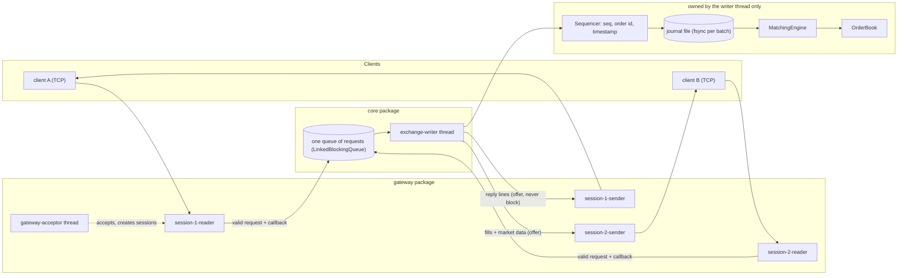

**[Verified]** thread names: `exchange-writer` (`src/main/java/exchangeserver/core/ExchangeService.java:112`),
`gateway-acceptor` (`src/main/java/exchangeserver/gateway/TcpGateway.java:79`), `session-N-reader` and
`session-N-sender` (`src/main/java/exchangeserver/gateway/ClientSession.java:62-63`).

### The one live path

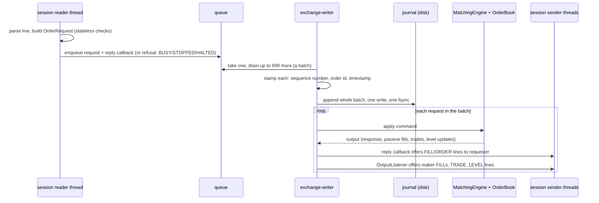

The heart of this path is `Exchange.process` (**[Verified]**):

```java
// src/main/java/exchangeserver/core/Exchange.java:118-165 (trimmed)
void process(List<Pending<?>> batch, OutputListener listener) throws IOException {
    List<Command> commands = new ArrayList<>(batch.size());
    for (Pending<?> p : batch) {
        // stamp: sequence number, order id, timestamp (an invalid request is refused, never journalled)
        ...
    }
    journal.appendAll(commands);                // durable before any effect
    for (Pending<?> p : batch) {
        if (p.refused) { continue; }
        if (p.request instanceof Request.Snapshot s) { p.complete(engine.snapshot(s.depth())); continue; }
        EngineOutput output;
        try {
            interceptor.beforeEngine(p.command);
            output = apply(p.command);
        } catch (RuntimeException bug) {
            quarantine(p.command, bug);          // poison pill: SKIP record + rebuild the engine
            p.fail(new ExchangeException(INTERNAL_ERROR, ...));
            continue;
        }
        p.complete(...response or cancel result...);   // reply callback runs here, on the writer
        listener.onOutput(output);                      // passive fills and market data
    }
}
```

### Restart

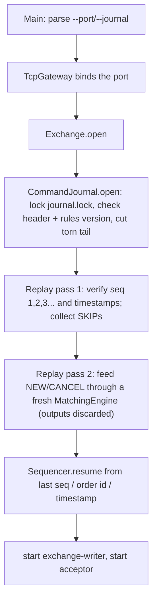

**[Verified]** `src/main/java/exchangeserver/core/Exchange.java:70-92`,
`src/main/java/exchangeserver/journal/CommandJournal.java:73-103`, `src/main/java/exchangeserver/core/Replay.java:36-43`.

### Packages and their dependencies

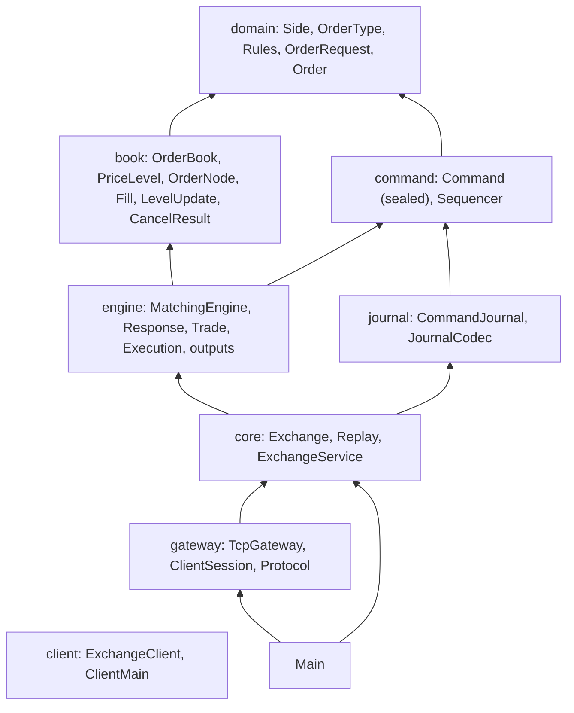

Arrows mean "depends on". **[Verified]** from the import lists of each file. The `client` package depends on
nothing in the project: it only speaks the text protocol (**[Verified]** `src/main/java/exchangeserver/client/ExchangeClient.java:1-19`).

## The 10 things you must know first

**1. One thread owns all mutable exchange state.** **[Verified]** The `exchange-writer` thread alone touches the
`Exchange`, `Sequencer`, `CommandJournal`, `MatchingEngine` and `OrderBook`; none of those classes is
thread-safe, on purpose (`CLAUDE.md`, "Single writer"; class comments such as
`src/main/java/exchangeserver/book/OrderBook.java:29`). Every other thread reaches state only through the queue,
including reads such as a book snapshot (Spec D57). If you ever read the book from another thread, you have a data
race.

**2. The order of operations is stamp → journal (fsync) → engine → reply → listener.** **[Verified]**
`src/main/java/exchangeserver/core/Exchange.java:118-165`. Nothing in a batch is processed before the whole batch
is on disk. The reply callback runs before the listener for the same command, which is why a taker sees its
`FILL`/`ORDER` lines before the market data its order caused (Spec D53).

**3. "Visible ⇒ durable" holds; "durable ⇒ visible" does not.** **[Verified]** Spec §4. No client ever sees the
effect of a command that is not on disk. But a crash *after* the fsync and *before* the reply leaves journalled
commands whose clients heard nothing; on restart they are replayed anyway. Clients reconcile by resending with the
same client order id: the duplicate check returns the original order id (Spec D49).

**4. The engine is deterministic, and that is load-bearing.** **[Verified]** `CLAUDE.md` ("Determinism is
load-bearing"); `src/main/java/exchangeserver/engine/MatchingEngine.java:25-26`. The engine reads no clock and
counts nothing: sequence numbers, order ids and timestamps come from the `Sequencer`
(`src/main/java/exchangeserver/command/Sequencer.java:11`), and a trade's timestamp is the incoming command's
timestamp (`src/main/java/exchangeserver/engine/Trade.java:10-12`). Replay depends on this: the same commands must
produce the same book.

**5. Validation is split by kind.** **[Verified]** *Stateless* checks (syntax, field ranges, name patterns) happen
at the gateway in `OrderRequest`; a request failing them gets `ERROR` and never reaches the queue or the journal.
*State-dependent* checks (duplicate client order id, price band, open-order cap, post-only would cross) happen in
the engine after journalling, so replay reproduces them (Spec D13, D47;
`src/main/java/exchangeserver/engine/RejectReason.java:5-6`).

**6. Book invariants are protected by Java package visibility.** **[Verified]** Every mutator of `PriceLevel` is
package-private, so the engine (another package) can read levels but must call `OrderBook.add`, `fillBest` or
`cancel`, which keep the invariants: an id is in the id map iff the order rests; no empty price levels; the book is
never crossed after a command (Spec D44; `src/main/java/exchangeserver/book/OrderBook.java:20-27`).

**7. Every rule replay depends on lives in `Rules`, and changing one means bumping `Rules.VERSION`.**
**[Verified]** `src/main/java/exchangeserver/domain/Rules.java:7-19`. The journal's first record stores the version
(`HEADER,2,1` = format 2, rules 1), and opening a journal written under another version fails. Observed running:
a journal edited to say rules version 9 was refused at startup with exit code 1.

**8. Poison pills are quarantined live, never at startup.** **[Verified]** Spec D51;
`src/main/java/exchangeserver/core/Exchange.java:41-44, 178-189`. If the engine throws a `RuntimeException` on a
command while running, the exchange appends `SKIP <seq>`, rebuilds the engine by replaying everything before that
command, and carries on; the caller gets `INTERNAL_ERROR`. If replay fails at startup, startup fails; an operator
inspects the command and runs `--quarantine <seq>`. An `Error` (e.g. `OutOfMemoryError`) or a journal I/O failure
halts the exchange (process exit code 2).

**9. Batching is "smart": no timer.** **[Verified]** `src/main/java/exchangeserver/core/ExchangeService.java:251-264`,
Spec D52. The writer blocks for one request, then drains whatever else is already waiting (up to 1,000 in total),
journals them with one fsync, and processes them. Under light load a batch is one request; under load, batches grow
by themselves. Measured on the author's laptop: 43 orders/ms with 64 clients versus 0.8 orders/ms with an fsync per
command (Spec §5).

**10. The writer never waits for a client.** **[Verified]** `src/main/java/exchangeserver/gateway/ClientSession.java:78-86`,
Spec D54. Lines for a client go into that client's bounded outbound queue (10,000 lines) with a non-blocking
`offer`; if it is full, the client is disconnected. A separate sender thread per client writes to the socket. One
slow client therefore cannot stall the exchange for everyone.

## Where to go next

- Guide 02 if any of records, sealed interfaces, `CompletableFuture`, `FileChannel.force` or JUnit 5 `@Nested` is
  unfamiliar.
- Guide 03 for a file-by-file map.
- Guide 04 to build, run and poke at it.
- Guide 05 for the six end-to-end flows.

## Key takeaways

- One instrument, five order types, price-time priority; trade price is always the resting order's price.
- Pipeline: gateway (stateless checks) → one queue → writer thread: stamp → journal + fsync → engine → reply →
  listener.
- Single writer thread; no locks inside the engine or book; reads go through the queue too.
- Write-ahead journal + deterministic engine = restart by replay; the `Rules.VERSION` header guards against
  replaying under changed rules.
- Poison pills: quarantined live (SKIP + rebuild), refused at startup until an operator quarantines them.
- Smart batching: one fsync per batch, batch size grows with load, no timer.
- The gateway never blocks the writer; slow clients are disconnected.
- Most reasons are recorded in the Spec as D-numbers (D1–D65).

## Common confusions

- **"Is the journal a log of what happened (trades)?"** No. It logs *inputs* (commands), not outputs. Trades,
  replies and market data are re-derived by replay (Spec D12, Vision principle 5). That is why the engine must be
  deterministic.
- **"Rejected orders are not journalled."** Only *stateless* rejects (bad syntax, bad field) are not journalled.
  State-dependent rejects (duplicate id, price band, open-order cap, post-only cross) are journalled and replayed,
  because whether they reject depends on the book state at that moment.
- **"The listener runs on another thread."** No: the `OutputListener` and the gateway's reply callbacks both run
  on the writer thread (**[Verified]** `src/main/java/exchangeserver/core/OutputListener.java:7-9`). They only
  offer lines to queues, which is why they are cheap enough to run there.
- **"A market order trades at any price."** Only before the first trade. After that it trades only within ±10% of
  the last trade price, fixed when it arrives (the *collar*, Spec D50).
- **"Disconnecting cancels my orders."** No. Resting orders stay on the book after a disconnect; there is no
  cancel-on-disconnect (**[Verified]** Spec §6).

## Questions to test yourself

1. Bob sends `NEW b1 BUY LIMIT 4 101` against a single resting ask of 10 at 100. At what price is the trade, and
   who learns about it?
   <details><summary>Answer</summary>At 100, the resting price. Bob gets a TAKER `FILL` and an `ORDER ... FILLED`;
   the maker (Alice) gets a MAKER `FILL` with `leaves=6` on every session she has open; subscribers get `TRADE` and
   a `LEVEL` update for the ask at 100 (now 6).</details>
2. Why must the matching engine never call `Instant.now()`?
   <details><summary>Answer</summary>Replay feeds journalled commands through the engine again after a restart. A
   clock read inside the engine would give different values on replay, so trades (and anything depending on time)
   would differ from what clients saw. All timestamps are stamped by the `Sequencer` before journalling.</details>
3. A client's order is rejected for `PRICE_OUTSIDE_BAND`. Is it in the journal? What about an order rejected
   because its quantity was 0?
   <details><summary>Answer</summary>The band reject is in the journal (state-dependent: it depends on the last
   trade price). The quantity-0 order never reaches the queue: `OrderRequest` refuses it at the gateway with
   `ERROR`.</details>
4. Which thread runs the code that formats the `ORDER` reply line, and why does that matter?
   <details><summary>Answer</summary>The `exchange-writer` thread, via the callback the session attached before
   enqueueing. It must therefore never block; it only offers lines to the session's bounded queue.</details>
5. What are the two conditions under which the exchange halts rather than quarantining?
   <details><summary>Answer</summary>A journal I/O failure (write or fsync), or any `Throwable` that is not a
   `RuntimeException` from the engine step (an `Error` such as `OutOfMemoryError`, an interrupt, or a bug outside
   the engine). The process then exits with code 2.</details>
6. Under light load (one request at a time), how big is a batch, and what is the latency floor?
   <details><summary>Answer</summary>One request; one fsync (about 1.5 ms on the author's disk, Spec §5). Smart
   batching adds no timer, so it costs nothing extra at low load.</details>


---

<a id="guide-02-tech-stack"></a>

<!-- source: docs/understanding/02-tech-stack.md -->

# 02 — Tech Stack

> **Project:** ExchangeServer2 | Single-instrument limit order book: price-time matching engine, write-ahead journal with replay, single writer thread, plain TCP gateway | Stack: Java 17, Maven wrapper, JUnit 5 (+ JMH, PIT)
> **This guide:** every language feature, JDK library and tool this code depends on: what it does here, why it was likely chosen, and the minimum you need to know to read the code | **Prerequisites:** 01 | **Related:** 04, 07-modules/*, 08, 10
> **Repo layout summary:** `pom.xml` + Maven wrapper (`mvnw`, `mvnw.cmd`) at the root; production code in `src/main/java/exchangeserver/` (packages `domain`, `book`, `engine`, `command`, `journal`, `core`, `gateway`, `client`, plus `Main`); tests mirror it in `src/test/java/exchangeserver/` (plus `bench/` JMH benchmarks and `testing/MutableClock`); design docs in `docs/` (`ExchangeServer2_Vision.md` = purpose/roadmap, `ExchangeServer2_Spec.md` = decisions D1–D65); these guides in `docs/understanding/`.

## Overview

The stack is deliberately small:

| Layer | What | Version | Scope |
|---|---|---|---|
| Language/runtime | Java (JDK) | 17 (`maven.compiler.release` 17) | everything |
| Build | Apache Maven via the Maven Wrapper | wrapper 3.3.2, Maven 3.9.16 | build |
| Tests | JUnit Jupiter (JUnit 5) | 5.11.4 (BOM) | test |
| Benchmarks | JMH (Java Microbenchmark Harness) | 1.37 | test, profile `bench` |
| Mutation testing | PIT (pitest) + JUnit 5 plugin | 1.17.4 / 1.2.1 | profile `mutation` |

**[Verified]** `pom.xml:13-19`, `pom.xml:33-52`, `pom.xml:132-141`, `.mvn/wrapper/maven-wrapper.properties`.
The JDK used on the dev machine is Temurin 17.0.20.1 (**[Verified]**, `java -version` run on 2026-10-27).

There are **no runtime dependencies**: the shipped jar contains only the project's own classes (about 110 KB,
**[Verified]**). No web framework, no logging library, no database, no JSON. Networking is `java.net` sockets, the
journal is a text file written through `java.nio`, logging is `System.Logger`. The Vision records that Spring Boot
was considered and dropped on 2026-10-24 in favour of a plain TCP gateway (**[Verified]** Vision §8).

**[Inferred]** Why so bare: the project is a learning exercise about durability, determinism and concurrency;
frameworks would hide exactly the mechanisms it wants to make visible (an fsync, a queue hand-off, a thread
boundary). The Vision's principle "Measure before optimizing" and the absence of any third-party runtime code are
consistent with that.

The rest of this guide goes feature by feature. For each: **here** (where and how it is used), **why** (likely
reason), **minimum** (what you must know to read the code).

## 1. Java 17 language features

### 1.1 Records, with compact constructors

**Here.** Almost every immutable value is a `record`: commands (`NewOrderCommand`, `CancelOrderCommand`,
`SkipCommand`), engine outputs (`Response`, `Trade`, `Execution`, `OrderOutput`, `CancelOutput`, `BookSnapshot`),
book results (`Fill`, `LevelUpdate`, `CancelResult`), requests (`Request.Submit`…), parsed client messages, and
`ExchangeService.Settings`. Validation lives in the **compact constructor** (a constructor without a parameter
list that runs before the fields are assigned):

```java
// src/main/java/exchangeserver/command/NewOrderCommand.java:8-20
public record NewOrderCommand(long sequenceNumber, Instant timestamp, long orderId, OrderRequest request)
        implements Command {

    public NewOrderCommand {
        Objects.requireNonNull(timestamp, "timestamp");
        Objects.requireNonNull(request, "request");
        if (sequenceNumber <= 0) {
            throw new IllegalArgumentException("Sequence number must be positive");
        }
        if (orderId <= 0) {
            throw new IllegalArgumentException("Order id must be positive");
        }
    }
}
```

Compact constructors are also used to **defensively copy** lists, e.g. `trades = List.copyOf(trades);` in
`Response` (**[Verified]** `src/main/java/exchangeserver/engine/Response.java:21`), so a record cannot be changed
through a list the caller still holds.

**Why.** **[Verified]** Spec §2 invariants: "An invalid `Order`, `OrderRequest`, `Command`, `Response`, `Trade` or
`CancelResult` cannot be constructed." Records give immutability plus generated `equals`/`hashCode`, which the
tests rely on heavily (e.g. comparing whole `BookSnapshot`s or whole output lists for determinism).

**Minimum.** A record's fields are final; accessors are named like the field (`command.sequenceNumber()`, not
`getSequenceNumber()`); `equals` compares all components; in a compact constructor you may reassign the parameter
(`bids = List.copyOf(bids)`) before the implicit field assignment.

Not everything is a record: `Order` (mutable: its filled quantity changes) and `OrderRequest` (private
constructor plus named factories) are ordinary final classes (**[Verified]**
`src/main/java/exchangeserver/domain/Order.java:16`, `src/main/java/exchangeserver/domain/OrderRequest.java:15`).

### 1.2 Sealed interfaces

**Here.** Closed sets of variants:

| Sealed type | Variants | File |
|---|---|---|
| `Command` | `NewOrderCommand`, `CancelOrderCommand`, `SkipCommand` | `src/main/java/exchangeserver/command/Command.java:11` |
| `Request<R>` | `Submit`, `Cancel`, `Snapshot` | `src/main/java/exchangeserver/core/Request.java:16` |
| `EngineOutput` | `OrderOutput`, `CancelOutput` | `src/main/java/exchangeserver/engine/EngineOutput.java:14` |
| `ClientMessage` | `Login`, `NewOrder`, `Cancel`, `Subscribe`, `Unsubscribe`, `Ping`, `Quit` | `src/main/java/exchangeserver/gateway/ClientMessage.java:9` |

```java
// src/main/java/exchangeserver/command/Command.java:11-16
public sealed interface Command permits NewOrderCommand, CancelOrderCommand, SkipCommand {
    long sequenceNumber();
    Instant timestamp();
}
```

**Why.** **[Verified]** the comment above it: "The Java type is the kind tag; the journal writes it as a word"
(`src/main/java/exchangeserver/command/Command.java:7-8`). Sealing documents that no other kind exists.

**Minimum.** `sealed ... permits A, B` means only the listed classes may implement it. In Java 17 the compiler
does **not** yet use this to check `instanceof` chains for exhaustiveness (see 1.4), so the code ends such chains
with a `throw new IllegalStateException("Unknown command type ...")` (**[Verified]**
`src/main/java/exchangeserver/journal/JournalCodec.java:94-96`).

### 1.3 Pattern matching for `instanceof`

**Here.** Everywhere a sealed type is dispatched:

```java
// src/main/java/exchangeserver/core/Exchange.java:168-176
private EngineOutput apply(Command command) {
    if (command instanceof NewOrderCommand n) {
        return engine.onNewOrder(n);
    }
    if (command instanceof CancelOrderCommand c) {
        return engine.onCancel(c);
    }
    throw new IllegalStateException("Not an engine command: " + command);
}
```

**Minimum.** `x instanceof T t` tests the type and binds `t` (already cast) in the true branch. Final in Java 16.

### 1.4 Switch expressions, arrows and `yield`

**Here.** Over enums and strings: the outcome switch in the engine, the journal decoder, the protocol parser and
`Main`'s argument parsing.

```java
// src/main/java/exchangeserver/engine/MatchingEngine.java:155-170
OrderStatus status = switch (order.getOrderType()) {
    case LIMIT, POST_ONLY -> {
        if (remaining > 0) {
            book.add(order);
            yield OrderStatus.RESTED;
        }
        yield OrderStatus.FILLED;
    }
    case IOC, MARKET -> remaining > 0 ? OrderStatus.CANCELLED : OrderStatus.FILLED;
    case FOK -> {
        if (remaining != 0) {
            throw new IllegalStateException("Fillable FOK " + order.getOrderId() + " left " + remaining);
        }
        yield OrderStatus.FILLED;
    }
};
```

**Why.** **[Verified]** Spec D24 and the class comment: "The outcome, as a switch over OrderType with no default
(the compiler rejects a missed type)" (`src/main/java/exchangeserver/engine/MatchingEngine.java:32`). A switch
*expression* over an enum must be exhaustive, so adding a sixth `OrderType` breaks the build here until it is
handled. That is a deliberate compile-time safety net.

**Minimum.** `case A, B -> expr` has no fall-through. A block arm returns its value with `yield`. A switch
*expression* must cover every enum constant (or have `default`).

**Why `instanceof` chains rather than `switch` over sealed types?** **[General knowledge]** Pattern matching for
`switch` (`case NewOrderCommand n ->`) was only a *preview* feature in Java 17 (JEP 406) and became final in Java
21 (JEP 441). With `maven.compiler.release` 17 and no `--enable-preview`, the code cannot use it. **[Inferred]**
This is why dispatch over sealed types uses `instanceof` chains plus a final `throw`, losing the exhaustiveness check
that enum switches get. Guide 12 (change recipes) lists every chain you must update when adding a variant.

### 1.5 Other small features

- `var` is **not** used; types are spelled out (**[Verified]** by search, no `var ` declarations in `src/main`).
- `List.of`, `List.copyOf`, `Set.copyOf` (immutable collections) are used for outputs and defensive copies.
- `Optional` / `OptionalLong`: `OrderBook.bestLevel` returns `Optional<PriceLevel>`; a request's price is an
  `OptionalLong` (empty for MARKET) so the "no price" sentinel `-1` never leaks out of the domain package
  (**[Verified]** `src/main/java/exchangeserver/domain/OrderRequest.java:11-12`, `116-118`; Spec D26).
- Text blocks are not used; class documentation is in `/* ... */` block comments at the top of each file.

## 2. Concurrency (`java.util.concurrent` and the memory model)

You need these to read `core.ExchangeService` and the `gateway` package. Guide 07-modules/exchange-service goes
deeper.

### 2.1 Happens-before, `volatile`, `synchronized` (the minimum)

**[General knowledge]** In Java, a write by one thread is guaranteed visible to another thread only if there is a
**happens-before** edge between them. The edges this code relies on:

| Edge | Where it is used here |
|---|---|
| `Thread.start()`: everything before it is visible to the started thread | The journal is replayed on the caller's thread, then the writer is started: **[Verified]** comment at `src/main/java/exchangeserver/core/ExchangeService.java:117-118` |
| `Thread.join()`: everything the thread did is visible after `join` returns | Stats are read after `stop()` in tests (**[Verified]** `src/test/java/exchangeserver/core/ExchangeServiceTest.java:39-41`) |
| `BlockingQueue` put → take | A `Pending` request needs no `volatile` fields (**[Verified]** `src/main/java/exchangeserver/core/Pending.java:12-13`) |
| `CompletableFuture` complete → `get`/`join`/continuation | Results flow back to callers the same way |
| `volatile` write → read | `ExchangeService.state`, `haltCause`, stats (`src/main/java/exchangeserver/core/ExchangeService.java:98-106`); `ClientSession.participant` (`src/main/java/exchangeserver/gateway/ClientSession.java:55`) |
| `synchronized` unlock → lock of the same monitor | `ExchangeService`'s hand-in lock (`src/main/java/exchangeserver/core/ExchangeService.java:187-197`); `ClientSession.subscriptionLock` (`src/main/java/exchangeserver/gateway/ClientSession.java:49`) |

**Minimum.** `volatile` gives visibility of single reads/writes, not atomicity of `x++` (fine here because only the
writer thread writes the stats). `synchronized (lock) { ... }` gives mutual exclusion plus visibility.

### 2.2 `BlockingQueue`: `LinkedBlockingQueue`, `ArrayBlockingQueue`, `drainTo`

**Here.**
- The exchange's single request queue is an **unbounded** `LinkedBlockingQueue`; its capacity (100,000) is
  enforced by hand under the lock, so `stop()` can always add its STOP marker without blocking (**[Verified]**
  `src/main/java/exchangeserver/core/ExchangeService.java:95`, `192`; Spec D56).
- The writer takes one request (blocking) and then `drainTo(batch, max - 1)` takes whatever else is already
  waiting without blocking. That pair *is* smart batching:

```java
// src/main/java/exchangeserver/core/ExchangeService.java:252-254
batch.clear();
batch.add(queue.take());
queue.drainTo(batch, settings.maxBatchSize() - 1);
```

- Each client session's outbound queue is a **bounded** `ArrayBlockingQueue` (10,000 lines); producers call
  non-blocking `offer`, which returns `false` when full (**[Verified]**
  `src/main/java/exchangeserver/gateway/ClientSession.java:61`, `82`).

**Minimum.** `put`/`take` block; `offer`/`poll` don't (or wait with a timeout); `drainTo` moves up to *n* waiting
elements in one call.

### 2.3 `CompletableFuture`

**Here.** Each request carries a `CompletableFuture` (in `Pending.result`) that the writer completes. Two
subtleties matter:

1. **Callbacks attached with `whenComplete` run on the completing thread** if the future is not yet done when
   they are attached. The gateway's reply callbacks are attached *before* the request is queued, so they run on the
   `exchange-writer` thread, before the listener (**[Verified]**
   `src/main/java/exchangeserver/core/ExchangeService.java:166-170`, `183-185`). If the request is refused at once,
   the callback runs on the caller's thread instead.
2. **The futures returned to ordinary callers are separate futures**, completed asynchronously on the
   **common ForkJoinPool** (the JVM-wide shared thread pool used by `*Async` methods without an executor):

```java
// src/main/java/exchangeserver/core/ExchangeService.java:154-164
private static <R> CompletableFuture<R> handOff(CompletableFuture<R> internal) {
    CompletableFuture<R> mine = new CompletableFuture<>();
    internal.whenCompleteAsync((value, failure) -> {
        if (failure != null) {
            mine.completeExceptionally(failure);
        } else {
            mine.complete(value);
        }
    });
    return mine;
}
```

**Why.** **[Verified]** Spec D61: with a shared future, a caller's `cancel()` or `orTimeout()` made the writer skip a
command it had already journalled (so the live book differed from the replayed one), and a caller's blocking
continuation ran on the writer thread and stalled the exchange.

**Minimum.** `complete`/`completeExceptionally` the first time wins; later calls are no-ops (that is why
`Pending.fail` is safe to call on an already-completed request, `src/main/java/exchangeserver/core/Pending.java:32-35`).
`whenComplete` vs `whenCompleteAsync`: same thread vs a pool thread. An exception thrown *inside* a `whenComplete`
callback is captured in the derived future and otherwise silently ignored.

### 2.4 Concurrent collections and atomics

- `ConcurrentHashMap.newKeySet()` for the gateway's `sessions` and `subscribers` sets; `ConcurrentHashMap.compute`
  / `computeIfPresent` to add/remove a session to/from its participant's set atomically, dropping the entry when it
  empties (**[Verified]** `src/main/java/exchangeserver/gateway/TcpGateway.java:136-165`; Spec §9 finding 6).
  `compute` runs the function atomically per key, so an add cannot slip into a set that a concurrent remove is
  dropping.
- `AtomicBoolean closed` in `ClientSession` (`compareAndSet` makes `close()` idempotent), `AtomicLong` session ids,
  `AtomicInteger OPEN` counting open journals for tests (**[Verified]**
  `src/main/java/exchangeserver/gateway/ClientSession.java:48`, `src/main/java/exchangeserver/journal/CommandJournal.java:50`).

### 2.5 Threads

Plain `java.lang.Thread`s with names, no executors (except the common pool used by `whenCompleteAsync`). The
writer is **non-daemon** (the JVM must not exit with accepted requests unprocessed); the acceptor and session
threads are **daemon** (they must not keep the JVM alive) (**[Verified]**
`src/main/java/exchangeserver/core/ExchangeService.java:112-114`, `src/main/java/exchangeserver/gateway/TcpGateway.java:79-80`,
`src/main/java/exchangeserver/gateway/ClientSession.java:62-65`).

## 3. Files and durability (`java.nio`)

### 3.1 `FileChannel`, `force`, `truncate`

**Here.** The journal is opened with `FileChannel.open(file, CREATE, WRITE, APPEND)`: `APPEND` means every write
goes to the current end of file, so history cannot be overwritten (**[Verified]**
`src/main/java/exchangeserver/journal/CommandJournal.java:79`). After writing a batch, `channel.force(true)` asks
the OS to flush the data (and, with `true`, file metadata such as size) to the storage device: this is the
**fsync** (**[Verified]** `src/main/java/exchangeserver/journal/CommandJournal.java:131`). Recovery opens a second
channel and `truncate`s the file to just after the last `\n` (**[Verified]**
`src/main/java/exchangeserver/journal/CommandJournal.java:272-282`).

**Minimum.** `write` returning does not mean the data is on disk; only `force` does. One `force` cost about
1.5 ms on the author's disk (**[Verified]** Spec §5), which is why batching matters. Reading uses separate
`InputStream`s (`Files.newInputStream`), so replay can read while the append channel is open.

### 3.2 `FileLock` and the `<journal>.lock` file (added 2026-10-27, D65)

**Here.** To stop two processes (e.g. a running exchange and an operator's `--quarantine` run) from appending to
the same journal, `CommandJournal.open` first takes an exclusive lock on a **separate, empty file next to the
journal**, `<journal>.lock` (e.g. `exchange.journal.lock`), before it opens the journal at all:

```java
// src/main/java/exchangeserver/journal/CommandJournal.java:207-238 (trimmed)
private record Lock(Path key, FileChannel channel) {
    static Lock acquire(Path journal) throws IOException {
        Path lockFile = journal.resolveSibling(journal.getFileName() + ".lock");
        try {
            Files.createFile(lockFile);     // create-new: never opens, so never closes, an existing lock file
        } catch (FileAlreadyExistsException normalAfterTheFirstRun) {
            // reuse it
        }
        Path key = lockFile.toRealPath();   // one key however the journal path is spelled
        if (!HELD.add(key)) {               // static set: a second open in this JVM is refused here
            throw alreadyOpen(journal);
        }
        FileChannel channel = FileChannel.open(lockFile, WRITE);
        if (channel.tryLock() == null) {    // another process holds it
            throw alreadyOpen(journal);     // (the real code also closes the channel and leaves HELD)
        }
        return new Lock(key, channel);
    }
}
```

`close()` closes the journal channel, then the lock channel (which releases the OS lock), then removes the key
from `HELD`; the empty lock file stays on disk (**[Verified]**
`src/main/java/exchangeserver/journal/CommandJournal.java:187-196`, `240-247`; `.gitignore` ignores
`*.journal.lock`).

**Why a separate file: OS lock semantics differ.** **[Verified]** the design comment at
`src/main/java/exchangeserver/journal/CommandJournal.java:200-206` and Spec D65:

| | Windows | Linux / macOS (POSIX `fcntl` locks) |
|---|---|---|
| Strength | **Mandatory**: a locked range cannot be read or written through any *other* handle, even in the same process | **Advisory**: only stops others who also ask for the lock |
| Owner | The handle (channel) that took it | The **whole process** |
| Released when | That handle closes | **Any** handle the process has on that file closes |

The journal itself is opened and closed constantly: the header check, the torn-tail cut and every `read()`
(replay, the poison-pill rebuild) use their own short-lived handles. Under POSIX semantics, the first of those
closes would silently drop a lock held on the journal. Under Windows semantics, a lock on the journal's *data*
would block those reads. A lock file that **nothing else ever opens or closes** avoids both. That is also why the
lock file is created with `Files.createFile` (create-new, which fails without opening an existing file) rather
than opened-if-exists, and why a second open **in the same JVM** is refused by the in-memory `HELD` set before it
touches the lock file: opening and closing a second channel on it would, on POSIX, drop the first holder's lock.

History: the first version of D65 locked one byte at `Long.MAX_VALUE - 1` *of the journal itself* (past the data,
to dodge Windows' mandatory locks). It passed on Windows, where locks belong to a handle, but would have vanished on
Linux/macOS at the first `read()`; it was replaced by the lock file the same day (**[Verified]** Spec D65).

**Minimum.** `FileChannel.tryLock()` returns `null` if **another process** holds an overlapping lock, and throws
`OverlappingFileLockException` if **this JVM** already holds one on that file through another channel (the
`FileLock` Javadoc also warns that, on some systems, closing a channel releases all of the JVM's locks on the file).
A lock is released when its channel closes. **[Verified]** cross-process refusal is tested with a child JVM
(`CommandJournalTest.Exclusive.anotherProcessIsRefusedWhileTheJournalIsOpen`, which first calls `read()` so that a
lock on the journal itself would have been dropped on POSIX); it has run on Windows only, not yet on Linux/macOS
(Spec D65).

### 3.3 Charsets

Every byte/char conversion names a charset: `UTF_8` for the journal, `US_ASCII` for the wire protocol
(**[Verified]** e.g. `src/main/java/exchangeserver/journal/CommandJournal.java:21`,
`src/main/java/exchangeserver/gateway/ClientSession.java:22`). **Why:** **[Verified]** `CLAUDE.md`: the dev
machine's default charset is windows-1252, so relying on the default would make the code behave differently across
machines.

## 4. Networking (`java.net`)

**Here.** Blocking, thread-per-connection sockets: a `ServerSocket` bound to `new InetSocketAddress(port)` (all
interfaces), `SO_REUSEADDR` on, `TCP_NODELAY` on each accepted socket (disables Nagle's algorithm, which would
otherwise delay small writes to batch them) (**[Verified]**
`src/main/java/exchangeserver/gateway/TcpGateway.java:65-67`, `108`). Each session has a reader thread doing
byte-by-byte `read()` from a `BufferedInputStream`, and a sender thread writing through a `BufferedWriter`, flushing
once per burst.

**Why.** **[Verified]** Spec §6 and Vision §5: "plain TCP, line protocol, thread-per-connection". **[Inferred]**
Blocking I/O with two threads per client is the simplest model to reason about; NIO or virtual threads are listed as
a future candidate (Vision §7, "NIO or virtual-thread gateway (Java 21)").

**Minimum.** Closing a socket's input or output stream closes the whole socket (which is why the reader never uses
try-with-resources on the input stream: **[Verified]** `src/main/java/exchangeserver/gateway/ClientSession.java:115-116`).
A blocked `read()` is woken by closing the socket from another thread.

## 5. Time: `java.time.Clock` injection

**Here.** The `Sequencer` takes a `Clock` and is the only class that reads it (**[Verified]**
`src/main/java/exchangeserver/command/Sequencer.java:22`, `74-81`). Production passes `Clock.systemUTC()`
(`src/main/java/exchangeserver/core/ExchangeService.java:69`); tests pass a `MutableClock` they can move, even
backwards (**[Verified]** `src/test/java/exchangeserver/testing/MutableClock.java`). Timestamps are `Instant`s,
written to the journal with `Instant.toString()` (ISO-8601, nanosecond precision).

**Why.** **[Verified]** Spec D32/D33: the sequencer owns all stamps, and a clock that steps backwards reuses the
previous timestamp; an injected clock makes that testable.

## 6. Logging: `System.Logger`

**Here.** Three classes log, all through `System.getLogger(...)`: `Exchange`, `ExchangeService`, `TcpGateway`
(**[Verified]** `src/main/java/exchangeserver/core/Exchange.java:51`,
`src/main/java/exchangeserver/core/ExchangeService.java:89`, `src/main/java/exchangeserver/gateway/TcpGateway.java:45`).
Everything else communicates through return values and exceptions; `Main` prints with `System.out`/`System.err`.

**Minimum.** **[General knowledge]** `System.Logger` (Java 9+) is a logging facade built into the JDK. With no
logging library on the classpath it routes to `java.util.logging`, whose default console handler prints `INFO` and
above to **stderr** in a two-line format (`<date> <class> <method>` then `LEVEL: message`). You saw that format in
the test output: `SEVERE: Exchange halted` followed by a stack trace (**[Verified]**, observed during the test run;
`ERROR` maps to `SEVERE`).

## 7. Build: Maven and the Maven Wrapper

**Here.** `pom.xml` is the only build file. The **Maven Wrapper** (`mvnw`, `mvnw.cmd`,
`.mvn/wrapper/maven-wrapper.properties`) downloads Maven 3.9.16 on first use, so no local Maven install is needed
(**[Verified]** `CLAUDE.md`, README). Key settings (**[Verified]** `pom.xml`):

- `maven.compiler.release` 17 and UTF-8 source encoding (`pom.xml:14-16`).
- `-Xlint:all` minus `processing` (`pom.xml:62-65`); the project rule is "keep the build warning-free"
  (`CLAUDE.md`).
- Surefire (the test runner plugin) **excludes** `exchangeserver/bench/**` so benchmarks never run as tests
  (`pom.xml:68-77`).
- The jar manifest's `Main-Class` is `exchangeserver.Main`, so `java -jar` works (`pom.xml:78-89`).
- Profile `bench`: runs JMH via `exec-maven-plugin` in the `verify` phase, with `skipTests`; options come from
  `-Djmh.args="..."` (`pom.xml:95-125`).
- Profile `mutation`: runs PIT in the `test` phase on packages `domain`, `book`, `engine`, `command`, `journal`,
  `core` (not `gateway`, `client`, `Main`) with 4 threads (`pom.xml:127-169`).

**Minimum.** A **profile** is a named block of extra build configuration switched on with `-P<id>`. Maven
compiles **incrementally by file timestamp**: a source file restored with an *older* modification time than its
`.class` file is not recompiled. **[Verified]** this happened during the 2026-10-27 survey (a jar silently kept old
classes); `CLAUDE.md` now says to use `clean` after swapping files.

## 8. Testing: JUnit 5 (Jupiter)

**Here.** Every test class uses these features (**[Verified]** across `src/test/java`):

| Feature | Meaning | Example |
|---|---|---|
| `@Test` | a test method | everywhere |
| `@Nested` | an inner (non-static) class grouping tests by behaviour; shares the outer instance's fields | `MatchingEngineTest.Limit`, `.Ioc`, `.Fok`… |
| `@TempDir Path dir` | JUnit creates and deletes a temporary directory per test | journals in `ExchangeTest`, `CommandJournalTest` |
| `@ParameterizedTest` + `@ValueSource`/`@CsvSource` | one test body, many inputs | `OrderRequestTest.Validation`, `JournalCodecTest.Corrupt` |
| `@RepeatedTest(5)` | run the same test 5 times | `ExchangeServiceTest.Stop.racingStopNeverLosesARequest` |
| `@BeforeEach` / `@AfterEach` | setup / teardown | `TcpGatewayTest` starts a gateway on port 0 |
| `assertThrows`, `assertInstanceOf` | exceptions and types | widely |

The project convention: **one test class per production class, `@Nested` groups per behaviour; every wait in a
concurrent test has a timeout** (**[Verified]** `CLAUDE.md`, Spec §1.2). Guide 10 covers the strategy.

## 9. JMH (benchmarks)

**Here.** Two benchmarks in `src/test/java/exchangeserver/bench`: `MatchingBenchmark` (engine cost per command at
10 / 1,000 / 100,000 price levels) and `BatchingBenchmark` (throughput and latency of fsync-per-command vs linger vs
smart batching with 1/16/64 client threads). The JMH annotation processor generates the harness code at test-compile
time (`jmh-generator-annprocess`, `pom.xml:46-51`).

**Why.** **[Verified]** Vision principle 7 "Measure before optimizing" and Spec §5: the results decided D59 (no cached
best-level pointer) and D52 (smart batching).

**Minimum.** `@State` holds per-thread or per-benchmark state, `@Setup(Level.Iteration)` rebuilds it, `@Param`
runs the benchmark once per listed value, and the return value of a `@Benchmark` method is consumed so the JIT cannot
delete the work. **[Verified]** not run during the 2026-10-27 survey; the numbers in guides come from Spec §5.

## 10. PIT (mutation testing)

**Here.** `mvnw.cmd -Pmutation test` makes thousands of small changes ("mutants") to the bytecode, e.g. `<` to
`<=`, removing a method call, returning 0, and reruns the tests against each. A mutant the tests catch is **killed**;
one they don't is a **survivor**, i.e. a behaviour no test pins down. Report: `target/pit-reports/index.html`
(**[Verified]** README, `pom.xml:127-169`). Last recorded result before the D63–D65 fixes: 478 mutations, 444 killed
(93%), with each surviving kind explained (**[Verified]** Spec §7).

**Why.** **[Verified]** pom comment: "the spec's 'break the code on purpose', automated" (`pom.xml:126`). The
project rule is to run it after any behavioural change and explain survivors (`CLAUDE.md`).

## Key takeaways

- Java 17 with zero runtime dependencies; Maven Wrapper; JUnit 5; JMH and PIT only in opt-in profiles.
- Records with validating compact constructors make invalid values unconstructable; sealed interfaces close the set
  of commands, requests, outputs and messages.
- Enum `switch` expressions are exhaustive by compiler; sealed-type dispatch uses `instanceof` chains ending in a
  `throw` because pattern `switch` is not final in Java 17.
- The concurrency toolkit: one `LinkedBlockingQueue` (+ `drainTo` = smart batching), per-session
  `ArrayBlockingQueue` with `offer`, `CompletableFuture`s (caller futures handed off via the common pool, D61),
  `volatile`/`synchronized` for the few shared fields, `ConcurrentHashMap.compute` in the gateway.
- Durability = `FileChannel` in `APPEND` mode + `force(true)` per batch; recovery uses `truncate`; an exclusive `FileLock`
  on a separate `<journal>.lock` file (plus an in-JVM set) keeps a second opener out, because POSIX locks vanish when
  any handle on the locked file closes and Windows locks block other handles.
- All charsets are explicit; the clock is injected; logging is `System.Logger` → `java.util.logging` on stderr.
- Maven compiles by timestamp: after swapping files, build with `clean`.

## Common confusions

- **"`whenComplete` runs on a pool thread."** Only `whenCompleteAsync` does. `whenComplete` runs on whichever
  thread completes the future (here: the writer), or immediately on the caller if already complete.
- **"`write` to a `FileChannel` makes data durable."** No: only `force` does. A crash between `write` and `force`
  may lose the data, or may keep part of it (hence torn-tail recovery).
- **"The journal file is locked."** The lock is on `<journal>.lock`, an empty sibling file; the journal itself is
  never locked. It is a "this journal is in use" flag, not a lock on the records. The lock file staying on disk after
  a stop is normal.
- **"A Java `FileLock` behaves the same everywhere."** No: on Linux/macOS it is per process and is dropped when *any*
  handle on that file closes; on Windows it is per handle and mandatory.
- **"`sealed` makes `instanceof` chains exhaustive."** Not in Java 17. Only enum switch expressions get that check
  here.
- **"Benchmarks run with `mvnw test`."** They are excluded from Surefire and run only with `-Pbench verify`.

## Questions to test yourself

1. Why is the exchange's request queue unbounded when the exchange enforces a capacity of 100,000?
   <details><summary>Answer</summary>So `stop()` can always add its STOP marker without blocking on a full queue;
   the capacity is enforced by checking `queue.size()` under the same lock as the state check, and a full queue
   refuses with BUSY (Spec D56).</details>
2. A gateway callback and a caller's `thenAccept` are both attached to request results. On which threads do they
   run?
   <details><summary>Answer</summary>The gateway callback is attached with `whenComplete` to the internal future
   before enqueueing, so it runs on the `exchange-writer` thread (or on the caller's thread if refused at once). A
   caller's `thenAccept` is attached to its own handed-off future, completed by `whenCompleteAsync` on the common
   ForkJoinPool, so it runs off the writer.</details>
3. Why does `CommandJournal` lock a separate `<journal>.lock` file instead of the journal itself? Give the Linux
   reason and the Windows reason.
   <details><summary>Answer</summary>Linux/macOS: POSIX locks belong to the process and are dropped when any handle
   on the file closes; the header check, the torn-tail cut and every `read()` open and close handles on the journal,
   so a lock on it would vanish almost at once. Windows: locks are mandatory, so a lock on the journal's records would
   block those same reads and the truncate. A lock file that nothing else opens or closes has neither problem.</details>
4. Why does `JournalCodec.encode` end with `throw new IllegalStateException("Unknown command type ...")` even
   though `Command` is sealed?
   <details><summary>Answer</summary>Java 17 does not check `instanceof` chains for exhaustiveness, and pattern
   matching for `switch` is only a preview there. The throw turns a forgotten variant into a loud failure instead of
   silently writing nothing.</details>
5. You replaced `CommandJournal.java` with an older backup and ran `mvnw.cmd package`. The jar still behaves like
   the newer code. Why, and what is the fix?
   <details><summary>Answer</summary>Maven's incremental compiler compares timestamps; the restored source is older
   than its `.class` file, so it is not recompiled. Run `mvnw.cmd clean package`.</details>
6. Which packages does PIT mutate, and which are only covered by end-to-end tests?
   <details><summary>Answer</summary>Mutated: `domain`, `book`, `engine`, `command`, `journal`, `core`. Not
   mutated: `gateway`, `client`, `Main` (the gateway is covered by end-to-end socket tests, Spec §7).</details>


---

<a id="guide-03-codebase-map"></a>

<!-- source: docs/understanding/03-codebase-map.md -->

# 03 — Codebase Map

> **Project:** ExchangeServer2 | Single-instrument limit order book: price-time matching engine, write-ahead journal with replay, single writer thread, plain TCP gateway | Stack: Java 17, Maven wrapper, JUnit 5 (+ JMH, PIT)
> **This guide:** a guided tour of the directories, entry points, conventions, and a one-line purpose for every file; what is generated vs hand-written | **Prerequisites:** 01 | **Related:** 02, 04, 07-modules/*, 10, 13
> **Repo layout summary:** `pom.xml` + Maven wrapper (`mvnw`, `mvnw.cmd`) at the root; production code in `src/main/java/exchangeserver/` (packages `domain`, `book`, `engine`, `command`, `journal`, `core`, `gateway`, `client`, plus `Main`); tests mirror it in `src/test/java/exchangeserver/` (plus `bench/` JMH benchmarks and `testing/MutableClock`); design docs in `docs/` (`ExchangeServer2_Vision.md` = purpose/roadmap, `ExchangeServer2_Spec.md` = decisions D1–D65); these guides in `docs/understanding/`.

## Overview

The repository is a single Maven module. Size (**[Verified]**, `wc -l` on 2026-10-27, after the D63–D65 fixes):
45 production files (~3,800 lines) in 8 packages plus `Main`, and 19 test files (~4,100 lines, including 2
benchmarks and one test helper). There is one git commit, `b3091a8` "Initial Commit"; the fixes of 2026-10-27 are
uncommitted at the time of writing.

```
ExchangeServer2/
├── pom.xml                       build: Java 17, JUnit 5, profiles bench (JMH) and mutation (PIT)
├── mvnw, mvnw.cmd, .mvn/wrapper/  Maven Wrapper (downloads Maven 3.9.16)
├── README.md                     one-page intro, commands, a sample session
├── CLAUDE.md                     instructions for AI agents working in the repo (commands, architecture, rules)
├── .gitignore                    target/, *.journal, IDE files
├── docs/
│   ├── ExchangeServer2_Vision.md purpose, working style, principles, roadmap (roadmap lives only here)
│   ├── ExchangeServer2_Spec.md   exact code state, decisions D1–D65, journal format, measurements, open threads
│   └── understanding/            these study guides
└── src/
    ├── main/java/exchangeserver/
    │   ├── Main.java             process entry point (server / --quarantine tool)
    │   ├── domain/               orders and the rules
    │   ├── book/                 the order book data structure
    │   ├── engine/               matching logic and its outputs
    │   ├── command/              stamped commands + the Sequencer
    │   ├── journal/              the write-ahead log file
    │   ├── core/                 the live path, replay, the writer thread
    │   ├── gateway/              TCP server, sessions, wire protocol
    │   └── client/               a line client (tests + interactive console)
    └── test/java/exchangeserver/ one test class per production class, plus bench/ and testing/
```

Not in the repo (ignored, **[Verified]** `.gitignore`): `target/` (all build output), `*.journal` (runtime journals) and `*.journal.lock` (the empty lock file next to each
journal, D65).

## Entry points

| Entry point | How it is started | What it does |
|---|---|---|
| `exchangeserver.Main` | `java -jar target/exchange-server2-2.0.0-SNAPSHOT.jar [--port N] [--journal FILE]` | Binds the TCP port, opens and replays the journal, starts the writer thread and the gateway, waits; documented exit codes 0 clean, 1 startup failure, 2 halted (**[Verified]** as documented in `src/main/java/exchangeserver/Main.java:12-21`; 0 after Ctrl+C unverified, guide 15) |
| `exchangeserver.Main --quarantine <seq>` | `java -jar ... --journal FILE --quarantine 7` | Operator tool: appends `SKIP 7` to the journal, then exits (**[Verified]** `src/main/java/exchangeserver/Main.java:47-58`) |
| `exchangeserver.client.ClientMain` | `java -cp target/exchange-server2-2.0.0-SNAPSHOT.jar exchangeserver.client.ClientMain [host] [port]` | Interactive console: type protocol lines, see every server line prefixed with `< ` (**[Verified]** `src/main/java/exchangeserver/client/ClientMain.java:8-14`) |
| JMH benchmarks | `mvnw.cmd -Pbench verify -Djmh.args="MatchingBenchmark ..."` | `org.openjdk.jmh.Main` runs the `@Benchmark` methods in `src/test/java/exchangeserver/bench` (**[Verified]** `pom.xml:95-125`) |
| Tests | `mvnw.cmd test` | Surefire runs every JUnit 5 test except `bench/**` |

There is no other `main` method (**[Verified]** by search). For programmatic use (tests, tools), the API entry
points are `ExchangeService.start(...)` (multi-threaded service) and `Exchange.open(...)` (single-threaded core).

## How the packages layer

Dependencies flow one way, from the network inward (**[Verified]** from imports):

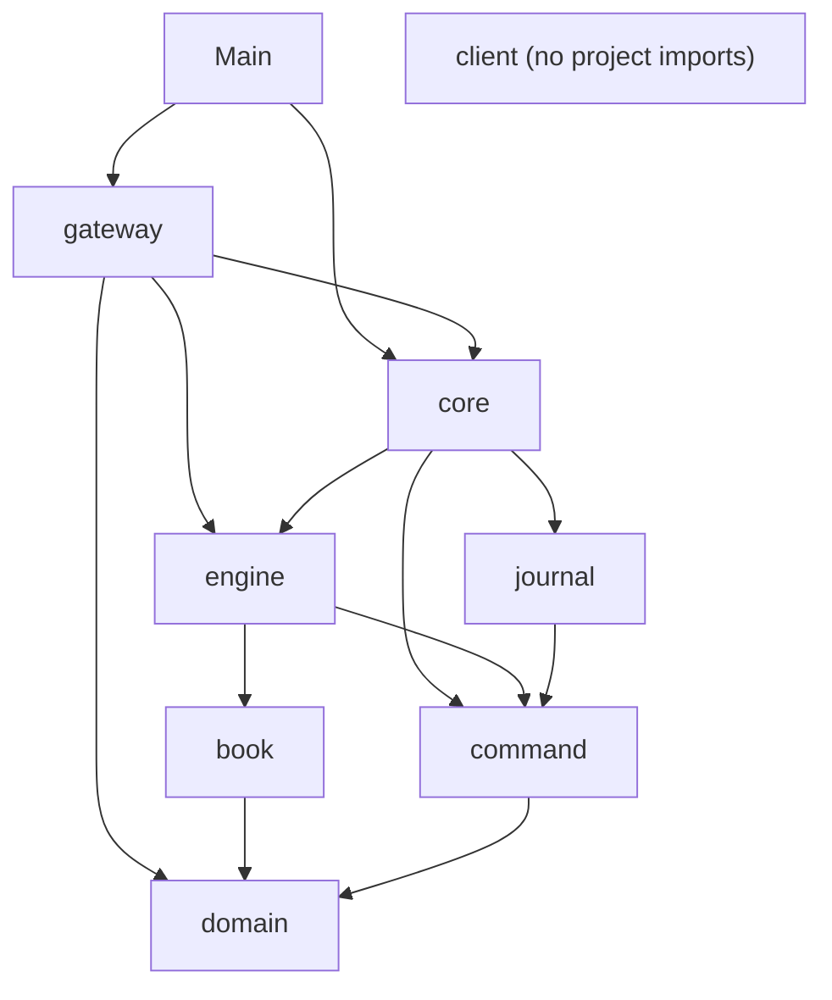

Reading tip: start at the bottom (`domain`, `book`) and work up; each layer only uses what is below it. `client`
talks to the server purely through the text protocol.

## Conventions you will see everywhere

1. **A block comment at the top of every class** explains its purpose, invariants, threading and the decisions it
   implements, e.g. `src/main/java/exchangeserver/book/OrderBook.java:18-34`. Method-level comments are short and
   explain *why*, not *what*. **[Verified]**
2. **Decision numbers in comments**: `(D44)`, `(D51)` refer to the decision table in `docs/ExchangeServer2_Spec.md`
   §3; `(step 4A)` and "roadmap step N" refer to the roadmap in Vision §7. Comments citing a "threads guide" (4.3,
   4.4, Lab 6) or "Spec v8"/"v3" refer to documents in the owner's **original project**
   (`Exchange Server/New Learnings/03_Threads_Visibility_and_Handoff.md`, `Exchange Server/src/docs/...`), not to
   this repo (**[Verified]** Spec §1.6).
3. **Visibility as an ownership tool**: mutators that only one class may call are package-private (`PriceLevel`'s
   `addOrder`, `fillHead`, `unlink`; `OrderNode` entirely), so the compiler, not convention, keeps other packages out
   (**[Verified]** Spec D44).
4. **Package-private test seams** instead of mocks: `core.CommandInterceptor` (inject a failure or block the writer),
   `OrderBook.checkInvariants()` and `ordersAt()`, `MatchingEngine.book()`, `Exchange.engine()`,
   `TcpGateway.participantsRegistered()`/`subscriberCount()`. Tests live in the same package to reach them.
   **[Verified]** `CLAUDE.md` ("Test seams").
5. **Records for values, final classes for everything else**; no inheritance hierarchies besides sealed interfaces.
6. **Dispatch over sealed types with `instanceof` chains ending in a `throw`** (Java 17 has no final pattern
   `switch`); **exhaustive `switch` expressions over enums** (guide 02, §1.4).
7. **Exceptions by meaning** (**[Verified]** Spec D27): `IllegalArgumentException` = bad input from outside;
   `IllegalStateException` = our own bug or a corrupt journal; `ExchangeException` with a `Reason` = a request got
   no business result (BUSY, STOPPED, HALTED, INTERNAL_ERROR).
8. **Explicit charsets** everywhere (`UTF_8` for the journal, `US_ASCII` for the wire).
9. **Tests: one test class per production class, `@Nested` groups per behaviour, every concurrent wait has a
   timeout**; test names are sentences (`duplicateIdThrowsAndChangesNothing`) (**[Verified]** `CLAUDE.md`).
10. **Getter style is mixed by kind**: classic `getX()` on the two domain classes (`Order`, `OrderRequest`) and
    `PriceLevel`; record-style `x()` on records and most other APIs (`lastTradePrice()`, `state()`).
    **[Inferred]** the domain classes kept the style of the original hand-written project.

## Every file, with its purpose

### Root and docs

| File | Purpose |
|---|---|
| `pom.xml` | Maven build: Java 17 release, UTF-8, `-Xlint:all`, JUnit BOM 5.11.4, JMH 1.37 (test scope), Surefire excluding `bench/**`, jar `Main-Class`, profiles `bench` and `mutation` |
| `mvnw`, `mvnw.cmd` | Maven Wrapper scripts (Unix / Windows), vendored from Apache; not hand-written |
| `.mvn/wrapper/maven-wrapper.properties` | Wrapper config: Maven 3.9.16 distribution URL |
| `.gitignore` | Ignores `target/`, `*.journal`, `*.journal.lock`, IDE and OS files |
| `README.md` | Short intro, build/run commands, a sample session, package table |
| `CLAUDE.md` | Agent instructions: commands, architecture across files, test rules, Windows environment notes |
| `docs/ExchangeServer2_Vision.md` | Purpose, working style, engineering principles, roadmap, non-goals, glossary |
| `docs/ExchangeServer2_Spec.md` | Current state per class, invariants, decisions D1–D65, journal format, benchmark and mutation results, open threads, review fixes (§9, §10) |
| `docs/understanding/*` | These study guides, `AI-TUTOR-PROMPT.md`, generated `FULL-CONTEXT.md` and its generator `build-full-context.java` |

### `src/main/java/exchangeserver/` (production)

| File | Lines | Purpose |
|---|---|---|
| `Main.java` | 92 | Parses `--port`, `--journal`, `--quarantine`; starts gateway + service; shutdown hook; exit codes 0/1/2 |
| **domain/** | | |
| `domain/Side.java` | 10 | `BUY`/`SELL`, `opposite()` |
| `domain/OrderType.java` | 23 | `LIMIT`, `IOC`, `FOK`, `MARKET`, `POST_ONLY`; `canRest()` true only for LIMIT and POST_ONLY |
| `domain/Rules.java` | 44 | Every rule replay depends on: `VERSION`, max quantity/price, name patterns, band percent, open-order cap, `withinBand` |
| `domain/OrderRequest.java` | 147 | A client's order before stamping; the only field-validation layer (D47); factories per type; price as `OptionalLong` |
| `domain/Order.java` | 110 | An accepted order: request + order id + timestamp; tracks filled quantity; `fill(q)` |
| **book/** | | |
| `book/OrderBook.java` | 239 | Bids/asks `TreeMap`s of levels, id → node map, per-participant open counts, changed-level set; `add`, `fillBest`, `cancel`, `drainLevelUpdates`; invariant checker for tests |
| `book/PriceLevel.java` | 157 | One price on one side: doubly linked list with sentinels, total volume, count; mutators package-private |
| `book/OrderNode.java` | 35 | Package-private list node (order, prev, next, level); sentinels only via `sentinel()` |
| `book/Fill.java` | 13 | Record: what `fillBest` did to one resting order (immutable copy) |
| `book/LevelUpdate.java` | 11 | Record: a level's state after a command (volume 0 = gone); level-2 market data |
| `book/CancelResult.java` | 25 | Record: `CANCELLED` with quantity, or `UNKNOWN_ORDER` |
| `book/CancelStatus.java` | 12 | Enum `CANCELLED`, `UNKNOWN_ORDER` (not owning = unknown, D48) |
| **engine/** | | |
| `engine/MatchingEngine.java` | 232 | Price-time matching: pre-checks (duplicate id, band, cap, FOK, post-only), matching loop, outcome switch, snapshot; deterministic |
| `engine/Response.java` | 54 | Record: what the submitter is told; constructor rejects contradictions (D22) |
| `engine/Trade.java` | 27 | Record: price, qty, buy/sell order ids, aggressor side, timestamp (= incoming command's) |
| `engine/Execution.java` | 13 | Record: a passive (maker) fill addressed to the resting order's owner |
| `engine/EngineOutput.java` | 25 | Sealed interface for everything one command produced |
| `engine/OrderOutput.java` | 22 | Output of a new order: response, passive fills, level updates |
| `engine/CancelOutput.java` | 27 | Output of a cancel: result, level updates |
| `engine/BookSnapshot.java` | 20 | Record: book as of a command (seq, last trade price, best-first levels) |
| `engine/OrderStatus.java` | 9 | `FILLED`, `RESTED`, `CANCELLED`, `REJECTED` |
| `engine/RejectReason.java` | 18 | The four state-dependent reject reasons |
| **command/** | | |
| `command/Command.java` | 16 | Sealed interface: a stamped, journalled input |
| `command/NewOrderCommand.java` | 21 | Record: seq, timestamp, order id, request |
| `command/CancelOrderCommand.java` | 24 | Record: seq, timestamp, participant, target order id |
| `command/SkipCommand.java` | 25 | Record: seq, timestamp, skipped seq (quarantine marker, D51) |
| `command/Sequencer.java` | 82 | The only clock reader and counter: stamps seq, order id, non-decreasing timestamp; `resume` after replay |
| **journal/** | | |
| `journal/JournalCodec.java` | 133 | Text format: `HEADER`/`NEW`/`CANCEL`/`SKIP` records, encode/decode |
| `journal/CommandJournal.java` | 326 | The write-ahead log: exclusive `<journal>.lock` file (D65), header check, torn-tail cut, `appendAll` (one write + fsync), streaming `read`, fail-stop |
| **core/** | | |
| `core/Exchange.java` | 245 | Single-threaded live path: stamp → journal → process; poison-pill quarantine + rebuild; `open` (replay), static `quarantine` tool |
| `core/Replay.java` | 90 | Two passes over the journal: verify, then feed the engine |
| `core/ExchangeService.java` | 320 | The writer thread, the queue, hand-in lock, states, batching, stop/halt |
| `core/Request.java` | 34 | Sealed: `Submit`, `Cancel`, `Snapshot` (what callers hand in, unstamped) |
| `core/Pending.java` | 36 | A request in flight with its own future; `command`, `refused` set by the writer |
| `core/ExchangeException.java` | 42 | Refusal/failure with `Reason`: BUSY, STOPPED, HALTED, INTERNAL_ERROR |
| `core/OutputListener.java` | 20 | Hook called with each command's output on the writer thread (the gateway implements it) |
| `core/CommandInterceptor.java` | 17 | Package-private test seam run before each engine step |
| **gateway/** | | |
| `gateway/TcpGateway.java` | 217 | Server socket + acceptor thread; session registry; `OutputListener` that routes maker fills and market data |
| `gateway/ClientSession.java` | 352 | One connection: reader thread (parse, validate, hand in), sender thread (bounded queue → socket), login, subscribe, close-after-replies (D63) |
| `gateway/Protocol.java` | 191 | The wire protocol: documentation, parser, line formatters, limits (256-byte lines, snapshot depth 100) |
| `gateway/ClientMessage.java` | 32 | Sealed: one parsed client line |
| `gateway/ProtocolException.java` | 11 | A malformed line (answered with `ERROR`) |
| **client/** | | |
| `client/ExchangeClient.java` | 151 | Minimal line client: background reader thread, `send`, `await(predicate, timeout)`, `field` parser |
| `client/ClientMain.java` | 51 | Interactive console client |

### `src/test/java/exchangeserver/` (tests and tools)

| File | Lines | What it covers |
|---|---|---|
| `domain/OrderRequestTest.java` | 140 | Factories, every validation rule, equality |
| `domain/OrderTest.java` | 95 | Construction, price for MARKET, fill/overfill |
| `domain/RulesTest.java` | 54 | Band edges and overflow, max price × quantity fits a long; also `Side.opposite`, `OrderType.canRest` |
| `book/PriceLevelTest.java` | 246 | Append, fillHead, unlink (head/middle/tail/only), sentinel and foreign-node guards |
| `book/OrderBookTest.java` | 299 | add/fillBest/cancel, open counts, level updates, read-only views, 3 × 10,000 random commands with `checkInvariants()` after each |
| `command/SequencerTest.java` | 171 | Stamping, invalid input uses no numbers, backwards clock, resume, command record validation |
| `engine/MatchingEngineTest.java` | 649 | Every order type, cancels, risk checks, outputs, snapshot, guards, determinism (2,000 random commands run twice) |
| `engine/ResponseTest.java` | 75 | `Response` consistency rules, `Trade` validation |
| `journal/JournalCodecTest.java` | 129 | Round trips, header, corrupt records |
| `journal/CommandJournalTest.java` | 327 | Header (incl. D64 refusals), append/read, recovery (torn tail), exclusive lock (D65, including a child JVM refused across processes), fail-stop |
| `core/ReplayTest.java` | 143 | Verify pass (gaps, repeats, backwards time), skips, `stopBefore`, feed alone |
| `core/ExchangeTest.java` | 377 | Live path, restart equality, torn tail, rules version, poison pills, quarantine tool (incl. D65) |
| `core/ExchangeServiceTest.java` | 553 | Hand-in from many threads, D61 future hand-off, stop/race, backpressure, halt, batching (with the `Gate` interceptor) |
| `gateway/ProtocolTest.java` | 133 | Parsing and formatting of every message |
| `gateway/ClientSessionTest.java` | 59 | `readLine` limits and line endings |
| `gateway/TcpGatewayTest.java` | 421 | End to end over real sockets: sessions, QUIT/EOF replies (D63), trading, market data, subscribe races, restart |
| `testing/MutableClock.java` | 44 | A `Clock` tests can set and move, even backwards |
| `bench/MatchingBenchmark.java` | 100 | JMH: best-level lookup, rest-and-take, add-and-cancel at 10 / 1,000 / 100,000 levels |
| `bench/BatchingBenchmark.java` | 93 | JMH: per-command vs linger vs smart batching, closed-loop clients |

Production classes **without** a test class of their own (**[Verified]** by comparing the trees): small records
and enums tested through their users (`Fill`, `LevelUpdate`, `CancelResult`, `Execution`, outputs, `OrderNode`,
command records, `Request`, `Pending`, `ExchangeException`, `ClientMessage`), plus `ExchangeClient`, `ClientMain`
and `Main`, which have no direct tests (`Main` is exercised only by hand). Guide 10 discusses the gaps.

## Generated vs hand-written

| Kind | Files |
|---|---|
| Hand-written (by the AI author, 2026-10-27) | everything under `src/`, `pom.xml`, `README.md`, `CLAUDE.md`, `docs/*.md` |
| Vendored | `mvnw`, `mvnw.cmd`, `.mvn/wrapper/maven-wrapper.properties` (Apache Maven Wrapper 3.3.2) |
| Generated at build time (in `target/`, ignored) | `target/classes`, `target/test-classes`, the JMH harness classes generated by the annotation processor, `target/exchange-server2-2.0.0-SNAPSHOT.jar`, `target/surefire-reports/`, `target/pit-reports/`, `target/bench/*.journal` |
| Generated by script | `docs/understanding/FULL-CONTEXT.md` (from the guides, by `docs/understanding/build-full-context.java`) |
| Runtime data | `*.journal` files (default `exchange.journal` in the working directory) and their empty `*.journal.lock` siblings (D65) |

## Key takeaways

- One Maven module, 8 packages + `Main`, ~3.8k production lines, ~4.1k test lines; no runtime dependencies.
- Packages layer inward: `gateway` → `core` → `engine`/`journal` → `book`/`command` → `domain`; `client` is
  independent.
- Entry points: `Main` (server, or `--quarantine` tool), `ClientMain` (console), JMH via `-Pbench`.
- Every class opens with a block comment; D-numbers point to the Spec; "threads guide" and "Spec v8" point to the
  original project.
- Package-private visibility enforces ownership and provides test seams; no mocking library.
- One test class per production class with `@Nested` groups; `Main`, `ClientMain`, `ExchangeClient` have no direct
  tests.
- Only `target/`, journals and `FULL-CONTEXT.md` are generated; the wrapper is vendored.

## Common confusions

- **`core.Exchange` vs `core.ExchangeService`.** `Exchange` is the single-threaded core (no threads, no queue; tests
  and tools call it directly). `ExchangeService` owns the writer thread and the queue and calls `Exchange.process`
  for each batch.
- **`domain.Order` vs `domain.OrderRequest` vs `command.NewOrderCommand`.** Request = validated client intent, not
  yet stamped. Command = request + sequence number + order id + timestamp (what is journalled). Order = the engine's
  mutable working object built from a command (what rests in the book).
- **`engine.Execution` vs `engine.Trade` vs `book.Fill`.** `Fill` is the book's report to the engine about one
  resting order; `Trade` is public (market data and the taker's response); `Execution` is the private maker fill sent
  to the resting order's owner.
- **`client` is not used by the server.** It is a test/interactive tool that happens to live in `src/main` so it
  ships in the jar.
- **`docs/` design docs vs `docs/understanding/`.** The first two are the project's own source of truth; these
  guides explain them and the code.

## Questions to test yourself

1. You want to change what a market order may trade at. Which package and file?
   <details><summary>Answer</summary>`engine/MatchingEngine.java` (`matchLimit`), plus `domain/Rules.java` if the
   band percentage changes (and then `Rules.VERSION` must be bumped).</details>
2. Why can't the engine call `PriceLevel.fillHead` directly?
   <details><summary>Answer</summary>It is package-private in `book`; the engine is in `engine`. It must call
   `OrderBook.fillBest`, which also removes an exhausted order and an emptied level, keeping the book invariants
   (D44).</details>
3. Which file documents the wire protocol, and where else is it summarised?
   <details><summary>Answer</summary>The block comment at the top of `gateway/Protocol.java`; the README shows a
   sample session.</details>
4. Name two test seams and what each lets a test do.
   <details><summary>Answer</summary>`CommandInterceptor` (throw to simulate an engine bug, or block the writer
   thread, e.g. the `Gate` in `ExchangeServiceTest`); `OrderBook.checkInvariants()` (re-derive every book invariant
   from scratch after each command).</details>
5. Which files would you never edit by hand?
   <details><summary>Answer</summary>Anything in `target/`, `docs/understanding/FULL-CONTEXT.md` (regenerate it),
   and normally the vendored wrapper scripts.</details>


---

<a id="guide-04-running-and-tooling"></a>

<!-- source: docs/understanding/04-running-and-tooling.md -->

# 04 — Running and Tooling

> **Project:** ExchangeServer2 | Single-instrument limit order book: price-time matching engine, write-ahead journal with replay, single writer thread, plain TCP gateway | Stack: Java 17, Maven wrapper, JUnit 5 (+ JMH, PIT)
> **This guide:** install, every setting, build, run, test, mutation testing, benchmarks, debugging and "deployment", with the real output observed on 2026-10-27 | **Prerequisites:** 01, 03 | **Related:** 02, 05, 08, 10, 14
> **Repo layout summary:** `pom.xml` + Maven wrapper (`mvnw`, `mvnw.cmd`) at the root; production code in `src/main/java/exchangeserver/` (packages `domain`, `book`, `engine`, `command`, `journal`, `core`, `gateway`, `client`, plus `Main`); tests mirror it in `src/test/java/exchangeserver/` (plus `bench/` JMH benchmarks and `testing/MutableClock`); design docs in `docs/` (`ExchangeServer2_Vision.md` = purpose/roadmap, `ExchangeServer2_Spec.md` = decisions D1–D65); these guides in `docs/understanding/`.

## Overview

You need only a **JDK 17**. The Maven Wrapper downloads Maven itself, and the project has no runtime dependencies,
no database, no environment variables and no configuration files. Everything configurable is either one of three
command-line flags or a constant in the code (listed below).

Commands are shown for Windows (`mvnw.cmd`, the author's and owner's platform). On macOS/Linux use `./mvnw` and
`/` paths. All outputs marked **[Verified]** were observed on the owner's machine on 2026-10-27 (Windows 11,
Temurin 17.0.20.1).

## 1. Install

1. Install a JDK 17 (e.g. Eclipse Temurin 17) and make sure `java -version` prints 17. **[Verified]** observed:

   ```
   openjdk version "17.0.20.1" 2026-08-18
   OpenJDK Runtime Environment Temurin-17.0.20.1+1 (build 17.0.20.1+1)
   ```

2. Clone or open the repository. In IntelliJ: *File > Open > `pom.xml`* (**[Verified]** README).
3. The first `mvnw.cmd` call downloads Maven 3.9.16 and the dependencies (JUnit, JMH; PIT only with `-Pmutation`)
   into your user Maven cache; it needs internet access once.

## 2. Settings: everything that can be configured

### 2.1 Command-line flags (`Main`)

```java
// src/main/java/exchangeserver/Main.java:28-45 (trimmed)
int port = 9000;
Path journal = Path.of("exchange.journal");
Long quarantine = null;
for (int i = 0; i < args.length; i++) {
    switch (args[i]) {
        case "--port" -> port = Integer.parseInt(args[++i]);
        case "--journal" -> journal = Path.of(args[++i]);
        case "--quarantine" -> quarantine = Long.parseLong(args[++i]);
        default -> throw new IllegalArgumentException("unknown option " + args[i]);
    }
}
// any RuntimeException here: print "Usage: ..." and exit 1
```

| Flag | Default | Effect |
|---|---|---|
| `--port N` | `9000` | TCP port to listen on, **on all network interfaces** (**[Verified]** `src/main/java/exchangeserver/gateway/TcpGateway.java:67`). `0` picks a free port (used by tests). |
| `--journal FILE` | `exchange.journal` in the current directory | The journal file. Created with a header if missing or empty. Must be a journal written under the same `Rules.VERSION`, otherwise startup fails. |
| `--quarantine SEQ` | none | Do not start the server: append `SKIP,<next seq>,<now>,SEQ` to the journal and exit. Refused if no NEW/CANCEL record has that sequence number, or if the journal is open in a running exchange (D65). |

**[Verified]** `src/main/java/exchangeserver/Main.java:28-58`. There are no environment variables and no config
files (**[Verified]** by search: no `System.getenv`, no `Properties` loading in `src/main`).

### 2.2 Constants in the code

| Setting | Value | Where | Changeable without editing code? |
|---|---|---|---|
| Queue capacity (requests waiting for the writer) | 100,000 | `src/main/java/exchangeserver/core/ExchangeService.java:69` (`Settings.defaults()`) | No (only via the Java API `ExchangeService.start(..., settings)`) |
| Max batch size | 1,000 | same line | No |
| Linger (group-commit wait) | 0 = off (smart batching) | same line | No; kept only for benchmarks (Spec D52) |
| Clock | `Clock.systemUTC()` | same line | No |
| Max sessions | 256 | `src/main/java/exchangeserver/gateway/TcpGateway.java:59` | No |
| Outbound queue per session | 10,000 lines | same line | No |
| Max line length (excluding `\r\n`) | 256 bytes | `src/main/java/exchangeserver/gateway/Protocol.java:44` | No |
| Snapshot depth on SUBSCRIBE | 100 levels per side | `src/main/java/exchangeserver/gateway/Protocol.java:48` | No |
| Accept back-off after a failed `accept()` | 100 ms | `src/main/java/exchangeserver/gateway/TcpGateway.java:46` | No |
| Shutdown wait for the writer | 10 s | `src/main/java/exchangeserver/Main.java:77` | No |
| `Rules.VERSION` | 1 | `src/main/java/exchangeserver/domain/Rules.java:19` | No, and changing any rule below requires bumping it |
| Max order quantity | 1,000,000,000 | `src/main/java/exchangeserver/domain/Rules.java:22` | No |
| Max price | `Long.MAX_VALUE / 1e9` ≈ 9,223,372,036 | `src/main/java/exchangeserver/domain/Rules.java:24` | No |
| Participant name | `[A-Za-z0-9_]{1,16}` | `src/main/java/exchangeserver/domain/Rules.java:26` | No |
| Client order id | `[A-Za-z0-9_.-]{1,32}` | `src/main/java/exchangeserver/domain/Rules.java:27` | No |
| Price band | ±10% of the last trade | `src/main/java/exchangeserver/domain/Rules.java:32` | No |
| Open orders per participant | 10,000 | `src/main/java/exchangeserver/domain/Rules.java:33` | No |

All **[Verified]** at the cited lines. **[Inferred]** The design treats rule values as code on purpose: they are
part of what the journal's rules version certifies (Spec D20, D46), so they must not drift per deployment.

## 3. Build

```
mvnw.cmd package                    compile, run all tests, build the jar
mvnw.cmd package -DskipTests        build the jar without tests (what the owner used for live runs)
mvnw.cmd clean package -DskipTests  same, from scratch
```

Output: `target/exchange-server2-2.0.0-SNAPSHOT.jar` (~110 KB, **[Verified]**). The jar's manifest names
`exchangeserver.Main` (**[Verified]** `pom.xml:78-89`), and the jar also contains the client classes.

The compiler runs with `-Xlint:all` (minus annotation-processing notes); the project rule is "keep the build
warning-free" (**[Verified]** `pom.xml:62-65`, `CLAUDE.md`).

**Stale-build trap (Windows and elsewhere).** Maven's compiler plugin recompiles a source only if it is newer than
its `.class`. If you restore an older copy of a file (for example with PowerShell's `Copy-Item`, which keeps the old
modification time), the jar keeps the *newer* compiled code and nothing warns you. **[Verified]**: this happened on
2026-10-27 and made a live test exercise old code. Use `mvnw.cmd clean ...` after swapping files.

**Do not run two Maven builds at once**: they share `target/` (**[Verified]** `CLAUDE.md`).

## 4. Run the server and a client

### 4.1 Start the server

```
java -jar target/exchange-server2-2.0.0-SNAPSHOT.jar --port 9000 --journal exchange.journal
```

**[Verified]** output (one line on stdout, then nothing until shutdown):

```
ExchangeServer2 listening on port 9000, journal C:\...\exchange.journal
```

Startup took about 0.5 s with a tiny journal (**[Verified]**, measured at 472 ms). Startup time grows with the
journal size, because the whole journal is replayed twice (verify, then feed) and there are no snapshots (Spec §8).

**Files that appear next to the journal.** Besides `exchange.journal`, the first start creates an **empty
`exchange.journal.lock`** in the same directory (**[Verified]** `src/main/java/exchangeserver/journal/CommandJournal.java:209-215`).
While the exchange runs, it holds an exclusive OS lock on that file, so a second exchange or a `--quarantine` run
on the same journal is refused with "already open" (D65). The lock file is **deliberately left on disk** after a
stop (deleting it could race with the next opener, `src/main/java/exchangeserver/journal/CommandJournal.java:205`);
it is safe to leave, safe to delete while nothing is running, ignored by git (`*.journal.lock`), and holds no data.
The lock, not the file's existence, is what matters: a leftover lock file from a killed process does not block the
next start, because the OS releases the lock when the process dies (**[Verified]** on Windows during the survey: the
server was hard-killed, `live2.journal.lock` (0 bytes) stayed on disk, and the restart on the same journal came up
and served `BOOK seq=1 last=0 bids=- asks=100x3`; on Linux/macOS **[Inferred]** from standard OS lock behaviour).

### 4.2 Connect a client

Interactive console client:

```
java -cp target/exchange-server2-2.0.0-SNAPSHOT.jar exchangeserver.client.ClientMain localhost 9000
```

It prints `Connected to localhost:9000. Try: LOGIN alice / NEW c1 BUY LIMIT 10 100 / SUBSCRIBE / QUIT`, then echoes
each server line prefixed with `< ` (**[Verified]** `src/main/java/exchangeserver/client/ClientMain.java:39`). Any
raw TCP tool also works (telnet, `nc`, PowerShell's `System.Net.Sockets.TcpClient`): the protocol is plain ASCII
lines ending in `\n` (`\r\n` accepted).

The protocol in one screen (**[Verified]** `src/main/java/exchangeserver/gateway/Protocol.java:17-38`):

```
Client -> server
    LOGIN <participant>
    NEW <clOrdId> <BUY|SELL> <LIMIT|IOC|FOK|POST_ONLY> <quantity> <price>
    NEW <clOrdId> <BUY|SELL> MARKET <quantity>
    CANCEL <orderId>
    SUBSCRIBE | UNSUBSCRIBE | PING | QUIT
Server -> client
    WELCOME participant=<p>
    FILL orderId= clOrdId= side= price= qty= leaves= liquidity=TAKER|MAKER
    ORDER orderId= clOrdId= status= filled= remaining= [reason=]
    CANCELLED orderId= qty=          CANCEL_REJECT orderId= reason=UNKNOWN_ORDER
    BOOK seq= last= bids=<price>x<qty>,... asks=...
    TRADE seq= price= qty= aggressor=          LEVEL seq= side= price= qty= orders=
    SUBSCRIBED  UNSUBSCRIBED  PONG  BYE
    ERROR <text>
QUIT: every request sent before it is answered first, then BYE, then the server closes the connection.
```

### 4.3 A real session (two clients)

**[Verified]** observed 2026-10-27 against a fresh journal, driven by a script with two TCP connections (`>` is
what a client sent, `<` what it received):

```
alice > NEW x1 BUY LIMIT 1 100
alice < ERROR LOGIN first
alice > LOGIN alice
alice < WELCOME participant=alice
bob > LOGIN bob
bob < WELCOME participant=bob
alice > NEW a1 SELL LIMIT 10 100
alice < ORDER orderId=1 clOrdId=a1 status=RESTED filled=0 remaining=10
alice > SUBSCRIBE
alice < SUBSCRIBED
alice < BOOK seq=1 last=0 bids=- asks=100x10
bob > NEW b1 BUY LIMIT 4 101
bob < FILL orderId=2 clOrdId=b1 side=BUY price=100 qty=4 leaves=0 liquidity=TAKER
bob < ORDER orderId=2 clOrdId=b1 status=FILLED filled=4 remaining=0
alice < FILL orderId=1 clOrdId=a1 side=SELL price=100 qty=4 leaves=6 liquidity=MAKER
alice < TRADE seq=2 price=100 qty=4 aggressor=BUY
alice < LEVEL seq=2 side=SELL price=100 qty=6 orders=1
bob > NEW b1 BUY LIMIT 4 101
bob < ORDER orderId=2 clOrdId=b1 status=REJECTED filled=0 remaining=4 reason=DUPLICATE_CLIENT_ORDER_ID
bob > NEW b2 BUY LIMIT 1 200
bob < ORDER orderId=4 clOrdId=b2 status=REJECTED filled=0 remaining=1 reason=PRICE_OUTSIDE_BAND
bob > NEW b3 BUY MARKET 1 100
bob < ERROR NEW takes 4 field(s), got 5
bob > CANCEL 1
bob < CANCEL_REJECT orderId=1 reason=UNKNOWN_ORDER
alice > CANCEL 1
alice < CANCELLED orderId=1 qty=6
alice < LEVEL seq=6 side=SELL price=100 qty=0 orders=0
bob > PING
bob < PONG
alice > QUIT
alice < BYE
bob > QUIT
bob < BYE
```

Things worth noticing (each is explained in guides 05 and 07):

- The duplicate `b1` is rejected **with the original order id 2**, so a client that lost a reply can learn what
  happened (Spec D49). The duplicate still used up order id 3, which is why `b2` gets id 4.
- `b2` at 200 is more than 10% above the last trade (100), so `PRICE_OUTSIDE_BAND`.
- `NEW b3 BUY MARKET 1 100` is a *syntax* error (a market order has no price field) and never reaches the
  exchange, so it uses no sequence number.
- Bob's `CANCEL 1` targets Alice's order: it looks unknown (`UNKNOWN_ORDER`), never "not yours" (Spec D48).
- The market-data sequence numbers jump from 2 to 6: sequence numbers count every journalled command, and only
  some produce market data.

The journal after that session (**[Verified]**, the file is plain text):

```
HEADER,2,1
NEW,1,2026-10-27T12:38:33.890909300Z,1,alice,a1,SELL,LIMIT,10,100
NEW,2,2026-10-27T12:38:34.862205500Z,2,bob,b1,BUY,LIMIT,4,101
NEW,3,2026-10-27T12:38:35.732225200Z,3,bob,b1,BUY,LIMIT,4,101
NEW,4,2026-10-27T12:38:36.154630600Z,4,bob,b2,BUY,LIMIT,1,200
CANCEL,5,2026-10-27T12:38:36.991832100Z,bob,1
CANCEL,6,2026-10-27T12:38:37.410921700Z,alice,1
```

The two rejected NEWs (records 3 and 4) are journalled because their rejection depended on state; the
unauthorised cancel (5) too. The `ERROR` lines are not.

### 4.4 Restart and crash recovery

**[Verified]** observed: the server above was killed hard (no shutdown hook ran), half a record
(`NEW,7,2026-10-27T12:`) was appended to simulate a crash mid-write, and the server restarted on the same journal:

```
> LOGIN carol
< WELCOME participant=carol
> SUBSCRIBE
< SUBSCRIBED
< BOOK seq=6 last=100 bids=- asks=-
> NEW c1 BUY LIMIT 5 99
< ORDER orderId=5 clOrdId=c1 status=RESTED filled=0 remaining=5
< LEVEL seq=7 side=BUY price=99 qty=5 orders=1
```

The torn record was cut silently (nothing is printed about it), the book and the last trade price came back, and
the counters continued at sequence 7 and order id 5. The new record replaced the torn bytes:
`NEW,7,2026-10-27T12:38:57.279532800Z,5,carol,c1,BUY,LIMIT,5,99`.

### 4.5 Startup failures (exit code 1)

**[Verified]** observed, journal whose header says rules version 9:

```
Startup failed: java.lang.IllegalStateException: Journal C:\...\v9.journal was written under rules version 9; this build uses 1. Start a fresh journal from a snapshot.
If replay failed on one command (a poison pill), inspect it, then restart with --quarantine <seq>.
```

(The second line is printed for every startup failure, even when it does not apply; and "from a snapshot" refers to
a feature that does not exist yet, Spec §8.)

**[Verified]** observed, a file that is not a journal (`--journal notes.txt` containing `keep me\nlast line`):

```
Startup failed: java.lang.IllegalStateException: Bad journal header "keep me": first record is not a header
```

and the file is left unchanged (D64).

**[Verified]** observed, a journal converted to CRLF line endings (e.g. by an editor or PowerShell `Set-Content`):

```
Startup failed: java.lang.IllegalStateException: Bad journal header "HEADER,2,9\r": For input string: "9\r"
```

Records are LF-only; a `\r` becomes part of the last field (Spec §8). **[Inferred]** A UTF-8 byte-order mark at the
start of the file would fail the same way (`first record is not a header`). Edit journals only with tools that keep
LF and no BOM, and only after a backup.

### 4.6 Quarantining a poison pill

If startup fails while replaying one command (an engine exception on record *k*), the message names the record.
After inspecting it:

```
java -jar target/exchange-server2-2.0.0-SNAPSHOT.jar --journal exchange.journal --quarantine 7
```

Output on success: `Quarantined command 7 in C:\...\exchange.journal` (**[Verified]**, observed). The journal gains
`SKIP,<next seq>,<now>,7`; the next startup skips record 7.

While a server has the journal open, the tool is refused (D65): it cannot take the lock on
`exchange.journal.lock`. Stop the exchange first. Expected output
(**[Verified]** from `src/main/java/exchangeserver/Main.java:50-54` and
`src/main/java/exchangeserver/journal/CommandJournal.java:249-251`; a cross-process refusal is also covered by the test
`CommandJournalTest.Exclusive.anotherProcessIsRefusedWhileTheJournalIsOpen`, which runs `Main --quarantine` in a
child JVM):

```
Quarantine failed: Journal C:\...\exchange.journal is already open (a running exchange, or a --quarantine run)
```

### 4.7 Stopping, and exit codes

| How it ends | Exit code | What happens |
|---|---|---|
| Ctrl+C / SIGTERM | 0 per `Main`'s comment; **unverified**, likely 130/143 on Linux/macOS (signal exit; guide 15 #24) | Shutdown hook: close the gateway (drop connections), `stop()` the service (refuse new requests, process everything already accepted, close the journal), wait up to 10 s (**[Verified]** `src/main/java/exchangeserver/Main.java:74-83`). **Not exercised** in the survey. |
| Halt (journal I/O failure, `Error` in the engine, writer interrupted) | 2 | `Exchange halted: <cause>` on stderr, gateway closed, `System.exit(2)` (**[Verified]** `src/main/java/exchangeserver/Main.java:85-90`) |
| Bad arguments, startup failure, failed quarantine | 1 | One-line message on stderr |
| Hard kill (`kill -9`, Task Manager) | n/a | Nothing runs; the journal is the truth; restart replays it (observed above) |

## 5. Tests

```
mvnw.cmd test                                           all tests
mvnw.cmd test -Dtest=MatchingEngineTest                 one class, including its @Nested groups
mvnw.cmd test -Dtest=RulesTest#oppositeSide             one test method
mvnw.cmd test "-Dtest=ExchangeServiceTest,TcpGatewayTest"   several classes
```

**[Verified]** commands from `CLAUDE.md`; the multi-class form was used during the survey. In PowerShell, quote
`-D` arguments containing commas, `#` or `$`. **[Inferred]** a single nested group can be selected as
`"-Dtest=ExchangeServiceTest`$Batching"` (Surefire treats nested classes as `Outer$Inner`); not tried.

Expected end of output (**[Verified]**, after the 2026-10-27 fixes):

```
[INFO] Tests run: 334, Failures: 0, Errors: 0, Skipped: 0
[INFO] BUILD SUCCESS
```

The full run takes about a minute or two on the dev laptop (**[Inferred]** from the session's timings).

**Expected noise** (not failures, **[Verified]** `CLAUDE.md` and observed): tests that inject poison pills or fatal
errors log stack traces, e.g.

```
SEVERE: Exchange halted
java.lang.OutOfMemoryError: simulated
	at exchangeserver.core.ExchangeServiceTest$Failures.lambda$fatalErrorHaltsAndEveryoneWaitingIsTold$1(...)
```

and `simulated engine bug`. Under PowerShell, anything a native program writes to stderr is shown as
`NativeCommandError`; that is PowerShell's wrapping, not a failure.

**Reports:** `target/surefire-reports/` (one `.txt` and `.xml` per test class). Only the last run's reports are
kept, so to study an intermittent failure save each run's console output.

**History:** the first full run of the survey had 1 failure out of 326
(`ExchangeServiceTest$Batching.waitingRequestsShareOneBatch: expected: <50> but was: <1>`), which then passed 8 of 8
runs of that class alone: a timing race in the test, fixed by reading the writer's stats after `stop()`
(**[Verified]** Spec §10).

## 6. Mutation testing (PIT)

```
mvnw.cmd -Pmutation test
```

Runs the normal tests, then PIT over `domain`, `book`, `engine`, `command`, `journal`, `core` with 4 threads; takes
several minutes. Report: `target/pit-reports/index.html` (**[Verified]** `pom.xml:127-169`, README). The project
rule: after a behavioural change, run it and explain survivors in Spec §7; fsync (`force`) and log calls are expected
survivors because no unit test can observe them (**[Verified]** `CLAUDE.md`, Spec §7).

## 7. Benchmarks (JMH)

```
mvnw.cmd -Pbench verify -Djmh.args="MatchingBenchmark -f 1 -wi 3 -w 1s -i 5 -r 1s"
mvnw.cmd -Pbench verify -Djmh.args="BatchingBenchmark -f 1 -wi 2 -w 2s -i 3 -r 3s -t 16"
```

`-f` forks, `-wi`/`-w` warm-up iterations/time, `-i`/`-r` measured iterations/time, `-t` threads (= simulated
clients for `BatchingBenchmark`). The `bench` profile skips tests. `BatchingBenchmark` writes real journals under
`target/bench/` because the cost of fsync is the point (**[Verified]**
`src/test/java/exchangeserver/bench/BatchingBenchmark.java:25-39`). **Not run** during the survey; recorded results
are in Spec §5 (e.g. a command costs ~0.65–1.1 µs; smart batching reaches 43 orders/ms with 64 clients).

## 8. Debugging

### 8.1 Threads you will see (names are set in code)

| Thread | Daemon? | Role | Where |
|---|---|---|---|
| `main` | no | Runs `Main`, then waits in `awaitTermination()` | `src/main/java/exchangeserver/Main.java:85` |
| `exchange-writer` | **no** | The single writer: batches, journal, engine, replies, listener | `src/main/java/exchangeserver/core/ExchangeService.java:112-114` |
| `gateway-acceptor` | yes | `accept()` loop | `src/main/java/exchangeserver/gateway/TcpGateway.java:79-80` |
| `session-N-reader` | yes | Parses lines from client N, hands in requests | `src/main/java/exchangeserver/gateway/ClientSession.java:62-64` |
| `session-N-sender` | yes | Writes client N's outbound queue to its socket | `src/main/java/exchangeserver/gateway/ClientSession.java:63-65` |
| `ForkJoinPool.commonPool-worker-*` | yes | Completes futures handed to API callers (D61) | `src/main/java/exchangeserver/core/ExchangeService.java:154-164` |
| `shutdown` | no | The shutdown hook | `src/main/java/exchangeserver/Main.java:74-83` |

A thread dump (`jstack <pid>` or `jcmd <pid> Thread.print`) shows instantly where each is blocked. An idle exchange
has `exchange-writer` waiting in `LinkedBlockingQueue.take`, readers in `SocketInputStream.read`, senders in
`ArrayBlockingQueue.take`. **[Inferred]** from the code paths; not captured during the survey.

### 8.2 Good breakpoints

| To see… | Break at |
|---|---|
| A batch being stamped and journalled | `src/main/java/exchangeserver/core/Exchange.java:118` (`process`) and `:137` (`journal.appendAll`) |
| One order being matched | `src/main/java/exchangeserver/engine/MatchingEngine.java:106` (`process`), the loop at `:137` |
| What a client line becomes | `src/main/java/exchangeserver/gateway/ClientSession.java:182` (`handle`) |
| Lines leaving for a client | `ClientSession.send` at `src/main/java/exchangeserver/gateway/ClientSession.java:78` |
| Replay at startup | `src/main/java/exchangeserver/core/Replay.java:36` (`run`) |
| A poison pill | `src/main/java/exchangeserver/core/Exchange.java:178` (`quarantine`) |

Caution: **a breakpoint on the writer thread freezes the whole exchange** (by design nothing else touches the
book), and if it sits long enough every client's requests pile up in the queue until BUSY. Prefer "suspend thread"
over "suspend all", and prefer tests with the `CommandInterceptor` seam for reproducible pauses (guide 10).

To debug a running jar from an IDE, start it with the standard JDWP agent (**[General knowledge]**):

```
java -agentlib:jdwp=transport=dt_socket,server=y,suspend=n,address=127.0.0.1:5005 -jar target/exchange-server2-2.0.0-SNAPSHOT.jar
```

### 8.3 Logs

Only three classes log, through `System.Logger`, which (with no logging library) goes to `java.util.logging` and
prints to **stderr** (**[Verified]** guide 02 §6):

| Message | Level | Meaning | Source |
|---|---|---|---|
| `Engine failed on command N; quarantining it` + stack trace | ERROR (shown as `SEVERE`) | A poison pill was quarantined live | `src/main/java/exchangeserver/core/Exchange.java:179` |
| `Output listener failed on command N` | ERROR | The gateway's listener threw; ignored | `src/main/java/exchangeserver/core/Exchange.java:163` |
| `Exchange halted` + cause | ERROR | Writer halted; process will exit 2 | `ExchangeService.halt` (search `Exchange halted` in `src/main/java/exchangeserver/core/ExchangeService.java`) |
| `Closing the journal failed` | WARNING | | `src/main/java/exchangeserver/core/ExchangeService.java:275` |
| `accept failed; retrying` | WARNING | Transient accept error (e.g. too many open files); retried every 100 ms | `src/main/java/exchangeserver/gateway/TcpGateway.java:99` |
| `session N is too slow; disconnecting` | INFO | A client's outbound queue filled | `src/main/java/exchangeserver/gateway/ClientSession.java:83` |

There is no request log, no metrics and no log of startup facts (commands replayed, torn bytes cut). To change log
levels, pass a standard `java.util.logging` config file with `-Djava.util.logging.config.file=...`
(**[General knowledge]**).

### 8.4 Inspecting state

- **The journal is the best debugging tool**: plain text, one command per line, in processing order. Replaying it
  in a test (`Exchange.open(path, clock)` then `snapshot(depth)`) rebuilds the exact book.
- **The live book**: `SUBSCRIBE` from any client gives a `BOOK` snapshot (best 100 levels per side).
- From code (tests): go through the queue (`service.snapshot(depth)`), never read the `OrderBook` from another
  thread (**[Verified]** `CLAUDE.md`, "Single writer").

## 9. Windows-specific notes

**[Verified]** from `CLAUDE.md` and Spec §1.5 unless marked:

- The default charset is windows-1252; the code always passes a charset, and the build sets UTF-8. Do the same in
  any code you add.
- **Never write Java sources with Windows PowerShell's `Set-Content -Encoding utf8`**: it adds a byte-order mark,
  which `javac` rejects. Use an editor, or `[IO.File]::WriteAllText(path, text, New-Object Text.UTF8Encoding($false))`.
- PowerShell `Set-Content`/`Out-File` also write CRLF line endings: fatal for a journal (§4.5; observed).
- Java opens files with delete sharing on Windows, so deleting a file does not prove it was closed; tests use
  `CommandJournal.openJournals()` instead.
- File locks differ by OS: on Windows they are mandatory and belong to a handle; on Linux/macOS they are advisory,
  belong to the process, and are dropped when *any* handle on the file closes. That is why the exchange locks a
  separate `<journal>.lock` file that nothing else opens, not the journal itself (D65; guide 02 §3.2). The
  cross-process test has run on Windows only.
- One fsync costs ~1.5 ms on the dev disk; timed waits round up to the ~15.6 ms Windows timer (why the linger
  batching mode measured badly, Spec §5).
- The stale-build trap (§3).

## 10. Deployment

There is none: no container, no service definition, no CI configuration (**[Verified]** no such files in the
repo). The deliverable is the jar plus a journal file. **[Inferred]** a real deployment would need at least: a
process supervisor that restarts on exit code 2 (but not blindly on exit 1, which needs an operator); the journal on
a durable local disk with a backup policy; the port firewalled, since the server binds all interfaces and `LOGIN`
has no authentication (guides 08 and 11).

## Key takeaways

- Only JDK 17 is needed; the wrapper fetches Maven; no env vars or config files.
- Three flags: `--port` (9000), `--journal` (`exchange.journal`), `--quarantine <seq>`; everything else is a code
  constant, and rule constants are certified by `Rules.VERSION`.
- `mvnw.cmd package -DskipTests` then `java -jar target/exchange-server2-2.0.0-SNAPSHOT.jar`; connect with
  `ClientMain` or any line-based TCP tool.
- Exit codes: 1 startup/argument/quarantine failure, 2 halted; a clean stop is documented as 0, but after Ctrl+C the
  JVM's signal exit status may apply instead (unverified, guide 15 #24).
- Tests: `mvnw.cmd test` → 334 green; stack traces from simulated failures are expected noise.
- `-Pmutation test` for PIT, `-Pbench verify -Djmh.args=...` for JMH.
- Debug by thread name; a breakpoint on `exchange-writer` freezes the exchange; the plain-text journal is the best
  state inspector.
- Windows traps: CRLF/BOM in journals and sources, stale incremental builds, coarse timers.
- An empty `<journal>.lock` file sits next to each journal; it is the "in use" lock (D65), safe to leave.

## Common confusions

- **"I changed `queueCapacity` in a config file."** There is none. Settings are `ExchangeService.Settings`, set
  only through the Java API; `Main` always uses `Settings.defaults()`.
- **"Exit code 1 means the exchange crashed."** No: 1 means it never started (or the quarantine tool refused).
  A running exchange that fails halts with exit code 2.
- **"The tool printed `Quarantined command 7`, so the poison is gone."** The poison record stays in the journal
  (history is annotated, never edited); a `SKIP` record after it tells replay to pass over it.
- **"A leftover `exchange.journal.lock` means the exchange is still running."** No: the file always stays. Only a
  live OS lock on it means "in use"; if nothing is running, it is just an empty file.
- **"The torn tail cut would be logged."** It is not; `Exchange.truncatedBytesOnOpen()` exists but `Main` does not
  print it.
- **"`-DskipTests` skips compiling tests."** It skips running them; test sources (and the JMH processor) still
  compile. **[General knowledge]** (`-Dmaven.test.skip=true` skips both.)

## Questions to test yourself

1. You start the jar twice on the same journal with different ports. What happens to the second?
   <details><summary>Answer</summary>It binds its port, then `CommandJournal.open` fails to take the lock on
   `exchange.journal.lock` and throws `IllegalStateException("... is already open ...")`; `Main` prints
   `Startup failed: ...` and exits 1 (D65).</details>
2. In the transcript, why does `b2` get order id 4 although only three orders were accepted before it?
   <details><summary>Answer</summary>Order ids are issued by the sequencer to every journalled new order, including
   the rejected duplicate `b1` (id 3). Rejected state-dependent orders are still journalled and use up an id.</details>
3. Which lines of the transcript produced no journal record, and why?
   <details><summary>Answer</summary>`LOGIN`, `SUBSCRIBE`, `PING`, `QUIT` (session-level, not exchange commands),
   the `NEW x1` before login, and `NEW b3 BUY MARKET 1 100` (syntax error): stateless refusals and session messages
   never reach the queue.</details>
4. A colleague edits the journal in Notepad to remove a bad record, and the server no longer starts with
   `Bad journal header "HEADER,2,1\r"`. What happened and what should they have done?
   <details><summary>Answer</summary>The editor saved CRLF line endings, so every record now ends with `\r`, which
   the codec keeps as part of the last field. They should never edit history; use `--quarantine <seq>` to skip a
   record, and if a file must be repaired, keep LF and no BOM.</details>
5. How do you make `MatchingEngineTest` stop at the start of every order match in your IDE without freezing any
   real clients?
   <details><summary>Answer</summary>Run the test in debug mode with a breakpoint at
   `MatchingEngine.process` (`src/main/java/exchangeserver/engine/MatchingEngine.java:106`); the engine tests call
   the engine directly on the test thread, with no writer thread or sockets involved.</details>
6. Why does the first line of a server's stderr during `mvnw.cmd test` say `NativeCommandError` in PowerShell?
   <details><summary>Answer</summary>PowerShell wraps anything a native program writes to stderr as an error record;
   the tests' expected log output (simulated failures) goes to stderr. It is not a test failure.</details>


---

<a id="guide-05-core-flows"></a>

<!-- source: docs/understanding/05-core-flows.md -->

# 05 — Core flows (index)

> **Project:** ExchangeServer2 | Single-instrument limit order book: price-time matching engine, write-ahead journal with replay, single writer thread, plain TCP gateway | Stack: Java 17, Maven wrapper, JUnit 5 (+ JMH, PIT)
> **This guide:** Index of the six end-to-end flows, split across 05a (trading and market data) and 05b (startup, recovery, poison pills, shutdown) | **Prerequisites:** 01, 03 | **Related:** 05a, 05b, 06, 07-modules/*
> **Repo layout summary:** `pom.xml` + Maven wrapper (`mvnw`, `mvnw.cmd`) at the root; production code in `src/main/java/exchangeserver/` (packages `domain`, `book`, `engine`, `command`, `journal`, `core`, `gateway`, `client`, plus `Main`); tests mirror it in `src/test/java/exchangeserver/` (plus `bench/` JMH benchmarks and `testing/MutableClock`); design docs in `docs/` (`ExchangeServer2_Vision.md` = purpose/roadmap, `ExchangeServer2_Spec.md` = decisions D1–D65); these guides in `docs/understanding/`.

## Overview

The six flows are traced in two files, each kept under ~8,000 words so it can be pasted into an AI on its own:

- **`05a-core-flows-trading.md`** — flows 1–3: what happens to client requests while the exchange is running.
- **`05b-core-flows-lifecycle.md`** — flows 4–6: how the exchange starts, recovers, survives its own bugs, and stops.

Every flow is traced from its trigger to its final effect through each method and file it touches, with a Mermaid
sequence diagram and the data shape at each step. All of them pass through the same backbone **[Verified]**
(`src/main/java/exchangeserver/core/Exchange.java:116-166`):

```
session reader: line -> ClientMessage -> OrderRequest (stateless checks)
      -> ExchangeService queue (one lock: state + capacity)
exchange-writer, per batch: stamp all (Sequencer) -> journal.appendAll (one write, one fsync)
      -> for each: engine -> complete the future (reply) -> OutputListener (passive fills, market data)
session sender(s): bounded outbound queue -> socket
```

## The six flows

| # | Flow | File | Summary |
|---|---|---|---|
| 1 | NEW order that trades, over TCP | 05a | Bytes → `readLine` → `Protocol.parse` → `OrderRequest.of` → `ExchangeService.submit` (callback attached before queuing) → writer batch → `Sequencer.stampNewOrder` → `CommandJournal.appendAll` (fsync) → `MatchingEngine.onNewOrder` (checks, matching loop over `OrderBook.fillBest`, outcome switch) → reply callback (FILL TAKER, ORDER) → `TcpGateway.onOutput` (FILL MAKER, TRADE, LEVEL) → sender threads. Explains why the reply precedes the market data. |
| 2 | CANCEL | 05a | Participant comes from the session; stamped with a sequence number but no order id; journalled even when it fails; `OrderBook.cancel` answers `UNKNOWN_ORDER` for missing *or* someone else's orders; `removeNode` → `PriceLevel.unlink` in O(1) and removes an emptied level, reported as `LEVEL … qty=0`. |
| 3 | SUBSCRIBE / UNSUBSCRIBE | 05a | A depth-100 snapshot is a read through the queue (never journalled); its callback sends SUBSCRIBED + BOOK and joins the subscriber set in the same writer step, so there is no gap or duplicate; `subscriptionLock` plus numbered subscriptions handle UNSUBSCRIBE races. |
| 4 | Startup and crash recovery | 05b | `Main` binds the port → `Exchange.open` → `CommandJournal.open` (lock, header check, torn-tail cut, header write) → `Replay.run` (verify pass, feed pass) → `Sequencer.resume` → writer and acceptor start. Includes the crash-recovery run seen in this session. |
| 5 | Poison pills | 05b | Live: SKIP record, rebuild via `Replay.feed`, batch continues, caller gets INTERNAL_ERROR. At startup: startup fails (exit 1); the operator runs `--quarantine <seq>`, which is refused while a server holds the journal lock. |
| 6 | Shutdown, halt, backpressure, closing a connection | 05b | Ctrl+C hook → gateway close → `stop()` (STOP marker under the enqueue lock) → drain → writer closes journal → exit (documented 0; unverified after Ctrl+C); halt → everyone refused HALTED → exit 2; BUSY on a full queue; slow readers disconnected; QUIT / end of stream close only after the session's replies (D63). |

## Key takeaways

- One backbone serves every flow: reader (parse, validate) → queue → writer (stamp, journal, engine, reply,
  listener) → senders.
- Write-ahead is per batch: nothing in a batch is processed before its single fsync.
- Replies are delivered before the market data the same command caused, per session.
- Only the journal persists; startup rebuilds all state by replaying it through the same deterministic engine.
- Failures split three ways: bad input → answered at the gateway, never journalled; engine bug → quarantined live;
  journal failure or `Error` → halt, exit 2.

## Common confusions

- **"05 is one long file."** It is an index; the traces are in 05a and 05b.
- **"Each flow has its own code path."** Startup replay, the live path and the poison-pill rebuild all run the
  same `MatchingEngine`; only who feeds it differs.

## Questions to test yourself

1. Which flows journal something, and what?
<details><summary>Answer</summary>Flow 1 (a NEW record, even for state-dependent rejects), flow 2 (a CANCEL record, even for UNKNOWN_ORDER), flow 4 (a HEADER if the file is new; a torn tail may be cut), flow 5 (a SKIP record, live or by the operator tool). Flow 3 (reads) and flow 6 (shutdown, refusals, close-after-replies reads) journal nothing.</details>

2. Which thread runs the reply callback for a NEW that was accepted, and which for one refused BUSY?
<details><summary>Answer</summary>Accepted: the `exchange-writer` thread, when it completes the future inside `Exchange.process`. Refused: the session's reader thread, inside `ExchangeService.enqueue`, after the lock is released.</details>


---

<a id="guide-05a-core-flows-trading"></a>

<!-- source: docs/understanding/05a-core-flows-trading.md -->

# 05a — Core flows, part 1: trading and market data

> **Project:** ExchangeServer2 | Single-instrument limit order book: price-time matching engine, write-ahead journal with replay, single writer thread, plain TCP gateway | Stack: Java 17, Maven wrapper, JUnit 5 (+ JMH, PIT)
> **This guide:** Step-by-step traces of flow 1 (a NEW order that trades, over TCP), flow 2 (CANCEL) and flow 3 (SUBSCRIBE / UNSUBSCRIBE market data), through every method, file and thread they touch, with the data shape at each step | **Prerequisites:** 01, 03 (helpful: 06) | **Related:** 05b, 06, 07-modules/gateway, 07-modules/exchange-service, 07-modules/engine, 07-modules/book, 07-modules/journal
> **Repo layout summary:** `pom.xml` + Maven wrapper (`mvnw`, `mvnw.cmd`) at the root; production code in `src/main/java/exchangeserver/` (packages `domain`, `book`, `engine`, `command`, `journal`, `core`, `gateway`, `client`, plus `Main`); tests mirror it in `src/test/java/exchangeserver/` (plus `bench/` JMH benchmarks and `testing/MutableClock`); design docs in `docs/` (`ExchangeServer2_Vision.md` = purpose/roadmap, `ExchangeServer2_Spec.md` = decisions D1–D65); these guides in `docs/understanding/`.

## Overview

This guide follows three requests from the moment a client types a line until the last byte leaves the server.
Read it with guide 06 (data and state) open if a type name is unfamiliar. Lifecycle flows (startup, crash recovery,
poison pills, shutdown, halts, backpressure, closing a connection) are in guide 05b.

Terms used throughout (all defined again in guide 13, the glossary):

- **Participant**: the trading identity a connection logs in as (`LOGIN alice`). No password: anyone can claim any
  name (a known, deferred security issue; guide 11).
- **Client order id (`clOrdId`)**: the client's own name for an order, unique per participant forever (Spec D49).
- **Order id**: the exchange's number for an order, issued by the sequencer, strictly increasing.
- **Sequence number (`seq`)**: the exchange's number for every journalled command (new orders *and* cancels).
- **Resting order / maker**: an order sitting on the book. **Aggressor / taker**: the incoming order that trades
  against it.
- **Writer thread** (`exchange-writer`): the one thread that owns the sequencer, journal, engine and book.
- **Journal**: the write-ahead log file; a command is written and fsynced before it is processed.

### The three threads a request crosses

Every TCP connection (a `ClientSession`) has two threads of its own: a **reader** that parses incoming lines, and a
**sender** that writes queued outgoing lines to the socket. Between them sits the exchange's single **writer**
thread. A request therefore makes three hops: *session reader → writer → session sender(s)*. No hop ever blocks
on another: the reader hands in through a queue, and the writer only *offers* lines to bounded per-session queues.
**[Verified]** `src/main/java/exchangeserver/gateway/ClientSession.java:24-36`,
`src/main/java/exchangeserver/core/ExchangeService.java:22-49`.

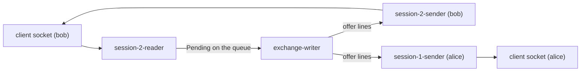

### The running example

All three flows use one real session captured while writing these guides (two raw TCP clients against the jar,
`--port 9137`). **[Verified]** (seen running):

```
alice > LOGIN alice                 alice < WELCOME participant=alice
bob   > LOGIN bob                   bob   < WELCOME participant=bob
alice > NEW a1 SELL LIMIT 10 100    alice < ORDER orderId=1 clOrdId=a1 status=RESTED filled=0 remaining=10
alice > SUBSCRIBE                   alice < SUBSCRIBED
                                    alice < BOOK seq=1 last=0 bids=- asks=100x10
bob   > NEW b1 BUY LIMIT 4 101      bob   < FILL orderId=2 clOrdId=b1 side=BUY price=100 qty=4 leaves=0 liquidity=TAKER
                                    bob   < ORDER orderId=2 clOrdId=b1 status=FILLED filled=4 remaining=0
                                    alice < FILL orderId=1 clOrdId=a1 side=SELL price=100 qty=4 leaves=6 liquidity=MAKER
                                    alice < TRADE seq=2 price=100 qty=4 aggressor=BUY
                                    alice < LEVEL seq=2 side=SELL price=100 qty=6 orders=1
bob   > NEW b1 BUY LIMIT 4 101      bob   < ORDER orderId=2 clOrdId=b1 status=REJECTED filled=0 remaining=4 reason=DUPLICATE_CLIENT_ORDER_ID
bob   > NEW b2 BUY LIMIT 1 200      bob   < ORDER orderId=4 clOrdId=b2 status=REJECTED filled=0 remaining=1 reason=PRICE_OUTSIDE_BAND
bob   > NEW b3 BUY MARKET 1 100     bob   < ERROR NEW takes 4 field(s), got 5
bob   > CANCEL 1                    bob   < CANCEL_REJECT orderId=1 reason=UNKNOWN_ORDER
alice > CANCEL 1                    alice < CANCELLED orderId=1 qty=6
                                    alice < LEVEL seq=6 side=SELL price=100 qty=0 orders=0
```

The journal file after that session (**[Verified]**, read from disk):

```
HEADER,2,1
NEW,1,2026-10-27T12:38:33.890909300Z,1,alice,a1,SELL,LIMIT,10,100
NEW,2,2026-10-27T12:38:34.862205500Z,2,bob,b1,BUY,LIMIT,4,101
NEW,3,2026-10-27T12:38:35.732225200Z,3,bob,b1,BUY,LIMIT,4,101
NEW,4,2026-10-27T12:38:36.154630600Z,4,bob,b2,BUY,LIMIT,1,200
CANCEL,5,2026-10-27T12:38:36.991832100Z,bob,1
CANCEL,6,2026-10-27T12:38:37.410921700Z,alice,1
```

Notice what is *not* there: the `MARKET 1 100` line (a syntax error at the gateway) and every `LOGIN`, `SUBSCRIBE`,
`PING`. Only commands that change, or could change, the book are journalled; the duplicate and the out-of-band
order *are* journalled, because whether they are rejected depends on state (Spec D13).

---

## Flow 1 — A NEW order that trades, over TCP

**Trigger:** bob's client sends the bytes `NEW b1 BUY LIMIT 4 101\n`. Book before: alice's order 1, SELL 10 @ 100,
resting. **Final effect:** a trade of 4 @ 100 is journalled-before-processed; bob hears FILL then ORDER; alice
hears her MAKER FILL; every subscriber hears TRADE then LEVEL.

### Sequence diagram

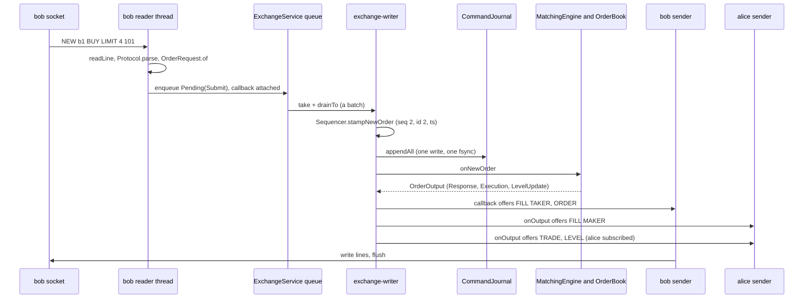

### Step by step

**Step 1 — bytes become a line (bob's reader thread).** The reader runs `readLoop`, which calls `readLine` in a
loop. `readLine` reads byte by byte, stops at `\n`, strips one trailing `\r`, and refuses anything longer than 256
bytes of content (`Protocol.MAX_LINE_LENGTH`) without buffering more than 257 bytes. **[Verified]**

```java
// src/main/java/exchangeserver/gateway/ClientSession.java:157-175 (trimmed)
static String readLine(InputStream in) throws IOException {
    ByteArrayOutputStream line = new ByteArrayOutputStream(64);
    int b;
    while ((b = in.read()) != -1) {
        if (b == '\n') {
            byte[] bytes = line.toByteArray();
            int length = bytes.length > 0 && bytes[bytes.length - 1] == '\r' ? bytes.length - 1 : bytes.length;
            if (length > Protocol.MAX_LINE_LENGTH) throw tooLong();
            return new String(bytes, 0, length, US_ASCII);
        }
        if (line.size() > Protocol.MAX_LINE_LENGTH) throw tooLong();
        line.write(b);
    }
    return null;            // a partial last line is dropped: it was never terminated
}
```

*Data shape:* `String "NEW b1 BUY LIMIT 4 101"`.

**Step 2 — syntax: the line becomes a `ClientMessage`.** `handle(line)` calls `Protocol.parse`, which splits on
single spaces (`split(" ", -1)`, so two spaces produce an empty token and an error) and switches on the first
token. `NEW` goes to `parseNew`, which parses the side and type as enum names (upper case only), then demands
exactly 6 tokens for priced types and exactly 5 for `MARKET`. **[Verified]**
`src/main/java/exchangeserver/gateway/ClientSession.java:182-189`,
`src/main/java/exchangeserver/gateway/Protocol.java:53-58`, `src/main/java/exchangeserver/gateway/Protocol.java:88-100`.

```java
// src/main/java/exchangeserver/gateway/Protocol.java:88-100 (trimmed)
private static ClientMessage parseNew(String[] t) {
    if (t.length < 5) throw new ProtocolException("NEW needs at least 4 fields");
    Side side = enumValue(Side.class, t[2], "side");
    OrderType type = enumValue(OrderType.class, t[3], "order type");
    if (type == OrderType.MARKET) {
        arity(t, 5);
        return new ClientMessage.NewOrder(t[1], side, type, number(t[4], "quantity"), OptionalLong.empty());
    }
    arity(t, 6);
    return new ClientMessage.NewOrder(t[1], side, type, number(t[4], "quantity"), OptionalLong.of(number(t[5], "price")));
}
```

A `ProtocolException` here is answered with `ERROR <text>` and the session carries on (that is how
`NEW b3 BUY MARKET 1 100` produced `ERROR NEW takes 4 field(s), got 5`). **[Verified]** (seen running;
`src/main/java/exchangeserver/gateway/ClientSession.java:184-189`).

*Data shape:* `ClientMessage.NewOrder(clientOrderId="b1", side=BUY, type=LIMIT, quantity=4, price=OptionalLong[101])`
— syntax only, no participant yet, no range checks.

**Step 3 — session checks.** `handle` answers `LOGIN`, `PING` and `QUIT` itself, then requires a logged-in
participant (`ERROR LOGIN first` otherwise), then dispatches `NewOrder` to `newOrder(p, n)`. **[Verified]**
`src/main/java/exchangeserver/gateway/ClientSession.java:191-209`. The `participant` field is `volatile` because the
reader writes it at LOGIN and the writer thread reads it while routing fills (`ClientSession.java:54-55`).

**Step 4 — stateless validation: `OrderRequest`.** `newOrder` builds the request with the general factory
`OrderRequest.of(...)`. This is the *only* field-validation layer in the system (Spec D47): participant and client
order id must match regular expressions, quantity must be 1..1,000,000,000, a priced order's price must be
1..`Rules.MAX_PRICE` (= `Long.MAX_VALUE / 1e9`, about 9.2e9, so price × quantity can never overflow), and a MARKET
order must have no price. A failure is answered on the reader thread and **never reaches the queue or the
journal**. **[Verified]** `src/main/java/exchangeserver/gateway/ClientSession.java:245-252`,
`src/main/java/exchangeserver/domain/OrderRequest.java:24-74`, `src/main/java/exchangeserver/domain/Rules.java:19-33`.

```java
// src/main/java/exchangeserver/gateway/ClientSession.java:245-263 (trimmed)
private void newOrder(String p, ClientMessage.NewOrder n) {
    OrderRequest request;
    try {
        request = OrderRequest.of(p, n.clientOrderId(), n.side(), n.type(), n.quantity(), n.price());
    } catch (IllegalArgumentException invalid) {
        send(Protocol.error("clOrdId=" + n.clientOrderId() + " " + invalid.getMessage()));
        return;
    }
    // Runs on the writer thread (or here, if refused): FILLs then ORDER, before this command's market data.
    gateway.service().submit(request, (Response response, Throwable failure) -> {
        if (failure != null) {
            send(failureLine("clOrdId=" + n.clientOrderId(), failure));
            return;
        }
        List<String> lines = new ArrayList<>(response.trades().size() + 1);
        Protocol.takerFills(response, n.side(), n.quantity(), lines);
        lines.add(Protocol.order(response));
        sendAll(lines);
    });
}
```

*Data shape:* `OrderRequest{participant="bob", clientOrderId="b1", side=BUY, orderType=LIMIT, quantity=4, price=101}`
(immutable; private constructor; `getPrice()` returns `OptionalLong`).

**Step 5 — hand-in: `ExchangeService.submit(request, callback)` (still on the reader thread).** The callback variant
wraps the request as `Request.Submit` inside a `Pending` (a request plus its own `CompletableFuture`), and calls
`enqueue`. `enqueue` attaches the callback to the future **before** queuing, then, under one lock, checks the
service state and the queue capacity and adds the request. **[Verified]**
`src/main/java/exchangeserver/core/ExchangeService.java:169-171`, `src/main/java/exchangeserver/core/ExchangeService.java:182-202`.

```java
// src/main/java/exchangeserver/core/ExchangeService.java:182-202 (trimmed)
private <R> CompletableFuture<R> enqueue(Pending<R> pending, BiConsumer<? super R, ? super Throwable> onDone) {
    if (onDone != null) {
        pending.result.whenComplete(onDone);
    }
    ExchangeException refusal = null;
    synchronized (lock) {
        if (state == State.HALTED)           refusal = new ExchangeException(HALTED, "exchange halted", haltCause);
        else if (state != State.RUNNING)     refusal = new ExchangeException(STOPPED, "exchange is stopping");
        else if (queue.size() >= settings.queueCapacity()) refusal = new ExchangeException(BUSY, "queue full");
        else                                 queue.add(pending);
    }
    if (refusal != null) {
        pending.fail(refusal);          // outside the lock: callbacks must not run while holding it
    }
    return pending.result;
}
```

Why attach first? `CompletableFuture.whenComplete` runs the callback on whichever thread completes the future. Attached
before the writer can see the request, the callback is guaranteed to run *on the writer thread, inside the
writer's processing of this command*; that is what makes the reply come out before the market data (step 12).
**[Verified]** comment `ExchangeService.java:166-168`. If the request is refused (BUSY, STOPPED, HALTED) the
callback runs right here on the reader thread and bob gets e.g. `ERROR clOrdId=b1 BUSY` (flow 6, guide 05b).

*Data shape:* `Pending{request=Request.Submit(OrderRequest), result=CompletableFuture<Response>, command=null, refused=false}`
in a `LinkedBlockingQueue<Pending<?>>`.

**Step 6 — the writer takes a batch.** The writer loops: block on `queue.take()` for one request, then
`drainTo` up to `maxBatchSize - 1` (999 by default) more that are *already* waiting, with no timer ("smart
batching", Spec D52). It removes the `STOP` marker if present (guide 05b), then calls `exchange.process(batch,
listener)`. **[Verified]** `src/main/java/exchangeserver/core/ExchangeService.java:246-265`.

```java
// src/main/java/exchangeserver/core/ExchangeService.java:251-264 (trimmed)
while (!stopping) {
    batch.clear();
    batch.add(queue.take());
    queue.drainTo(batch, settings.maxBatchSize() - 1);
    if (settings.lingerNanos() > 0) linger(batch);   // off by default; benchmark comparison only
    stopping = batch.remove(STOP);                     // always last: nothing is accepted after it
    if (!batch.isEmpty()) {
        exchange.process(batch, listener);
        batches++; processed += batch.size(); largestBatch = Math.max(largestBatch, batch.size());
    }
}
```

**Step 7 — stamping (writer thread).** `Exchange.process` first stamps every request in the batch with the
`Sequencer`, the *only* component that reads the clock or counts (Spec D32). A new order gets the next sequence
number, the next order id, and a timestamp that never goes backwards (if the clock steps back, the previous
timestamp is reused). A request whose stamping throws (an invalid cancel from a direct API caller, for example) is
marked `refused`, failed, and uses up no number. Snapshot reads are not stamped. **[Verified]**
`src/main/java/exchangeserver/core/Exchange.java:118-135`, `src/main/java/exchangeserver/command/Sequencer.java:48-52`,
`src/main/java/exchangeserver/command/Sequencer.java:74-81`.

```java
// src/main/java/exchangeserver/command/Sequencer.java:48-52
public NewOrderCommand stampNewOrder(OrderRequest request) {
    Objects.requireNonNull(request, "request");     // before stamping: a null must not use up numbers
    Instant timestamp = nextTimestamp();
    return new NewOrderCommand(nextSequenceNumber++, timestamp, nextOrderId++, request);
}
```

*Data shape:* `NewOrderCommand(sequenceNumber=2, timestamp=2026-10-27T12:38:34.862205500Z, orderId=2, request=OrderRequest)`,
stored in `Pending.command`.

**Step 8 — write-ahead: one write, one fsync for the whole batch.** `journal.appendAll(commands)` encodes every
command first (so an encoding bug writes nothing), writes the bytes, then calls `FileChannel.force(true)` — the
fsync that makes them durable. Only after it returns does anything get processed: "visible ⇒ durable" (Spec §4).
A failed write or fsync sets `failed = true` permanently ("fail-stop", D39) and propagates; the writer then halts
(guide 05b, flow 6). **[Verified]** `src/main/java/exchangeserver/core/Exchange.java:137`,
`src/main/java/exchangeserver/journal/CommandJournal.java:113-137`.

```java
// src/main/java/exchangeserver/journal/CommandJournal.java:113-137 (trimmed)
public void appendAll(List<? extends Command> commands) throws IOException {
    if (failed) throw new IllegalStateException("Journal failed earlier; restart to recover");
    if (commands.isEmpty()) return;
    StringBuilder sb = new StringBuilder(commands.size() * 96);
    for (Command command : commands) sb.append(JournalCodec.encode(command));
    ByteBuffer records = ByteBuffer.wrap(sb.toString().getBytes(UTF_8));
    try {
        while (records.hasRemaining()) channel.write(records);
        channel.force(true);
    } catch (IOException | RuntimeException e) {
        failed = true;      // a partial record may be on disk, and a failed fsync cannot be retried safely
        throw e;
    }
}
```

*Data shape:* the journal line `NEW,2,2026-10-27T12:38:34.862205500Z,2,bob,b1,BUY,LIMIT,4,101\n`
(`JournalCodec.encode`, `src/main/java/exchangeserver/journal/JournalCodec.java:68-98`).

**Step 9 — into the engine.** Back in `Exchange.process`, the second loop goes through the batch in order: skip
refused requests, answer snapshot reads, and for commands call the test-seam interceptor (a no-op in production)
then `apply`, which dispatches a `NewOrderCommand` to `MatchingEngine.onNewOrder`. **[Verified]**
`src/main/java/exchangeserver/core/Exchange.java:139-176`.

`onNewOrder` first guards determinism: the order id and sequence number must each be above the last one seen
(Spec D35), checked *before any mutation*. Then it builds the in-memory `Order` from the command and calls the
private `process`. **[Verified]** `src/main/java/exchangeserver/engine/MatchingEngine.java:61-75`.

```java
// src/main/java/exchangeserver/engine/MatchingEngine.java:61-75 (trimmed)
public OrderOutput onNewOrder(NewOrderCommand command) {
    if (command.orderId() <= lastOrderId) throw new IllegalStateException("Order id ... is not above the last one");
    checkSequence(command.sequenceNumber());
    lastOrderId = command.orderId();
    lastSequenceNumber = command.sequenceNumber();
    Order order = new Order(command.orderId(), command.request(), command.timestamp());
    List<Execution> passiveFills = new ArrayList<>();
    Response response = process(order, passiveFills);
    return new OrderOutput(command.sequenceNumber(), command.timestamp(), response, passiveFills,
            book.drainLevelUpdates());
}
```

*Data shape:* `Order{orderId=2, participant="bob", clientOrderId="b1", side=BUY, type=LIMIT, price=101,
originalQuantity=4, filledQuantity=0, timestamp=...}` — the only mutable field is `filledQuantity`
(`src/main/java/exchangeserver/domain/Order.java:16-45`).

**Step 10 — the engine's three phases.** `process` is written as (1) checks that change nothing, (2) the shared
matching loop, (3) an exhaustive `switch` over the order type (Spec D24). **[Verified]**
`src/main/java/exchangeserver/engine/MatchingEngine.java:106-173`.

*Phase 1, checks.* In order: duplicate client order id (the map entry is added even if a later check rejects —
"every new order uses up its id", D49); price band (a priced order must be within ±10% of the last trade price,
exact integer math, no band before the first trade, D50); open-order cap (LIMIT and POST_ONLY only, 10,000 resting
orders per participant); FOK fillability (walks the crossing levels without changing anything); POST_ONLY would
cross. For bob: no duplicate, no trade yet (no band), bob has 0 open orders, it is a LIMIT. **[Verified]**
`MatchingEngine.java:109-133`.

```java
// src/main/java/exchangeserver/engine/MatchingEngine.java:110-121 (trimmed)
Long original = orderIdByClientOrderId.putIfAbsent(
        new ClientOrderKey(order.getParticipant(), order.getClientOrderId()), order.getOrderId());
if (original != null) return rejected(original, order, RejectReason.DUPLICATE_CLIENT_ORDER_ID);
if (order.hasPrice() && lastTradePrice > 0 && !Rules.withinBand(order.getPrice(), lastTradePrice))
    return rejected(order.getOrderId(), order, RejectReason.PRICE_OUTSIDE_BAND);
if (order.getOrderType().canRest()
        && book.openOrders(order.getParticipant()) >= Rules.MAX_OPEN_ORDERS_PER_PARTICIPANT)
    return rejected(order.getOrderId(), order, RejectReason.MAX_OPEN_ORDERS);
```

*Phase 2, matching.* `matchLimit` gives the worst price the order may trade at (its own price for priced orders; a
collar around the last trade for MARKET). The loop asks the book for the best level on the *opposite* side; if it
crosses (a buy crosses an ask at or below its limit — the one definition, `crosses`, D28), it calls
`book.fillBest(restingSide, remaining)`, fills the incoming order by the same amount, records the last trade price,
and builds one `Trade` and one `Execution` (passive fill) per fill. **[Verified]** `MatchingEngine.java:135-151`,
`MatchingEngine.java:183-199`.

```java
// src/main/java/exchangeserver/engine/MatchingEngine.java:137-151 (trimmed)
while (order.getRemainingQuantity() > 0) {
    Optional<PriceLevel> best = book.bestLevel(restingSide);
    if (best.isEmpty() || !crosses(order.getSide(), limit, best.get().getPrice())) break;
    Fill fill = book.fillBest(restingSide, order.getRemainingQuantity());
    order.fill(fill.quantity());
    lastTradePrice = fill.price();
    long buyId  = order.getSide() == Side.BUY ? order.getOrderId() : fill.restingOrderId();
    long sellId = order.getSide() == Side.BUY ? fill.restingOrderId() : order.getOrderId();
    trades.add(new Trade(fill.price(), fill.quantity(), buyId, sellId, order.getSide(), order.getTimestamp()));
    passiveFills.add(new Execution(fill.participant(), fill.restingOrderId(), fill.clientOrderId(),
            restingSide, fill.price(), fill.quantity(), fill.leavesQuantity()));
}
```

Inside the book (package `book`, which the engine cannot reach into — every `PriceLevel` mutator is
package-private, D44): `fillBest` takes the best level from the `TreeMap` (`firstEntry()`, O(log L)), fills the
level's head order (time priority) via `PriceLevel.fillHead`, marks the level as changed for market data, and if
the head is exhausted removes it (and an emptied level) through the single removal path `removeNode`. It returns an
immutable `Fill` so the engine never holds the resting `Order`. **[Verified]**
`src/main/java/exchangeserver/book/OrderBook.java:77-94`, `src/main/java/exchangeserver/book/PriceLevel.java:96-113`.

```java
// src/main/java/exchangeserver/book/OrderBook.java:77-94 (trimmed)
public Fill fillBest(Side side, long maxQuantity) {
    Map.Entry<Long, PriceLevel> best = sideOf(side).firstEntry();
    if (best == null) throw new IllegalStateException("Fill on empty side " + side);
    PriceLevel level = best.getValue();
    OrderNode head = level.headNode();
    Order order = head.order;
    long quantity = level.fillHead(maxQuantity);
    changed.add(new LevelKey(side, level.getPrice()));
    if (order.getRemainingQuantity() == 0) removeNode(head);
    return new Fill(order.getOrderId(), order.getParticipant(), order.getClientOrderId(), side,
            level.getPrice(), quantity, order.getRemainingQuantity());
}
```

For bob: best ask is level 100 (alice's order 1, 10 remaining); `crosses(BUY, 101, 100)` is true; `fillBest(SELL, 4)`
fills 4, leaving alice 6, so her order stays. *Data shapes:*
`Fill(restingOrderId=1, participant="alice", clientOrderId="a1", restingSide=SELL, price=100, quantity=4, leavesQuantity=6)`,
`Trade(price=100, quantity=4, buyOrderId=2, sellOrderId=1, aggressorSide=BUY, timestamp=<bob's command ts>)`,
`Execution(participant="alice", orderId=1, clientOrderId="a1", side=SELL, price=100, quantity=4, leavesQuantity=6)`.
The trade price is always the resting price, and its timestamp is the incoming command's (never a clock read:
replay must reproduce it, D34). **[Verified]** `src/main/java/exchangeserver/engine/Trade.java:8-15`.

*Phase 3, outcome.* With 0 remaining, a LIMIT is `FILLED` (with some remaining it would `book.add` the remainder
and be `RESTED`; IOC/MARKET remainders are `CANCELLED`). The `Response` constructor re-checks consistency
(filled = sum of trades, a reason only with REJECTED, FILLED means nothing remains…; D22). **[Verified]**
`MatchingEngine.java:153-172`, `src/main/java/exchangeserver/engine/Response.java:18-53`.

*Data shape:* `Response(orderId=2, clientOrderId="b1", status=FILLED, rejectReason=null, filledQuantity=4,
remainingQuantity=0, trades=[Trade])`.

**Step 11 — level updates drained.** `onNewOrder` finishes with `book.drainLevelUpdates()`: for every level touched
since the last drain, in the order first touched (a `LinkedHashSet`, so deterministic), its *current absolute*
volume and order count, or 0/0 if the level is gone. **[Verified]** `src/main/java/exchangeserver/book/OrderBook.java:130-143`.

*Data shape:* `OrderOutput(sequenceNumber=2, timestamp, response, passiveFills=[Execution], levelUpdates=[LevelUpdate(SELL, 100, 6, 1)])`.

**Step 12 — the reply goes out first (writer thread).** `Exchange.process` completes this request's future with
the `Response`. Completing the future synchronously runs the callback attached in step 5, *on the writer thread*:
it formats bob's taker fills (leaves counting down trade by trade) and the ORDER line and offers them to bob's
outbound queue. Only **then** does `process` call the output listener. **[Verified]**
`src/main/java/exchangeserver/core/Exchange.java:159-164`, `src/main/java/exchangeserver/gateway/Protocol.java:131-152`.

```java
// src/main/java/exchangeserver/core/Exchange.java:159-164
p.complete(output instanceof OrderOutput o ? o.response() : ((CancelOutput) output).result());
try {
    listener.onOutput(output);
} catch (RuntimeException listenerBug) {
    LOG.log(Level.ERROR, "Output listener failed on command " + output.sequenceNumber(), listenerBug);
}
```

*Data shape:* bob's outbound queue gets
`FILL orderId=2 clOrdId=b1 side=BUY price=100 qty=4 leaves=0 liquidity=TAKER` then
`ORDER orderId=2 clOrdId=b1 status=FILLED filled=4 remaining=0`.

`send` never blocks: it `offer`s to a bounded `ArrayBlockingQueue` (10,000 lines by default) and, if the queue is
full, disconnects that client rather than stall the exchange (D54). **[Verified]**
`src/main/java/exchangeserver/gateway/ClientSession.java:77-86`.

**Step 13 — passive fills and market data (writer thread, `TcpGateway.onOutput`).** The gateway is the
`OutputListener`. It routes each `Execution` to *every* session logged in as the resting order's participant (a
`MAKER` FILL), then, if anyone is subscribed and there is public data, formats TRADE lines then LEVEL lines tagged
with the command's sequence number and offers them to every subscriber. A fill for a participant with no open
session is simply not delivered (no resend; Spec §8). **[Verified]**
`src/main/java/exchangeserver/gateway/TcpGateway.java:183-207`.

```java
// src/main/java/exchangeserver/gateway/TcpGateway.java:183-207 (trimmed)
public void onOutput(EngineOutput output) {
    for (Execution e : output.passiveFills()) {
        Set<ClientSession> owners = sessionsByParticipant.get(e.participant());
        if (owners != null) {
            String line = Protocol.makerFill(e);
            for (ClientSession s : owners) s.send(line);
        }
    }
    if (subscribers.isEmpty() || (output.trades().isEmpty() && output.levelUpdates().isEmpty())) return;
    List<String> lines = new ArrayList<>(...);
    for (Trade t : output.trades())             lines.add(Protocol.trade(output.sequenceNumber(), t));
    for (LevelUpdate l : output.levelUpdates()) lines.add(Protocol.level(output.sequenceNumber(), l));
    for (ClientSession s : subscribers)         s.sendAll(lines);
}
```

*Data shape:* alice's queue gets `FILL ... liquidity=MAKER`, `TRADE seq=2 price=100 qty=4 aggressor=BUY`,
`LEVEL seq=2 side=SELL price=100 qty=6 orders=1`.

**Step 14 — the senders write.** Each session's sender thread blocks on `outbound.take()`, writes each line plus
`\n`, and flushes only when its queue is momentarily empty (one flush per burst). **[Verified]**
`src/main/java/exchangeserver/gateway/ClientSession.java:323-343`.

**Step 15 — writer bookkeeping.** After `process` returns, the writer updates `batches`, `processed` and
`largestBatch` — *after* the futures were completed, so a caller holding a result may still see old stats (this is
what made one test flaky; fixed by reading stats only after `stop()`; Spec §10). **[Verified]**
`src/main/java/exchangeserver/core/ExchangeService.java:101-106`, `ExchangeService.java:259-263`.

### Why the ORDER reply precedes the maker FILL, TRADE and LEVEL

Two facts combine. (1) The callback was attached to the future before the request was queued, so completing the
future runs it immediately on the writer thread. (2) `Exchange.process` completes the future *before* it calls
`listener.onOutput`. So for any one command, its reply lines are offered before its market data. **[Verified]**
`ExchangeService.java:166-171`, `Exchange.java:159-161`; also tested by
`ExchangeServiceTest.callbackRunsOnTheWriterBeforeTheListener` and `TcpGatewayTest.takerHearsFillsBeforeTheOrderOutcome`.

What this does **not** promise **[Inferred]**: an order between lines on *different* sockets. Bob's sender and
alice's sender are independent threads; alice may well read her MAKER FILL before bob reads his ORDER. Ordering is
per session only.

### Variations of flow 1 (same path, different exit)

| Input | Where it exits | Journalled? | What the client sees |
|---|---|---|---|
| Malformed line (`NEW c1 BUY LIMIT ten 100`) | `Protocol.parse`, step 2 | No | `ERROR bad quantity: ten` |
| Not logged in | `handle`, step 3 | No | `ERROR LOGIN first` |
| Invalid field (quantity 0, bad clOrdId) | `OrderRequest`, step 4 | No | `ERROR clOrdId=… Quantity must be positive` |
| Queue full / stopping / halted | `enqueue`, step 5 | No | `ERROR clOrdId=… BUSY` (or `STOPPED`, `HALTED`) |
| Duplicate clOrdId (bob's second `b1`) | engine phase 1 | **Yes** (seq 3, id 3 used up) | `ORDER orderId=2 … REJECTED … reason=DUPLICATE_CLIENT_ORDER_ID` — the **original** id |
| Outside the ±10% band (`b2` @ 200 vs last 100) | engine phase 1 | **Yes** (seq 4, id 4) | `ORDER orderId=4 … REJECTED … reason=PRICE_OUTSIDE_BAND` |
| FOK that cannot fully fill | engine phase 1 | Yes | `ORDER … status=CANCELLED filled=0 remaining=<qty>` |
| POST_ONLY that would cross (equal price counts) | engine phase 1 | Yes | `ORDER … REJECTED … reason=POST_ONLY_WOULD_CROSS` |
| Engine throws a `RuntimeException` (a bug) | `Exchange.process` catch | Yes, plus a `SKIP` | `ERROR clOrdId=… INTERNAL_ERROR` (guide 05b, flow 5) |

All rows **[Verified]**: the first five and the duplicate/band rows were seen running; the others from
`MatchingEngine.java:109-133` and `Exchange.java:149-158`.

---

## Flow 2 — CANCEL

**Trigger:** a logged-in client sends `CANCEL <orderId>`. Two real cases from the example: bob sends `CANCEL 1`
(alice's order — refused), then alice sends `CANCEL 1` (her order, 6 left — cancelled, and its level disappears).

### Sequence diagram

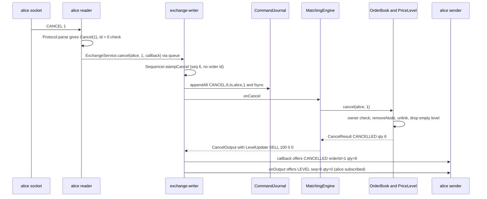

### Step by step

**Step 1 — parse.** `CANCEL` takes exactly one numeric field: `ClientMessage.Cancel(orderId=1)`. **[Verified]**
`src/main/java/exchangeserver/gateway/Protocol.java:53-70` (the `CANCEL` case).

**Step 2 — session check and hand-in (reader thread).** The session rejects a non-positive id itself (otherwise the
writer would refuse it at stamping), then calls the callback variant `service.cancel(participant, orderId,
callback)`. Note the participant comes from the *session*, not the line: a client can only cancel as itself.
**[Verified]** `src/main/java/exchangeserver/gateway/ClientSession.java:210-216`.

```java
// src/main/java/exchangeserver/gateway/ClientSession.java:210-216
} else if (message instanceof ClientMessage.Cancel c) {
    if (c.orderId() <= 0) {
        send(Protocol.error("order id must be positive"));
    } else {
        gateway.service().cancel(p, c.orderId(), (result, failure) ->
                send(failure == null ? Protocol.cancel(result) : failureLine("orderId=" + c.orderId(), failure)));
    }
}
```

*Data shape:* `Pending{request=Request.Cancel(participant="alice", orderId=1)}` → `enqueue` exactly as in flow 1,
step 5 (`ExchangeService.java:173-175`).

**Step 3 — stamp.** `stampCancel` builds the record *before* incrementing the counter, so an invalid cancel uses up
no sequence number; a cancel never gets an order id of its own (its `orderId` field is the *target*). **[Verified]**
`src/main/java/exchangeserver/command/Sequencer.java:54-58`, `src/main/java/exchangeserver/command/CancelOrderCommand.java:8-23`.

*Data shape:* `CancelOrderCommand(sequenceNumber=6, timestamp, participant="alice", orderId=1)`.

**Step 4 — journal.** Same `appendAll` as flow 1: line `CANCEL,6,2026-10-27T12:38:37.410921700Z,alice,1`. Bob's
failed attempt was journalled too (`CANCEL,5,…,bob,1`): whether a cancel succeeds depends on state, so replay must
see it. **[Verified]** (journal read from disk).

**Step 5 — engine.** `onCancel` checks the sequence number, records it, and delegates entirely to the book.
**[Verified]** `src/main/java/exchangeserver/engine/MatchingEngine.java:77-83`.

```java
// src/main/java/exchangeserver/engine/MatchingEngine.java:77-83
public CancelOutput onCancel(CancelOrderCommand command) {
    checkSequence(command.sequenceNumber());
    lastSequenceNumber = command.sequenceNumber();
    CancelResult result = book.cancel(command.participant(), command.orderId());
    return new CancelOutput(command.sequenceNumber(), command.timestamp(), result, book.drainLevelUpdates());
}
```

**Step 6 — the book: ownership, O(1) removal, level cleanup.** `OrderBook.cancel` looks the id up in the
`orderId → OrderNode` map (O(1)). If there is no node *or the caller does not own it*, the answer is
`UNKNOWN_ORDER` — deliberately indistinguishable, so a participant cannot probe which ids are live (D48). Otherwise
it records the remaining quantity, marks the level changed, and calls `removeNode`, the single removal path shared
with fill-removal (D2). **[Verified]** `src/main/java/exchangeserver/book/OrderBook.java:97-127`.

```java
// src/main/java/exchangeserver/book/OrderBook.java:97-127 (trimmed)
public CancelResult cancel(String participant, long orderId) {
    OrderNode node = orders.get(orderId);
    if (node == null || !node.order.getParticipant().equals(participant)) {
        return CancelResult.unknown(orderId);
    }
    long remaining = node.order.getRemainingQuantity();
    changed.add(new LevelKey(node.order.getSide(), node.order.getPrice()));
    removeNode(node);
    return CancelResult.cancelled(orderId, remaining);
}

private void removeNode(OrderNode node) {
    Order order = node.order;
    PriceLevel level = node.level;
    if (level == null || orders.get(order.getOrderId()) != node) throw new IllegalStateException("... is not resting");
    level.unlink(node);
    orders.remove(order.getOrderId());
    openOrders.computeIfPresent(order.getParticipant(), (p, n) -> n == 1 ? null : n - 1);
    if (level.isEmpty()) {
        PriceLevel removed = sideOf(level.getSide()).remove(level.getPrice());
        if (removed != level) throw new IllegalStateException("Removed the wrong level at ...");   // D18
    }
}
```

`PriceLevel.unlink` splices the node out of the doubly linked list in O(1) (the sentinels mean no edge-case
branches), subtracts the node's *remaining* quantity from the level's total (0 for a fully filled order, which
`fillHead` already subtracted), decrements the count, and nulls the node's links. **[Verified]**
`src/main/java/exchangeserver/book/PriceLevel.java:116-134`.

For alice: the 100 level held only her order, so it becomes empty and is removed from the `asks` `TreeMap` at once
("eager removal", D10). For bob: the owner check fails → `UNKNOWN_ORDER`, nothing marked changed, so no level update.

*Data shapes:* `CancelResult(status=CANCELLED, orderId=1, cancelledQuantity=6)` and
`CancelOutput(sequenceNumber=6, timestamp, result, levelUpdates=[LevelUpdate(SELL, 100, 0, 0)])`; for bob,
`CancelResult(UNKNOWN_ORDER, 1, 0)` with an empty level-update list.

**Step 7 — reply, then market data.** As in flow 1: the callback (on the writer) offers `CANCELLED orderId=1 qty=6`
(or `CANCEL_REJECT orderId=1 reason=UNKNOWN_ORDER`), then `onOutput` sends subscribers `LEVEL seq=6 side=SELL
price=100 qty=0 orders=0`; `qty=0` means "level gone". A cancel produces no trades and no passive fills
(`CancelOutput.trades()` and `passiveFills()` return empty lists). **[Verified]**
`src/main/java/exchangeserver/gateway/Protocol.java:154-158`, `src/main/java/exchangeserver/engine/CancelOutput.java:18-26`,
and the live transcript.

### Points worth noticing

- A cancel that loses a race with a fill (the order filled while the cancel was queued) is a *normal* outcome:
  `UNKNOWN_ORDER`, not an exception (D17). **[Verified]** `src/main/java/exchangeserver/book/CancelResult.java:5`.
- A cancel only affects the book through `OrderBook`; the engine never touches a `PriceLevel` mutator (the compiler
  forbids it: they are package-private). **[Verified]** `PriceLevel.java:17-18`.
- Disconnecting does **not** cancel resting orders (no cancel-on-disconnect). **[Verified]** Spec §6; no cancel call
  exists on any close path in `ClientSession`/`TcpGateway`.

---

## Flow 3 — SUBSCRIBE and UNSUBSCRIBE (market data)

**Trigger:** a logged-in client sends `SUBSCRIBE`. **Final effect:** it receives `SUBSCRIBED`, one `BOOK` snapshot
(best 100 levels per side), then every later TRADE / LEVEL line, with no gap and no duplicate between the snapshot
and the first update. `UNSUBSCRIBE` stops the updates.

The core problem **[Inferred, confirmed by Spec D57]**: the book lives on the writer thread. If a session read the
book from its own thread it would be a data race, and if it took a snapshot and *then* registered for updates,
an update could slip in between (a gap) or be counted twice. The fix is to do both in **one writer-thread step**.

### Sequence diagram

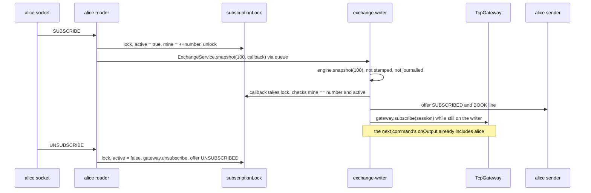

### Step by step

**Step 1 — claim the subscription (reader thread).** `subscribe()` takes the session's `subscriptionLock`; if a
subscription is already active it answers `ERROR already subscribed`; otherwise it sets `subscriptionActive = true`
and takes a new number `mine = ++subscriptionNumber`. **[Verified]**
`src/main/java/exchangeserver/gateway/ClientSession.java:276-285`.

**Step 2 — a read through the queue.** It calls `service.snapshot(Protocol.SNAPSHOT_DEPTH, callback)`. The depth is
checked on the caller's thread when `Request.Snapshot` is constructed, so a bad read can never reach, and halt, the
writer. The request goes through the same queue as orders, so it sees exactly the state after every earlier request
and before every later one. **[Verified]** `ClientSession.java:288`, `src/main/java/exchangeserver/core/Request.java:24-33`,
`src/main/java/exchangeserver/gateway/Protocol.java:45-48`.

**Step 3 — the writer answers the read.** In `Exchange.process`, a snapshot is never stamped (no `command`) and so
never journalled; in the processing loop it is answered directly from the engine and the listener is **not**
called for it. **[Verified]** `src/main/java/exchangeserver/core/Exchange.java:120-135`, `Exchange.java:145-148`.

```java
// src/main/java/exchangeserver/core/Exchange.java:145-148
if (p.request instanceof Request.Snapshot s) {
    p.complete(engine.snapshot(s.depth()));
    continue;
}
```

`MatchingEngine.snapshot(depth)` copies up to `depth` levels per side, best first, plus the last processed sequence
number and the last trade price. **[Verified]** `src/main/java/exchangeserver/engine/MatchingEngine.java:86-91`,
`MatchingEngine.java:222-231`.

*Data shape:* `BookSnapshot(sequenceNumber=1, lastTradePrice=0, bids=[], asks=[LevelUpdate(SELL, 100, 10, 1)])`.

**Step 4 — the callback, on the writer thread, under the lock.** It acts only if this is still the current
subscription (`mine == subscriptionNumber && subscriptionActive`). On a refusal it clears the claim and sends an
ERROR. Otherwise it offers `SUBSCRIBED` and the BOOK line and adds the session to the gateway's subscriber set —
all while the writer is still between commands, so the next command's `onOutput` (same thread, later) includes
this session. If the session closed meanwhile, it removes itself again. **[Verified]** `ClientSession.java:288-305`.

```java
// src/main/java/exchangeserver/gateway/ClientSession.java:288-305 (trimmed)
gateway.service().snapshot(Protocol.SNAPSHOT_DEPTH, (snapshot, failure) -> {
    synchronized (subscriptionLock) {
        if (mine != subscriptionNumber || !subscriptionActive) return;   // withdrawn by an UNSUBSCRIBE that got here first
        if (failure != null) { subscriptionActive = false; send(failureLine("SUBSCRIBE", failure)); return; }
        send("SUBSCRIBED");
        send(Protocol.book(snapshot));
        gateway.subscribe(this);
    }
    if (closed.get()) gateway.unsubscribe(this);          // closed meanwhile: removed() may already have run
});
```

*Data shape on the wire:* `SUBSCRIBED`, then `BOOK seq=1 last=0 bids=- asks=100x10` (`-` for an empty side;
`price x volume` per level, comma-separated). **[Verified]** live transcript; `Protocol.java:160-177`.

**Step 5 — updates.** From now on every command with public effects produces TRADE/LEVEL lines via
`TcpGateway.onOutput` (flow 1, step 13). LEVEL carries the *absolute* quantity at that price after the command, so a
subscriber can simply overwrite its copy; a level deeper than the 100 in the snapshot appears the first time it
changes (D62). Sequence numbers on market data are the *command* sequence numbers, so gaps are normal (a rejected
order or an UNKNOWN_ORDER cancel has no public effect). **[Verified]** Spec D62, Spec §8 "Gateway".

**Step 6 — UNSUBSCRIBE (reader thread).** Under the same lock: clear the claim, leave the subscriber set, offer
`UNSUBSCRIBED`. **[Verified]** `ClientSession.java:308-314`.

### The two races the lock and the number handle

All three actions (SUBSCRIBE claim, snapshot callback, UNSUBSCRIBE) take `subscriptionLock`, so each happens
entirely before or after the others. **[Verified]** comment `ClientSession.java:266-275`; regression test
`TcpGatewayTest.rapidSubscribeUnsubscribeEndsConsistent` (Spec §9 finding 3).

1. **UNSUBSCRIBE overtakes the snapshot.** SUBSCRIBE claims, the read is queued, UNSUBSCRIBE runs (claim cleared,
   `UNSUBSCRIBED` sent), then the callback runs, sees `!subscriptionActive`, and does nothing. The client's last
   word is `UNSUBSCRIBED`, matching reality.
2. **SUBSCRIBE, UNSUBSCRIBE, SUBSCRIBE in quick succession.** Two reads are queued, with numbers 1 and 2. Callback 1
   sees `mine (1) != subscriptionNumber (2)` and does nothing; callback 2 acts. One BOOK goes out, not two.

The lock is held only while *offering* to the non-blocking outbound queue, so the writer is never delayed by it.
**[Verified]** `ClientSession.java:274`.

### Cost bound

SUBSCRIBE costs the writer a snapshot of at most 100 levels per side, whatever the book depth; before review fix 7
it copied the whole book on the writer thread. **[Verified]** Spec D62, `TcpGatewayTest.snapshotIsBoundedToTheSnapshotDepth`.

---

## Key takeaways

- Every request crosses three threads: session reader (parse + stateless checks) → `exchange-writer` (stamp,
  journal, match) → session sender(s) (socket writes). Only the writer touches the book.
- Bad syntax and bad fields are answered at the gateway and never journalled; state-dependent rejects
  (duplicate clOrdId, band, open-order cap, post-only cross) *are* journalled so replay reproduces them.
- Write-ahead: a whole batch is stamped, written and fsynced once before any command in it is processed.
- The engine decides (checks → shared matching loop → outcome switch); the book carries it out through
  `add` / `fillBest` / `cancel`, and returns immutable `Fill`, `CancelResult`, `LevelUpdate` values.
- The reply callback is attached before queuing, so it runs on the writer before `onOutput`: FILL(TAKER) and ORDER
  precede the same command's MAKER FILL, TRADE and LEVEL — per session, not across sessions.
- Cancels are owner-only; someone else's order looks exactly like a missing one (`UNKNOWN_ORDER`).
- An emptied price level is removed in the same step; a LEVEL with `qty=0` tells subscribers it is gone.
- SUBSCRIBE is a read through the queue, and joining the subscriber set happens in the same writer step as the
  snapshot: no gap, no duplicate.

## Common confusions

- **"orderId in a DUPLICATE reject is the new order's id."** No: it is the *original* order's id (bob's second
  `b1` got `orderId=2`), so a client that lost a reply learns which order it actually has. The new command still
  used up id 3, so the next order got 4.
- **"A cancel gets an order id."** No: cancels use up a sequence number only; `CancelOrderCommand.orderId` is the
  target.
- **"Market data sequence numbers should be contiguous."** They are command numbers; commands without public
  effects leave gaps.
- **"The LEVEL line is a delta."** It is the absolute quantity and order count at that price after the command.
- **"FILL leaves= for the taker is what remains on the book."** For the taker it is the order's remaining quantity
  after that trade; for an IOC it can be > 0 and then the ORDER line says CANCELLED.
- **"SUBSCRIBE reads the book from the session thread."** It never does; that would be a data race.

## Questions to test yourself

1. A client sends `NEW x BUY LIMIT 0 100`. Which class refuses it, on which thread, and is a sequence number used?
<details><summary>Answer</summary>`OrderRequest` (quantity must be positive), on the session's reader thread inside `ClientSession.newOrder`; the client gets `ERROR clOrdId=x Quantity must be positive`. Nothing is queued or journalled, so no sequence number or order id is used.</details>

2. Bob's order trades with alice's. Can alice's client receive her MAKER FILL before bob's client receives his ORDER line?
<details><summary>Answer</summary>Yes. The reply is offered to bob's queue before alice's lines are offered to hers, but the two sessions have independent sender threads and sockets. The ordering guarantee is per session.</details>

3. Why does `ExchangeService.enqueue` attach the callback before adding the request to the queue?
<details><summary>Answer</summary>So the callback is guaranteed to run on the writer thread when the writer completes the future, which happens inside `Exchange.process` before `listener.onOutput`. Attached later, it might run on the caller's thread after the market data had been sent.</details>

4. Bob sends `CANCEL 1` for alice's order. What is journalled, and what does each client see?
<details><summary>Answer</summary>`CANCEL,<seq>,<ts>,bob,1` is journalled. Bob sees `CANCEL_REJECT orderId=1 reason=UNKNOWN_ORDER`. Alice sees nothing: the book did not change, so there is no LEVEL line.</details>

5. Alice cancels the last order at ask 100. Name the method that removes the price level, and what subscribers see.
<details><summary>Answer</summary>`OrderBook.removeNode` removes it from the `asks` TreeMap (after `PriceLevel.unlink` leaves it empty). Subscribers get `LEVEL seq=<n> side=SELL price=100 qty=0 orders=0`.</details>

6. A client sends SUBSCRIBE, UNSUBSCRIBE, SUBSCRIBE very fast. How many BOOK lines does it get and why?
<details><summary>Answer</summary>One. Each SUBSCRIBE takes a new number under `subscriptionLock`; the first snapshot callback sees that its number is no longer the current one and does nothing; only the second acts.</details>

7. Is a SUBSCRIBE snapshot written to the journal? Does the output listener hear about it?
<details><summary>Answer</summary>Neither. Snapshots are never stamped (`Exchange.process` only stamps Submit and Cancel), so they are not journalled, and the processing loop `continue`s before the listener call.</details>


---

<a id="guide-05b-core-flows-lifecycle"></a>

<!-- source: docs/understanding/05b-core-flows-lifecycle.md -->

# 05b — Core flows, part 2: startup, recovery, poison pills, shutdown

> **Project:** ExchangeServer2 | Single-instrument limit order book: price-time matching engine, write-ahead journal with replay, single writer thread, plain TCP gateway | Stack: Java 17, Maven wrapper, JUnit 5 (+ JMH, PIT)
> **This guide:** Step-by-step traces of flow 4 (startup and crash recovery), flow 5 (poison pills, live and at startup) and flow 6 (shutdown, halt, backpressure, and closing a connection after its replies), with the data shape at each step | **Prerequisites:** 01, 05a (helpful: 06) | **Related:** 05a, 06, 07-modules/journal, 07-modules/exchange-and-replay, 07-modules/exchange-service, 07-modules/client-and-main, 08-cross-cutting
> **Repo layout summary:** `pom.xml` + Maven wrapper (`mvnw`, `mvnw.cmd`) at the root; production code in `src/main/java/exchangeserver/` (packages `domain`, `book`, `engine`, `command`, `journal`, `core`, `gateway`, `client`, plus `Main`); tests mirror it in `src/test/java/exchangeserver/` (plus `bench/` JMH benchmarks and `testing/MutableClock`); design docs in `docs/` (`ExchangeServer2_Vision.md` = purpose/roadmap, `ExchangeServer2_Spec.md` = decisions D1–D65); these guides in `docs/understanding/`.

## Overview

Guide 05a followed requests through a running exchange. This guide covers how the exchange *gets* running, how it
rebuilds itself after a crash, what it does when its own engine throws, and how it stops — cleanly, by halting, or
by refusing work. These paths matter more than their size suggests: they are where "the journal is the truth"
(Vision principle 5) is actually enforced.

Terms (also in guide 13):

- **Journal**: the append-only text file of stamped commands (`HEADER`, then `NEW` / `CANCEL` / `SKIP` lines). It is
  the *only* persistent state; everything else is rebuilt from it.
- **Replay**: feeding the journalled commands, in order, through a fresh `MatchingEngine`; outputs are discarded.
- **Torn tail**: bytes after the last `\n`, left by a crash in the middle of a write.
- **fsync**: `FileChannel.force(true)`, which returns only when the bytes are on the disk.
- **Poison pill**: a journalled command that makes the engine throw — and would make every replay throw too.
- **Quarantine / SKIP**: a `SKIP,<seq>,<ts>,<skippedSeq>` record telling replay to pass over a command; history is
  annotated, never edited.
- **Halt**: the writer thread stops for good after a failure it cannot continue from; the process exits with code 2.
- **Fail-stop**: after one failed write or fsync, the journal refuses every later append until a restart.

---

## Flow 4 — Startup and crash recovery

**Trigger:** `java -jar target/exchange-server2-2.0.0-SNAPSHOT.jar --port 9000 --journal exchange.journal`, either
on a fresh file or on a journal left by a crash. **Final effect:** the book, counters, last trade price and
client-order-id map are exactly what they were after the last journalled command; new commands continue the
numbering; the gateway accepts connections.

### Sequence diagram

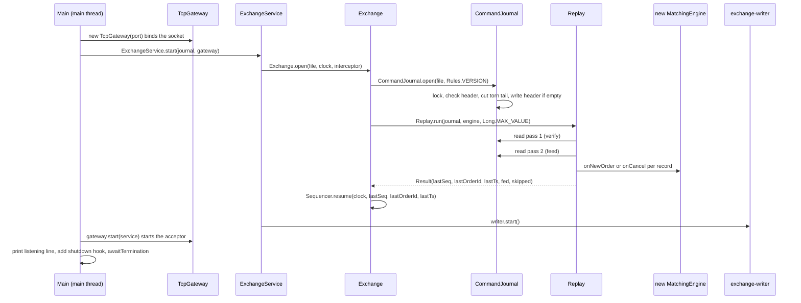

### Step by step

**Step 1 — arguments (`Main.main`).** Three options: `--port` (default 9000), `--journal` (default
`exchange.journal` in the working directory), `--quarantine <seq>` (flow 5). Anything else, or a missing value,
prints the usage line and exits 1. **[Verified]** `src/main/java/exchangeserver/Main.java:28-45`.

**Step 2 — bind the port first.** `new TcpGateway(port)` creates and binds a `ServerSocket` on *all* interfaces
(`new InetSocketAddress(port)`), with no acceptor thread yet. **[Verified]**
`src/main/java/exchangeserver/Main.java:60`, `src/main/java/exchangeserver/gateway/TcpGateway.java:62-68`.
**[Inferred]** Binding before replay means a port clash fails fast, before a possibly long replay; a client that
connects during replay waits in the OS backlog until the acceptor starts. Binding to all interfaces with an
unauthenticated LOGIN is a known, deferred security issue (guide 11).

**Step 3 — `ExchangeService.start` → `Exchange.open` (still the main thread).** Opening, and replaying, happens on
the caller's thread; only afterwards is the writer thread started. `Exchange.open` creates the journal, engine and
sequencer *itself*, so no caller ever holds a reference that could bypass the journal (D43). If anything fails, it
closes the journal (releasing its lock) and rethrows. **[Verified]**
`src/main/java/exchangeserver/core/ExchangeService.java:117-133`, `src/main/java/exchangeserver/core/Exchange.java:74-92`.

```java
// src/main/java/exchangeserver/core/Exchange.java:74-92 (trimmed)
static Exchange open(Path journalFile, Clock clock, CommandInterceptor interceptor) throws IOException {
    CommandJournal journal = CommandJournal.open(journalFile, Rules.VERSION);
    try {
        MatchingEngine engine = new MatchingEngine();
        Replay.Result replay = Replay.run(journal, engine, Long.MAX_VALUE, interceptor);
        Sequencer sequencer = Sequencer.resume(clock, replay.lastSequenceNumber(), replay.lastOrderId(),
                replay.lastTimestamp());
        return new Exchange(journal, sequencer, engine, new HashSet<>(replay.skipped()), replay.fed(), interceptor);
    } catch (IOException | RuntimeException | Error e) {
        try { journal.close(); } catch (IOException closeFailure) { e.addSuppressed(closeFailure); }
        throw e;
    }
}
```

**Step 4 — `CommandJournal.open`: lock, then check, then change.** The order is deliberate (D64, D65, added in
this session's fixes). **[Verified]** `src/main/java/exchangeserver/journal/CommandJournal.java:71-103`.

```java
// src/main/java/exchangeserver/journal/CommandJournal.java:73-103 (trimmed)
public static CommandJournal open(Path file, int rulesVersion) throws IOException {
    Lock lock = Lock.acquire(file);
    FileChannel channel = null;
    long truncated;
    try {
        channel = FileChannel.open(file, CREATE, WRITE, APPEND);            // APPEND: never overwrite history
        checkHeader(file, rulesVersion);
        truncated = cutTornTail(file);
        if (channel.size() == 0) {
            channel.write(ByteBuffer.wrap(JournalCodec.encodeHeader(rulesVersion).getBytes(UTF_8)));
            channel.force(true);
        }
    } catch (IOException | RuntimeException e) {
        // close the channel if it was opened, then lock.release(); failures are added as suppressed
        throw e;
    }
    OPEN.incrementAndGet();
    return new CommandJournal(file, channel, lock, truncated);
}
```

1. **Lock first** (`Lock.acquire`, `CommandJournal.java:198-252`), *before* the journal itself is even opened. The
   lock lives on a separate, empty file next to the journal, `<journal>.lock` (e.g. `exchange.journal.lock`), that
   nothing else ever opens:
   - create the lock file if missing (`Files.createFile`, which never opens an existing one);
   - add its real path to a static in-JVM set `HELD`; if it is already there, refuse at once — a second open in the
     same JVM never touches the lock file;
   - open the lock file and `tryLock()` the whole of it; if another process holds it, refuse.

   The refusal is `IllegalStateException("Journal … is already open (a running exchange, or a --quarantine run)")`.
   Why a separate file: on Linux and macOS Java's file locks are POSIX locks, and closing *any* handle a process
   holds on a file drops all of that process's locks on it; the header check, the torn-tail cut and `read()` open
   and close handles on the journal itself, so a lock taken on the journal would silently vanish. `close()` closes
   the journal channel, then releases the lock (closing the lock channel and leaving `HELD`); the lock file is left
   on disk (deleting it would race with the next opener; `*.journal.lock` is git-ignored). **[Verified]** code and the
   comment at `CommandJournal.java:200-206`, `close()` at `CommandJournal.java:185-196`. Seen running with the final
   code on Windows: `--quarantine` against a running server was refused, the 0-byte `.lock` file appeared next to
   the journal, and after a hard kill the server restarted on the same journal despite the leftover lock file.
   Not yet run on Linux/macOS (guide 15).
2. **Open the journal in APPEND mode** (creating it if missing): every write goes to the end; history is never
   overwritten.
3. **Check the header before changing anything** (`checkHeader`, `CommandJournal.java:256-269`). Read the first
   record. If it is complete (ends in `\n`), it must parse as `HEADER,2,<rulesVersion>` with *this build's*
   `Rules.VERSION`, otherwise refuse ("was written under rules version 9; this build uses 1…"). If there is no
   complete record, the bytes must be a prefix of the expected header (a crash while the file was being created).
   Anything else is refused, and **the file is left untouched**. **[Verified]** code; seen running (a version-9
   journal refused, exit 1; a non-journal text file refused and unchanged).
4. **Cut a torn tail** (`cutTornTail`, `CommandJournal.java:271-282`): scan backwards in 4 KiB blocks for the last
   `\n` (`endOfLastCompleteRecord`, `CommandJournal.java:284-306`), truncate everything after it, and fsync the cut
   so new records cannot follow garbage. Cost is proportional to the last record, not the file. Returns the bytes
   cut. **[Verified]**
5. **Write the header** if the file is (now) empty, and fsync it.

*Data shape:* a `CommandJournal{file, channel (APPEND), lock (the held `<journal>.lock` channel), truncatedBytesOnOpen, failed=false}`; on disk at
least `HEADER,2,1\n`.

**Step 5 — `Replay.run`: two streaming passes.** The journal is read twice with `CommandJournal.read`, which streams
bytes in 64 KiB buffers, splits on `\n`, validates (but skips) record 1 as the header, and decodes every other
record with `JournalCodec.decode`; it never holds the whole file in memory (D60). A *complete* record that does not
parse throws `IllegalStateException("Corrupt journal record <n>: …")` — it is never silently dropped (D38).
**[Verified]** `src/main/java/exchangeserver/core/Replay.java:36-43`,
`src/main/java/exchangeserver/journal/CommandJournal.java:139-171`,
`src/main/java/exchangeserver/journal/JournalCodec.java:101-126`.

*Pass 1, verify* (`Replay.Verifier`, `Replay.java:66-89`): sequence numbers must be exactly 1, 2, 3, …;
timestamps must never decrease; it remembers the last sequence number, last timestamp, the last order id *from NEW
records* (a cancel's id is a target, not an issued id), and the set of skipped sequence numbers from SKIP records.
Nothing is fed if any of this fails anywhere in the file.

*Pass 2, feed* (`Replay.feed`, `Replay.java:47-64`): every NEW / CANCEL below `stopBefore` that is not skipped goes
through the test-seam interceptor and then into the real engine; SKIP records themselves are ignored; outputs are
thrown away (they were delivered in the live run, D41).

```java
// src/main/java/exchangeserver/core/Replay.java:47-64 (trimmed)
static long feed(CommandJournal journal, MatchingEngine engine, long stopBefore, Set<Long> skipped,
                 CommandInterceptor interceptor) throws IOException {
    long[] fed = {0};
    journal.read(command -> {
        if (command.sequenceNumber() >= stopBefore || command instanceof SkipCommand
                || skipped.contains(command.sequenceNumber())) {
            return;
        }
        interceptor.beforeEngine(command);
        if (command instanceof NewOrderCommand n) engine.onNewOrder(n);
        else if (command instanceof CancelOrderCommand c) engine.onCancel(c);
        fed[0]++;
    });
    return fed[0];
}
```

Because the engine is deterministic (no clock, no counters, no randomness, no hash-iteration order — D12), feeding
the same commands rebuilds the same book, the same `lastTradePrice` (so the price band comes back), and the same
client-order-id map (so a resend after a crash is caught as a duplicate, D49). **[Verified]**
`src/main/java/exchangeserver/engine/MatchingEngine.java:21-36` comment; tests
`ExchangeTest.rebuildsTheIdenticalBookAndContinuesTheCounters`, `clientOrderIdsSurviveSoAResendAfterRestartIsCaught`.

*Data shape:* `Replay.Result(lastSequenceNumber, lastOrderId, lastTimestamp, fed, skipped)`.

**Step 6 — resume the sequencer.** `Sequencer.resume` continues at `lastSequenceNumber + 1` and `lastOrderId + 1`,
and will never stamp a timestamp earlier than the last journalled one (if the machine's clock is behind, it reuses
the last timestamp). **[Verified]** `src/main/java/exchangeserver/command/Sequencer.java:38-46`,
`Sequencer.java:74-81`.

**Step 7 — start the writer.** `new ExchangeService(...)` creates the non-daemon thread `exchange-writer`
(non-daemon so the JVM cannot exit with accepted requests unprocessed or the journal open), and `writer.start()`
runs it. `Thread.start()` is the happens-before edge that safely hands everything the main thread built during
replay to the writer thread. **[Verified]** `ExchangeService.java:108-115`, `ExchangeService.java:117-118` comment,
`ExchangeService.java:129-132`.

**Step 8 — start accepting, then wait.** `gateway.start(service)` starts the daemon thread `gateway-acceptor`;
`Main` prints `ExchangeServer2 listening on port <p>, journal <absolute path>`, registers a shutdown hook (flow 6)
and blocks in `service.awaitTermination()` (a `join` on the writer). **[Verified]** `Main.java:71-85`,
`TcpGateway.java:74-82`. The acceptor loop then accepts sockets, turns on `TCP_NODELAY`, refuses beyond 256
sessions (`ERROR too many sessions`), and starts a `ClientSession` (sender thread, then reader thread) per
connection; an `accept()` failure other than "socket closed" is logged and retried after 100 ms. **[Verified]**
`TcpGateway.java:88-124`, `src/main/java/exchangeserver/gateway/ClientSession.java:68-71`.

### Failure exits

If step 3–6 throws (locked, wrong rules version, not a journal, corrupt record, sequence gap, backwards timestamp,
or an engine exception on a replayed command), `Main` closes the gateway, prints `Startup failed: <exception>` plus a
hint about `--quarantine`, and exits **1**. **[Verified]** `Main.java:62-70`. Note the hint is printed for every
startup failure, including ones that have nothing to do with poison pills, and the version error tells the operator
to "Start a fresh journal from a snapshot" although snapshots do not exist yet (Spec §8). **[Verified]** (seen
running; `CommandJournal.java:263-264`).

### Crash recovery, seen running

During this session the server was hard-killed (no shutdown hook ran), half a record was appended
(`NEW,7,2026-10-27T12:`), and the server restarted on the same file. **[Verified]** (seen running):

- startup succeeded and printed only the usual "listening" line — **the 21-byte cut is not reported**
  (`Exchange.truncatedBytesOnOpen()` exists but `Main` never prints it);
- a new subscriber received `BOOK seq=6 last=100 bids=- asks=-`: the empty book and the last trade price were
  rebuilt by replay;
- the next order became `NEW,7,…,5,carol,c1,BUY,LIMIT,5,99`: sequence 7 and order id 5 continued correctly.

### What a crash can and cannot lose

| Crash moment | After restart | Client's view |
|---|---|---|
| Before the batch's fsync returned | Records may be missing or torn (cut) | Nobody was answered, so nobody saw an effect: consistent |
| After fsync, before replies were sent | Commands are replayed and take effect | Client heard nothing; it should resend with the **same** clOrdId and gets DUPLICATE with the original order id (D49) |
| In the middle of writing a record | Torn tail cut on open | As row 1 |

**[Verified]** Spec §4 failure model ("visible ⇒ durable" holds; "durable ⇒ visible" does not).

---

## Flow 5 — Poison pills, live and at startup

**What a poison pill is:** a journalled command on which the engine throws a `RuntimeException` (a bug). Because
replay runs the same engine on the same command, *every* future startup would throw on it too.

### 5a. Live: quarantine, rebuild, carry on

**Trigger:** within a batch, `MatchingEngine` throws on command *k*. **Final effect:** a durable `SKIP` record for
*k*; the engine is rebuilt to the state just before *k*; the rest of the batch is processed; the caller of *k* gets
`INTERNAL_ERROR`; nobody else notices.

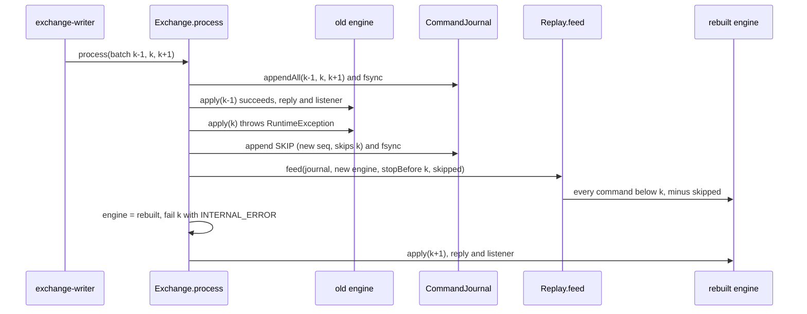

**Step by step.** **[Verified]** `src/main/java/exchangeserver/core/Exchange.java:149-158`,
`Exchange.java:178-189`.

```java
// src/main/java/exchangeserver/core/Exchange.java:149-158 (trimmed)
EngineOutput output;
try {
    interceptor.beforeEngine(p.command);
    output = apply(p.command);
} catch (RuntimeException bug) {
    quarantine(p.command, bug);
    p.fail(new ExchangeException(ExchangeException.Reason.INTERNAL_ERROR,
            "command " + p.command.sequenceNumber() + " failed and was quarantined", bug));
    continue;
}

// src/main/java/exchangeserver/core/Exchange.java:178-189 (trimmed)
private void quarantine(Command poison, RuntimeException cause) throws IOException {
    LOG.log(Level.ERROR, "Engine failed on command " + poison.sequenceNumber() + "; quarantining it", cause);
    journal.append(sequencer.stampSkip(poison.sequenceNumber()));
    skipped.add(poison.sequenceNumber());
    MatchingEngine rebuilt = new MatchingEngine();
    Replay.feed(journal, rebuilt, poison.sequenceNumber(), skipped, interceptor);
    engine = rebuilt;
}
```

1. The engine may have thrown half-way through *k* (some fills applied, others not), so the old engine is thrown
   away rather than "rolled back".
2. A `SKIP` is stamped with the *next* sequence number — after the whole batch, since the batch was stamped first —
   and appended with its own fsync. Example from `ExchangeTest.failingCommandIsQuarantinedAndTheExchangeCarriesOn`:
   orders at seq 1 and 2 (2 is the poison) → the journal gains `SKIP,3,<ts>,2`, and the next order becomes seq 4.
3. `Replay.feed` alone (no verification pass: the file was verified at open, and only this thread has appended
   since; review finding 9) rebuilds a new engine from every command before *k*, minus everything already skipped.
   That is exactly the history clients have seen, because *k*'s outputs were never emitted — outputs are only sent
   after `apply` returns.
4. The caller of *k* is failed with `ExchangeException(INTERNAL_ERROR)`; through the gateway this is
   `ERROR clOrdId=<id> INTERNAL_ERROR` (`ClientSession.failureLine`, `ClientSession.java:316-319`). The listener
   never hears of *k*.
5. The loop continues with the rebuilt engine; later commands of the same batch see the book as if *k* had never
   existed. `ExchangeTest.poisonInTheMiddleOfABatchDoesNotDisturbTheOthers` checks exactly this: a buy after the
   poison matches the sell before it, and the listener sees sequence numbers 1 and 3 only.

*Data shape:* new journal line `SKIP,<n>,<ts>,<k>`; `Exchange.skipped` gains *k*.

**What is not quarantined:** an `Error` (for example `OutOfMemoryError`, `StackOverflowError`, an `AssertionError`)
is not a `RuntimeException`, so it propagates out of `process` and halts the writer (flow 6). The same happens if
appending the SKIP fails. **[Verified]** `Exchange.java:153` catches only `RuntimeException`;
`ExchangeTest.errorsAreNotQuarantinedTheyPropagate`.

### 5b. At startup: stop and let an operator decide

**Trigger:** the journal contains a command, *without* a SKIP, on which today's engine throws during replay (for
example written by an older build, or a crash before the SKIP was durable). **Final effect:** startup fails (exit 1);
after inspecting the record the operator appends a SKIP with `--quarantine <seq>`; the next startup succeeds.

Why not skip it automatically? At startup the code cannot tell a true poison from a command that *succeeded* under
older code (and whose effects clients saw); skipping the latter would silently rebuild a different book (D51).
**[Verified]** Spec D51.

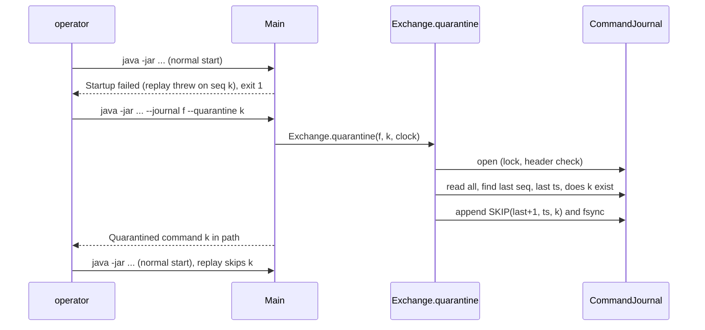

**Step by step.** **[Verified]** `src/main/java/exchangeserver/Main.java:47-58`,
`src/main/java/exchangeserver/core/Exchange.java:94-114`.

```java
// src/main/java/exchangeserver/core/Exchange.java:96-114 (trimmed)
public static void quarantine(Path journalFile, long sequenceNumber, Clock clock) throws IOException {
    try (CommandJournal journal = CommandJournal.open(journalFile, Rules.VERSION)) {
        long[] last = {0};
        Instant[] lastTimestamp = {null};
        boolean[] exists = {false};
        journal.read(c -> {
            last[0] = c.sequenceNumber();
            lastTimestamp[0] = c.timestamp();
            if (c.sequenceNumber() == sequenceNumber && !(c instanceof SkipCommand)) exists[0] = true;
        });
        if (!exists[0]) throw new IllegalArgumentException("No new-order or cancel record with sequence number " + sequenceNumber);
        Sequencer sequencer = Sequencer.resume(clock, last[0], 0, lastTimestamp[0]);
        journal.append(sequencer.stampSkip(sequenceNumber));
    }
}
```

1. `CommandJournal.open` takes the lock. If the exchange is running on that file, the tool is refused; since this
   session's fix `Main` prints `Quarantine failed: Journal … is already open (a running exchange, or a --quarantine
   run)` and exits 1. **[Verified]** seen running with the final code (lock file, `Main.java:48-55`): against a
   live server the tool printed exactly that line, exited 1, and appended nothing.
2. It reads every record (not through the engine), remembering the last sequence number and timestamp and whether
   *k* is a NEW or CANCEL record. Quarantining a SKIP, or a number that does not exist, is refused.
3. It stamps `SKIP(last + 1, ts, k)` with a sequencer resumed at the end of the file and appends it (fsync).
4. On the next normal start, the verify pass collects *k* into the skip set and the feed pass passes over it.

Limits **[Verified]**:
- A record that does not even *parse* cannot be quarantined: `journal.read` throws on it first. A corrupt complete
  record always stops startup (D38).
- The tool does not check whether *k* is already skipped; running it twice appends a second, harmless SKIP (seen in
  this session's scratch journal: `SKIP,8,…,7` then `SKIP,9,…,7`; recorded in Spec §8).

---

## Flow 6 — Shutdown, halt, backpressure, and closing a connection

### 6a. The service state machine

`ExchangeService` has four states. "Refused" and "never lost" hold together because the state check and the
enqueue happen under one lock, and `stop()` flips the state and enqueues the `STOP` marker under that same lock:
every accepted request is therefore ahead of `STOP` in the queue (D56). **[Verified]**
`src/main/java/exchangeserver/core/ExchangeService.java:35-47`, `ExchangeService.java:182-217`.

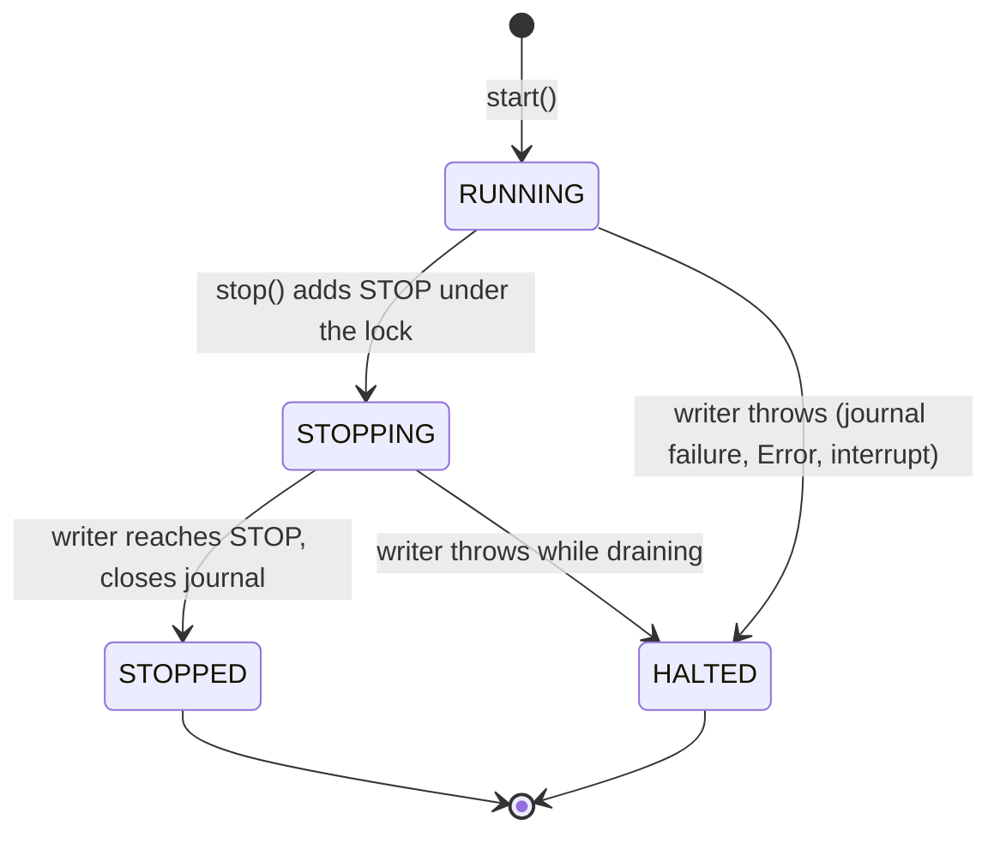

| State | New request | Already queued | Journal / writer |
|---|---|---|---|
| RUNNING | accepted (or BUSY if the queue is at capacity) | processed | open / running |
| STOPPING | refused `STOPPED` | processed (all are before STOP) | open / running |
| STOPPED | refused `STOPPED` | none left | closed / ended |
| HALTED | refused `HALTED` | refused `HALTED` | closed / ended |

### 6b. Clean shutdown (Ctrl+C)

**Trigger:** SIGINT / Ctrl+C. **Final effect:** connections dropped, every accepted request processed, journal
closed (lock released) by the writer as its last act. **Not exercised in this session** (the server could only be
hard-killed from the tool environment); the trace below is from code. **[Verified]** code. **Exit code: uncertain.**
`Main`'s comment and the README say 0, but when the JVM shuts down because of a signal the exit status normally comes
from the signal (130 for SIGINT on Linux/macOS), not from `main` returning; see guide 15 (open questions) for how
to check. **[Inferred]**

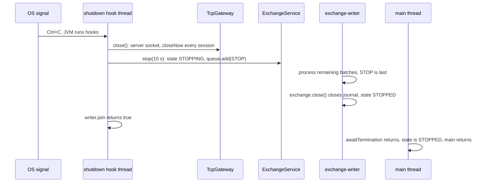

1. The hook (`Main.java:74-83`) closes the gateway first: `TcpGateway.close` closes the server socket (the acceptor's
   `accept()` throws, sees the socket closed, and returns) and calls `closeNow()` on every session: mark closed,
   unregister, close the socket, interrupt the sender. Queued outgoing lines are dropped. **[Verified]**
   `TcpGateway.java:209-216`, `ClientSession.java:94-110`.
2. It then calls `service.stop(Duration.ofSeconds(10))`: under the lock, RUNNING → STOPPING and `STOP` is added
   (the queue itself is unbounded, so this never blocks even when the capacity is reached); then `writer.join` with
   the timeout. Returns `false` (and `Main` prints "Writer thread did not stop within 10 s") if the writer is still
   alive. Idempotent. **[Verified]** `ExchangeService.java:206-217`.
3. The writer keeps taking batches. `STOP` is always the last thing in the queue, so the batch that contains it is
   the last batch: `batch.remove(STOP)` sets `stopping`, the remaining requests are processed, and the loop ends.
   Replies for sessions already closed are silently dropped (`send` checks `closed`). **[Verified]**
   `ExchangeService.java:250-265`, `ClientSession.java:78-81`.
4. In `finally`, the writer closes the `Exchange` (which closes the journal and releases the lock) — only the writer
   ever closes it, so nothing can be using it (D58) — and sets STOPPED under the lock. **[Verified]**
   `ExchangeService.java:268-282`.
5. `Main`'s main thread, blocked in `awaitTermination`, returns; the state is not HALTED, so `main` returns.

### 6c. Halt

**Trigger:** the writer catches any `Throwable` that escaped `exchange.process`: a journal `IOException` (disk
full, I/O error), the fail-stopped journal's `IllegalStateException`, an `Error` from the engine, a failure while
appending a SKIP, an interrupt, or a bug outside the engine. **Final effect:** HALTED, everyone waiting is told,
journal closed, process exits **2**; the journal is the truth on restart (fail-stop over limping, Vision principle
10). **[Verified]** `ExchangeService.java:266-271`, `ExchangeService.java:301-319`, `Main.java:85-90`.

```java
// src/main/java/exchangeserver/core/ExchangeService.java:302-319 (trimmed)
private void halt(Throwable cause, List<Pending<?>> batch) {
    LOG.log(Level.ERROR, "Exchange halted", cause);
    synchronized (lock) {
        haltCause = cause;
        state = State.HALTED;           // from here on enqueue() refuses, so the drain below is final
    }
    ExchangeException refusal = new ExchangeException(ExchangeException.Reason.HALTED, "exchange halted", cause);
    for (Pending<?> p : batch) p.fail(refusal);       // no-op for those already completed
    List<Pending<?>> left = new ArrayList<>();
    queue.drainTo(left);
    for (Pending<?> p : left) if (p != STOP) p.fail(refusal);
}
```

1. Under the lock: record the cause, set HALTED. From now on `enqueue` refuses with `HALTED`, so draining the queue
   afterwards is final — nothing can slip in behind the drain.
2. Fail every request in the current batch (those already completed are unaffected: `completeExceptionally` on a
   done future is a no-op) and everything still queued.
3. `finally` closes the journal; the state stays HALTED.
4. `Main` sees HALTED after `awaitTermination`, prints `Exchange halted: <cause>`, closes the gateway, and calls
   `System.exit(2)` (which also runs the shutdown hook; `stop` then just joins a dead thread).

**The gap a halt leaves:** commands of the failing batch were journalled (or partly), but their callers were told
`HALTED`. On restart they replay and take effect — "durable ⇒ visible" does not hold. Clients reconcile by resending
with the same client order id (D49). **[Verified]** Spec §4, `ExchangeException.java:9-11`.

### 6d. Backpressure: BUSY

`enqueue` refuses when `queue.size() >= queueCapacity` (100,000 by default), *without blocking the caller*, and
journals nothing; the caller should retry later. Through the gateway the refusal callback runs on the session's
reader thread and the client sees `ERROR clOrdId=<id> BUSY` (or `ERROR orderId=<n> BUSY` for a cancel). The capacity
is global — one queue for all sessions, with no per-session fairness (a deferred finding; guide 11). **[Verified]**
`ExchangeService.java:59-70`, `ExchangeService.java:182-202`, `ClientSession.java:316-319`;
`ExchangeServiceTest.fullQueueRefusesWithBusyAndJournalsNothing`.

A different kind of backpressure protects the writer from *slow readers*: each session's outbound queue holds at
most 10,000 lines; when an `offer` fails, that session is disconnected immediately (D54). **[Verified]**
`ClientSession.java:77-86`, `TcpGateway.java:58-60`.

### 6e. Closing a connection only after its replies (D63)

**Trigger:** the session's reader stops reading — the client sent `QUIT`, closed its sending side (end of stream),
or sent an over-long line. **Final effect:** every request that session already handed in is answered first; then
`BYE` (for QUIT only); then the connection closes. **[Verified]** `ClientSession.java:114-153`,
`ClientSession.java:199-201`; regression tests `TcpGatewayTest.quitAnswersEveryEarlierRequestBeforeBye`,
`endOfStreamStillGetsTheReplies`; seen running:

```
> LOGIN dave / NEW d1 BUY LIMIT 1 95 / NEW d2 BUY LIMIT 1 96 / QUIT     (one write)
< WELCOME participant=dave
< ORDER orderId=6 clOrdId=d1 status=RESTED filled=0 remaining=1
< ORDER orderId=7 clOrdId=d2 status=RESTED filled=0 remaining=1
< BYE
```

Before this session's fix, `QUIT` sent `BYE` and closed at once; a client sending NEW then QUIT lost the ORDER reply
for an order that had executed (199 of 200 replies lost in the regression test run against the old code).

```java
// src/main/java/exchangeserver/gateway/ClientSession.java:114-153 (trimmed)
private void readLoop() {
    boolean answerFirst = false;
    String farewell = null;
    try {
        InputStream in = new BufferedInputStream(socket.getInputStream());
        String line;
        while ((line = readLine(in)) != null) {
            if (!handle(line)) { farewell = "BYE"; break; }        // handle() returns false only for QUIT
        }
        answerFirst = true;                     // QUIT or end of stream
    } catch (ProtocolException e) {             // over-long line
        send(Protocol.error(e.getMessage()));
        answerFirst = true;
    } catch (IOException e) {
        // connection gone: nobody left to answer
    } finally {
        if (answerFirst) closeAfterReplies(farewell); else close();
    }
}

private void closeAfterReplies(String farewell) {
    gateway.service().snapshot(1, (snapshot, failure) -> {
        if (farewell != null) send(farewell);
        close();
    });
}
```

How it works: the exchange queue is FIFO and processed in order, so a depth-1 snapshot read queued *now* completes
after every request this session queued earlier, and their reply callbacks have already offered their lines to the
outbound queue. The read's own callback then offers `BYE` and calls `close()`, which puts the `CLOSE` sentinel
behind them; the sender writes everything, then closes the socket. A broken connection (`IOException`) still closes
at once — there is nobody to answer. During shutdown the read is refused immediately, so the session closes without
waiting (the gateway drops connections then anyway). **[Verified]** code and Spec D63.

---

## Key takeaways

- Startup = bind port → open journal (lock → header check → torn-tail cut → header) → two-pass replay (verify, then
  feed) → resume sequencer → start writer → start acceptor. Any failure exits 1 and leaves the journal untouched
  except for a legitimate torn-tail cut.
- Replay rebuilds *everything* (book, counters, last trade price, client-order-id map) because the engine is
  deterministic; the journal is the only persistent state.
- Only one process may have a journal open (D65); a non-journal or other-rules file is refused unchanged (D64).
- Live poison pill: SKIP (fsynced) → rebuild from commands before it → carry on; caller gets INTERNAL_ERROR. At
  startup a failing record is never skipped automatically; the operator runs `--quarantine <seq>`.
- `Error`s and journal failures are not quarantined: they halt the writer, every waiting request is refused
  HALTED, and the process exits 2.
- `stop()` is safe against racing producers because the state flip and the `STOP` marker share the enqueue lock;
  everything accepted before `STOP` is processed.
- BUSY is non-blocking backpressure at hand-in; slow *readers* are disconnected instead of being waited for.
- QUIT, end of stream and an over-long line close a session only after its earlier requests are answered (D63).

## Common confusions

- **"The torn-tail cut is reported somewhere."** It is not printed; only `Exchange.truncatedBytesOnOpen()` knows,
  and only tests read it.
- **"A SKIP removes the poison from the file."** It does not; the poison stays, and the SKIP (with its own,
  later sequence number) tells replay to pass over it.
- **"The SKIP gets the poison's sequence number + 1."** It gets the next number *after the whole batch*, because the
  batch was stamped before processing began.
- **"STOPPED and HALTED are the same."** STOPPED processes everything already accepted; HALTED refuses everything
  still queued, and its batch may contain commands that are journalled but whose callers were told HALTED.
- **"`stop()` waits forever."** It waits at most the timeout and returns `false` if the writer is still alive.
- **"Closing a connection cancels its orders."** No cancel-on-disconnect exists; resting orders stay.
- **"The writer's stats are up to date when my future completes."** They are updated after the batch's futures;
  read them after `stop()` (that is what fixed the flaky test).

## Questions to test yourself

1. The server crashed after fsyncing a batch but before replying. Bob never got his ORDER. What should bob's client do, and what will it see?
<details><summary>Answer</summary>Resend the same NEW with the same client order id. Replay already applied the original, so the engine rejects the resend as DUPLICATE_CLIENT_ORDER_ID and the ORDER line carries the original order id, which bob can then use (e.g. to cancel).</details>

2. A batch holds commands with sequence numbers 10, 11, 12. The engine throws on 11. What new journal record appears, and what engine state does 12 run against?
<details><summary>Answer</summary>`SKIP,13,<ts>,11` (13 because 10–12 were stamped before processing). Command 12 runs against a new engine rebuilt by `Replay.feed` from every command below 11 minus earlier skips — i.e. the state after 10.</details>

3. Why does `CommandJournal.open` lock a separate `<journal>.lock` file instead of the journal itself, and why is there also an in-JVM `HELD` set?
<details><summary>Answer</summary>On Linux/macOS Java file locks are POSIX locks: closing any handle the process has on the locked file drops the process's locks on it, and `open`/`read` open and close handles on the journal all the time, so a lock on the journal would vanish. A lock file nothing else opens keeps the lock alive. `HELD` refuses a second open in the same JVM before it opens (and later closes) the lock file, for the same reason — and because the OS lock alone would not stop a second open in the same process.</details>

4. You point `--journal` at `notes.txt` (two lines, no trailing newline). What happens to the file now, and what happened before D64?
<details><summary>Answer</summary>Now: the first record is complete but not a header, so `open` refuses and the file is unchanged (seen running). Before: the torn-tail cut ran first and removed the unterminated last line, then the header check refused it.</details>

5. During shutdown a client sends NEW after `stop()` was called. What does it get, and is anything journalled?
<details><summary>Answer</summary>`enqueue` sees STOPPING and refuses with STOPPED, on the reader thread: `ERROR clOrdId=<id> STOPPED`. Nothing is journalled. (In practice the gateway is closed first, so the client is usually disconnected before it can send.)</details>

6. Why is an `Error` from the engine not quarantined like a `RuntimeException`?
<details><summary>Answer</summary>`Exchange.process` catches only `RuntimeException`. An `Error` (out of memory, stack overflow) says the JVM itself may be unhealthy, so the code fail-stops: the writer halts, everyone waiting gets HALTED, and the process exits 2.</details>

7. A client sends 200 NEW lines followed by QUIT in one write. In what order do lines come back, and why is that guaranteed?
<details><summary>Answer</summary>200 ORDER lines (plus any FILL lines), then BYE, then the connection closes. QUIT makes the session queue a depth-1 snapshot read behind its 200 requests; the queue is processed in order, so that read's callback (which sends BYE and closes) runs after every earlier reply callback.</details>


---

<a id="guide-06-data-and-state"></a>

<!-- source: docs/understanding/06-data-and-state.md -->

# 06 — Data and state

> **Project:** ExchangeServer2 | Single-instrument limit order book: price-time matching engine, write-ahead journal with replay, single writer thread, plain TCP gateway | Stack: Java 17, Maven wrapper, JUnit 5 (+ JMH, PIT)
> **This guide:** Every data model (domain, commands, book, engine outputs, core requests, gateway messages), the journal file format, the wire protocol, where each piece of state lives and which thread may touch it, how state changes over time, the validation layers, what persists, and how "migrations" work | **Prerequisites:** 01 (helpful: 02 for records and sealed interfaces) | **Related:** 05a, 05b, 07-modules/domain-and-commands, 07-modules/book, 07-modules/engine, 07-modules/journal, 07-modules/gateway, 13
> **Repo layout summary:** `pom.xml` + Maven wrapper (`mvnw`, `mvnw.cmd`) at the root; production code in `src/main/java/exchangeserver/` (packages `domain`, `book`, `engine`, `command`, `journal`, `core`, `gateway`, `client`, plus `Main`); tests mirror it in `src/test/java/exchangeserver/` (plus `bench/` JMH benchmarks and `testing/MutableClock`); design docs in `docs/` (`ExchangeServer2_Vision.md` = purpose/roadmap, `ExchangeServer2_Spec.md` = decisions D1–D65); these guides in `docs/understanding/`.

## Overview

ExchangeServer2 has no database. Its data lives in three places:

1. **One journal file** — the only thing that persists. Plain text, one record per line.
2. **In-memory state owned by the single writer thread** — the order book, the engine's counters and maps, the
   sequencer. All of it is rebuilt from the journal at startup.
3. **Per-connection gateway state** — sessions, subscriptions, outbound queues. Never persisted; lost on restart.

Most types are Java **records** (immutable data classes with generated accessors, `equals` and `hashCode`) and
**sealed interfaces** (an interface that lists exactly which classes may implement it, so the compiler knows every
case). Guide 02 explains both. Two design rules shape almost every type **[Verified]** (Spec D22, D31, D47):

- **An invalid value cannot be constructed.** Constructors (including records' "compact constructors") check their
  fields and throw. So code that holds an `OrderRequest`, a `Command` or a `Response` never re-checks it.
- **Validation happens once, at the right layer.** Stateless field rules live only in `OrderRequest`; rules that
  depend on the book live only in the engine.

Prices and quantities are plain `long` integers everywhere. The code never says what one unit of price is (a cent,
a tick) or what instrument is traded. **[Verified]** (no currency, tick or decimal type anywhere in
`src/main/java`); the intended unit is unknown — see guide 15.

---

## 1. Data models

### 1.1 Domain (`exchangeserver.domain`)

| Type | Kind | Fields / values | Rules enforced | Source |
|---|---|---|---|---|
| `Side` | enum | `BUY`, `SELL`; `opposite()` | — | `src/main/java/exchangeserver/domain/Side.java:3-10` |
| `OrderType` | enum | `LIMIT`, `IOC`, `FOK`, `MARKET`, `POST_ONLY`; `canRest()` true only for LIMIT and POST_ONLY | — | `src/main/java/exchangeserver/domain/OrderType.java:12-23` |
| `Rules` | constants | `VERSION=1`, `MAX_ORDER_QUANTITY=1e9`, `MAX_PRICE=Long.MAX_VALUE/1e9` (≈9.2e9), `PARTICIPANT=[A-Za-z0-9_]{1,16}`, `CLIENT_ORDER_ID=[A-Za-z0-9_.-]{1,32}`, `PRICE_BAND_PERCENT=10`, `MAX_OPEN_ORDERS_PER_PARTICIPANT=10,000`, `withinBand(price, ref)` | every rule replay depends on | `src/main/java/exchangeserver/domain/Rules.java:17-44` |
| `OrderRequest` | final class, private constructor | `participant`, `clientOrderId`, `side`, `orderType`, `quantity`, `price` (`-1` internally for MARKET) | the regexes, 1 ≤ quantity ≤ 1e9, 1 ≤ price ≤ MAX_PRICE for priced types, MARKET has no price | `src/main/java/exchangeserver/domain/OrderRequest.java:15-74` |
| `Order` | final class, one mutable field | `orderId`, the request's fields, `timestamp`, **`filledQuantity`** (mutable) | id > 0, non-null timestamp; `fill(q)` rejects q ≤ 0 and overfill; `getPrice()` throws for MARKET | `src/main/java/exchangeserver/domain/Order.java:16-103` |

Two details worth knowing **[Verified]**:

- The participant and client-order-id patterns forbid `,` and spaces because those separate fields in the journal
  and the wire protocol (`Rules.java:25`).
- A market order's "no price" is the sentinel `Order.NO_PRICE = -1` inside the objects, but it never leaks: the API
  returns `OptionalLong` (`OrderRequest.getPrice()`, `OrderRequest.java:116-118`) and `Order.getPrice()` throws for
  MARKET (`Order.java:71-77`); the journal writes `-`.

```java
// src/main/java/exchangeserver/domain/Rules.java:38-43
// Exact integer comparison, no rounding: price * 100 vs reference * (100 +- band).
// Cannot overflow: both prices are <= MAX_PRICE (~9.2e9), times at most 110.
public static boolean withinBand(long price, long referencePrice) {
    return price * 100 <= referencePrice * (100 + PRICE_BAND_PERCENT)
            && price * 100 >= referencePrice * (100 - PRICE_BAND_PERCENT);
}
```

### 1.2 Commands (`exchangeserver.command`) — what the journal stores

A **command** is a request after the writer thread has stamped it: the immutable, journalled source of truth
(D12, D31). `Command` is a sealed interface with three records. **[Verified]**
`src/main/java/exchangeserver/command/Command.java:11-16`.

| Record | Fields | Constructor checks | Source |
|---|---|---|---|
| `NewOrderCommand` | `sequenceNumber`, `timestamp`, `orderId`, `request` (an `OrderRequest`) | seq > 0, id > 0, non-nulls | `NewOrderCommand.java:8-21` |
| `CancelOrderCommand` | `sequenceNumber`, `timestamp`, `participant`, `orderId` (the **target**) | seq > 0, participant matches the regex, id > 0 | `CancelOrderCommand.java:9-23` |
| `SkipCommand` | `sequenceNumber`, `timestamp`, `skippedSequenceNumber` | seq > 0, 0 < skipped < seq (only an earlier command) | `SkipCommand.java:14-24` |

The `Sequencer` (`Sequencer.java:20-82`) is the only place that creates the stamps: one counter for sequence
numbers (every command), one for order ids (new orders only), and a timestamp from an injected `java.time.Clock`
that never goes backwards.

### 1.3 Book (`exchangeserver.book`)

```java
// src/main/java/exchangeserver/book/OrderBook.java:37-45
private record LevelKey(Side side, long price) { }

private final TreeMap<Long, PriceLevel> bids = new TreeMap<>(Comparator.reverseOrder());   // best = highest
private final TreeMap<Long, PriceLevel> asks = new TreeMap<>();                            // best = lowest
private final Map<Long, OrderNode> orders = new HashMap<>();          // orderId -> node, iff resting
private final Map<String, Integer> openOrders = new HashMap<>();      // participant -> resting count
private final Set<LevelKey> changed = new LinkedHashSet<>();          // levels touched since last drain
```

| Type | What it is | Source |
|---|---|---|
| `OrderBook` | Two sorted maps of price levels, an id map for O(1) cancel, per-participant counts, and the "changed" set that feeds market data. Owns the lifecycle of every resting order. | `src/main/java/exchangeserver/book/OrderBook.java:35-45` |
| `PriceLevel` | All orders resting at one price on one side, in time priority, as a doubly linked list between two sentinel nodes (`head <-> o1 <-> o2 <-> tail`), plus `totalVolume` and `orderCount`. Public getters; every mutator package-private. | `src/main/java/exchangeserver/book/PriceLevel.java:9-41` |
| `OrderNode` | Package-private list node: `order` (null only for sentinels), `prev`, `next`, `level` (the level it is linked in, null when unlinked). | `src/main/java/exchangeserver/book/OrderNode.java:7-35` |
| `Fill` | Immutable record of what `fillBest` did to one resting order: id, participant, clOrdId, side, price, quantity, leaves. | `src/main/java/exchangeserver/book/Fill.java:5-13` |
| `LevelUpdate` | `(side, price, volume, orderCount)`: the absolute state of one level after a command; volume 0 = gone. | `src/main/java/exchangeserver/book/LevelUpdate.java:5-11` |
| `CancelResult`, `CancelStatus` | `(status, orderId, cancelledQuantity)`; `CANCELLED` (qty > 0) or `UNKNOWN_ORDER` (qty 0). | `src/main/java/exchangeserver/book/CancelResult.java:6-24` |

A **sentinel** is a dummy node at each end of the list so that linking and unlinking never need "is this the
first/last node?" branches. **[Verified]** `PriceLevel.java:11-15`.

### 1.4 Engine outputs (`exchangeserver.engine`)

| Type | Fields | Notes | Source |
|---|---|---|---|
| `Response` | `orderId, clientOrderId, status, rejectReason, filledQuantity, remainingQuantity, trades` | constructor rejects contradictions: filled = Σ trades, a reason iff REJECTED, FILLED ⇒ 0 remaining, RESTED/CANCELLED ⇒ > 0 remaining, REJECTED ⇒ nothing filled | `src/main/java/exchangeserver/engine/Response.java:15-53` |
| `OrderStatus` | `FILLED, RESTED, CANCELLED, REJECTED` | | `OrderStatus.java:4-9` |
| `RejectReason` | `DUPLICATE_CLIENT_ORDER_ID, PRICE_OUTSIDE_BAND, MAX_OPEN_ORDERS, POST_ONLY_WOULD_CROSS` | all state-dependent, all journalled | `RejectReason.java:9-18` |
| `Trade` | `price, quantity, buyOrderId, sellOrderId, aggressorSide, timestamp` | price = resting price; timestamp = incoming command's | `Trade.java:15-26` |
| `Execution` | `participant, orderId, clientOrderId, side, price, quantity, leavesQuantity` | a passive (maker) fill, addressed to the resting order's owner | `Execution.java:11-12` |
| `EngineOutput` (sealed) | `sequenceNumber, timestamp, trades(), passiveFills(), levelUpdates()` | `OrderOutput` (adds `response`) or `CancelOutput` (adds `result`) | `EngineOutput.java:14-25`, `OrderOutput.java:9-22`, `CancelOutput.java:10-26` |
| `BookSnapshot` | `sequenceNumber, lastTradePrice, bids, asks` (lists of `LevelUpdate`, best first) | 0 = no command / no trade yet | `BookSnapshot.java:14-19` |

Every list in these records is defensively copied with `List.copyOf`, so an output cannot change after it is built.
**[Verified]** e.g. `Response.java:21`, `OrderOutput.java:14-15`.

### 1.5 Core hand-in (`exchangeserver.core`)

| Type | What it is | Source |
|---|---|---|
| `Request<R>` (sealed, package-private) | What a caller hands in, *before* stamping: `Submit(OrderRequest)` → `Response`, `Cancel(participant, orderId)` → `CancelResult`, `Snapshot(depth)` → `BookSnapshot` (depth checked on the caller's thread). | `src/main/java/exchangeserver/core/Request.java:16-34` |
| `Pending<R>` (package-private) | One request in flight: `request`, its own `CompletableFuture<R> result`, plus `command` and `refused`, set by the writer. No field is volatile: the queue's put→take and the future's complete→get are the happens-before edges. | `src/main/java/exchangeserver/core/Pending.java:7-36` |
| `ExchangeException` | Why a request got no business result: `BUSY`, `STOPPED`, `HALTED`, `INTERNAL_ERROR`. | `src/main/java/exchangeserver/core/ExchangeException.java:16-41` |
| `ExchangeService.Settings` | `queueCapacity` (100,000), `maxBatchSize` (1,000), `lingerNanos` (0 = smart batching), `clock` (UTC). | `src/main/java/exchangeserver/core/ExchangeService.java:59-87` |

The queue carries *requests*, not commands, so that stamping happens on the writer thread and "sequence order =
queue order = processing order" holds without locking (D55). **[Verified]** `Request.java:8-15`.

### 1.6 Gateway (`exchangeserver.gateway`)

`ClientMessage` is a sealed interface of records for one parsed client line, syntax only: `Login(participant)`,
`NewOrder(clientOrderId, side, type, quantity, OptionalLong price)`, `Cancel(orderId)`, `Subscribe()`,
`Unsubscribe()`, `Ping()`, `Quit()`. The session adds the participant and builds the `OrderRequest`.
**[Verified]** `src/main/java/exchangeserver/gateway/ClientMessage.java:8-32`.

### 1.7 Class diagram

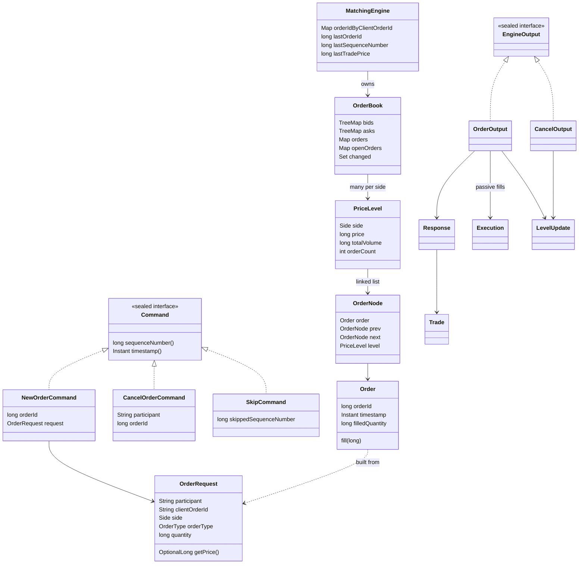

---

## 2. The journal file format

**[Verified]** `src/main/java/exchangeserver/journal/JournalCodec.java:16-41`, Spec §4.

```
HEADER,<formatVersion=2>,<rulesVersion>                                       (first record only)
NEW,<seq>,<timestamp>,<orderId>,<participant>,<clientOrderId>,<side>,<type>,<quantity>,<price or ->
CANCEL,<seq>,<timestamp>,<participant>,<targetOrderId>
SKIP,<seq>,<timestamp>,<skippedSeq>
```

- UTF-8 text, `,`-separated, every record ends in `\n` (LF only).
- Timestamps are `Instant.toString()` (ISO-8601 UTC, exact to the nanosecond); enums by `name()`; a MARKET order's
  price is `-`.
- A SKIP has its own sequence number; the skipped record stays in the file.

A real journal from this session, including a quarantine **[Verified]** (read from disk):

```
HEADER,2,1
NEW,1,2026-10-27T12:38:33.890909300Z,1,alice,a1,SELL,LIMIT,10,100
NEW,2,2026-10-27T12:38:34.862205500Z,2,bob,b1,BUY,LIMIT,4,101
NEW,3,2026-10-27T12:38:35.732225200Z,3,bob,b1,BUY,LIMIT,4,101        <- duplicate clOrdId: rejected, still journalled
NEW,4,2026-10-27T12:38:36.154630600Z,4,bob,b2,BUY,LIMIT,1,200        <- outside the band: rejected, still journalled
CANCEL,5,2026-10-27T12:38:36.991832100Z,bob,1                        <- not bob's order: UNKNOWN_ORDER
CANCEL,6,2026-10-27T12:38:37.410921700Z,alice,1
NEW,7,2026-10-27T12:38:57.279532800Z,5,carol,c1,BUY,LIMIT,5,99       <- after a crash and restart: ids continue
SKIP,8,2026-10-27T12:51:59.624498Z,7                                 <- operator quarantined seq 7
```

(The `<-` notes are added here; they are not in the file.)

Decoding goes back through `OrderRequest.of`, so a journal record must satisfy the same stateless rules as a
gateway request (no third copy of the rules). Anything that does not parse — a wrong field count, a bad number or
timestamp, an unknown enum, an invalid participant — is `IllegalStateException("Corrupt journal record <n>: …")`,
where record 1 is the header. **[Verified]** `JournalCodec.java:101-126`.

How the file behaves at open, in order (D65, D64, D38): lock the separate `<journal>.lock` file (plus an in-JVM set of held lock files); check the first record is this format and rules
version (or a prefix of the header); cut bytes after the last `\n`; write a header if empty. A **complete** corrupt
record is never dropped — startup fails. **[Verified]** `src/main/java/exchangeserver/journal/CommandJournal.java:71-103`.

**[Verified, seen running]** A journal converted to CRLF line endings (e.g. by an editor or a tool that rewrites
line endings) no longer opens: the header becomes `HEADER,2,1\r`, which fails to parse. Spec §8 records this.

---

## 3. The wire protocol

ASCII lines ending in `\n` (`\r\n` accepted), tokens separated by single spaces, at most 256 bytes of content.
Server lines are `TYPE key=value …` so fields can be added without breaking parsers (D53). **[Verified]**
`src/main/java/exchangeserver/gateway/Protocol.java:16-48`.

### Client → server

| Line | Meaning | Checked where |
|---|---|---|
| `LOGIN <participant>` | Claim an identity (no password). Once per connection. | `ClientSession.login`, `ClientSession.java:225-243` |
| `NEW <clOrdId> <BUY\|SELL> <LIMIT\|IOC\|FOK\|POST_ONLY> <qty> <price>` | Priced order | `Protocol.parseNew`, then `OrderRequest.of` |
| `NEW <clOrdId> <BUY\|SELL> MARKET <qty>` | Market order (no price field) | same |
| `CANCEL <orderId>` | Cancel your own resting order | `Protocol.parse`, `ClientSession.java:210-216` |
| `SUBSCRIBE` / `UNSUBSCRIBE` | Start / stop market data | `ClientSession.java:276-314` |
| `PING` | Liveness | answered `PONG` by the reader |
| `QUIT` | Close after every earlier request is answered, then `BYE` (D63) | `ClientSession.java:199-201` |

### Server → client

| Line | When | Example (seen running) |
|---|---|---|
| `WELCOME participant=` | after LOGIN | `WELCOME participant=alice` |
| `FILL orderId= clOrdId= side= price= qty= leaves= liquidity=TAKER\|MAKER` | one per trade, to the taker (before ORDER) and to every session of the maker | `FILL orderId=1 clOrdId=a1 side=SELL price=100 qty=4 leaves=6 liquidity=MAKER` |
| `ORDER orderId= clOrdId= status= filled= remaining= [reason=]` | outcome of a NEW | `ORDER orderId=4 clOrdId=b2 status=REJECTED filled=0 remaining=1 reason=PRICE_OUTSIDE_BAND` |
| `CANCELLED orderId= qty=` / `CANCEL_REJECT orderId= reason=UNKNOWN_ORDER` | outcome of a CANCEL | `CANCELLED orderId=1 qty=6` |
| `BOOK seq= last= bids=<p>x<q>,… asks=…` | snapshot after SUBSCRIBE (best 100 levels/side; `-` if empty) | `BOOK seq=1 last=0 bids=- asks=100x10` |
| `TRADE seq= price= qty= aggressor=` | to subscribers | `TRADE seq=2 price=100 qty=4 aggressor=BUY` |
| `LEVEL seq= side= price= qty= orders=` | to subscribers; absolute; `qty=0` = level gone | `LEVEL seq=6 side=SELL price=100 qty=0 orders=0` |
| `SUBSCRIBED`, `UNSUBSCRIBED`, `PONG`, `BYE` | acknowledgements | |
| `ERROR <text>` | syntax error, invalid field, refusal (`BUSY`/`STOPPED`/`HALTED`/`INTERNAL_ERROR`), over-long line | `ERROR NEW takes 4 field(s), got 5` |

`seq` on BOOK/TRADE/LEVEL is the *command* sequence number, so gaps are normal. **[Verified]** Spec §8.

---

## 4. Where state lives

| State | Location | Owner thread(s) | Persisted? | After a restart |
|---|---|---|---|---|
| The journal records | file on disk; `CommandJournal.channel` (APPEND), `failed` flag | writer appends; `read` may run while open (poison rebuild) | **yes — the only thing** | read and replayed |
| Bids, asks, id map, open-order counts, changed set | `OrderBook` fields, `OrderBook.java:40-45` | writer only | no | rebuilt by replay |
| Orders' filled quantities | `Order.filledQuantity`, `Order.java:28` | writer only | no | rebuilt by replay |
| Client-order-id map, last order id, last sequence number, last trade price | `MatchingEngine.java:42-46` | writer only | no | rebuilt by replay (so duplicates and the band survive restarts) |
| Next sequence number, next order id, previous timestamp | `Sequencer.java:22-25` | writer only | no | resumed from the replayed last values |
| Quarantined (skipped) sequence numbers, current engine reference | `Exchange.java:51-58` | writer only (built on main thread before `Thread.start`) | no (the SKIP records are) | collected by the verify pass |
| Request queue, service state, halt cause, stats | `ExchangeService.java:91-106` | any thread hands in under `lock`; writer takes; `state`/stats `volatile` | no | empty queue, RUNNING |
| Open journal count (diagnostic) | static `CommandJournal.OPEN`, `CommandJournal.java:50` | any (atomic) | no | — |
| Exclusive-open lock (D65) | empty file `<journal>.lock` next to the journal, held via `CommandJournal.lock`; static in-JVM set `CommandJournal.HELD` of held lock-file paths, `CommandJournal.java:52-53`, `CommandJournal.java:198-252` | whoever calls `open`/`close` (main thread at startup, writer at close) | the file stays on disk (empty, git-ignored); the lock does not | re-acquired on open; a stale file is harmless |
| Sessions, subscribers, participant → sessions | `TcpGateway.java:51-56` (concurrent sets/maps) | acceptor, readers, writer | no | empty: clients reconnect, LOGIN, re-SUBSCRIBE |
| One session's outbound queue, `closed`, `participant`, subscription flag and number | `ClientSession.java:41-55` | reader, sender, writer (`participant` volatile; subscription fields guarded by `subscriptionLock`) | no | gone |
| Passive fills for a participant with no session | nowhere | — | **no** | lost: no resend (Spec §8) |

**[Verified]** for every row from the cited fields and comments; the "single writer" rule is stated in
`ExchangeService.java:22-28` and `OrderBook.java:29`.

The important consequence: **only the writer thread may touch the book, engine, sequencer or journal.** Other
threads reach them only through the queue — reads included (a snapshot is a queued request). Tests that inspect
state must also go through a future. **[Verified]** `CLAUDE.md` "Single writer", Spec D57.

---

## 5. How state changes over time

### 5.1 An order's lifecycle

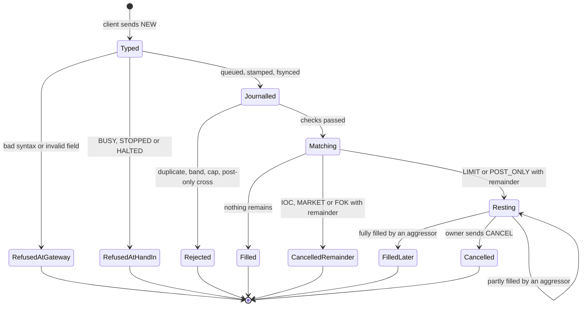

A FOK that cannot fill entirely never trades: it is answered `CANCELLED` with nothing filled before the loop runs.
A POST_ONLY never trades: it rests or is rejected. **[Verified]** `MatchingEngine.java:123-133`, Spec §2 order-type
table. Only `Order.filledQuantity` changes while an order rests; everything else about it is final.

### 5.2 The service

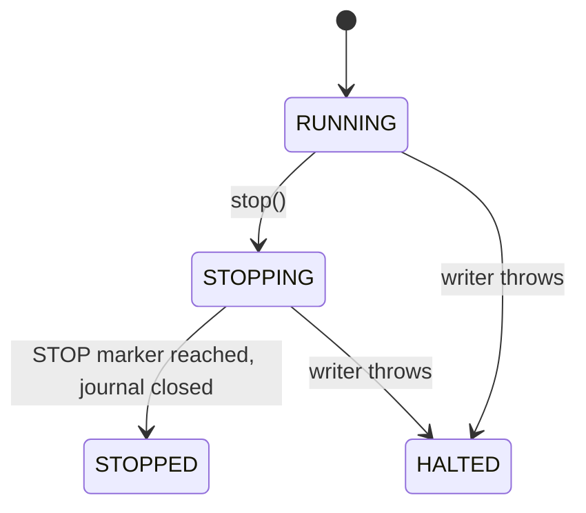

**[Verified]** `ExchangeService.java:35-47`. Details and refusal rules: guide 05b, flow 6.

### 5.3 A connection (session)

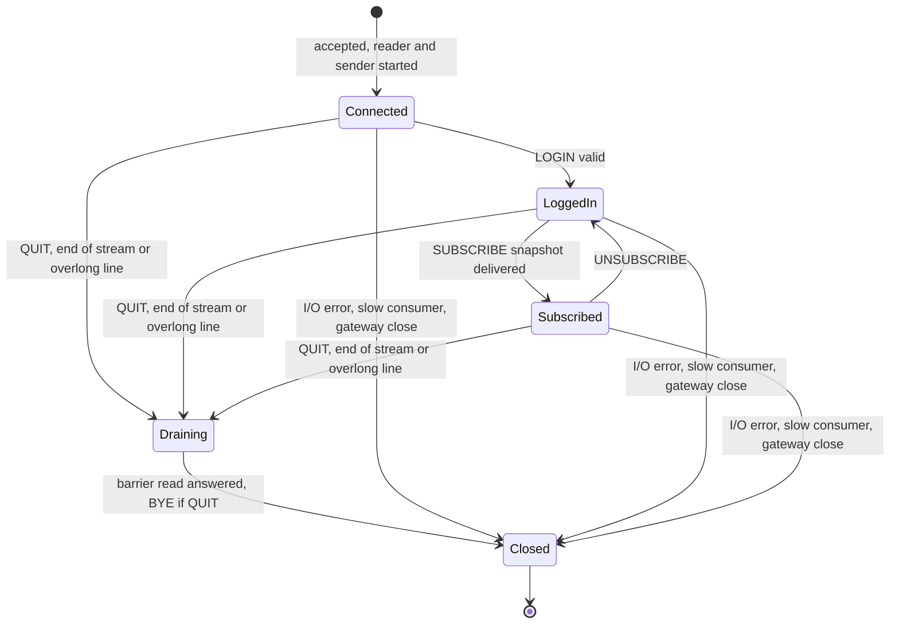

"Draining" is not a named field; it is the time between the reader stopping and the barrier read's callback calling
`close()` (D63). Resting orders are untouched by any of these transitions. **[Verified]**
`ClientSession.java:94-153`, `ClientSession.java:225-243`, `ClientSession.java:276-314`.

### 5.4 The journal file

Missing → (open) header written → appended in batches → (crash) possibly torn → (open) torn tail cut → … The file
only grows, except for the torn-tail cut. There is no rotation, compaction or snapshot, so recovery time grows with
the journal. **[Verified]** Spec §8 "No snapshots".

---

## 6. Validation layers

| # | Layer | Where | Examples | On failure | Journalled? |
|---|---|---|---|---|---|
| 1 | Line framing | `ClientSession.readLine`, `ClientSession.java:157-175` | > 256 bytes | `ERROR …; disconnecting`, close after replies | no |
| 2 | Syntax | `Protocol.parse`, `Protocol.java:53-121` | unknown command, wrong field count, non-number, lower-case enum | `ERROR <text>`, session continues | no |
| 3 | Session rules | `ClientSession.handle/login`, `ClientSession.java:182-243` | not logged in, second LOGIN, invalid name, cancel id ≤ 0 | `ERROR …` | no |
| 4 | Stateless fields | `OrderRequest` constructor/factories, `OrderRequest.java:24-74` | quantity 0 or > 1e9, price 0 or > MAX_PRICE, bad clOrdId, MARKET with a price | `ERROR clOrdId=… <reason>` | no |
| 5 | Hand-in | `ExchangeService.enqueue`, `ExchangeService.java:182-202` | queue full, stopping, halted | `ERROR … BUSY/STOPPED/HALTED` | no |
| 6 | Stamping | record constructors via `Sequencer`, `Exchange.java:120-131` | invalid cancel from a direct API caller | future fails; no number used | no |
| 7 | State-dependent | `MatchingEngine.process`, `MatchingEngine.java:109-133` | duplicate clOrdId, band, open-order cap, post-only cross; FOK not fillable | `ORDER … REJECTED reason=…` (FOK: `CANCELLED`) | **yes** |
| 8 | Invariants (bugs) | engine guards (`MatchingEngine.java:63-66`), book guards (`OrderBook.java:48-57`, `110-126`), `Response` constructor | non-increasing id/seq, duplicate id in the book, inconsistent response | `IllegalStateException` → poison-pill quarantine (guide 05b) | the command yes, plus a SKIP |
| 9 | Journal history | `CommandJournal.open`, `Replay.Verifier`, `JournalCodec.decode` | wrong rules version, sequence gap, backwards timestamp, corrupt record | startup fails, exit 1 | — |

The exception convention (D27): `IllegalArgumentException` = bad input from outside; `IllegalStateException` = our
own bug or a corrupt journal. **[Verified]** Spec D27.

---

## 7. What persists, what is rebuilt, what is lost

- **Persists:** the journal only — every accepted, stamped NEW/CANCEL (including state-dependent rejects) and every
  SKIP. **[Verified]**
- **Rebuilt at startup by replay:** the whole book, the per-participant counts, the client-order-id map, the last
  trade price, and the counters the sequencer resumes from. Outputs produced during replay are discarded.
  **[Verified]** `Replay.java:15-27`.
- **Lost on restart:** sessions, logins, subscriptions, queued outgoing lines, undelivered passive fills, and the
  writer's statistics. A reconnecting client must LOGIN and SUBSCRIBE again (getting a fresh BOOK). **[Verified]**
  Spec §8 "No output sequence numbers / resend".
- **Grows forever:** the client-order-id map (every participant/clOrdId pair ever used; D49) and the journal itself.
  Both are open threads; the planned fix is daily snapshots plus journal rotation (Vision §7, next candidate 1).
  **[Verified]** Spec §8.

## 8. "Migrations": versions instead of schema changes

There is no schema-migration tool. Two version numbers protect replay instead **[Verified]**:

- `JournalCodec.FORMAT_VERSION = 2` (`JournalCodec.java:34`): the shape of the records. A header with another
  format version is refused.
- `Rules.VERSION = 1` (`Rules.java:19`): the business rules replay depends on (limits, regexes, band, cap). Replaying
  old commands under changed rules could reject or accept them differently and silently rebuild a different book, so
  `CommandJournal.open` refuses a journal written under another rules version (D46). Rule change ⇒ bump `VERSION`
  (guide 12 has the recipe).

The intended way across a version change is "snapshot + fresh journal", but snapshots are **not built yet**, so in
practice crossing a rule change today means starting from an empty book (the error message's advice to "start a
fresh journal from a snapshot" cannot be followed). **[Verified]** `CommandJournal.java:263-264`, Spec D46 and §8.
And the version number only catches *deliberate* rule changes: a code change that alters matching behaviour without
bumping it would replay differently and go unnoticed (Spec §8). **[Verified]**

## Key takeaways

- Data types are immutable records/enums that validate in their constructors; the one mutable domain field is
  `Order.filledQuantity`.
- Requests (`Request` in a `Pending`) become commands (`NewOrderCommand`, `CancelOrderCommand`, `SkipCommand`) only
  on the writer thread, when the `Sequencer` stamps them.
- The journal is a versioned, LF-only text file and is the only persistent state; everything in memory is rebuilt by
  replay, sessions and undelivered fills are not.
- The book is two `TreeMap`s of `PriceLevel`s (doubly linked lists with sentinels) plus an id → node map; the engine
  can read levels but only `OrderBook` can change them.
- Every piece of book/engine/sequencer/journal state belongs to the writer thread; other threads reach it only
  through the queue.
- Validation is layered: framing → syntax → session → `OrderRequest` → hand-in → engine (journalled rejects) →
  invariants (exceptions = bugs) → journal history at startup.
- `Rules.VERSION` and `FORMAT_VERSION` replace migrations; without snapshots, a version change means a new, empty
  journal.

## Common confusions

- **"`Order` and `OrderRequest` are duplicates."** `OrderRequest` is the validated client intent (no id, no time);
  `Order` is that plus the exchange's id and timestamp and the mutable filled quantity. `Order` can only be built
  from an `OrderRequest`, so it never re-validates fields (D47).
- **"`CancelOrderCommand.orderId` is the cancel's own id."** It is the target order's id.
- **"Rejected orders are not in the journal."** Stateless rejects are not; state-dependent rejects are.
- **"`LevelUpdate` is a delta."** It is the absolute volume and order count at that price after the command.
- **"The journal can be edited to fix a bad record."** Editing breaks contiguity or, with a CRLF-converting editor,
  the header; the supported tool is `--quarantine`, which appends.
- **"State survives in memory across a restart."** Nothing does; only the journal.

## Questions to test yourself

1. Which classes may change a `PriceLevel`, and how does the code enforce that?
<details><summary>Answer</summary>Only classes in the `exchangeserver.book` package — in practice `OrderBook`. `PriceLevel`'s mutators (`addOrder`, `headNode`, `fillHead`, `unlink`) are package-private, so the engine (another package) cannot call them; the compiler enforces it (D44).</details>

2. Write the journal record for a market order: seq 12, order id 9, participant `p1`, clOrdId `m-1`, SELL, quantity 3.
<details><summary>Answer</summary>`NEW,12,<ISO timestamp>,9,p1,m-1,SELL,MARKET,3,-` followed by `\n`.</details>

3. After a restart, does a participant's old client order id still count as used? Why?
<details><summary>Answer</summary>Yes. The client-order-id map is engine state rebuilt by replaying every NEW record (rejected ones included), so a resend with an old clOrdId is rejected as a duplicate with the original order id.</details>

4. List three pieces of state lost on restart and say how a client recovers each.
<details><summary>Answer</summary>Its login (send LOGIN again), its subscription (SUBSCRIBE again, receiving a fresh BOOK snapshot), and any fills or market data sent while it was disconnected (not recoverable: there is no resend; it can only learn the current book via BOOK and its own order state by reconciling, e.g. resending with the same clOrdId).</details>

5. A developer changes `PRICE_BAND_PERCENT` from 10 to 5 and restarts on an existing journal. What should happen, and what must they have done for it to happen?
<details><summary>Answer</summary>Startup should refuse the journal ("written under rules version 1; this build uses 2"). That only happens if they also bumped `Rules.VERSION`; otherwise replay would silently re-evaluate old orders under the new band and could build a different book.</details>

6. Which validation layer rejects `NEW c1 buy LIMIT 1 100`, and is anything journalled?
<details><summary>Answer</summary>The syntax layer (`Protocol.parse` → `enumValue`): enum names are case-sensitive, so `buy` is `ERROR bad side: buy`. Nothing is journalled.</details>


---

<a id="guide-07-modules-domain-and-commands"></a>

<!-- source: docs/understanding/07-modules/domain-and-commands.md -->

# 07 — Module: domain and command

> **Project:** ExchangeServer2 | Single-instrument limit order book: price-time matching engine, write-ahead journal with replay, single writer thread, plain TCP gateway | Stack: Java 17, Maven wrapper, JUnit 5 (+ JMH, PIT)
> **This guide:** the value types every other package is built on (`domain`: `Side`, `OrderType`, `Rules`, `OrderRequest`, `Order`) and the stamped inputs plus their stamper (`command`: `Command`, `NewOrderCommand`, `CancelOrderCommand`, `SkipCommand`, `Sequencer`) | **Prerequisites:** 01, 02 | **Related:** 06, 07-modules/engine, 07-modules/journal, 07-modules/exchange-and-replay, 09, 12
> **Repo layout summary:** `pom.xml` + Maven wrapper (`mvnw`, `mvnw.cmd`) at the root; production code in `src/main/java/exchangeserver/` (packages `domain`, `book`, `engine`, `command`, `journal`, `core`, `gateway`, `client`, plus `Main`); tests mirror it in `src/test/java/exchangeserver/` (plus `bench/` JMH benchmarks and `testing/MutableClock`); design docs in `docs/` (`ExchangeServer2_Vision.md` = purpose/roadmap, `ExchangeServer2_Spec.md` = decisions D1–D65); these guides in `docs/understanding/`.

## Overview

These two small packages (about 430 lines together) define *what an order is* and *what an input to the
exchange is*. Almost every rule that can make a request invalid lives here, and the only component allowed to
read the clock or count lives here too.

- **`domain`**: plain business values.
  - `Side` is `BUY` or `SELL`.
  - `OrderType` is one of the five order types.
  - `Rules` holds every limit and constant that replay depends on.
  - `OrderRequest` is a client's order **before** the exchange accepts it. It is the only place fields are
    validated.
  - `Order` is an accepted order: a request plus an id and a timestamp. It is the one mutable object, because it
    tracks how much has been filled.
- **`command`**: the **commands**. A command is a stamped, journalled input, and commands are the system's
  source of truth.
  - There are three kinds: `NewOrderCommand`, `CancelOrderCommand` and `SkipCommand`.
  - `Sequencer` stamps them with a sequence number, a timestamp and (for new orders) an order id.

Two project terms appear throughout:

- **Replay.** On restart, the exchange rebuilds its state by feeding every journalled command through the same
  matching engine again (see guide 07-modules/exchange-and-replay). Anything replay depends on must therefore be
  deterministic and must not change silently. That requirement is why `Rules` exists and why only the
  `Sequencer` reads the clock.
- **Stateless vs state-dependent validation.** A *stateless* check needs only the request itself (is the
  quantity positive?). A *state-dependent* check needs the book (is this client order id already used?). The
  stateless checks live in `OrderRequest`; the state-dependent ones live in the engine (guide
  07-modules/engine). **[Verified]** Spec D47, Vision §4 principle 6.

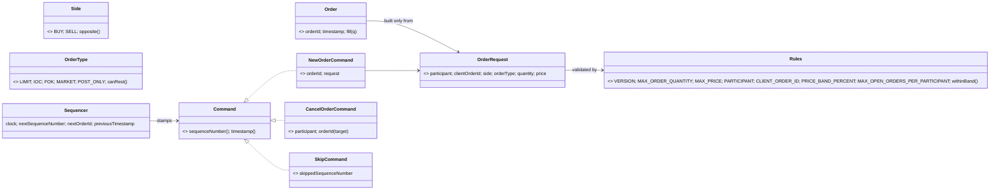

## Responsibility

| Type | Responsibility | Mutable? |
|---|---|---|
| `Side` | Which side of the book; `opposite()` | no |
| `OrderType` | The five order types; `canRest()` says which may sit on the book | no |
| `Rules` | One home for every limit replay depends on, plus the price-band arithmetic | no |
| `OrderRequest` | The only field-validation layer (stateless) | no |
| `Order` | An accepted order inside the engine and book; tracks `filledQuantity` | **yes** (only `fill`) |
| `Command` + 3 records | Stamped, journalled inputs; validated in their constructors | no |
| `Sequencer` | The only clock reader and the only counter | yes (writer thread only) |

## Public interface and who calls it

| Member | Visibility | Called by |
|---|---|---|
| `Side.opposite()` | public | `MatchingEngine.process` (`restingSide`), `MatchingEngine.canBeFilled` |
| `OrderType.canRest()` | public | `OrderBook.add` (guard), `MatchingEngine.process` (open-order cap) |
| `Rules.*` constants | public | `OrderRequest`, `CancelOrderCommand`, `ClientSession.login` (participant pattern), `MatchingEngine` (band, cap, collar), `Exchange` (`Rules.VERSION` to open the journal) |
| `Rules.withinBand(price, ref)` | public | `MatchingEngine.process` (band check) |
| `OrderRequest.of(..., OptionalLong)` | public | `ClientSession.newOrder` (`src/main/java/exchangeserver/gateway/ClientSession.java:248`), `JournalCodec.decode` |
| `OrderRequest.limit/ioc/fok/postOnly/market` | public | tests, benchmarks |
| `OrderRequest.rawPrice()` | package-private | `Order` constructor only |
| `new Order(id, request, ts)` | public | `MatchingEngine.onNewOrder` |
| `Order.fill(q)` | public | `PriceLevel.fillHead` (resting side), `MatchingEngine.process` (incoming side) |
| `Sequencer.stampNewOrder/stampCancel` | public | `Exchange.process` (`src/main/java/exchangeserver/core/Exchange.java:123`, `:125`) |
| `Sequencer.stampSkip` | public | `Exchange.quarantine` (both the static operator tool, `Exchange.java:112`, and the live poison-pill path, `Exchange.java:180`) |
| `Sequencer.resume(...)` | public static | `Exchange.open` (after replay), `Exchange.quarantine` (static tool) |

All of the above is **[Verified]** by reading the call sites.

## Internal walkthrough: `domain`

### `Side` and `OrderType`

```java
// src/main/java/exchangeserver/domain/Side.java:3-10
public enum Side {
    BUY,
    SELL;

    public Side opposite() {
        return this == BUY ? SELL : BUY;
    }
}
```

```java
// src/main/java/exchangeserver/domain/OrderType.java:3-23 (trimmed)
/*
LIMIT      match what crosses now, rest the remainder.
IOC        match what crosses now, cancel the remainder.
FOK        fill completely now or do nothing.
MARKET     no price; match at any price inside the market collar (Rules), cancel the remainder.
POST_ONLY  rest without matching; rejected if it would cross on arrival.
 */
public enum OrderType {
    LIMIT, IOC, FOK, MARKET, POST_ONLY;

    // Only these two ever rest on the book.
    public boolean canRest() {
        return this == LIMIT || this == POST_ONLY;
    }
}
```

**[Verified]** The comment block is the clearest one-line definition of each type. IOC means "immediate or
cancel" and FOK means "fill or kill". `canRest()` drives two distinct things:
1. `OrderBook.add` refuses any other type, which is a bug guard.
2. Only `LIMIT` and `POST_ONLY` are subject to the open-order cap, which is a business rule (guide
   07-modules/engine).

### `Rules`: everything replay depends on

```java
// src/main/java/exchangeserver/domain/Rules.java:17-43 (trimmed)
public final class Rules {

    public static final int VERSION = 1;

    // Stateless (checked by OrderRequest, i.e. at the gateway).
    public static final long MAX_ORDER_QUANTITY = 1_000_000_000L;
    // Notional (price x quantity) can never overflow a long.
    public static final long MAX_PRICE = Long.MAX_VALUE / MAX_ORDER_QUANTITY;
    // No ',' or whitespace: they separate fields in the journal and in the wire protocol.
    public static final Pattern PARTICIPANT = Pattern.compile("[A-Za-z0-9_]{1,16}");
    public static final Pattern CLIENT_ORDER_ID = Pattern.compile("[A-Za-z0-9_.-]{1,32}");

    // State-dependent (checked by the engine).
    public static final int PRICE_BAND_PERCENT = 10;
    public static final int MAX_OPEN_ORDERS_PER_PARTICIPANT = 10_000;

    // Exact integer comparison, no rounding: price * 100 vs reference * (100 +- band).
    // Cannot overflow: both prices are <= MAX_PRICE (~9.2e9), times at most 110.
    public static boolean withinBand(long price, long referencePrice) {
        return price * 100 <= referencePrice * (100 + PRICE_BAND_PERCENT)
                && price * 100 >= referencePrice * (100 - PRICE_BAND_PERCENT);
    }
}
```

Line by line:

- **`VERSION` (line 19).** **[Verified]** It is written into the journal header, and `CommandJournal.open`
  refuses a journal whose header names another version (Spec D46). Replay feeds *old* commands through *today's*
  code. If, say, `MAX_ORDER_QUANTITY` shrank, an old valid order would fail decoding or be rejected differently,
  and the rebuilt book would differ from what clients saw. The class comment (`Rules.java:5-16`) says exactly
  this.
  - **Caveat [Verified]** (Spec §8): the version catches *deliberate* rule changes only. A code change that alters
    matching behaviour without touching `Rules` is not detected.
- **`MAX_PRICE` (line 24) = `Long.MAX_VALUE / 1_000_000_000` = 9,223,372,036.** **[Verified]**
  `RulesTest.maxPriceTimesMaxQuantityFitsInALong` checks it. So `price * quantity` can never overflow a `long`,
  whatever the inputs. A consequence **[Inferred]**: prices are integer "ticks" (no decimals anywhere), with a
  ceiling of about 9.2 billion ticks.
- **The two patterns (lines 26–27).** They exclude `,` (the journal's field separator) and spaces (the wire
  protocol's token separator). So a participant or client order id can never corrupt either format. **[Verified]**
  by the comment, by `JournalCodec` splitting on `,` and by `Protocol.parse` splitting on a single space.
- **`withinBand` (lines 40–43).** It compares `price × 100` with `reference × 110` and `reference × 90` in
  integers, so there's no floating point and no rounding. Both edges are inclusive.
  - **Worked example [Verified by arithmetic]:** with last trade 105, the band is `[94.5, 115.5]` in real
    numbers. For integer prices 95 is the lowest allowed (`9500 >= 9450`) and 115 the highest
    (`11500 <= 11550`). 94 is out (`9400 < 9450`) and 116 is out (`11600 > 11550`).
  - **Overflow note [Verified]:** `MAX_PRICE × 110 ≈ 1.01e12`, far below `Long.MAX_VALUE`.
    `RulesTest.bandDoesNotOverflowAtTheMaximumPrice` covers it.

### `OrderRequest`: the only field-validation layer

```java
// src/main/java/exchangeserver/domain/OrderRequest.java:24-74 (trimmed)
private OrderRequest(String participant, String clientOrderId, Side side, OrderType orderType, long quantity, long price) {
    if (participant == null || !Rules.PARTICIPANT.matcher(participant).matches()) {
        throw new IllegalArgumentException("Invalid participant: " + participant);
    }
    if (clientOrderId == null || !Rules.CLIENT_ORDER_ID.matcher(clientOrderId).matches()) { ... }
    if (side == null) { ... }
    if (orderType == null) { ... }
    if (quantity <= 0) { ... }
    if (quantity > Rules.MAX_ORDER_QUANTITY) { ... }
    if (orderType != OrderType.MARKET) {
        if (price <= 0) { ... }
        if (price > Rules.MAX_PRICE) { ... }
    }
    ...
}

// The general factory: the price is present for every type except MARKET.
public static OrderRequest of(String participant, String clientOrderId, Side side, OrderType orderType,
                              long quantity, OptionalLong price) {
    Objects.requireNonNull(price, "price");
    if (orderType == OrderType.MARKET) {
        if (price.isPresent()) {
            throw new IllegalArgumentException("A market order has no price");
        }
        return new OrderRequest(participant, clientOrderId, side, orderType, quantity, Order.NO_PRICE);
    }
    if (price.isEmpty()) {
        throw new IllegalArgumentException("A " + orderType + " order needs a price");
    }
    return new OrderRequest(participant, clientOrderId, side, orderType, quantity, price.getAsLong());
}
```

Key design points:

1. **The constructor is private.** Every route in goes through a factory, so every instance has passed every
   check. "An invalid `OrderRequest` cannot exist" is enforced by the type, not by convention. **[Verified]**
   `OrderRequest.java:24`.
2. **One rule set, two users.** **[Verified]**
   - The gateway builds requests with `of(...)`: `ClientSession.java:248`.
   - The journal decoder builds them with `of(...)` too (guide 07-modules/journal).

   So a journalled record is re-validated on replay by the *same* rules as the gateway applied. The class comment
   calls this "reuse, not a third copy of the rules" (`OrderRequest.java:9`).
3. **A market order has no price in the API.** `getPrice()` returns `OptionalLong`, empty for `MARKET`
   (`OrderRequest.java:116-118`). Internally the field holds the sentinel `Order.NO_PRICE = -1`
   (`Order.java:18`), but only `Order`'s constructor can see it, through the package-private `rawPrice()`
   (`OrderRequest.java:121-123`). **[Verified]** Spec D25/D26 record this choice.
4. **`equals`/`hashCode` cover every field** (`OrderRequest.java:126-140`). **[Verified]**
   `OrderRequestTest.equalityCoversEveryField`. **[Inferred]** These matter for tests that compare decoded
   journal records with the originals, and for `NewOrderCommand` (a record), whose `equals` delegates to the
   request's.

`IllegalArgumentException` means "bad input from outside". **[Verified]** Spec D27:
`IllegalArgumentException` = bad input; `IllegalStateException` = our bug or a corrupt journal. The gateway
catches the `IllegalArgumentException` and answers `ERROR clOrdId=… <message>`, so the request never reaches the
queue (guide 07-modules/gateway).

### `Order`: an accepted order

```java
// src/main/java/exchangeserver/domain/Order.java:30-103 (trimmed)
public Order(long orderId, OrderRequest request, Instant timestamp) {
    Objects.requireNonNull(request, "request");
    Objects.requireNonNull(timestamp, "timestamp");
    if (orderId <= 0) {
        throw new IllegalArgumentException("Order id must be positive");
    }
    this.orderId = orderId;
    this.participant = request.getParticipant();
    ...
    this.price = request.rawPrice();
    this.originalQuantity = request.getQuantity();
    this.timestamp = timestamp;
}

public boolean hasPrice() { return orderType != OrderType.MARKET; }

// A market order has no price; asking for one is a bug.
public long getPrice() {
    if (!hasPrice()) {
        throw new IllegalStateException("Order " + orderId + " is a market order and has no price");
    }
    return price;
}

public long getRemainingQuantity() { return originalQuantity - filledQuantity; }

public void fill(long quantity) {
    if (quantity <= 0) { throw new IllegalArgumentException("Fill quantity must be positive"); }
    if (quantity > getRemainingQuantity()) { throw new IllegalArgumentException("Cannot overfill order " + orderId); }
    filledQuantity += quantity;
}
```

- **The only constructor takes a request** (Spec D47). So `Order` re-checks only what a request cannot know:
  the id and the timestamp. **[Verified]**
- **Its single mutable field is `filledQuantity`** (`Order.java:28`); "remaining" is derived from it. **[Verified]**
- **An `Order` holds no references to the book, level or node.** "An Order does not know where it is stored"
  (`Order.java:13`). The book wraps it in an `OrderNode` instead (guide 07-modules/book). **[Verified]**
- **`getPrice()` throws for `MARKET`.** Code that forgets the "market has no price" case fails loudly instead of
  matching at price −1. **[Verified]**
- **Who calls `fill`.** It is called on the resting order (inside `PriceLevel.fillHead`) and on the incoming
  order (in `MatchingEngine.process`). Both pass the same quantity per trade. **[Verified]** by reading both.

## Internal walkthrough: `command`

### The sealed `Command` interface and its three records

```java
// src/main/java/exchangeserver/command/Command.java:11-16
public sealed interface Command permits NewOrderCommand, CancelOrderCommand, SkipCommand {
    long sequenceNumber();
    Instant timestamp();
}
```

A **sealed interface** (Java 17) lists every allowed implementation, so the compiler knows the full set. A
**record** is an immutable data class; a *compact constructor* (`public NewOrderCommand { ... }`) runs
validation before the fields are assigned. Commands are immutable, so "the object that is logged and the object
that is processed cannot differ" (`Command.java:7-8`). **[Verified]**

```java
// src/main/java/exchangeserver/command/NewOrderCommand.java:8-21 (trimmed)
public record NewOrderCommand(long sequenceNumber, Instant timestamp, long orderId, OrderRequest request)
        implements Command {
    public NewOrderCommand {
        Objects.requireNonNull(timestamp, "timestamp");
        Objects.requireNonNull(request, "request");
        if (sequenceNumber <= 0) { throw new IllegalArgumentException("Sequence number must be positive"); }
        if (orderId <= 0) { throw new IllegalArgumentException("Order id must be positive"); }
    }
}
```

```java
// src/main/java/exchangeserver/command/CancelOrderCommand.java:8-23 (trimmed)
// orderId is the target; a cancel is not issued an id of its own (D32).
public record CancelOrderCommand(long sequenceNumber, Instant timestamp, String participant, long orderId)
        implements Command {
    public CancelOrderCommand {
        Objects.requireNonNull(timestamp, "timestamp");
        if (sequenceNumber <= 0) { ... }
        if (participant == null || !Rules.PARTICIPANT.matcher(participant).matches()) { ... }
        if (orderId <= 0) { ... }
    }
}
```

```java
// src/main/java/exchangeserver/command/SkipCommand.java:14-24 (trimmed)
public record SkipCommand(long sequenceNumber, Instant timestamp, long skippedSequenceNumber) implements Command {
    public SkipCommand {
        Objects.requireNonNull(timestamp, "timestamp");
        if (sequenceNumber <= 0) { ... }
        if (skippedSequenceNumber <= 0 || skippedSequenceNumber >= sequenceNumber) {
            throw new IllegalArgumentException("Can only skip an earlier command, not " + skippedSequenceNumber);
        }
    }
}
```

- **`NewOrderCommand`** carries the issued `orderId` and the validated request.
- **`CancelOrderCommand`** carries the participant, needed for the ownership check (Spec D45, D48), and the
  *target* order id. A cancel does not consume an order id. **[Verified]**
- **`SkipCommand`** is the quarantine marker of the poison-pill policy (Spec D51). It names an *earlier*
  sequence number that replay must not feed to the engine. The skipped record stays in the file: "history is
  never edited, only annotated" (`SkipCommand.java:11`). **[Verified]** The constructor's "only earlier"
  check makes a self-skip or a forward skip impossible. **[Verified]**

There is no command for reads (snapshots). Reads are never stamped or journalled (guide
07-modules/exchange-and-replay). **[Verified]** `ExchangeTest.interceptorSeesEveryCommandLiveInOrder` asserts
that only the two orders and the cancel got sequence numbers.

### `Sequencer`: the only clock reader and counter

```java
// src/main/java/exchangeserver/command/Sequencer.java:20-81 (trimmed)
public final class Sequencer {
    private final Clock clock;
    private long nextSequenceNumber;
    private long nextOrderId;
    private Instant previousTimestamp;

    public Sequencer(Clock clock) { this(clock, 1, 1, Instant.MIN); }

    public static Sequencer resume(Clock clock, long lastSequenceNumber, long lastOrderId, Instant lastTimestamp) {
        if (lastSequenceNumber < 0 || lastOrderId < 0) {
            throw new IllegalArgumentException("Counters cannot be negative");
        }
        return new Sequencer(clock, lastSequenceNumber + 1, lastOrderId + 1,
                lastTimestamp == null ? Instant.MIN : lastTimestamp);
    }

    public NewOrderCommand stampNewOrder(OrderRequest request) {
        Objects.requireNonNull(request, "request");     // before stamping: a null must not use up numbers
        Instant timestamp = nextTimestamp();
        return new NewOrderCommand(nextSequenceNumber++, timestamp, nextOrderId++, request);
    }

    public CancelOrderCommand stampCancel(String participant, long orderId) {
        CancelOrderCommand command = new CancelOrderCommand(nextSequenceNumber, nextTimestamp(), participant, orderId);
        nextSequenceNumber++;                           // only once the command is valid
        return command;
    }

    public SkipCommand stampSkip(long skippedSequenceNumber) {
        SkipCommand command = new SkipCommand(nextSequenceNumber, nextTimestamp(), skippedSequenceNumber);
        nextSequenceNumber++;
        return command;
    }

    private Instant nextTimestamp() {
        Instant now = clock.instant();
        if (now.isBefore(previousTimestamp)) {
            now = previousTimestamp;
        }
        previousTimestamp = now;
        return now;
    }
}
```

The tricky parts, line by line:

1. **Two counters, both starting at 1** (`Sequencer.java:27-29`). Every command gets the next sequence number;
   only new orders get the next order id. **[Verified]**
   - Example: NEW, CANCEL, NEW is stamped seq 1/2/3 with order ids 1 and 2.
   - `SequencerTest.onlyNewOrdersUseUpOrderIds` checks this.
2. **"Only once valid" ordering.** `stampCancel` and `stampSkip` build the record first, which runs its
   validation, and increment `nextSequenceNumber` only afterwards (`Sequencer.java:55-56`, `61-62`). An invalid
   cancel (bad participant, order id ≤ 0) therefore throws without using a number, and the journal keeps its
   sequence numbers contiguous. **[Verified]** `SequencerTest.InvalidInputUsesUpNothing`.
   - `stampNewOrder` uses the opposite style: post-increments inside the constructor call. That is safe because
     the only failure its constructor could raise on real input (a null request) is checked *before*
     (`Sequencer.java:49`). **[Verified]** by reading.
   - **[Inferred]** `nextTimestamp()` is still called before an invalid cancel throws, so `previousTimestamp` may
     move forward for a command that is never issued. That is harmless, because timestamps only need to be
     non-decreasing.
3. **The backwards clock (Spec D33).** If the wall clock steps back (an NTP correction, a VM pause),
   `nextTimestamp` reuses the previous timestamp instead of going backwards (`Sequencer.java:74-81`). Equal
   timestamps are allowed. **[Verified]** `SequencerTest.Clock`.
   - Why it matters: replay *verifies* that timestamps never decrease and refuses a journal where they do (guide
     07-modules/exchange-and-replay). So a backwards stamp would make the next restart fail.
4. **`resume` continues after a replayed journal** (Spec D41). The caller passes the last sequence number, the
   last *new-order* id and the last timestamp. **[Verified]** The comment at `Sequencer.java:38-39` explains why
   it must be the last NEW record's id rather than the last record's id field: a cancel's id field is a target,
   not an issued id. `ExchangeTest.nextOrderIdComesFromTheLastNewOrderNotTheLastRecord` covers this.
5. **The clock is injected.** The `Clock` is a constructor parameter, so tests pass `MutableClock` (a clock tests
   can move, even backwards; `src/test/java/exchangeserver/testing/MutableClock.java`). **[Verified]**
6. **Not thread-safe, by design.** It is called only from the writer thread. Because stamping happens there,
   *sequence order equals queue order equals processing order* without any lock (`Sequencer.java:16-17`; Spec
   D55). **[Verified]**

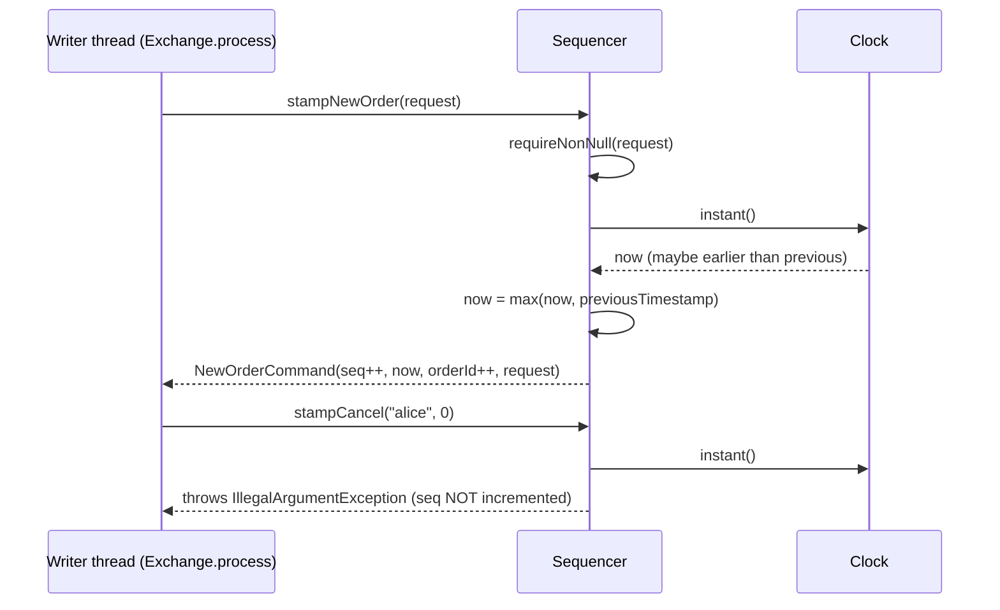

## Dependencies in and out

```mermaid
flowchart LR
    subgraph domain
      Side; OrderType; Rules; OrderRequest; Order
    end
    subgraph command
      Command; NewOrderCommand; CancelOrderCommand; SkipCommand; Sequencer
    end
    OrderRequest --> Rules
    Order --> OrderRequest
    NewOrderCommand --> OrderRequest
    CancelOrderCommand --> Rules
    Sequencer --> NewOrderCommand & CancelOrderCommand & SkipCommand
    gateway[gateway.ClientSession] --> OrderRequest
    gateway --> Rules
    journal[journal.JournalCodec] --> OrderRequest & NewOrderCommand & CancelOrderCommand & SkipCommand
    engine[engine.MatchingEngine] --> Order & Rules & OrderType & Side
    book[book.OrderBook / PriceLevel] --> Order & Side
    core[core.Exchange / Replay] --> Sequencer & Command
```

**[Verified]** by imports. `domain` depends on nothing but the JDK. `command` depends only on `domain`. They are
the foundation layer.

## How it's tested

| Test class | `@Nested` groups / notable tests | What it pins down |
|---|---|---|
| `domain/OrderRequestTest` (16 tests) | `Factories` (each typed factory sets its type; `of` matches the typed factories; market with price and priced type without price are refused); `Validation` (parameterised quantity/price must be positive; limits inclusive; patterns); `equalityCoversEveryField` | The stateless rule set |
| `domain/OrderTest` (8) | `Construction`, `Price` (market has no price and says so), `Fill` (partial then full, cannot overfill, must be positive) | The one mutable object |
| `domain/RulesTest` (6) | `bandIsInclusiveAtBothEdges`, `bandComparesExactlyWithoutRounding`, `bandDoesNotOverflowAtTheMaximumPrice`, `maxPriceTimesMaxQuantityFitsInALong`, `oppositeSide`, `onlyLimitAndPostOnlyRest` | Arithmetic edges; also `Side` and `OrderType` |
| `command/SequencerTest` (18) | `Stamping`, `InvalidInputUsesUpNothing`, `Clock` (backwards step reuses the previous timestamp; resumes once it catches up; equal timestamps allowed), `Resume`, `CommandValidation` (the three records' constructors) | Counters, clock policy, record validation |

**[Verified]** Test counts come from counting `@Test`/`@ParameterizedTest` annotations; parameterised tests run
more cases than that. Two deviations from "one test class per production class" **[Verified]**: `Side` and
`OrderType` are tested in `RulesTest`, and the three command records in `SequencerTest.CommandValidation`. Both
packages are included in PIT mutation testing (`pom.xml` `targetClasses`). **[Verified]**

## Key takeaways

- `OrderRequest` is the **only** field-validation layer. Its private constructor makes an invalid request
  impossible, and both the gateway and the journal decoder build requests through it.
- `Order` is the only mutable domain object, and only `filledQuantity` changes. A market order has no price
  (`hasPrice()` is false, `getPrice()` throws).
- `Rules` holds every constant replay depends on. Changing one means bumping `Rules.VERSION`, and an old journal
  is then refused.
- `MAX_PRICE × MAX_ORDER_QUANTITY` fits in a `long`; the band check is exact integer arithmetic, inclusive at both
  edges.
- Commands are immutable records under a sealed interface; reads are not commands.
- `Sequencer` is the single source of sequence numbers, order ids and timestamps. It never moves a timestamp
  backwards and never uses up a number for an invalid input.
- Only new orders consume order ids; cancels carry a *target* id; a SKIP names an earlier sequence number and never
  deletes history.

## Common confusions

- **"Is `Order` validated twice?"** No. `Order` checks only the id and the timestamp; everything else was checked
  when the `OrderRequest` was built (Spec D47).
- **"Does the order id equal the sequence number?"** Only by coincidence. The two counters diverge as soon as a
  cancel or skip is stamped, which uses a sequence number but no order id.
- **"A rejected order doesn't get an order id, right?"** Wrong. The order id is stamped before the engine runs,
  so a state-dependent reject (duplicate client order id, band, cap, post-only cross) still uses up an order id
  and a sequence number, and is journalled. Only *stateless* rejects (refused at the gateway) use nothing.
- **"`Order.NO_PRICE` is −1, so a market order trades at −1?"** No. The sentinel never leaves the domain package
  through a public API; `getPrice()` throws for market orders, and the engine uses a separate "match limit"
  (guide 07-modules/engine).
- **"`Rules.VERSION` protects against any behaviour change."** No, only against deliberate changes to `Rules`
  (Spec §8).

## Questions to test yourself

1. Why is `OrderRequest`'s constructor private, and which two production call sites build requests?
   <details><summary>Answer</summary>So that every instance has passed every check: factories are the only way in. The gateway (`ClientSession.newOrder` via `OrderRequest.of`) and the journal decoder (`JournalCodec.decode` via `OrderRequest.of`) both build requests, so replay re-applies the same stateless rules as the gateway.</details>
2. Stamp, in order: NEW, CANCEL (participant "bob", order 1), CANCEL (participant "bad name", order 1), NEW. What sequence numbers and order ids result?
   <details><summary>Answer</summary>NEW → seq 1, id 1. CANCEL → seq 2. The invalid cancel throws `IllegalArgumentException` from the record constructor before the increment, so it uses no number. NEW → seq 3, id 2.</details>
3. The clock reads 10:00:05, then 10:00:03, then 10:00:06. Which timestamps are stamped, and why does it matter?
   <details><summary>Answer</summary>10:00:05, 10:00:05 (the previous one is reused), 10:00:06. Replay refuses a journal whose timestamps decrease, so a backwards stamp would make the next restart fail.</details>
4. The last trade was 200. Which integer prices pass `Rules.withinBand`?
   <details><summary>Answer</summary>`price×100 ≤ 200×110 = 22000` and `price×100 ≥ 200×90 = 18000`, so 180 to 220 inclusive.</details>
5. Why must `Sequencer.resume` take the last NEW record's order id rather than the last record's id field?
   <details><summary>Answer</summary>The last record may be a CANCEL, whose id field is the target order, not an issued id. Taking it would reuse or skip ids; the engine refuses a non-increasing id (D35), so startup or the next order would fail.</details>
6. Can a `SkipCommand` skip itself or a later command? Where is that enforced?
   <details><summary>Answer</summary>No. Its compact constructor requires `0 < skippedSequenceNumber < sequenceNumber` (`SkipCommand.java:21-23`).</details>
7. Why do the participant and client-order-id patterns exclude commas and spaces?
   <details><summary>Answer</summary>Commas separate journal fields and spaces separate wire-protocol tokens; an id containing either could corrupt or be mis-parsed by those formats.</details>


---

<a id="guide-07-modules-book"></a>

<!-- source: docs/understanding/07-modules/book.md -->

# 07 — Module: book

> **Project:** ExchangeServer2 | Single-instrument limit order book: price-time matching engine, write-ahead journal with replay, single writer thread, plain TCP gateway | Stack: Java 17, Maven wrapper, JUnit 5 (+ JMH, PIT)
> **This guide:** the order book data structure (`OrderBook`, `PriceLevel`, `OrderNode`) and its small result types (`Fill`, `LevelUpdate`, `CancelResult`, `CancelStatus`), its invariants and how they are kept | **Prerequisites:** 01, 07-modules/domain-and-commands | **Related:** 06, 07-modules/engine, 09, 10
> **Repo layout summary:** `pom.xml` + Maven wrapper (`mvnw`, `mvnw.cmd`) at the root; production code in `src/main/java/exchangeserver/` (packages `domain`, `book`, `engine`, `command`, `journal`, `core`, `gateway`, `client`, plus `Main`); tests mirror it in `src/test/java/exchangeserver/` (plus `bench/` JMH benchmarks and `testing/MutableClock`); design docs in `docs/` (`ExchangeServer2_Vision.md` = purpose/roadmap, `ExchangeServer2_Spec.md` = decisions D1–D65); these guides in `docs/understanding/`.

## Overview

An **order book** is the list of orders waiting to trade (**resting** orders), grouped by side and price:
- the **bids** are buy orders, best = highest price first;
- the **asks** are sell orders, best = lowest price first.

Inside one price, orders queue in arrival order, which is **time priority**. Together that gives
**price-time priority**: better price first, then earlier arrival.

The `book` package is a data structure with a few hard rules (**invariants**) and no business logic:
- It does not decide whether two orders match. That is the engine's job (guide 07-modules/engine).
- It *carries out* what the engine decides, through exactly three mutating entry points: `add`, `fillBest` and
  `cancel`.

**[Verified]** Spec D44 and Vision §4 principles 2 and 9.

The physical shape:

- **Each side** is a `TreeMap<Long, PriceLevel>`, a sorted map keyed by price. The bid map uses
  `Comparator.reverseOrder()`, so `firstEntry()` is the best price on both sides. **[Verified]**
  `src/main/java/exchangeserver/book/OrderBook.java:40-41`.
- **Each `PriceLevel`** is a hand-written **doubly linked list with sentinels**: dummy `head` and `tail` nodes
  that are never removed, so linking and unlinking need no special cases for the ends. **[Verified]** Spec D6, D7.
- **An id map `orderId → OrderNode`** lets a cancel find an order's node in O(1) and unlink it in O(1).
  **[Verified]** `OrderBook.java:42`, Spec D1, D5.

```mermaid
flowchart LR
    subgraph OrderBook
      direction TB
      B["bids: TreeMap (reverse order)<br/>101 → level, 100 → level"]
      A["asks: TreeMap (natural order)<br/>102 → level, 105 → level"]
      M["orders: HashMap orderId → OrderNode"]
      P["openOrders: HashMap participant → count"]
      C["changed: LinkedHashSet of LevelKey(side, price)"]
    end
    subgraph "PriceLevel BUY 100"
      direction LR
      H((head sentinel)) <--> N1["node: order 7<br/>rem 5"] <--> N2["node: order 9<br/>rem 3"] <--> T((tail sentinel))
    end
    B --> H
    M -. "7 →" .-> N1
    M -. "9 →" .-> N2
```

## Responsibility

| Type | What it is | Visibility |
|---|---|---|
| `OrderBook` | Owns the lifecycle of every resting order (Spec D1); the only mutator of levels | public class |
| `PriceLevel` | Orders at one price on one side, in time priority. **Public getters only; every mutator is package-private** | public class |
| `OrderNode` | One list node: `order`, `prev`, `next`, `level` | package-private class |
| `Fill` | Immutable record of what `fillBest` did to one resting order | public record |
| `LevelUpdate` | Immutable record: one level's state after a command (level-2 market data); volume 0 = gone | public record |
| `CancelResult` / `CancelStatus` | Outcome of a cancel: `CANCELLED` (with quantity) or `UNKNOWN_ORDER` | public record / enum |

"Level-2 market data" (L2) means aggregated volume per price level, as opposed to individual orders.

## Public interface and who calls it

| Member | Visibility | Called by |
|---|---|---|
| `OrderBook.add(Order)` | public | `MatchingEngine.process` (rests a LIMIT/POST_ONLY remainder) |
| `OrderBook.fillBest(Side, maxQty) → Fill` | public | `MatchingEngine.process` (the match loop) |
| `OrderBook.cancel(participant, orderId) → CancelResult` | public | `MatchingEngine.onCancel` |
| `OrderBook.drainLevelUpdates()` | public | `MatchingEngine.onNewOrder` / `onCancel` (once per command) |
| `OrderBook.bestLevel(Side)` | public | `MatchingEngine.process` (match loop, post-only check); `MatchingBenchmark` |
| `OrderBook.levels(Side)` | public | `MatchingEngine.canBeFilled` (FOK), `MatchingEngine.levels` (snapshot) |
| `OrderBook.openOrders(participant)` | public | `MatchingEngine.process` (open-order cap) |
| `OrderBook.restingOrderCount()` | public | `MatchingEngine(OrderBook)` constructor (must be 0) |
| `volumeAt`, `levelCount`, `isResting` | public | tests only **[Verified]** by grep |
| `OrderBook.ordersAt`, `checkInvariants()` | package-private | tests only (test seams) |
| `PriceLevel.getSide/getPrice/getTotalVolume/getOrderCount/isEmpty` | public | engine (read-only) and `OrderBook` |
| `PriceLevel.addOrder/headNode/fillHead/unlink` | package-private | `OrderBook` only |

Because the engine is in another package, the compiler stops it from calling `PriceLevel` mutators. That is the
"ownership enforced by packages" rule from `CLAUDE.md`. **[Verified]** Spec D44.

## The invariants

The class comment lists them, and `checkInvariants()` re-derives them from scratch:

```java
// src/main/java/exchangeserver/book/OrderBook.java:20-32 (trimmed comment)
Every mutation goes through four methods (add, fillBest, cancel, and the private removeNode they share), so
these invariants have exactly one place to hold:
1. An id is in `orders` iff its order is linked in a level.
2. No empty level is ever left in `bids` or `asks` (eager removal, D10).
3. openOrders.get(p) == number of resting orders owned by p (absent when 0).
4. Every level touched since the last drainLevelUpdates() is in `changed`.
```

```java
// src/main/java/exchangeserver/book/PriceLevel.java:20-25 (comment)
1. totalVolume == sum of remaining quantity over the linked nodes.
2. orderCount  == number of linked nodes.
3. node.level == this  <=>  node is linked in this level.
4. Every linked order has remaining > 0, except the head between fillHead() exhausting it and
   OrderBook unlinking it (both inside one OrderBook.fillBest call).
```

Plus, from `checkInvariants` (`OrderBook.java:193-234`): levels are strictly ordered on each side, and the book
is never **crossed**, meaning the best bid is below the best ask. **[Verified]** The "never crossed" invariant
holds because the engine always matches before resting; the book itself does not enforce it on `add`.
**[Inferred]** from reading `add`, which has no cross check.

## Internal walkthrough: `PriceLevel`

### Construction and the sentinels

```java
// src/main/java/exchangeserver/book/PriceLevel.java:28-41 (trimmed)
public final class PriceLevel {
    private final Side side;
    private final long price;
    private final OrderNode head = OrderNode.sentinel();
    private final OrderNode tail = OrderNode.sentinel();
    private long totalVolume;
    private int orderCount;

    PriceLevel(Side side, long price) {
        this.side = side;
        this.price = price;
        head.next = tail;
        tail.prev = head;
    }
```

```java
// src/main/java/exchangeserver/book/OrderNode.java:18-35 (trimmed)
final class OrderNode {
    final Order order;
    OrderNode prev;
    OrderNode next;
    PriceLevel level;

    OrderNode(Order order) {
        this.order = Objects.requireNonNull(order, "A real node must wrap an order");
    }
    private OrderNode() { this.order = null; }
    static OrderNode sentinel() { return new OrderNode(); }
}
```

`order == null` holds **if and only if** the node is a sentinel. That is enforced by construction: the
real-node constructor rejects null, and sentinels can only come from `sentinel()`. **[Verified]**
`OrderNode.java:12-13, 24-34`. Every real linked node therefore has a non-null `prev` and `next`, at worst a
sentinel, which is why link and unlink have no `if (node == head)` branches.

### `addOrder`: append at the tail, checks first

```java
// src/main/java/exchangeserver/book/PriceLevel.java:64-87
OrderNode addOrder(Order order) {
    // All checks before any mutation.
    if (order.getSide() != side || order.getPrice() != price) { throw new IllegalStateException(...); }
    if (order.getRemainingQuantity() <= 0) { throw new IllegalStateException(...); }
    if (order.getRemainingQuantity() > Long.MAX_VALUE - totalVolume) { throw new IllegalStateException(...); }

    OrderNode node = new OrderNode(order);
    OrderNode last = tail.prev;
    node.prev = last;
    node.next = tail;
    last.next = node;
    tail.prev = node;
    node.level = this;

    totalVolume += order.getRemainingQuantity();
    orderCount++;
    return node;
}
```

- It returns the node so `OrderBook` can store it in the id map. **[Verified]**
- It adds the order's *remaining* quantity, not the original. A partially filled incoming order that rests adds
  only what is left (`PriceLevelTest.addsRemainingNotOriginalQuantity`). **[Verified]**
- **Overflow guard.** It makes sure `totalVolume` can never wrap round. **[Verified]** **[Inferred]** It is
  practically unreachable, since at most 10,000 orders per participant × 1e9 each per participant. Spec §7 lists
  the related `<=`/`<` mutant as equivalent.

### `fillHead`: fill, never remove

```java
// src/main/java/exchangeserver/book/PriceLevel.java:96-113
long fillHead(long maxQuantity) {
    if (maxQuantity <= 0) { throw new IllegalArgumentException("Fill quantity must be positive"); }
    OrderNode first = headNode();
    if (first == null) { throw new IllegalStateException("Fill on empty level " + side + " " + price); }
    Order order = first.order;
    if (order.getRemainingQuantity() == 0) { throw new IllegalStateException("Exhausted order ... left at the head ..."); }

    long quantity = Math.min(order.getRemainingQuantity(), maxQuantity);
    order.fill(quantity);
    totalVolume -= quantity;
    return quantity;
}
```

It fills the head order by `min(remaining, maxQuantity)` and subtracts that from `totalVolume`, but **does not
unlink an exhausted head**: "that is OrderBook's job, so the id map and the list change together" (Spec D3).
**[Verified]** This leaves a deliberate, short window where invariant 4 is broken: the head has remaining 0. The
window closes inside the same `OrderBook.fillBest` call (below).

### `unlink`: O(1) removal, shared by fills and cancels

```java
// src/main/java/exchangeserver/book/PriceLevel.java:116-134
void unlink(OrderNode node) {
    if (node.order == null) { throw new IllegalStateException("Cannot unlink a sentinel"); }
    if (node.level != this) { throw new IllegalStateException("Order ... is not linked in level ..."); }

    node.prev.next = node.next;
    node.next.prev = node.prev;

    // 0 for a filled order (fillHead already subtracted it); the live remainder for a cancel.
    totalVolume -= node.order.getRemainingQuantity();
    orderCount--;

    node.prev = null;
    node.next = null;
    node.level = null;
}
```

The key arithmetic is `totalVolume -= remaining`:
- For a **fill-removal**, `fillHead` already subtracted the filled quantity and the remaining is 0, so this
  subtracts 0.
- For a **cancel**, the remaining is still on the books, so this subtracts it.

One line serves both paths (Spec D2). **[Verified]** Nulling the links (Spec D8) makes a second `unlink` of the
same node fail loudly (`node.level != this`), and so does unlinking a node from another level.
`PriceLevelTest.Unlink.refusesASecondUnlink`, `refusesANodeFromAnotherLevel` and `refusesASentinel` cover this.
**[Verified]**

## Internal walkthrough: `OrderBook`

### `add`: all-or-nothing

```java
// src/main/java/exchangeserver/book/OrderBook.java:48-73
public void add(Order order) {
    if (!order.getOrderType().canRest()) { throw new IllegalStateException("A " + ... + " order never rests: " ...); }
    if (order.getRemainingQuantity() <= 0) { throw new IllegalStateException(... "has nothing left to rest"); }
    if (orders.containsKey(order.getOrderId())) { throw new IllegalStateException("Duplicate order id " ...); }  // D15

    TreeMap<Long, PriceLevel> side = sideOf(order.getSide());
    PriceLevel level = side.get(order.getPrice());
    boolean newLevel = level == null;
    if (newLevel) {
        level = new PriceLevel(order.getSide(), order.getPrice());
    }
    OrderNode node = level.addOrder(order);         // throws before linking anything
    if (newLevel) {
        side.put(order.getPrice(), level);          // only now: a failed add must not leave an empty level
    }

    orders.put(order.getOrderId(), node);
    openOrders.merge(order.getParticipant(), 1, Integer::sum);
    changed.add(new LevelKey(order.getSide(), order.getPrice()));
}
```

The **ordering** is the point. A new level is created but put into the tree only *after* `addOrder` succeeded.
If `addOrder` threw (wrong price, overflow), the tree would otherwise keep an empty level and break invariant 2.
After `addOrder` returns, the remaining statements (`put`, `merge`, `add`) cannot fail on valid state.
**[Verified]** `OrderBookTest.Add.duplicateIdThrowsAndChangesNothing`, `refusesTypesThatNeverRest` and
`refusesAnExhaustedOrder`. **[Inferred]** Only an `OutOfMemoryError` could interrupt them, and an `Error` halts
the exchange anyway.

### `fillBest`: fill, remove the exhausted order, remove an emptied level

```java
// src/main/java/exchangeserver/book/OrderBook.java:77-94
public Fill fillBest(Side side, long maxQuantity) {
    Map.Entry<Long, PriceLevel> best = sideOf(side).firstEntry();
    if (best == null) { throw new IllegalStateException("Fill on empty side " + side); }
    PriceLevel level = best.getValue();
    OrderNode head = level.headNode();
    Order order = head.order;

    long quantity = level.fillHead(maxQuantity);
    changed.add(new LevelKey(side, level.getPrice()));
    if (order.getRemainingQuantity() == 0) {
        removeNode(head);
    }

    return new Fill(order.getOrderId(), order.getParticipant(), order.getClientOrderId(), side,
            level.getPrice(), quantity, order.getRemainingQuantity());
}
```

Line by line:
1. `side` is the side **of the book being hit**, the resting side, not the incoming order's side. The comment
   on `bestLevel` says the same (`OrderBook.java:145`). **[Verified]**
2. It remembers `head` and `order` before filling, because the head may be unlinked during the call.
3. `fillHead` fills; then, if the order is exhausted, `removeNode` unlinks it, drops it from the id map,
   decrements the owner's open-order count, and drops the level if it emptied. That closes the invariant-4 window
   inside this one call (Spec D4 revised by D44). **[Verified]**
4. It returns an **immutable copy** (`Fill`), so the engine learns the resting order's id, owner, client order
   id, price, filled quantity and leaves (what is left) without ever holding the `Order` object that sits in the
   book. **[Verified]** `Fill.java:5-9`. `level.getPrice()` is still valid after the level left the tree, because
   the object still exists.

### `cancel`: owner-only, unknown otherwise

```java
// src/main/java/exchangeserver/book/OrderBook.java:96-107
public CancelResult cancel(String participant, long orderId) {
    OrderNode node = orders.get(orderId);
    if (node == null || !node.order.getParticipant().equals(participant)) {
        return CancelResult.unknown(orderId);
    }
    long remaining = node.order.getRemainingQuantity();
    changed.add(new LevelKey(node.order.getSide(), node.order.getPrice()));
    removeNode(node);
    return CancelResult.cancelled(orderId, remaining);
}
```

- Someone else's order looks exactly like a missing one: the result is `UNKNOWN_ORDER`, never a "not owner"
  status. A distinct status would let any participant probe which order ids are live (Spec D48). **[Verified]**
- `UNKNOWN_ORDER` is a normal return value, not an exception, because racing a fill is ordinary: you cancel an
  order that just filled (Spec D17). **[Verified]** `CancelResult.java:5`.
- An unknown cancel touches no level, so no level update is produced
  (`OrderBookTest.LevelUpdates.unknownCancelTouchesNothing`). **[Verified]**

### `removeNode`: the single removal path

```java
// src/main/java/exchangeserver/book/OrderBook.java:110-127
private void removeNode(OrderNode node) {
    Order order = node.order;
    PriceLevel level = node.level;
    if (level == null || orders.get(order.getOrderId()) != node) {
        throw new IllegalStateException("Order " + order.getOrderId() + " is not resting");
    }
    level.unlink(node);
    orders.remove(order.getOrderId());
    openOrders.computeIfPresent(order.getParticipant(), (p, n) -> n == 1 ? null : n - 1);

    if (level.isEmpty()) {
        PriceLevel removed = sideOf(level.getSide()).remove(level.getPrice());
        if (removed != level) {
            throw new IllegalStateException("Removed the wrong level at " + ...);   // D18
        }
    }
}
```

- **One path for fills and cancels** (Spec D2), so invariants 1–3 are maintained in exactly one place.
- `computeIfPresent` returning `null` removes the map entry when the count reaches zero, which keeps invariant 3
  ("absent when 0"). **[Verified]**
- **Eager level removal** (Spec D10, D14). An emptied level leaves the tree immediately. **D18:** it checks that
  `TreeMap.remove` returned *this* level object, as a guard against a corrupted tree. **[Verified]**

### `drainLevelUpdates`: deterministic L2 output

```java
// src/main/java/exchangeserver/book/OrderBook.java:130-143
public List<LevelUpdate> drainLevelUpdates() {
    if (changed.isEmpty()) {
        return List.of();
    }
    List<LevelUpdate> updates = new ArrayList<>(changed.size());
    for (LevelKey key : changed) {
        PriceLevel level = sideOf(key.side()).get(key.price());
        updates.add(level == null
                ? new LevelUpdate(key.side(), key.price(), 0, 0)
                : new LevelUpdate(key.side(), key.price(), level.getTotalVolume(), level.getOrderCount()));
    }
    changed.clear();
    return updates;
}
```

- `changed` is a `LinkedHashSet<LevelKey>`, so each touched level appears **once**, in the order it was **first**
  touched. Iteration order is insertion order, never hash order, which keeps outputs deterministic across runs
  and replays. **[Verified]** `OrderBook.java:44-45`. A plain `HashSet` would iterate in an order that depends on
  hash codes; still repeatable in practice for these keys, but the code avoids relying on that. **[Inferred]**
- The update carries the **absolute** state after the command (not a delta); a vanished level is reported as
  volume 0, orders 0 (`LevelUpdate.java:7`). **[Verified]**
- The engine drains once per command, so every output's level updates belong to that command only. **[Verified]**
  `MatchingEngine.onNewOrder`/`onCancel`.

### Read-only views

`levels(side)` returns `Collections.unmodifiableCollection(sideOf(side).values())`: best first, and removal
through the view is rejected. `PriceLevel` exposes no public mutators, so the view is read-only twice over.
**[Verified]** `OrderBook.java:152-154`; `OrderBookTest.levelViewsAreReadOnly`. It is a *live* view, not a copy.
**[Inferred]** Iterating it while the book changes would be unsafe, but only the writer thread ever does either.

## Worked example

The bids at 100 hold order 7 (alice, 5 left) then order 9 (bob, 3 left), so `totalVolume = 8` and
`orderCount = 2`. An incoming SELL IOC for 6 at 100 arrives.

| Step | Call | Effect |
|---|---|---|
| 1 | `fillBest(BUY, 6)` | head = order 7; `fillHead(6)` fills `min(5,6)=5`; totalVolume 8→3; `changed += (BUY,100)`; order 7 has 0 left → `removeNode`: `unlink` subtracts 0 (totalVolume stays 3), count 2→1; id 7 leaves the map; alice's count drops (entry removed if it was 1); level not empty. Returns `Fill(7, alice, …, 100, qty 5, leaves 0)` |
| 2 | `fillBest(BUY, 1)` | head = order 9; fills 1; totalVolume 3→2; order 9 has 2 left, stays. Returns `Fill(9, bob, …, 100, qty 1, leaves 2)` |
| 3 | `drainLevelUpdates()` | `[LevelUpdate(BUY, 100, 2, 1)]` (one entry although touched twice) |
| 4 | later, `cancel("bob", 9)` | `changed += (BUY,100)`; `removeNode`: `unlink` subtracts the live remainder 2 → 0, count 0; level empty → removed from the tree (D18 check). Returns `CANCELLED, qty 2` |
| 5 | `drainLevelUpdates()` | `[LevelUpdate(BUY, 100, 0, 0)]`: the level is gone |

**[Verified]** by tracing the code. Compare `OrderBookTest.FillBest.exhaustedOrderAndEmptiedLevelLeaveTheBook`
and `LevelUpdates.removedLevelReportsZero`.

```mermaid
sequenceDiagram
    participant E as MatchingEngine
    participant B as OrderBook
    participant L as PriceLevel (BUY 100)
    E->>B: fillBest(BUY, 6)
    B->>L: headNode() → node(7)
    B->>L: fillHead(6)
    L-->>B: 5 (order 7 now has 0 left; still linked)
    B->>B: changed.add(BUY,100)
    B->>B: removeNode(node 7)
    B->>L: unlink(node 7)  (totalVolume -= 0)
    B->>B: orders.remove(7); openOrders--; level empty? no
    B-->>E: Fill(7, alice, ..., qty 5, leaves 0)
```

## Complexity

**[Verified]** from the class comment (`OrderBook.java:31-32`) and Spec D59:

| Operation | Cost |
|---|---|
| add | O(log L): tree lookup for the level, where L = levels on that side |
| cancel / fill-removal of a node | O(1), plus O(log L) when the level empties |
| best-level lookup | O(log L); measured at 8–18 ns from 10 to 100,000 levels, under 2% of a ~1 µs command, so no cached pointer (D59) |

## Dependencies in and out

```mermaid
flowchart LR
    domain["domain: Order, Side, OrderType"] --> book
    book["book: OrderBook, PriceLevel, OrderNode,<br/>Fill, LevelUpdate, CancelResult, CancelStatus"]
    book --> engine["engine.MatchingEngine (only production caller)"]
    book --> gw["gateway.Protocol (formats CancelResult, LevelUpdate)"]
    book --> bench["bench.MatchingBenchmark (bestLevel)"]
```

**[Verified]** `book` imports only `domain` and the JDK. `LevelUpdate`, `CancelResult` and `CancelStatus` also
travel outwards inside engine outputs to the gateway.

## How it's tested

| Test class | Groups | Highlights |
|---|---|---|
| `book/PriceLevelTest` (21 tests) | `AddOrder`, `FillHead`, `Unlink` (middle, head, tail-then-append, only node, filled order subtracts nothing, links cleared, second unlink refused, foreign node refused, sentinel refused), `realNodeNeedsAnOrder` | Every link/unlink edge, and the `totalVolume` arithmetic |
| `book/OrderBookTest` (21 tests) | `Add`, `FillBest`, `Cancel` (incl. `cancelInTheMiddleKeepsTimePriority`), `OpenOrders`, `LevelUpdates`, `levelViewsAreReadOnly`, `InvariantsUnderRandomTraffic` | Public behaviour and invariants |

The flagship test is `InvariantsUnderRandomTraffic.tenThousandRandomCommands`
(`src/test/java/exchangeserver/book/OrderBookTest.java:257-299`). **[Verified]** For 3 seeds × 10,000 commands
(30,000 in total):
- it drives a real `MatchingEngine` with random order types, sides and prices in 95–105;
- about a quarter of the commands are cancels; a fifth of those are sent by a randomly chosen participant (usually
  not the owner);
- after **every** command it calls `checkInvariants()` and asserts that traded quantity equals passive-fill
  quantity.

`checkInvariants()` and `ordersAt()` are package-private test seams. `ordersAt` walks each level forwards and
backwards and fails if the two walks disagree, which catches broken `prev` pointers. **[Verified]**
`OrderBook.java:178-190`. The package is under PIT mutation testing; Spec §7 lists the surviving `book` mutants
as equivalent or test-support only. **[Verified]**

## Key takeaways

- Each side is a `TreeMap` keyed by price (bids reversed), so `firstEntry()` is always the best level; each level
  is a sentinel-bounded doubly linked list in time priority.
- The engine can **read** levels but cannot **change** them: `PriceLevel` mutators are package-private (D44).
- All mutation goes through `add`, `fillBest` and `cancel`, and all removal through `removeNode` (D2), so each
  invariant has one place to hold.
- `fillHead` never removes; `fillBest` removes an exhausted order and an emptied level in the same call (D3, D4/D44).
- `unlink` subtracts the remaining quantity: 0 for a filled order, the live remainder for a cancel.
- `add` is all-or-nothing: a new level enters the tree only after the order was linked.
- Cancel is owner-only, and someone else's order reads as `UNKNOWN_ORDER` (D48).
- Level updates are drained once per command, deduplicated, in first-touched order (`LinkedHashSet`), as absolute
  values.

## Common confusions

- **"`fillBest(side, …)` takes the incoming order's side."** No: it takes the side of the book being filled.
  The engine passes `order.getSide().opposite()`.
- **"Cancelling subtracts twice from `totalVolume`."** No. For a cancel, `fillHead` never ran, so `unlink`'s
  subtraction of the remainder is the only one.
- **"The book prevents crossing."** It doesn't check. The engine never rests an order that still crosses, and
  `checkInvariants` (tests) verifies the outcome.
- **"`LevelUpdate` is a delta."** It is the absolute state of the level after the command; 0 means gone.
- **"`levels()` returns a copy."** It's a live, unmodifiable view.

## Questions to test yourself

1. Why does `OrderBook.add` put a new `PriceLevel` into the tree only after `addOrder` returns?
   <details><summary>Answer</summary>If `addOrder` threw (wrong price/side, exhausted order, overflow), a level already in the tree would be empty, breaking "no empty levels". Putting it in last makes `add` all-or-nothing.</details>
2. A level holds one order with 4 left. `fillBest` fills 4. Trace `totalVolume` through `fillHead` and `unlink`.
   <details><summary>Answer</summary>4 → 0 in `fillHead` (subtracts the filled 4). `unlink` subtracts the remaining, which is now 0, so it stays 0. Then the empty level is removed from the tree.</details>
3. Bob cancels Alice's resting order 12. What does he get, and why not a "not owner" reply?
   <details><summary>Answer</summary>`CancelResult(UNKNOWN_ORDER, 12, 0)`. A distinct status would reveal which ids are live to any participant; the caller's next action is the same either way (D48).</details>
4. One command touches BUY 100, then SELL 101, then BUY 100 again. What does `drainLevelUpdates` return, and in what order?
   <details><summary>Answer</summary>Two updates, BUY 100 then SELL 101 (first-touched order, deduplicated by the `LinkedHashSet`), each with the level's absolute volume and order count after the command (0/0 if it emptied).</details>
5. When is invariant 4 ("every linked order has remaining > 0") temporarily false?
   <details><summary>Answer</summary>Inside one `OrderBook.fillBest` call, between `PriceLevel.fillHead` exhausting the head and `removeNode` unlinking it.</details>
6. What does the D18 check in `removeNode` protect against?
   <details><summary>Answer</summary>Against removing the wrong object from the tree: it asserts `TreeMap.remove(price)` returned exactly the level being emptied, failing loudly if the tree and the level disagree.</details>


---

<a id="guide-07-modules-engine"></a>

<!-- source: docs/understanding/07-modules/engine.md -->

# 07 — Module: engine

> **Project:** ExchangeServer2 | Single-instrument limit order book: price-time matching engine, write-ahead journal with replay, single writer thread, plain TCP gateway | Stack: Java 17, Maven wrapper, JUnit 5 (+ JMH, PIT)
> **This guide:** the matching engine (`MatchingEngine`), how it processes new orders and cancels, its risk checks, and the output types it produces (`Response`, `Trade`, `Execution`, `EngineOutput`/`OrderOutput`/`CancelOutput`, `OrderStatus`, `RejectReason`, `BookSnapshot`) | **Prerequisites:** 01, 07-modules/domain-and-commands, 07-modules/book | **Related:** 05, 06, 07-modules/exchange-and-replay, 07-modules/gateway, 09
> **Repo layout summary:** `pom.xml` + Maven wrapper (`mvnw`, `mvnw.cmd`) at the root; production code in `src/main/java/exchangeserver/` (packages `domain`, `book`, `engine`, `command`, `journal`, `core`, `gateway`, `client`, plus `Main`); tests mirror it in `src/test/java/exchangeserver/` (plus `bench/` JMH benchmarks and `testing/MutableClock`); design docs in `docs/` (`ExchangeServer2_Vision.md` = purpose/roadmap, `ExchangeServer2_Spec.md` = decisions D1–D65); these guides in `docs/understanding/`.

## Overview

`MatchingEngine` implements **price-time-priority matching** for one instrument. An incoming order trades
against the best opposite price first, and within a price against the oldest resting order first.

It decides *what* a match means. The book (guide 07-modules/book) carries it out. **[Verified]**
`src/main/java/exchangeserver/engine/MatchingEngine.java:23`.

The engine's contract with the rest of the system is **determinism**. Its behaviour depends only on the commands
it is given, in order:
- no clock;
- no counter of its own (ids, sequence numbers and timestamps all arrive inside the command);
- no randomness;
- no reliance on hash-iteration order (its `HashMap`s are only looked up).

**[Verified]** `MatchingEngine.java:25-26`, Spec D12. Determinism is what makes **replay** work: on restart the
same journalled commands are fed through a fresh engine and must rebuild the identical book (guide
07-modules/exchange-and-replay).

It has two entry points, each returning an **output** record:
- `onNewOrder(NewOrderCommand) → OrderOutput` holds the submitter's `Response`, the **passive fills** (fills on
  resting orders, addressed to their owners) and the **level updates** (L2 market data).
- `onCancel(CancelOrderCommand) → CancelOutput` holds the `CancelResult` and the level updates.

A third method, `snapshot(depth)`, is a read.

```mermaid
classDiagram
    direction LR
    class MatchingEngine {
      -OrderBook book
      -Map~ClientOrderKey,Long~ orderIdByClientOrderId
      -long lastOrderId
      -long lastSequenceNumber
      -long lastTradePrice
      +onNewOrder(NewOrderCommand) OrderOutput
      +onCancel(CancelOrderCommand) CancelOutput
      +snapshot(int) BookSnapshot
    }
    class EngineOutput { <<sealed>> sequenceNumber(); timestamp(); trades(); passiveFills(); levelUpdates() }
    class OrderOutput { <<record>> response; passiveFills; levelUpdates }
    class CancelOutput { <<record>> result: CancelResult; levelUpdates }
    class Response { <<record>> orderId; clientOrderId; status; rejectReason; filled; remaining; trades }
    class Trade { <<record>> price; quantity; buyOrderId; sellOrderId; aggressorSide; timestamp }
    class Execution { <<record>> participant; orderId; clientOrderId; side; price; quantity; leaves }
    class BookSnapshot { <<record>> sequenceNumber; lastTradePrice; bids; asks }
    EngineOutput <|.. OrderOutput
    EngineOutput <|.. CancelOutput
    OrderOutput --> Response
    OrderOutput --> Execution
    Response --> Trade
    MatchingEngine --> OrderOutput
    MatchingEngine --> CancelOutput
    MatchingEngine --> BookSnapshot
```

## Responsibility

- Turn each `NewOrderCommand` into an outcome. The four outcomes are `FILLED`, `RESTED`, `CANCELLED` and
  `REJECTED` (Spec D23); the client's next action differs for each.
- Apply the **state-dependent** checks. These are journalled, so replay reproduces them (Spec D13).
  `RejectReason` lists four (`RejectReason.java:9-18`):
  - `DUPLICATE_CLIENT_ORDER_ID`
  - `PRICE_OUTSIDE_BAND`
  - `MAX_OPEN_ORDERS`
  - `POST_ONLY_WOULD_CROSS`
- Guard its own inputs: reject a non-increasing order id or sequence number before any mutation (Spec D35).
- Produce everything a command caused, so the caller can route it.

All **[Verified]**.

## Public interface and who calls it

| Member | Visibility | Called by |
|---|---|---|
| `new MatchingEngine()` | public | `Exchange.open` (`src/main/java/exchangeserver/core/Exchange.java:78`), `Exchange.quarantine` rebuild (`Exchange.java:186`), tests |
| `new MatchingEngine(OrderBook)` | public | tests and `MatchingBenchmark` only; throws unless the book is empty |
| `onNewOrder`, `onCancel` | public | `Exchange.apply` (live), `Replay.feed` (`src/main/java/exchangeserver/core/Replay.java:57`, `:59`) |
| `snapshot(depth)` | public | `Exchange.process` for a `Snapshot` read (`Exchange.java:146`) |
| `lastTradePrice()`, `lastSequenceNumber()` | public | tests (grep) |
| `book()` | package-private | tests in `engine` only; "Reading it from another thread is a data race" |
| `matchLimit(Order)` | package-private | `process`; visible to tests |
| `crosses(side, limit, restingPrice)` | static, package-private | `process`, `canBeFilled`; `MatchingEngineTest.crossesIsInclusiveOnBothSides` |

**[Verified]** by reading the call sites. The single-argument constructor exists "for tests that inspect the
book"; production uses the no-argument one, "so no caller keeps a reference that could change the book behind the
engine's back" (`MatchingEngine.java:52-59`).

## Internal walkthrough

### State

```java
// src/main/java/exchangeserver/engine/MatchingEngine.java:39-46
private record ClientOrderKey(String participant, String clientOrderId) {
}

private final OrderBook book;
private final Map<ClientOrderKey, Long> orderIdByClientOrderId = new HashMap<>();
private long lastOrderId;
private long lastSequenceNumber;
private long lastTradePrice;        // 0 = no trade yet; the reference for the band and the collar
```

- `orderIdByClientOrderId` remembers every `(participant, clientOrderId)` ever used, mapped to the order id it
  got. **It only grows**: a known limitation (Spec §8). **[Verified]**
- `lastTradePrice` is the reference for the price band and the market collar; 0 means "no trade yet, no band".
  **[Verified]**

### `onNewOrder` and `onCancel`

```java
// src/main/java/exchangeserver/engine/MatchingEngine.java:61-83
public OrderOutput onNewOrder(NewOrderCommand command) {
    // D35: catches any id reuse, including ids that already left the book. Before any mutation.
    if (command.orderId() <= lastOrderId) {
        throw new IllegalStateException("Order id " + command.orderId() + " is not above the last one, " + lastOrderId);
    }
    checkSequence(command.sequenceNumber());
    lastOrderId = command.orderId();
    lastSequenceNumber = command.sequenceNumber();

    Order order = new Order(command.orderId(), command.request(), command.timestamp());
    List<Execution> passiveFills = new ArrayList<>();
    Response response = process(order, passiveFills);
    return new OrderOutput(command.sequenceNumber(), command.timestamp(), response, passiveFills,
            book.drainLevelUpdates());
}

public CancelOutput onCancel(CancelOrderCommand command) {
    checkSequence(command.sequenceNumber());
    lastSequenceNumber = command.sequenceNumber();

    CancelResult result = book.cancel(command.participant(), command.orderId());
    return new CancelOutput(command.sequenceNumber(), command.timestamp(), result, book.drainLevelUpdates());
}
```

- **Guards first.** An order id at or below the last one is rejected *before any mutation*. That also catches an
  id that already left the book, which the book's own duplicate check (`add`) cannot see. **[Verified]**
  `MatchingEngineTest.Guards.orderIdMustIncreaseAndAViolationChangesNothing`; `ReplayTest.reusedOrderIdIsCaughtByTheEngine`.
- These guards throw `IllegalStateException` (a bug or a corrupt journal, Spec D27), not a reject. **[Verified]**
- **[Inferred]** `lastOrderId`/`lastSequenceNumber` are advanced *before* `process` runs. If `process` then throws
  half-way (a poison pill), the engine is in an unknown state. That is exactly why the live path throws this
  engine away and rebuilds a new one by replay (Spec D51; guide 07-modules/exchange-and-replay).
- Level updates are drained once per command, so each output carries exactly that command's L2 changes.
  **[Verified]**

### `process`: three phases (Spec D24)

```mermaid
flowchart TD
    S([process order]) --> D{"clientOrderId already used?<br/>(putIfAbsent records it either way)"}
    D -- yes --> R1[REJECTED DUPLICATE_CLIENT_ORDER_ID<br/>orderId = ORIGINAL id]
    D -- no --> BAND{"priced AND lastTrade > 0<br/>AND NOT withinBand?"}
    BAND -- yes --> R2[REJECTED PRICE_OUTSIDE_BAND]
    BAND -- no --> CAP{"canRest type AND<br/>openOrders ≥ 10,000?"}
    CAP -- yes --> R3[REJECTED MAX_OPEN_ORDERS]
    CAP -- no --> LIM["limit = matchLimit(order)"]
    LIM --> FOK{"FOK AND NOT canBeFilled?"}
    FOK -- yes --> C1[CANCELLED, nothing traded, book unchanged]
    FOK -- no --> PO{"POST_ONLY AND best opposite<br/>level crosses (≤ / ≥)?"}
    PO -- yes --> R4[REJECTED POST_ONLY_WOULD_CROSS]
    PO -- no --> LOOP
    subgraph LOOP [2. match loop]
      L1{"remaining > 0 AND best opposite<br/>level exists AND crosses(limit)?"} -- yes --> L2["fill = book.fillBest(restingSide, remaining)<br/>order.fill(qty); lastTradePrice = fill.price<br/>add Trade + Execution"] --> L1
    end
    L1 -- no --> OUT{"3. switch (orderType)"}
    OUT -- "LIMIT / POST_ONLY" --> O1["remaining > 0 ? book.add → RESTED : FILLED"]
    OUT -- "IOC / MARKET" --> O2["remaining > 0 ? CANCELLED : FILLED"]
    OUT -- FOK --> O3["remaining must be 0 → FILLED<br/>(else IllegalStateException)"]
```

#### Phase 1: checks that change nothing

```java
// src/main/java/exchangeserver/engine/MatchingEngine.java:106-133
private Response process(Order order, List<Execution> passiveFills) {
    Side restingSide = order.getSide().opposite();

    // 1. Checks that change nothing (except remembering the client order id, which every order uses up).
    Long original = orderIdByClientOrderId.putIfAbsent(
            new ClientOrderKey(order.getParticipant(), order.getClientOrderId()), order.getOrderId());
    if (original != null) {
        return rejected(original, order, RejectReason.DUPLICATE_CLIENT_ORDER_ID);
    }
    if (order.hasPrice() && lastTradePrice > 0 && !Rules.withinBand(order.getPrice(), lastTradePrice)) {
        return rejected(order.getOrderId(), order, RejectReason.PRICE_OUTSIDE_BAND);
    }
    if (order.getOrderType().canRest()
            && book.openOrders(order.getParticipant()) >= Rules.MAX_OPEN_ORDERS_PER_PARTICIPANT) {
        return rejected(order.getOrderId(), order, RejectReason.MAX_OPEN_ORDERS);
    }

    long limit = matchLimit(order);
    if (order.getOrderType() == OrderType.FOK && !canBeFilled(order, limit)) {
        return new Response(order.getOrderId(), order.getClientOrderId(), OrderStatus.CANCELLED, null,
                0, order.getRemainingQuantity(), List.of());
    }
    if (order.getOrderType() == OrderType.POST_ONLY) {
        Optional<PriceLevel> best = book.bestLevel(restingSide);
        if (best.isPresent() && crosses(order.getSide(), limit, best.get().getPrice())) {
            return rejected(order.getOrderId(), order, RejectReason.POST_ONLY_WOULD_CROSS);
        }
    }
    ...
```

Why this order:

1. **The duplicate check comes first and records the id at the same time.** `putIfAbsent` returns the existing
   value or inserts the new one. So **every** order uses up its client order id, even one rejected later for the
   band or the cap (Spec D49). **[Verified]** `MatchingEngineTest.Risk.aRejectedOrderStillUsesUpItsClientOrderId`.
   - The duplicate reply carries the **original** order id. A client that never got a reply (crash, halt) can
     resend with the same client order id after a restart and learn the original's id instead of creating a
     second order. **[Verified]** Spec D49, `Response.java:11`.
   - **[Inferred]** Putting it first makes the answer to "is this a resend?" independent of whatever the book
     looks like now; the other checks depend on current state.
   - **Live evidence [Verified]**, from a run of the real server during the survey: bob's second `NEW b1` got
     `ORDER orderId=2 clOrdId=b1 status=REJECTED … reason=DUPLICATE_CLIENT_ORDER_ID`, and his next order got
     `orderId=4`. The resend's own id 3 was used up silently.
2. **Price band (D50).** It applies only to priced orders and only after the first trade (`lastTradePrice > 0`).
   It uses `Rules.withinBand`: ±10%, inclusive, exact integer math. **[Verified]**
3. **Open-order cap.** It applies only to types that can rest (LIMIT, POST_ONLY), and is checked **on arrival**.
   So a LIMIT that would have fully filled is still rejected when its owner is at the cap; Spec §8 calls this
   "simple and deterministic; real venues differ". **[Verified]**
4. **FOK pre-check** (below). A FOK that cannot fill completely is answered `CANCELLED` (not `REJECTED`) with no
   trades, and the book is unchanged. **[Verified]**
5. **Post-only.** If the best opposite level **crosses** the order's price, it is rejected; it is not repriced,
   or "slid" (Spec D29). `crosses` is inclusive, so an **equal price counts as crossing**. **[Verified]**
   `MatchingEngineTest.PostOnly.equalPriceCountsAsCrossingAndIsRejected`.

```java
// src/main/java/exchangeserver/engine/MatchingEngine.java:175-178
private static Response rejected(long orderId, Order order, RejectReason reason) {
    return new Response(orderId, order.getClientOrderId(), OrderStatus.REJECTED, reason,
            0, order.getRemainingQuantity(), List.of());
}
```

A reject reports `filled = 0` and `remaining = the full quantity`. **[Verified]**

#### The one definition of "crosses" (D28) and the match limit (D50)

```java
// src/main/java/exchangeserver/engine/MatchingEngine.java:183-199
long matchLimit(Order order) {
    if (order.hasPrice()) {
        return order.getPrice();
    }
    if (lastTradePrice == 0) {
        return order.getSide() == Side.BUY ? Long.MAX_VALUE : 0;
    }
    return order.getSide() == Side.BUY
            ? lastTradePrice * (100 + Rules.PRICE_BAND_PERCENT) / 100
            : (lastTradePrice * (100 - Rules.PRICE_BAND_PERCENT) + 99) / 100;
}

static boolean crosses(Side incomingSide, long limit, long restingPrice) {
    return incomingSide == Side.BUY ? restingPrice <= limit : restingPrice >= limit;
}
```

- **Match limit.** This is the worst price the order may trade at.
  - For a priced order it is the order's price.
  - For a market order it is the **collar**: the same ±10% band around the last trade. It is computed **once, on
    arrival**, so the order's own trades (which update `lastTradePrice` inside the loop) cannot widen it.
    **[Verified]** `MatchingEngineTest.Market.collarIsFixedAtArrivalNotMovedByItsOwnTrades`.
  - With no trade yet, a market order has no limit: `Long.MAX_VALUE` for a buy, 0 for a sell, so it sweeps every
    level. **[Verified]**
- **Collar rounding, with a worked example.** The last trade is 105, so the real band is [94.5, 115.5].
  - BUY collar = `105 × 110 / 100 = 11550 / 100 = 115`. Integer division floors 115.5 down, inward.
  - SELL collar = `(105 × 90 + 99) / 100 = 9549 / 100 = 95`. The `+ 99` turns integer division into a ceiling:
    94.5 rounds up to 95, inward.
  - `Rules.withinBand` gives exactly the same edges: 115 passes (`11500 ≤ 11550`), 116 fails; 95 passes
    (`9500 ≥ 9450`), 94 fails.

  So a market order trades in exactly the range a limit order may be priced in. The code comment says
  "floor / ceil keep the collar exactly equal to Rules.withinBand" (`MatchingEngine.java:182`).
  `Market.buyCollarStopsAtReferencePlusBand` and `sellCollarRoundsInward` cover it. **[Verified]**
- **Crosses.** A buy crosses an ask *at or below* its limit; a sell crosses a bid *at or above* it. Every caller
  uses this one function (Spec D28). **[Verified]**

#### FOK pre-walk

```java
// src/main/java/exchangeserver/engine/MatchingEngine.java:202-214
private boolean canBeFilled(Order order, long limit) {
    long needed = order.getRemainingQuantity();
    for (PriceLevel level : book.levels(order.getSide().opposite())) {
        if (!crosses(order.getSide(), limit, level.getPrice())) {
            return false;
        }
        needed -= level.getTotalVolume();
        if (needed <= 0) {
            return true;
        }
    }
    return false;
}
```

It walks the opposite side best first, summing volume only over levels that cross, and stops at the first one
that doesn't. It reads, never writes, so a FOK that will not fill leaves the book untouched; no undo is needed.
**[Verified]** `Fok.notEnoughVolumeKillsItWithNoTradesAndNoChange` and `volumeBeyondItsPriceDoesNotCount`.

#### Phase 2: the match loop

```java
// src/main/java/exchangeserver/engine/MatchingEngine.java:135-151
// 2. Match. A post-only order that got here crosses nothing, so the loop ends at once.
List<Trade> trades = new ArrayList<>();
while (order.getRemainingQuantity() > 0) {
    Optional<PriceLevel> best = book.bestLevel(restingSide);
    if (best.isEmpty() || !crosses(order.getSide(), limit, best.get().getPrice())) {
        break;
    }
    Fill fill = book.fillBest(restingSide, order.getRemainingQuantity());
    order.fill(fill.quantity());
    lastTradePrice = fill.price();

    long buyId = order.getSide() == Side.BUY ? order.getOrderId() : fill.restingOrderId();
    long sellId = order.getSide() == Side.BUY ? fill.restingOrderId() : order.getOrderId();
    trades.add(new Trade(fill.price(), fill.quantity(), buyId, sellId, order.getSide(), order.getTimestamp()));
    passiveFills.add(new Execution(fill.participant(), fill.restingOrderId(), fill.clientOrderId(),
            restingSide, fill.price(), fill.quantity(), fill.leavesQuantity()));
}
```

Each iteration fills against the head of the best opposite level and records two views of the same fill:

| | `Trade` (public) | `Execution` (private, to the resting order's owner) |
|---|---|---|
| Price | the **resting** level's price (`Trade.java:10`) | same |
| Who | buy order id, sell order id, aggressor side | owner participant, resting order id, client order id, leaves |
| Timestamp | the **incoming command's** timestamp (D34): reading a clock here would make replay produce different trades | — |

The incoming order is the **aggressor** (also called the *taker*); the resting order is the *maker*. The trade
price is always the resting price, so a buy at 105 that meets an ask at 100 trades at 100: **price improvement**
for the aggressor. **[Verified]** `Limit.tradesAtTheRestingPrice`.

**Self-trades are allowed** (Spec §8). Nothing in the loop compares participants. **[Verified]**

#### Phase 3: the outcome, an exhaustive switch

```java
// src/main/java/exchangeserver/engine/MatchingEngine.java:153-172
long remaining = order.getRemainingQuantity();
OrderStatus status = switch (order.getOrderType()) {
    case LIMIT, POST_ONLY -> {
        if (remaining > 0) {
            book.add(order);
            yield OrderStatus.RESTED;
        }
        yield OrderStatus.FILLED;
    }
    case IOC, MARKET -> remaining > 0 ? OrderStatus.CANCELLED : OrderStatus.FILLED;
    case FOK -> {
        if (remaining != 0) {
            throw new IllegalStateException("Fillable FOK " + order.getOrderId() + " left " + remaining);
        }
        yield OrderStatus.FILLED;
    }
};
```

- A **switch expression** over an enum with no `default` must cover every constant, or it doesn't compile. Add a
  sixth `OrderType` and this line fails to build until you decide its outcome (Spec D24). **[Verified]** Java
  language rule, and the code comment at `MatchingEngine.java:32`.
- `RESTED` means "the remainder is now on the book". A LIMIT that partly filled and rested reports both
  `filled > 0` and `RESTED`. **[Verified]** `Limit.partialFillRestsTheRemainder`.
- The FOK branch is a **bug guard**: the pre-walk promised enough volume, so leftover quantity means the code is
  wrong. **[Verified]**

The outcome table from Spec §2 **[Verified]**:

| Type | Fully fills now | Partly fills now | Nothing crosses |
|---|---|---|---|
| LIMIT | FILLED | RESTED (remainder rests) | RESTED |
| IOC | FILLED | CANCELLED (remainder) | CANCELLED |
| FOK | FILLED | *(cannot happen)* CANCELLED, all, no trades | CANCELLED |
| MARKET | FILLED | CANCELLED (remainder) | CANCELLED |
| POST_ONLY | *(rejected)* | *(rejected)* | RESTED |

### Worked example

Asks: 100 × 3 (order 1, alice), 101 × 5 (order 2, alice), 103 × 4 (order 3, carol). No trade yet, so there is
no band. Bob sends `NEW b1 BUY LIMIT 7 101` (stamped as order 4).

| Step | What happens |
|---|---|
| checks | `(bob, b1)` is new and recorded → 4; no band yet (`lastTradePrice == 0`); bob has 0 open orders < 10,000; `matchLimit` = 101 |
| loop 1 | best ask 100 crosses (100 ≤ 101) → `fillBest(SELL, 7)` fills order 1 by 3 (exhausted, removed, level 100 removed); `lastTradePrice = 100`; Trade(100, 3, buy 4, sell 1, BUY) |
| loop 2 | best ask 101 crosses → `fillBest(SELL, 4)` fills order 2 by 4, leaving 1; `lastTradePrice = 101`; Trade(101, 4, buy 4, sell 2, BUY) |
| loop 3 | remaining 0 → loop ends |
| outcome | LIMIT, remaining 0 → `FILLED`; `Response(4, "b1", FILLED, null, filled 7, remaining 0, [2 trades])` |
| outputs | passive fills: Execution(alice, 1, …, 100, 3, leaves 0), Execution(alice, 2, …, 101, 4, leaves 1); level updates: (SELL,100,0,0), (SELL,101,1,1) |

The next priced order must now be within ±10% of **101**, so 91 to 111 inclusive (`withinBand`). **[Verified]**
by tracing the code.

### Output types

```java
// src/main/java/exchangeserver/engine/Response.java:15-53 (trimmed)
public record Response(long orderId, String clientOrderId, OrderStatus status, RejectReason rejectReason,
                       long filledQuantity, long remainingQuantity, List<Trade> trades) {
    public Response {
        Objects.requireNonNull(clientOrderId, "clientOrderId");
        Objects.requireNonNull(status, "status");
        trades = List.copyOf(trades);
        long traded = 0;
        for (Trade t : trades) { traded += t.quantity(); }
        if (traded != filledQuantity) { throw new IllegalStateException("Trades add up to ..."); }
        if (remainingQuantity < 0) { throw new IllegalStateException("Negative remaining quantity"); }
        if ((status == OrderStatus.REJECTED) != (rejectReason != null)) { throw new IllegalStateException(...); }
        switch (status) {
            case FILLED -> { if (remainingQuantity != 0) throw ... }
            case RESTED, CANCELLED -> { if (remainingQuantity == 0) throw ... }
            case REJECTED -> { if (filledQuantity != 0) throw ... }
        }
    }
}
```

The constructor makes contradictory responses **unconstructable** (Spec D22). **[Verified]** It enforces:
- `filled` equals the sum of the trade quantities;
- `remaining ≥ 0`;
- a reason is present if and only if the status is `REJECTED`;
- `FILLED` means nothing remains;
- `RESTED`/`CANCELLED` mean something remains;
- `REJECTED` means nothing traded.

A bug therefore fails *inside the engine* (as a poison pill) instead of reaching a client. `ResponseTest` checks
each rule. **[Verified]**

| Record | Fields / rules | File |
|---|---|---|
| `Trade` | price > 0, quantity > 0, aggressor and timestamp non-null | `Trade.java:15-26` |
| `Execution` | a passive fill for the resting order's owner; the aggressor learns its own fills from its `Response` | `Execution.java:5-12` |
| `EngineOutput` | sealed: `OrderOutput` or `CancelOutput`; exposes `trades()`, `passiveFills()`, `levelUpdates()` uniformly | `EngineOutput.java:14-25` |
| `OrderOutput` | `trades()` delegates to `response.trades()`; lists copied | `OrderOutput.java:9-22` |
| `CancelOutput` | `trades()` and `passiveFills()` are always empty | `CancelOutput.java:10-27` |
| `BookSnapshot` | `(sequenceNumber, lastTradePrice, bids, asks)`, levels best first, lists copied; seq 0 = empty history, lastTradePrice 0 = none | `BookSnapshot.java:7-20` |

All **[Verified]**. `List.copyOf` in the compact constructors makes the lists immutable, so a record that has
left the writer thread can be read safely by other threads. **[Inferred]** That matters because outputs travel to
gateway sessions.

`snapshot(depth)` returns up to `depth` levels per side, best first, plus `lastSequenceNumber` (the last command
the engine *processed*) and `lastTradePrice`. A depth ≤ 0 throws. **[Verified]** `MatchingEngine.java:86-91,
222-231`. The gateway asks for depth 100 (Spec D62).

## Dependencies in and out

```mermaid
flowchart LR
    domain["domain: Order, OrderType, Rules, Side"] --> engine
    book["book: OrderBook, PriceLevel, Fill,<br/>LevelUpdate, CancelResult"] --> engine
    command["command: NewOrderCommand, CancelOrderCommand"] --> engine
    engine["engine.MatchingEngine + output records"] --> core["core.Exchange (live) / core.Replay (restart)"]
    engine --> gateway["gateway (formats Response, Trade,<br/>Execution, BookSnapshot)"]
    engine --> bench["bench.MatchingBenchmark"]
```

**[Verified]** by imports. The engine never sees the journal, the clock, threads or sockets.

## Determinism, concretely

**[Verified]** Spec D12; `MatchingEngine.java:25-26`.

| Possible source of nondeterminism | How it is avoided |
|---|---|
| Wall clock | Timestamps arrive in the command; trades copy the command's timestamp (D34) |
| Ids / sequence numbers | Arrive in the command (stamped by `Sequencer`) |
| Hash iteration order | `orderIdByClientOrderId` and the book's maps are only looked up; touched levels are kept in a `LinkedHashSet` |
| Randomness | None |

`MatchingEngineTest.Determinism.sameCommandsGiveIdenticalOutputs` runs 2,000 seeded random commands through two
fresh engines and asserts the output lists are `equals`. **[Verified]**

## How it's tested

| Test class | Groups (tests) | Highlights |
|---|---|---|
| `engine/MatchingEngineTest` (54 tests) | `Limit` (incl. `allSixPriceRelationsBetweenSidesAndPrices`: 2 sides × 3 price relations), `Ioc`, `Fok`, `Market` (collar rounding, collar fixed at arrival), `PostOnly`, `Cancel`, `Risk` (duplicate gives the original id, band inclusive, band on every priced type, cap only on resting types), `Outputs` (passive fills with leaves, level updates in order, trade timestamp = command timestamp, quantity conserved), `Snapshot`, `Guards`, `Determinism`; plus `crossesIsInclusiveOnBothSides`, `onlyRejectedResponsesCarryAReason` | Every order type × outcome, every reject reason |
| `engine/ResponseTest` (9 tests) | consistency rules, list copying, `Trade` validation | The "cannot construct a contradiction" rule |
| `book/OrderBookTest.InvariantsUnderRandomTraffic` | 30,000 random engine commands with `checkInvariants()` after each | Exercises the engine and the book together |

The test helpers stamp commands "like the sequencer would", incrementing `seq` and `id` locally
(`MatchingEngineTest.java:39-46`). **[Verified]** The package is under PIT mutation testing. **[Verified]** `pom.xml`.

## Key takeaways

- The engine is deterministic: everything it needs, including ids and timestamps, is in the command. That is what
  lets replay rebuild the identical book.
- New-order processing has three phases: checks that change nothing → the shared match loop → an exhaustive
  `switch` over `OrderType`.
- The client order id is recorded first with `putIfAbsent`, so every order uses its id up; a duplicate is rejected
  **with the original order id** (D49).
- Band (±10% of the last trade, priced orders only, none before the first trade), market collar (the same range,
  fixed at arrival, rounded inward), open-order cap (resting types, checked on arrival).
- `crosses` is the single, inclusive definition of crossing; a post-only at an equal price is rejected.
- FOK is pre-walked read-only, so a killed FOK never touches the book.
- Trades happen at the resting price and carry the incoming command's timestamp; each trade has exactly one passive
  `Execution`.
- `Response`'s constructor rejects any self-contradictory outcome, so engine bugs fail fast.

## Common confusions

- **"A FOK that can't fill is REJECTED."** No, it's `CANCELLED` with no trades. `REJECTED` is only for the four
  `RejectReason`s.
- **"The duplicate reject's orderId is the new order's id."** No: it is the *original* order's id. The new
  order's own id is used up silently, leaving a gap in issued ids.
- **"Market orders have no price protection."** They do once a trade has happened: the collar. Before the first
  trade they sweep everything.
- **"The collar moves as the market order trades."** No, `matchLimit` is computed once before the loop.
- **"`RESTED` means nothing traded."** It means the remainder rests; `filledQuantity` may be positive.
- **"The engine journals rejects."** The engine never touches the journal. State-dependent rejects end up in the
  journal because the *command* was journalled before the engine ran (guide 07-modules/exchange-and-replay).

## Questions to test yourself

1. The last trade is 200. Which prices may a LIMIT BUY carry, and up to what price may a MARKET BUY trade? A MARKET SELL?
   <details><summary>Answer</summary>LIMIT: 180–220 inclusive (`withinBand`). MARKET BUY collar: `200×110/100 = 220`. MARKET SELL collar: `(200×90 + 99)/100 = 18099/100 = 180`. Both equal the band edges.</details>
2. Alice is at exactly 10,000 resting orders. She sends a LIMIT BUY that would fully fill against a resting ask. What happens?
   <details><summary>Answer</summary>`REJECTED MAX_OPEN_ORDERS`: the cap is checked on arrival for resting types, before matching (a known simplification, Spec §8). An IOC or MARKET would not be capped.</details>
3. Best ask is 100. A POST_ONLY BUY at 100 arrives. Outcome?
   <details><summary>Answer</summary>`REJECTED POST_ONLY_WOULD_CROSS`: `crosses(BUY, 100, 100)` is true (inclusive).</details>
4. Bob's order `x` was rejected for PRICE_OUTSIDE_BAND with order id 9. He resends `x` with a valid price. Outcome?
   <details><summary>Answer</summary>`REJECTED DUPLICATE_CLIENT_ORDER_ID` with orderId 9: the client order id was used up by the first attempt (D49). He must use a new client order id.</details>
5. Why does the trade carry the incoming command's timestamp rather than "now"?
   <details><summary>Answer</summary>Determinism (D34): replay must produce identical trades, so no clock can be read inside the engine; the incoming order is also what caused the trade.</details>
6. What prevents a contributor from adding a new `OrderType` and forgetting its outcome?
   <details><summary>Answer</summary>The outcome is a switch *expression* over `OrderType` with no default; a missing constant is a compile error.</details>
7. Asks: 100×2, 102×5. FOK BUY 4 @ 101. Trace `canBeFilled`.
   <details><summary>Answer</summary>Level 100 crosses: needed 4−2 = 2. Level 102 does not cross 101 → return false. Response CANCELLED, filled 0, remaining 4, no trades, book unchanged.</details>


---

<a id="guide-07-modules-journal"></a>

<!-- source: docs/understanding/07-modules/journal.md -->

# 07 — Module: journal

> **Project:** ExchangeServer2 | Single-instrument limit order book: price-time matching engine, write-ahead journal with replay, single writer thread, plain TCP gateway | Stack: Java 17, Maven wrapper, JUnit 5 (+ JMH, PIT)
> **This guide:** the write-ahead journal: the text format (`JournalCodec`) and the file handling (`CommandJournal`): durable batch append, streaming read, torn-tail recovery, the header/version check, the exclusive lock file and fail-stop | **Prerequisites:** 01, 02, 07-modules/domain-and-commands | **Related:** 05, 06, 07-modules/exchange-and-replay, 08, 09, 11
> **Repo layout summary:** `pom.xml` + Maven wrapper (`mvnw`, `mvnw.cmd`) at the root; production code in `src/main/java/exchangeserver/` (packages `domain`, `book`, `engine`, `command`, `journal`, `core`, `gateway`, `client`, plus `Main`); tests mirror it in `src/test/java/exchangeserver/` (plus `bench/` JMH benchmarks and `testing/MutableClock`); design docs in `docs/` (`ExchangeServer2_Vision.md` = purpose/roadmap, `ExchangeServer2_Spec.md` = decisions D1–D65); these guides in `docs/understanding/`.

## Overview

The **journal** is a **write-ahead log** (WAL): a file where every input command is written, and forced to disk,
*before* the exchange acts on it. **[Verified]** Spec D12, D40, Vision §4 principle 5.

The sequenced input commands are the **source of truth**. The book is not saved anywhere: on restart it is
rebuilt by replaying the journal through the engine (guide 07-modules/exchange-and-replay).

Two classes:
- **`JournalCodec`** (package-private) is the text format: one comma-separated record per line, each ending in
  `\n`. Turning commands into text is *encoding*; turning text back into commands is *decoding*.
- **`CommandJournal`** (public) is the file.
  - It takes an exclusive lock, verifies the file, and cuts a half-written last record left by a crash.
  - It appends a batch with one write and one **fsync**. An fsync is a call that returns only once the OS has
    pushed the data to the physical disk. Java's version is `FileChannel.force`.
  - It streams the file back for replay.
  - After any write failure it refuses all further writes (**fail-stop**).

The lock lives in a second, always-empty file next to the journal, `<journal>.lock` (for example
`exchange.journal.lock`). It stays on disk after the exchange stops, and `.gitignore` ignores `*.journal.lock`.
**[Verified]** `src/main/java/exchangeserver/journal/CommandJournal.java:200-210`, `.gitignore`.

Example journal, captured from a real run during the survey **[Verified]**:

```
HEADER,2,1
NEW,1,2026-10-27T12:38:33.890909300Z,1,alice,a1,SELL,LIMIT,10,100
NEW,2,2026-10-27T12:38:34.862205500Z,2,bob,b1,BUY,LIMIT,4,101
NEW,3,2026-10-27T12:38:35.732225200Z,3,bob,b1,BUY,LIMIT,4,101
NEW,4,2026-10-27T12:38:36.154630600Z,4,bob,b2,BUY,LIMIT,1,200
CANCEL,5,2026-10-27T12:38:36.991832100Z,bob,1
CANCEL,6,2026-10-27T12:38:37.410921700Z,alice,1
```

Record 3 was rejected as a duplicate client order id and record 4 for the price band; record 5 was an unknown
cancel. They are all journalled anyway, because they are *state-dependent* outcomes that replay must reproduce
(Spec D13). Stateless rejects, such as a malformed line, never reach the journal.

## Responsibility

| Concern | Where | Decision |
|---|---|---|
| Format, with version numbers in the header | `JournalCodec` | D36 (plain text), D46 (header with the rules version) |
| Durability per batch | `CommandJournal.appendAll` | D37 revised by D52 (fsync per batch) |
| Torn-tail recovery | `CommandJournal.open` → `cutTornTail` | D38 |
| Refuse other rules / non-journals, untouched | `CommandJournal.open` → `checkHeader` | D46, **D64** |
| One process (and one open) at a time | `CommandJournal.open` → `Lock.acquire`; `close` → `Lock.release` | **D65** |
| Fail-stop | `CommandJournal.appendAll` (`failed` flag) | D39 |
| Streaming replay input | `CommandJournal.read` | D60 |

All **[Verified]** against the Spec decisions table and the class comment (`CommandJournal.java:27-45`).

## Public interface and who calls it

| Member | Visibility | Called by |
|---|---|---|
| `CommandJournal.open(path, rulesVersion)` | public static | `Exchange.open` (`src/main/java/exchangeserver/core/Exchange.java:76`), the `Exchange.quarantine` operator tool (`Exchange.java:97`) |
| `appendAll(List<Command>)` | public | `Exchange.process`: one call per batch (`Exchange.java:137`) |
| `append(Command)` | public | `Exchange` quarantine paths: the SKIP record (`Exchange.java:112`, `:180`) |
| `read(Consumer<Command>)` | public | `Replay.run` (verify pass) and `Replay.feed` (feed pass) (`src/main/java/exchangeserver/core/Replay.java:39`, `:50`); the quarantine tool (`Exchange.java:101`) |
| `close()` | public, idempotent | `Exchange.close` (`Exchange.java:243`), `Exchange.open` on failure (`Exchange.java:86`) |
| `getTruncatedBytesOnOpen()` | public | `Exchange.truncatedBytesOnOpen()` (`Exchange.java:229`); only tests read either |
| `openJournals()` | public static | tests (proves a handle was released) |
| `hasFailed()`, `getFile()` | public | `hasFailed`: tests; `getFile`: no caller **[Verified]** by grep |
| `Lock` (`acquire`, `release`) | private nested record | `open` and `close` only |
| `JournalCodec.*` | package-private | `CommandJournal` only; `JournalCodecTest` |

## The format: `JournalCodec`

```java
// src/main/java/exchangeserver/journal/JournalCodec.java:16-41 (trimmed)
/*
The journal's text format (D36), one record per line, ','-separated, every record ending in '\n':

    HEADER,<formatVersion>,<rulesVersion>                                                   (first record only)
    NEW,<seq>,<timestamp>,<orderId>,<participant>,<clientOrderId>,<side>,<type>,<quantity>,<price>
    CANCEL,<seq>,<timestamp>,<participant>,<targetOrderId>
    SKIP,<seq>,<timestamp>,<skippedSeq>

A MARKET order's price field is "-" (D26). Enums by name(); timestamps by Instant.toString() (ISO-8601, exact
to the nanosecond). Participant and client order id cannot contain ',' (Rules).
 */
final class JournalCodec {
    static final int FORMAT_VERSION = 2;
    static final String NO_PRICE = "-";
    static final char SEPARATOR = ',';
    static final char END_OF_RECORD = '\n';
    ...
}
```

**Two versions live in the header** **[Verified]**:
- `FORMAT_VERSION` (2) describes the *layout of the text*.
- The **rules version** (`domain.Rules.VERSION`, currently 1) describes the *business rules* the records were
  written under.

A mismatch in either refuses startup.

### Encoding

```java
// src/main/java/exchangeserver/journal/JournalCodec.java:68-98 (trimmed)
static String encode(Command command) {
    Objects.requireNonNull(command, "command");
    StringBuilder sb = new StringBuilder(96);
    if (command instanceof NewOrderCommand n) {
        OrderRequest r = n.request();
        sb.append(NEW)
                .append(SEPARATOR).append(n.sequenceNumber())
                .append(SEPARATOR).append(n.timestamp())
                ...
                .append(SEPARATOR).append(r.getPrice().isPresent() ? Long.toString(r.getPrice().getAsLong()) : NO_PRICE);
    } else if (command instanceof CancelOrderCommand c) {
        ...
    } else if (command instanceof SkipCommand s) {
        ...
    } else {
        throw new IllegalStateException("Unknown command type " + command.getClass());
    }
    return sb.append(END_OF_RECORD).toString();
}
```

- It uses an `instanceof` pattern chain rather than a pattern `switch`. **[Inferred]** Pattern matching in
  `switch` was only a preview feature in Java 17, so the chain is the idiomatic choice here.
- `-` stands for "no price". The in-memory sentinel −1 never reaches the file: the codec writes from
  `OrderRequest.getPrice()`, an `OptionalLong`. **[Verified]**
- `Instant.toString()` is exact to the nanosecond (`2026-01-01T10:00:00.123456789Z`) and contains no commas.
  **[Verified]** `JournalCodecTest.RoundTrip`.

### Decoding

```java
// src/main/java/exchangeserver/journal/JournalCodec.java:100-126
// record: one record without its '\n'. recordNumber: 1-based, header included, for the error message.
static Command decode(String record, long recordNumber) {
    String[] f = record.split(String.valueOf(SEPARATOR), -1);     // -1 keeps trailing empty fields
    try {
        return switch (f[0]) {
            case NEW -> {
                requireFieldCount(f, 10);
                OrderType type = OrderType.valueOf(f[7]);
                OptionalLong price = f[9].equals(NO_PRICE) ? OptionalLong.empty() : OptionalLong.of(Long.parseLong(f[9]));
                OrderRequest request = OrderRequest.of(f[4], f[5], Side.valueOf(f[6]), type, Long.parseLong(f[8]), price);
                yield new NewOrderCommand(Long.parseLong(f[1]), Instant.parse(f[2]), Long.parseLong(f[3]), request);
            }
            case CANCEL -> { requireFieldCount(f, 5); yield new CancelOrderCommand(...); }
            case SKIP -> { requireFieldCount(f, 4); yield new SkipCommand(...); }
            default -> throw new IllegalArgumentException("unknown record type " + f[0]);
        };
    } catch (IllegalArgumentException | DateTimeParseException | NullPointerException e) {
        // Includes NumberFormatException, enum valueOf and the request's own validation.
        throw new IllegalStateException("Corrupt journal record " + recordNumber + ": \"" + record + "\"", e);
    }
}
```

Line by line:

- **`split(",", -1)`.** Java's `split` drops trailing empty strings by default; `-1` keeps them. The field count
  is then exact, so `"…,100,"` has 11 fields and is refused rather than read as 10. **[Verified]** by the comment
  and the Java API.
- **Re-validation through `OrderRequest.of`.** Every stateless rule the gateway applied is applied again on read.
  A record such as `LIMIT,10,-1` (the in-memory sentinel) or `MARKET,10,100` is corrupt. **[Verified]**
  `JournalCodecTest.Corrupt` lists 19 such records.
- **Error translation.** Every parse failure becomes `IllegalStateException("Corrupt journal record N …")`. Per
  Spec D27, `IllegalStateException` means "our bug or corrupt data", never bad user input.
  - `N` is 1-based and counts the header as record 1. **[Inferred]** So it equals the line number an editor
    shows. **[Verified]** `CommandJournalTest.completeCorruptRecordIsNeverDropped` expects "record 3" for the
    third line.
- **`NullPointerException` in the catch.** **[Inferred]** It is defensive; nothing in `split`'s output can be
  `null`. See `15-open-questions.md`.

`decodeHeader` (`JournalCodec.java:51-66`) checks that the first field is `HEADER`, that there are exactly 3
fields, and that the format is 2, then returns the rules version. Anything else becomes "Bad journal header".
**[Verified]**

**Line endings.** The format is LF-only (`CommandJournalTest.recordsUseLfOnly`). If a tool converts the file to
CRLF, every record ends in `\r` and the last field no longer parses. **[Verified live]**: during the survey a
journal rewritten with CRLF failed startup with `Bad journal header "HEADER,2,9\r": For input string: "9\r"`.
Spec §8 lists this as a known limitation.

## The file: `CommandJournal`

### `open`: lock, then check, then change (D64, D65)

```java
// src/main/java/exchangeserver/journal/CommandJournal.java:71-103
// Opens the journal, creating it with a header if it is missing or empty. Lock, then check, then change:
// nothing is written to a file this journal does not own (D64, D65).
public static CommandJournal open(Path file, int rulesVersion) throws IOException {
    Objects.requireNonNull(file, "file");
    Lock lock = Lock.acquire(file);
    FileChannel channel = null;
    long truncated;
    try {
        channel = FileChannel.open(file, CREATE, WRITE, APPEND);            // APPEND: never overwrite history
        checkHeader(file, rulesVersion);
        truncated = cutTornTail(file);
        if (channel.size() == 0) {
            channel.write(ByteBuffer.wrap(JournalCodec.encodeHeader(rulesVersion).getBytes(UTF_8)));
            channel.force(true);
        }
    } catch (IOException | RuntimeException e) {
        try {
            if (channel != null) {
                channel.close();
            }
        } catch (IOException closeFailure) {
            e.addSuppressed(closeFailure);
        }
        try {
            lock.release();
        } catch (IOException releaseFailure) {
            e.addSuppressed(releaseFailure);
        }
        throw e;
    }
    OPEN.incrementAndGet();
    return new CommandJournal(file, channel, lock, truncated);
}
```

```mermaid
flowchart TD
    A([open file, rulesVersion]) --> LF["Lock.acquire: Files.createFile(&lt;journal&gt;.lock)<br/>(already exists → reuse it)"]
    LF --> K["key = lockFile.toRealPath()"]
    K --> HELD{"HELD.add(key)?<br/>(this JVM)"}
    HELD -- "no: already held here" --> X0["IllegalStateException 'already open'<br/>lock file never opened; journal untouched"]
    HELD -- yes --> TL{"FileChannel.open(lockFile, WRITE)<br/>.tryLock() on the whole lock file"}
    TL -- "null: another process holds it" --> X1["close lock channel, HELD.remove(key)<br/>IllegalStateException 'already open'"]
    TL -- got lock --> JC["FileChannel.open(journal, CREATE, WRITE, APPEND)"]
    JC --> H["checkHeader: readFirstRecord = bytes up to first '\n' (max ~1 KB)"]
    H --> HC{"complete record?"}
    HC -- yes --> HV{"decodeHeader OK AND<br/>rules version == ours?"}
    HV -- no --> X2["IllegalStateException (bad header / other rules)<br/>journal untouched"]
    HC -- "no (or empty)" --> HP{"text is a prefix of<br/>our expected header?"}
    HP -- no --> X3["IllegalStateException<br/>'does not start with a journal header'<br/>journal untouched"]
    HP -- yes --> CUT
    HV -- yes --> CUT["cutTornTail: truncate after last '\n', force"]
    CUT --> E{"size == 0?"}
    E -- yes --> W["write HEADER,2,&lt;rules&gt;\n, force"]
    E -- no --> OK
    W --> OK(["OPEN++, return journal<br/>(lock held until close)"])
    X2 & X3 --> REL["failure path: close journal channel,<br/>then Lock.release (independent try blocks)"]
```

The order of these steps is the fix for two bugs found during the study-guide survey (Spec §10). **[Verified]**

- **D64: check before cut.**
  - *Before*, `open` cut the torn tail first. Pointing `--journal` at, say, a notes file with no final newline
    would cut its last line *and then* refuse it.
  - A one-line file with no newline was emptied and turned into a journal.
  - A journal written under other rules was also cut before being refused.
  - *Now* the header is checked first (`checkHeader`, `CommandJournal.java:256-269`), and a refused file is never
    modified.
  - `checkHeader` allows exactly one kind of incomplete first record: a **prefix** of the header this build would
    write, which is the trace of a crash while the journal was being created (`tornHeaderIsCutAndRewritten`
    writes `HEAD`). The empty file is the trivial prefix.

  Checked live **[Verified]**: a two-line non-journal file stays byte-for-byte unchanged after a refused start.
- **D65: lock first.** `Lock.acquire` runs **before** the journal channel is even opened
  (`CommandJournal.java:75`).
  - *Before D65*, `java -jar … --quarantine <seq>` could append a SKIP record to a journal that a running exchange
    was also writing. The two processes would interleave sequence numbers, and the next startup would fail on a gap
    or repeat.
  - *Now* the second opener is refused with "already open (a running exchange, or a --quarantine run)".

  **[Verified]**
- **Failure path.** If anything after `Lock.acquire` throws, `open` closes the journal channel (if it was opened)
  and releases the lock, in **two independent `try` blocks** (`CommandJournal.java:86-99`).
  - A failure to close the channel therefore cannot skip the release, and either failure is attached to the
    original exception with `addSuppressed`.
  - `OPEN` is incremented only on success. **[Verified]**
  - Covered by `otherRulesVersionIsRefusedAndTheFileIsReleased` and by `aSecondOpenIsRefusedUntilTheFirstCloses`,
    whose reopen after `close` only works if the lock was released.

### The lock, line by line (D65)

```java
// src/main/java/exchangeserver/journal/CommandJournal.java:198-252
// ---------- Exclusive access (D65) ----------

/*
The lock is on a separate "<journal>.lock" file that nothing else ever opens. On Linux and macOS Java's file
locks are POSIX locks, and closing ANY handle a process holds on a file drops all of that process's locks on
it; read(), the header check and the torn-tail cut open and close handles on the journal itself, so a lock on
the journal would vanish. For the same reason a second open in this JVM is refused by HELD before it opens the
lock file at all. The lock file stays after close (deleting it would race with the next opener); it is empty.
*/
private record Lock(Path key, FileChannel channel) {

    static Lock acquire(Path journal) throws IOException {
        Path lockFile = journal.resolveSibling(journal.getFileName() + ".lock");
        try {
            Files.createFile(lockFile);     // create-new: never opens, so never closes, an existing lock file
        } catch (FileAlreadyExistsException normalAfterTheFirstRun) {
            // reuse it
        }
        Path key = lockFile.toRealPath();   // one key however the journal path is spelled
        if (!HELD.add(key)) {
            throw alreadyOpen(journal);
        }
        FileChannel channel = null;
        try {
            channel = FileChannel.open(lockFile, WRITE);
            if (channel.tryLock() == null) {
                throw alreadyOpen(journal);
            }
            return new Lock(key, channel);
        } catch (IOException | RuntimeException e) {
            try {
                if (channel != null) {
                    channel.close();
                }
            } catch (IOException closeFailure) {
                e.addSuppressed(closeFailure);
            }
            HELD.remove(key);
            throw e;
        }
    }

    // Closing the channel releases the OS lock.
    void release() throws IOException {
        try {
            channel.close();
        } finally {
            HELD.remove(key);
        }
    }
    ...
}
```

The core problem: **POSIX record locks** (what Java's `FileLock` uses on Linux and macOS) belong to the *process
and file*, not to the handle. When a process closes **any** handle on a file, it loses **all** of its locks on that
file. The `FileLock` Javadoc warns about this. **[Verified]** by the code comment (`CommandJournal.java:201-205`).
**[Inferred, general knowledge]** This is the documented `fcntl` behaviour.

The journal opens and closes its own handles all the time: `read()` during replay, `readFirstRecord` in the header
check, `cutTornTail`. So a lock held *on the journal file itself* would silently disappear on POSIX. The design
answers that point by point:

| Line(s) | What | Why |
|---|---|---|
| `resolveSibling(name + ".lock")` (210) | The lock is on a separate file, `exchange.journal.lock` | Nothing else in the program ever opens this file, so no stray close can drop the lock |
| `Files.createFile` (212–215) | "Create new" semantics: it creates the file if missing and **fails** with `FileAlreadyExistsException` if it exists, which is caught and ignored | Creating it with an open-then-close would itself be a handle close on the lock file. `createFile` on an existing file opens nothing, so it can't drop a lock another `CommandJournal` in this JVM holds |
| `toRealPath()` (216) | Canonical path as the key | `x.journal`, `./x.journal` and an absolute path name the same lock |
| `HELD.add(key)` (217–219) | A static in-JVM set of held lock files (`CommandJournal.java:52-53`) | A second open *in the same JVM* is refused **before** it opens the lock file at all. Opening and then closing a second handle on the lock file would drop the first opener's POSIX lock. (Java would also throw `OverlappingFileLockException`, but only after the damaging open.) |
| `FileChannel.open(lockFile, WRITE).tryLock()` (222–225) | An exclusive lock on the whole lock file; `null` means another process holds it | The cross-process check |
| catch block (227–236) | On any failure: close the lock channel, then `HELD.remove(key)` | No leaked handle, and this JVM can try again later. Closing our own unlocked channel only affects *this* process's locks, and this process holds none on that file (HELD guaranteed that) |
| `release()` (241–247) | Close the channel (releases the OS lock), then always remove from `HELD` (`finally`) | Order: the OS lock goes first, then this JVM allows a new opener |

All **[Verified]** by reading the code; the "why" column restates the comment and Spec D65.

**`close()`** releases in the same spirit:

```java
// src/main/java/exchangeserver/journal/CommandJournal.java:185-196
// Idempotent.
@Override
public synchronized void close() throws IOException {
    if (channel.isOpen()) {
        OPEN.decrementAndGet();
        try {
            channel.close();
        } finally {
            lock.release();
        }
    }
}
```

The journal channel closes first and the lock is released afterwards, even if that close throws. No other opener
can get in while this journal's handle is still open. **[Verified]**

**The lock file stays on disk.** Deleting it on close would race with the next opener: process B could open the
old file while A deletes it, and then C creates a fresh one and also "gets the lock". It is empty, and
`*.journal.lock` is in `.gitignore`. **[Verified]** by the comment (`CommandJournal.java:205`) and `.gitignore`.
**[Inferred]** the race example.

#### History: the first D65 implementation (replaced)

The first version of D65, written earlier the same day, locked **one byte of the journal itself** at offset
`Long.MAX_VALUE − 1`, through the journal's own append channel.

- **Why that offset.** Windows locks are *mandatory*: a locked range cannot be read through any other handle,
  even in the same process. Locking real records would have blocked `read()` and the torn-tail cut. A byte far
  past any real data locked nothing real, yet still made two openers conflict.
- **What happened on Windows.** It passed the in-JVM tests and a live two-process check.
- **Why it failed on Linux/macOS.** There, the same lock is a POSIX lock and is dropped as soon as the process
  closes *any* handle on the journal, which `read()`, `readFirstRecord` and `cutTornTail` all do, even during
  `open` itself. So after `open`, a second process could lock the journal and append alongside the exchange.
- **How it was found.** A later review fork found it, citing POSIX `fcntl` semantics and the `FileLock` Javadoc.
  It was replaced by the separate lock file described above.

**[Verified]** from the coordinator's account of the rework and the current comment. The POSIX failure itself was
reasoned out, not observed: see `15-open-questions.md`.

### `appendAll`: one write, one fsync, per batch

```java
// src/main/java/exchangeserver/journal/CommandJournal.java:113-137
// All or none are encoded before anything is written: a command that cannot be encoded writes nothing.
public void appendAll(List<? extends Command> commands) throws IOException {
    if (failed) {
        throw new IllegalStateException("Journal failed earlier; restart to recover");
    }
    if (commands.isEmpty()) {
        return;
    }
    StringBuilder sb = new StringBuilder(commands.size() * 96);
    for (Command command : commands) {
        sb.append(JournalCodec.encode(command));
    }
    ByteBuffer records = ByteBuffer.wrap(sb.toString().getBytes(UTF_8));

    try {
        while (records.hasRemaining()) {
            channel.write(records);
        }
        channel.force(true);
    } catch (IOException | RuntimeException e) {
        // A partial record may be on disk, and a failed fsync cannot be retried safely.
        failed = true;
        throw e;
    }
}
```

1. **Encode everything first.** If one command cannot be encoded, nothing is written. That failure happens
   *before* the `try`, so it does **not** set `failed`. **[Verified]** `AppendAndRead.encodeFailureWritesNothing`.
2. **One write, one `force(true)`** for the whole batch. `force(true)` asks the OS to flush the file's data *and*
   its metadata (such as its size) to the device. This is the expensive call, about 1.5 ms on the dev disk
   (`CLAUDE.md`).
   - Smart batching amortises it: one fsync per batch instead of per command. Measured as 53× the throughput of
     fsync-per-command at 64 clients, with the same single-client latency (Spec §5, D52). **[Verified]** from the
     Spec. The benchmark was not re-run during the survey.
   - **[Inferred]** `force(true)` rather than `force(false)` because a growing append-only file needs its new
     size to be durable too; the code gives no reason.
3. **`while (records.hasRemaining())`.** One `write` call may write fewer bytes than requested, so it loops.
   **[Verified]**
4. **Fail-stop (D39).** After a failed write or fsync, `failed = true` and every later `appendAll` throws
   `IllegalStateException` until restart.
   - The comment gives two reasons: a partial record may already be on disk, and a failed fsync cannot safely be
     retried.
   - **[Inferred, general knowledge]** On Linux, after a failed fsync the kernel may mark the dirty pages clean.
     A retry can then "succeed" with data never written: the "fsyncgate" problem known from PostgreSQL.
   - The caller (`Exchange` → `ExchangeService`) treats any journal exception as fatal: the writer halts and the
     process exits with code 2 (guide 07-modules/exchange-service). **[Verified]**
5. **The caller's contract: write-ahead.** `appendAll` returns only after the data is on disk, and the caller
   must not process a command before that (`CommandJournal.java:31-32`). `Exchange.process` calls it once, before
   the engine loop. **[Verified]** `Exchange.java:137`.

### `read`: streaming bytes, not lines

```java
// src/main/java/exchangeserver/journal/CommandJournal.java:139-171
public void read(Consumer<? super Command> consumer) throws IOException {
    ByteArrayOutputStream record = new ByteArrayOutputStream(128);
    long recordNumber = 0;
    byte[] buffer = new byte[64 * 1024];

    try (InputStream in = new BufferedInputStream(Files.newInputStream(file), buffer.length)) {
        int n;
        while ((n = in.read(buffer)) != -1) {
            int start = 0;
            for (int i = 0; i < n; i++) {
                if (buffer[i] == JournalCodec.END_OF_RECORD) {
                    record.write(buffer, start, i - start);
                    recordNumber++;
                    String text = record.toString(UTF_8);
                    if (recordNumber == 1) {
                        JournalCodec.decodeHeader(text);        // validated by open(); skipped here
                    } else {
                        consumer.accept(JournalCodec.decode(text, recordNumber));
                    }
                    record.reset();
                    start = i + 1;
                }
            }
            record.write(buffer, start, n - start);
        }
    }
    // Read bytes, not lines: readLine() cannot tell a finished last record from a cut-off one.
    if (record.size() > 0) {
        throw new IllegalStateException("Journal record " + (recordNumber + 1) + " has no end of record: \""
                + record.toString(UTF_8) + "\"");
    }
}
```

- **Streaming.** Memory stays constant however big the journal is. Commands are handed to the consumer one at a
  time. **[Verified]** Spec D60; replay runs two passes over the file instead of loading a `List`.
- **Why scan bytes instead of `BufferedReader.readLine()`?** `readLine` returns the last line whether or not it
  ended in `\n`, so it cannot tell a complete record from one cut off by a crash. The byte scan keeps any
  leftover bytes and fails loudly if there are some. **[Verified]** by the comment and
  `Recovery.unterminatedRecordFoundByReadIsAnError`.
- **Records spanning the 64 KB buffer boundary** are handled by carrying the partial record across reads
  (`record.write(buffer, start, n - start)`). **[Verified]** `AppendAndRead.readHandlesRecordsSpanningBufferBoundaries`.
- **It opens (and closes) its own handle on the journal**, so it can run while the append channel is open. The
  poison-pill rebuild relies on this: it replays the journal in the middle of a live batch. **[Verified]**
  `CommandJournal.java:42-43`. That handle close is exactly what would have dropped a POSIX lock held on the
  journal file, which is why the lock lives in `<journal>.lock`.
- **A complete corrupt record is never skipped**: decode throws and the whole read fails (D38). Startup then
  fails, and an operator decides what to do. **[Verified]**

### Recovery: `cutTornTail` and the backwards block scan

```java
// src/main/java/exchangeserver/journal/CommandJournal.java:271-306 (trimmed)
private static long cutTornTail(Path file) throws IOException {
    try (FileChannel ch = FileChannel.open(file, CREATE, READ, WRITE)) {
        long size = ch.size();
        long end = endOfLastCompleteRecord(ch, size);
        if (end < size) {
            ch.truncate(end);
            ch.force(true);                 // the cut must be durable before new records follow it
        }
        return size - end;
    }
}

// Position just after the last '\n', or 0 if there is none. Scans backwards in blocks, so recovery costs
// the length of the last record, not of the file.
private static long endOfLastCompleteRecord(FileChannel ch, long size) throws IOException {
    ByteBuffer block = ByteBuffer.allocate(4096);
    long blockEnd = size;
    while (blockEnd > 0) {
        int length = (int) Math.min(block.capacity(), blockEnd);
        long blockStart = blockEnd - length;
        block.clear().limit(length);
        while (block.hasRemaining()) {
            if (ch.read(block, blockStart + block.position()) < 0) {
                throw new IOException("Journal shrank while being recovered");
            }
        }
        for (int i = length - 1; i >= 0; i--) {
            if (block.get(i) == JournalCodec.END_OF_RECORD) {
                return blockStart + i + 1;
            }
        }
        blockEnd = blockStart;
    }
    return 0;
}
```

- A **torn tail** is the bytes after the last `\n`: a record that a crash cut off mid-write. It was never fsynced
  as a whole, so it was never processed and never visible to anyone. Cutting it loses nothing that a client saw.
  **[Verified]** Spec §4 "visible ⇒ durable".
- It reads backwards in 4 KB blocks from the end until it finds a `\n`. Recovery therefore costs about the length
  of the last record, not of the file. **[Verified]** `Recovery.longTornTailAcrossScanBlocksIsCut` uses a
  10,000-byte tail spanning three blocks.
- The cut is fsynced before anything new is appended after it. **[Verified]**
- **Worked example [Verified]**, the same as `Recovery.tornLastRecordIsCutOnOpen`, and reproduced live during
  the survey:
  1. A crash leaves `…\nNEW,2,2026-01-01T10:0`, which is 21 bytes after the last `\n`.
  2. `open` cuts those 21 bytes, and `getTruncatedBytesOnOpen()` returns 21.
  3. The next append starts on a clean line.

  `Main` does not print the number (Spec §8), so in production the cut is silent.

## Lifecycle and failure states

```mermaid
stateDiagram-v2
    [*] --> Refused: open() fails (already open / bad header / other rules / not a journal)
    [*] --> Open: open() succeeds (lock file locked + in HELD, header verified, torn tail cut)
    Open --> Open: appendAll() ok (write + fsync)
    Open --> Failed: write/fsync throws (failed = true)
    Failed --> Failed: appendAll() → IllegalStateException
    Open --> Closed: close() (journal channel, then Lock.release)
    Failed --> Closed: close()
    Closed --> Closed: close() again (idempotent)
    Refused --> [*]: anything acquired was released
    Closed --> [*]: lock released; the empty .lock file stays on disk
```

`close()` is `synchronized` and idempotent; it decrements `OPEN` and releases the lock only if the channel was
open. **[Verified]** `CommandJournal.java:185-196`. **[Inferred]** It is synchronized because it is the one method
that tests, or an error path, may call from a thread other than the writer. In production only the writer thread
closes the journal (Spec D58).

`OPEN` and `openJournals()` exist because of a Windows trap. Java opens files on Windows with delete sharing, so
*deleting* a file proves nothing about whether its handle was closed. Tests count open journals instead.
**[Verified]** `CommandJournal.java:48-50`, Spec §1.5.

## Dependencies in and out

```mermaid
flowchart LR
    command["command: Command, NewOrderCommand,<br/>CancelOrderCommand, SkipCommand"] --> journal
    domain["domain: OrderRequest, OrderType, Side"] --> journal
    journal["journal: CommandJournal (public, with private Lock),<br/>JournalCodec (package-private)"] --> core["core.Exchange (open, appendAll, append, close)<br/>core.Replay (read)"]
    jdk["JDK NIO: FileChannel, FileLock (via tryLock), Files"] --> journal
    journal -. "creates / locks" .-> lockfile[("&lt;journal&gt;.lock (empty, gitignored)")]
```

**[Verified]** by imports. The journal knows nothing about the engine, the book or threads.

## How it's tested

| Test class | Groups | Highlights |
|---|---|---|
| `journal/CommandJournalTest` | `Header` (new journal gets a header; no second header; other rules refused and released; file without header refused; **D64**: `fileThatIsNotAJournalIsRefusedUnchanged`, `textWithoutAnyRecordIsRefusedUnlessItStartsAHeader`, `otherRulesVersionWithATornTailIsRefusedUnchanged`; open/close counting), `AppendAndRead` (order, batch, empty batch, reopen appends, LF only, buffer boundaries, encode failure writes nothing), `Recovery` (torn record cut, torn header cut and rewritten, clean file cuts nothing, complete corrupt record never dropped, unterminated record found by read, long tail across scan blocks), **`Exclusive`** (D65, below), `FailStop` (closing the channel makes the next write fail; after that every append is refused) | File behaviour |
| `journal/JournalCodecTest` (10 tests) | `RoundTrip` (limit, market `-`, every priced type, cancel, skip), `Header` (round trip, other format refused, malformed headers), `Corrupt` (19 corrupt records → `IllegalStateException` mentioning "record 42"), `encodeRejectsNull` | Exact text of every record type |
| `core/ExchangeTest` | `Restart.tornTailFromACrashIsCutAndReported`, `journalFromOtherRulesIsRefused`, `PoisonPill.quarantineToolRefusesWhileTheExchangeIsRunning` | Journal behaviour seen from the exchange |

The `Exclusive` group (`src/test/java/exchangeserver/journal/CommandJournalTest.java:273-312`) **[Verified]**:
- `aSecondOpenIsRefusedUntilTheFirstCloses` (line 278) covers the in-JVM case.
  - A second `open` fails with "already open" and leaves `openJournals()` unchanged.
  - The first journal still appends and reads.
  - After `close`, a reopen works.
- `anotherProcessIsRefusedWhileTheJournalIsOpen` (line 296) covers the cross-process case.
  - The test opens the journal, appends, and calls `read()`. That step matters: on POSIX it opens and closes a
    handle on the journal, which would have dropped the first implementation's lock.
  - It then starts a **child JVM** running `exchangeserver.Main --journal <file> --quarantine 1` and asserts that
    the child exits 1 with "already open", and that the journal still has only the header and one order (no SKIP).
  - **It passes on Windows; it has not been run on Linux/macOS.** On Windows the old byte-range lock would also
    have passed, so this test only proves the POSIX fix when someone runs it on POSIX. See `15-open-questions.md`.

The regression tests added for D64/D65 (and D63 in the gateway) were run against the old code, restored from git,
and failed there. **[Verified]** Spec §10. The package is under PIT mutation testing. The expected survivors are
the removed `force()` calls (an fsync cannot be observed by a unit test) and log calls. **[Verified]** Spec §7.

## Key takeaways

- The journal is the source of truth: sequenced input commands, written and fsynced **before** they are processed
  (write-ahead). The book is rebuilt from it on restart.
- Plain text, one record per `\n`-terminated line. The header names the format version (2) and the rules version;
  either mismatch refuses startup.
- `open` locks first (D65), then opens the journal, verifies the header (D64), cuts a torn tail, and writes a
  header if the file is empty. A refused file is never modified, and every failure releases whatever was acquired.
- The lock is an OS lock on a separate, empty `<journal>.lock` file. It is guarded inside the JVM by the static
  `HELD` set, which refuses a second open before it touches the lock file. That is because, on Linux/macOS, closing
  *any* handle on a file drops the process's locks on it.
- `close()` closes the journal channel, then releases the lock. The lock file stays on disk (gitignored).
- `appendAll` encodes everything first, then does one write and one `force(true)` per batch. Any write/fsync
  failure fail-stops the journal until restart.
- `read` streams bytes, not lines, so an unterminated record is detected; a complete corrupt record is never
  dropped.
- Decoding re-applies the gateway's stateless rules through `OrderRequest.of`; corrupt data becomes
  `IllegalStateException` with a 1-based record number (the header is record 1).

## Common confusions

- **"A torn tail and a corrupt record are the same thing."** No. A torn tail is an *unterminated* last record, cut
  silently on open. A *complete* record that doesn't parse stops startup and is never dropped automatically.
- **"The lock is on the journal file."** Not any more. It is on `<journal>.lock`, a file nothing else opens. A lock
  on the journal itself would vanish on Linux/macOS the moment `read()` or the header check closed its own handle.
- **"Deleting a stale `.lock` file is needed after a crash."** No. The OS releases the lock when the process dies.
  The file's mere existence means nothing; only a held lock refuses an opener.
- **"`HELD` is redundant, because `tryLock` would throw `OverlappingFileLockException` in the same JVM anyway."**
  Java would throw, but only *after* opening a second handle on the lock file; closing that handle would then drop
  the first opener's POSIX lock. `HELD` refuses before any handle is opened.
- **"Encode failures fail-stop the journal."** They don't. Nothing was written, so `failed` stays false. Only
  write/fsync failures set it.
- **"`read()` skips the header."** It *validates* the header again and then skips it; the consumer never sees it.
- **"Record numbers start after the header."** They don't: the header is record 1, so "record 3" is the third line.
- **"The journal can be edited by hand on Windows."** Only if the editor keeps LF line endings; CRLF makes it
  unreadable.

## Questions to test yourself

1. Why does `open` check the header *before* cutting the torn tail? What went wrong when it was the other way round?
   <details><summary>Answer</summary>So a file it refuses is never changed (D64). Before, any file passed as `--journal` had its unterminated last line cut before being refused; a one-line file without a newline was emptied and turned into a journal; a journal of other rules was cut too.</details>
2. A file contains exactly `HEADER,2` (no newline). Rules version is 1. What does `open` do?
   <details><summary>Answer</summary>The first record is incomplete, and `HEADER,2` is a prefix of `HEADER,2,1\n`, so it is treated as a torn header: cut to 0 bytes (8 truncated) and a fresh header written.</details>
3. Why is the lock on a separate `<journal>.lock` file, created with `Files.createFile`, rather than on the journal itself? What did the first implementation do, and why did it break?
   <details><summary>Answer</summary>On Linux/macOS Java file locks are POSIX locks: closing any handle the process holds on a file drops all its locks on that file. `read()`, the header check and `cutTornTail` open and close handles on the journal, so a lock there would vanish. The first implementation locked one byte of the journal at `Long.MAX_VALUE − 1`, chosen so Windows' mandatory locks would not block the journal's own reads; it worked on Windows but was silently dropped on POSIX. The separate file is never opened by anything else, and `createFile` (create-new) never opens/closes an existing lock file, so no stray close can drop the lock.</details>
4. A batch of 50 commands is appended; the fsync throws. What happens to the next batch, and to the process?
   <details><summary>Answer</summary>`failed` is set; the next `appendAll` throws `IllegalStateException` ("restart to recover"). The writer thread halts, every waiting request is refused with HALTED, and `Main` exits with code 2. On restart the journal (possibly with a torn tail, which is cut) is the truth.</details>
5. Why doesn't `read()` use `BufferedReader.readLine()`?
   <details><summary>Answer</summary>`readLine` returns a final line whether or not it ended in `\n`, so a record cut off by a crash would look complete. Scanning bytes leaves unterminated bytes in the buffer, and `read` throws on them.</details>
6. What does the record `NEW,5,2026-01-01T10:00:00Z,5,alice,c9,BUY,LIMIT,10,-1` do on replay?
   <details><summary>Answer</summary>Decoding builds an `OrderRequest` with price −1, which fails validation (`IllegalArgumentException`), so decode throws `IllegalStateException("Corrupt journal record N …")` and startup fails. It is never skipped automatically.</details>
7. The exchange is running on `x.journal`. An operator runs `java -jar … --journal x.journal --quarantine 3` in another terminal. Walk through `Lock.acquire` in the second process.
   <details><summary>Answer</summary>`createFile(x.journal.lock)` throws `FileAlreadyExistsException` (ignored); `HELD` in the new JVM is empty, so `add` succeeds; `FileChannel.open(lockFile, WRITE).tryLock()` returns `null` because the exchange process holds the lock; the channel is closed, the key removed from `HELD`, and `IllegalStateException("… is already open …")` is thrown. `Main` prints "Quarantine failed: …" and exits 1; nothing is appended (this is exactly `Exclusive.anotherProcessIsRefusedWhileTheJournalIsOpen`). Two *servers* on the same journal fail the same way, unless they share a port, in which case the second fails earlier at the port bind.</details>
8. Inside one JVM, a test opens `x.journal` twice. Which line refuses the second open, and why must it be that line rather than `tryLock`?
   <details><summary>Answer</summary>`HELD.add(key)` returns false (`CommandJournal.java:217`), so `alreadyOpen` is thrown before the lock file is opened. If the second open reached `FileChannel.open(lockFile)`, then closing that handle after Java's `OverlappingFileLockException` would, on POSIX, drop the first journal's lock.</details>


---

<a id="guide-07-modules-exchange-and-replay"></a>

<!-- source: docs/understanding/07-modules/exchange-and-replay.md -->

# 07 — Module: core (Exchange, Replay and their helpers)

> **Project:** ExchangeServer2 | Single-instrument limit order book: price-time matching engine, write-ahead journal with replay, single writer thread, plain TCP gateway | Stack: Java 17, Maven wrapper, JUnit 5 (+ JMH, PIT)
> **This guide:** the single-threaded heart of `exchangeserver.core`: `Exchange` (stamp → journal → process, poison-pill quarantine, the operator quarantine tool), `Replay` (two-pass rebuild), and the small types `Request`, `Pending`, `CommandInterceptor`, `ExchangeException`, `OutputListener` | **Prerequisites:** 01, 06, 07-modules/domain-and-commands, 07-modules/engine, 07-modules/journal | **Related:** 05, 07-modules/exchange-service, 09, 10, 11
> **Repo layout summary:** `pom.xml` + Maven wrapper (`mvnw`, `mvnw.cmd`) at the root; production code in `src/main/java/exchangeserver/` (packages `domain`, `book`, `engine`, `command`, `journal`, `core`, `gateway`, `client`, plus `Main`); tests mirror it in `src/test/java/exchangeserver/` (plus `bench/` JMH benchmarks and `testing/MutableClock`); design docs in `docs/` (`ExchangeServer2_Vision.md` = purpose/roadmap, `ExchangeServer2_Spec.md` = decisions D1–D65); these guides in `docs/understanding/`.

---

## Overview

The `core` package glues the deterministic engine to durable storage and to threads. It splits into two layers:

| Layer | Classes | Threads |
|---|---|---|
| **Single-threaded live path and recovery** (this guide) | `Exchange`, `Replay`, `Request`, `Pending`, `CommandInterceptor`, `ExchangeException`, `OutputListener` | Exactly one thread at a time; in production, the writer thread |
| **Thread model** (guide 07-modules/exchange-service) | `ExchangeService` | Any number of caller threads + the one writer thread |

`Exchange` answers one question: *given a batch of requests, how do we turn them into stamped, durable commands and engine outputs, in order, without ever letting a client see something that is not on disk?* Its answer, in one line, is the comment at the top of the class:

```java
// src/main/java/exchangeserver/core/Exchange.java:31-48 (trimmed)
/*
The one live path: stamp -> write ahead -> process (D40), one batch at a time.

open() creates everything itself (sequencer, journal, engine) and replays the journal before returning, so
nobody else holds a reference that could bypass the journal.

A batch: stamp every command, append them all with one write and one fsync, then process them in order.
Nothing is processed before its record is durable, so "visible => durable" holds (write-ahead rule).

Poison pills (D51): if the engine throws on a command, the engine may be half-way through it. The command is
quarantined (a durable SKIP record), the engine is rebuilt by replaying everything before it, and the batch
continues. The failing caller gets INTERNAL_ERROR; nobody else notices. A journal failure is different: it
propagates, and the caller (ExchangeService) halts.

Not thread-safe: exactly one thread may call it. ExchangeService provides that thread.
*/
```

Terms used throughout (defined once here):

- **Command**: a stamped, journalled input (`NewOrderCommand`, `CancelOrderCommand`, `SkipCommand`), carrying a sequence number and timestamp. See guide 07-modules/domain-and-commands.
- **Request**: what a caller hands in *before* stamping (`Submit`, `Cancel`, `Snapshot`). Requests become commands on the writer thread.
- **Write-ahead**: persisting (and fsyncing) a command before anything acts on it. "Visible ⇒ durable": nothing a client can observe exists unless it is on disk.
- **fsync**: forcing the operating system to flush a file's data to the physical disk (`FileChannel.force(true)` in Java). Expensive: about 1.5 ms on the development disk (Spec §1.5).
- **Replay**: rebuilding state by feeding the journal's commands through the same engine again.
- **Poison pill**: a command that makes the engine throw. If it is in the journal, every replay throws on it too.
- **Quarantine**: appending a `SKIP <seq>` record so replay passes over a poison pill. The poisoned record stays in the file; history is annotated, never edited.

---

## Responsibility

**[Verified]** `Exchange`:
1. Opens the journal, replays it into a fresh engine, and resumes the sequencer, all inside `open()` (`src/main/java/exchangeserver/core/Exchange.java:74-92`).
2. Processes batches: stamp → `appendAll` (one write, one fsync) → engine → complete each request's future → call the output listener (`Exchange.java:118-166`).
3. Survives engine bugs on a single command (poison-pill quarantine + rebuild, `Exchange.java:178-189`).
4. Provides an operator tool to quarantine a command found to be poisonous at startup (`Exchange.java:96-114`).
5. Offers a single-threaded convenience API (`submit`, `cancel`, `snapshot`) for tests, tools and the benchmark baseline (`Exchange.java:193-216`).

**[Verified]** `Replay` rebuilds engine state from the journal in two streaming passes: verify, then feed (`src/main/java/exchangeserver/core/Replay.java:15-27`).

---

## Public interface

| Member | Visibility | Called by | Thread |
|---|---|---|---|
| `Exchange.open(Path, Clock)` | public | tests, tools | caller's thread (then it owns the instance) |
| `Exchange.open(Path, Clock, CommandInterceptor)` | package-private | `ExchangeService.start`, tests | the starting thread |
| `Exchange.quarantine(Path, long, Clock)` | public static | `Main --quarantine`, tests | `main` (the exchange must **not** be running; enforced by the journal lock, D65) |
| `process(List<Pending<?>>, OutputListener)` | package-private | `ExchangeService.run`, tests | writer thread only |
| `submit(OrderRequest)`, `cancel(String,long)`, `snapshot(int)` | public | tests, tools, benchmark baseline | the single owning thread |
| `lastSequenceNumber()`, `replayedOnOpen()`, `truncatedBytesOnOpen()`, `quarantined()` | public | tests (only) | owning thread |
| `engine()` | package-private | tests in `core` | owning thread |
| `close()` | public (`AutoCloseable`) | `ExchangeService.run` (finally), tests | owning thread |
| `Replay.run(...)`, `Replay.feed(...)` | package-private static | `Exchange.open`, `Exchange.quarantine` (private), tests | owning thread |
| `Request.Submit / Cancel / Snapshot` | package-private sealed interface + records | `ExchangeService`, `Exchange` | created on caller threads, read on the writer |
| `Pending<R>` | package-private | `ExchangeService`, `Exchange` | created on callers, mutated on the writer |
| `CommandInterceptor` | package-private functional interface | tests only (production uses `NONE`) | writer thread / replay thread |
| `ExchangeException` (+ `Reason`) | public | everyone who gets a refused or failed future | any |
| `OutputListener` | public functional interface | implemented by `gateway.TcpGateway` | called on the writer thread |

**[Verified]** that `replayedOnOpen()`, `truncatedBytesOnOpen()` and `quarantined()` are read only by tests: a search of `src/` finds them only in `Exchange.java` and `ExchangeTest.java`. `Main` prints neither (Spec §8, "Startup reporting").

---

## Dependencies

```mermaid
flowchart LR
    subgraph core
        ES[ExchangeService] --> EX[Exchange]
        EX --> RP[Replay]
        EX --> PE[Pending]
        EX --> RQ[Request]
        EX --> CI[CommandInterceptor]
        EX --> EE[ExchangeException]
        EX --> OL[OutputListener]
        RP --> CI
    end
    EX --> SEQ[command.Sequencer]
    EX --> CJ[journal.CommandJournal]
    EX --> ME[engine.MatchingEngine]
    EX --> RU[domain.Rules VERSION]
    RP --> CJ
    RP --> ME
    GW[gateway.TcpGateway] -. implements .-> OL
    MAIN[Main] --> EX
```

- **In:** `ExchangeService` (the only production caller of `process`), `Main` (quarantine tool), tests.
- **Out:** `Sequencer` (all stamps), `CommandJournal` (durability), `MatchingEngine` (all business decisions), `Rules.VERSION` (passed to `CommandJournal.open`).

---

## The small types first

### `Request<R>`: what goes on the queue

```java
// src/main/java/exchangeserver/core/Request.java:16-34 (trimmed)
sealed interface Request<R> permits Request.Submit, Request.Cancel, Request.Snapshot {
    record Submit(OrderRequest order) implements Request<Response> { }
    record Cancel(String participant, long orderId) implements Request<CancelResult> { }
    // A read. Goes through the queue like everything else, so it sees the state after every earlier request
    // and before every later one. Never journalled.
    record Snapshot(int depth) implements Request<BookSnapshot> {
        public Snapshot {
            // Checked here, on the caller's thread: a bad read must not reach (and halt) the writer thread.
            if (depth <= 0) { throw new IllegalArgumentException("Depth must be positive"); }
        }
    }
}
```

- **[Verified]** The type parameter `R` is the result type: `Submit` → `Response`, `Cancel` → `CancelResult`, `Snapshot` → `BookSnapshot` (`Request.java:18-26`). A *sealed* interface lists every allowed implementation (`permits`), so the compiler knows the full set.
- **[Verified]** The queue carries requests, not commands: stamping happens on the writer thread "so sequence order is exactly processing order and no producer reads the clock" (`Request.java:10-14`, Spec D55).
- **[Verified]** `Snapshot` validates its depth in the constructor, i.e. on the caller's thread, because `MatchingEngine.snapshot` would otherwise throw on the writer thread (`Request.java:27-32`). `Cancel` does **not** validate: an invalid cancel (e.g. `orderId <= 0`) is caught when the writer stamps it (see "First loop" below).

### `Pending<R>`: a request in flight with its own result slot

```java
// src/main/java/exchangeserver/core/Pending.java:16-36 (trimmed)
final class Pending<R> {
    final Request<R> request;
    final CompletableFuture<R> result = new CompletableFuture<>();
    Command command;                // set by the writer thread when stamped; null for reads
    boolean refused;                // set by the writer thread when stamping refused it; never journalled

    @SuppressWarnings("unchecked")
    void complete(Object value) { ((CompletableFuture<Object>) result).complete(value); }

    // A no-op if the future is already done, so failing a whole batch after a partial success is safe.
    void fail(Throwable cause) { result.completeExceptionally(cause); }
}
```

- **`CompletableFuture`**: a one-shot result slot that one thread completes (`complete` / `completeExceptionally`) and others wait on (`get`, `join`) or attach callbacks to (`whenComplete`). Completing an already-completed future does nothing and returns `false`.
- **[Verified]** One future per request, never shared: "a shared slot hands every waiter the first result (threads guide, Lab 6)" (`Pending.java:9-10`). The "threads guide" is a document in the original project, `Exchange Server/New Learnings/03_Threads_Visibility_and_Handoff.md` (Spec §1.6).
- **[Verified]** No field is `volatile`: the queue's put → take publishes the request to the writer, and the future's complete → get publishes the result back (`Pending.java:12-13`). **Happens-before** is the Java Memory Model rule that says when one thread's writes are guaranteed visible to another. `BlockingQueue` hand-off and `CompletableFuture` completion each create such an edge.
- **[Inferred]** `command` and `refused` are written and read only by the writer thread, so they need no synchronisation at all.
- **[Verified]** `complete(Object)` uses an unchecked cast because `process` works on a `List<Pending<?>>` and cannot name `R` (`Pending.java:27-30`). The result type is still guaranteed by construction (`Request<R>` pairs each request with its result type).

### `CommandInterceptor`: the test seam

```java
// src/main/java/exchangeserver/core/CommandInterceptor.java:5-17 (trimmed)
/* Test seam: runs just before the engine processes a command, live and during replay. Tests use it to inject a
   poison pill (throw) or to hold the writer thread (block). Production uses NONE. */
@FunctionalInterface
interface CommandInterceptor {
    CommandInterceptor NONE = command -> { };
    void beforeEngine(Command command);
}
```

**[Verified]** It is package-private, so only code in `exchangeserver.core` (production and tests) can pass one. It is called in `Exchange.process` (`Exchange.java:151`) and in `Replay.feed` (`Replay.java:55`).

### `ExchangeException`: why a request got no business result

```java
// src/main/java/exchangeserver/core/ExchangeException.java:5-23 (trimmed)
/*
BUSY            the queue is full (backpressure); nothing was journalled. Retry later.
STOPPED         the exchange is stopping or stopped; nothing was journalled.
HALTED          ... The request may or may not be in the journal: after restart, resend with the same client
                order id and the duplicate check tells you (D49).
INTERNAL_ERROR  the engine failed on this command (a bug). The command was quarantined and the exchange
                carried on without it (D51).
*/
public final class ExchangeException extends RuntimeException {
    public enum Reason { BUSY, STOPPED, HALTED, INTERNAL_ERROR }
    ...
}
```

**[Verified]** The message is `reason + ": " + message` (`ExchangeException.java:29-37`). The gateway turns the `Reason` into the text after `ERROR` (`ClientSession.failureLine`, see guide 07-modules/gateway).

Note what is *not* an `ExchangeException`: an **invalid request** refused at stamping fails its future with the original `IllegalArgumentException` (`Exchange.java:127-130`), and **business rejects** (duplicate client order id, price band, …) are normal `Response`s with status `REJECTED`, not exceptions.

### `OutputListener`: the hook for passive fills and market data

```java
// src/main/java/exchangeserver/core/OutputListener.java:7-20 (trimmed)
/* Receives every command's output, in sequence order, on the writer thread, after the command's own future has
   been completed. Must not block (it would stall the whole exchange) and should not throw (a throw is logged and
   ignored). The gateway uses it for passive fills and market data.
   Not called during replay: those outputs were already delivered in the live run (D41). */
@FunctionalInterface
public interface OutputListener {
    OutputListener NONE = output -> { };
    void onOutput(EngineOutput output);
}
```

---

## `Exchange.open`: build everything, replay, resume

```java
// src/main/java/exchangeserver/core/Exchange.java:74-92
static Exchange open(Path journalFile, Clock clock, CommandInterceptor interceptor) throws IOException {
    Objects.requireNonNull(clock, "clock");
    CommandJournal journal = CommandJournal.open(journalFile, Rules.VERSION);
    try {
        MatchingEngine engine = new MatchingEngine();
        Replay.Result replay = Replay.run(journal, engine, Long.MAX_VALUE, interceptor);
        Sequencer sequencer = Sequencer.resume(clock, replay.lastSequenceNumber(), replay.lastOrderId(),
                replay.lastTimestamp());
        return new Exchange(journal, sequencer, engine, new HashSet<>(replay.skipped()), replay.fed(), interceptor);
    } catch (IOException | RuntimeException | Error e) {
        // The exchange owns the journal from here (D43): a failed open must not leak the file handle.
        try {
            journal.close();
        } catch (IOException closeFailure) {
            e.addSuppressed(closeFailure);
        }
        throw e;
    }
}
```

Line by line:

1. **[Verified]** `CommandJournal.open(journalFile, Rules.VERSION)` (line 76) first takes an exclusive lock on a separate sibling file, `<journal>.lock` (D65; a second open in the same JVM is refused even earlier by an in-memory set of held lock files), then checks the header and rules version *before* changing anything (D64), then cuts a torn last record or writes a fresh header. If it throws, no journal exists yet and there is nothing to close. Details: guide 07-modules/journal.
2. **[Verified]** A brand-new `MatchingEngine` is created here, and nowhere else in production, so no caller holds a reference that could change the book behind the journal's back (`Exchange.java:35-36`, Spec D43).
3. **[Verified]** `Replay.run(..., Long.MAX_VALUE, ...)` feeds the whole history (line 79). `stopBefore = Long.MAX_VALUE` means "no stop".
4. **[Verified]** The sequencer resumes from the journal's counters (line 80-81): next sequence number = last + 1, next order id = last *issued* order id + 1, and timestamps never earlier than the last journalled one (Sequencer, guide 07-modules/domain-and-commands).
5. **[Verified]** The skip set is copied into a mutable `HashSet` (line 82) because live quarantines will add to it later (`Exchange.java:181`).
6. **[Verified]** On any failure, including an `Error`, the journal is closed before rethrowing (lines 83-91). Closing the journal also releases its `<journal>.lock` lock, so a retry (or `--quarantine`) can open it. The empty lock file itself stays on disk (it is gitignored as `*.journal.lock`). Test: `ExchangeTest$Restart.failedReplayReleasesTheJournal` (`src/test/java/exchangeserver/core/ExchangeTest.java:216`).

**[Verified]** Replay at startup **never** quarantines automatically: an exception during `Replay.run` propagates and startup fails (Spec D51). The reason (D51): at startup we cannot tell a true poison pill from a record that succeeded under older code; skipping the latter would silently build a different book.

---

## `Replay`: two passes over the file

```java
// src/main/java/exchangeserver/core/Replay.java:36-64 (trimmed)
static Result run(CommandJournal journal, MatchingEngine engine, long stopBefore, CommandInterceptor interceptor)
        throws IOException {
    Verifier verifier = new Verifier();
    journal.read(verifier);                                                  // pass 1: verify
    long fed = feed(journal, engine, stopBefore, verifier.skipped, interceptor);   // pass 2: feed
    return new Result(verifier.lastSequenceNumber, verifier.lastOrderId, verifier.lastTimestamp, fed,
            Set.copyOf(verifier.skipped));
}

static long feed(CommandJournal journal, MatchingEngine engine, long stopBefore, Set<Long> skipped,
                 CommandInterceptor interceptor) throws IOException {
    long[] fed = {0};
    journal.read(command -> {
        if (command.sequenceNumber() >= stopBefore || command instanceof SkipCommand
                || skipped.contains(command.sequenceNumber())) {
            return;
        }
        interceptor.beforeEngine(command);
        if (command instanceof NewOrderCommand n) {
            engine.onNewOrder(n);
        } else if (command instanceof CancelOrderCommand c) {
            engine.onCancel(c);
        }
        fed[0]++;
    });
    return fed[0];
}
```

### Pass 1: the `Verifier`

```java
// src/main/java/exchangeserver/core/Replay.java:66-89 (trimmed)
private static final class Verifier implements java.util.function.Consumer<Command> {
    long lastSequenceNumber;
    long lastOrderId;           // from NEW records only, skipped ones included: that id was issued
    Instant lastTimestamp;
    final Set<Long> skipped = new HashSet<>();

    public void accept(Command command) {
        if (command.sequenceNumber() != lastSequenceNumber + 1) { throw new IllegalStateException("Journal sequence gap or repeat: ..."); }
        if (lastTimestamp != null && command.timestamp().isBefore(lastTimestamp)) { throw new IllegalStateException("Journal timestamp goes backwards ..."); }
        lastSequenceNumber = command.sequenceNumber();
        lastTimestamp = command.timestamp();
        if (command instanceof NewOrderCommand n) { lastOrderId = n.orderId(); }
        else if (command instanceof SkipCommand s) { skipped.add(s.skippedSequenceNumber()); }
    }
}
```

- **[Verified]** Sequence numbers must be exactly 1, 2, 3, … (lines 74-77), counting every record kind, SKIPs included.
- **[Verified]** Timestamps must never decrease (lines 78-80). Equal timestamps are fine.
- **[Verified]** `lastOrderId` comes from **NEW records only, skipped ones included** (line 68, 83-84). Why: a quarantined NEW still *issued* its order id, and ids are never reused (Spec D15/D16). If the last record is a CANCEL, its `orderId` is a *target*, not an issued id, which is why the verifier does not just take "the last record's id". Test: `ExchangeTest$Restart.nextOrderIdComesFromTheLastNewOrderNotTheLastRecord` (`ExchangeTest.java:158`), `ReplayTest.skippedCommandsAreNotFedButTheirIdsCount` (`src/test/java/exchangeserver/core/ReplayTest.java:70`).
- **[Verified]** The verifier does **not** check that order ids increase. The engine does that when the command is fed (`MatchingEngine.onNewOrder`, D35). Test: `ReplayTest.reusedOrderIdIsCaughtByTheEngine` (`ReplayTest.java:137`).

### Why two passes (D60)

**[Verified]** Spec D60: "Replay streams the file twice (verify, then feed) instead of loading a `List`. Constant memory, and nothing is fed if the history is invalid anywhere." Two consequences:

- The skip set must be complete before feeding starts, because a `SKIP` record always comes **after** the command it skips (`Replay.java:25`). A single pass would have already fed the poison by the time it read the SKIP.
- **[Verified]** Nothing is fed if verification fails anywhere: `ReplayTest.nothingIsFedIfVerificationFails` (`ReplayTest.java:127`).

**[Inferred]** The cost is reading the file twice at startup. Recovery time is O(journal size) because there are no snapshots yet (Spec §8, first "next candidate" in the Vision roadmap).

### What feed skips

**[Verified]** `feed` ignores three kinds of record (`Replay.java:51-53`): anything at or after `stopBefore`, every `SkipCommand` (they carry no engine work), and every sequence number in the skip set. Outputs returned by the engine are discarded: they were delivered in the live run (D41). `OutputListener` is never called during replay.

---

## `Exchange.process`: the live path, two loops around one fsync

```java
// src/main/java/exchangeserver/core/Exchange.java:118-166
void process(List<Pending<?>> batch, OutputListener listener) throws IOException {
    List<Command> commands = new ArrayList<>(batch.size());
    for (Pending<?> p : batch) {
        try {
            if (p.request instanceof Request.Submit s) {
                p.command = sequencer.stampNewOrder(s.order());
            } else if (p.request instanceof Request.Cancel c) {
                p.command = sequencer.stampCancel(c.participant(), c.orderId());
            }
        } catch (RuntimeException invalid) {
            p.refused = true;                   // refused before stamping: uses up no number, never journalled
            p.fail(invalid);
            continue;
        }
        if (p.command != null) {
            commands.add(p.command);
        }
    }

    journal.appendAll(commands);                // durable before any effect

    for (Pending<?> p : batch) {
        // Decided from the writer's own state, never from the future: a journalled command must reach the
        // engine whatever happened to anyone's future, or the live book and the replayed one differ (D61).
        if (p.refused) {
            continue;
        }
        if (p.request instanceof Request.Snapshot s) {
            p.complete(engine.snapshot(s.depth()));
            continue;
        }
        EngineOutput output;
        try {
            interceptor.beforeEngine(p.command);
            output = apply(p.command);
        } catch (RuntimeException bug) {
            quarantine(p.command, bug);
            p.fail(new ExchangeException(ExchangeException.Reason.INTERNAL_ERROR,
                    "command " + p.command.sequenceNumber() + " failed and was quarantined", bug));
            continue;
        }
        p.complete(output instanceof OrderOutput o ? o.response() : ((CancelOutput) output).result());
        try {
            listener.onOutput(output);
        } catch (RuntimeException listenerBug) {
            LOG.log(Level.ERROR, "Output listener failed on command " + output.sequenceNumber(), listenerBug);
        }
    }
}
```

```mermaid
sequenceDiagram
    participant W as Writer thread (ExchangeService.run)
    participant X as Exchange.process
    participant S as Sequencer
    participant J as CommandJournal
    participant E as MatchingEngine
    participant F as Pending futures / callbacks
    participant L as OutputListener (gateway)
    W->>X: process(batch, listener)
    loop first loop: every request
        X->>S: stampNewOrder / stampCancel (snapshots: nothing)
        alt stamping throws
            X->>F: refused = true, fail(IllegalArgumentException)
        end
    end
    X->>J: appendAll(commands)  [one write, one fsync]
    loop second loop: every request, in order
        alt refused
            X-->>X: skip
        else Snapshot
            X->>E: snapshot(depth)
            X->>F: complete(BookSnapshot)
        else engine command
            X->>E: onNewOrder / onCancel
            alt RuntimeException (poison pill)
                X->>J: append(SKIP)  [its own fsync]
                X->>E: rebuild new engine via Replay.feed(stopBefore = poison)
                X->>F: fail(INTERNAL_ERROR)
            else success
                X->>F: complete(Response or CancelResult)  [gateway callback runs here]
                X->>L: onOutput(output)  [passive fills, TRADE, LEVEL]
            end
        end
    end
```

### First loop: stamp (or refuse)

- **[Verified]** Only `Submit` and `Cancel` are stamped. A `Snapshot` keeps `command == null` and is never journalled (`Exchange.java:122-126, 132-134`). Test: `ExchangeTest$LivePath.snapshotIsNotJournalled` (`ExchangeTest.java:110`), `ExchangeTest.interceptorSeesEveryCommandLiveInOrder` (`ExchangeTest.java:366`, "reads are never stamped or journalled").
- **[Verified]** If stamping throws (for example `CancelOrderCommand`'s constructor rejects `orderId <= 0` or a participant that fails `Rules.PARTICIPANT`), the request is marked `refused`, its future fails with that exception, and no sequence number is used: `Sequencer.stampCancel` increments the counter only after the command was built (`src/main/java/exchangeserver/command/Sequencer.java:54-58`). Test: `ExchangeTest$LivePath.invalidCancelIsRefusedWithoutUsingASequenceNumber` (`ExchangeTest.java:101`).
- **[Inferred]** Through the gateway this path is rare: `ClientSession` already rejects `CANCEL` with a non-positive id and only logged-in, pattern-valid participants exist. It protects direct API callers (`ExchangeService.cancel(participant, id)`).

### The fsync in the middle

**[Verified]** `journal.appendAll(commands)` (line 137) encodes every command first, writes them with one write and one `force(true)`, and only then returns (`src/main/java/exchangeserver/journal/CommandJournal.java`, `appendAll`). Nothing in the second loop runs before that, which is the write-ahead rule. If it throws (`IOException`, or `IllegalStateException` because the journal fail-stopped earlier), the exception propagates out of `process` before any future is completed; `ExchangeService` then halts and fails every future in the batch with `HALTED` (guide 07-modules/exchange-service).

**[Verified]** An empty `commands` list (a batch of only snapshots or refused requests) writes nothing and does not fsync (`CommandJournal.appendAll` returns early on an empty list).

### Second loop: why `refused`, not the future, decides (D61)

**[Verified]** The comment at `Exchange.java:140-141` and Spec D61 record a real bug found in code review (Spec §9, finding 1). An earlier version shared one future between caller and writer and skipped any request whose future was already done. A caller could then:

1. submit an order (it gets journalled in the first loop);
2. call `future.cancel(true)` or `orTimeout(...)` on its future before the second loop reached it;
3. the writer saw "already done" and skipped the engine step.

The order was **in the journal but not in the live book**. On restart, replay would put it in the book: the live and replayed books diverge, breaking the project's central determinism promise. The fix has two halves: callers never get the writer's future (`ExchangeService.handOff`, guide 07-modules/exchange-service), and `process` decides only from writer-owned state (`p.refused`). Regression test: `ExchangeServiceTest$HandIn.cancellingTheCallersFutureDoesNotStopAJournalledCommand` (`src/test/java/exchangeserver/core/ExchangeServiceTest.java:196`).

### Completing, then notifying

- **[Verified]** The future is completed **before** the listener is called (lines 159-161). Callbacks attached to that future before it completes (the gateway's reply callbacks) run synchronously inside `p.complete(...)`, on the writer thread. That is how a client sees its own `FILL`/`ORDER` lines before the `TRADE`/`LEVEL` market data of the same command (D53). Test: `ExchangeServiceTest$HandIn.callbackRunsOnTheWriterBeforeTheListener` (`ExchangeServiceTest.java:238`).
- **[Verified]** A `RuntimeException` from the listener is logged and ignored (lines 160-164). An `Error` from the listener is not caught and halts the exchange (it escapes `process`).
- **[Verified]** Snapshots never reach the listener (`continue` at line 147): reads have no public effect.

---

## Poison pills: quarantine and rebuild

```java
// src/main/java/exchangeserver/core/Exchange.java:178-189
private void quarantine(Command poison, RuntimeException cause) throws IOException {
    LOG.log(Level.ERROR, "Engine failed on command " + poison.sequenceNumber() + "; quarantining it", cause);
    journal.append(sequencer.stampSkip(poison.sequenceNumber()));
    skipped.add(poison.sequenceNumber());

    // Everything before the poison, minus earlier quarantined commands, is exactly what clients have seen.
    // One pass: the journal was verified at open and only this thread has appended since, and `skipped` is
    // already the complete skip set.
    MatchingEngine rebuilt = new MatchingEngine();
    Replay.feed(journal, rebuilt, poison.sequenceNumber(), skipped, interceptor);
    engine = rebuilt;
}
```

### Why rebuild at all

**[Verified]** "If the engine throws on a command, the engine may be half-way through it" (`Exchange.java:41-42`). For example, the matching loop might have filled two resting orders and then thrown: the book has changed but no output was emitted. The only state known to be correct is "everything before the poison". **[Verified]** Clients have seen exactly that, because outputs are emitted only after a command succeeds (Spec D51).

### Worked example: batch 5, 6, 7 with a poison at 6

Assume the journal holds commands 1–4 and the writer takes a batch of three requests.

| Step | What happens | Journal afterwards |
|---|---|---|
| First loop | Stamps sequence numbers 5, 6, 7. The sequencer's next number is now 8. | (unchanged) |
| `appendAll` | One write + one fsync of 5, 6, 7. | 1 2 3 4 **5 6 7** |
| Command 5 | Engine succeeds; future completed; listener called. | |
| Command 6 | Engine throws `RuntimeException` → `quarantine(6)`: `stampSkip(6)` produces `SKIP` with **sequence number 8** (the next free number, after the batch's own), appended with its own fsync; `6` added to `skipped`; a new engine is fed records with sequence < 6, minus skipped ones (so 1–5); the old engine is dropped. Caller of 6 gets `INTERNAL_ERROR`. Listener never hears about 6. | 1 2 3 4 5 6 7 **SKIP(8→6)** |
| Command 7 | Processed by the **rebuilt** engine. | |
| Next restart | Verify pass: sequence 1…8 contiguous; skip set {6}. Feed pass: 1–5, 7. | |

**[Verified]** This matches `ExchangeTest$PoisonPill.poisonInTheMiddleOfABatchDoesNotDisturbTheOthers` (`ExchangeTest.java:283`): with batch `[a, POISON, b]`, the listener hears sequence numbers 1 and 3 only, and `b` trades against `a`. Also `failingCommandIsQuarantinedAndTheExchangeCarriesOn` (`ExchangeTest.java:253`) asserts the fourth journal line starts with `SKIP,3,` (sequence 3 skipping 2).

**[Inferred]** Why command 7 is still valid for the rebuilt engine: the engine requires strictly increasing sequence numbers and order ids (D35). The rebuilt engine's last sequence number is 5 and its last order id is 5's (or earlier). Command 7's numbers are larger than the poison's, so both checks pass.

### Why the rebuild uses `Replay.feed` only (D60, Spec §9 finding 9)

**[Verified]** The rebuild skips the verify pass. The comment gives the reason: the journal was verified at open, only this thread has appended since, and the in-memory `skipped` set is already complete (`Exchange.java:184-185`). Spec §9 finding 9 records the earlier version, which read the journal twice per poison pill. Regression test: `ReplayTest.feedAloneUsesTheGivenSkipSetAndDoesNotVerify` (`ReplayTest.java:91`).

### What is *not* a poison pill

- **[Verified]** Only `RuntimeException` is quarantined. An `Error` (e.g. `OutOfMemoryError`, `AssertionError`) propagates out of `process` and halts the exchange (`Exchange.java:153`; test `ExchangeTest$PoisonPill.errorsAreNotQuarantinedTheyPropagate`, `ExchangeTest.java:354`; service-level `ExchangeServiceTest$Failures.fatalErrorHaltsAndEveryoneWaitingIsTold`, `ExchangeServiceTest.java:419`).
- **[Verified]** A failure *inside* `quarantine` (the SKIP append fails, or the rebuild's replay throws) escapes from the `catch` block and halts the exchange.
- **[Inferred]** Rebuild cost is O(journal size) per poison pill, on the writer thread, during which no other request is processed. Acceptable for a rare bug path; it would matter with a large journal (no snapshots yet).

---

## The operator tool: `Exchange.quarantine(Path, long, Clock)`

```java
// src/main/java/exchangeserver/core/Exchange.java:96-114
public static void quarantine(Path journalFile, long sequenceNumber, Clock clock) throws IOException {
    try (CommandJournal journal = CommandJournal.open(journalFile, Rules.VERSION)) {
        long[] last = {0};
        Instant[] lastTimestamp = {null};
        boolean[] exists = {false};
        journal.read(c -> {
            last[0] = c.sequenceNumber();
            lastTimestamp[0] = c.timestamp();
            if (c.sequenceNumber() == sequenceNumber && !(c instanceof SkipCommand)) {
                exists[0] = true;
            }
        });
        if (!exists[0]) {
            throw new IllegalArgumentException("No new-order or cancel record with sequence number " + sequenceNumber);
        }
        Sequencer sequencer = Sequencer.resume(clock, last[0], 0, lastTimestamp[0]);
        journal.append(sequencer.stampSkip(sequenceNumber));
    }
}
```

- **[Verified]** Used by `Main --quarantine <seq>` when startup failed on a command (D51). It does **not** replay through the engine: it only reads to find the last sequence number and timestamp, checks the target exists and is a NEW or CANCEL (not a SKIP), and appends one SKIP.
- **[Verified]** The one-element arrays (`long[] last = {0}`) are a Java idiom: a lambda can only capture effectively-final local variables, so mutable state goes inside an array.
- **[Verified]** `lastOrderId` is passed as 0 (line 111) because stamping a SKIP never issues an order id.
- **[Verified]** Since D65 the tool cannot run against a journal that a running exchange holds: `CommandJournal.open` refuses with "already open". Test: `ExchangeTest$PoisonPill.quarantineToolRefusesWhileTheExchangeIsRunning` (`ExchangeTest.java:341`). Before D65, the tool would append its own sequence numbers next to the running exchange's, and the next startup would fail on a sequence gap or repeat (Spec §10 finding 4).
- **[Verified]** Refuses a non-existent sequence number and refuses to skip a SKIP (tests at `ExchangeTest.java:321` and `:330`).
- **[Verified]** It does **not** refuse a command that is already skipped; that writes a harmless second SKIP (Spec §8). It also does not verify contiguity, and it fails on an unparsable record like any `read` (a *corrupt* record cannot be quarantined: D38 says such a record is never dropped).

---

## The convenience API and state getters

```java
// src/main/java/exchangeserver/core/Exchange.java:205-216
private <R> R runOne(Request<R> request) throws IOException {
    Pending<R> p = new Pending<>(request);
    process(List.of(p), OutputListener.NONE);
    try {
        return p.result.join();
    } catch (CompletionException e) {
        if (e.getCause() instanceof RuntimeException r) {
            throw r;
        }
        throw e;
    }
}
```

- **[Verified]** Each call is a batch of one, so one fsync per call. `join()` wraps failures in `CompletionException`; `runOne` unwraps runtime causes so callers see the real `ExchangeException` / `IllegalArgumentException`.
- **[Verified]** `lastSequenceNumber()` is `sequencer.nextSequenceNumber() - 1` (`Exchange.java:220-222`): it counts SKIP records too, unlike `MatchingEngine.lastSequenceNumber()`, which only counts commands the engine processed. Example in `ExchangeTest$PoisonPill.unquarantinedPoisonStopsStartupUntilAnOperatorQuarantinesIt` (`ExchangeTest.java:304`): after quarantining command 2, `lastSequenceNumber()` is 3.
- **[Verified]** `close()` closes the journal (and with it the file lock). In production only the writer thread calls it, as its last act (D58).

---

## How it is tested

| Test class | `@Nested` groups / notable tests | What it pins down |
|---|---|---|
| `ExchangeTest` (`src/test/java/exchangeserver/core/ExchangeTest.java`) | `LivePath` (submit/cancel, visible ⇒ durable, state-dependent rejects journalled, invalid cancel uses no number, snapshot not journalled); `Restart` (identical book after random traffic, time priority and partial fills survive, next order id, client order ids survive restart, timestamps never go back, torn tail cut, other rules refused, failed replay releases the journal, close releases it); `PoisonPill` (quarantine + carry on, restart skips it, poison mid-batch, startup refuses until operator quarantines, tool refusals incl. D65, errors propagate); `interceptorSeesEveryCommandLiveInOrder` | `Exchange` end to end with a real journal in a `@TempDir` |
| `ReplayTest` (`src/test/java/exchangeserver/core/ReplayTest.java`) | empty journal; feeds and reports counters; skipped not fed but ids count; `stopBefore`; feed alone; gap / repeat / backwards timestamp refused; nothing fed if verification fails; reused order id caught by the engine | both passes |

- **[Verified]** The `POISON` interceptor in `ExchangeTest` throws `IllegalStateException("simulated engine bug")` for any order whose client order id starts with `POISON` (`ExchangeTest.java:55-59`). This is why a passing test run logs that stack trace (CLAUDE.md: expected noise).
- **[Verified]** Journal handles are proven released with `CommandJournal.openJournals()`, not by deleting the file: on Windows Java opens files with delete sharing, so deletion proves nothing (Spec §1.5).
- **[Verified]** PIT mutation testing targets `core` among other packages (`pom.xml:143-150`); survivors for `core` include removed log calls and `addSuppressed` (Spec §7).

---

## Key takeaways

- `Exchange` is single-threaded by contract; `ExchangeService` supplies the one thread. Nothing inside is synchronised.
- A batch is: stamp all → **one write + one fsync** → process in order → complete future → notify listener. Nothing is visible before it is durable.
- Requests (unstamped) go on the queue; commands (stamped) go in the journal. Snapshots are requests that never become commands.
- The second loop decides from `p.refused`, never from a future's state (D61). Otherwise a caller cancelling its future could make the live book differ from the replayed one.
- Completing the future before calling the listener is what puts a client's reply ahead of the market data its order caused.
- A `RuntimeException` from the engine is quarantined live: SKIP (next free sequence number, after the batch's own) → rebuild by `Replay.feed` up to the poison → continue. An `Error` halts.
- At startup nothing is skipped automatically; the operator inspects and runs `--quarantine <seq>`, which is refused while the exchange holds the journal (D65).
- Replay is two streaming passes: verify (contiguous sequence, non-decreasing time, collect skips and counters), then feed. `lastOrderId` counts skipped NEWs because their ids were issued.

## Common confusions

- **"The SKIP record has the poison's sequence number."** No. A SKIP has its *own* sequence number (the next free one) and names the skipped one in its third field: `SKIP,8,<ts>,6`.
- **"Rebuild replays the whole journal."** It replays only records *before* the poison (`stopBefore = poison`), skipping already-quarantined ones. Later commands of the current batch are then processed live by the new engine.
- **"`refused` means a business reject."** No. `refused` means stamping threw: the request was invalid and never journalled. Business rejects (`REJECTED` with a `RejectReason`) are journalled and replayed (D13).
- **"`Exchange.lastSequenceNumber()` equals the engine's."** The `Exchange` value counts SKIPs; the engine's counts only processed commands.
- **"The listener sees replayed commands."** It does not: replay discards outputs (D41).
- **"`HALTED` means the command was not journalled."** It might have been. A halt fails every not-yet-completed future in the batch, but the batch may already be on disk. Clients reconcile by resending the same client order id (D49).

## Questions to test yourself

1. A batch contains `[Submit A, Snapshot, Cancel with orderId 0, Submit B]` and the journal's last record is sequence 41. Which sequence numbers are used, and what is written to the journal?
<details><summary>Answer</summary>A gets 42. The snapshot is not stamped. The cancel throws while stamping (`CancelOrderCommand` rejects `orderId <= 0`), is marked refused, fails with `IllegalArgumentException` and uses no number. B gets 43. One `appendAll` writes NEW 42 and NEW 43 with one fsync. (`Exchange.java:120-137`, `Sequencer.java:54-58`.)</details>

2. Why must the skip set be complete before the feed pass starts?
<details><summary>Answer</summary>Because a SKIP record always comes after the command it skips. A single pass would feed the poison before reading its SKIP. Pass 1 collects every SKIP, pass 2 feeds (`Replay.java:20-25`).</details>

3. In the worked example (batch 5, 6, 7; poison 6), why is the SKIP numbered 8 and not 6 or 7?
<details><summary>Answer</summary>All three requests were stamped in the first loop, so the sequencer's next number is 8. Sequence numbers are unique and contiguous across all record kinds; the SKIP is a new record and takes the next free number, naming 6 as the skipped one.</details>

4. What would go wrong if the second loop skipped requests whose future was already cancelled?
<details><summary>Answer</summary>A cancelled-but-journalled order would not reach the live engine, but replay would feed it: the live book and the book rebuilt from the journal would differ (Spec D61, §9 finding 1).</details>

5. Why does `Exchange.open` catch `Error` as well as exceptions?
<details><summary>Answer</summary>To close the journal (and release its file lock) whatever goes wrong during replay, including an `OutOfMemoryError` or `AssertionError`; then it rethrows (`Exchange.java:83-91`, D43).</details>

6. Why can't the quarantine tool help with a journal record that does not parse?
<details><summary>Answer</summary>`Exchange.quarantine` reads the whole journal with `CommandJournal.read`, which throws on a complete unparsable record. By design (D38) a corrupt complete record is never dropped; the operator must investigate the file itself.</details>

7. A listener throws `NullPointerException` on command 12. What happens to command 12 and to command 13 in the same batch?
<details><summary>Answer</summary>Command 12's future was already completed, so its caller has its result. The exception is logged and ignored (`Exchange.java:160-164`). Command 13 is processed normally. Command 12 is not quarantined: the engine succeeded.</details>


---

<a id="guide-07-modules-exchange-service"></a>

<!-- source: docs/understanding/07-modules/exchange-service.md -->

# 07 — Module: core (ExchangeService, the single-writer thread)

> **Project:** ExchangeServer2 | Single-instrument limit order book: price-time matching engine, write-ahead journal with replay, single writer thread, plain TCP gateway | Stack: Java 17, Maven wrapper, JUnit 5 (+ JMH, PIT)
> **This guide:** `exchangeserver.core.ExchangeService`: the one queue, the "exchange-writer" thread, `Settings`, the hand-in lock and states (RUNNING / STOPPING / STOPPED / HALTED), smart batching vs linger, the future hand-off (D61), halting, and the stats (including the flaky-test history) | **Prerequisites:** 01, 02, 07-modules/exchange-and-replay | **Related:** 05, 07-modules/gateway, 08, 09, 10, 11
> **Repo layout summary:** `pom.xml` + Maven wrapper (`mvnw`, `mvnw.cmd`) at the root; production code in `src/main/java/exchangeserver/` (packages `domain`, `book`, `engine`, `command`, `journal`, `core`, `gateway`, `client`, plus `Main`); tests mirror it in `src/test/java/exchangeserver/` (plus `bench/` JMH benchmarks and `testing/MutableClock`); design docs in `docs/` (`ExchangeServer2_Vision.md` = purpose/roadmap, `ExchangeServer2_Spec.md` = decisions D1–D65); these guides in `docs/understanding/`.

---

## Overview

`ExchangeService` is the **single-writer thread model**: exactly one thread, named `exchange-writer`, owns the `Exchange` (and through it the sequencer, journal, engine and book). Any number of other threads (gateway session readers, tests, benchmark clients) hand requests in through **one queue** and get a `CompletableFuture` (or a callback) back.

```java
// src/main/java/exchangeserver/core/ExchangeService.java:22-49 (trimmed)
/*
The single-writer thread model (roadmap step 4A).

Exactly one thread, "exchange-writer", owns the Exchange (sequencer, journal, engine, book). Any number of
caller threads hand in requests through one queue and get a CompletableFuture each. Nothing inside the engine
is synchronised: there is no second thread there to synchronise with (Vision 5).

Batching (step 4C, D52): the writer takes whatever is waiting (up to maxBatchSize), journals it with one fsync,
then processes it ("smart batching"). ...

States (threads guide 4.3):
  state      new request         already queued                   resources
  RUNNING    accepted            processed                        open
  STOPPING   refused (STOPPED)   processed (all are before STOP)  open
  STOPPED    refused (STOPPED)   none                             journal closed, thread ended
  HALTED     refused (HALTED)    refused (HALTED)                 journal closed, thread ended

"Refused" and "never lost" are both true because the state check and the enqueue happen under one lock, and
stop() flips the state and enqueues STOP under the same lock: every accepted request is ahead of STOP. Only
the writer thread closes the journal, as its last act, so nothing can be using it.

The queue itself is unbounded; the capacity is enforced under the lock, so stop() never blocks on a full queue.
*/
```

"Step 4A / 4C" refer to the roadmap in `docs/ExchangeServer2_Vision.md` §7; "threads guide 4.3" is section 4.3 ("The shutdown state machine") of `Exchange Server/New Learnings/03_Threads_Visibility_and_Handoff.md` in the original project (Spec §1.6).

**Why a single writer at all?** **[Verified]** Determinism and simplicity: sequence order = queue order = processing order with no locking around the sequencer (Spec D55), and the book needs no internal thread-safety (Vision §5). **[Inferred]** It is the same idea as the LMAX "single writer principle": one thread mutates state; others communicate with it by messages.

---

## Threads and what each one touches

```mermaid
flowchart LR
    subgraph callers["Caller threads (session readers, tests, JMH clients)"]
        C1[submit / cancel / snapshot]
    end
    subgraph lockbox["synchronized (lock)"]
        CHK{state RUNNING and size below capacity?}
    end
    C1 --> CHK
    CHK -- yes --> Q[(LinkedBlockingQueue of Pending, unbounded)]
    CHK -- no --> REF[fail future: BUSY / STOPPED / HALTED, on the caller thread]
    Q --> W[exchange-writer thread]
    W --> EX[Exchange.process: stamp, fsync, engine]
    EX --> CB[gateway callbacks run here]
    EX --> LST[OutputListener runs here]
    EX --> INT[internal future completed]
    INT -- whenCompleteAsync --> POOL[ForkJoinPool.commonPool]
    POOL --> MINE[caller's own future completed]
    STOPPER[stop caller] -- under lock: STOPPING + enqueue STOP --> Q
```

| Thread | Reads / writes |
|---|---|
| Any caller | `enqueue` under `lock`: reads `state`, `haltCause`, `queue.size()`; adds to `queue`. `stop()`: writes `state`, adds `STOP`. Getters read `volatile` fields. |
| `exchange-writer` | Everything inside `Exchange`; `queue.take/drainTo/poll`; writes `batches`, `processed`, `largestBatch`; writes `state` (STOPPED / HALTED) and `haltCause` under `lock`. |
| `ForkJoinPool.commonPool` worker | Completes the caller's own future in `handOff` (and runs any continuation the caller attached to it). |

---

## Public interface

| Member | Visibility | Called by | Thread |
|---|---|---|---|
| `start(Path, OutputListener, Settings)` / `start(Path, OutputListener)` | public static | `Main`, `TcpGatewayTest`, `BatchingBenchmark`, tests | starting thread; replays the journal on it |
| `start(Path, OutputListener, Settings, CommandInterceptor)` | package-private static | `ExchangeServiceTest` | starting thread |
| `submit(OrderRequest)` → `CompletableFuture<Response>` | public | tests, benchmark | any |
| `cancel(String, long)` → `CompletableFuture<CancelResult>` | public | tests | any |
| `snapshot(int)` → `CompletableFuture<BookSnapshot>` | public | tests | any |
| `submit(OrderRequest, BiConsumer)`, `cancel(String, long, BiConsumer)`, `snapshot(int, BiConsumer)` | public | `gateway.ClientSession` | any; the callback runs on the writer (or on the caller if refused) |
| `stop(Duration)` → `boolean` | public | `Main` shutdown hook, tests, benchmark | any (not the writer itself: see Common confusions) |
| `awaitTermination()` | public | `Main` | `main` thread |
| `state()`, `haltCause()`, `batches()`, `processed()`, `largestBatch()` | public | `Main`, tests, benchmark | any (volatile reads) |
| `Settings` record + `defaults()`, `withQueueCapacity`, `withMaxBatchSize`, `withLinger`, `withClock` | public | `Main` (defaults), tests, benchmark | any |
| `State` enum | public | `Main`, tests | any |

---

## `Settings`

```java
// src/main/java/exchangeserver/core/ExchangeService.java:59-87 (trimmed)
public record Settings(int queueCapacity, int maxBatchSize, long lingerNanos, Clock clock) {
    public Settings {
        Objects.requireNonNull(clock, "clock");
        if (queueCapacity <= 0 || maxBatchSize <= 0 || lingerNanos < 0) {
            throw new IllegalArgumentException("Bad settings");
        }
    }
    public static Settings defaults() {
        return new Settings(100_000, 1_000, 0, Clock.systemUTC());
    }
    public Settings withQueueCapacity(int capacity) { ... }
    public Settings withMaxBatchSize(int size) { ... }
    public Settings withLinger(Duration linger) { ... linger.toNanos() ... }
    public Settings withClock(Clock c) { ... }
}
```

| Setting | Default | Effect |
|---|---|---|
| `queueCapacity` | 100,000 | Above this many queued requests, new ones are refused with `BUSY` (backpressure). |
| `maxBatchSize` | 1,000 | Most requests per batch (per fsync). `1` = fsync per command. |
| `lingerNanos` | 0 | `0` = smart batching. `> 0` = group commit with a timeout (benchmark comparison only). |
| `clock` | `Clock.systemUTC()` | The only clock the system reads, handed to the `Sequencer`. Tests pass `MutableClock`. |

**[Verified]** There is no configuration file or environment variable: `Main` always uses `Settings.defaults()` (`src/main/java/exchangeserver/Main.java:63`, via the two-argument `start`). The settings are code constants changed only by tests and the benchmark.

**Backpressure**: refusing new work (`BUSY`) instead of queueing without limit, so a flood shows up as visible refusals rather than unbounded memory and latency.

---

## Starting

```java
// src/main/java/exchangeserver/core/ExchangeService.java:108-133 (trimmed)
private ExchangeService(Exchange exchange, OutputListener listener, Settings settings) {
    ...
    this.writer = new Thread(this::run, "exchange-writer");
    // Not a daemon: the JVM must not exit with accepted requests unprocessed or the journal open.
    this.writer.setDaemon(false);
}

// Opens (and replays) the journal on the calling thread, then starts the writer thread. Thread.start() is
// the happens-before edge that hands the replayed state to the writer.
static ExchangeService start(Path journalFile, OutputListener listener, Settings settings,
                             CommandInterceptor interceptor) throws IOException {
    Exchange exchange = Exchange.open(journalFile, settings.clock(), interceptor);
    ExchangeService service = new ExchangeService(exchange, Objects.requireNonNull(listener, "listener"), settings);
    service.writer.start();
    return service;
}
```

- **[Verified]** Replay runs on the **calling** thread (`ExchangeService.java:129`). The engine, book and sequencer built there are then used only by the writer. `Thread.start()` is a happens-before edge (Java Memory Model rule: everything a thread did before calling `t.start()` is visible to `t`), so no synchronisation is needed for that hand-over (`ExchangeService.java:117-118`).
- **[Verified]** The writer is a non-daemon thread. A **daemon** thread does not keep the JVM alive; a non-daemon one does. Non-daemon here means the JVM cannot exit while accepted requests are unprocessed or the journal is open (`ExchangeService.java:113-114`).
- **[Verified]** If `Exchange.open` throws (bad header, other rules version, journal already open, replay failure), no thread is started and the exception propagates to the caller (`Main` prints "Startup failed" and exits 1).

---

## Hand-in: `enqueue` under one lock

```java
// src/main/java/exchangeserver/core/ExchangeService.java:181-202
// Returns the internal future: for handOff() only, never to a caller.
private <R> CompletableFuture<R> enqueue(Pending<R> pending, BiConsumer<? super R, ? super Throwable> onDone) {
    if (onDone != null) {
        pending.result.whenComplete(onDone);
    }
    ExchangeException refusal = null;
    synchronized (lock) {
        if (state == State.HALTED) {
            refusal = new ExchangeException(ExchangeException.Reason.HALTED, "exchange halted", haltCause);
        } else if (state != State.RUNNING) {
            refusal = new ExchangeException(ExchangeException.Reason.STOPPED, "exchange is stopping");
        } else if (queue.size() >= settings.queueCapacity()) {
            refusal = new ExchangeException(ExchangeException.Reason.BUSY, "queue full");
        } else {
            queue.add(pending);
        }
    }
    if (refusal != null) {
        pending.fail(refusal);          // outside the lock: callbacks must not run while holding it
    }
    return pending.result;
}
```

Line by line:

1. **[Verified]** The callback (if any) is attached **before** the request can reach the writer (line 183-185). That guarantees it is registered before the writer completes the future, so it runs inside the completion, on the writer thread, before the listener (see "Callback variants" below).
2. **[Verified]** The state check and the `queue.add` are inside one `synchronized (lock)` block (lines 187-197). `stop()` changes the state and adds `STOP` under the same lock (`ExchangeService.java:208-214`). So either a request is added before `STOP` (and will be processed) or it sees `STOPPING` and is refused. There is no window where a request is accepted after `STOP` and then silently never processed. That is the "never lost" invariant (Spec D56), tested by `ExchangeServiceTest$Stop.racingStopNeverLosesARequest`, repeated 5 times (`src/test/java/exchangeserver/core/ExchangeServiceTest.java:323`).
3. **[Verified]** The refusal is delivered **outside** the lock (line 198-200) because failing the future runs the gateway's callback synchronously, and callbacks must not run while holding the lock.
4. **[Verified]** Priority of refusals: `HALTED` over `STOPPED` over `BUSY`. A halted exchange also attaches the halt cause to the exception.

### Why an unbounded queue with a capacity check (D56)

**[Verified]** "The queue itself is unbounded; the capacity is enforced under the lock, so stop() never blocks on a full queue" (`ExchangeService.java:47`). With a bounded `ArrayBlockingQueue`, `stop()` would have to `put` the `STOP` marker into a possibly full queue and could block (or fail with `offer`). Here `queue.add(STOP)` always succeeds.

**[Inferred]** The capacity check is slightly conservative but safe: only the writer removes items, and it does so outside the lock, so `queue.size()` can only shrink between the check and the add. The real number of queued items never exceeds `queueCapacity` (plus the `STOP` marker).

**[Verified]** BUSY is tested by `ExchangeServiceTest$Backpressure.fullQueueRefusesWithBusyAndJournalsNothing` (`ExchangeServiceTest.java:379`): with capacity 3 and the writer held by the `Gate` interceptor, the fourth request is refused immediately, without the writer's help.

---

## Two ways to get a result

### Future variants and the hand-off (D61)

```java
// src/main/java/exchangeserver/core/ExchangeService.java:137-164 (trimmed)
// Future variants. The caller gets its own future, completed from the common pool, never the one the writer
// completes:
//  - continuations the caller attaches (thenAccept, ...) can block without stalling the exchange;
//  - cancelling it, or completing it via orTimeout(), cannot make the writer skip a request it has already
//    journalled (the writer decides from its own state, D61).
public CompletableFuture<Response> submit(OrderRequest order) {
    return handOff(enqueue(new Pending<>(new Request.Submit(Objects.requireNonNull(order, "order"))), null));
}

private static <R> CompletableFuture<R> handOff(CompletableFuture<R> internal) {
    CompletableFuture<R> mine = new CompletableFuture<>();
    internal.whenCompleteAsync((value, failure) -> {
        if (failure != null) {
            mine.completeExceptionally(failure);
        } else {
            mine.complete(value);
        }
    });
    return mine;
}
```

**[Verified]** Spec D61 and §9 findings 1 and 8 describe two bugs this fixes:

1. **Skipped journalled command.** With one shared future, a caller's `cancel()` or `orTimeout()` completed the writer's future early; the writer then skipped a command it had already journalled. The live book differed from the replayed one. Now the caller cancels only *its own* future (`mine`), and `Exchange.process` decides from `Pending.refused`, not from any future. Test: `ExchangeServiceTest$HandIn.cancellingTheCallersFutureDoesNotStopAJournalledCommand` (`ExchangeServiceTest.java:196`).
2. **Blocked writer.** With one shared future, a continuation such as `submit(...).thenAccept(r -> slowDatabaseCall())` attached *before* completion ran on the writer thread and stalled the whole exchange. **[General Java knowledge]** `whenCompleteAsync` without an executor argument runs its action on `ForkJoinPool.commonPool()`. So `mine` is completed on a pool thread, and continuations on `mine` run there (or on the caller's thread if attached after completion), never on the writer. Test: `ExchangeServiceTest$HandIn.callerContinuationsRunOffTheWriterAndCannotStallIt` (`ExchangeServiceTest.java:218`).

**[Inferred]** Cost: one extra future and a common-pool task per request. The common pool is shared JVM-wide; a very busy pool would delay result delivery but never the writer.

### Callback variants (the gateway's path)

```java
// src/main/java/exchangeserver/core/ExchangeService.java:166-179 (trimmed)
// Callback variants, for the gateway: the callback is attached before the request is queued, so it runs on the
// writer thread, before that command's OutputListener call; that is how a reply goes out before the fills and
// market data the same command caused. The callback must not block: it holds up the whole exchange.
public void submit(OrderRequest order, BiConsumer<? super Response, ? super Throwable> onDone) {
    enqueue(new Pending<>(new Request.Submit(Objects.requireNonNull(order, "order"))), onDone);
}
```

**[Verified]** Here the callback is attached to the writer's *internal* future. **[General Java knowledge]** A dependent action registered with `whenComplete` before the future completes runs synchronously in the thread that completes it. That thread is the writer, inside `p.complete(...)` at `src/main/java/exchangeserver/core/Exchange.java:159`, just before `listener.onOutput(output)`. The ordering "reply, then market data" falls out of that. Test: `ExchangeServiceTest$HandIn.callbackRunsOnTheWriterBeforeTheListener` (`ExchangeServiceTest.java:238`) asserts the events `reply 1, listener 1, reply 2, listener 2`, all on `exchange-writer`.

- **[Verified]** The gateway's callbacks only offer lines to bounded queues, so they never block (guide 07-modules/gateway, D54).
- **[Verified]** When a request is refused at hand-in, its callback runs on the **caller's** thread (the session reader), right inside `enqueue` (line 199).
- **[Inferred]** An exception thrown by a callback is captured by the dependent future that `whenComplete` returns, which nobody looks at, so it vanishes silently. The gateway's callbacks are trivial, but a new callback that throws would fail without a trace. See guide 11.

---

## The writer loop: smart batching

```java
// src/main/java/exchangeserver/core/ExchangeService.java:246-283
private void run() {
    List<Pending<?>> batch = new ArrayList<>(settings.maxBatchSize());
    Throwable failure = null;
    try {
        boolean stopping = false;
        while (!stopping) {
            batch.clear();
            batch.add(queue.take());
            queue.drainTo(batch, settings.maxBatchSize() - 1);
            if (settings.lingerNanos() > 0) {
                linger(batch);
            }
            stopping = batch.remove(STOP);      // always last: nothing is accepted after it
            if (!batch.isEmpty()) {
                exchange.process(batch, listener);
                batches++;
                processed += batch.size();
                largestBatch = Math.max(largestBatch, batch.size());
            }
        }
    } catch (Throwable t) {
        failure = t;
    } finally {
        if (failure != null) {
            halt(failure, batch);
        }
        try {
            exchange.close();
        } catch (IOException e) {
            LOG.log(Level.WARNING, "Closing the journal failed", e);
        }
        if (failure == null) {
            synchronized (lock) {
                state = State.STOPPED;
            }
        }
    }
}
```

**Smart batching**: block for the first request (`take`), then grab whatever else is *already* waiting (`drainTo`, up to `maxBatchSize - 1` more), with no timer. Under light load a batch is one request, so latency is one fsync; under load batches grow on their own, so throughput grows with load. **Group commit with a timeout** ("linger"): after the first request, keep waiting up to a fixed time for more.

**[Verified]** Measured results that chose smart batching (Spec §5, D52), closed-loop clients, one fsync ≈ 1.5 ms:

| clients | mode | throughput (orders/ms) | p50 latency | avg batch |
|---|---|---|---|---|
| 1 | per command | 0.76 | 1.5 ms | 1 |
| 1 | linger 1 ms | 0.07 | 16 ms | 1 |
| 1 | smart | ~0.6 | 1.6 ms | 1 |
| 64 | per command | 0.81 | 152 ms | 1 |
| 64 | linger 1 ms | 4.1 | 20 ms | 64 |
| 64 | smart | 43.3 | 1.4 ms | 63 |

**[Verified]** Linger measured badly on Windows because a "1 ms" timed wait rounds up to the ~15.6 ms Windows timer resolution (Spec §5). I did not re-run the benchmarks in this session.

### The STOP marker: identity and "always last"

```java
// src/main/java/exchangeserver/core/ExchangeService.java:91
private final Pending<Void> STOP = new Pending<>(null);     // marker, compared by identity
```

- A **sentinel object compared by identity** is a special instance that means "stop" and can never be confused with real data because nothing else is the same object. **[Verified]** `Pending` does not override `equals`, so `batch.remove(STOP)` (line 258), which uses `equals`, falls back to `Object.equals`, i.e. identity. `linger` and `halt` compare with `!=` directly (lines 288, 315).
- **[Verified]** "Always last" holds because `stop()` sets `STOPPING` and enqueues `STOP` under the lock, and `enqueue` refuses everything while not `RUNNING`. Nothing can be queued behind `STOP`.
- **[Inferred]** `STOP` may not be in the current batch: if more than `maxBatchSize` requests are queued before it, the writer processes full batches first and meets `STOP` later. Either way everything accepted is processed before the loop ends.
- **[Verified]** A batch that contained only `STOP` is empty after the removal and is not processed or counted (line 259).
- **[Inferred]** Naming nit: `STOP` is an instance field written in constant case. It must be per-instance only in the sense that it is compared by identity per service; a `static` one would also work. See guide 11.

### Shutdown order inside `finally`

**[Verified]** The `finally` block runs in this order: (1) on failure, `halt(...)` first, which sets `HALTED` and fails everything outstanding; (2) `exchange.close()` closes the journal and releases its lock (D58: only the writer closes it, as its last act); (3) only on a clean exit, set `STOPPED` under the lock. **[Inferred]** Consequences: once `state()` returns `STOPPED`, the journal is guaranteed closed; a halted service shows `HALTED` slightly *before* its journal is closed, which is why tests wait for the thread with `stop()`/`join` rather than polling `state()`.

### Linger (group commit), kept for comparison

```java
// src/main/java/exchangeserver/core/ExchangeService.java:285-299
private void linger(List<Pending<?>> batch) throws InterruptedException {
    long deadline = System.nanoTime() + settings.lingerNanos();
    while (batch.size() < settings.maxBatchSize() && batch.get(batch.size() - 1) != STOP) {
        long left = deadline - System.nanoTime();
        if (left <= 0) {
            break;
        }
        Pending<?> next = queue.poll(left, TimeUnit.NANOSECONDS);
        if (next == null) {
            break;
        }
        batch.add(next);
    }
}
```

**[Verified]** It stops early if the batch is full, the deadline passes, or the last item taken is `STOP`, so `stop()` never waits out a long linger (test `ExchangeServiceTest$Batching.stopDuringLingerStillDrains`, `ExchangeServiceTest.java:535`, linger 5 s, stop must finish in under 4 s). **[Verified]** Production never lingers (`lingerNanos` defaults to 0); only tests and `BatchingBenchmark` use `withLinger`. **[Inferred]** It is effectively benchmark-only code living in production (guide 11).

---

## Stopping and halting

### State machine

```mermaid
stateDiagram-v2
    [*] --> RUNNING: start() (after replay)
    RUNNING --> STOPPING: stop() under lock, enqueue STOP
    STOPPING --> STOPPED: writer drained everything before STOP, closed journal
    RUNNING --> HALTED: writer threw (journal I/O, Error, interrupt, failed rebuild)
    STOPPING --> HALTED: writer threw while draining
    STOPPED --> [*]
    HALTED --> [*]
```

### `stop(Duration)`

```java
// src/main/java/exchangeserver/core/ExchangeService.java:206-217
public boolean stop(Duration timeout) throws InterruptedException {
    synchronized (lock) {
        if (state == State.RUNNING) {
            state = State.STOPPING;
            queue.add(STOP);
        }
    }
    writer.join(Math.max(1, timeout.toMillis()));
    return !writer.isAlive();
}
```

- **[Verified]** Idempotent: a second call (or a call after a halt) does not enqueue another `STOP`; it just waits (lines 210-213). Test: `ExchangeServiceTest$Stop.isIdempotentAndReleasesTheJournal`.
- **[Verified]** `Math.max(1, …)` avoids `join(0)`, which in Java means "wait forever".
- **[Verified]** Returns `false` if the writer is still alive after the timeout (test `reportsFalseWhenTheWriterDoesNotEndInTime`, `ExchangeServiceTest.java:309`).
- **[Verified]** `join` is a happens-before edge: after `stop()` returns `true`, everything the writer did is visible to the caller, including the final stats (see "Stats" below).
- **[Verified]** Spec §8 open thread: calling `stop()` **from the writer thread itself** (e.g. inside a listener or callback) would `join` on itself and wait until the timeout.

### `halt`

```java
// src/main/java/exchangeserver/core/ExchangeService.java:301-319
// Journal failure, interrupt, or a bug outside the engine: nothing more can be processed safely.
private void halt(Throwable cause, List<Pending<?>> batch) {
    LOG.log(Level.ERROR, "Exchange halted", cause);
    synchronized (lock) {
        haltCause = cause;
        state = State.HALTED;           // from here on enqueue() refuses, so the drain below is final
    }
    ExchangeException refusal = new ExchangeException(ExchangeException.Reason.HALTED, "exchange halted", cause);
    for (Pending<?> p : batch) {
        p.fail(refusal);                // no-op for those already completed
    }
    List<Pending<?>> left = new ArrayList<>();
    queue.drainTo(left);
    for (Pending<?> p : left) {
        if (p != STOP) {
            p.fail(refusal);
        }
    }
}
```

- **[Verified]** What halts the writer: anything that escapes `Exchange.process`, i.e. a journal `IOException`, an `IllegalStateException` from a journal that already fail-stopped, an `Error` from the engine or listener, a failure inside the poison-pill rebuild, or an `InterruptedException` from `take`/`poll` (nothing in production interrupts the writer).
- **[Verified]** **Fail-stop**: rather than limp along, the writer stops; `Main` then exits with code 2 and the operator restarts; the journal is the truth (Vision principle 10, D58).
- **[Verified]** Every future in the failing batch that was not yet completed, and everything still queued, is failed with `HALTED` (tests `fatalErrorHaltsAndEveryoneWaitingIsTold`, `ExchangeServiceTest.java:419`, and `haltRefusesWhatIsStillQueuedAndClosesTheJournal`, `ExchangeServiceTest.java:449`). Because state changes to `HALTED` under the lock *before* the drain, no new request can slip in after it.
- **[Verified]** The failing batch may already be journalled. Its callers hear `HALTED`, but on restart those commands are replayed ("durable ⇒ visible" does not hold; Spec §4). Clients reconcile by resending with the same client order id: the duplicate check answers with the original order id (D49).

---

## Stats and the flaky-test history

```java
// src/main/java/exchangeserver/core/ExchangeService.java:101-106
// Written only by the writer thread; volatile so other threads can read a recent value. Updated after the
// batch's futures complete, so a caller holding a result may still see the previous values; after stop()
// returns true (the writer's join) they are final.
private volatile long batches;
private volatile long processed;
private volatile int largestBatch;
```

- **[Verified]** `processed` counts every request in processed batches, **including snapshot reads and refused requests**: it is `batch.size()` (line 262). That is why `manyThreadsEachGetTheirOwnResult` now expects `threads * each + 1` after a final snapshot.
- **[Verified]** `volatile` makes each read see the latest write, and `processed += …` is safe without atomics because only one thread writes (single writer).
- **[Verified]** The stats are updated **after** `exchange.process` returns (lines 260-263), and `process` completes futures inside. A thread woken by a completed future can therefore still see the *previous* values. In this session's first full test run, `ExchangeServiceTest$Batching.waitingRequestsShareOneBatch` failed with `expected: <50> but was: <1>` for exactly this reason; it passed 8 times out of 8 when the class ran alone (an intermittent timing race). Spec §10, finding 1: five assertions had the race; the tests now read stats only after `stop()` (the writer's `join` is the happens-before edge), and the field comment above documents the lag. Production behaviour was not changed.

**[Inferred]** Why not update the stats before completing the futures? It would make `batches()` count a batch that later halts, and stats are diagnostics, not a protocol. Documenting the lag was the smaller change.

---

## Dependencies

```mermaid
flowchart LR
    MAIN[Main] --> ES[ExchangeService]
    CS[gateway.ClientSession] --> ES
    BB[bench.BatchingBenchmark] --> ES
    ES --> EX[Exchange]
    ES --> PE[Pending]
    ES --> RQ[Request]
    ES --> EE[ExchangeException]
    ES --> OL[OutputListener]
    ES --> CI[CommandInterceptor]
    OL -. implemented by .-> GW[gateway.TcpGateway]
```

- **In:** `Main` (start, stop via shutdown hook, awaitTermination, state, haltCause), `ClientSession` (callback variants), `TcpGateway` (holds the reference), tests and `BatchingBenchmark`.
- **Out:** `Exchange` (everything stateful), JDK concurrency (`LinkedBlockingQueue`, `CompletableFuture`, `ForkJoinPool.commonPool` via `whenCompleteAsync`), `System.Logger` for the halt and close-failure logs.

---

## How it is tested

`ExchangeServiceTest` (`src/test/java/exchangeserver/core/ExchangeServiceTest.java`):

| `@Nested` group | Tests |
|---|---|
| `HandIn` (`:113`) | `manyThreadsEachGetTheirOwnResult` (8 threads × 500, every caller gets its own result, replay rebuilds the same book); `readsGoThroughTheQueueInOrder`; `startReplaysAnExistingJournal`; `nullOrderIsRefusedOnTheCallersThread`; the two D61 regression tests; `callbackRunsOnTheWriterBeforeTheListener` |
| `Stop` (`:258`) | `drainsEverythingAcceptedAndRefusesTheRest`; `isIdempotentAndReleasesTheJournal`; `reportsFalseWhenTheWriterDoesNotEndInTime`; `racingStopNeverLosesARequest` (`@RepeatedTest(5)`, 4 producers × 250) |
| `Backpressure` (`:376`) | `fullQueueRefusesWithBusyAndJournalsNothing` |
| `Failures` (`:403`) | `poisonIsQuarantinedAndTheServiceCarriesOn`; `fatalErrorHaltsAndEveryoneWaitingIsTold` (a simulated `OutOfMemoryError`); `haltRefusesWhatIsStillQueuedAndClosesTheJournal` |
| `Batching` (`:479`) | `waitingRequestsShareOneBatch` (50 in one batch); `maxBatchSizeOneIsFsyncPerCommand`; `lingerCollectsLateArrivalsIntoTheSameBatch`; `stopDuringLingerStillDrains` |
| top level | `settingsAreValidated` |

The **`Gate`** interceptor (`ExchangeServiceTest.java:88`) blocks the writer inside the engine step on any order whose client order id starts with `HOLD`, using two `CountDownLatch`es (`reached`, `release`). Tests use it to pile requests up in the queue deterministically, for example to form a batch of exactly 50 or to fill the queue to capacity.

- **[Verified]** Every wait has a timeout (`WAIT` = 30 s), following the original project's threads guide §4.4 (`ExchangeServiceTest.java:39-41`). One exception: `racingStopNeverLosesARequest` spins with `Thread.onSpinWait()` until a third of the requests are handed in, without a timeout.
- **[Verified]** Tests that inject an `OutOfMemoryError` log a `SEVERE: Exchange halted` stack trace; that is expected noise (CLAUDE.md).
- **[Verified]** `ExchangeService` is in PIT's target packages (`pom.xml:143-150`). Survivors include `setDaemon(false)` (equivalent: the thread is already non-daemon), `awaitTermination()` (only `Main` uses it), and linger loop boundaries (Spec §7).

---

## Key takeaways

- One thread (`exchange-writer`) owns all mutable exchange state; every other thread talks to it through one `LinkedBlockingQueue`.
- The state check and the enqueue share a lock with `stop()`, so every request is either processed or explicitly refused (`BUSY`, `STOPPED`, `HALTED`), never silently lost.
- The queue is unbounded on purpose; capacity is checked under the lock so `stop()` can always enqueue `STOP` without blocking.
- Smart batching (take what is waiting, one fsync, no timer) was chosen by measurement; linger exists only for comparison.
- Future variants return the caller's *own* future, completed on the common pool (D61); callback variants run on the writer, before the listener, which is how replies precede market data.
- `STOP` is a sentinel compared by identity; it is always the last thing accepted.
- A halt fails every outstanding request with `HALTED`, closes the journal, and `Main` exits 2. Some halted commands may still be in the journal and are replayed on restart.
- Stats are `volatile` diagnostics that lag replies; read them after `stop()` if you need exact values.

## Common confusions

- **"`BUSY` means the order was journalled but slow."** No: `BUSY`, `STOPPED` refusals happen before the queue; nothing was journalled. Only `HALTED` is ambiguous.
- **"Cancelling my future cancels my order."** No. It only stops *you* waiting. A queued order is still processed (D61). To cancel an order, send a cancel request.
- **"The callback runs on my thread."** Only when the request is refused at hand-in. Otherwise it runs on the writer thread and must not block.
- **"`stop()` from a listener is fine."** It is not: the writer would `join` itself and the call would time out (Spec §8).
- **"`processed()` counts orders."** It counts requests in processed batches, including snapshot reads and requests refused at stamping.
- **"Linger is the default."** `lingerNanos` defaults to 0 (smart batching).
- **"`state() == STOPPED` right after `stop()` began."** `STOPPED` is set by the writer at the very end, after closing the journal; until then it reads `STOPPING`.

## Questions to test yourself

1. Producer P checks `state == RUNNING` and, just before adding its request, `stop()` runs on another thread. Why can't P's request end up behind `STOP` and be lost?
<details><summary>Answer</summary>The check and the add are in the same `synchronized (lock)` block, and `stop()` takes the same lock to set `STOPPING` and add `STOP`. Either P's whole block runs first (its request is ahead of `STOP`) or `stop()` runs first (P sees `STOPPING` and is refused). (`ExchangeService.java:187-197, 208-214`.)</details>

2. Why does `stop()` never block on a full queue?
<details><summary>Answer</summary>The `LinkedBlockingQueue` is unbounded; the capacity limit is a check in `enqueue`, not a property of the queue, so `queue.add(STOP)` always succeeds (D56).</details>

3. With `maxBatchSize = 1000` and 2,500 requests queued ahead of `STOP`, how many batches does the writer process after `stop()` and how many `fsync`s?
<details><summary>Answer</summary>Three batches (1000, 1000, 500); the third drains 500 requests and `STOP`, removes `STOP` and processes 500. Three `appendAll` calls, one fsync each (assuming no snapshots-only batch and no poison pills, which would add a SKIP fsync).</details>

4. A test awaits all 50 futures of a batch and immediately asserts `largestBatch() == 50`. Why can that fail, and what is the fix?
<details><summary>Answer</summary>The writer completes the futures inside `process()` and updates the stats only after `process()` returns, so the test thread may run before the update. Read the stats after `stop()` returns true (the `join` gives happens-before). Spec §10 finding 1.</details>

5. Why does `handOff` use `whenCompleteAsync` instead of `whenComplete`?
<details><summary>Answer</summary>So the caller's future is completed on a common-pool thread rather than the writer; then any continuation the caller attached runs off the writer and cannot stall the exchange (D61, Spec §9 finding 8).</details>

6. The engine throws `IllegalStateException` on one command. Does the service halt?
<details><summary>Answer</summary>No. `Exchange.process` catches the `RuntimeException`, quarantines the command (SKIP + rebuild) and continues; the caller gets `INTERNAL_ERROR`. Only an `Error`, a journal failure, a failed rebuild or an interrupt escapes `process` and halts the service.</details>

7. A gateway callback runs on the writer. Where does it run if the exchange is already stopping?
<details><summary>Answer</summary>On the caller's thread (the session reader), inside `enqueue`, after the lock is released, because the request is refused before ever reaching the writer (`ExchangeService.java:198-200`).</details>


---

<a id="guide-07-modules-gateway"></a>

<!-- source: docs/understanding/07-modules/gateway.md -->

# 07 — Module: gateway (TcpGateway, ClientSession, Protocol)

> **Project:** ExchangeServer2 | Single-instrument limit order book: price-time matching engine, write-ahead journal with replay, single writer thread, plain TCP gateway | Stack: Java 17, Maven wrapper, JUnit 5 (+ JMH, PIT)
> **This guide:** `exchangeserver.gateway`: the plain-TCP line protocol (`Protocol`, `ClientMessage`, `ProtocolException`), the acceptor and routing (`TcpGateway`), and one connection's two threads, login, subscription and close-after-replies logic (`ClientSession`, D63) | **Prerequisites:** 01, 06, 07-modules/exchange-service | **Related:** 04, 05, 07-modules/client-and-main, 08, 11, 12
> **Repo layout summary:** `pom.xml` + Maven wrapper (`mvnw`, `mvnw.cmd`) at the root; production code in `src/main/java/exchangeserver/` (packages `domain`, `book`, `engine`, `command`, `journal`, `core`, `gateway`, `client`, plus `Main`); tests mirror it in `src/test/java/exchangeserver/` (plus `bench/` JMH benchmarks and `testing/MutableClock`); design docs in `docs/` (`ExchangeServer2_Vision.md` = purpose/roadmap, `ExchangeServer2_Spec.md` = decisions D1–D65); these guides in `docs/understanding/`.

---

## Overview

The gateway is the only network-facing part. It turns text lines from TCP clients into requests for `ExchangeService`, and turns results and engine outputs back into text lines. It owns **no exchange state**: it never touches the book; everything goes through `ExchangeService`'s queue (Spec D57).

| Class | Role |
|---|---|
| `Protocol` | Parse client lines into `ClientMessage`s (syntax only) and format server lines. The protocol is documented at the top of this file. |
| `ClientMessage` | Sealed interface of parsed messages: `Login`, `NewOrder`, `Cancel`, `Subscribe`, `Unsubscribe`, `Ping`, `Quit`. |
| `ProtocolException` | A malformed line; answered with `ERROR`, never reaches the exchange. |
| `TcpGateway` | Binds the server socket, runs the acceptor thread, keeps the session registries, implements `OutputListener` to route passive fills and market data. |
| `ClientSession` | One connection: a reader thread and a sender thread, a bounded outbound queue, login, subscription state, the close logic. |

**[Verified]** It is plain TCP, ASCII, one message per line, with **thread-per-connection**: two platform threads per session plus one acceptor (Spec §6). Limits: 256 sessions, 10,000 queued outbound lines per session, 256-byte lines (`src/main/java/exchangeserver/gateway/TcpGateway.java:58-60`, `src/main/java/exchangeserver/gateway/Protocol.java:44`).

**[Verified]** There is no authentication and no TLS: `LOGIN <name>` accepts any name matching `[A-Za-z0-9_]{1,16}` (Vision §6 non-goals). The server socket binds to **all interfaces** (`new InetSocketAddress(port)`, `TcpGateway.java:67`), so anyone on the network can log in as any participant. This is a known, deliberately deferred security finding (guides 08 and 11).

---

## The wire protocol

```java
// src/main/java/exchangeserver/gateway/Protocol.java:16-40 (trimmed)
/*
The wire protocol: ASCII lines ending in '\n' ("\r\n" accepted), tokens separated by single spaces (D53).

Client -> server
    LOGIN <participant>
    NEW <clOrdId> <BUY|SELL> <LIMIT|IOC|FOK|POST_ONLY> <quantity> <price>
    NEW <clOrdId> <BUY|SELL> MARKET <quantity>
    CANCEL <orderId>
    SUBSCRIBE | UNSUBSCRIBE | PING | QUIT

Server -> client (key=value after the message type, so fields can be added without breaking parsers)
    WELCOME participant=<p>
    FILL orderId= clOrdId= side= price= qty= leaves= liquidity=TAKER|MAKER     (one per trade, both sides)
    ORDER orderId= clOrdId= status= filled= remaining= [reason=]               (the outcome of a NEW)
    CANCELLED orderId= qty=          CANCEL_REJECT orderId= reason=UNKNOWN_ORDER
    BOOK seq= last= bids=<price>x<qty>,... asks=...      (best SNAPSHOT_DEPTH levels; "-" for an empty side)
    TRADE seq= price= qty= aggressor=          LEVEL seq= side= price= qty= orders=   (qty=0: level gone)
    SUBSCRIBED  UNSUBSCRIBED  PONG  BYE
    ERROR <text>

For a NEW, the submitter gets its FILL lines, then ORDER; market data for the same command follows.
QUIT: every request sent before it is answered first, then BYE, then the server closes the connection.
*/
```

A real session, captured in this survey against the running jar (`alice` and `bob` on two connections; lines prefixed `>` were sent, `<` received). **[Verified]** by running it:

```
alice > NEW x1 BUY LIMIT 1 100
alice < ERROR LOGIN first
alice > LOGIN alice
alice < WELCOME participant=alice
alice > NEW a1 SELL LIMIT 10 100
alice < ORDER orderId=1 clOrdId=a1 status=RESTED filled=0 remaining=10
alice > SUBSCRIBE
alice < SUBSCRIBED
alice < BOOK seq=1 last=0 bids=- asks=100x10
bob   > NEW b1 BUY LIMIT 4 101
bob   < FILL orderId=2 clOrdId=b1 side=BUY price=100 qty=4 leaves=0 liquidity=TAKER
bob   < ORDER orderId=2 clOrdId=b1 status=FILLED filled=4 remaining=0
alice < FILL orderId=1 clOrdId=a1 side=SELL price=100 qty=4 leaves=6 liquidity=MAKER
alice < TRADE seq=2 price=100 qty=4 aggressor=BUY
alice < LEVEL seq=2 side=SELL price=100 qty=6 orders=1
bob   > NEW b1 BUY LIMIT 4 101
bob   < ORDER orderId=2 clOrdId=b1 status=REJECTED filled=0 remaining=4 reason=DUPLICATE_CLIENT_ORDER_ID
bob   > NEW b2 BUY LIMIT 1 200
bob   < ORDER orderId=4 clOrdId=b2 status=REJECTED filled=0 remaining=1 reason=PRICE_OUTSIDE_BAND
bob   > NEW b3 BUY MARKET 1 100
bob   < ERROR NEW takes 4 field(s), got 5
bob   > CANCEL 1
bob   < CANCEL_REJECT orderId=1 reason=UNKNOWN_ORDER
alice > CANCEL 1
alice < CANCELLED orderId=1 qty=6
alice < LEVEL seq=6 side=SELL price=100 qty=0 orders=0
alice > QUIT
alice < BYE
```

Things worth noticing (all **[Verified]** in that run and in code):
- The duplicate `b1` is rejected with the **original** order id (2), but it used up order id 3, which is why `b2` gets id 4 (D49).
- `CANCEL` of someone else's order looks exactly like an unknown order (D48).
- Market-data `seq=` is the **command** sequence number, so gaps are normal: commands 3, 4 and 5 had no public effect (Spec §8).
- The maker hears its `FILL … liquidity=MAKER` because it is logged in as `alice`, even though the trade was caused by `bob`.

---

## Dependencies

```mermaid
flowchart LR
    subgraph gateway
        TG[TcpGateway] --> CS[ClientSession]
        CS --> TG
        CS --> PR[Protocol]
        TG --> PR
        PR --> CM[ClientMessage]
        PR --> PX[ProtocolException]
    end
    CS --> ES[core.ExchangeService callback variants]
    CS --> OR[domain.OrderRequest stateless validation]
    CS --> RU[domain.Rules PARTICIPANT]
    CS --> EE[core.ExchangeException]
    TG -. implements .-> OL[core.OutputListener]
    PR --> ENG[engine Response, Trade, Execution, BookSnapshot]
    PR --> BK[book LevelUpdate, CancelResult]
    MAIN[Main] --> TG
    TEST[TcpGatewayTest, client.ExchangeClient] -. TCP .-> TG
```

---

## Threads

```mermaid
flowchart TB
    ACC[gateway-acceptor thread, daemon] -- accept --> S1
    subgraph S1["ClientSession n"]
        R[session-n-reader, daemon] -- parse + stateless checks --> HAND[ExchangeService.submit / cancel / snapshot with callback]
        OUT[(outbound ArrayBlockingQueue, capacity 10,000)]
        SND[session-n-sender, daemon] -- take, write, flush --> SOCK[socket]
        OUT --> SND
    end
    HAND --> Q[(exchange queue)]
    Q --> W[exchange-writer]
    W -- reply callback: offer lines --> OUT
    W -- onOutput: maker FILL, TRADE, LEVEL --> OUT
```

| Thread | Runs | May block on |
|---|---|---|
| `gateway-acceptor` | `TcpGateway.acceptLoop` | `ServerSocket.accept()` |
| `session-<id>-reader` | `ClientSession.readLoop` | socket reads |
| `session-<id>-sender` | `ClientSession.sendLoop` | `outbound.take()`, socket writes |
| `exchange-writer` | reply callbacks + `TcpGateway.onOutput` | **never**: only `offer` to bounded queues (D54) |

**[Verified]** All gateway threads are daemon threads (`TcpGateway.java:80`, `src/main/java/exchangeserver/gateway/ClientSession.java:64-65`): they never keep the JVM alive. Only the exchange writer is non-daemon.

---

## Public (package) interface

| Member | Visibility | Called by | Thread |
|---|---|---|---|
| `TcpGateway(int port)` / `(port, maxSessions, outboundCapacity)` | public | `Main`, tests | main; binds immediately |
| `TcpGateway.port()` | public | `Main` (log line), tests (port 0 = ephemeral) | any |
| `TcpGateway.start(ExchangeService)` | public, synchronized | `Main`, tests | main; starts the acceptor once |
| `TcpGateway.onOutput(EngineOutput)` | public (`OutputListener`) | `Exchange.process` | writer |
| `TcpGateway.close()` | public (`AutoCloseable`) | `Main` (startup failure, shutdown hook, halt), tests | any |
| `loggedIn`, `subscribe`, `unsubscribe`, `removed`, `service()`, `log` | package-private | `ClientSession` | reader / writer / sender |
| `participantsRegistered()`, `subscriberCount()` | package-private | tests | any |
| `ClientSession.send`, `sendAll` | package-private | writer (callbacks, `onOutput`), reader | any; never blocks |
| `ClientSession.close`, `closeNow` | package-private | reader, sender, writer, `TcpGateway.close` | any; idempotent |
| `ClientSession.readLine(InputStream)` | package-private static | reader, `ClientSessionTest` | reader |
| `Protocol.parse`, format methods, `MAX_LINE_LENGTH`, `SNAPSHOT_DEPTH` | package-private | `ClientSession`, `TcpGateway`, tests | any (stateless) |

**[Verified]** Everything except `TcpGateway`'s constructor, `port`, `start`, `onOutput` and `close` is package-private: the rest of the system sees a gateway only as an `OutputListener` with a lifecycle.

---

## `Protocol`: parse (syntax only) and format

```java
// src/main/java/exchangeserver/gateway/Protocol.java:53-100 (trimmed)
static ClientMessage parse(String line) {
    if (line.isEmpty()) {
        throw new ProtocolException("empty line");
    }
    String[] t = line.split(" ", -1);
    return switch (t[0]) {
        case "LOGIN" -> { arity(t, 2); yield new ClientMessage.Login(t[1]); }
        case "NEW" -> parseNew(t);
        case "CANCEL" -> { arity(t, 2); yield new ClientMessage.Cancel(number(t[1], "order id")); }
        case "SUBSCRIBE" -> { arity(t, 1); yield new ClientMessage.Subscribe(); }
        ...
        default -> throw new ProtocolException("unknown message " + t[0]);
    };
}

private static ClientMessage parseNew(String[] t) {
    if (t.length < 5) { throw new ProtocolException("NEW needs at least 4 fields"); }
    Side side = enumValue(Side.class, t[2], "side");
    OrderType type = enumValue(OrderType.class, t[3], "order type");
    if (type == OrderType.MARKET) {
        arity(t, 5);
        return new ClientMessage.NewOrder(t[1], side, type, number(t[4], "quantity"), OptionalLong.empty());
    }
    arity(t, 6);
    return new ClientMessage.NewOrder(t[1], side, type, number(t[4], "quantity"), OptionalLong.of(number(t[5], "price")));
}
```

- **[Verified]** `split(" ", -1)`: the `-1` limit keeps trailing empty strings. So `"PING "` becomes `["PING", ""]` and fails the arity check instead of being silently accepted; a double space produces an empty token, which also fails. Separators are exactly one space; tabs are not separators.
- **[Verified]** Keywords and enum values are case-sensitive (`Enum.valueOf`): `new`, `buy` and `Limit` are errors.
- **[Verified]** `parse` checks **syntax only**: numbers parse, enums exist, field counts match. It does not check that quantity is positive, the price is in range, or the client order id matches its pattern. That happens one layer later in `OrderRequest` (`ProtocolTest$Parse.syntaxOnlySemanticsAreCheckedLater`). The "is this order type supported" decision is stateless and lives here too (D30).
- **[Verified]** A market order with a price is an arity error (`ERROR NEW takes 4 field(s), got 5`), observed live above.

The format side builds `key=value` lines. One detail: the taker's own `FILL` lines are reconstructed from the `Response`, counting `leaves` down trade by trade from the original quantity:

```java
// src/main/java/exchangeserver/gateway/Protocol.java:130-137
// The submitter's own fills, from its Response; leaves counts down trade by trade.
static void takerFills(Response r, Side side, long quantity, List<String> out) {
    long leaves = quantity;
    for (Trade t : r.trades()) {
        leaves -= t.quantity();
        out.add(fill(r.orderId(), r.clientOrderId(), side, t.price(), t.quantity(), leaves, "TAKER"));
    }
}
```

**[Inferred]** For an IOC or MARKET order the last taker `FILL` can show `leaves > 0` even though the remainder is cancelled; the following `ORDER … status=CANCELLED` line is the authority.

**[Verified]** `Protocol.error` replaces `\n` and `\r` with spaces so an error message is always exactly one line (`Protocol.java:187-190`).

---

## `TcpGateway`: acceptor, registries and routing

### Binding and the acceptor loop

```java
// src/main/java/exchangeserver/gateway/TcpGateway.java:62-124 (trimmed)
public TcpGateway(int port, int maxSessions, int outboundCapacity) throws IOException {
    ...
    this.server = new ServerSocket();
    server.setReuseAddress(true);
    server.bind(new InetSocketAddress(port));
}

private void acceptLoop() {
    while (!server.isClosed()) {
        Socket socket;
        try {
            socket = server.accept();
        } catch (IOException e) {
            // Only a closed server socket ends the loop. Anything else (e.g. "Too many open files", also a
            // SocketException) is passing: log, back off, keep accepting.
            if (server.isClosed()) { return; }
            LOG.log(Level.WARNING, "accept failed; retrying", e);
            try { Thread.sleep(ACCEPT_BACKOFF_MILLIS); } catch (InterruptedException interrupted) { return; }
            continue;
        }
        try {
            socket.setTcpNoDelay(true);
            if (sessions.size() >= maxSessions) {
                OutputStream out = socket.getOutputStream();
                out.write((Protocol.error("too many sessions") + "\n").getBytes(US_ASCII));
                out.flush();
                closeQuietly(socket);
                continue;
            }
        } catch (IOException e) {
            closeQuietly(socket);           // a client that reset at once must not leak a descriptor
            continue;
        }
        ClientSession session = new ClientSession(sessionIds.incrementAndGet(), socket, this, outboundCapacity);
        sessions.add(session);
        session.start();
    }
}
```

- **[Verified]** The constructor binds at once, before `start` (so `Main` binds the port before replaying the journal; guide 07-modules/client-and-main). Port `0` asks the OS for a free port; tests use it and read `port()`.
- **[Verified]** Spec §9 finding 2: the acceptor used to exit on *any* `SocketException`, e.g. "too many open files", silently ending all new connections. Now only a closed server socket ends the loop; other failures are logged and retried after 100 ms (`ACCEPT_BACKOFF_MILLIS`, line 46). Spec §8 notes there is no alarm if failures persist.
- **[Verified]** Spec §9 finding 5: a socket leaked if writing "too many sessions" or `setTcpNoDelay` failed; it is now closed in the catch.
- **TCP_NODELAY** disables Nagle's algorithm (which delays small writes to batch them), so short reply lines go out immediately.
- **[Inferred]** The `sessions.size() >= maxSessions` check is not atomic with `sessions.add`, but only the acceptor thread adds, so the limit holds.

### Registries

```java
// src/main/java/exchangeserver/gateway/TcpGateway.java:52-54, 136-165 (trimmed)
private final Set<ClientSession> sessions = ConcurrentHashMap.newKeySet();
private final Set<ClientSession> subscribers = ConcurrentHashMap.newKeySet();
private final Map<String, Set<ClientSession>> sessionsByParticipant = new ConcurrentHashMap<>();

// Add and remove both run inside compute*, which is atomic per key: a remove that drops an emptied set cannot
// interleave with an add into that same set (the add would land in a set no longer in the map).
void loggedIn(ClientSession session) {
    sessionsByParticipant.compute(session.participant(), (p, mine) -> {
        Set<ClientSession> set = mine == null ? ConcurrentHashMap.newKeySet() : mine;
        set.add(session);
        return set;
    });
}

void removed(ClientSession session) {
    sessions.remove(session);
    subscribers.remove(session);
    String p = session.participant();
    if (p != null) {
        // Drop the participant's entry with its last session, so ever-new names cannot grow the map.
        sessionsByParticipant.computeIfPresent(p, (k, mine) -> {
            mine.remove(session);
            return mine.isEmpty() ? null : mine;
        });
    }
}
```

- **[General Java knowledge]** `ConcurrentHashMap.compute` and `computeIfPresent` run their function atomically for that key; returning `null` removes the entry.
- **[Verified]** Spec §9 finding 6: the map used to keep an empty set for every participant name ever used, which a client could grow forever by logging in under new names. Now the last session's removal drops the entry. Regression test: `TcpGatewayTest$Session.participantRegistryForgetsDisconnectedParticipants` (`src/test/java/exchangeserver/gateway/TcpGatewayTest.java:161`).
- **[Inferred]** Why the two halves must both be in `compute*`: if `removed` did "remove session; if set empty, remove key" as two steps, a concurrent `loggedIn` could add to the set between them, and the second step would delete the key together with the new session, so that session would never get its maker fills.

### Routing outputs (`onOutput`, on the writer thread)

```java
// src/main/java/exchangeserver/gateway/TcpGateway.java:182-207 (trimmed)
public void onOutput(EngineOutput output) {
    for (Execution e : output.passiveFills()) {
        Set<ClientSession> owners = sessionsByParticipant.get(e.participant());
        if (owners != null) {
            String line = Protocol.makerFill(e);
            for (ClientSession s : owners) { s.send(line); }
        }
    }
    if (subscribers.isEmpty() || (output.trades().isEmpty() && output.levelUpdates().isEmpty())) {
        return;
    }
    List<String> lines = ...;
    for (Trade t : output.trades()) { lines.add(Protocol.trade(output.sequenceNumber(), t)); }
    for (LevelUpdate l : output.levelUpdates()) { lines.add(Protocol.level(output.sequenceNumber(), l)); }
    for (ClientSession s : subscribers) { s.sendAll(lines); }
}
```

| Output | Goes to |
|---|---|
| Reply to a request (`FILL … TAKER`, `ORDER`, `CANCELLED`, …) | The requesting session only, via the request's callback (not via `onOutput`) |
| Passive fill (`FILL … MAKER`) | Every session logged in as the resting order's participant |
| `TRADE`, `LEVEL` | Every subscribed session |

- **[Verified]** A maker fill for a participant with no open session is **dropped**; there is no store or resend (Spec §8, "next candidate" 2 in the Vision roadmap).
- **[Verified]** Everything `onOutput` does is `offer` to bounded queues via `send`, so it cannot block the writer (D54).
- **[Verified]** `TcpGateway.close()` closes the server socket and calls `closeNow()` on every session; it does **not** stop the exchange (`TcpGateway.java:209-216`).

---

## `ClientSession`: one connection

### Construction and the never-blocking `send`

```java
// src/main/java/exchangeserver/gateway/ClientSession.java:77-110 (trimmed)
// Any thread; never blocks.
void send(String line) {
    if (closed.get()) {
        return;
    }
    if (!outbound.offer(line)) {
        gateway.log("session " + id + " is too slow; disconnecting");
        closeNow();
    }
}

// Graceful: the sender writes what is queued (e.g. BYE), then closes the socket.
void close() {
    if (!closed.compareAndSet(false, true)) {
        return;
    }
    gateway.removed(this);
    if (!outbound.offer(CLOSE)) {
        closeSocket();
    }
}

// Immediate: pending output is dropped.
void closeNow() {
    close();
    closeSocket();
    sender.interrupt();
}
```

- **[Verified]** The outbound queue is an `ArrayBlockingQueue` of 10,000 lines (`ClientSession.java:61`, capacity from `TcpGateway.java:59`). `offer` returns `false` instead of blocking when full. A full queue means the client is not reading fast enough: a **slow consumer**. It is disconnected rather than allowed to stall the writer for everybody (D54, "a classic exchange failure mode").
- **[Verified]** `close()` is idempotent thanks to `AtomicBoolean.compareAndSet` (line 96).

### The `CLOSE` sentinel

```java
// src/main/java/exchangeserver/gateway/ClientSession.java:41-42
@SuppressWarnings("StringOperationCanBeSimplified")
private static final String CLOSE = new String("<close>");     // sentinel, compared by identity
```

**[Verified]** The sender stops when it takes exactly this object: `if (line == CLOSE)` (`ClientSession.java:327`). `new String(...)` creates a distinct object, so no other string, even one with the same text, can be `==` to it. **[Inferred]** The `@SuppressWarnings` name is an IntelliJ inspection ID (javac ignores unknown names), silencing the IDE's "redundant `new String`" hint.

### The reader: lines, bounds and the three ways to stop

```java
// src/main/java/exchangeserver/gateway/ClientSession.java:155-175
// A line without its terminator, or null at end of stream. Bounded: a client cannot make us buffer more than
// MAX_LINE_LENGTH + 1 bytes (the +1 is room for the '\r' of "\r\n", which does not count toward the limit).
static String readLine(InputStream in) throws IOException {
    ByteArrayOutputStream line = new ByteArrayOutputStream(64);
    int b;
    while ((b = in.read()) != -1) {
        if (b == '\n') {
            byte[] bytes = line.toByteArray();
            int length = bytes.length > 0 && bytes[bytes.length - 1] == '\r' ? bytes.length - 1 : bytes.length;
            if (length > Protocol.MAX_LINE_LENGTH) {
                throw tooLong();
            }
            return new String(bytes, 0, length, US_ASCII);
        }
        if (line.size() > Protocol.MAX_LINE_LENGTH) {
            throw tooLong();
        }
        line.write(b);
    }
    return null;            // a partial last line is dropped: it was never terminated
}
```

- **[Verified]** A line may hold at most 256 bytes of content; the size check before each write caps the buffer at 257 bytes (256 + a possible `\r`), so an endless line is refused without buffering it (`ClientSessionTest$ReadLine.anEndlessLineIsRefusedWithoutBufferingIt`).
- **[Verified]** Spec §9 finding 10: the `\r` of `\r\n` used to count toward the limit, so a 256-byte line was accepted with `\n` but refused with `\r\n`. The limit now applies to the content (`ClientSessionTest$ReadLine.aLineOfExactlyTheLimitIsAcceptedWithEitherEnding`).
- **[Verified]** A partial last line at end of stream is dropped (line 174): a request without its terminator was never really sent.

```java
// src/main/java/exchangeserver/gateway/ClientSession.java:114-153
private void readLoop() {
    // Not try-with-resources: closing a socket's input stream closes the whole socket, and the sender must
    // still flush what is queued (replies, BYE, a final ERROR). The sender closes the socket.
    boolean answerFirst = false;
    String farewell = null;
    try {
        InputStream in = new BufferedInputStream(socket.getInputStream());
        String line;
        while ((line = readLine(in)) != null) {
            if (!handle(line)) {
                farewell = "BYE";
                break;
            }
        }
        answerFirst = true;                     // QUIT or end of stream
    } catch (ProtocolException e) {
        send(Protocol.error(e.getMessage()));
        answerFirst = true;
    } catch (IOException e) {
        // connection gone: nobody left to answer
    } finally {
        if (answerFirst) {
            closeAfterReplies(farewell);
        } else {
            close();
        }
    }
}

// Closes once every request this session handed in has been answered (D63). The exchange processes its queue
// in order, so a read queued now completes after all of them, and their reply callbacks have already offered
// their lines. A refused read (exchange stopping) completes at once: shutdown drops connections anyway.
private void closeAfterReplies(String farewell) {
    gateway.service().snapshot(1, (snapshot, failure) -> {
        if (farewell != null) {
            send(farewell);
        }
        close();
    });
}
```

| How the reader stops | What the client gets | Close |
|---|---|---|
| `QUIT` (`handle` returns `false`) | all replies still owed, then `BYE` | after replies (D63) |
| End of stream (client closed or half-closed its side) | all replies still owed | after replies (D63) |
| Overlong line (`ProtocolException` from `readLine`) | `ERROR line longer than 256 bytes; disconnecting`, replies still owed | after replies (D63) |
| `IOException` (connection reset) | nothing (nobody to answer) | at once |
| `TcpGateway.close()` or slow consumer | nothing more | `closeNow()`: at once, output dropped |

### D63: close only after the replies are out

**Barrier**: a marker that cannot complete until everything queued before it has completed. Here the barrier is a cheap `snapshot(1)` read.

**[Verified]** Before this session's fix, `QUIT` sent `BYE` and closed at once. A client that sent `NEW` then `QUIT` usually lost the `ORDER` reply for an order that had executed and could be resting on the book. The regression test lost 199 of 200 replies against the old code (Spec D63 and §10 finding 2).

Why the barrier works, step by step (**[Verified]** from code and Spec D63; the ordering argument is **[Inferred]** from the FIFO queue and the processing loop):

1. Every request this session handed in is already on the exchange queue (handed in by this same reader thread, earlier).
2. `closeAfterReplies` hands in one more request, a `Snapshot(1)`, with a callback. The queue is FIFO and processed in order, so the writer processes the snapshot **after** all of them.
3. Each earlier request's reply callback ran on the writer when its future completed and offered its lines to `outbound`.
4. The snapshot's callback then offers `BYE` (for `QUIT`) and calls `close()`, which offers the `CLOSE` sentinel.
5. The sender writes everything in queue order (replies, `BYE`), meets `CLOSE`, flushes and closes the socket.

```mermaid
sequenceDiagram
    participant C as Client
    participant R as session reader
    participant Q as exchange queue
    participant W as exchange-writer
    participant O as outbound queue
    participant S as session sender
    C->>R: NEW d1 ... / NEW d2 ... / QUIT (one write)
    R->>Q: Submit d1 (callback)
    R->>Q: Submit d2 (callback)
    R->>R: handle(QUIT) returns false, farewell = BYE
    R->>Q: Snapshot(1) barrier (callback)
    Note over R: reader thread ends; session still open
    W->>W: batch: stamp d1, d2; one fsync
    W->>O: callback d1: ORDER orderId=6 ...
    W->>O: callback d2: ORDER orderId=7 ...
    W->>O: barrier callback: BYE, then close() offers CLOSE
    S->>C: ORDER ..., ORDER ..., BYE
    S->>S: takes CLOSE: flush, close socket
```

**[Verified]** Observed live after the fix:

```
< WELCOME participant=dave
< ORDER orderId=6 clOrdId=d1 status=RESTED filled=0 remaining=1
< ORDER orderId=7 clOrdId=d2 status=RESTED filled=0 remaining=1
< BYE
```

Edge cases:
- **[Verified]** If the exchange is stopping, the barrier is refused at once and its callback runs immediately on the reader thread: the session closes without waiting ("shutdown drops connections anyway", `ClientSession.java:145`). Requests accepted before `STOP` are still processed, but their replies go to a closed session and are dropped.
- **[Inferred]** Between the reader stopping and the barrier completing, the session stays registered: it can still receive maker fills and market data, which may appear between the replies and `BYE`.
- **[Inferred]** Cost: one snapshot of depth 1 through the writer per disconnect, not journalled. Spec D63 chose this over adding a dedicated "barrier" request type to `core`.
- **[Verified]** Resting orders stay on the book after a disconnect; there is no cancel-on-disconnect (Spec §6).

### `handle`: dispatch and the validation layers

```java
// src/main/java/exchangeserver/gateway/ClientSession.java:182-223 (trimmed)
private boolean handle(String line) {
    ClientMessage message;
    try {
        message = Protocol.parse(line);
    } catch (ProtocolException e) {
        send(Protocol.error(e.getMessage()));
        return true;                                // a malformed line does not end the session
    }
    if (message instanceof ClientMessage.Login login) { login(login.participant()); return true; }
    if (message instanceof ClientMessage.Ping) { send("PONG"); return true; }
    if (message instanceof ClientMessage.Quit) {
        return false;                           // BYE follows the replies still owed (readLoop)
    }
    String p = participant;
    if (p == null) { send(Protocol.error("LOGIN first")); return true; }

    if (message instanceof ClientMessage.NewOrder n) {
        newOrder(p, n);
    } else if (message instanceof ClientMessage.Cancel c) {
        if (c.orderId() <= 0) {
            send(Protocol.error("order id must be positive"));
        } else {
            gateway.service().cancel(p, c.orderId(), (result, failure) ->
                    send(failure == null ? Protocol.cancel(result) : failureLine("orderId=" + c.orderId(), failure)));
        }
    } else if (message instanceof ClientMessage.Subscribe) {
        subscribe();
    } else if (message instanceof ClientMessage.Unsubscribe) {
        unsubscribe();
    }
    return true;
}
```

**[Verified]** Layers of validation, each one cheaper and earlier than the next (Spec D47, D19/D30):

1. `readLine`: length (disconnects).
2. `Protocol.parse`: syntax (answers `ERROR`, session survives).
3. Session state: `LOGIN first`, positive cancel id.
4. `OrderRequest.of(...)` in `newOrder`: every stateless field rule, the **only** field-validation layer (`ClientSession.java:245-264`; an `IllegalArgumentException` becomes `ERROR clOrdId=<id> <message>`).
5. Only then is the request queued. Stateless rejects therefore never reach the journal (`TcpGatewayTest$Trading.statelessRejectsNeverReachTheJournal`). State-dependent rejects (duplicate id, price band, open-order cap, post-only cross) are decided by the engine and journalled.

**[Verified]** `failureLine` turns an `ExchangeException` into its reason name, otherwise the exception's simple class name: e.g. `ERROR clOrdId=x BUSY` or `ERROR orderId=5 HALTED` (`ClientSession.java:316-319`).

### Login: add-then-check against set-then-remove

```java
// src/main/java/exchangeserver/gateway/ClientSession.java:225-243 (trimmed)
private void login(String requested) {
    if (participant != null) { send(Protocol.error("already logged in as " + participant)); return; }
    if (!Rules.PARTICIPANT.matcher(requested).matches()) { send(Protocol.error("invalid participant " + requested)); return; }
    participant = requested;
    gateway.loggedIn(this);
    // close() sets `closed` and then unregisters. If it ran before loggedIn(), its unregistering missed us:
    // undo it here. (Add-then-check against set-then-remove: at least one side sees the other.)
    if (closed.get()) {
        gateway.removed(this);
        return;
    }
    send(Protocol.welcome(requested));
}
```

**[Verified]** Spec §9 finding 4: a session closed during LOGIN (or SUBSCRIBE) could be re-registered after `removed()` had run, and leak. **[Inferred]** Why "at least one side sees the other": login does (A) register, then (B) read `closed`; close does (C) set `closed`, then (D) unregister. If B reads `false`, then C has not happened yet, so D comes after A and removes the registration. If B reads `true`, login undoes its own registration. Either way nothing leaks. This relies on the concurrent map and `AtomicBoolean` operations being sequentially consistent.

**[Verified]** `participant` is `volatile` (line 55): written by the reader at LOGIN, read by the writer when routing fills.

### Subscriptions: one lock, numbered claims

```java
// src/main/java/exchangeserver/gateway/ClientSession.java:276-314 (trimmed)
private void subscribe() {
    long mine;
    synchronized (subscriptionLock) {
        if (subscriptionActive) { send(Protocol.error("already subscribed")); return; }
        subscriptionActive = true;
        mine = ++subscriptionNumber;
    }
    // The snapshot is taken on the writer thread and the session joins the subscribers in the same step,
    // so the first update it gets is the first command after the snapshot: no gap, no duplicate.
    gateway.service().snapshot(Protocol.SNAPSHOT_DEPTH, (snapshot, failure) -> {
        synchronized (subscriptionLock) {
            if (mine != subscriptionNumber || !subscriptionActive) {
                return;                         // withdrawn by an UNSUBSCRIBE that got here first
            }
            if (failure != null) { subscriptionActive = false; send(failureLine("SUBSCRIBE", failure)); return; }
            send("SUBSCRIBED");
            send(Protocol.book(snapshot));
            gateway.subscribe(this);
        }
        if (closed.get()) {
            gateway.unsubscribe(this);          // closed meanwhile: removed() may already have run
        }
    });
}

private void unsubscribe() {
    synchronized (subscriptionLock) {
        subscriptionActive = false;
        gateway.unsubscribe(this);
        send("UNSUBSCRIBED");
    }
}
```

```mermaid
stateDiagram-v2
    [*] --> Inactive
    Inactive --> Pending: SUBSCRIBE (number n = n + 1)
    Pending --> Active: snapshot callback with current n: SUBSCRIBED, BOOK, join subscribers
    Pending --> Inactive: UNSUBSCRIBE before callback (callback later finds claim withdrawn, sends nothing)
    Pending --> Inactive: snapshot refused: ERROR SUBSCRIBE reason
    Active --> Inactive: UNSUBSCRIBE: leave subscribers, UNSUBSCRIBED
    Pending --> Pending: SUBSCRIBE again: ERROR already subscribed
    Active --> Active: SUBSCRIBE again: ERROR already subscribed
```

- **[Verified]** No gap and no duplicate between snapshot and updates (D57): the snapshot callback runs on the writer thread, inside `Exchange.process` for the snapshot request, and joins `subscribers` in that same step. Every later command's `onOutput` runs after it, and snapshots never trigger `onOutput`.
- **[Verified]** Spec §9 finding 3: an `UNSUBSCRIBE` overtaking the snapshot used to leave the client's last word `SUBSCRIBED` while it was actually unsubscribed, and `SUBSCRIBE`/`UNSUBSCRIBE`/`SUBSCRIBE` could send two `BOOK`s. The lock plus the claim number make "the client's last word matches its real state". Regression test: `TcpGatewayTest$MarketData.rapidSubscribeUnsubscribeEndsConsistent` (`TcpGatewayTest.java:342`).
- **[Verified]** The lock is held only while offering lines (non-blocking), so the writer is not delayed (`ClientSession.java:266-275`).
- **[Verified]** D62: the snapshot is limited to `SNAPSHOT_DEPTH` = 100 levels per side, so a SUBSCRIBE costs the writer bounded work. `LEVEL` updates carry absolute quantities, so a deeper level appears in a subscriber's view when it first changes. Test `snapshotIsBoundedToTheSnapshotDepth` (`TcpGatewayTest.java:375`).

### The sender

```java
// src/main/java/exchangeserver/gateway/ClientSession.java:323-343 (trimmed)
private void sendLoop() {
    try (Writer out = new BufferedWriter(new OutputStreamWriter(socket.getOutputStream(), US_ASCII))) {
        while (true) {
            String line = outbound.take();
            if (line == CLOSE) { break; }
            out.write(line);
            out.write('\n');
            if (outbound.isEmpty()) {
                out.flush();        // flush once per burst, not per line
            }
        }
        out.flush();
    } catch (IOException | InterruptedException e) {
        // connection gone or forced close
    } finally {
        closeSocket();
        close();
    }
}
```

**[Verified]** It flushes only when the queue is momentarily empty: a burst of lines (e.g. many `FILL`s) goes out in few TCP writes. `closeNow()` interrupts it (`take` throws `InterruptedException`) and closes the socket (a blocked write throws `IOException`).

### Session lifecycle

```mermaid
stateDiagram-v2
    [*] --> Connected: acceptor creates session, starts sender then reader
    Connected --> LoggedIn: LOGIN valid name (WELCOME)
    Connected --> Connected: other messages: ERROR LOGIN first (PING, QUIT still work)
    LoggedIn --> Draining: QUIT / end of stream / overlong line (barrier queued)
    Connected --> Draining: QUIT / end of stream / overlong line
    Draining --> Closed: barrier callback: BYE if QUIT, close()
    LoggedIn --> Closed: I/O error / slow consumer / gateway close
    Connected --> Closed: I/O error / gateway close
    Draining --> Closed: slow consumer / gateway close
    Closed --> [*]: sender wrote queued lines, closed socket
```

---

## How it is tested

| Test class | Groups / tests | Kind |
|---|---|---|
| `ProtocolTest` (`src/test/java/exchangeserver/gateway/ProtocolTest.java`) | `Parse` (login, priced and market orders, other messages, malformed lines parameterised, syntax-only semantics); `Format` (taker fills count leaves down, maker fill, order, cancel, book, market data, error is one line) | unit, no sockets |
| `ClientSessionTest` | `ReadLine` (LF and CRLF, exact limit, one byte over, endless line, unterminated last line) | unit on `readLine` |
| `TcpGatewayTest` (`src/test/java/exchangeserver/gateway/TcpGatewayTest.java`) | `Session` (login rules, QUIT, **D63** `quitAnswersEveryEarlierRequestBeforeBye` `:106` and `endOfStreamStillGetsTheReplies` `:123`, malformed line survives, overlong line disconnects, registry cleanup, CRLF); `Trading` (rest then cross fills both sides, taker hears fills before ORDER, every maker session hears its fill, cancel ownership, duplicates, stateless rejects never journalled, refused after stop); `MarketData` (snapshot then updates, double subscribe, rapid subscribe/unsubscribe, bounded snapshot, non-subscribers get nothing); `restartKeepsTheBookForTheNextGateway` | end to end: real sockets, real writer, real journal in a `@TempDir` |

- **[Verified]** The D63 tests were checked against the old code restored from git: both fail there (`expected 200 but was 1`, `expected 50 but was 0`) and pass now (Spec §10).
- **[Verified]** PIT does **not** mutate the gateway: `pom.xml:143-150` lists `domain`, `book`, `engine`, `command`, `journal`, `core` only. The gateway is covered by end-to-end tests (Spec §7).
- **[Verified]** Tests use `client.ExchangeClient` (guide 07-modules/client-and-main) whose `await` keeps unmatched lines, because replies, fills and market data interleave on one connection.

---

## Key takeaways

- The gateway holds no exchange state; it only parses, validates statelessly, hands requests to `ExchangeService`, and formats lines.
- Two daemon threads per connection plus one acceptor: thread-per-connection, simple and bounded to 256 sessions.
- The writer never blocks on a client: every send is an `offer` to a bounded queue; a full queue disconnects the slow consumer (D54).
- Replies travel via request callbacks (on the writer, before the listener); maker fills go to every session of the owner; `TRADE`/`LEVEL` go to subscribers.
- SUBSCRIBE takes its snapshot and joins the subscribers in one writer step, so there is no gap or duplicate (D57), limited to 100 levels per side (D62).
- QUIT, end of stream and an overlong line close the session only after its earlier requests are answered, using a `snapshot(1)` barrier through the FIFO queue (D63).
- Registry and subscription races are closed with atomic `compute*` operations, an add-then-check login, and numbered subscription claims under one lock.
- No authentication, no TLS, bound to all interfaces: anyone who can reach the port can act as any participant (deferred finding).

## Common confusions

- **"The reply goes through `onOutput`."** No. The requester's reply goes through its request's callback; `onOutput` carries only maker fills and public market data.
- **"`seq=` in TRADE/LEVEL counts market-data messages."** It is the command's sequence number; gaps are normal.
- **"An `ERROR` line means the order was journalled and rejected."** `ERROR` means it never reached the exchange (syntax or stateless rule) or was refused (`BUSY`, `STOPPED`, `HALTED`, or `INTERNAL_ERROR` for a quarantined command). A business reject is `ORDER … status=REJECTED reason=…`.
- **"QUIT cancels my resting orders."** It does not; orders stay on the book.
- **"`BYE` arrives immediately after `QUIT`."** Since D63 it arrives after the replies to everything sent before `QUIT`.
- **"A malformed line disconnects."** Only an overlong line does; other malformed lines get `ERROR` and the session continues.
- **"Two sessions of the same participant split the fills."** Each maker fill is sent to *every* session of that participant.

## Questions to test yourself

1. A client sends `NEW c1 BUY LIMIT 5 100 ` (trailing space). What does it get, and which line of code decides?
<details><summary>Answer</summary>`ERROR NEW takes 5 field(s), got 6`. `split(" ", -1)` keeps the trailing empty token, so the priced-order arity check `arity(t, 6)` fails (`Protocol.java:57`, `parseNew`).</details>

2. Why can't the writer thread be stalled by a client that never reads its socket?
<details><summary>Answer</summary>The writer only calls `send`, which `offer`s to a bounded `ArrayBlockingQueue`. When the queue is full, `offer` returns false and the session is closed with `closeNow()`; the writer never waits on the socket (`ClientSession.java:78-86`, D54).</details>

3. Explain why a SUBSCRIBE never misses or duplicates an update between the BOOK snapshot and the first LEVEL line.
<details><summary>Answer</summary>The snapshot is a request processed on the writer thread; its callback (also on the writer) sends SUBSCRIBED and BOOK and adds the session to `subscribers` in that same step. Every command before it is already in the snapshot; every command after it calls `onOutput` later and finds the session subscribed (D57).</details>

4. What would a client see if it sent 200 `NEW` lines then `QUIT` against the code before D63, and why?
<details><summary>Answer</summary>Typically one or a few `ORDER` lines and `BYE`, then the connection closes. The reader handled `QUIT` long before the writer had processed the orders, sent `BYE` and closed; later reply callbacks found the session closed and their lines were dropped. The regression test saw 1 of 200 (Spec §10).</details>

5. Why are both `loggedIn` and `removed` written with `ConcurrentHashMap.compute*`?
<details><summary>Answer</summary>So "add to a participant's set" and "remove from the set and drop it if empty" are each atomic per key. Otherwise a login could add a session to a set that a concurrent removal then drops from the map, and that session would stop receiving maker fills (Spec §9 finding 6).</details>

6. The exchange is stopping and a client sends `QUIT`. Does it still get `BYE`?
<details><summary>Answer</summary>Yes. The barrier `snapshot(1)` is refused immediately, its callback runs on the reader thread, sends `BYE` and closes. Replies for requests accepted before the stop may be lost, because the session is already closed when they arrive (`ClientSession.java:143-152`).</details>


---

<a id="guide-07-modules-client-and-main"></a>

<!-- source: docs/understanding/07-modules/client-and-main.md -->

# 07 — Module: client and Main (ExchangeClient, ClientMain, Main)

> **Project:** ExchangeServer2 | Single-instrument limit order book: price-time matching engine, write-ahead journal with replay, single writer thread, plain TCP gateway | Stack: Java 17, Maven wrapper, JUnit 5 (+ JMH, PIT)
> **This guide:** the process entry point `exchangeserver.Main` (CLI options, start order, exit codes 0/1/2, shutdown hook, the `--quarantine` path) and the `exchangeserver.client` package (`ExchangeClient`, the line client used by tests; `ClientMain`, the interactive console client) | **Prerequisites:** 01, 04, 07-modules/gateway | **Related:** 05, 07-modules/exchange-service, 07-modules/exchange-and-replay, 08, 10, 14
> **Repo layout summary:** `pom.xml` + Maven wrapper (`mvnw`, `mvnw.cmd`) at the root; production code in `src/main/java/exchangeserver/` (packages `domain`, `book`, `engine`, `command`, `journal`, `core`, `gateway`, `client`, plus `Main`); tests mirror it in `src/test/java/exchangeserver/` (plus `bench/` JMH benchmarks and `testing/MutableClock`); design docs in `docs/` (`ExchangeServer2_Vision.md` = purpose/roadmap, `ExchangeServer2_Spec.md` = decisions D1–D65); these guides in `docs/understanding/`.

---

## Overview

These three classes sit at the edges of the system:

| Class | Package | Role | Entry point |
|---|---|---|---|
| `Main` | `exchangeserver` | Starts the server (or runs the operator quarantine tool), wires gateway ↔ service, handles shutdown and exit codes | `java -jar target/exchange-server2-2.0.0-SNAPSHOT.jar …` (the jar manifest names it, `pom.xml:79-88`) |
| `ExchangeClient` | `exchangeserver.client` | Minimal TCP line client with a background reader and a "wait for a matching line" API; used by `TcpGatewayTest` and by `ClientMain` | library |
| `ClientMain` | `exchangeserver.client` | Interactive console client: type protocol lines, see every server line | `java -cp target/exchange-server2-2.0.0-SNAPSHOT.jar exchangeserver.client.ClientMain localhost 9000` |

**[Verified]** `client` lives in `src/main` (not `src/test`), so it ships in the jar and the console client can run against a real server. **[Inferred]** The cost is that test-support code (`await`, `linesUntil`, `isClosedByServer`) ships in production.

---

## Dependencies

```mermaid
flowchart LR
    MAIN[Main] --> TG[gateway.TcpGateway]
    MAIN --> ES[core.ExchangeService]
    MAIN --> EX[core.Exchange quarantine tool]
    CMAIN[client.ClientMain] --> EC[client.ExchangeClient]
    EC -. TCP line protocol .-> TG
    TEST[gateway.TcpGatewayTest] --> EC
```

- **[Verified]** The client package depends on **nothing** in the rest of the code base: it only speaks the text protocol over a socket (`src/main/java/exchangeserver/client/ExchangeClient.java:1-19` imports only `java.*`).
- **[Verified]** `Main` depends on `Exchange` (quarantine), `ExchangeService` and `TcpGateway` only (`src/main/java/exchangeserver/Main.java:3-5`).

---

## `Main`

### Usage and exit codes

```java
// src/main/java/exchangeserver/Main.java:12-21 (trimmed)
/*
Starts the exchange: replay the journal, start the writer thread, open the TCP gateway.

    java -jar exchange-server2.jar [--port 9000] [--journal exchange.journal]
    java -jar exchange-server2.jar --journal exchange.journal --quarantine <seq>

Exit codes: 0 after a clean stop (Ctrl+C), 1 bad arguments or startup failure, 2 the exchange halted (restart
it; the journal is the truth). Fail-stop: a halted exchange exits rather than limp along refusing everything.
*/
```

| Exit code | Meaning | Where |
|---|---|---|
| 0 | Clean stop (documented as "after Ctrl+C") | `main` returns normally after `awaitTermination` (`Main.java:85-91`); see the open question below |
| 1 | Bad arguments; startup failure (bad journal, other rules version, journal already open, replay failure); failed `--quarantine` | `Main.java:43`, `:53`, `:68`; also any uncaught exception, e.g. the port is already in use |
| 2 | The exchange halted (journal I/O failure, `Error` in the engine, failed rebuild) | `Main.java:89` |

### Argument parsing

```java
// src/main/java/exchangeserver/Main.java:28-45
public static void main(String[] args) throws Exception {
    int port = 9000;
    Path journal = Path.of("exchange.journal");
    Long quarantine = null;
    try {
        for (int i = 0; i < args.length; i++) {
            switch (args[i]) {
                case "--port" -> port = Integer.parseInt(args[++i]);
                case "--journal" -> journal = Path.of(args[++i]);
                case "--quarantine" -> quarantine = Long.parseLong(args[++i]);
                default -> throw new IllegalArgumentException("unknown option " + args[i]);
            }
        }
    } catch (RuntimeException e) {
        System.err.println("Usage: [--port 9000] [--journal exchange.journal] [--quarantine <seq>]  (" + e.getMessage() + ")");
        System.exit(1);
        return;
    }
    ...
```

- **[Verified]** Defaults: port 9000, journal `exchange.journal` in the current working directory. There are no environment variables or config files.
- **[Verified]** `args[++i]` reads the option's value. A missing value throws `ArrayIndexOutOfBoundsException`, a bad number `NumberFormatException`; both are `RuntimeException`s, caught, and turned into the usage line with exit 1.
- **[Inferred]** A repeated option silently takes the last value; `--port` is ignored when `--quarantine` is given.
- **[Verified]** `return` after `System.exit(1)` never runs; it is there so the compiler knows `port`/`journal` are definitely assigned on the paths that continue.

### The `--quarantine` path

```java
// src/main/java/exchangeserver/Main.java:47-58
if (quarantine != null) {
    try {
        Exchange.quarantine(journal, quarantine, Clock.systemUTC());
    } catch (IOException | RuntimeException e) {
        // e.g. no such command, or the journal is open in a running exchange (D65)
        System.err.println("Quarantine failed: " + e.getMessage());
        System.exit(1);
        return;
    }
    System.out.println("Quarantined command " + quarantine + " in " + journal.toAbsolutePath());
    return;
}
```

- **[Verified]** This is the operator half of the poison-pill policy (D51): if startup fails because replay throws on command *k*, the operator inspects record *k* and runs `--quarantine k`, which appends `SKIP,<next seq>,<ts>,k`; the next start skips *k*. Details in guide 07-modules/exchange-and-replay.
- **[Verified]** Since this session (Spec §10 finding 4), a refusal prints one line and exits 1 instead of a stack trace. The most important refusal is D65: a running exchange holds the lock on `<journal>.lock`, a separate empty file next to the journal that stays on disk after close (`src/main/java/exchangeserver/journal/CommandJournal.java:201-205`). **[Verified]** by a live run in this survey:

```
--- quarantine while running:
Quarantine failed: Journal …\demo.journal is already open (a running exchange, or a --quarantine run)
```

(The first live attempt printed a raw stack trace before the `Main` change; the message text comes from `CommandJournal`.)

### Start order: bind, replay, accept

```java
// src/main/java/exchangeserver/Main.java:60-72
TcpGateway gateway = new TcpGateway(port);
ExchangeService service;
try {
    service = ExchangeService.start(journal, gateway);
} catch (IOException | RuntimeException e) {
    gateway.close();
    System.err.println("Startup failed: " + e);
    System.err.println("If replay failed on one command (a poison pill), inspect it, then restart with --quarantine <seq>.");
    System.exit(1);
    return;
}
gateway.start(service);
System.out.println("ExchangeServer2 listening on port " + gateway.port() + ", journal " + journal.toAbsolutePath());
```

```mermaid
sequenceDiagram
    participant M as main thread
    participant G as TcpGateway
    participant S as ExchangeService
    participant X as Exchange / Replay
    participant W as exchange-writer
    M->>G: new TcpGateway(port): bind socket (no accept yet)
    M->>S: start(journal, gateway as OutputListener)
    S->>X: Exchange.open: lock + check + cut journal, replay, resume sequencer
    S->>W: writer.start()
    M->>G: start(service): acceptor thread begins accepting
    M->>M: print "listening", register shutdown hook
    M->>S: awaitTermination() (blocks until the writer ends)
```

1. **[Verified]** The port is bound **before** the journal is replayed (line 60 before 63). **[Inferred]** Why: a port conflict fails fast, before a possibly long replay. Clients that connect during replay wait in the operating system's accept backlog, because the acceptor starts only at line 71.
2. **[Verified]** The gateway is passed as the service's `OutputListener` before the gateway knows the service. That is safe: `onOutput` does not use the service, and no sessions exist until `gateway.start(service)`.
3. **[Verified]** Any `IOException` or `RuntimeException` from start (bad header, rules-version mismatch, "already open", replay failure on a poison pill) closes the gateway and exits 1. The hint about `--quarantine` is printed for **every** startup failure. **[Verified]** by a live run: a journal with another rules version printed the correct "written under rules version 9; this build uses 1" message **and** the poison-pill hint, which does not apply there. The rules-version message also says "Start a fresh journal from a snapshot", but snapshots do not exist yet (Spec §8).
4. **[Verified]** An `Error` during start (e.g. `OutOfMemoryError` in replay) is not caught. **[General Java knowledge]** It escapes `main`, the JVM prints the stack trace, and the exit status is 1 (no non-daemon threads are running yet).
5. **[Verified]** `Main` prints neither the replayed command count nor the torn bytes cut on open. `Exchange.replayedOnOpen()` and `truncatedBytesOnOpen()` exist but only tests read them (Spec §8, "Startup reporting"). **[Verified]** by a live run: after a torn record was appended to a journal and the server restarted, stdout showed only the "listening" line.

### Shutdown hook and halt

```java
// src/main/java/exchangeserver/Main.java:74-91
Runtime.getRuntime().addShutdownHook(new Thread(() -> {
    try {
        gateway.close();
        if (!service.stop(Duration.ofSeconds(10))) {
            System.err.println("Writer thread did not stop within 10 s");
        }
    } catch (IOException | InterruptedException e) {
        System.err.println("Shutdown: " + e);
    }
}, "shutdown"));

service.awaitTermination();
if (service.state() == ExchangeService.State.HALTED) {
    System.err.println("Exchange halted: " + service.haltCause());
    gateway.close();
    System.exit(2);
}
```

A **shutdown hook** is a thread the JVM runs when it is asked to exit: on Ctrl+C (SIGINT), SIGTERM, or a call to `System.exit`. It does **not** run on a hard kill (SIGKILL, or `Stop-Process -Force` / Task Manager on Windows).

**Clean stop (Ctrl+C):**
1. **[Verified]** The hook closes the gateway first: no new connections, every session dropped (`closeNow`).
2. **[Verified]** Then `service.stop(10 s)`: state `STOPPING`, `STOP` enqueued, everything accepted before it is processed, the writer closes the journal, state `STOPPED` (guide 07-modules/exchange-service).
3. **[Verified]** Meanwhile `main` was blocked in `awaitTermination()`; it returns when the writer ends, sees `STOPPED`, and returns normally.

**[Inferred]** Closing the gateway before stopping the service means replies for requests still in the queue are computed and journalled but go to closed sessions. Clients reconcile on reconnect by resending with the same client order id (D49).

**Halt:**
1. **[Verified]** The writer halts; `awaitTermination()` returns; the state is `HALTED`; `main` prints the cause, closes the gateway, and calls `System.exit(2)`.
2. **[Verified]** `System.exit` runs the shutdown hook too: `gateway.close()` again (idempotent) and `service.stop(...)`, which sees the state is not `RUNNING`, enqueues nothing, and returns at once because the writer has already ended.
3. **[Verified]** Fail-stop: "a halted exchange exits rather than limp along refusing everything" (`Main.java:20`, Vision principle 10, D58). The operator restarts; replay rebuilds the state from the journal.

**Hard kill (crash):** **[Verified]** by live runs in this survey: the process was killed with `Stop-Process -Force` (no hook ran). A restart on the same journal rebuilt the book (`BOOK seq=6 last=100 bids=- asks=-`), continued the counters (next order id 5, next sequence 7), and silently cut a torn half-record that had been appended to simulate a crash mid-write.

> **Open question (see 15-open-questions.md):** the documented "exit 0 after Ctrl+C" was not verified in this survey (only hard kills were possible from the tooling). **[General Java knowledge]** When a JVM exits because of a signal, the process exit status is usually set by the signal (for example 130 for SIGINT on Linux), not by `main` returning. Whether the exit code really is 0 after Ctrl+C on Windows and Linux needs a manual check.

### How `Main` is tested

**[Verified]** It is not unit-tested: there is no `MainTest`. PIT does not mutate the root package (`pom.xml:143-150` lists only `domain`, `book`, `engine`, `command`, `journal`, `core`), and `ExchangeService.awaitTermination()` (used only by `Main`) is a reported survivor (Spec §7). The pieces `Main` calls are tested individually (`ExchangeServiceTest`, `ExchangeTest$PoisonPill` for the quarantine tool, `TcpGatewayTest`). This survey exercised `Main` by hand (normal session, restart after a hard kill with a torn tail, wrong rules version, non-journal file, `--quarantine` while running).

---

## `ExchangeClient`

```java
// src/main/java/exchangeserver/client/ExchangeClient.java:21-46 (trimmed)
/*
A minimal client for the line protocol, used by ClientMain and by the gateway tests.

A background thread reads lines into a queue. await() returns the first line matching a predicate within a
timeout and keeps the lines it skipped, so a later await() can still find them (replies, fills and market data
interleave on one connection).
*/
public final class ExchangeClient implements AutoCloseable {
    private static final String EOF = "\u0000EOF";
    private final Socket socket;
    private final Writer out;
    private final BlockingQueue<String> incoming = new LinkedBlockingQueue<>();
    private final List<String> skipped = new ArrayList<>();

    public ExchangeClient(String host, int port) throws IOException {
        socket = new Socket(host, port);
        socket.setTcpNoDelay(true);
        out = new BufferedWriter(new OutputStreamWriter(socket.getOutputStream(), US_ASCII));
        Thread reader = new Thread(this::readLoop, "client-reader");
        reader.setDaemon(true);
        reader.start();
    }
```

### Public interface

| Member | Purpose | Thread |
|---|---|---|
| `ExchangeClient(host, port)` | Connect; start the daemon `client-reader` thread | caller |
| `send(String line)` | Write `line + "\n"`, flush. `synchronized`. A string containing `\n` sends several lines (the D63 test uses this to send 201 lines in one write). | any |
| `await(Predicate<String>, Duration)` | First line (already-skipped ones first, oldest first) that matches; non-matching lines read meanwhile are kept in `skipped`. Throws `IllegalStateException` on timeout or on connection close. | one test thread |
| `awaitPrefix(String, Duration)` | `await` for `line.startsWith(prefix)` | one test thread |
| `linesUntil(Predicate, Duration)` | Every line, in arrival order, up to and including the first match | one test thread |
| `nextLine()` | Block for the next raw line, or `null` at end of stream (for `ClientMain`) | printer thread |
| `isClosedByServer(Duration)` | `true` if end of stream arrives within the timeout | one test thread |
| `static field(line, key)` | Parse `key=value` out of a server line, e.g. `field("ORDER orderId=7 …", "orderId")` → `"7"` | any |
| `close()` | Close the socket | any |

### The `await` buffer

```java
// src/main/java/exchangeserver/client/ExchangeClient.java:55-79
public String await(Predicate<String> match, Duration timeout) throws InterruptedException {
    for (Iterator<String> it = skipped.iterator(); it.hasNext(); ) {
        String line = it.next();
        if (match.test(line)) {
            it.remove();
            return line;
        }
    }
    long deadline = System.nanoTime() + timeout.toNanos();
    while (true) {
        long left = deadline - System.nanoTime();
        String line = left <= 0 ? null : incoming.poll(left, TimeUnit.NANOSECONDS);
        if (line == null) {
            throw new IllegalStateException("No matching line within " + timeout + "; unmatched so far: " + skipped);
        }
        if (line == EOF) {
            incoming.add(EOF);
            throw new IllegalStateException("Connection closed; unmatched lines: " + skipped);
        }
        if (match.test(line)) {
            return line;
        }
        skipped.add(line);
    }
}
```

- **[Verified]** Why it exists: on one connection a client receives its replies, its maker fills and market data interleaved. A test that waits for `ORDER` must not lose a `TRADE` that arrived first; the skipped list keeps it for a later `await`.
- **[Verified]** Every wait has a deadline, in line with the project's rule that tests never wait without a timeout. A timeout failure message lists every unmatched line, which makes gateway test failures readable.
- **[Verified]** `EOF` is a sentinel string compared by identity (`line == EOF`), added by the reader thread when the stream ends (`ExchangeClient.java:124-135`). It is put back after being seen so later calls also see end of stream. **[Inferred]** The `\u0000` prefix makes it impossible to confuse with a real ASCII protocol line even by value; identity comparison makes it doubly safe.
- **[Verified]** `skipped` is a plain `ArrayList`; `await`, `linesUntil` and `isClosedByServer` are meant for a single test thread (not thread-safe). `incoming` is a thread-safe `LinkedBlockingQueue` filled by the reader thread.

### The `linesUntil` quirk

```java
// src/main/java/exchangeserver/client/ExchangeClient.java:85-97
public List<String> linesUntil(Predicate<String> match, Duration timeout) throws InterruptedException {
    List<String> lines = new ArrayList<>();
    String[] last = {null};
    await(line -> {
        lines.add(line);
        last[0] = line;
        return match.test(line);
    }, timeout);
    // await() moved the non-matching lines it read into `skipped`; they are reported here, so drop them.
    skipped.removeAll(lines);
    return lines;
}
```

**[Verified]** It records every line `await` tests, then removes them from `skipped`. **[Inferred]** `List.removeAll` removes **every** element equal to any recorded line, not just the recorded occurrences. If the match is found among already-skipped lines and a *later* skipped line has identical text to an earlier recorded one (two identical `PONG`s, two identical `LEVEL` lines), that later line is dropped too and a following `await` will not find it. Harmless for the current tests; a trap for new ones. **[Verified]** `last` is written but never read (dead variable).

---

## `ClientMain`

```java
// src/main/java/exchangeserver/client/ClientMain.java:20-50 (trimmed)
public static void main(String[] args) throws Exception {
    String host = args.length > 0 ? args[0] : "localhost";
    int port = args.length > 1 ? Integer.parseInt(args[1]) : 9000;

    try (ExchangeClient client = new ExchangeClient(host, port)) {
        Thread printer = new Thread(() -> {
            ... while ((line = client.nextLine()) != null) { System.out.println("< " + line); }
            System.out.println("(connection closed)");
        }, "printer");
        printer.setDaemon(true);
        printer.start();

        System.out.println("Connected to " + host + ":" + port + ". Try: LOGIN alice / NEW c1 BUY LIMIT 10 100 / SUBSCRIBE / QUIT");
        BufferedReader stdin = new BufferedReader(new InputStreamReader(System.in, UTF_8));
        String line;
        while ((line = stdin.readLine()) != null) {
            client.send(line.strip());
            if (line.strip().equals("QUIT")) {
                printer.join(2000);
                break;
            }
        }
    }
}
```

- **[Verified]** Two threads: `main` reads stdin and sends; a daemon `printer` prints every server line as it arrives, prefixed `< `. Input is stripped of surrounding whitespace before sending.
- **[Verified]** After `QUIT` it waits up to 2 s for the printer (so `BYE` and, since D63, any outstanding replies are printed), then closes.
- **[Inferred]** stdin is decoded as UTF-8 but the socket writer encodes US-ASCII; a non-ASCII character would be replaced (typically by `?`) and then rejected by the server's patterns. Harmless for the ASCII protocol.
- **[Verified]** It has no tests.

---

## How the client is tested

**[Verified]** `ExchangeClient` has no test class of its own; it is exercised by every test in `TcpGatewayTest` (`src/test/java/exchangeserver/gateway/TcpGatewayTest.java`), which creates clients through `connect()`/`login(...)` helpers and closes them in `@AfterEach`. Two of this session's D63 tests show both styles: `quitAnswersEveryEarlierRequestBeforeBye` (`TcpGatewayTest.java:106`) uses `ExchangeClient.send` + `linesUntil`; `endOfStreamStillGetsTheReplies` (`:123`) uses a raw `java.net.Socket` because `ExchangeClient` has no way to half-close its output.

---

## Key takeaways

- `Main` has two modes: run the server, or `--quarantine <seq>` (operator tool, refused while a server holds the journal, D65).
- Start order is bind → replay (on the main thread) → start writer → start accepting → print "listening" → wait for the writer.
- Exit codes: 0 clean stop, 1 bad arguments / startup failure / failed quarantine, 2 halted. A halt is fail-stop: restart and let replay rebuild.
- The shutdown hook closes the gateway, then stops the service with a 10 s timeout; it runs on Ctrl+C and `System.exit`, not on a hard kill.
- A hard kill is survivable by design: restart rebuilds the identical book from the journal (verified live, including a torn tail).
- `ExchangeClient` buffers unmatched lines so tests can wait for a specific line in an interleaved stream; every wait has a timeout.
- `linesUntil` removes by value (`removeAll`), which can drop identical later lines.
- `Main` has no unit tests and is outside PIT's scope; it was exercised by hand.

## Common confusions

- **"`--port` matters for `--quarantine`."** No; the quarantine path returns before the gateway is created.
- **"Startup failure always means a poison pill."** The hint is printed for every startup failure, including a rules-version mismatch or "already open".
- **"Ctrl+C loses queued orders."** No: `stop()` processes everything accepted before `STOP`. What is lost is delivery of those late replies to clients whose sessions were already closed by `gateway.close()`.
- **"`ExchangeClient` is test code."** It lives in `src/main` and ships in the jar; `ClientMain` uses it.
- **"`await` consumes every line it reads."** It returns the match and keeps the others for later calls.

## Questions to test yourself

1. What does `java -jar …jar --port` (no value) print, and with which exit code?
<details><summary>Answer</summary>`args[++i]` throws `ArrayIndexOutOfBoundsException`, a `RuntimeException`, so `Main` prints `Usage: [--port 9000] [--journal exchange.journal] [--quarantine <seq>]  (Index 1 out of bounds for length 1)` and exits 1 (`Main.java:32-45`).</details>

2. Why is the TCP port bound before the journal is replayed, and what happens to a client that connects during replay?
<details><summary>Answer</summary>So a port conflict fails before a possibly long replay ([Inferred]). The connection is queued in the OS accept backlog and is accepted once `gateway.start(service)` starts the acceptor after replay (`Main.java:60-71`).</details>

3. The exchange halts on a journal write error. Trace what happens until the process ends.
<details><summary>Answer</summary>The writer halts (state HALTED, outstanding futures failed with HALTED, journal closed). `awaitTermination()` returns in `main`; `main` prints "Exchange halted: …", closes the gateway and calls `System.exit(2)`. The shutdown hook runs: `gateway.close()` again (no-op) and `service.stop(10 s)`, which returns at once. Exit code 2.</details>

4. Why can't an operator accidentally corrupt a live journal with `--quarantine` any more?
<details><summary>Answer</summary>`CommandJournal.open` first takes an exclusive lock on the sibling file `<journal>.lock` (D65). The running exchange holds it, so the tool's `open` throws "already open" before it touches the journal; `Main` prints "Quarantine failed: …" and exits 1 without writing anything.</details>

5. A test calls `client.awaitPrefix("ORDER", WAIT)` but the server sent `FILL`, `TRADE`, `ORDER`. What is returned, and where do the other two lines go?
<details><summary>Answer</summary>The `ORDER` line is returned. `FILL` and `TRADE` were read first, did not match, and were appended to `skipped`, where a later `await` (which checks `skipped` first, oldest first) can still find them.</details>


---

<a id="guide-08-cross-cutting"></a>

<!-- source: docs/understanding/08-cross-cutting.md -->

# 08 — Cross-cutting concerns

> **Project:** ExchangeServer2 | Single-instrument limit order book: price-time matching engine, write-ahead journal with replay, single writer thread, plain TCP gateway | Stack: Java 17, Maven wrapper, JUnit 5 (+ JMH, PIT)
> **This guide:** error handling, logging, security, configuration, concurrency, performance and determinism, each traced across every package | **Prerequisites:** 01, 05 | **Related:** 06, 07-modules/*, 09, 11
> **Repo layout summary:** `pom.xml` + Maven wrapper (`mvnw`, `mvnw.cmd`) at the root; production code in `src/main/java/exchangeserver/` (packages `domain`, `book`, `engine`, `command`, `journal`, `core`, `gateway`, `client`, plus `Main`); tests mirror it in `src/test/java/exchangeserver/` (plus `bench/` JMH benchmarks and `testing/MutableClock`); design docs in `docs/` (`ExchangeServer2_Vision.md` = purpose/roadmap, `ExchangeServer2_Spec.md` = decisions D1–D65); these guides in `docs/understanding/`.

## Overview

The module guides (07-*) explain one package at a time. This guide follows themes that cut across all of them:

1. **Error handling**: which exception means what, where it is caught, and what a client finally sees.
2. **Logging and observability**: what is logged, where it goes, and what is *not* reported.
3. **Security**: there is essentially none, by stated choice; the four known gaps.
4. **Configuration**: three command-line flags; everything else is a constant in code.
5. **Concurrency**: every thread, what it owns, and every lock, `volatile` and queue with the happens-before edge it gives.
6. **Performance**: measured numbers and where the time goes.
7. **Determinism**: the rule that the engine depends only on its input commands, which constrains code everywhere.

A one-paragraph refresher of the architecture, so this guide stands alone: clients send text lines over TCP. Per connection, a *reader thread* parses each line and validates it (stateless checks), then hands a request to `ExchangeService`, which puts it on one queue. A single *writer thread* (`exchange-writer`) takes batches from the queue, stamps each request with a sequence number, order id and timestamp (`Sequencer`), appends the whole batch to a text journal and fsyncs it (`CommandJournal`), then runs each command through the matching engine (`MatchingEngine` over `OrderBook`). Replies and market data are offered to per-connection bounded queues that a *sender thread* per connection writes to the socket. On restart the journal is replayed through the same engine.

---

## 1. Error handling

### 1.1 The exception vocabulary

The code uses a small, deliberate set of exception types. The rule is written down as decision D27: **`IllegalArgumentException` means bad input; `IllegalStateException` means our own bug or a corrupt journal** [Verified — Spec D27].

| Exception | Meaning here | Typical thrower | Who catches it |
|---|---|---|---|
| `IllegalArgumentException` (IAE) | A caller passed something invalid (bad field, bad setting, non-positive id) | `OrderRequest` constructor `src/main/java/exchangeserver/domain/OrderRequest.java:24-50`, command record constructors, `Settings` `src/main/java/exchangeserver/core/ExchangeService.java:64` | Gateway (`ClientSession.newOrder`) turns it into `ERROR`; writer turns it into a refused request |
| `IllegalStateException` (ISE) | An invariant broke (our bug) or the journal is corrupt / unusable | `OrderBook`, `PriceLevel`, `MatchingEngine` guards; `JournalCodec.decode`; `CommandJournal.open` | Live: `Exchange.process` treats it as a poison pill. At startup: propagates, startup fails |
| `ProtocolException` (package-private, extends `RuntimeException`) | A malformed wire line | `Protocol.parse` `src/main/java/exchangeserver/gateway/Protocol.java:52-121` | `ClientSession.handle` → `ERROR <text>` line, session survives |
| `ExchangeException` with a `Reason` | Why a request got no business result: `BUSY`, `STOPPED`, `HALTED`, `INTERNAL_ERROR` | `ExchangeService.enqueue`, `halt`, `Exchange.process` | The caller's future / callback |
| `IOException` | Real I/O failure (journal write, fsync, socket) | `CommandJournal`, sockets | Journal: fail-stop → writer halts. Socket: session closes |
| `Error` (e.g. `OutOfMemoryError`, `AssertionError`) | The JVM or a test says "unrecoverable" | anywhere | Not caught by the poison-pill path; halts the writer |

`ExchangeException`'s own comment states the client's next action for each reason [Verified]:

```java
// src/main/java/exchangeserver/core/ExchangeException.java:5-23 (trimmed)
BUSY            the queue is full (backpressure); nothing was journalled. Retry later.
STOPPED         the exchange is stopping or stopped; nothing was journalled.
HALTED          the exchange hit a failure it cannot continue from (journal I/O, or the writer thread died).
                The request may or may not be in the journal: after restart, resend with the same client
                order id and the duplicate check tells you (D49).
INTERNAL_ERROR  the engine failed on this command (a bug). The command was quarantined and the exchange
                carried on without it (D51).
public enum Reason { BUSY, STOPPED, HALTED, INTERNAL_ERROR }
```

Two kinds of "no" are deliberately **not** exceptions:
- A cancel of an order that is gone or belongs to someone else returns `CancelResult` with status `UNKNOWN_ORDER` (D17, D48) [Verified — `src/main/java/exchangeserver/book/OrderBook.java:97-101`].
- A state-dependent rejection (duplicate client order id, price band, open-order cap, post-only would cross) is a normal `Response` with status `REJECTED` and a `RejectReason` [Verified — `src/main/java/exchangeserver/engine/MatchingEngine.java:110-133`]. These are journalled and replayed (D13).

### 1.2 Validation layers: who rejects what

```mermaid
flowchart LR
    L["wire line"] --> P{"Protocol.parse<br/>(syntax)"}
    P -- "ProtocolException" --> E1["ERROR text (not queued)"]
    P --> R{"OrderRequest.of<br/>(stateless fields)"}
    R -- "IllegalArgumentException" --> E2["ERROR clOrdId=... text (not queued)"]
    R --> Q{"ExchangeService.enqueue<br/>(state, capacity)"}
    Q -- "BUSY / STOPPED / HALTED" --> E3["ERROR clOrdId=... REASON (not journalled)"]
    Q --> W["writer: stamp → journal → engine"]
    W --> S{"engine checks<br/>(state-dependent)"}
    S -- "REJECTED + reason" --> E4["ORDER ... status=REJECTED reason=... (journalled)"]
    S -- "RuntimeException (bug)" --> E5["ERROR clOrdId=... INTERNAL_ERROR (journalled + SKIP)"]
    S --> OK["FILL... / ORDER ..."]
```

The principle is "validate at the right layer": stateless checks at the gateway, state-dependent checks in the engine, and invariant violations throw (Vision §4.6) [Verified]. `OrderRequest` is the *only* field-validation layer (D47) [Verified — Spec D47]; the journal decoder reuses it to rebuild requests, so the same rules apply to replayed data [Verified — `src/main/java/exchangeserver/journal/JournalCodec.java:101-126`].

### 1.3 What the client sees, case by case

All of these were observed in the live session on 2026-10-27 or are direct reads of the formatting code [Verified]:

| Situation | Wire reply | Where it is produced |
|---|---|---|
| Unknown command / bad arity / bad number | `ERROR NEW takes 4 field(s), got 5` | `Protocol.parse` → `ClientSession.handle` `src/main/java/exchangeserver/gateway/ClientSession.java:182-190` |
| Trading before `LOGIN` | `ERROR LOGIN first` | `ClientSession.handle` |
| Invalid field (e.g. quantity 0) | `ERROR clOrdId=c1 Quantity must be positive` | `ClientSession.newOrder` `src/main/java/exchangeserver/gateway/ClientSession.java:245-252` |
| Queue full / stopping / halted | `ERROR clOrdId=c1 BUSY` (or `STOPPED`, `HALTED`) | `failureLine` `src/main/java/exchangeserver/gateway/ClientSession.java:316-319` |
| Engine bug on this command | `ERROR clOrdId=c1 INTERNAL_ERROR` | same |
| State-dependent reject | `ORDER orderId=4 clOrdId=b2 status=REJECTED filled=0 remaining=1 reason=PRICE_OUTSIDE_BAND` | `Protocol.order` |
| Cancel of unknown / foreign order | `CANCEL_REJECT orderId=1 reason=UNKNOWN_ORDER` | `Protocol.cancel` |
| Line over 256 bytes | `ERROR line longer than 256 bytes; disconnecting`, then the server closes after earlier requests are answered (D63) | `ClientSession.readLoop` `src/main/java/exchangeserver/gateway/ClientSession.java:129-131` |

```java
// src/main/java/exchangeserver/gateway/ClientSession.java:316-319
private static String failureLine(String context, Throwable failure) {
    String reason = failure instanceof ExchangeException e ? e.getReason().name() : failure.getClass().getSimpleName();
    return Protocol.error(context + " " + reason);
}
```

Note the fallback: an unexpected exception type reaches the client as its simple class name, e.g. `ERROR orderId=0 IllegalArgumentException` if a non-positive cancel id ever got past the gateway check [Inferred from the code; the gateway checks `orderId <= 0` itself at `src/main/java/exchangeserver/gateway/ClientSession.java:211-213` so this path is defensive].

### 1.4 The poison-pill policy: RuntimeException vs Error

The single most important error-handling decision is in `Exchange.process` (D51). Everything in a batch is journalled first; then each command runs through the engine inside a `try` that catches only `RuntimeException`:

```java
// src/main/java/exchangeserver/core/Exchange.java:149-164 (trimmed)
EngineOutput output;
try {
    interceptor.beforeEngine(p.command);
    output = apply(p.command);
} catch (RuntimeException bug) {
    quarantine(p.command, bug);                     // SKIP record + rebuild the engine
    p.fail(new ExchangeException(ExchangeException.Reason.INTERNAL_ERROR,
            "command " + p.command.sequenceNumber() + " failed and was quarantined", bug));
    continue;
}
p.complete(output instanceof OrderOutput o ? o.response() : ((CancelOutput) output).result());
try {
    listener.onOutput(output);
} catch (RuntimeException listenerBug) {
    LOG.log(Level.ERROR, "Output listener failed on command " + output.sequenceNumber(), listenerBug);
}
```

- **`RuntimeException` from the engine** = "this command triggers a bug". The engine may be half-way through mutating the book, so it cannot be trusted. `quarantine` appends `SKIP <seq>` (fsynced), rebuilds a fresh engine by replaying every journalled command before the poison (minus earlier skips), and the batch continues [Verified — `src/main/java/exchangeserver/core/Exchange.java:178-189`]. Nobody else notices; the listener never hears of the poison.
- **`Error`** passes straight through `process`, out of the writer loop's `catch (Throwable t)`, and **halts** the exchange [Verified — `src/main/java/exchangeserver/core/ExchangeService.java:266-271`; test `ExchangeTest.errorsAreNotQuarantinedTheyPropagate`]. Why the split: an `Error` such as `OutOfMemoryError` says the JVM itself is in trouble, so a rebuild would likely fail too [Inferred; the Spec states the rule, not this reason].
- **A listener failure** is logged and ignored: the command already happened and was replied to [Verified — lines 160-164 above].
- **At startup** the same engine failure is *not* quarantined: replay propagates the exception, `Exchange.open` closes the journal, `Main` prints `Startup failed: ...` and exits 1. An operator inspects the record and runs `--quarantine <seq>` [Verified — Spec D51; `src/main/java/exchangeserver/core/Exchange.java:83-91`; `src/main/java/exchangeserver/Main.java:62-69`]. The stated reason: at startup the code cannot tell a poison pill from a record that succeeded under older code, and skipping the latter would silently diverge from what clients saw [Verified — Spec D51].

### 1.5 Fail-stop

"Fail-stop over limping" is Vision principle 10 [Verified]. It is implemented at three levels:

1. **Journal**: after any failed write or fsync, `failed = true` and every later `appendAll` throws `IllegalStateException("Journal failed earlier; restart to recover")` [Verified — `src/main/java/exchangeserver/journal/CommandJournal.java:114-137`]. The comment's reason: a partial record may be on disk and a failed fsync cannot be retried safely.
2. **Writer thread**: any `Throwable` escaping the loop (journal failure, `Error`, interrupt, a bug outside the engine) calls `halt`: state becomes `HALTED`, every request in the batch and still in the queue is failed with `HALTED`, the journal is closed [Verified — `src/main/java/exchangeserver/core/ExchangeService.java:246-283`, `302-319`].
3. **Process**: `Main` waits for the writer to end; if the state is `HALTED` it prints the cause and exits with code 2 [Verified — `src/main/java/exchangeserver/Main.java:85-90`]. The journal is the truth on restart.

What a halt means for clients: commands in the failing batch are already journalled, but their callers are told `HALTED`. They will be replayed on restart, so their effects reappear. This is the documented "durable ⇒ visible" gap; the client-side remedy is resending with the same client order id, which then answers `DUPLICATE_CLIENT_ORDER_ID` with the original order id (D49) [Verified — Spec §4, §8].

### 1.6 Corrupt or unexpected journal data

| Condition | Behaviour | Where |
|---|---|---|
| Torn last record (no trailing `\n`) | Cut on open, fsynced; size reported only via `getTruncatedBytesOnOpen()` | `CommandJournal.cutTornTail` `src/main/java/exchangeserver/journal/CommandJournal.java:272-284` |
| Complete record that doesn't parse | `IllegalStateException("Corrupt journal record N: ...")`; startup fails; never dropped (D38) | `JournalCodec.decode` `src/main/java/exchangeserver/journal/JournalCodec.java:122-124` |
| First record not a valid header / other rules version | Refused **before** anything is cut or written (D64) | `CommandJournal.checkHeader` `src/main/java/exchangeserver/journal/CommandJournal.java:258-269` |
| Journal already open (same JVM or another process) | Refused: "already open" (D65) | `CommandJournal.Lock.acquire` `src/main/java/exchangeserver/journal/CommandJournal.java:207-251` |
| Sequence gap/repeat, timestamp going backwards | `IllegalStateException` in replay's verify pass; nothing is fed | `Replay.Verifier` `src/main/java/exchangeserver/core/Replay.java:72-88` |
| File converted to CRLF | The header's last field becomes `"1\r"` → "Bad journal header" → startup fails | observed live 2026-10-27 [Verified] |

---

## 2. Logging and observability

### 2.1 What is logged

Logging uses `java.lang.System.Logger` (JDK 9+), a tiny logging facade built into the JDK. With no logging library on the classpath it routes to `java.util.logging`, whose default handler prints to **stderr** in a two-line format (timestamp + class + method, then `LEVEL: message`) [Verified — observed in the test log: `SEVERE: Exchange halted` with a stack trace]. There is no logging configuration file in the repo [Verified — no `logging.properties` exists].

Every log call in the production code [Verified]:

| Where | Level | When |
|---|---|---|
| `src/main/java/exchangeserver/core/Exchange.java:163` | ERROR | The output listener threw (ignored) |
| `src/main/java/exchangeserver/core/Exchange.java:179` | ERROR | Engine failed on a command; quarantining it |
| `src/main/java/exchangeserver/core/ExchangeService.java:275` | WARNING | Closing the journal failed |
| `src/main/java/exchangeserver/core/ExchangeService.java:303` | ERROR | Exchange halted (with cause) |
| `src/main/java/exchangeserver/gateway/TcpGateway.java:99` | WARNING | `accept()` failed; retrying after 100 ms |
| `src/main/java/exchangeserver/gateway/TcpGateway.java:177` | INFO | Used by `ClientSession.send` for "session N is too slow; disconnecting" |

`Main` additionally prints plain lines to stdout/stderr: the "listening on port" line, startup failures (with a hint about poison pills), the halt cause, shutdown problems, and quarantine success/failure [Verified — `src/main/java/exchangeserver/Main.java:42-89`].

### 2.2 What is *not* reported

- **Replay count and torn bytes.** `Exchange.replayedOnOpen()` and `truncatedBytesOnOpen()` exist but only tests read them; `Main` prints neither. In the live crash-recovery run on 2026-10-27, the server cut a 20-byte torn record and printed nothing about it [Verified — `src/main/java/exchangeserver/core/Exchange.java:224-230`; live run; Spec §8].
- **Connections and logins**: not logged.
- **Rejects, BUSY refusals, protocol errors**: answered to the client, not logged.
- **Metrics**: none exported. The only counters are the writer's `batches()`, `processed()`, `largestBatch()` (used by the benchmark and tests) [Verified — `src/main/java/exchangeserver/core/ExchangeService.java:101-106`]. Their comment notes they lag the replies: they are updated after `process()` returns, so a caller holding a result may still see old values; after `stop()` returns `true` they are final. That lag caused a flaky test (fixed this session; see guide 10).
- **Persistent acceptor failures** produce a warning every 100 ms with no alarm (Spec §8 open thread).

Observability is listed as a "next candidate" on the roadmap (Vision §7) [Verified].

---

## 3. Security

### 3.1 The stated position

"Authentication; TLS" and "production hardening beyond the learning goals" are listed as non-goals (Vision §6) [Verified]. A note in the user's own project memory says that this particular wording ("authentication; TLS" as a non-goal) was added by the AI when writing Vision v4, not by the user in the original v3 [Verified — project memory, 2026-10-27]. Whether it stays a non-goal is an open question for the user (guide 15).

### 3.2 What exists

- **Identity**: `LOGIN <participant>` with any name matching `[A-Za-z0-9_]{1,16}` [Verified — `src/main/java/exchangeserver/domain/Rules.java:26`; `ClientSession.login` `src/main/java/exchangeserver/gateway/ClientSession.java:225-243`]. No password, no check that the name is not already in use: two sessions can log in as the same participant, and both receive that participant's passive fills (by design; tested by `TcpGatewayTest.everySessionOfTheMakerHearsItsFill`).
- **Ownership**: a cancel carries the session's participant; `OrderBook.cancel` only cancels an order owned by that participant (D45) [Verified — `src/main/java/exchangeserver/book/OrderBook.java:97-107`].
- **Information hiding (D48)**: cancelling someone else's order returns `UNKNOWN_ORDER`, the same as a missing order, so a participant cannot probe which order ids are live [Verified — Spec D48; `src/main/java/exchangeserver/book/CancelStatus.java:3-8`].
- **Input bounds**: line length 256 bytes, enforced while reading so a client cannot make the server buffer more (`ClientSession.readLine`); fields bounded by regex and numeric limits in `Rules` [Verified — `src/main/java/exchangeserver/gateway/ClientSession.java:155-175`; `src/main/java/exchangeserver/domain/Rules.java:22-33`].
- **Resource caps**: 256 sessions, 10,000 queued outbound lines per session (a slow consumer is disconnected), 100,000 queued requests globally (beyond that `BUSY`), 10,000 resting orders per participant [Verified — `src/main/java/exchangeserver/gateway/TcpGateway.java:58-60`; `src/main/java/exchangeserver/core/ExchangeService.java:68-70`; `src/main/java/exchangeserver/domain/Rules.java:33`].

### 3.3 Known gaps (four deferred findings)

A security review on 2026-10-27 found four issues. **The user chose to defer all four**; none were fixed or written into the Spec [Verified — user's project memory]. They are restated here because they shape how the system can safely be run:

1. **Binds to all interfaces, no authentication.** `server.bind(new InetSocketAddress(port))` listens on every network interface [Verified — `src/main/java/exchangeserver/gateway/TcpGateway.java:67`]. Anyone on the LAN can log in as any participant, trade, cancel that participant's orders and read their maker fills. Cheapest mitigation noted: bind to `127.0.0.1` by default with a `--bind` flag.
2. **Memory-exhaustion flood.** Participant names are self-chosen, so the per-participant open-order cap can be bypassed with new names; the client-order-id map grows forever (D49); there is no rate limit. An `OutOfMemoryError` halts the writer, and because replay rebuilds the same state, restarts can fail too [Inferred for the restart effect; the map growth is Verified — `src/main/java/exchangeserver/engine/MatchingEngine.java:43`, `110-114`].
3. **No timeouts.** No socket read timeout, login timeout or idle timeout [Verified — no `setSoTimeout` in `src/main`]. 256 idle connections that never log in exhaust the session slots.
4. **No fairness.** One global queue; one client pipelining requests can fill it and make every other client receive `BUSY` [Verified — `src/main/java/exchangeserver/core/ExchangeService.java:192-193`].

There is no TLS: all traffic, including participant names, is plain ASCII [Verified].

---

## 4. Configuration

There are **no environment variables and no configuration files** [Verified — no `System.getenv`/`getProperty` in `src/main`]. Configuration is three command-line flags plus constants in code.

| Setting | Default | Where | Changeable without code change? |
|---|---|---|---|
| `--port` | 9000 | `src/main/java/exchangeserver/Main.java:29,35` | yes |
| `--journal` | `exchange.journal` (relative to the working directory) | `src/main/java/exchangeserver/Main.java:30,36` | yes |
| `--quarantine <seq>` | none (mode switch: append a SKIP and exit) | `src/main/java/exchangeserver/Main.java:37,47-58` | yes |
| Queue capacity | 100,000 | `ExchangeService.Settings.defaults()` `src/main/java/exchangeserver/core/ExchangeService.java:68-70` | no (API only) |
| Max batch size | 1,000 | same | no |
| Linger | 0 (smart batching) | same | no |
| Clock | `Clock.systemUTC()` | same | no |
| Max sessions | 256 | `src/main/java/exchangeserver/gateway/TcpGateway.java:58-60` | no |
| Outbound lines per session | 10,000 | same | no |
| Max line length | 256 bytes | `src/main/java/exchangeserver/gateway/Protocol.java:44` | no |
| Snapshot depth for SUBSCRIBE | 100 levels per side | `src/main/java/exchangeserver/gateway/Protocol.java:48` | no |
| Accept backoff | 100 ms | `src/main/java/exchangeserver/gateway/TcpGateway.java:46` | no |
| Shutdown wait | 10 s | `src/main/java/exchangeserver/Main.java:77` | no |
| Business rules (`VERSION` 1, max quantity 1e9, max price, name patterns, band 10%, open-order cap 10,000) | — | `src/main/java/exchangeserver/domain/Rules.java:19-33` | no, and **changing one requires bumping `Rules.VERSION`** |
| Journal format version | 2 | `src/main/java/exchangeserver/journal/JournalCodec.java:34` | no |

`Rules` is special: every rule that replay depends on lives there, and the journal header records `Rules.VERSION`. `CommandJournal.open` refuses a journal written under a different version, because replaying old commands under new rules would silently build a different book (D20, D46) [Verified — `src/main/java/exchangeserver/domain/Rules.java:5-16`; `src/main/java/exchangeserver/journal/CommandJournal.java:258-265`]. The way across a rule change would be "snapshot + fresh journal", but snapshots are not built yet, so in practice a rule change means starting a new journal and losing the old book [Verified — Spec §8].

---

## 5. Concurrency

### 5.1 Thread inventory

| Thread (name) | Count | Daemon? | Owns / does | Created at |
|---|---|---|---|---|
| `main` | 1 | no | Parses args, binds the gateway, opens + replays the journal, starts everything, then waits for the writer | `Main.main` |
| `exchange-writer` | 1 | **no** (so the JVM cannot exit with accepted work or an open journal) | **Owns** `Exchange`, `Sequencer`, `CommandJournal`, `MatchingEngine`, `OrderBook`. Runs reply callbacks and the `OutputListener` (the gateway's `onOutput`) | `src/main/java/exchangeserver/core/ExchangeService.java:112-114` |
| `gateway-acceptor` | 1 | yes | Accepts sockets, creates sessions | `src/main/java/exchangeserver/gateway/TcpGateway.java:79-81` |
| `session-N-reader` | 1 per connection | yes | Reads and parses lines, validates, hands requests to `ExchangeService` | `src/main/java/exchangeserver/gateway/ClientSession.java:62-65` |
| `session-N-sender` | 1 per connection | yes | Takes lines from the session's bounded outbound queue and writes them to the socket | same |
| ForkJoin common pool | JVM-managed | yes | Completes the *caller's* future in the future-returning API (D61) | `src/main/java/exchangeserver/core/ExchangeService.java:154-164` |
| `shutdown` | 1, at exit | — | Closes the gateway, calls `stop(10 s)` | `src/main/java/exchangeserver/Main.java:74-83` |

```mermaid
flowchart LR
    subgraph "per connection"
      R["session-N-reader"] -->|"submit/cancel/snapshot (callback)"| Q
      OQ["outbound queue<br/>(ArrayBlockingQueue, 10,000)"] --> S["session-N-sender"] --> SOCK["socket"]
    end
    A["gateway-acceptor"] -->|"new ClientSession"| R
    Q["request queue<br/>(LinkedBlockingQueue,<br/>capacity checked under lock)"] --> W["exchange-writer<br/>owns Exchange, Sequencer,<br/>CommandJournal, MatchingEngine, OrderBook"]
    W -->|"callback + onOutput: offer() lines"| OQ
    W -->|"complete internal future"| FJ["common pool"] -->|"complete caller future"| C["API caller"]
```

### 5.2 The single-writer rule

Only `exchange-writer` touches the exchange's state. Nothing in `domain`, `book`, `engine`, `command` or `journal` is synchronised, on purpose: "there is no second thread there to synchronise with" [Verified — `src/main/java/exchangeserver/core/ExchangeService.java:22-28`; `src/main/java/exchangeserver/book/OrderBook.java:29`]. Even reads go through the queue: `snapshot` is a request like any other (D57), so no other thread ever reads the book [Verified — `src/main/java/exchangeserver/core/Request.java:24-33`]. Tests obey the same rule: they inspect state through a future, never by reading the book from the test thread [Verified — CLAUDE.md "Single writer"].

The replayed state is built on the `main` thread *before* the writer starts; `Thread.start()` is the happens-before edge that publishes it to the writer [Verified — comment at `src/main/java/exchangeserver/core/ExchangeService.java:117-118`].

### 5.3 Every synchronisation point and the edge it gives

*Happens-before* is the Java Memory Model rule that decides what one thread is guaranteed to see of another's writes: if action A happens-before B, B sees everything A (and anything before A in its thread) wrote.

| Mechanism | Location | What it guarantees |
|---|---|---|
| `LinkedBlockingQueue` put → take | `src/main/java/exchangeserver/core/ExchangeService.java:97` | Everything the producer wrote into the `Pending` (request, attached callback) is visible to the writer. This is why `Pending`'s fields need no `volatile` [Verified — `src/main/java/exchangeserver/core/Pending.java:12-14`] |
| `synchronized (lock)` in `enqueue`, `stop`, `halt`, `run`'s final `STOPPED` | `src/main/java/exchangeserver/core/ExchangeService.java:187-197, 209-214, 278-280, 304-307` | State check + enqueue are atomic with `stop()`'s state flip + enqueue of `STOP`: every accepted request is ahead of `STOP`, nothing is accepted after it. "Refused" and "never lost" at once (D56) |
| `volatile state`, `haltCause` | `src/main/java/exchangeserver/core/ExchangeService.java:98-99` | Readable outside the lock (`state()`, `Main`'s halt check) |
| `volatile batches/processed/largestBatch` | `src/main/java/exchangeserver/core/ExchangeService.java:104-106` | Recent values only; **not** ordered with result futures (they are written after `process` returns). Final after `writer.join()` |
| `CompletableFuture.complete` → `get`/`join` | `Pending.result` | Publishes the result to whoever waits |
| `whenCompleteAsync` hand-off (D61) | `src/main/java/exchangeserver/core/ExchangeService.java:154-164` | The caller gets its own future, completed on the common pool, so caller continuations never run on (or block) the writer, and a caller cancelling its future cannot affect the writer |
| `writer.join()` in `stop()` / `awaitTermination()` | `src/main/java/exchangeserver/core/ExchangeService.java:215, 221` | Everything the writer did (including closing the journal and final stats) is visible |
| `ArrayBlockingQueue` outbound + `offer` (never `put`) | `src/main/java/exchangeserver/gateway/ClientSession.java:78-86` | The writer never blocks on a client: a full queue disconnects that client (D54) |
| `AtomicBoolean closed` | `ClientSession` | Exactly one close path runs |
| `volatile participant` | `src/main/java/exchangeserver/gateway/ClientSession.java:55` | Written by the reader at LOGIN, read by the writer when routing fills |
| `subscriptionLock` | `src/main/java/exchangeserver/gateway/ClientSession.java:276-314` | SUBSCRIBE (reader), its snapshot callback (writer) and UNSUBSCRIBE (reader) happen entirely before or after each other; numbered subscriptions mean only the latest SUBSCRIBE's snapshot is sent |
| `ConcurrentHashMap.compute` / `computeIfPresent` | `src/main/java/exchangeserver/gateway/TcpGateway.java:138-165` | Adding a session to a participant's set and dropping an emptied set cannot interleave |
| `synchronized close()` on the journal | `src/main/java/exchangeserver/journal/CommandJournal.java:187-196` | Idempotent close (closes the journal channel, then releases the lock); only the writer (or a single-threaded tool) uses the journal otherwise |
| In-JVM `HELD` set + OS lock on `<journal>.lock` (D65) | `src/main/java/exchangeserver/journal/CommandJournal.java:52-53, 207-251` | Not a memory-model edge: `HELD` (a concurrent set of lock-file real paths) refuses a second open in this JVM before it touches the lock file; the OS lock on the separate lock file excludes a second **process**. A separate file because on Linux/macOS closing any handle to a file drops the process's POSIX locks on it, and the journal's own handles are opened and closed by `read()`, the header check and the torn-tail cut |

### 5.4 Two ordering guarantees worth memorising

**Reply before market data.** The gateway uses the callback variants of `submit`/`cancel`. The callback is attached to the internal future *before* the request is queued, so it runs synchronously on the writer inside `p.complete(...)`, which happens *before* `listener.onOutput(output)` for the same command [Verified — `src/main/java/exchangeserver/core/ExchangeService.java:166-179`; `src/main/java/exchangeserver/core/Exchange.java:159-161`; test `ExchangeServiceTest.callbackRunsOnTheWriterBeforeTheListener`]. Hence a taker sees its `FILL ... TAKER` lines and `ORDER`, and only then do maker fills, `TRADE` and `LEVEL` lines go out.

**Answer before closing (D63).** When a session's reader stops (QUIT, end of stream, overlong line), it queues a depth-1 snapshot read whose callback sends `BYE` (for QUIT) and closes. The request queue is FIFO and processed in order, so that read completes after every request the session handed in, whose reply callbacks have already offered their lines [Verified — `src/main/java/exchangeserver/gateway/ClientSession.java:114-153`; Spec D63; tests `TcpGatewayTest.quitAnswersEveryEarlierRequestBeforeBye`, `endOfStreamStillGetsTheReplies`].

### 5.5 Known concurrency limits

- `stop()` called *from the writer thread* (e.g. inside a listener) would wait for its own end until the timeout (Spec §8) [Verified].
- Callbacks run on the writer and **must not block**; a throwing callback is swallowed silently by `CompletableFuture.whenComplete` (no log) [Inferred from `whenComplete` semantics; see guide 11].
- Thread-per-connection: two platform threads per client (512 at the 256-session cap) [Verified — Spec §6].

---

## 6. Performance

All numbers come from Spec §5 (laptop, Windows 11, JDK 17, JMH 1.37, one fork). They were **not re-run** while writing these guides [Verified that they are documented; not re-measured].

**Engine cost** (`MatchingBenchmark`, ns per op; the last two columns are two commands per op):

| levels per side | `bestLevelLookup` | `restAndTake` | `addAndCancel` |
|---|---|---|---|
| 10 | 7.9 | 2,131 | 1,334 |
| 1,000 | 15.8 | 2,234 | 1,297 |
| 100,000 | 18.5 | 2,169 | 1,534 |

Reading: a command costs about 0.65–1.1 µs, flat in book depth. The O(log L) `TreeMap.firstEntry` lookup is visible (8 → 18 ns) but under 2% of a command, which is why there is no cached best-level pointer (D59). The cost is allocation (records, lists, `Optional`, strings) and the client-order-id map, not the tree [Verified — Spec §5].

**Batching** (`BatchingBenchmark`, closed-loop clients, real fsync ≈ 1.5 ms on the dev disk):

| clients | mode | throughput (orders/ms) | p50 | p99 | avg batch |
|---|---|---|---|---|---|
| 1 | per command | 0.76 | 1.5 ms | 34 ms | 1 |
| 1 | smart | ~0.6 | 1.6 ms | 2.4 ms | 1 |
| 16 | per command | 0.83 | 19 ms | 31 ms | 1 |
| 16 | smart | 11.0 | 1.2 ms | 2.7 ms | 15 |
| 64 | per command | 0.81 | 152 ms | 186 ms | 1 |
| 64 | linger 1 ms | 4.1 | 20 ms | 38 ms | 64 |
| 64 | smart | 43.3 | 1.4 ms | 2.4 ms | 63 |

Reading [Verified — Spec §5]:
- **fsync dominates.** The engine takes ~1 µs per command; one fsync takes ~1,500 µs. Per-command fsync caps throughput at roughly one order per fsync whatever the load.
- **Smart batching** (take whatever is waiting, one fsync, then process) keeps single-client latency equal to one fsync and grows the batch with the load: 53× the per-command throughput at 64 clients.
- **Linger** (wait up to 1 ms for more) measured worse than both on Windows: every timed wait rounds up to the ~15.6 ms default Windows timer resolution, so "1 ms" actually waits ~16 ms.

Other performance-relevant facts:
- Recovery time is O(journal size): the whole journal is replayed on every start (no snapshots); it is streamed twice (verify, then feed) in constant memory (D60) [Verified].
- The client-order-id map only grows (D49), so memory grows with every order ever submitted [Verified — Spec §8].
- `OrderBook` operations: add O(log L), cancel and fill-removal O(1) plus O(log L) when a level empties, best-level lookup O(log L) [Verified — `src/main/java/exchangeserver/book/OrderBook.java:31-32`].
- Two platform threads per connection; writes flushed once per burst, not per line [Verified — `src/main/java/exchangeserver/gateway/ClientSession.java:323-343`].

---

## 7. Determinism as a cross-cutting rule

Replay feeds journalled commands through the same engine, so **the engine's behaviour must depend only on the ordered commands** (D12, Vision §4.4) [Verified]. This one rule explains many small choices in different packages:

| Rule | How it is honoured | Where |
|---|---|---|
| No clock in the engine | Timestamps come from the `Sequencer`; a trade's timestamp is the incoming command's timestamp (D34) | `src/main/java/exchangeserver/engine/MatchingEngine.java:148`; `src/main/java/exchangeserver/engine/Trade.java:8-13` |
| No counters in the engine | Order ids and sequence numbers are stamped by the `Sequencer`, the only clock reader and counter (D32) | `src/main/java/exchangeserver/command/Sequencer.java:9-19` |
| No hash-iteration order | Maps in the engine/book are only looked up; the set of touched levels is a `LinkedHashSet`, so level updates come out in the order levels were touched | `src/main/java/exchangeserver/book/OrderBook.java:44-45`; `src/main/java/exchangeserver/engine/MatchingEngine.java:25-26` |
| Rules fixed per journal | `Rules.VERSION` in the header; refused on mismatch (D46) | `src/main/java/exchangeserver/journal/CommandJournal.java:258-265` |
| Stamping on the writer | The queue carries unstamped requests; sequence order = queue order = processing order (D55) | `src/main/java/exchangeserver/core/Request.java:10-14` |
| State-dependent rejects journalled | So replay reproduces them (D13) | `src/main/java/exchangeserver/engine/RejectReason.java:3-8` |
| Market collar fixed at arrival | An order's own trades cannot move its collar, so the outcome depends only on state at arrival (D50) | `src/main/java/exchangeserver/engine/MatchingEngine.java:180-193` |
| The writer decides from its own state | A journalled command always reaches the engine, whatever happened to a caller's future (D61) | `src/main/java/exchangeserver/core/Exchange.java:139-144` |

It is tested directly: `MatchingEngineTest.Determinism.sameCommandsGiveIdenticalOutputs` runs 2,000 seeded commands through two fresh engines and compares every output [Verified — `src/test/java/exchangeserver/engine/MatchingEngineTest.java:605-627`], and restart tests compare the replayed book's snapshot with the live one.

What determinism does **not** protect against: a code change that alters matching behaviour without changing a rule constant. `Rules.VERSION` only catches deliberate rule changes; replaying an old journal through changed code can silently build a different book (Spec §8) [Verified].

---

## Key takeaways

- **IAE = bad input, ISE = our bug or a corrupt journal** (D27); state-dependent "no"s are normal results (`REJECTED`, `UNKNOWN_ORDER`), not exceptions.
- **Live engine `RuntimeException` → quarantine + rebuild** (only that caller gets `INTERNAL_ERROR`); **`Error`, journal failure or startup failure → stop** (halt and exit 2, or exit 1 at startup).
- **Fail-stop at three levels**: the journal refuses further appends, the writer halts and refuses everything, and the process exits 2.
- **Logging is minimal**: six log calls via `System.Logger` to stderr; replay counts and torn-tail cuts are not reported; no metrics beyond three lagging counters.
- **No security**: unauthenticated LOGIN, binds all interfaces, no TLS, no timeouts or fairness. Four findings were deferred by the user on 2026-10-27.
- **Configuration = three CLI flags**; everything else is a constant; changing a `Rules` constant requires bumping `Rules.VERSION`.
- **One writer thread owns all exchange state**; other threads communicate only through the request queue (in) and bounded outbound queues and futures (out).
- **Two ordering guarantees**: a reply goes before the market data it caused; a session closes only after its requests are answered (D63).
- **fsync, not matching, is the cost**: ~1.5 ms vs ~1 µs, hence smart batching.
- **Determinism** is why there is no clock, counter or hash-order dependence in the engine.

## Common confusions

- *"INTERNAL_ERROR means the order was not recorded."* It **was** journalled (write-ahead happens before processing) and a `SKIP` record follows it; replay passes over it. The exchange carried on without it.
- *"HALTED means the order did not happen."* Not necessarily: commands in the failing batch were journalled and will be replayed on restart. Resend with the same client order id to find out (D49).
- *"The open-order cap protects memory."* It is per participant, and participant names are free to choose, so it does not bound total memory (deferred finding 2).
- *"`volatile` stats are up to date when my future completes."* They are written after the batch's futures complete; read them after `stop()` for exact values.
- *"Logging shows what happened at startup."* It shows nothing about replay or torn-tail cuts; only failures print.
- *"Locks in the book would be safer."* There is nothing to lock against: only one thread ever touches it, and adding locks would hide, not fix, a violation of the single-writer rule.

## Questions to test yourself

1. A client sends `NEW c1 BUY LIMIT 0 100`. Which layer rejects it, what exactly does the client receive, and is anything journalled?
<details><summary>Answer</summary>`Protocol.parse` accepts the syntax (0 is a valid number); `OrderRequest.of` throws `IllegalArgumentException("Quantity must be positive")` in `ClientSession.newOrder`, which sends `ERROR clOrdId=c1 Quantity must be positive`. Nothing reaches the queue, so nothing is journalled.</details>

2. The engine throws `IllegalStateException` on command 6 in a batch holding commands 5, 6, 7. What does the journal contain afterwards, and who is told what?
<details><summary>Answer</summary>Records 5, 6, 7 (written before processing), then `SKIP,8,...,6`. The engine is rebuilt from everything before 6; command 7 runs on the rebuilt engine. Caller 6 gets `INTERNAL_ERROR`; callers 5 and 7 get normal results; the listener hears about 5 and 7 only.</details>

3. Why does the poison-pill path catch `RuntimeException` but not `Error`?
<details><summary>Answer</summary>[Inferred] A `RuntimeException` from the engine signals a bug triggered by that command, which a rebuild without it can recover from. An `Error` (e.g. `OutOfMemoryError`) signals a broken JVM, where rebuilding is unsafe, so the exchange halts (fail-stop). The rule itself is Spec D51; test `errorsAreNotQuarantinedTheyPropagate`.</details>

4. Which happens-before edge lets the writer see the request a reader thread created, without any `volatile` field in `Pending`?
<details><summary>Answer</summary>The `BlockingQueue`'s put → take: actions before `queue.add` in the producer happen-before actions after `queue.take` in the writer.</details>

5. Name every way to configure the running server without recompiling.
<details><summary>Answer</summary>`--port`, `--journal` and (as a separate mode) `--quarantine <seq>`. No environment variables or config files exist.</details>

6. Why is the market collar computed once at arrival instead of from the latest trade during the match loop?
<details><summary>Answer</summary>So the order's own trades cannot widen (or move) its collar (Spec D50). It also keeps the outcome a function of the state at arrival, which is easy to reason about and replay.</details>

7. A colleague runs the server on a shared office network. What can another person on that network do, and what is the cheapest mitigation noted?
<details><summary>Answer</summary>Connect, `LOGIN` as any participant (no authentication), trade and cancel as them, and receive their maker fills; also flood memory or the queue. Cheapest mitigation noted in the deferred findings: bind to `127.0.0.1` by default and add a `--bind` flag (`TcpGateway.java:67`).</details>

8. Why does the README's crash-recovery story not mention how much of the journal was cut?
<details><summary>Answer</summary>Because nothing reports it: `Exchange.truncatedBytesOnOpen()` exists but `Main` never prints it (Spec §8 open thread; observed live).</details>


---

<a id="guide-09-design-decisions"></a>

<!-- source: docs/understanding/09-design-decisions.md -->

# 09 — Design decisions

> **Project:** ExchangeServer2 | Single-instrument limit order book: price-time matching engine, write-ahead journal with replay, single writer thread, plain TCP gateway | Stack: Java 17, Maven wrapper, JUnit 5 (+ JMH, PIT)
> **This guide:** reconstructed decision records for the significant design choices: what was decided, why, what else was possible, and what it costs | **Prerequisites:** 01, 05 | **Related:** 07-modules/*, 08, 11, 15
> **Repo layout summary:** `pom.xml` + Maven wrapper (`mvnw`, `mvnw.cmd`) at the root; production code in `src/main/java/exchangeserver/` (packages `domain`, `book`, `engine`, `command`, `journal`, `core`, `gateway`, `client`, plus `Main`); tests mirror it in `src/test/java/exchangeserver/` (plus `bench/` JMH benchmarks and `testing/MutableClock`); design docs in `docs/` (`ExchangeServer2_Vision.md` = purpose/roadmap, `ExchangeServer2_Spec.md` = decisions D1–D65); these guides in `docs/understanding/`.

## Overview

Unusually for a codebase you inherit, this one comes with its decisions written down. `docs/ExchangeServer2_Spec.md` §3 numbers them **D1–D65** with a one-line reason each, and code comments cite them ("(D44)"). D1–D43 come from the original project's Spec v8 (in the user's earlier project, `Exchange Server/src/docs/ExchangeServer_Spec_v8.md`); D44–D62 were made in the rewrite; D63–D65 were added on 2026-10-27 while these guides were being written, to fix problems the survey found.

So this guide does not have to *guess* most reasons. It labels each part:
- **[Verified — Spec Dnn]**: the Spec states this reason.
- **[Verified — path:line]**: the code or a comment states it.
- **[Inferred]**: my reconstruction (alternatives and trade-offs are mostly this).
- **⚠ Gap**: where the stated reason looks incomplete or rests on an untested assumption.

Each record has the same shape: **Decision · Why · Alternatives not taken · Trade-offs and consequences**.

Vision §3 sets the bar the author held itself to: "'Production systems do it' is not a reason unless true; the real reason is often simpler" [Verified]. Read the records with that in mind.

### Index

| # | Decision | Spec |
|---|---|---|
| 1 | One writer thread owns all exchange state | D21, D55, Vision §5 |
| 2 | Journal the inputs, not the state | D12, D41 |
| 3 | Plain-text journal | D36 |
| 4 | Write-ahead, one fsync per batch, smart batching | D37 → D52 |
| 5 | Replay through the same engine; determinism rules | D12, D34, D40, D41 |
| 6 | The Sequencer is the only clock reader and counter | D32, D33, D55 |
| 7 | Packages enforce book ownership | D1, D3, D44 |
| 8 | TreeMap of levels + linked list per level + id map; no cached best pointer | D5–D9, D59 |
| 9 | Eager removal of empty levels | D10, D14, D18 |
| 10 | Stateless checks at the gateway, state-dependent in the engine, and the latter journalled | D13, D19, D47 |
| 11 | Client order id unique per participant, forever | D45, D49 |
| 12 | Price band and market collar fixed at arrival | D50 |
| 13 | Poison pills: quarantine live, stop at startup | D51 |
| 14 | Rules version in the journal header | D20, D46 |
| 15 | Two-pass streaming replay | D42, D60 |
| 16 | Reads go through the queue | D57 |
| 17 | Bounded session queues, slow consumers disconnected | D54 |
| 18 | Unbounded queue, capacity checked under the hand-in lock | D56 |
| 19 | Callers get their own future | D61 |
| 20 | Bounded SUBSCRIBE snapshot | D62 |
| 21 | Fail-stop; only the writer closes the journal | D39, D58 |
| 22 | Text line protocol, thread-per-connection | D53, Spec §6 |
| 23 | Close a session only after its requests are answered | D63 |
| 24 | Check the journal header before changing the file | D64 |
| 25 | One process per journal: a lock file | D65 |
| 26 | Build and dependencies: Maven wrapper, no runtime libraries, Spring Boot dropped | Vision §8 |

---

## 1. One writer thread owns all exchange state

**Decision.** Exactly one thread, `exchange-writer`, owns `Exchange`, `Sequencer`, `CommandJournal`, `MatchingEngine` and `OrderBook`. Any thread hands requests in through one queue and gets a result back through a future or callback. Nothing inside the engine or book is synchronised [Verified — `src/main/java/exchangeserver/core/ExchangeService.java:22-28`; Vision §5].

**Why.** [Verified — Vision §4.4, §5; `src/main/java/exchangeserver/command/Sequencer.java:16-17`] Determinism: with one thread, sequence order equals queue order equals processing order, with no locking around the sequencer. The comment's phrasing: "there is no second thread there to synchronise with." This is the pattern LMAX made well known [Inferred: general knowledge, not stated in the repo].

**Alternatives not taken.** [Inferred]
- Lock the book (`synchronized` methods or a `ReentrantReadWriteLock`): every caller pays for contention, and the processing order would come from lock acquisition order, so the sequencer would need its own lock to keep it consistent with the journal.
- Multi-threaded matching (e.g. partition by instrument): irrelevant for a single instrument, and listed as a non-goal (Vision §6).
- An `ExecutorService` with one thread: equivalent; the threads guide the author studied compares a bare thread with a single-thread executor (section 4.2). The bare thread gives explicit control of the stop and halt states [Inferred].

**Trade-offs and consequences.**
- The engine is simple and lock-free; correctness reduces to "only the writer touches it" [Verified].
- Throughput is capped by one core. Measured at ~1 µs per command, the core is not the bottleneck; fsync is (Spec §5) [Verified].
- Everything the writer runs (reply callbacks, the gateway's `onOutput`) must never block, or the whole exchange stalls. That drives decisions 17 and 19 [Verified — `src/main/java/exchangeserver/core/OutputListener.java:7-9`].
- Even reads must go through the queue (decision 16), and tests must inspect state through a future [Verified — CLAUDE.md].

---

## 2. Journal the inputs, not the state

**Decision.** The source of truth is the ordered list of **stamped input commands** (`NEW`, `CANCEL`, `SKIP`). Book state is never saved; on restart it is rebuilt by feeding the commands through the engine, and those replay outputs are discarded [Verified — Spec D12, D41; `src/main/java/exchangeserver/command/Command.java:5-9`].

**Why.** [Verified — Vision §4.5 "Inputs are the source of truth. Log sequenced commands; derive outputs by replay."] One code path rebuilds state (the engine itself), so there is no second "load state" path that could disagree with it.

**Alternatives not taken.** [Inferred]
- Journal outputs/events (trades, book changes) and rebuild by applying them: needs a second "apply event" path, but recovery doesn't depend on engine determinism.
- Periodic state snapshots plus a journal tail: the standard way to bound recovery time; on the roadmap as "next candidate 1" but not built [Verified — Vision §7].
- A database: far beyond scope; the goal is to learn the mechanism.

**Trade-offs and consequences.**
- Replay is only correct if the engine is deterministic (decision 5) and the rules haven't changed (decision 14) [Verified].
- Recovery time and the client-order-id map grow with the whole history, because nothing is ever compacted [Verified — Spec §8].
- An engine bug that crashes on a command crashes replay too, which is why the poison-pill policy exists (decision 13) [Verified — Spec D51].

---

## 3. Plain-text journal

**Decision.** One record per line, comma-separated, `\n`-terminated; timestamps as `Instant.toString()`; enums by name; a MARKET order's price as `-` [Verified — Spec D36, §4; `src/main/java/exchangeserver/journal/JournalCodec.java:16-30`]:

```
HEADER,2,1
NEW,1,2026-10-27T12:38:33.890909300Z,1,alice,a1,SELL,LIMIT,10,100
CANCEL,6,2026-10-27T12:38:37.410921700Z,alice,1
SKIP,8,2026-10-27T12:51:59.624498Z,7
```

**Why.** The Spec records the decision without a separate reason in v9 (it is inherited from v8) [Verified — Spec D36]. ⚠ Gap: the likely reasons are readability, debuggability with any text tool, and no schema tooling, which fits a learning project [Inferred].

**Alternatives not taken.** [Inferred] A binary format with length prefixes and per-record checksums (compact, fast, detects corruption); JSON lines (self-describing but larger); an existing log library (Chronicle Queue, Kafka).

**Trade-offs and consequences.**
- You can read and even hand-edit the journal; this is how the poison-pill story stays explainable [Inferred].
- **No per-record checksum**: a bit flip that still parses changes history silently (Spec §8 open thread) [Verified].
- **LF only**: a tool that converts the file to CRLF (an editor, git `autocrlf`) makes it unreadable. The header's last field becomes `1\r`, and startup fails with "Bad journal header" [Verified — observed live 2026-10-27].
- Separators must not appear in fields, so `Rules` forbids `,` and whitespace in participant names and client order ids [Verified — `src/main/java/exchangeserver/domain/Rules.java:25-27`].
- Parsing costs a little CPU, which doesn't matter next to fsync [Inferred].

---

## 4. Write-ahead, one fsync per batch, smart batching

**Decision.** For each batch, the writer stamps every request, appends them all with **one write and one fsync**, and only then processes them. The batch is "whatever is already waiting", up to `maxBatchSize` = 1,000, with no timer ("smart batching"). A `lingerNanos` mode (wait a little for more) exists only so the benchmark can compare [Verified — Spec D52; `src/main/java/exchangeserver/core/ExchangeService.java:30-33, 246-299`].

**Why.**
- *Write-ahead*: "visible ⇒ durable": no reply, fill or market data exists for a command that is not on disk [Verified — Spec §2, §4].
- *Per batch rather than per command*: measured. Per-command fsync is capped at about one order per fsync (~0.8 orders/ms); smart batching reached 43 orders/ms at 64 clients with p50 latency still about one fsync (1.4 ms) [Verified — Spec §5].
- *Smart rather than linger*: same latency as per-command at light load (a batch of one), and no timer. On Windows a "1 ms" timed wait rounds up to the ~15.6 ms timer resolution, so linger measured *worse* than both [Verified — Spec §5].

**Alternatives not taken.**
- fsync per command (the v8 design, D37): rejected by measurement [Verified].
- Group commit with a timeout (linger): measured and rejected; kept in code for comparison [Verified].
- No fsync, relying on the OS page cache: fast, but a power loss loses acknowledged orders [Inferred].
- Asynchronous replication instead of fsync: out of scope (distribution is a later roadmap topic) [Verified — Vision §7].

**Trade-offs and consequences.**
- **Durable ⇒ visible does not hold**: if the process dies after the fsync and before replies go out, journalled commands whose clients heard nothing are replayed on restart. Clients reconcile by resending with the same client order id (decision 11) [Verified — Spec §4].
- A halt fails every command in the batch with `HALTED` although they are journalled [Verified — Spec §8].
- ⚠ Gap: the linger result is specific to Windows' timer. The Spec itself notes that on Linux linger would be closer to 1 ms but would still add that 1 ms to every lightly loaded request, so the conclusion likely holds [Verified — Spec §5], but it was not measured there.
- The linger code path stays in production code, used only by tests and the benchmark (see guide 11) [Verified].

---

## 5. Replay through the same engine; determinism rules

**Decision.** Replay, the live path and the poison-pill rebuild all call the same `MatchingEngine.onNewOrder`/`onCancel`. The engine reads no clock, keeps no counter, uses no randomness and never iterates a hash map; a trade's timestamp is the incoming command's timestamp [Verified — Spec D12, D34, D40, D41; `src/main/java/exchangeserver/engine/MatchingEngine.java:23-26`].

**Why.** [Verified — Vision §4.3–4.4] "One code path where possible" and "Determinism: engine behaviour depends only on the ordered input commands." The trade-timestamp rule's reason is spelled out: "reading the clock here would make replay produce different trades" [Verified — `src/main/java/exchangeserver/engine/Trade.java:10-12`].

**Alternatives not taken.** [Inferred] A separate replay/apply path, or letting the engine read time and accepting that replayed trades differ in timestamps (breaks equality checks of rebuilt state).

**Trade-offs and consequences.**
- Determinism is enforced by convention plus a test (`MatchingEngineTest.Determinism`), not by the compiler. A future change that, say, iterates a `HashMap` would break replay silently [Inferred].
- Outputs depend on iteration order in exactly one place, the set of touched levels, which is a `LinkedHashSet` so level updates come out in the order levels were touched [Verified — `src/main/java/exchangeserver/book/OrderBook.java:44-45`].

---

## 6. The Sequencer is the only clock reader and counter

**Decision.** `Sequencer` stamps sequence numbers (every command), order ids (new orders only) and timestamps. If the clock steps backwards, the previous timestamp is reused. It runs only on the writer thread. Requests in the queue are unstamped; stamping happens on the writer [Verified — Spec D32, D33, D55; `src/main/java/exchangeserver/command/Sequencer.java:9-19, 74-81`].

**Why.** [Verified — Spec D55] "Sequence order = queue order = processing order, with no locking around the sequencer; producers never read the clock." Timestamps never decreasing is also a replay check (decision 15).

**Alternatives not taken.** [Inferred] Stamping on the producer thread (needs a lock or atomic counter, and stamp order could differ from queue order); `AtomicLong` ids (same ordering problem); `System.nanoTime` (not wall-clock).

**Trade-offs and consequences.**
- The clock is injected (`java.time.Clock`), so tests drive time with `MutableClock`, including stepping it backwards [Verified — `src/test/java/exchangeserver/testing/MutableClock.java`].
- A stamping failure (invalid cancel) must not use up a number. `stampCancel` builds the command first and increments only once it is valid [Verified — `src/main/java/exchangeserver/command/Sequencer.java:54-58`].
- Ids are never reused, but gaps are normal (a quarantined command keeps its id; `SKIP` records use sequence numbers) [Verified — Spec D16].

---

## 7. Packages enforce book ownership

**Decision.** `OrderBook` owns every resting order's lifecycle. Every `PriceLevel` mutator (`addOrder`, `headNode`, `fillHead`, `unlink`) is package-private, so the engine (another package) can read levels but cannot change them. The engine calls `OrderBook.fillBest`, which fills, removes an exhausted order and an emptied level, and returns an immutable `Fill` [Verified — Spec D1, D3, D44; `src/main/java/exchangeserver/book/PriceLevel.java:17-18`].

**Why.** [Verified — Spec D44; Vision §4.2] "The compiler, not convention, keeps the engine out of book internals." It closes a tension from the original project, where an engine-side `fillHeadOrder` had to keep the id map and the list in step by hand.

**Alternatives not taken.** [Inferred] One big class (simpler but mixes matching policy with data structure); a public book API with documentation-only rules.

**Trade-offs and consequences.**
- The invariants (id map iff resting, no empty or crossed levels, open-order counts) each have one place that maintains them [Verified — `src/main/java/exchangeserver/book/OrderBook.java:18-27`].
- Tests need package-private seams (`ordersAt`, `checkInvariants`, `MatchingEngine.book()`), which forces test classes into the same packages [Verified].
- CLAUDE.md instructs future contributors not to widen visibility for convenience [Verified].

---

## 8. TreeMap of levels + linked list per level + id map; no cached best pointer

**Decision.** Bids are `TreeMap<Long, PriceLevel>` in reverse order and asks in natural order. Each level is a hand-written doubly linked list with head/tail **sentinels** (dummy nodes, so linking and unlinking never need edge-case branches). An `orderId → OrderNode` `HashMap` gives O(1) cancel. There is no cached pointer to the best level [Verified — Spec D5–D9, D59; `src/main/java/exchangeserver/book/OrderBook.java:40-45`; `src/main/java/exchangeserver/book/PriceLevel.java:9-15`].

**Why.**
- Linked list + node handle: cancel and fill-removal of any order is O(1) without searching (Vision §4.8) [Verified].
- No cached best pointer: measured. `TreeMap.firstEntry` costs 8–18 ns at 10–100,000 levels, under 2% of a ~1 µs command (D59) [Verified — Spec §5].

**Alternatives not taken.**
- `java.util.LinkedList`/`ArrayDeque` per level: no stable node handles, so cancel would be O(n) [Inferred].
- Price-indexed arrays (common in real venues): need a bounded price range; "benchmarks did not ask for it" [Verified — Vision §6].
- A cached best-level pointer: rejected by measurement [Verified — D59].

**Trade-offs and consequences.** More code to get right (pointer surgery), so heavy testing: prev/next walks are cross-checked, and a random-traffic test re-derives every invariant after each of 30,000 commands [Verified — `src/main/java/exchangeserver/book/OrderBook.java:177-234`; `src/test/java/exchangeserver/book/OrderBookTest.java:258-299`].

---

## 9. Eager removal of empty levels

**Decision.** When a level's last order leaves (fill or cancel), the level is removed from the tree immediately, inside the single removal path, and the code checks that `TreeMap.remove` returned that very level [Verified — Spec D10, D14, D18; `src/main/java/exchangeserver/book/OrderBook.java:110-127`].

**Why.** [Verified — Vision §4.1] Invariant: "the book never contains empty price levels". The best level is then always a real price, so the match loop and FOK pre-check need no "skip empty levels" logic [Inferred].

**Alternatives not taken.** [Inferred] Lazy cleanup (leave empty levels and skip them on lookup); cheaper when a price is re-used quickly, but every reader must handle empties.

**Trade-offs and consequences.** An O(log L) tree removal each time a level empties; `add` must be all-or-nothing so a failed add never leaves an empty level behind [Verified — `src/main/java/exchangeserver/book/OrderBook.java:47-73`].

---

## 10. Validation layers; state-dependent rejects are journalled

**Decision.** Field validation happens **only** in `OrderRequest` (at the gateway, and again when the journal is decoded). `Order` can only be built from an `OrderRequest`. State-dependent checks (duplicate client order id, band, cap, post-only cross) run in the engine after journalling, so they are replayed. Stateless rejects never reach the queue [Verified — Spec D13, D19, D47; `src/main/java/exchangeserver/engine/RejectReason.java:3-8`].

**Why.** [Verified — Spec D47] In v8 the same rules existed in two places that had to be kept in step; now "an invalid `Order` is impossible by type, not by duplication". Journalling state-dependent rejects means replay reproduces them exactly (a reject still uses up an order id and, here, a client order id) [Verified — Spec D13, D49].

**Alternatives not taken.** [Inferred] Validate everything in the engine (wastes journal space and fsyncs on garbage); validate everything at the gateway (impossible for state-dependent rules without reading the book from another thread).

**Trade-offs and consequences.** The journal decoder re-runs today's stateless rules on old records, so tightening a stateless rule could make an old journal unreadable. That is one reason all such rules live in `Rules` behind `Rules.VERSION` [Verified — `src/main/java/exchangeserver/domain/Rules.java:5-16`].

---

## 11. Client order id unique per participant, forever

**Decision.** Every order carries a participant and a client order id (`clOrdId`). A repeat by the same participant is `REJECTED` with `DUPLICATE_CLIENT_ORDER_ID` **and the original order's id**. Every new order uses up its client order id, rejected ones included [Verified — Spec D45, D49; `src/main/java/exchangeserver/engine/MatchingEngine.java:110-114`].

**Why.** [Verified — Spec D49] It closes the "durable ⇒ visible" gap from the client side: a client that got no reply (crash, halt) resends after restart and learns the original's id instead of creating a duplicate order.

**Alternatives not taken.** [Inferred] Uniqueness per trading day (the Spec's own suggested fix); uniqueness only among *open* orders (the usual FIX behaviour, but then a resend after a fill would create a new order); server-side idempotency keys with expiry.

**Trade-offs and consequences.**
- The map only grows, so memory and replay cost grow forever [Verified — Spec §8]. It also feeds a deferred security finding (memory exhaustion) [Verified — user memory].
- A participant cannot correct a mistyped order by reusing its `clOrdId`, even after a reject [Verified — test `MatchingEngineTest.Risk.aRejectedOrderStillUsesUpItsClientOrderId`].
- ⚠ Gap: the check runs *first*, before the band and cap checks, and records the id even when a later check rejects. That ordering is required by "every new order uses up its id", but the Spec does not discuss whether rejected orders *should* consume ids [Inferred].

---

## 12. Price band and market collar fixed at arrival

**Decision.** A priced order must be within ±10% of the last trade price (inclusive), or it is `REJECTED` `PRICE_OUTSIDE_BAND`. A market order trades only inside the same range, computed once on arrival with floor/ceil rounding inward so it equals `withinBand` exactly. There is no band before the first trade [Verified — Spec D50; `src/main/java/exchangeserver/domain/Rules.java:38-43`; `src/main/java/exchangeserver/engine/MatchingEngine.java:180-193`].

**Why.** [Verified — Spec D50] Fat-finger protection and market-order price protection; "fixed at arrival so an order's own trades cannot widen its collar."

**Alternatives not taken.** [Inferred] Reference = mid or last close; dynamic collar moving with each trade; no protection.

**Trade-offs and consequences.**
- Exact integer math (`price * 100` vs `ref * 110`) avoids floating-point rounding; overflow is ruled out by `MAX_PRICE` [Verified — `src/main/java/exchangeserver/domain/Rules.java:38-43`].
- Before the first trade there is no protection at all; a market order sweeps every level [Verified — test `Market.withoutAReferencePriceSweepsEveryLevel`].
- A thin market can get "stuck": if the last trade is far from where liquidity now sits, priced orders near the new liquidity are rejected [Inferred].

---

## 13. Poison pills: quarantine live, stop at startup

**Decision.** Live, if the engine throws a `RuntimeException` on command *k*: append `SKIP k` (fsynced), rebuild the engine by replaying everything before *k* (minus earlier skips), continue the batch. The caller gets `INTERNAL_ERROR`; the listener never hears of *k*. An `Error` halts instead. At startup a failing record is **never** skipped automatically: startup fails and an operator runs `--quarantine <seq>` [Verified — Spec D51; `src/main/java/exchangeserver/core/Exchange.java:149-189`].

**Why.** [Verified — Spec D51] Live, *k*'s effects were never visible (outputs are emitted only after success), so history without *k* is exactly what clients saw. At startup the code cannot tell a poison pill from a record that succeeded under older code; skipping the latter would silently diverge.

**Alternatives not taken.** [Inferred] Halt on any engine exception (simplest, but one bad order stops the market); skip and continue without rebuilding (the engine may be half-mutated); delete the bad record (edits history; the design rule is "annotate, never edit") [Verified — `src/main/java/exchangeserver/command/SkipCommand.java:6-12`].

**Trade-offs and consequences.**
- The rebuild costs a full replay of the journal up to *k*: fine at this scale, slow for a long history [Inferred].
- The operator tool appends a `SKIP` even for an already-skipped command (a harmless duplicate) [Verified — observed live; Spec §8].
- The rebuild uses `Replay.feed` with the skip set `Exchange` already holds, reading the journal once (review fix 9) [Verified — Spec D60, §9].

---

## 14. Rules version in the journal header

**Decision.** The first journal record is `HEADER,<format>,<rulesVersion>`. `open` refuses a journal written under another rules version [Verified — Spec D20, D46].

**Why.** [Verified — Spec D46] "Replaying under changed rules would silently build a different book." D20's lesson (limits are code constants) is made mechanical.

**Alternatives not taken.** [Inferred] Store the rules in the journal; version every command; trust discipline.

**Trade-offs and consequences.**
- ⚠ Gap acknowledged by the Spec itself: it catches deliberate rule changes, **not** accidental behaviour changes in code [Verified — Spec §8].
- The refusal message says "Start a fresh journal from a snapshot", but snapshots don't exist yet [Verified — `src/main/java/exchangeserver/journal/CommandJournal.java:263-264`].

---

## 15. Two-pass streaming replay

**Decision.** Replay reads the file twice: pass 1 verifies (sequence numbers exactly 1, 2, 3…; timestamps never decrease) and collects `SKIP`s and the counters the sequencer resumes from; pass 2 feeds every non-skipped `NEW`/`CANCEL` [Verified — Spec D42, D60; `src/main/java/exchangeserver/core/Replay.java:15-43`].

**Why.** [Verified — Spec D60] Constant memory, and nothing is fed if the history is invalid anywhere. A `SKIP` comes *after* the command it skips, so the skip set must be complete before feeding.

**Alternatives not taken.** [Inferred] Load the whole journal into a `List` (the v8 approach: simple, O(n) memory); single pass with lookahead.

**Trade-offs and consequences.** Twice the I/O at startup [Inferred]. `lastOrderId` comes from `NEW` records only, skipped ones included, because that id *was* issued [Verified — `src/main/java/exchangeserver/core/Replay.java:68`].

---

## 16. Reads go through the queue

**Decision.** `snapshot(depth)` is a non-journalled request processed by the writer in queue order. `SUBSCRIBE` takes the snapshot and joins the subscribers in one writer-thread step [Verified — Spec D57; `src/main/java/exchangeserver/core/Request.java:24-33`].

**Why.** [Verified — Spec D57] No other thread ever touches the book (no data race), and a subscriber sees no gap and no duplicate between snapshot and updates.

**Alternatives not taken.** [Inferred] A concurrent read-only view; copy-on-write snapshots published via `volatile`.

**Trade-offs and consequences.** A read waits behind queued writes and costs writer time, hence decision 20's depth bound [Verified]. D63 reuses this kind of read as an ordering barrier (decision 23).

---

## 17. Bounded session queues; slow consumers disconnected

**Decision.** Each session's outbound queue is an `ArrayBlockingQueue` of 10,000 lines. The writer only `offer`s; a full queue disconnects that client (D54) [Verified — `src/main/java/exchangeserver/gateway/ClientSession.java:78-86`].

**Why.** [Verified — Spec D54] "One slow client must not stall the exchange for everybody (a classic exchange failure mode)."

**Alternatives not taken.** [Inferred] Blocking `put` (stalls the exchange); an unbounded queue (memory grows without limit); dropping lines (corrupts the client's view).

**Trade-offs and consequences.** A disconnected client loses market data and fills, and there is no resend (Spec §8 open thread) [Verified]. This path has no automated test (guide 10) [Verified].

---

## 18. Unbounded queue, capacity checked under the hand-in lock

**Decision.** The request queue is an unbounded `LinkedBlockingQueue`; the capacity (100,000) is checked inside `synchronized (lock)` together with the state check, and a full queue refuses with `BUSY`. `stop()` flips the state and enqueues `STOP` under the same lock [Verified — Spec D56; `src/main/java/exchangeserver/core/ExchangeService.java:182-217`].

**Why.** [Verified — Spec D56] "Refused" and "never lost" at once: nothing can be accepted after `STOP`, and `stop()` never blocks on a full queue. Refusing rather than blocking keeps gateway threads responsive and makes backpressure visible.

**Alternatives not taken.** [Inferred] A bounded queue with blocking `put` (a producer blocks forever if the writer has died, and `stop()` could block on a full queue); bounded with `offer` (then `STOP` might not fit).

**Trade-offs and consequences.** One global capacity, so one aggressive client can make everyone `BUSY` (deferred finding 4) [Verified — user memory]. Tested with 5 × 1,000 racing requests (`racingStopNeverLosesARequest`) [Verified].

---

## 19. Callers get their own future (D61)

**Decision.** `submit`/`cancel`/`snapshot` return a *separate* `CompletableFuture`, completed from the common pool via `whenCompleteAsync`. The writer decides what to process from its own state (`Pending.refused`), never from a future's. The callback variants (used by the gateway) still run on the writer and must not block [Verified — Spec D61; `src/main/java/exchangeserver/core/ExchangeService.java:135-179`; `src/main/java/exchangeserver/core/Exchange.java:139-144`].

**Why.** [Verified — Spec D61, §9 findings 1 and 8] Found in code review: with a shared future, a caller's `cancel()` or `orTimeout()` on a queued request made the writer skip a command it had already journalled (live book ≠ replayed book), and any continuation a caller attached ran on, and could block, the writer.

**Alternatives not taken.** [Inferred] Return `future.copy()` (Java 9+; similar effect); document "don't cancel" (unenforceable).

**Trade-offs and consequences.** One extra future and a pool hop per request on the future API; the gateway avoids this by using callbacks, which is also how it guarantees reply-before-market-data [Verified].

---

## 20. Bounded SUBSCRIBE snapshot (D62)

**Decision.** `SUBSCRIBE` snapshots at most 100 levels per side [Verified — Spec D62; `src/main/java/exchangeserver/gateway/Protocol.java:44-48`].

**Why.** [Verified — Spec D62] Bounds the writer-thread cost and the line length whatever the book depth (a client could loop SUBSCRIBE/UNSUBSCRIBE). `LEVEL` updates carry absolute quantities, so a deeper level appears in a subscriber's view the first time it changes.

**Trade-offs.** A subscriber's view of deep levels is incomplete until they change [Verified].

---

## 21. Fail-stop; only the writer closes the journal

**Decision.** A journal I/O failure marks the journal failed (every later append refused); any `Throwable` escaping the writer loop halts the service; only the writer closes the journal, as its last act; a halted process exits 2 [Verified — Spec D39, D58; `src/main/java/exchangeserver/core/ExchangeService.java:246-283`].

**Why.** [Verified — Vision §4.10; Spec D58] "Fail-stop over limping"; the journal is the truth on restart. "Nothing can be using the journal when it closes."

**Alternatives not taken.** [Inferred] Retry fsync (unsafe: after a failed fsync, Linux may have dropped the dirty pages, so a retry can report success for data that was lost); keep serving reads after a journal failure.

**Trade-offs.** Requires an external supervisor to restart the process; none is provided [Inferred].

---

## 22. Text line protocol, thread-per-connection

**Decision.** ASCII lines, `TYPE key=value ...` outbound; FILL lines before the ORDER outcome; market data after the reply for the same command. One reader and one sender thread per connection, plus an acceptor; at most 256 sessions [Verified — Spec D53, §6].

**Why.** [Verified — Spec D53] "Self-describing, extensible, debuggable with any line client." The ordering is "received → matches → done". ⚠ Gap: thread-per-connection has no stated reason beyond being the simple choice; NIO or virtual threads are a roadmap candidate [Verified — Vision §7 candidate 4].

**Alternatives not taken.** FIX (non-goal, Vision §6); binary protocols; NIO selectors; Java 21 virtual threads (the project targets 17) [Verified/Inferred].

**Trade-offs.** 512 platform threads at the session cap; idle connections hold threads forever (no timeouts) [Verified].

---

## 23. Close a session only after its requests are answered (D63)

**Decision.** When the reader stops (QUIT, end of stream, overlong line) it queues a depth-1 snapshot read; that read's callback sends `BYE` (for QUIT) and closes the session. A broken connection (I/O error) still closes at once [Verified — Spec D63; `src/main/java/exchangeserver/gateway/ClientSession.java:114-153`].

**Why.** [Verified — Spec D63] The queue is FIFO, so that read completes after every request the session handed in, and their reply callbacks have already offered their lines. Before this, QUIT sent `BYE` and closed at once: a client sending `NEW` then `QUIT` lost the `ORDER` reply (199 of 200 in the regression test, run against the old code) for an order that executed and may rest.

**Alternatives not taken.** [Verified — Spec D63] A dedicated "barrier" request type in `core` (more API surface); per-session in-flight counters [Inferred].

**Trade-offs.** One tiny snapshot per disconnect on the writer. During shutdown the read is refused immediately and the session closes without waiting (shutdown drops connections anyway) [Verified — Spec D63]. Whether a dedicated barrier request would be cleaner is an open question (guide 15).

---

## 24. Check the journal header before changing the file (D64)

**Decision.** `CommandJournal.open` verifies the file first. A complete first record must be a header of this rules version; a file with no complete record must be a prefix of the expected header (a crash while creating the journal). Otherwise it refuses and the file is untouched. Only then does it cut a torn tail or write a new header [Verified — Spec D64; `src/main/java/exchangeserver/journal/CommandJournal.java:73-103, 256-269`].

**Why.** [Verified — Spec D64] Before, the torn-tail cut ran first: pointing `--journal` at any other file cut its unterminated last line, and a one-line file without a newline was emptied and turned into a journal. A journal written under other rules was also cut before being refused. All three cases have regression tests that fail on the old code.

**Trade-offs.** A slightly stricter open: a torn header from a *different* rules version is refused rather than recreated [Inferred from `checkHeader`].

---

## 25. One process per journal: a lock file (D65)

**Decision (current).** `open` first adds the lock file's real path to an in-JVM set (`HELD`), then takes an exclusive `FileLock` on a separate file `<journal>.lock` through a channel nothing else ever opens. A second open, in the same JVM or another process, is refused with "already open". `close` closes the journal channel, then releases the lock. The empty lock file stays on disk and is gitignored (`*.journal.lock`) [Verified — `src/main/java/exchangeserver/journal/CommandJournal.java:52-53, 198-252`; `.gitignore:6`; Spec D65].

```java
// src/main/java/exchangeserver/journal/CommandJournal.java:209-226 (trimmed)
static Lock acquire(Path journal) throws IOException {
    Path lockFile = journal.resolveSibling(journal.getFileName() + ".lock");
    try {
        Files.createFile(lockFile);             // create-new: never opens, so never closes, an existing lock file
    } catch (FileAlreadyExistsException normalAfterTheFirstRun) {
        // reuse it
    }
    Path key = lockFile.toRealPath();           // one key however the journal path is spelled
    if (!HELD.add(key)) {
        throw alreadyOpen(journal);
    }
    FileChannel channel = FileChannel.open(lockFile, WRITE);
    if (channel.tryLock() == null) {
        throw alreadyOpen(journal);
    }
    return new Lock(key, channel);
}
```

**Why.** [Verified — Spec D65] Nothing stopped `--quarantine` from appending next to a running exchange. That interleaves sequence numbers, and the next startup fails on the gap or repeat.

**History: the first implementation was replaced the same day.** The first D65 locked one byte at `Long.MAX_VALUE - 1` *of the journal file itself*. The byte was far past the data because Windows locks are mandatory, and locking the records would have blocked `read()` and the torn-tail cut, which use their own handles. It passed tests and a live check on Windows. A later review while writing these guides found it would not hold on Linux/macOS. There Java's file locks are POSIX locks, and **closing any handle a process holds on a file drops all of that process's locks on it**; `open`, `read()` and the torn-tail cut open and close handles on the journal, so the lock would vanish almost at once [Verified — Spec D65; `src/main/java/exchangeserver/journal/CommandJournal.java:200-206`; the `FileLock` Javadoc warns of this platform dependence]. The fix moved the lock to a separate file that nothing else opens. For the same reason, a second in-JVM open must be refused by `HELD` *before* it opens the lock file at all. Otherwise closing the refused channel would drop the owner's POSIX lock.

There was also a **process lesson** from the first version. The first live check of it appeared to fail (`--quarantine` succeeded against a running server). The cause was a stale jar: restored sources kept older timestamps, and Maven's incremental compiler skipped them. A clean build showed the lock working on Windows. CLAUDE.md now warns about this [Verified — CLAUDE.md "Environment"].

**Alternatives not taken.** [Inferred] A lock on the journal file itself (the first version: platform-dependent); a PID file (stale after a crash; needs liveness checks); OS advisory locks via `flock` through JNI (no portable Java API).

**Trade-offs and consequences.**
- An extra file next to every journal; it is never deleted, because deleting it would race with the next opener [Verified — `src/main/java/exchangeserver/journal/CommandJournal.java:205`].
- Tested across processes on **Windows only**: a child JVM runs `Main --quarantine` while the test holds the journal and has already called `read()`, and must exit 1 with "already open" [Verified — `src/test/java/exchangeserver/journal/CommandJournalTest.java:296-312`]. ⚠ Gap: **not yet run on Linux/macOS**, the platforms the redesign is for [Verified — Spec D65].
- Locks on network filesystems are unreliable in general [Inferred: general knowledge].

---

## 26. Build and dependencies

**Decision.** A Maven project with the wrapper (`mvnw`/`mvnw.cmd`, Maven 3.9.16 downloaded on first use), Java 17, `-Xlint:all` with a warning-free build. **No runtime dependencies**: JUnit 5, JMH and PIT are test- or profile-scoped. Spring Boot was dropped on 2026-10-24 in favour of a plain TCP gateway [Verified — `pom.xml:13-52`; `.mvn/wrapper/maven-wrapper.properties`; Vision §8].

**Why.** [Verified — Vision §8 records the decision.] ⚠ Gap: no reason is written down for dropping Spring Boot. Likely reasons: a framework hides exactly the threading, I/O and lifecycle mechanics the project exists to teach, and adds startup time and dependencies [Inferred]. The wrapper means "no local Maven needed" [Verified — README].

**Trade-offs.** Hand-written networking, logging setup and CLI parsing (`Main` parses three flags by hand) [Verified — `src/main/java/exchangeserver/Main.java:28-45`]. A tiny jar (~110 KB) that runs with just a JDK [Verified — observed build].

---

## Key takeaways

- Most "why" questions have a written answer: look up the D-number in Spec §3 before guessing.
- The core triad: **single writer** + **write-ahead input journal** + **deterministic engine replayed through the same code**. Most other decisions protect one of these three.
- **Measured, not assumed**: smart batching over fsync-per-command and linger (D52); no cached best pointer (D59).
- **Visible ⇒ durable holds; durable ⇒ visible does not**. Forever-unique client order ids (D49) are the client-side remedy, at the cost of unbounded growth.
- **Compiler-enforced ownership** (D44) and **one place per invariant** keep the book correct.
- **Poison pills**: quarantine live (safe, because nothing was visible), refuse at startup (can't tell a poison from history).
- **D61–D65 were found by review or survey**, not by design up front. Two of them (D63, D64) fixed silent data or reply loss.
- **D65 changed implementation the same day**: a lock on the journal itself would not hold on POSIX systems; the lock moved to `<journal>.lock`, and it is still untested on Linux/macOS.
- Gaps to remember: no checksum, LF-only journal, `Rules.VERSION` doesn't catch code behaviour changes, no snapshots, no stated reason for dropping Spring Boot or for thread-per-connection.

## Common confusions

- *"The journal stores the book."* It stores **inputs**; the book is always derived by replay.
- *"Smart batching waits to fill batches."* It never waits: it takes what is already queued. Linger (group commit with a timeout) is the mode that waits, and it lost the measurement.
- *"Rejected orders aren't journalled."* State-dependent rejects are (they consume ids and must replay); only stateless rejects never reach the journal.
- *"D65 is a lock on the journal file."* Not any more: the first version was; the current one locks the separate `<journal>.lock` file, for POSIX reasons.
- *"`Rules.VERSION` protects against any code change."* Only against deliberate changes to rule constants, and only if someone bumps the version.
- *"The poison-pill policy skips bad orders at startup."* It deliberately does **not**; an operator decides.

## Questions to test yourself

1. Why does the engine take a trade's timestamp from the incoming command instead of the clock?
<details><summary>Answer</summary>Replay feeds the same commands later; reading the clock would give different timestamps, so replayed trades would differ from live ones (Spec D34; `Trade.java:10-12`). Determinism is what makes "rebuild by replay" correct.</details>

2. What two problems did D61 fix, and what is the one rule that fixes the first?
<details><summary>Answer</summary>(1) A caller cancelling or timing out its future made the writer skip a journalled command, so the live book diverged from the replayed one; (2) caller continuations ran on, and could block, the writer. Rule: the writer decides from its own state (`Pending.refused`), never from a future's state; callers get a separate future completed on the common pool.</details>

3. The capacity check is under a lock but the queue itself is unbounded. Why not just use a bounded queue?
<details><summary>Answer</summary>So `stop()` can always enqueue `STOP` without blocking on a full queue, and so the state check and the enqueue are atomic with `stop()`'s state flip: every accepted request is ahead of `STOP` and nothing is accepted after it (D56).</details>

4. Why is a poison pill quarantined automatically live but never at startup?
<details><summary>Answer</summary>Live, the failing command's effects were never visible, so history without it equals what clients saw. At startup, a failing record might have succeeded under older code, and skipping it would silently diverge; an operator must decide (D51).</details>

5. Why did the first D65 lock byte sit at `Long.MAX_VALUE - 1`, and why was that design replaced?
<details><summary>Answer</summary>Windows locks are mandatory, so locking real journal bytes would block the journal's own `read()` and torn-tail cut; a byte far past the end avoids that. It was replaced because on Linux/macOS locks are POSIX locks that vanish when the process closes *any* handle to the file, and the journal code opens and closes such handles all the time. The lock moved to `<journal>.lock`, which nothing else opens.</details>

6. Name two decisions that were settled by measurement and the numbers behind them.
<details><summary>Answer</summary>D52 smart batching: 43 orders/ms at 64 clients vs ~0.8 for fsync-per-command, p50 ~1.4 ms. D59 no cached best pointer: `firstEntry` 8–18 ns, under 2% of a ~1 µs command.</details>

7. What does D49 cost, and what fix does the Spec suggest?
<details><summary>Answer</summary>The client-order-id map grows forever (memory and replay time), and it contributes to a memory-exhaustion risk. Suggested fix: scope ids to a trading day, with end of day = snapshot + fresh journal (Spec §8).</details>


---

<a id="guide-10-testing"></a>

<!-- source: docs/understanding/10-testing.md -->

# 10 — Testing

> **Project:** ExchangeServer2 | Single-instrument limit order book: price-time matching engine, write-ahead journal with replay, single writer thread, plain TCP gateway | Stack: Java 17, Maven wrapper, JUnit 5 (+ JMH, PIT)
> **This guide:** test strategy, seams, how to run and write tests, what is and isn't covered, mutation-testing results, and the critical untested paths | **Prerequisites:** 03, 04 | **Related:** 07-modules/*, 08, 11, 14
> **Repo layout summary:** `pom.xml` + Maven wrapper (`mvnw`, `mvnw.cmd`) at the root; production code in `src/main/java/exchangeserver/` (packages `domain`, `book`, `engine`, `command`, `journal`, `core`, `gateway`, `client`, plus `Main`); tests mirror it in `src/test/java/exchangeserver/` (plus `bench/` JMH benchmarks and `testing/MutableClock`); design docs in `docs/` (`ExchangeServer2_Vision.md` = purpose/roadmap, `ExchangeServer2_Spec.md` = decisions D1–D65); these guides in `docs/understanding/`.

## Overview

The suite is large relative to the code: about 4,300 lines of tests for about 3,300 lines of production code. It is the main evidence that the code behaves as the Spec says. Status as of 2026-10-27:

- **334 tests, all green**, on a clean build with `-Xlint:all` and no warnings [Verified — Spec header; the 333-test run was observed directly in this session, and the parent session added the 334th test (`CommandJournalTest.Exclusive.anotherProcessIsRefusedWhileTheJournalIsOpen`) afterwards].
- **History worth knowing:** the Spec used to say "326 tests, all green (three consecutive runs)". The first full run while writing these guides gave **325/326**: `ExchangeServiceTest$Batching.waitingRequestsShareOneBatch` failed with `expected: <50> but was: <1>`. Re-running that class alone passed 8/8, so it was an intermittent (flaky) failure [Verified — observed]. The cause and fix are in §6.
- **Mutation testing** (PIT, explained in §5): final run 496 mutations, 454 killed (92%), test strength 94%, line coverage 94% for the mutated packages (see §5) [Verified — observed].

The testing rules are written in CLAUDE.md and Spec §1 [Verified]:
1. One test class per production class, `@Nested` groups per behaviour; tests mirror the main packages.
2. Every wait in a concurrent test has a timeout; never synchronise with `Thread.sleep`.
3. After a behavioural change, run `-Pmutation` and explain survivors in Spec §7.
4. Expected noise: tests that inject poison pills or fatal errors log stack traces ("simulated engine bug", `OutOfMemoryError: simulated`). These are not failures.

---

## 1. Strategy

### 1.1 Layers of tests

```mermaid
flowchart TB
    U["Unit tests per class<br/>(domain, book, engine, command, journal codec)"] --> C["Component tests with real files<br/>(CommandJournalTest, ExchangeTest, ReplayTest)"]
    C --> T["Concurrency tests with real writer thread<br/>(ExchangeServiceTest)"]
    T --> E["End-to-end: real sockets + writer + journal<br/>(TcpGatewayTest, ClientSessionTest)"]
    P["Property-style: random traffic + invariant re-derivation<br/>(OrderBookTest), determinism (MatchingEngineTest)"] -.-> U
    M["Mutation testing (PIT) over domain..core"] -.-> U & C & T
    B["JMH benchmarks (bench/, not run by surefire)"]
```

| Layer | What it proves | Example |
|---|---|---|
| Unit | Each class's contract, including its refusals | `PriceLevelTest.Unlink.refusesASentinel` |
| Invariant / property | The book's invariants hold after every one of 30,000 random commands (3 seeds × 10,000), all five order types, wrong-owner cancels included; every trade has exactly one passive fill | `src/test/java/exchangeserver/book/OrderBookTest.java:254-299` |
| Determinism | The same 2,000 commands give equal outputs from two fresh engines | `src/test/java/exchangeserver/engine/MatchingEngineTest.java:601-627` |
| Durability / recovery | Visible ⇒ durable; restart rebuilds the identical book; torn tail cut; corrupt record never dropped; version refused | `ExchangeTest.LivePath.visibleImpliesDurable` (`src/test/java/exchangeserver/core/ExchangeTest.java:80`), `ExchangeTest.Restart.*`, `CommandJournalTest.Recovery.*` |
| Concurrency | Each caller gets its own result; stop never loses a request; BUSY backpressure; halt refuses everything; batching shapes | `ExchangeServiceTest.*` |
| End to end | The protocol, routing, ordering of lines, subscription races, restart behind a new gateway | `TcpGatewayTest.*` |
| Regression | One test per review/survey finding, each checked to fail on the old code | Spec §9, §10 |

### 1.2 Test classes and sizes

Counts are annotated test methods (`@Test`, `@ParameterizedTest`, `@RepeatedTest`); parameterized and repeated tests expand into more executions, which is how they add up to 334 [Verified — grep of `src/test`].

| Package | Test class | Methods | Notable groups (`@Nested`) |
|---|---|---|---|
| domain | `RulesTest` | 6 | band edges, overflow at max price |
| domain | `OrderRequestTest` | 16 | `Factories`, `Validation` |
| domain | `OrderTest` | 8 | `Construction`, `Price`, `Fill` |
| book | `PriceLevelTest` | 21 | `AddOrder`, `FillHead`, `Unlink` |
| book | `OrderBookTest` | 21 | `Add`, `FillBest`, `Cancel`, `OpenOrders`, `LevelUpdates`, `InvariantsUnderRandomTraffic` |
| engine | `MatchingEngineTest` | 54 | `Limit`, `Ioc`, `Fok`, `Market`, `PostOnly`, `Cancel`, `Risk`, `Outputs`, `Snapshot`, `Guards`, `Determinism` |
| engine | `ResponseTest` | 9 | constructor invariants |
| command | `SequencerTest` | 18 | `Stamping`, `InvalidInputUsesUpNothing`, `Clock`, `Resume`, `CommandValidation` |
| journal | `JournalCodecTest` | 10 | `RoundTrip`, `Header`, `Corrupt` |
| journal | `CommandJournalTest` | 24 | `Header`, `AppendAndRead`, `Recovery`, `Exclusive`, `FailStop` |
| core | `ReplayTest` | 10 | verify/feed passes |
| core | `ExchangeTest` | 23 | `LivePath`, `Restart`, `PoisonPill` |
| core | `ExchangeServiceTest` | 20 | `HandIn`, `Stop`, `Backpressure`, `Failures`, `Batching` |
| gateway | `ProtocolTest` | 13 | `Parse`, `Format` |
| gateway | `ClientSessionTest` | 5 | `ReadLine` |
| gateway | `TcpGatewayTest` | 23 | `Session`, `Trading`, `MarketData` |
| — | `bench/MatchingBenchmark`, `bench/BatchingBenchmark` | (JMH) | excluded from surefire |

There is no test class for `Main`, `ClientMain`, `ExchangeClient` (used as a test helper), `TcpGateway` beyond `TcpGatewayTest`, or the small records and enums (exercised indirectly) [Verified].

---

## 2. Test seams

A *seam* is a place where a test can change or observe behaviour without editing production code. All of these are package-private or test-only, so production callers cannot use them [Verified].

| Seam | Where | Used for |
|---|---|---|
| `CommandInterceptor` (package-private functional interface, `NONE` in production) | `src/main/java/exchangeserver/core/CommandInterceptor.java:5-17` | Runs before the engine processes each command, live and during replay. Tests throw from it (poison pill) or block in it (hold the writer) |
| `Gate` (an interceptor that blocks on any order whose client order id starts with `HOLD`) | `src/test/java/exchangeserver/core/ExchangeServiceTest.java:88-108` | Holds the writer mid-batch so the test can queue requests behind it: batching shapes, BUSY, cancelled futures |
| `POISON` (throws `IllegalStateException("simulated engine bug")` for client order ids starting with `POISON`) | `src/test/java/exchangeserver/core/ExchangeTest.java:55-59` | Drives the poison-pill policy, live and on restart |
| `MutableClock` (a `java.time.Clock` tests can set, advance or move backwards; thread-safe) | `src/test/java/exchangeserver/testing/MutableClock.java` | Deterministic timestamps; backwards-clock tests |
| `OrderBook.checkInvariants()`, `ordersAt(side, price)` | `src/main/java/exchangeserver/book/OrderBook.java:177-234` | Re-derive every book invariant from scratch; walk a level's list both ways |
| `MatchingEngine.book()`, `MatchingEngine(OrderBook)` constructor | `src/main/java/exchangeserver/engine/MatchingEngine.java:52-59, 101-104` | Inspect the book behind an engine (same package only) |
| `Exchange.engine()`, `Exchange.process(batch, listener)`, `Pending` | `src/main/java/exchangeserver/core/Exchange.java:118, 237` | Hand-build a batch (e.g. poison in the middle of one) |
| `ExchangeService.start(..., interceptor)` (package-private overload) | `src/main/java/exchangeserver/core/ExchangeService.java:125-133` | Start the service with an interceptor |
| `CommandJournal.openJournals()` (count of open journals in this JVM) | `src/main/java/exchangeserver/journal/CommandJournal.java:105-107` | Prove a journal handle was released. On Windows, deleting a file proves nothing, because Java opens files with delete sharing |
| `TcpGateway.participantsRegistered()`, `subscriberCount()` | `src/main/java/exchangeserver/gateway/TcpGateway.java:168-174` | Registry leaks, subscription state |
| `TcpGateway(0)` (port 0 = OS picks a free port) | `src/test/java/exchangeserver/gateway/TcpGatewayTest.java:42` | Parallel-safe end-to-end tests |
| `ExchangeClient` (`await`, `awaitPrefix`, `linesUntil`, `isClosedByServer`, `field`) | `src/main/java/exchangeserver/client/ExchangeClient.java` | Line client with timeouts that keeps lines it skipped |
| `@TempDir` (JUnit creates and deletes a temporary directory per test) | every journal-touching test | Isolated journal files |

The `Gate` pattern, in full, because many concurrency tests rely on it:

```java
// src/test/java/exchangeserver/core/ExchangeServiceTest.java:88-108 (trimmed)
private static final class Gate implements CommandInterceptor {
    final CountDownLatch reached = new CountDownLatch(1);
    final CountDownLatch release = new CountDownLatch(1);

    @Override
    public void beforeEngine(exchangeserver.command.Command command) {
        if (command instanceof NewOrderCommand n && n.request().getClientOrderId().startsWith("HOLD")) {
            reached.countDown();
            if (!release.await(WAIT.toSeconds(), TimeUnit.SECONDS)) {
                throw new IllegalStateException("gate never released");
            }
        }
    }
    void awaitReached() throws InterruptedException {
        assertTrue(reached.await(WAIT.toSeconds(), TimeUnit.SECONDS), "writer never reached the gate");
    }
}
```

Typical use: submit a `HOLD` order, `awaitReached()` (the writer is now blocked *inside* processing, after journalling that batch), submit more requests (they queue up), then `release.countDown()`.

---

## 3. Running tests

All commands run from the repo root. Use `mvnw.cmd` on Windows and `./mvnw` elsewhere. Don't run two Maven builds at once: they share `target/` [Verified — CLAUDE.md].

| Goal | Command | Notes |
|---|---|---|
| Everything | `mvnw.cmd test` | ~1–2 min; ends `Tests run: 334, Failures: 0 ...` and `BUILD SUCCESS` |
| One class (with all its `@Nested` groups) | `mvnw.cmd test -Dtest=MatchingEngineTest` | [Verified — CLAUDE.md; used in this session] |
| One method | `mvnw.cmd test -Dtest=RulesTest#oppositeSide` | [Verified — CLAUDE.md] |
| One `@Nested` group | `mvnw.cmd test "-Dtest=MatchingEngineTest$Market"` | Nested classes compile to `Outer$Inner`; quote the argument so the shell doesn't expand `$` [Inferred — standard surefire/JUnit 5 behaviour, not run in this session] |
| One method in a group | `mvnw.cmd test "-Dtest=MatchingEngineTest$Market#emptyBookCancelsAll"` | [Inferred, as above] |
| Several classes | `mvnw.cmd test "-Dtest=CommandJournalTest,ExchangeTest,TcpGatewayTest"` | [Verified — used in this session] |
| Mutation testing | `mvnw.cmd -Pmutation test` | Several minutes; report at `target/pit-reports/index.html` |
| Clean first | `mvnw.cmd clean test` | Needed after restoring files with older timestamps: Maven compiles incrementally by modification time, and a stale class was the cause of a false alarm in this session [Verified — CLAUDE.md] |

On Windows, if a `clean` fails with "Failed to delete ...\target\pit-reports", some process (even a shell whose working directory is inside `target/`) holds the folder [Verified — happened in this session].

Reading the output: per-class lines like `Tests run: 24, Failures: 0, Errors: 0, Skipped: 0 -- in exchangeserver.core.ExchangeServiceTest`, then a summary. Stack traces for "simulated engine bug" and `OutOfMemoryError: simulated` are expected. In the IDE (IntelliJ: File › Open › `pom.xml`) the `@Nested` groups show as a tree.

---

## 4. Writing a new test

Follow the house style. A template for an engine behaviour:

```java
// in src/test/java/exchangeserver/engine/MatchingEngineTest.java, inside the existing class
@Nested
class SelfTrade {                                   // one @Nested group per behaviour

    @Test
    void sameParticipantOrdersStillTrade() {        // the name states the behaviour as a sentence
        limit("a", SELL, 100, 5);                   // existing helpers stamp seq/id like the sequencer
        Response r = limit("a", BUY, 100, 5);
        assertEquals(OrderStatus.FILLED, r.status());
        assertEquals(1, r.trades().size());
    }
}
```

Checklist [Verified as house style, from the existing tests and CLAUDE.md]:
1. **Put it in the test class that mirrors the production class** (same package, so package-private seams are visible).
2. **Use a `@Nested` group per behaviour**, and name tests as statements (`refusesASecondUnlink`, `bandIsInclusiveAroundTheLastTrade`).
3. **Use the class's helpers.** `MatchingEngineTest` has `limit/ioc/fok/market/postOnly/cancel` that stamp sequence numbers and ids [Verified — `src/test/java/exchangeserver/engine/MatchingEngineTest.java:37-80`].
4. **Concurrency:** every wait has a timeout (`f.get(WAIT...)`, `latch.await(WAIT...)`, `ExchangeClient.await(..., WAIT)`); use `Gate` rather than sleeps; inspect state through a future (`service.snapshot(...)`), never by reading the book from the test thread; read writer stats only after `stop()`.
5. **Files:** use `@TempDir`; prove a handle was released with `CommandJournal.openJournals()`, not by deleting the file.
6. **Book changes:** call `checkInvariants()` (book package) after mutations.
7. **Regression tests:** put the old code back and confirm the test fails (the project's practice in Spec §9/§10), then add a comment naming the finding or D-number.
8. **Afterwards:** run `-Pmutation`; explain any new survivors in Spec §7.

---

## 5. Mutation testing (PIT)

**What it is.** PIT (pitest) makes small automatic changes ("mutants") to the compiled production code, e.g. `<` → `<=`, removing a method call, returning `0`, and reruns the tests that cover each change. A mutant is **killed** if some test fails, and **survives** if all tests still pass. A survivor shows either a missing test or a change that cannot be observed. It is "breaking the code on purpose", automated [Verified — `pom.xml:126-169` comment].

**Scope.** Packages `domain`, `book`, `engine`, `command`, `journal`, `core` (`pom.xml:143-150`). **Not mutated: `gateway`, `client`, `Main`.** The gateway is covered only by end-to-end tests [Verified — Spec §7].

**Results** [Verified — Spec §7 and runs observed in this session]:

| run | mutations | killed | test strength | line coverage |
|---|---|---|---|---|
| first (rewrite) | 476 | 432 (91%) | 94% | 94% |
| after code-review fixes | 478 | 444 (93%) | 95% | 95% |
| after survey fixes D63/D64 and the first D65 (2026-10-27) | 486 | 450 (93%) | 95% | 95% (846/891 lines) |
| **final: after the D65 rework to `<journal>.lock` (2026-10-27)** | **496** | **454 (92%)** | **94%** | **94% (864/920 lines)** |

*Test strength* = killed ÷ mutants that some test covers. In the final run 15 mutants had no covering test at all (11 before the rework). The rework's 10 new mutants: the in-JVM paths are killed; the 3 in `Lock.acquire`'s "another process holds the lock" branch have **no coverage**, because that branch only runs inside the child JVM of `CommandJournalTest.anotherProcessIsRefusedWhileTheJournalIsOpen`, which PIT does not instrument.

**The survivors, by kind** [Verified — PIT report observed; classification follows Spec §7]:

| Kind | Survivors | Why it survives |
|---|---|---|
| Not observable by a unit test | Removed `force()` (fsync) in `open`, `cutTornTail`, `appendAll`; removed log calls (`Exchange.quarantine`, `ExchangeService.halt`, `run` [no coverage], `Exchange.process` listener-failure log [no coverage]); removed `addSuppressed` (`Exchange.open`, `CommandJournal.open`); `awaitTermination` (only `Main` calls it; no coverage) | Durability needs a power cut to test; logs aren't asserted |
| Equivalent (no behaviour change) | `<=` vs `<` where a second check throws anyway (`OrderBook.add`, `PriceLevel.addOrder` overflow guard, `PriceLevel.fillHead`); linger and journal scan-loop boundaries that only change an extra iteration (`ExchangeService.linger` ×2, `run`, `cutTornTail`, `endOfLastCompleteRecord`); `StringBuilder` initial capacity in `appendAll`; the 1,024-byte header-length cap in `readFirstRecord` | Equivalent mutants can't be killed |
| Test support / cosmetic | `OrderBook.checkInvariants` boundaries ×4 (test-only code); `toString` (`Order`, `PriceLevel`, `OrderRequest`); `OrderRequest.hashCode` → 0 (still correct, just slow); `OrderRequest.equals` `this == o` shortcut; `CommandJournal.getFile` (unused); the callback-less `ExchangeService.cancel` future variant (no test calls it) | Not worth a test, or (for `getFile`) dead code |

**A survivor that was briefly killable.** "Removed `channel.close()` on the failed-open path" is unobservable (the open-journal counter only counts successful opens). With the *first* D65 (lock on the journal itself) a leaked channel kept the lock, so a reopen killed it; after the rework the lock lives on a separate channel, so it survives again, with its `channel != null` guard. The reopen line in `CommandJournalTest.otherRulesVersionIsRefusedAndTheFileIsReleased` now kills "removed `lock.release()`" instead [Verified — final PIT report; `src/test/java/exchangeserver/journal/CommandJournalTest.java:72-80`].

---

## 6. The flaky test and its fix

**Symptom.** In a full run, `waitingRequestsShareOneBatch` failed with `expected: <50> but was: <1>`; it passed 8/8 when run alone [Verified — observed].

**Cause.** The writer loop updates its statistics **after** `exchange.process(batch, ...)` returns, but each request's future is completed **inside** `process`:

```java
// src/main/java/exchangeserver/core/ExchangeService.java:259-264
if (!batch.isEmpty()) {
    exchange.process(batch, listener);      // completes every future in the batch
    batches++;                              // ...then updates the stats
    processed += batch.size();
    largestBatch = Math.max(largestBatch, batch.size());
}
```

A test thread woken by the last future could read `largestBatch` before the writer had updated it. Under full-suite load that window was wide enough to be hit once. The same race existed in five assertions across `ExchangeServiceTest` [Verified — code; the timing explanation is Inferred but consistent with the observed failure and passes].

**Fix (tests only).** Each of those tests now calls `assertTrue(service.stop(WAIT))` before reading the stats. `stop()` joins the writer thread, and `Thread.join` is a happens-before edge, so the final values are visible. A class comment records the rule, and the production field comment now says the stats lag the replies [Verified — `src/test/java/exchangeserver/core/ExchangeServiceTest.java:38-40`; `src/main/java/exchangeserver/core/ExchangeService.java:101-106`]. One consequence: `manyThreadsEachGetTheirOwnResult` now expects `threads * each + 1` processed, because the snapshot read it makes before stopping is counted too.

**Lesson.** "N runs green" is weak evidence for concurrent code. The Spec's "three consecutive full runs" claim hid this flake.

---

## 7. Coverage map: what is and isn't tested

| Area | Covered by | Gaps |
|---|---|---|
| Order types × fill outcomes (LIMIT/IOC/FOK/MARKET/POST_ONLY × full/partial/none) | `MatchingEngineTest` groups per type, "all six price relations" | — |
| Risk checks (duplicate, band, collar, cap, post-only cross) | `MatchingEngineTest.Risk`, `Market`, `PostOnly` | Interaction of the cap with a fully fillable LIMIT is tested as a rule, not questioned |
| Book invariants | Unit tests + 30,000 random commands with full re-derivation | — |
| Journal format, torn tail, corrupt record, version, header-before-cut (D64) | `JournalCodecTest`, `CommandJournalTest.Header/Recovery` | **CRLF-converted journal**: no test (observed live: startup fails) |
| Journal exclusivity (D65) | `CommandJournalTest.Exclusive` (in-JVM, plus a child JVM running `Main --quarantine` after the holder has called `read()`), `ExchangeTest.quarantineToolRefusesWhileTheExchangeIsRunning` | Run on **Windows only**; the POSIX behaviour that motivated the redesign is untested |
| Fail-stop | `CommandJournalTest.FailStop`, `ExchangeServiceTest.Failures` | A real disk error (tests simulate with a closed channel / thrown `Error`) |
| Replay & recovery | `ReplayTest`, `ExchangeTest.Restart` | Very large journals (time/memory) |
| Poison pill | `ExchangeTest.PoisonPill`, `ExchangeServiceTest.Failures.poisonIsQuarantinedAndTheServiceCarriesOn` | — |
| Service concurrency (hand-in, stop races, BUSY, halt, batching, D61) | `ExchangeServiceTest` | `stop()` called from the writer itself (documented limitation) |
| Protocol parse/format | `ProtocolTest` | — |
| Gateway end to end (login, trading, routing, market data, subscription races, D63 QUIT/EOF, restart) | `TcpGatewayTest`, `ClientSessionTest` | See §8 |

---

## 8. Critical untested paths

Each item below was checked by searching `src/test` for the relevant names, constants and messages on 2026-10-27 [Verified unless marked].

1. **`Main` end to end.** Argument parsing, startup failure (exit 1), halt (exit 2), clean stop via the shutdown hook (exit 0). The only automated run of `Main` is the `--quarantine` refusal in `CommandJournalTest.Exclusive.anotherProcessIsRefusedWhileTheJournalIsOpen` (child JVM, expects exit 1 and "already open"). In this session, the startup and refusal paths were exercised by hand, but **a clean Ctrl+C shutdown was never exercised** (the server was only hard-killed).
2. **Linux/macOS.** Nothing has been run off Windows. That matters most for D65 (POSIX lock semantics were the reason for the redesign) and for anything timing-related (Windows timer resolution shaped the batching numbers).
3. **Slow-consumer disconnect** (`ClientSession.send` when the outbound queue is full). No test constructs a gateway with a small `outboundCapacity`; both `TcpGatewayTest` gateways use `new TcpGateway(0)` with the 10,000-line default [Verified — `src/test/java/exchangeserver/gateway/TcpGatewayTest.java:42, 414`].
4. **"Too many sessions"** (the 257th connection gets `ERROR too many sessions`). Not tested.
5. **Acceptor back-off** after a transient `accept()` failure (Spec §9 finding 2 says "not unit-testable; reviewed").
6. **A listener that throws.** `Exchange.process` logs and ignores it; PIT reports that log call as having no coverage, and no test passes a throwing listener [Verified — PIT report; grep].
7. **Halt while the listener or callbacks are running**, and requests whose callbacks were already run when a later command halts.
8. **The gateway under mutation.** `gateway`, `client` and `Main` are excluded from PIT, so their test strength is unknown.
9. **`ClientMain`** (interactive console client): no test.
10. **Benchmarks**: the JMH numbers in Spec §5 were not re-run for these guides.
11. **CRLF journal** (see §7) and **double `SKIP`** of the same command (accepted; observed live).

---

## 9. Test-side smells

- **A spin-wait without a deadline**: `racingStopNeverLosesARequest` busy-waits `while (handedIn.get() < producers * each / 3) Thread.onSpinWait();` with no timeout. If the producers died early, the test would hang instead of failing, which breaks the project's own "every wait has a timeout" rule [Verified — `src/test/java/exchangeserver/core/ExchangeServiceTest.java:348-350`]. The other two spin-waits do have deadlines [Verified — `src/test/java/exchangeserver/core/ExchangeServiceTest.java:279-282`; `src/test/java/exchangeserver/gateway/TcpGatewayTest.java:168-171`].
- **`Thread.sleep(50)` to shape a batch** in `lingerCollectsLateArrivalsIntoTheSameBatch`. The Spec allows it explicitly, because it only affects batching inside a 300 ms linger window, never correctness. It could still flake on a very slow machine (if the sleep overran the window, the assertion `batches == 1` would fail) [Verified — `src/test/java/exchangeserver/core/ExchangeServiceTest.java:525`; the flake risk is Inferred].
- **`ExchangeClient.linesUntil`** uses `skipped.removeAll(lines)`, which removes **every** equal string, so a duplicate line (e.g. two `PONG`s) skipped earlier could vanish [Verified — `src/main/java/exchangeserver/client/ExchangeClient.java:86-97`; impact Inferred]. It lives in production code because `ExchangeClient` doubles as the test client.
- **Timing-based end-to-end tests.** `quitAnswersEveryEarlierRequestBeforeBye` relies on 200 requests arriving faster than the writer can answer them, to show the old bug. Against the old code it failed reliably in this session (1 of 200 replies arrived), but it is a probabilistic reproduction [Verified — observed; Inferred about robustness].
- **Assertions on log noise.** None: expected stack traces in the output are not asserted, so a real unexpected one would go unnoticed if the test still passed [Inferred].

---

## Key takeaways

- **334 tests**, one class per production class with `@Nested` behaviour groups, from unit to real-socket end-to-end; plus PIT at **92% killed / 94% strength** (final run, 496 mutations).
- **Seams**: `CommandInterceptor` (the `Gate` and `POISON` patterns), `MutableClock`, package-private `checkInvariants`/`ordersAt`/`engine()`/`book()`, `openJournals()`.
- **The strongest tests** are the 30,000-command random invariant test, the determinism test, and the restart-equality tests.
- **A flaky test hid behind "326 green"**: stats are written after futures complete; read them after `stop()`.
- **Regression tests are proven** by running them against the old code (all 7 survey tests failed there).
- **Biggest gaps**: `Main`/shutdown/exit codes, Linux/macOS (incl. D65), slow-consumer and too-many-sessions paths, throwing listeners, and the unmutated gateway.
- Use `mvnw.cmd clean test` after swapping files; use `-Dtest=Class#method` for one test.

## Common confusions

- *"Line coverage 95% means 95% of the code is tested."* It is 95% of lines in the **mutated packages only**; `gateway`, `client` and `Main` are excluded.
- *"A surviving mutant is a bug."* Many are equivalent or unobservable (fsync, logs); the Spec classifies each kind.
- *"`Thread.sleep` is banned."* For *synchronisation* it is; one sleep only shapes a batch inside a 300 ms window.
- *"The 334th test is a unit test."* It starts a child JVM running `exchangeserver.Main --quarantine`, so it also covers part of `Main`.
- *"Green once means not flaky."* The batching test passed 8/8 alone and still failed under full-suite load.

## Questions to test yourself

1. Why must `ExchangeServiceTest` read `largestBatch()` after `stop()` rather than after awaiting all futures?
<details><summary>Answer</summary>The writer updates the stats after `exchange.process` returns, while futures complete inside `process`. A completed future gives no happens-before edge to the later stats write; `stop()` joins the writer thread, which does.</details>

2. How does a test hold the writer thread in the middle of processing, and what state is the journal in at that moment?
<details><summary>Answer</summary>Submit an order whose client order id starts with `HOLD` to a service started with a `Gate` interceptor; `beforeEngine` blocks on a latch. The interceptor runs after the batch was journalled and fsynced, so the held command (and its batch) is already on disk.</details>

3. Which PIT survivors are expected and why can't a unit test kill "removed call to `FileChannel::force`"?
<details><summary>Answer</summary>Removing an fsync changes nothing observable unless the machine loses power between the write and the OS flushing it; a unit test can't simulate that. Other expected ones: log calls, `addSuppressed`, equivalent boundary mutants, test-only `checkInvariants`, `toString`/`hashCode`.</details>

4. How would you run only the market-order tests?
<details><summary>Answer</summary>`mvnw.cmd test "-Dtest=MatchingEngineTest$Market"` (nested class name with `$`, quoted). Not run in this session; check the output lists only the `Market` tests.</details>

5. Name three production behaviours with no automated test and how you would test one of them.
<details><summary>Answer</summary>Any three of: slow-consumer disconnect, too-many-sessions refusal, a throwing listener, clean shutdown via the hook/exit codes, acceptor back-off. E.g. slow consumer: create `new TcpGateway(0, 256, 5)`, connect a raw socket that never reads, subscribe, generate enough market data to overflow 5 lines, assert the server closes the connection (and that other clients still trade).</details>

6. What does `CommandJournal.openJournals()` give you that deleting the journal file in a test doesn't?
<details><summary>Answer</summary>Proof that the channel was closed: on Windows Java opens files with delete sharing, so a file can be deleted while still open; the counter decrements only on close.</details>


---

<a id="guide-11-risks-and-smells"></a>

<!-- source: docs/understanding/11-risks-and-smells.md -->

# 11 — Risks and smells

> **Project:** ExchangeServer2 | Single-instrument limit order book: price-time matching engine, write-ahead journal with replay, single writer thread, plain TCP gateway | Stack: Java 17, Maven wrapper, JUnit 5 (+ JMH, PIT)
> **This guide:** an honest review: bugs and likely bugs, risks, fragile spots, tech debt and code smells, ranked by severity, plus what was fixed during the survey | **Prerequisites:** 01, 05, 08 | **Related:** 09, 10, 12, 15
> **Repo layout summary:** `pom.xml` + Maven wrapper (`mvnw`, `mvnw.cmd`) at the root; production code in `src/main/java/exchangeserver/` (packages `domain`, `book`, `engine`, `command`, `journal`, `core`, `gateway`, `client`, plus `Main`); tests mirror it in `src/test/java/exchangeserver/` (plus `bench/` JMH benchmarks and `testing/MutableClock`); design docs in `docs/` (`ExchangeServer2_Vision.md` = purpose/roadmap, `ExchangeServer2_Spec.md` = decisions D1–D65); these guides in `docs/understanding/`.

## Overview

This is the "what could hurt you" guide. It is honest rather than polite. Overall, the code is careful: invariants are enforced at their source, every decision is documented, the tests are strong, and a 2026-10-27 survey found only a handful of real defects (fixed, §6). What remains is mostly **deliberate scope limits** (no security, no snapshots) and **operational fragility**.

**Severity scale** (for *this* project: a single-machine learning system, not a production venue):
- **High**: could lose data, wedge the system or let an outsider act as a participant under realistic use (e.g. on a shared network).
- **Medium**: wrong or surprising behaviour in an edge case, or a gap that will bite as the project grows.
- **Low**: misleading output, test fragility, minor inefficiency.
- **Smell**: not a bug; makes the code harder to read or change.

Each entry gives **location · evidence · impact · label · suggested direction**. The direction is a pointer, not a fix: whether and how to fix is the user's call (guide 15 lists the open decisions). None of the High items are fixed: the four security findings were **deferred by the user on 2026-10-27**, and the rest are documented open threads in Spec §8.

There are **no Critical items** for the intended use (local, single user). Items H1 and H2 would become Critical the moment the gateway is reachable by untrusted machines.

---

## 1. High

### H1. Unauthenticated gateway listening on every network interface
- **Location:** `src/main/java/exchangeserver/gateway/TcpGateway.java:67`; `ClientSession.login` `src/main/java/exchangeserver/gateway/ClientSession.java:225-243`.
- **Evidence:** `server.bind(new InetSocketAddress(port))` binds all interfaces; `LOGIN <name>` accepts any name matching `[A-Za-z0-9_]{1,16}`, with no secret and no check that the name is in use [Verified].
  ```java
  // src/main/java/exchangeserver/gateway/TcpGateway.java:62-68
  public TcpGateway(int port, int maxSessions, int outboundCapacity) throws IOException {
      this.maxSessions = maxSessions;
      this.outboundCapacity = outboundCapacity;
      this.server = new ServerSocket();
      server.setReuseAddress(true);
      server.bind(new InetSocketAddress(port));     // all interfaces
  }
  ```
- **Impact:** anyone who can reach the port can log in as any participant, trade in their name, cancel their orders and receive their maker fills (passive fills go to *every* session of that participant). No TLS, so everything is readable on the wire [Verified].
- **Status:** deferred finding 1 (user, 2026-10-27); "authentication; TLS" is a Vision §6 non-goal (wording added by the AI in Vision v4, per the user's memory notes) [Verified].
- **Direction:** bind to `127.0.0.1` by default with a `--bind` flag (the cheapest fix noted); later, per-participant credentials.

### H2. Memory exhaustion that replay reproduces
- **Location:** client-order-id map `src/main/java/exchangeserver/engine/MatchingEngine.java:43, 110-114`; open-order cap keyed by self-chosen names `src/main/java/exchangeserver/engine/MatchingEngine.java:118-121`; no rate limit anywhere.
- **Evidence:** every new order adds a `(participant, clientOrderId) → orderId` entry that is never removed (D49). The cap of 10,000 resting orders is per participant, and participant names are free, so a client can rest unlimited orders by logging in under new names [Verified].
- **Impact:** a flood grows the heap until an `OutOfMemoryError`. That is an `Error`, so the writer **halts** (not a poison-pill quarantine), and the process exits 2. On restart, replay rebuilds the same map and book from the journal, so the restart may hit the same OOM: the exchange can be bricked until someone edits or truncates history [Verified for halt-on-Error; the restart loop is Inferred].
- **Status:** deferred finding 2 [Verified — user memory].
- **Direction:** a global cap on resting orders, a rate limit per session, authenticated participants (H1); for the map, trading-day scoping (H3).

### H3. History only grows: no snapshots, no rotation, unbounded id map
- **Location:** Spec §8 "Client-order-id map only grows", "No snapshots"; `Replay` reads the whole journal on every start `src/main/java/exchangeserver/core/Replay.java:36-43`.
- **Evidence:** recovery is O(journal size), streamed twice (verify, then feed); memory for the id map is O(all orders ever) [Verified].
- **Impact:** startup time and memory grow without bound. A poison-pill rebuild also replays everything before the poison, so it gets slower over time too. Crossing a `Rules.VERSION` change is impossible without losing the book, because "snapshot + fresh journal" is not built [Verified — Spec §8, D46].
- **Direction:** the Vision's first "next candidate": snapshots + journal rotation, with client order ids scoped to a trading day.

---

## 2. Medium

### M1. No socket timeouts (deferred finding 3)
- **Location:** `ClientSession.readLoop` / `readLine`; no `setSoTimeout` anywhere in `src/main` [Verified].
- **Impact:** a connection that never sends anything holds two threads forever. 256 idle, never-logged-in connections exhaust the session limit, and further clients get `ERROR too many sessions` [Verified for the limit; the exhaustion scenario is Inferred].
- **Direction:** a login timeout and an idle timeout (read timeout + PING expectations).

### M2. No fairness between clients (deferred finding 4)
- **Location:** one global capacity check `src/main/java/exchangeserver/core/ExchangeService.java:192-193`.
- **Impact:** one client pipelining requests can fill the 100,000-slot queue, and then *every* client gets `BUSY` [Verified].
- **Direction:** a per-session in-flight limit at the gateway.

### M3. Durable ⇒ visible gap on halt or crash
- **Location:** `ExchangeService.halt` `src/main/java/exchangeserver/core/ExchangeService.java:302-319`; Spec §4.
- **Evidence:** the batch is fsynced *before* processing. If the process dies (or halts) after the fsync, journalled commands whose callers were told `HALTED`, or nothing at all, are replayed on restart [Verified — Spec §4, §8].
- **Impact:** a client can believe an order failed while it actually rests on the book after restart. The documented remedy is client-side: resend with the same client order id and read the `DUPLICATE_CLIENT_ORDER_ID` reply, which carries the original id (D49). Nothing forces clients to do this, and there is no resend of missed fills [Verified].
- **Direction:** output sequence numbers + resend (Vision §7 candidate 2).

### M4. D65's lock is untested where it matters most
- **Location:** `CommandJournal.Lock` `src/main/java/exchangeserver/journal/CommandJournal.java:198-252`.
- **Evidence:** the lock was redesigned on 2026-10-27 to use a separate `<journal>.lock` file, because a lock on the journal itself would be dropped on Linux/macOS whenever any handle to the journal closes (POSIX semantics). The cross-process test (`CommandJournalTest.Exclusive.anotherProcessIsRefusedWhileTheJournalIsOpen`) has only ever run on **Windows** [Verified — Spec D65].
- **Impact:** on Linux/macOS the protection against running `--quarantine` next to a live exchange (which corrupts sequence numbers) is reasoned, not demonstrated. Locks on network filesystems are unreliable in general [Inferred].
- **Direction:** run the suite on Linux/macOS (CI would do it).

### M5. `Rules.VERSION` does not catch behaviour changes in code
- **Location:** `src/main/java/exchangeserver/domain/Rules.java:5-16`; Spec §8.
- **Evidence:** the journal header records only the rules version. Any code change that alters matching (for example a different check order, rounding, or a new order-type rule outside `Rules`) replays old commands differently and **silently** builds a different book [Verified — Spec §8].
- **Impact:** the core guarantee ("restart rebuilds the identical book") depends on discipline. Nothing detects divergence: no checksums of state, no recorded outputs to compare against [Verified/Inferred].
- **Direction:** record a state digest (e.g. hash of the book) periodically in the journal and verify it during replay; or snapshot + fresh journal on every behavioural release.

### M6. Journal integrity: no per-record checksum, directory not fsynced
- **Location:** format `src/main/java/exchangeserver/journal/JournalCodec.java:16-30`; `CommandJournal.open` creates the file without fsyncing its directory; Spec §8.
- **Impact:** a bit flip that still parses changes history silently. On Linux, a crash right after creating a new journal can lose the file's directory entry [Verified — Spec §8; the Linux behaviour is general knowledge].
- **Direction:** a CRC per record; fsync the parent directory after creating the file.

### M7. LF-only journal: a CRLF conversion bricks startup
- **Location:** `JournalCodec.decodeHeader` / `decode` split on `,` and keep any trailing `\r` `src/main/java/exchangeserver/journal/JournalCodec.java:51-66, 101-126`.
- **Evidence:** observed live on 2026-10-27: a journal rewritten with Windows line endings fails at startup with `Bad journal header "HEADER,2,9\r": For input string: "9\r"` [Verified].
- **Impact:** opening the journal in a Windows editor, or committing it to git with `autocrlf`, makes the exchange refuse to start. The data is intact but needs manual conversion. (`*.journal` is gitignored, which avoids the git case by default.)
- **Direction:** decide whether to tolerate `\r\n` (a format decision, guide 15) or detect it and print a specific message.

### M8. Disconnect leaves orders resting, and missed fills are lost
- **Location:** `ClientSession.close` → `TcpGateway.removed` `src/main/java/exchangeserver/gateway/TcpGateway.java:154-165`; routing in `onOutput` `src/main/java/exchangeserver/gateway/TcpGateway.java:183-207`.
- **Evidence:** there is no cancel-on-disconnect, and a passive fill for a participant with no open session is dropped (Spec §6, §8) [Verified].
- **Impact:** a client that disconnects keeps market risk on the book and cannot learn what traded while it was away, except by inference from a fresh `SUBSCRIBE` snapshot.
- **Direction:** an optional cancel-on-disconnect; output sequence numbers + resend.

### M9. Exceptions in callbacks vanish silently
- **Location:** `pending.result.whenComplete(onDone)` `src/main/java/exchangeserver/core/ExchangeService.java:183-185`.
- **Evidence:** `CompletableFuture.whenComplete` returns a new future that captures an exception thrown by the callback; nobody looks at that future [Inferred from `whenComplete` semantics; no test covers a throwing callback — Verified by grep].
- **Impact:** a bug in a gateway callback (e.g. a formatting exception in `Protocol.order`) would mean the client silently gets no reply, with nothing logged. The listener path, by contrast, logs (`Exchange.java:162-163`).
- **Direction:** wrap callbacks so a throw is logged.

### M10. Policy edges that may surprise
- **Self-trades are allowed** (no self-trade prevention) [Verified — Spec §8].
- **The open-order cap is checked on arrival**, so a LIMIT that would *fully fill* is rejected when the participant is at the cap [Verified — `src/main/java/exchangeserver/engine/MatchingEngine.java:118-121`; Spec §8].
- **A rejected order still uses up its client order id**, including band and cap rejects [Verified — `src/main/java/exchangeserver/engine/MatchingEngine.java:110-114`].
- **No band before the first trade**: the first market order can sweep the whole book [Verified — `src/main/java/exchangeserver/engine/MatchingEngine.java:187-189`].
- **During shutdown, D63 does not wait**: a session's close-after-replies read is refused once stopping, so it closes at once [Verified — `src/main/java/exchangeserver/gateway/ClientSession.java:143-145`].
- **Direction:** user decisions (guide 15).

---

## 3. Low

### L1. Startup says nothing about what recovery did
- **Location:** `src/main/java/exchangeserver/Main.java:71-72`; `Exchange.replayedOnOpen()` / `truncatedBytesOnOpen()` `src/main/java/exchangeserver/core/Exchange.java:224-230`.
- **Evidence:** in the live crash-recovery run, a 20-byte torn record was cut and the server printed only "listening on port ..." [Verified].
- **Impact:** an operator can't tell that data was cut or how much was replayed.
- **Direction:** print replayed count, truncated bytes and quarantined set at startup.

### L2. Misleading operator messages
- **Location:** `src/main/java/exchangeserver/journal/CommandJournal.java:263-264`; `src/main/java/exchangeserver/Main.java:66-67`.
- **Evidence:** the rules-version refusal says "Start a fresh journal from a snapshot", but snapshots don't exist. And **every** startup failure prints "If replay failed on one command (a poison pill), inspect it, then restart with --quarantine <seq>", including a version mismatch or a non-journal file, where quarantining is wrong [Verified — observed live].
- **Direction:** print the poison-pill hint only for replay failures on a record; change the snapshot advice to what is actually possible today.

### L3. `--quarantine` accepts an already-skipped command
- **Location:** `Exchange.quarantine` `src/main/java/exchangeserver/core/Exchange.java:96-114` refuses a SKIP *record* but not a command that already has a SKIP.
- **Evidence:** observed live: quarantining 7 twice appended `SKIP,8,...,7` and `SKIP,9,...,7` [Verified].
- **Impact:** harmless (replay ignores the duplicate), just noise in history [Verified — Spec §8].

### L4. `ExchangeClient.linesUntil` can drop duplicate lines
- **Location:** `src/main/java/exchangeserver/client/ExchangeClient.java:86-97`.
- **Evidence:** `skipped.removeAll(lines)` removes every equal string, not just the ones this call consumed [Verified]. A line equal to one in `lines` but skipped and not yet consumed (e.g. a second `PONG`) disappears.
- **Impact:** test-helper flakiness only; `ExchangeClient` is in `src/main` because `ClientMain` and the tests share it [Inferred].

### L5. Test fragility
- A spin-wait without a deadline (`racingStopNeverLosesARequest`, `src/test/java/exchangeserver/core/ExchangeServiceTest.java:348-350`) can hang instead of failing [Verified].
- `Thread.sleep(50)` shapes a linger batch (`src/test/java/exchangeserver/core/ExchangeServiceTest.java:525`); allowed by the Spec, but timing-dependent [Verified].
- The D63 regression test reproduces the old bug probabilistically (200 requests racing one `QUIT`) [Verified/Inferred].
- See guide 10 §9.

### L6. Small operational edges
- `stop()` called from the writer thread (e.g. inside a listener) waits for its own end until the timeout [Verified — Spec §8].
- The gateway binds its port **before** replay, and the acceptor starts after it. During a long replay, clients can connect (the OS queues them in the backlog) but get no response until replay ends [Verified — `src/main/java/exchangeserver/Main.java:60-71`; the client experience is Inferred].
- The acceptor retries a failing `accept()` every 100 ms forever, with a warning each time and no alarm [Verified — Spec §8].
- The lock file `<journal>.lock` is left behind after close by design (deleting it would race with the next opener); it is empty and gitignored [Verified — `src/main/java/exchangeserver/journal/CommandJournal.java:205`; `.gitignore:6`].

---

## 4. Smells (not bugs)

| Smell | Location | Comment |
|---|---|---|
| An instance field named like a constant: `private final Pending<Void> STOP` | `src/main/java/exchangeserver/core/ExchangeService.java:91` | A per-instance marker compared by identity; `UPPER_CASE` suggests `static`. Works correctly [Verified] |
| Unchecked cast to complete a future | `Pending.complete(Object)` `src/main/java/exchangeserver/core/Pending.java:27-30` | `@SuppressWarnings("unchecked")`; type safety rests on `process` pairing each request with the right output type [Verified] |
| `instanceof` chains instead of `switch` over sealed types | `Exchange.process` `src/main/java/exchangeserver/core/Exchange.java:122-126`, `Replay.feed`, `JournalCodec.encode`, `ClientSession.handle` | **Justified** on Java 17: pattern-matching `switch` was only a preview feature there (final in 21). The cost: the compiler doesn't check exhaustiveness for these chains (except where a `switch` over an enum is used, as in `MatchingEngine.process`) [Verified/Inferred] |
| Benchmark-only mode in production code | `lingerNanos` / `linger()` `src/main/java/exchangeserver/core/ExchangeService.java:255-257, 286-299` | Kept "only so the benchmark can compare" (comment, D52). Its boundaries are equivalent-mutant survivors [Verified] |
| Convenience API on a production class used by tests and tools | `Exchange.submit/cancel/snapshot` `src/main/java/exchangeserver/core/Exchange.java:191-216` | Labelled "single-threaded convenience API (tools, tests, the benchmark baseline)"; a second way to drive `Exchange` that production never uses [Verified] |
| Unused method | `CommandJournal.getFile()` `src/main/java/exchangeserver/journal/CommandJournal.java:181-183` | No caller anywhere; PIT reports no coverage [Verified] |
| Comments coupled to external documents and decision numbers | e.g. `(threads guide 4.3)` `src/main/java/exchangeserver/core/ExchangeService.java:35`, `(threads guide, Lab 6)` `src/main/java/exchangeserver/core/Pending.java:10`, `Spec v8` references, D-numbers everywhere | Useful as a trail, but the "threads guide" and "Spec v8" live in a *different* project folder; Spec §1.6 now names the files. Without the Spec at hand, many comments read as cryptic [Verified] |
| Defensive double checks | `remaining > 0` checked in both `OrderBook.add` (`src/main/java/exchangeserver/book/OrderBook.java:52`) and `PriceLevel.addOrder` (`src/main/java/exchangeserver/book/PriceLevel.java:69`); the FOK "fillable FOK left remaining" throw (`src/main/java/exchangeserver/engine/MatchingEngine.java:164-169`); duplicate-id check in `add` plus the engine's increasing-id guard | Harmless; each layer protects its own invariant ("fail loudly"). They are also why several PIT boundary mutants are equivalent [Verified] |
| Sentinels by identity | `new String("<close>")` `src/main/java/exchangeserver/gateway/ClientSession.java:41-42`; `"\u0000EOF"` in `ExchangeClient` | Deliberate and correct (identity, not equality), but surprising to readers and linters (hence the `@SuppressWarnings`) [Verified] |
| Mutable captured arrays for lambda state | `long[] fed = {0}` (`Replay.feed`), `long[] last`, `boolean[] exists` (`Exchange.quarantine`) | A common Java idiom; a small class or loop would read better [Verified] |

### Traits typical of AI-written code, as observed here

The user asked for these to be called out. Each is a pattern seen in this codebase, not a guess about how it was written [Verified examples]:

1. **Very dense, decision-referencing comments.** Almost every class opens with a block comment, and many lines cite `(D44)`, `(step 4A)`, `(threads guide 4.3)`. The comments are accurate and often explain *why*, which is good. But they assume the reader has the Spec and the original project's documents open, and they can drift from the code without anything noticing.
2. **Confident claims in docs that didn't hold.** The Spec said "326 tests, all green (three consecutive full runs)"; the first run during the survey was 325/326 (flaky test, guide 10 §6). The first D65 lock was described as working, and it did on Windows, but its design was wrong for POSIX systems. CLAUDE.md said "decisions D1–D60" when the Spec had D62, and "not a git repository yet" when it was one. **Lesson: verify the docs' status claims by running things.**
3. **Belt-and-braces defensiveness** (the double checks above) next to real gaps elsewhere (no auth, no timeouts). Effort went into internal invariants more than into the edges where the outside world comes in.
4. **Polished internals with operational blind spots**: startup reports nothing about recovery (L1), operator messages point to features that don't exist (L2).
5. **Self-review fixes that leave fingerprints**: comments like "Review finding 8" in tests, and §9/§10 tables, record each round of fixes. Useful history, but a reader must know the review happened.

---

## 5. Things that look like risks but are fine

- **No locks in the book or engine.** Correct by the single-writer design; locks would add nothing (guide 08 §5).
- **Unbounded request queue.** Capacity is enforced under the hand-in lock, so it is bounded in practice; the queue is unbounded only so `stop()` can always enqueue `STOP` (D56).
- **`HashMap`s in the engine and book.** Only looked up, never iterated, so they don't break determinism; the one iterated collection is a `LinkedHashSet` (guide 08 §7).
- **Torn records are cut on open.** Only bytes after the last `\n` (never a complete record), and only after the header check (D64).
- **Rejected orders consuming ids.** Required for replay (state-dependent rejects are journalled); gaps in ids are expected (D16).

---

## 6. Resolved in this session (2026-10-27)

Found while surveying the code to write these guides, then fixed at the user's request ("fix first"). All are recorded in Spec §10. **All seven regression tests written for items 2–4 were run against the original code (restored from git) and failed there**, then passed on the fixed code [Verified — observed].

| # | Finding | Fix | Regression test(s) |
|---|---|---|---|
| 1 | **Flaky test.** `waitingRequestsShareOneBatch` failed once in a full run (`expected 50 but was 1`): the writer's stats are updated after `process()` completes the batch's futures; five assertions had the race | Tests read stats after `stop()` (the writer's `join` is the happens-before edge); the field comment documents the lag; production behaviour unchanged | the five `ExchangeServiceTest` assertions themselves |
| 2 | **D63.** `QUIT` (or end of stream) right after `NEW` dropped the reply of an order that executed and may rest; against the old code 199 of 200 replies were lost | Close only after a queued read completes behind the session's requests; `BYE` goes last | `TcpGatewayTest.Session.quitAnswersEveryEarlierRequestBeforeBye`, `endOfStreamStillGetsTheReplies` |
| 3 | **D64.** `CommandJournal.open` cut the "torn tail" of *any* file before checking its header: `--journal` pointed at a wrong file lost its last line; a one-line file without a newline was **emptied and turned into a journal**; a journal of other rules was cut before being refused | Verify the header (or that the content is a prefix of a header) before cutting or writing | `CommandJournalTest.Header.fileThatIsNotAJournalIsRefusedUnchanged`, `textWithoutAnyRecordIsRefusedUnlessItStartsAHeader`, `otherRulesVersionWithATornTailIsRefusedUnchanged` |
| 4 | **D65.** Nothing stopped `--quarantine` from appending to a journal a running exchange was writing, interleaving sequence numbers | Exclusive lock while open; `Main --quarantine` now reports a refusal in one line (exit 1) instead of a stack trace. **Reworked the same day**: the first version locked one byte of the journal itself, which works on Windows but would be released on Linux/macOS whenever any handle to the journal closes (POSIX semantics); the lock now lives on a separate `<journal>.lock` file plus an in-JVM `HELD` set | `CommandJournalTest.Exclusive.aSecondOpenIsRefusedUntilTheFirstCloses`, `ExchangeTest.PoisonPill.quarantineToolRefusesWhileTheExchangeIsRunning`; after the rework also `anotherProcessIsRefusedWhileTheJournalIsOpen` (child JVM, Windows only so far, see M4). A lock-release assertion added to `otherRulesVersionIsRefusedAndTheFileIsReleased` also kills a formerly unobservable PIT mutant |
| 5 | Code comments cite a "threads guide" and "Spec v8" that aren't in this repo | Spec §1.6 names the files in the original project (`Exchange Server/New Learnings/03_Threads_Visibility_and_Handoff.md`, `Exchange Server/src/docs/ExchangeServer_Spec_v8.md`) | — |
| 6 | CLAUDE.md drift: "D1–D60", a stale test count, "not a git repository yet" | Updated; CLAUDE.md also warns about stale incremental builds after restoring files | — |

A process lesson from item 4: the first live check of the lock appeared to fail because the jar was **stale**. Restored source files kept older timestamps, so Maven's incremental compiler didn't recompile them. A `clean` build showed the fix working. When a fix "doesn't work", check the build first [Verified].

---

## 7. Top 5

1. **H1 — Anyone on the network can log in as any participant** (gateway binds all interfaces, no authentication, no TLS). Deferred by the user.
2. **H2 — A memory flood halts the exchange, and replay can reproduce the OOM on restart** (self-chosen names bypass the per-participant cap; the client-order-id map never shrinks; no rate limit). Deferred by the user.
3. **H3 — History only grows**: no snapshots or rotation, so recovery time, the id map and poison-pill rebuild cost grow forever, and a rules change can't be crossed without losing the book.
4. **M5 — Replay correctness depends on discipline**: a code change that alters matching silently rebuilds a different book; `Rules.VERSION` only catches deliberate rule-constant changes.
5. **M4 — The journal lock (D65) is untested on Linux/macOS**, the platforms its redesign targets; nothing at all has been run off Windows.

---

## Key takeaways

- No Critical items for local use; **H1–H3** are the real risks, and H1/H2 were consciously deferred by the user.
- The internals (book, engine, journal) are well protected; the risks concentrate at the **edges**: network, operations, long-term growth, platform differences.
- **Replay's "identical book" guarantee** rests on determinism plus discipline about code changes (M5) and journal hygiene (M6, M7).
- Several "surprises" are **policy**, not bugs (self-trades, cap on fully fillable orders, ids consumed by rejects, no cancel-on-disconnect); they need decisions, not fixes.
- The survey found and fixed **four real defects** (flaky stats test, lost replies on QUIT, journal open damaging foreign files, no single-writer lock), each with regression tests proven against the old code.
- **Don't trust status claims in docs without running things**: "326 green" hid a flake, and a correct-looking lock was wrong for POSIX.

## Common confusions

- *"Deferred means unknown."* The four security findings are known and documented in the user's notes; deferring was a deliberate scope choice.
- *"The poison-pill policy protects against OOM floods."* No: an `OutOfMemoryError` is an `Error`, which halts rather than quarantines.
- *"The lock file left on disk means the journal is still open."* The OS lock, not the file's existence, means "open"; the empty file stays by design.
- *"A green test suite on Windows covers the lock on Linux."* POSIX lock semantics differ fundamentally; that difference is the reason for the redesign.
- *"CRLF tolerance is a bug fix."* It is a format decision: the journal format says LF, and changing what the decoder accepts affects replay of old journals.

## Questions to test yourself

1. Why could an `OutOfMemoryError` caused by a flood make the exchange unable to restart, while an engine `IllegalStateException` on one order does not stop it?
<details><summary>Answer</summary>The ISE is a `RuntimeException`: live, it is quarantined (SKIP + rebuild) and the exchange continues. The OOM is an `Error`: the writer halts and the process exits 2. On restart, replay rebuilds the same id map and book from the journal, which can need the same memory and fail again.</details>

2. You open `exchange.journal` in Notepad, save it, and restart. What happens and why?
<details><summary>Answer</summary>If the editor converted line endings to CRLF, startup fails with "Bad journal header ... For input string: "1\r"": the decoder splits on `,` and keeps the `\r` in the last field (observed live). The data is intact but needs converting back to LF.</details>

3. Which of these are deliberate policies rather than bugs: self-trades allowed; `QUIT` dropping replies; a fully fillable LIMIT rejected at the cap; `--quarantine` running next to a live exchange?
<details><summary>Answer</summary>Self-trades and the cap rule are documented policies (Spec §8). `QUIT` dropping replies and quarantine next to a live exchange were defects, fixed as D63 and D65.</details>

4. What evidence shows the D63 regression test really guards the bug?
<details><summary>Answer</summary>It was run against the original `ClientSession` restored from git and failed (1 of 200 `ORDER` lines before `BYE`), then passed with the fix (Spec §10).</details>

5. Why was the first D65 lock implementation replaced, though its tests passed?
<details><summary>Answer</summary>It locked a byte of the journal file itself. On Linux/macOS Java's locks are POSIX locks, released when the process closes any handle to that file, and the journal code opens and closes such handles (`read()`, header check, torn-tail cut). The tests passed because they ran on Windows, where locks are per handle.</details>

6. Pick one Low item and say what minimal change would fix it.
<details><summary>Answer</summary>E.g. L1: after `ExchangeService.start`, have `Main` print `replayedOnOpen()`, `truncatedBytesOnOpen()` and `quarantined()` (they would need exposing through `ExchangeService`, since `Main` doesn't hold the `Exchange`). Or L3: make `Exchange.quarantine` refuse a sequence number that already has a SKIP.</details>


---

<a id="guide-12-change-recipes"></a>

<!-- source: docs/understanding/12-change-recipes.md -->

# 12 — Change Recipes

> **Project:** ExchangeServer2 | Single-instrument limit order book: price-time matching engine, write-ahead journal with replay, single writer thread, plain TCP gateway | Stack: Java 17, Maven wrapper, JUnit 5 (+ JMH, PIT)
> **This guide:** step-by-step recipes for the most likely changes: which files to touch, in which order, which tests to add, and which version numbers and documents must move with them | **Prerequisites:** 01, 03, 05, 06 | **Related:** 07 (all modules), 09, 10, 11
> **Repo layout summary:** `pom.xml` + Maven wrapper (`mvnw`, `mvnw.cmd`) at the root; production code in `src/main/java/exchangeserver/` (packages `domain`, `book`, `engine`, `command`, `journal`, `core`, `gateway`, `client`, plus `Main`); tests mirror it in `src/test/java/exchangeserver/` (plus `bench/` JMH benchmarks and `testing/MutableClock`); design docs in `docs/` (`ExchangeServer2_Vision.md` = purpose/roadmap, `ExchangeServer2_Spec.md` = decisions D1–D65); these guides in `docs/understanding/`.

## Overview

Most changes in this project touch more files than you expect, because one request crosses five layers:
the wire protocol (`gateway`), stateless validation (`domain.OrderRequest`), the stamped and journalled command (`command`, `journal`), the deterministic engine (`engine`, `book`) and the writer thread (`core`). Two version numbers guard replay:

| Number | Where | Bump it when | What happens if you forget |
|---|---|---|---|
| `Rules.VERSION` | `src/main/java/exchangeserver/domain/Rules.java:19` | any rule the engine or `OrderRequest` applies changes meaning (limits, band, cap, patterns, a new reject) | an old journal replays under new rules and silently builds a different book than clients saw **[Verified]** (comment at `Rules.java:5-14`, Spec D20, D46) |
| `JournalCodec.FORMAT_VERSION` | `src/main/java/exchangeserver/journal/JournalCodec.java:34` | the text layout of a record changes (a field added, removed, reordered, re-encoded) | old journals fail to decode ("Corrupt journal record") or, worse, decode into different values **[Inferred]** |

A journal header records both: `HEADER,<format>,<rules>` **[Verified]** (`JournalCodec.java:46-48`). `CommandJournal.open` refuses a journal whose rules version differs, and checks the header *before* changing the file **[Verified]** (`src/main/java/exchangeserver/journal/CommandJournal.java:256-269`, Spec D64). There is no migration tool: "the way across a rule change is a snapshot plus a fresh journal" (`Rules.java:12`), and snapshots are not built yet **[Verified]** (Spec §8). In practice, during development: bump the version, delete your local `*.journal` files (they are git-ignored), restart.

**Before you start any change:** the project's working rule is to *ask which collaboration mode applies* — the user writes the code and the LLM reviews and quizzes, or the LLM writes it **[Verified]** (`CLAUDE.md` "Working style"; Vision §3). If you are an AI assistant reading this, ask. If you are the user, decide.

**After any behavioural change** (the checklist every recipe ends with):
1. `mvnw.cmd test` — all green, and the compiler is warning-free (`-Xlint:all`, `pom.xml:62-65`) **[Verified]**.
2. `mvnw.cmd -Pmutation test` — PIT mutation testing; explain survivors in Spec §7 **[Verified]** (`CLAUDE.md` Tests section; `pom.xml:126-169`).
3. A new design decision gets the next D-number in `docs/ExchangeServer2_Spec.md` §3 with its real reason (next free: **D66**) **[Verified]** (`CLAUDE.md`).
4. Update the Spec's class table (§2), invariants and, if relevant, the journal format (§4) or gateway (§6) section.
5. Update the matching guide(s) in `docs/understanding/` and regenerate `FULL-CONTEXT.md` with `java docs/understanding/build-full-context.java`.
6. Don't run two Maven builds at once (they share `target/`); after swapping source files from a backup, use `mvnw.cmd clean ...` because incremental compilation goes by timestamp **[Verified]** (`CLAUDE.md` Environment; this session hit exactly that).

---

## Recipe 1 — Add an order type (e.g. a STOP order, or a "good-till-time" LIMIT)

The type set is a Java `enum` used in exhaustive `switch` expressions, so the compiler will find most of the places for you. That is deliberate **[Verified]** (`MatchingEngine.java` header comment: "a switch over OrderType with no default (the compiler rejects a missed type)", Spec D24).

```java
// src/main/java/exchangeserver/domain/OrderType.java:12-23
public enum OrderType {
    LIMIT, IOC, FOK, MARKET, POST_ONLY;

    // Only these two ever rest on the book.
    public boolean canRest() {
        return this == LIMIT || this == POST_ONLY;
    }
}
```

Steps, in order:

1. **Decide the semantics first, with a numeric scenario** (Vision §3 rule 1). For each type you must answer: does it have a price? does it rest? what happens when it fully fills / partly fills / nothing crosses? which state-dependent checks apply (band, cap, duplicate id)? Write the row for the Spec §2 order-type table before coding.
   - A **STOP** order is a big change: it is *not* in the book when placed; it waits for a trade price to reach its trigger, then becomes a market/limit order. That needs a new structure (a trigger list in the engine, ordered deterministically), and triggered orders generate trades inside *another* command's processing. **[Inferred]** Expect a new D-number for "where triggered orders live and in what order they fire".
   - A **GTT** ("good till time") LIMIT needs expiry. The engine must not read a clock (determinism, `MatchingEngine.java:25-26`), so expiry must arrive as a *command* stamped by the `Sequencer` (e.g. an `EXPIRE` command), not as a timer inside the engine **[Inferred from the determinism rule]**.
2. **`domain/OrderType.java`** — add the constant; update `canRest()` if it rests.
3. **`domain/OrderRequest.java`** — add a typed factory (`limit`, `ioc`, … at `OrderRequest.java:76-94`) and make sure `of(...)` (`:61-74`) handles price presence correctly: today only `MARKET` has no price. If your type has an extra field (a trigger price), see Recipe 4.
4. **`engine/MatchingEngine.java`** — compile; the `switch (order.getOrderType())` at `MatchingEngine.java:155-170` will fail to compile until you add a case. Also review:
   - the pre-checks block (`:110-133`): band check applies to any `hasPrice()` order; cap applies to `canRest()` types;
   - `matchLimit` (`:183-193`) if the type's worst acceptable price is not simply its price;
   - FOK-style "all or nothing" needs a pre-check like `canBeFilled` (`:202-214`), because the matching loop mutates as it goes.
5. **`domain/Order.java`** — `hasPrice()` is `orderType != MARKET` (`Order.java:67-69`); adjust if your type has no price.
6. **`journal/JournalCodec.java`** — encoding uses `getOrderType().name()` and decoding `OrderType.valueOf` (`:80`, `:107`), so a new constant needs no codec change **unless** the price/extra-field layout differs. If it does, bump `FORMAT_VERSION` (Recipe 4).
7. **`gateway/Protocol.java`** — `parseNew` (`Protocol.java:88-100`) treats `MARKET` as "4 fields, no price", every other type as "5 fields with price". Add a branch if your type's syntax differs, and update the protocol comment block at `Protocol.java:20-38`.
8. **`domain/Rules.java`** — bump `VERSION` (`:19`). A journal written before the change cannot contain the new type, but an old build reading a new journal would fail; more importantly any rule-like behaviour change should bump it **[Inferred]**.
9. **Tests** (one class per production class, `@Nested` per behaviour):
   - `MatchingEngineTest` — a new `@Nested class YourType` with the three outcome cases (fully fills / partly / nothing crosses), plus band/cap/duplicate interactions. The helper style is in `MatchingEngineTest.java:39-79`.
   - `OrderRequestTest` — the factory and `of(...)` validation.
   - `JournalCodecTest.RoundTrip` — the new type round-trips.
   - `ProtocolTest.Parse` — the new syntax and its malformed variants.
   - `OrderBookTest.InvariantsUnderRandomTraffic` (`OrderBookTest.java:258`) already draws from `OrderType.values()`, so the new type enters the 30,000-command invariant check automatically **[Verified]** (`OrderBookTest.java:262-283` uses `types = OrderType.values()`). Make sure its price/qty generation still makes sense.
   - `TcpGatewayTest.Trading` — one end-to-end case.
10. **Docs:** Spec §2 order-type table, new D-number, README session example if user-visible; guide 07 (modules/engine) and guide 06.

---

## Recipe 2 — Add a reject reason / a new risk check

Example: "reject an order whose quantity exceeds 5% of the visible opposite-side volume".

1. **Stateless or stateful?** If the check needs only the request's own fields (e.g. "quantity must be a multiple of 10"), it belongs in `OrderRequest`'s constructor (`OrderRequest.java:24-58`) and is answered with `ERROR` at the gateway; it never reaches the queue or the journal **[Verified]** (Spec D47, `ClientSession.java:245-...` catches `IllegalArgumentException` from `OrderRequest.of`). If it needs book or history state, it is a **state-dependent reject**: it runs in the engine *after* journalling, and replay reproduces it **[Verified]** (`RejectReason.java:3-8`, Spec D13).
2. **`engine/RejectReason.java`** — add the constant with a one-line comment.
3. **`engine/MatchingEngine.java`** — add the check in the "checks that change nothing" block (`:110-133`). **Order matters**:
   - The duplicate-client-order-id check comes first and *consumes* the id even when a later check rejects (`putIfAbsent` at `:110-114`) **[Verified]**. Every new order uses up its client order id (Spec D49). Keep your check after it.
   - The check must not mutate state before returning, otherwise a rejected order would leave traces that replay reproduces but no client saw explained **[Inferred]**. The only allowed mutation is the client-order-id map.
   - Return via `rejected(order.getOrderId(), order, RejectReason.YOUR_REASON)` (`:175-178`). `Response`'s constructor enforces "REJECTED ⇔ reason non-null" and "REJECTED ⇒ filled = 0" (`Response.java:33-51`).
4. **`domain/Rules.java`** — put any constant here (e.g. `MAX_PERCENT_OF_BOOK`) and **bump `VERSION`**: an old journal replayed with the new check would reject orders that originally traded **[Verified]** (`Rules.java:5-12`).
5. **Gateway** — nothing to change: `Protocol.order` prints `reason=<enum name>` (`Protocol.java:148-152`).
6. **Tests:** `MatchingEngineTest.Risk` (boundary values: exactly at the limit, one above); `ExchangeTest.LivePath.stateDependentRejectsAreJournalled`-style test proving it is journalled and replays to the same outcome; `ResponseTest` needs nothing new.
7. **Docs:** Spec D-number, §2 status/reject list ("Any type can be REJECTED for…"), guide 07 (modules/engine).

---

## Recipe 3 — Change a business-rule constant (band %, open-order cap, max quantity)

```java
// src/main/java/exchangeserver/domain/Rules.java:19-33 (trimmed)
public static final int VERSION = 1;
public static final long MAX_ORDER_QUANTITY = 1_000_000_000L;
public static final long MAX_PRICE = Long.MAX_VALUE / MAX_ORDER_QUANTITY;
public static final Pattern PARTICIPANT = Pattern.compile("[A-Za-z0-9_]{1,16}");
public static final Pattern CLIENT_ORDER_ID = Pattern.compile("[A-Za-z0-9_.-]{1,32}");
public static final int PRICE_BAND_PERCENT = 10;
public static final int MAX_OPEN_ORDERS_PER_PARTICIPANT = 10_000;
```

1. Change the constant in `Rules.java`.
2. **Bump `VERSION`** in the same edit **[Verified]** (the file's own header comment).
3. Check derived arithmetic:
   - `MAX_PRICE` is derived so that `price × quantity` never overflows a `long` (`Rules.java:23-24`); raising `MAX_ORDER_QUANTITY` lowers `MAX_PRICE` **[Verified]**.
   - `withinBand` multiplies prices by `100 ± PRICE_BAND_PERCENT`; the comment's no-overflow argument assumes "times at most 110" (`Rules.java:38-43`). A band above ~99% or a `MAX_PRICE` change needs that argument redone **[Inferred]**.
   - `matchLimit` computes the market collar with the same percentage, using floor for buys and ceil for sells so it equals `withinBand` exactly (`MatchingEngine.java:183-193`) **[Verified]**. If you change the band *formula* (not just the number), change both places together — `RulesTest.bandIsInclusiveAtBothEdges` and `MatchingEngineTest.Market.sellCollarRoundsInward` guard the agreement.
   - Patterns must never allow `,` or whitespace: they are the journal and wire separators (`Rules.java:25`) **[Verified]**.
4. Update boundary tests: `RulesTest`, `MatchingEngineTest.Risk` (`bandIsInclusiveAroundTheLastTrade`, `openOrderCapRejectsRestingTypesButNotImmediateOnes`), `OrderRequestTest.Validation`.
5. Locally: delete old `*.journal` files (startup now refuses them with "written under rules version N").
6. Docs: Spec §2 `domain.Rules` row; glossary values in guide 13.

---

## Recipe 4 — Add a field to orders (e.g. a free-text `account` tag)

This touches every layer and the journal format.

1. **`domain/Rules.java`** — define validation (pattern, length) for the field; no `,` or whitespace. Bump `VERSION` if the field affects matching; a pure tag arguably does not, but the journal format does change (next step) **[Inferred]**.
2. **`domain/OrderRequest.java`** — add the field, validate it in the private constructor (the only field-validation layer, Spec D47), add it to every factory, to `of(...)`, `equals`, `hashCode`, `toString` (`OrderRequest.java:125-146`). `OrderRequestTest.equalityCoversEveryField` will remind you.
3. **`domain/Order.java`** — copy it in the constructor (`Order.java:30-45`) and add a getter.
4. **`journal/JournalCodec.java`** — add the field to `encode` (`:71-82`) and `decode` (`:105-111`), change `requireFieldCount(f, 10)` to 11, update the format comment (`:18-26`), and **bump `FORMAT_VERSION`** (`:34`). Decoding must keep going through `OrderRequest.of(...)` so the journal applies the same stateless rules as the gateway **[Verified]** (`JournalCodec.java:28-29`).
5. **Engine outputs** — if the field must reach clients, add it to `book.Fill` (`Fill.java:11-12`), `engine.Execution` (`Execution.java:11-12`), possibly `engine.Response`, and fill it in `OrderBook.fillBest` (`OrderBook.java:92-93`) and `MatchingEngine.process` (`:146-150`).
6. **Gateway** — accept it in `Protocol.parseNew` (`Protocol.java:88-100`) and `ClientMessage.NewOrder` (`ClientMessage.java:14-16`); pass it in `ClientSession.newOrder` (`ClientSession.java:245`); print it in `Protocol.fill` / `order` (key=value lines are designed so fields can be added without breaking parsers, `Protocol.java:27`).
7. **Line length:** a NEW line must stay ≤ 256 bytes (`Protocol.MAX_LINE_LENGTH`, `Protocol.java:44`) — check the worst case.
8. **Tests:** `OrderRequestTest`, `OrderTest`, `JournalCodecTest.RoundTrip` and `Corrupt` (wrong field count), `ProtocolTest`, one `TcpGatewayTest` case, `ExchangeTest.Restart` (survives replay).
9. **Docs:** Spec §4 journal format (format version 3), §2, D-number; guide 06.

---

## Recipe 5 — Add a protocol message (e.g. `STATUS <orderId>`)

1. **Decide where it is answered.** Session-local messages (`PING`, `QUIT`, `LOGIN`) never touch the exchange. Anything that reads book state must go **through the queue** — no other thread may read the book (`CLAUDE.md` "Single writer", Spec D57). See Recipe 6 for the query itself.
2. **`gateway/ClientMessage.java`** — add a record to the sealed interface (`ClientMessage.java:9-32`).
3. **`gateway/Protocol.java`** — add a `case` to `parse` (`Protocol.java:53-86`) using `arity` (`:102-106`) and `number` for numeric fields; add a formatter (`static String yourLine(...)`) producing `TYPE key=value ...`; update the comment block (`:20-38`).
4. **`gateway/ClientSession.java`** — handle it in `handle` (`ClientSession.java:182-...`). Messages after the `LOGIN first` guard (`:203-205`) require a login. If it calls the exchange, use the **callback** variant of `ExchangeService` (`ExchangeService.java:169-179`) so the reply is sent from the writer thread in order; the callback must not block (`ExchangeService.java:166-168`). Use `failureLine(...)` (`:316`) for `ExchangeException` refusals.
5. **Tests:** `ProtocolTest.Parse` (well-formed and malformed — the parameterized `malformedLinesAreProtocolErrors` list), `ProtocolTest.Format`, a `TcpGatewayTest` end-to-end case using `ExchangeClient.awaitPrefix`.
6. **Docs:** `Protocol.java` comment (it is *the* protocol documentation per `CLAUDE.md`), README if user-facing, guide 07 (modules/gateway), guide 06 wire tables.

---

## Recipe 6 — Add a read-only query through the queue (e.g. "my open orders")

Reads are requests like any other, so they see the state after every earlier request and before every later one, and they are never journalled **[Verified]** (`Request.java:24-26`, `Exchange.java:145-148`).

1. **Engine/book** — add a read method (e.g. `OrderBook.ordersOf(participant)` returning immutable copies, never `Order` or `OrderNode` references; the engine and gateway must not hold book internals, Spec D44). Expose it through `MatchingEngine`.
2. **`core/Request.java`** — add `record OpenOrders(String participant) implements Request<List<...>>` to the sealed interface (`Request.java:16-34`). Validate arguments in its compact constructor, on the caller's thread, like `Snapshot` does (`:26-32`): "a bad read must not reach (and halt) the writer thread".
3. **`core/Exchange.java`** — in `process` (`Exchange.java:118-166`):
   - the stamping loop (`:120-135`) only stamps `Submit` and `Cancel`; a read leaves `p.command == null` and is not journalled — good;
   - in the processing loop add a branch next to the `Snapshot` one (`:145-148`) that completes the future with your result and `continue`s (no listener call).
   - Add a convenience method beside `snapshot` (`:201-203`) if tests or tools need it.
4. **`core/ExchangeService.java`** — add the future variant (wrap with `handOff`, like `snapshot` at `:150-152`, so callers never get the writer's own future — D61) and, if the gateway needs it, a callback variant (`:177-179`).
5. **Gateway** — Recipe 5.
6. **Tests:** `ExchangeTest` (not journalled; `interceptorSeesEveryCommandLiveInOrder` style), `ExchangeServiceTest.HandIn.readsGoThroughTheQueueInOrder` style, engine unit tests.
7. No `Rules.VERSION` bump: reads do not change replay **[Inferred]**.

---

## Recipe 7 — Change batching or queue settings, and add a CLI flag

Settings live in a record with validated fields and `with…` copiers:

```java
// src/main/java/exchangeserver/core/ExchangeService.java:59-70 (trimmed)
public record Settings(int queueCapacity, int maxBatchSize, long lingerNanos, Clock clock) {
    public Settings {
        Objects.requireNonNull(clock, "clock");
        if (queueCapacity <= 0 || maxBatchSize <= 0 || lingerNanos < 0) {
            throw new IllegalArgumentException("Bad settings");
        }
    }
    public static Settings defaults() {
        return new Settings(100_000, 1_000, 0, Clock.systemUTC());
    }
```

`Main` has **no** flags for these; it calls `ExchangeService.start(journal, gateway)`, which uses `Settings.defaults()` **[Verified]** (`Main.java:63`, `ExchangeService.java:123-125`). To make one configurable:

1. **`Main.java`** — add a `case "--queue-capacity" -> …` to the argument `switch` (`Main.java:34-39`); parse errors are already turned into the usage message and exit 1 (`:41-45`). Update the usage string and the class comment (`Main.java:12-21`).
2. Build `Settings.defaults().withQueueCapacity(n)` and call the three-argument `ExchangeService.start(journal, gateway, settings)` (`ExchangeService.java:119`).
3. For gateway limits (sessions 256, outbound queue 10,000 lines), use the three-argument `TcpGateway(port, maxSessions, outboundCapacity)` constructor **[Verified]** (`TcpGateway.java:58-68`).
4. Update README "Run" section and `CLAUDE.md` Commands.
5. **Changing the defaults**: `maxBatchSize` 1,000 and smart batching (linger 0) were chosen by measurement (Spec D52, §5). Re-run `BatchingBenchmark` (`mvnw.cmd -Pbench verify -Djmh.args="BatchingBenchmark -f 1 -wi 2 -w 2s -i 3 -r 3s -t 16"`) and record the numbers in Spec §5 before claiming an improvement (Vision principle 7, "measure before optimizing").
6. Tests: `ExchangeServiceTest.settingsAreValidated`; read writer stats only **after `stop()`** — they lag the replies (`ExchangeService.java:101-106`, Spec §10 #1).

---

## Recipe 8 — Add a dependency

The production jar has **zero** runtime dependencies; JUnit, JMH and PIT are test-scope or plugin-only **[Verified]** (`pom.xml:33-52`, `:126-169`).

1. Add it to `pom.xml` `<dependencies>`. Prefer a version property next to `junit.version` (`pom.xml:17-18`). Use `<scope>test</scope>` unless production code needs it.
2. A production dependency changes deployment: `java -jar target/exchange-server2-2.0.0-SNAPSHOT.jar` works today only because there is nothing else on the classpath; the jar plugin (`pom.xml:78-89`) sets `Main-Class` but no `Class-Path` and there is no shading. You would need the shade/assembly plugin or a `-cp` with the dependency jar **[Inferred]**.
3. Keep the build warning-free under `-Xlint:all` (`pom.xml:62-65`). Annotation processors produce a `processing` warning, which is why `-Xlint:-processing` is set for JMH's processor (`pom.xml:61-64`).
4. If the dependency brings test classes that must not run under surefire, extend the `<excludes>` (`pom.xml:72-76`); JMH benchmarks are excluded there.
5. Update guide 02 (tech stack) and Spec §8 "Decisions confirmed" style note in the Vision if it is architectural (e.g. the Spring Boot drop is recorded in Vision §8).
6. Determinism check: a library used inside the engine must not read clocks, randomise or iterate hash maps in an order-dependent way (`MatchingEngine.java:25-26`).

---

## Recipe 9 — Add a new test

Conventions **[Verified]** (`CLAUDE.md` Tests; Spec §1):

- **One test class per production class**, same package under `src/test/java/exchangeserver/`, with `@Nested` inner classes per behaviour (`class Limit`, `class Risk`, …).
- **Every wait has a timeout**; never synchronise with `Thread.sleep` (`ExchangeServiceTest.java:39-41`, `WAIT = Duration.ofSeconds(30)`). Use `future.get(WAIT…)`, `CountDownLatch.await(timeout)`, `ExchangeClient.awaitPrefix(prefix, WAIT)`.
- **Never read engine/book state from the test thread while the writer runs.** Go through a future (`service.snapshot(depth)`), which is a happens-before edge (`CLAUDE.md` Single writer).
- **Writer stats** (`batches()`, `processed()`, `largestBatch()`) only after `assertTrue(service.stop(WAIT))` (`ExchangeServiceTest.java:39-41`; this session's flaky-test fix).
- **Seams** (package-private, so the test must be in the same package):
  - `core.CommandInterceptor` — inject a poison pill (throw) or block the writer (the `Gate` class in `ExchangeServiceTest.java`, released by a latch). `ExchangeService.start(path, listener, settings, interceptor)` and `Exchange.open(path, clock, interceptor)` accept it.
  - `OrderBook.checkInvariants()` and `ordersAt(side, price)` (`OrderBook.java:178-234`).
  - `MatchingEngine.book()` (`MatchingEngine.java:102-104`) and `Exchange.engine()` — owning thread only.
  - `testing.MutableClock` — a settable, thread-safe `Clock` (`src/test/java/exchangeserver/testing/MutableClock.java`).
- **Files:** use JUnit's `@TempDir Path dir` for journals; to prove a handle was closed use `CommandJournal.openJournals()`, not file deletion (Windows delete sharing, Spec §1.5).
- **Regression tests for a fix:** put the old code back and confirm the new test fails, as Spec §9 and §10 did (`git show HEAD:path > path`, run, restore — then `mvnw.cmd clean test`, because restored files keep old timestamps).
- Then run `-Pmutation` and look at survivors in your area (`target/pit-reports/index.html`).

Skeleton:

```java
// sketch, in src/test/java/exchangeserver/engine/MatchingEngineTest.java
@Nested
class YourBehaviour {

    @Test
    void describesTheRuleInASentence() {
        limit("s", SELL, 100, 5);                       // helpers stamp seq/id like the sequencer
        Response r = limit("b", BUY, 100, 2);
        assertEquals(OrderStatus.FILLED, r.status());
        book.checkInvariants();
    }
}
```

---

## Recipe 10 — Change journal behaviour (durability, recovery)

1. Read guide 07 (modules/journal) first: `open` is **lock the separate `<journal>.lock` file → open the journal channel → check header → cut torn tail → write header if empty** (`CommandJournal.java:71-103`), and that order is a decision (Spec D64, D65). Never take a lock on the journal file itself: on Linux/macOS, closing *any* handle on a file drops the process's POSIX locks on it, and `read()`, the header check and the torn-tail cut all open and close handles on the journal (`CommandJournal.java:198-249`). If you touch the lock, run the child-JVM test on Linux too: `docker run --rm -v "$PWD":/w -w /w eclipse-temurin:17 ./mvnw -B test -Dtest=CommandJournalTest`.
2. Never weaken "nothing is processed before its batch is fsynced" (`Exchange.java:137`, `CommandJournal.java:127-131`): that is the write-ahead rule, and the `ExchangeTest.LivePath.visibleImpliesDurable` test checks it.
3. Removing a `force(true)` is a *survivor* PIT cannot catch (Spec §7) — no unit test can observe an fsync. Treat such changes as review-only.
4. Format changes: Recipe 4 step 4 (`FORMAT_VERSION`).

---

## Key takeaways

- Two version numbers guard replay: `Rules.VERSION` (meaning) and `JournalCodec.FORMAT_VERSION` (layout). Bump the right one in the same edit as the change.
- Stateless validation lives only in `OrderRequest`; stateful rejects live in the engine's "checks that change nothing" block, after the duplicate-id check, and are journalled.
- The exhaustive `switch` over `OrderType` and sealed interfaces (`Command`, `Request`, `ClientMessage`, `EngineOutput`) let the compiler list the places a new variant must be handled — but `instanceof` chains (e.g. `Exchange.apply`, `Replay.feed`, `ClientSession.handle`) are *not* checked by the compiler.
- Reads go through the writer queue as non-journalled requests; nobody else touches the book.
- Every change ends with: tests, `-Pmutation`, a D-number with its real reason, Spec tables, these guides, and `FULL-CONTEXT.md` regeneration.
- `Main` has only `--port`, `--journal`, `--quarantine`; every other setting is a code default.
- Ask which collaboration mode applies before writing production code.

## Common confusions

- **"A new `RejectReason` is just an enum constant."** It is a rule change: old journals would replay differently. Bump `Rules.VERSION`.
- **"Adding an `OrderType` constant needs no journal change."** True for the codec (it writes `name()`), but only if the record layout is unchanged; and an older build cannot read a journal containing the new name.
- **"I'll validate the new field in the engine too, to be safe."** Spec D47 removed exactly that duplication; `Order` can only be built from a valid `OrderRequest`.
- **"Reads can just call `engine.snapshot()` from the gateway thread."** That is a data race; reads go through the queue (D57).
- **"`instanceof` chains are as safe as switches."** Java 17 has no pattern-matching `switch` (it was a preview), so `Exchange.apply` and `Replay.feed` use `instanceof` and would silently ignore a new `Command` type. Grep for them.

## Questions to test yourself

1. You change `PRICE_BAND_PERCENT` from 10 to 15 and restart on yesterday's journal. What happens, and why is that the desired behaviour?
<details><summary>Answer</summary>If you also bumped <code>Rules.VERSION</code> (as you must), <code>CommandJournal.open</code> refuses the journal ("written under rules version 1; this build uses 2") without modifying it (D46, D64). That is desired because replaying yesterday's orders under a 15% band could accept orders that were rejected live, building a book clients never saw. If you forgot the bump, startup succeeds and the replayed book may silently differ.</details>

2. Where exactly does a new state-dependent check go, and what must it not do before returning?
<details><summary>Answer</summary>In <code>MatchingEngine.process</code>'s "checks that change nothing" block (<code>MatchingEngine.java:110-133</code>), after the duplicate-client-order-id check. It must not mutate the book or engine state before returning a reject; the only mutation allowed before a reject is the client-order-id map entry, which every order consumes (D49).</details>

3. You add a `Command` subtype `ExpireCommand`. Name three places the compiler will *not* flag.
<details><summary>Answer</summary><code>Exchange.apply</code> (throws "Not an engine command" at runtime), <code>Exchange.process</code>'s stamping loop (only stamps Submit/Cancel), <code>Replay.feed</code> (ignores unknown types silently), <code>Replay.Verifier</code>, <code>JournalCodec.encode</code> (throws "Unknown command type") and <code>decode</code> (unknown record word). The sealed <code>permits</code> clause itself <em>will</em> fail to compile until you list the new record.</details>

4. Why does a protocol message that reads the book use the callback variant of `ExchangeService`, not the future variant?
<details><summary>Answer</summary>The callback is attached before the request is queued and runs on the writer thread right when the result is ready, so the reply line is offered to the session's outbound queue in the same order as the command's market data (reply before market data, D53). The future variant completes on the common pool (D61), which would lose that ordering.</details>

5. Which test convention would a new `ExchangeServiceTest` violate if it asserted `service.batches()` right after awaiting all its futures?
<details><summary>Answer</summary>The stats are updated after the batch's futures complete (<code>ExchangeService.java:259-263</code>), so they can lag; read them only after <code>stop()</code>, whose <code>join</code> gives a happens-before edge. This exact race made <code>waitingRequestsShareOneBatch</code> flaky (Spec §10 #1).</details>


---

<a id="guide-13-glossary"></a>

<!-- source: docs/understanding/13-glossary.md -->

# 13 — Glossary

> **Project:** ExchangeServer2 | Single-instrument limit order book: price-time matching engine, write-ahead journal with replay, single writer thread, plain TCP gateway | Stack: Java 17, Maven wrapper, JUnit 5 (+ JMH, PIT)
> **This guide:** every domain term, project-specific name and abbreviation, with a short definition and where it lives in the code | **Prerequisites:** none (use it alongside any guide) | **Related:** 01, 06, 07 (all modules), 09
> **Repo layout summary:** `pom.xml` + Maven wrapper (`mvnw`, `mvnw.cmd`) at the root; production code in `src/main/java/exchangeserver/` (packages `domain`, `book`, `engine`, `command`, `journal`, `core`, `gateway`, `client`, plus `Main`); tests mirror it in `src/test/java/exchangeserver/` (plus `bench/` JMH benchmarks and `testing/MutableClock`); design docs in `docs/` (`ExchangeServer2_Vision.md` = purpose/roadmap, `ExchangeServer2_Spec.md` = decisions D1–D65); these guides in `docs/understanding/`.

## Overview

Alphabetical, grouped by first letter. Paths are relative to `src/main/java/exchangeserver/` unless they start with `src/`, `docs/` or `pom.xml`. Every location was read in the current code **[Verified]** unless marked **[Inferred]**. Where the project's own glossary (Vision §9) defines a term, the definition agrees with it.

Abbreviations used across the guides: **D-n** = design decision n in the Spec; **WAL** = write-ahead log; **L2** = level-2 market data; **IOC/FOK** = immediate-or-cancel / fill-or-kill; **clOrdId** = client order id; **seq** = sequence number; **JMH/PIT** = benchmark / mutation tools.

---

## A

- **Acceptor** — the daemon thread `gateway-acceptor` that accepts TCP connections and creates a `ClientSession` for each, refusing beyond 256 sessions. `gateway/TcpGateway.java:88-124`.
- **Aggressor (taker, incoming order)** — the order being matched *now*; it may never rest. Its side is recorded on every trade as `aggressorSide`. `engine/Trade.java:15`; set at `engine/MatchingEngine.java:148`.
- **`answerFirst` / close after replies** — the session's reader, when it stops on QUIT, end of stream or an overlong line, closes only after a queued depth-1 snapshot read completes, so every earlier reply is out first (D63). `gateway/ClientSession.java:114-153`.
- **Append / `appendAll`** — write a batch of encoded commands with one write and one fsync; sets the journal's fail-stop flag on error. `journal/CommandJournal.java:113-137`.
- **Ask** — a sell order resting on the book; the ask side is a `TreeMap` sorted lowest price first. `book/OrderBook.java:41`.

## B

- **Backpressure / BUSY** — refusing a request when the writer's queue holds `queueCapacity` (default 100,000) requests, instead of queueing without limit. The caller gets `ExchangeException` with reason `BUSY`; nothing is journalled. `core/ExchangeService.java:182-202`, `core/ExchangeException.java:18-23`.
- **Band (price band)** — a priced order must be within ±`PRICE_BAND_PERCENT` (10%) of the last trade price, else REJECTED `PRICE_OUTSIDE_BAND`; no band before the first trade. `domain/Rules.java:29-43`, checked at `engine/MatchingEngine.java:115-117` (D50).
- **Batch** — the requests the writer takes from the queue in one go (up to `maxBatchSize`, default 1,000), stamped, journalled with one fsync, then processed. `core/ExchangeService.java:246-265`, `core/Exchange.java:118-166`.
- **Bid** — a buy order resting on the book; the bid side is a `TreeMap` in reverse order (highest price first). `book/OrderBook.java:40`.
- **BOOK line** — the snapshot a subscriber receives: `BOOK seq= last= bids=<p>x<q>,... asks=...`. `gateway/Protocol.java:160-177`.
- **`BookSnapshot`** — `(sequenceNumber, lastTradePrice, bids, asks)` as of the last processed command; levels best first. `engine/BookSnapshot.java:14-20`.

## C

- **Callback variant** — `ExchangeService.submit/cancel/snapshot(…, BiConsumer)`: the callback is attached before queueing and runs on the writer thread, before the command's listener call; used by the gateway. Must not block. `core/ExchangeService.java:166-179`.
- **Cancel** — removing a resting order by its owner; someone else's order or a gone order yields `UNKNOWN_ORDER` (D48). `book/OrderBook.java:96-107`, `engine/MatchingEngine.java:77-83`.
- **`CancelResult` / `CancelStatus`** — `CANCELLED` (with the cancelled quantity) or `UNKNOWN_ORDER`. `book/CancelResult.java:6-25`, `book/CancelStatus.java:9-12`.
- **`canRest()`** — true only for `LIMIT` and `POST_ONLY`; only those types can sit on the book. `domain/OrderType.java:19-22`.
- **`checkInvariants()`** — package-private test seam that re-derives every book invariant from scratch. `book/OrderBook.java:192-234`.
- **clOrdId (client order id)** — the client's own id for a new order, unique per participant forever; a repeat is REJECTED `DUPLICATE_CLIENT_ORDER_ID` with the original order id (D49). Pattern `[A-Za-z0-9_.-]{1,32}`. `domain/Rules.java:27`, map at `engine/MatchingEngine.java:43`.
- **`ClientMessage`** — sealed interface of parsed client lines (Login, NewOrder, Cancel, Subscribe, Unsubscribe, Ping, Quit); syntax only. `gateway/ClientMessage.java:9-32`.
- **`ClientSession`** — one TCP connection with a reader thread and a sender thread and a bounded outbound queue. `gateway/ClientSession.java`.
- **Collar (market collar)** — the price range a MARKET order may trade inside: the band around the last trade, fixed at arrival, floor/ceil inward. `engine/MatchingEngine.java:180-193` (D50).
- **`Command`** — a stamped, journalled input; sealed: `NewOrderCommand`, `CancelOrderCommand`, `SkipCommand`. The source of truth (D12, D31). `command/Command.java:11-16`.
- **`CommandInterceptor`** — package-private test seam called just before the engine, live and in replay; tests throw (poison) or block (Gate) in it. Production uses `NONE`. `core/CommandInterceptor.java:11-17`.
- **`CommandJournal`** — the write-ahead log file: lock, header check, torn-tail cut, append+fsync, streaming read, fail-stop. `journal/CommandJournal.java`.
- **Crosses / crossing** — an incoming buy crosses an ask at or below its limit; a sell crosses a bid at or above it. The single definition (D28): `engine/MatchingEngine.java:195-199`. A **crossed book** (best bid ≥ best ask) must never exist after a command (`book/OrderBook.java:231-233`).

## D

- **D-number (D1–D65)** — a numbered design decision with its reason in `docs/ExchangeServer2_Spec.md` §3; code comments cite them. Next free: D66.
- **Determinism** — the engine's output depends only on the ordered commands: no clock, counters, randomness or hash-iteration order. Required for replay. `engine/MatchingEngine.java:25-26`; tested by `src/test/java/exchangeserver/engine/MatchingEngineTest.java:605`.
- **`drainLevelUpdates()`** — returns one `LevelUpdate` per level touched since the last call, in first-touched order, and clears the set. `book/OrderBook.java:129-143`.
- **Durable ⇒ visible / visible ⇒ durable** — the second holds (nothing is seen before it is fsynced); the first does not (a crash after fsync and before the reply leaves journalled commands nobody heard about). Spec §4.

## E

- **`EngineOutput`** — sealed: `OrderOutput` (response, passive fills, level updates) or `CancelOutput`; everything one command produced. `engine/EngineOutput.java:14-25`.
- **`Exchange`** — the single-threaded live path: stamp → journal → engine, plus poison-pill quarantine and the static `--quarantine` tool. `core/Exchange.java:49`.
- **`ExchangeException`** — refusal with a reason: `BUSY`, `STOPPED`, `HALTED`, `INTERNAL_ERROR`. `core/ExchangeException.java:16-42`.
- **`ExchangeService`** — owns the writer thread and the queue; any thread hands in requests. `core/ExchangeService.java:50`.
- **`exchange-writer`** — the name of the single writer thread. `core/ExchangeService.java:112`.
- **Execution (passive fill)** — a fill on a resting order, addressed to its owner; sent as `FILL … liquidity=MAKER`. `engine/Execution.java:11-12`.

## F

- **Fail-stop** — after a failure the system stops rather than limping: the journal refuses every append after a failed write/fsync; the writer halts; `Main` exits 2. `journal/CommandJournal.java:115-117,132-136`, `Main.java:85-90` (D39, D58).
- **Fill** — (1) `book.Fill`: immutable record of what `fillBest` did to one resting order (`book/Fill.java:11-12`); (2) the `FILL` wire line, sent to both taker and maker (`gateway/Protocol.java:131-146`). Compare **Trade** (the public fact) and **Execution** (the maker's private fill).
- **`fillBest`** — the book fills the head of the best level by up to a quantity, removes an exhausted order and an emptied level, returns a `Fill` (D44). `book/OrderBook.java:75-94`.
- **FOK (fill-or-kill)** — fill completely now or do nothing; a pre-check walks crossing levels without mutating. `engine/MatchingEngine.java:124-127,201-214`.
- **Format version** — `JournalCodec.FORMAT_VERSION` (2): the record layout version, in the header. `journal/JournalCodec.java:34`.
- **fsync / `force(true)`** — forcing written bytes (and metadata) to the disk; ~1.5 ms on the dev disk. `journal/CommandJournal.java:131`.
- **Future (caller's)** — each `submit/cancel/snapshot` returns its own `CompletableFuture`, completed on the common pool from the writer's internal one (`handOff`, D61). `core/ExchangeService.java:142-163`.

## G

- **Gate** — test helper implementing `CommandInterceptor` that blocks the writer on orders whose clOrdId starts with `HOLD`. `src/test/java/exchangeserver/core/ExchangeServiceTest.java` (class `Gate`).
- **Gateway** — the TCP front end: `TcpGateway` + `ClientSession` + `Protocol`. `gateway/`.
- **Group commit / linger** — collect requests until a batch is full or `lingerNanos` elapse, then one fsync. Kept only for benchmark comparison; default 0 (off). `core/ExchangeService.java:285-299` (D52).

## H

- **`handOff`** — wraps the writer's internal future into a fresh one completed via `whenCompleteAsync`, so callers cannot block the writer or cancel its future (D61). `core/ExchangeService.java:154-164`.
- **Halt / HALTED** — the writer hit an unrecoverable failure (journal I/O, an `Error`, interrupt); every pending request is refused `HALTED`; the journal closes; `Main` exits 2. `core/ExchangeService.java:302-319`.
- **Happens-before** — the Java Memory Model guarantee that one action's effects are visible to another (e.g. `queue.put` → `take`, future `complete` → `get`, `Thread.start`, `Thread.join`). Why `Pending` fields need no `volatile`. `core/Pending.java:12-13`.
- **Header** — the journal's first record, `HEADER,<format>,<rules>`; checked before anything is changed (D46, D64). `journal/JournalCodec.java:46-66`, `journal/CommandJournal.java:256-269`.

## I

- **Id map** — `orders: orderId → OrderNode`; contains an id iff the order rests (D1). `book/OrderBook.java:42`.
- **Invariant** — a property that must always hold (e.g. level volume = sum of remaining; no empty level). Listed in Spec §2 and `book/OrderBook.java:22-27`, `book/PriceLevel.java:20-25`.
- **IOC (immediate-or-cancel)** — match what crosses now, cancel the remainder. `domain/OrderType.java:6`.

## J

- **JMH (Java Microbenchmark Harness)** — benchmark framework; benchmarks in `src/test/java/exchangeserver/bench/`, run with `-Pbench`. `pom.xml:93-125`.
- **Journal (WAL, write-ahead log)** — the text file of stamped commands; persisted before processing. Format: `journal/JournalCodec.java:16-30`.
- **`JournalCodec`** — encodes/decodes records; decoding rebuilds requests through `OrderRequest` so the same stateless rules apply. `journal/JournalCodec.java:32`.

## L

- **L2 (level-2) market data** — per-price aggregate volume and order count (not individual orders); here `LEVEL` lines and `LevelUpdate`. `book/LevelUpdate.java:7-11`.
- **Last trade price** — the band/collar reference; 0 means no trade yet. `engine/MatchingEngine.java:46`.
- **Leaves** — quantity still open on an order after a fill. `book/Fill.java:12`, `Protocol.takerFills` counts it down (`gateway/Protocol.java:130-137`).
- **Level (price level, `PriceLevel`)** — all orders at one price on one side, in time order, as a doubly linked list with sentinels. `book/PriceLevel.java:28`.
- **`LevelUpdate`** — `(side, price, volume, orderCount)` after a command; `volume == 0` means the level is gone. `book/LevelUpdate.java:10`.
- **LIMIT** — match what crosses now, rest the remainder. `domain/OrderType.java:5`.
- **Listener (`OutputListener`)** — receives every command's output on the writer thread after the reply; the gateway implements it for maker fills and market data. Not called in replay. `core/OutputListener.java:14-20`, `gateway/TcpGateway.java:182-207`.
- **Lock (journal lock, `<journal>.lock`)** — an exclusive whole-file `FileLock` on a separate, empty sibling file (e.g. `exchange.journal.lock`) that nothing else ever opens, taken before the journal is opened and released after it closes. A static in-JVM `HELD` set refuses a second open in the same JVM before the lock file is touched. A second open anywhere is refused "already open" (D65). The lock file stays on disk (git-ignored `*.journal.lock`). `journal/CommandJournal.java:52-53,198-249`.

## M

- **Maker / passive / resting** — an order sitting on the book; when hit, its owner receives `FILL … liquidity=MAKER`. Vision §9.
- **MARKET** — no price; trades at any price inside the collar; remainder cancelled. `domain/OrderType.java:8`.
- **`MatchingEngine`** — price-time matching, risk checks, outputs; deterministic. `engine/MatchingEngine.java:37`.
- **`MutableClock`** — test clock that can be set or advanced, including backwards. `src/test/java/exchangeserver/testing/MutableClock.java`.
- **Mutation testing (PIT)** — PIT changes the bytecode (e.g. flips `<` to `<=`) and checks a test fails ("killed"); survivors show untested behaviour. `pom.xml:126-169`, results in Spec §7.

## O

- **Open orders / open-order cap** — resting orders per participant (`openOrders` map), capped at 10,000 for resting types (`MAX_OPEN_ORDERS`). `book/OrderBook.java:43`, `engine/MatchingEngine.java:118-121`, `domain/Rules.java:33`.
- **`Order`** — an accepted order: a valid request plus id and timestamp; tracks filled quantity. `domain/Order.java:16`.
- **Order id** — exchange-issued, from the sequencer, strictly increasing; gaps allowed. `command/Sequencer.java:48-52`.
- **`OrderNode`** — package-private linked-list node; `order == null` ⇔ sentinel. `book/OrderNode.java:18-35`.
- **`OrderRequest`** — a client order before stamping; the only field-validation layer (D47). `domain/OrderRequest.java:15`.
- **`OrderStatus`** — `FILLED`, `RESTED`, `CANCELLED`, `REJECTED`. `engine/OrderStatus.java:4-9`.

## P

- **Participant** — the logged-in identity owning orders; pattern `[A-Za-z0-9_]{1,16}`; no authentication. `domain/Rules.java:26`, `gateway/ClientSession.java:225-243`.
- **`Pending`** — a request in flight with its own future, its stamped `command`, and the writer-owned `refused` flag. `core/Pending.java:16-36`.
- **Poison pill** — a journalled command that makes the engine throw, and so would crash every replay. `core/Exchange.java:41-44` (D51).
- **POST_ONLY** — rests without matching; REJECTED `POST_ONLY_WOULD_CROSS` if it would cross on arrival (equal price counts). `engine/MatchingEngine.java:128-133`.
- **Price-time priority** — best price first; at one price, earliest arrival first (FIFO within a level). `book/PriceLevel.java:63-87`.
- **`Protocol`** — the wire protocol: parsing and line formatting; its header comment is the protocol documentation. `gateway/Protocol.java:16-40`.

## Q

- **Quarantine** — appending `SKIP <seq>` so replay passes over a poison pill without editing history; automatic live (`core/Exchange.java:178-189`), operator-run at startup via `--quarantine <seq>` (`core/Exchange.java:94-114`, `Main.java:47-58`).
- **Queue** — the single `LinkedBlockingQueue<Pending<?>>` into the writer; unbounded, capacity enforced under a lock (D56). `core/ExchangeService.java:95`.

## R

- **Refused (`p.refused`)** — set by the writer when stamping rejects a request (e.g. invalid cancel); such a request is never journalled and is skipped in processing, decided from writer state, not the future (D61). `core/Exchange.java:127-131,142-144`.
- **`RejectReason`** — state-dependent rejects: `DUPLICATE_CLIENT_ORDER_ID`, `PRICE_OUTSIDE_BAND`, `MAX_OPEN_ORDERS`, `POST_ONLY_WOULD_CROSS`. `engine/RejectReason.java:9-18`.
- **`removeNode`** — the single removal path for fills and cancels (D2). `book/OrderBook.java:109-127`.
- **Replay** — rebuilding engine state by feeding journalled commands through the same engine: pass 1 verifies, pass 2 feeds (D60). `core/Replay.java:28-90`.
- **`Request`** — sealed: `Submit`, `Cancel`, `Snapshot`; what callers hand in before stamping (D55). `core/Request.java:16-34`.
- **`Response`** — what a new order's submitter is told; its constructor rejects contradictory fields (D22). `engine/Response.java:15-54`.
- **Rules version** — `Rules.VERSION` (1); recorded in the header; a mismatch refuses startup. `domain/Rules.java:19`.

## S

- **Sentinel** — dummy head/tail nodes of a level's list, removing edge-case branches. `book/PriceLevel.java:31-32`, `book/OrderNode.java:32-34`.
- **Sequence number (seq)** — contiguous number of every journalled command (new, cancel, skip), from 1. `command/Sequencer.java:13`. Market-data lines carry it, so gaps are normal.
- **`Sequencer`** — the only component that reads the clock or counts; backwards clock reuses the previous timestamp (D32, D33). `command/Sequencer.java:20-82`.
- **`Settings`** — `queueCapacity`, `maxBatchSize`, `lingerNanos`, `clock`. `core/ExchangeService.java:59-87`.
- **Single writer** — exactly one thread (`exchange-writer`) touches sequencer, journal, engine and book; no locks inside them. `core/ExchangeService.java:22-49`.
- **SKIP record / `SkipCommand`** — `SKIP,<seq>,<ts>,<skippedSeq>`; can only skip an earlier command. `command/SkipCommand.java:14-25`.
- **Slow consumer** — a session whose bounded outbound queue (10,000 lines) is full; it is disconnected rather than waited for (D54). `gateway/ClientSession.java:77-86`.
- **Smart batching** — take whatever is already queued, one fsync, process; no timer. The default (D52). `core/ExchangeService.java:252-254`.
- **Snapshot** — a read through the queue returning `BookSnapshot` (bounded to 100 levels per side for SUBSCRIBE, D62); never journalled. `core/Request.java:24-33`, `engine/MatchingEngine.java:85-91`.
- **Spec / Vision** — `docs/ExchangeServer2_Spec.md` (exact code state, D-numbers, journal format, measurements, open threads) and `docs/ExchangeServer2_Vision.md` (purpose, working style, principles, roadmap).
- **States (RUNNING, STOPPING, STOPPED, HALTED)** — `ExchangeService` lifecycle. `core/ExchangeService.java:35-57`.
- **STOP marker** — a private `Pending` compared by identity; enqueued by `stop()` under the lock so every accepted request is ahead of it. `core/ExchangeService.java:91,208-217`.
- **Subscription** — a session receiving TRADE/LEVEL lines after `SUBSCRIBE`; numbered and guarded by a per-session lock against SUBSCRIBE/UNSUBSCRIBE races. `gateway/ClientSession.java:266-314`.

## T

- **Taker** — see Aggressor; `FILL … liquidity=TAKER`.
- **Time priority** — within a level, the earliest order fills first (tail append, head fill). `book/PriceLevel.java:63`, `:94-113`.
- **Torn tail** — bytes after the last `\n` (a record cut off by a crash); cut on open after the header check. `journal/CommandJournal.java:271-306`.
- **Touch** — the best bid and best ask levels. Vision §9.
- **Trade** — a public match: `(price, quantity, buyOrderId, sellOrderId, aggressorSide, timestamp)`; price is always the resting level's; timestamp is the incoming command's (D34). `engine/Trade.java:8-27`.

## U

- **`UNKNOWN_ORDER`** — cancel outcome for a missing, already-gone or not-owned order. `book/CancelStatus.java:3-8`.
- **Unlink** — O(1) splice of a node out of its level's list; nulls the node's links. `book/PriceLevel.java:115-134`.

## W

- **`withinBand`** — exact integer check `price*100` vs `ref*(100±band)`. `domain/Rules.java:38-43`.
- **Write-ahead** — persist (fsync) a command before processing it; "nothing is processed before its batch is fsynced". `core/Exchange.java:137`.

---

## Key takeaways

- Three different "fill" words: **Trade** (public, one per match), **Execution** (the maker's private fill), **Fill** (the book's internal record, and the wire line for both sides).
- "Order id" is exchange-issued and increasing; "client order id" is the client's and unique per participant forever.
- "Sequence number" counts every journalled command; market-data `seq=` values therefore have gaps.
- "Snapshot" is a queued read, not a persistence snapshot; persistence snapshots do not exist yet.
- "Rules version" (meaning) and "format version" (layout) are different numbers in the same header.
- "Quarantine" never deletes: it appends a SKIP.

## Common confusions

- **"Passive fill" vs "partial fill".** Passive = the resting side of a trade; partial = not the whole quantity. A passive fill can be complete.
- **"Snapshot" (BookSnapshot) vs "snapshot + fresh journal"** in Spec D46: the latter is a future persistence feature, not built.
- **"Stopped" vs "halted".** STOPPED is a clean stop (documented exit 0; unverified after Ctrl+C, guide 15); HALTED is a failure (exit 2).
- **"Refused" vs "rejected".** Refused = never processed (ERROR line, or `ExchangeException`); rejected = processed by the engine, journalled, `ORDER … status=REJECTED`.

## Questions to test yourself

1. What is the difference between a trade, an execution and a fill in this codebase?
<details><summary>Answer</summary>A <code>Trade</code> is the public record of one match (price, quantity, both order ids, aggressor side). An <code>Execution</code> is the resting order's owner's private copy of its side of that match. <code>book.Fill</code> is what the book returns from <code>fillBest</code>; on the wire, both the taker and the maker receive a <code>FILL</code> line (TAKER and MAKER).</details>

2. Why does a `LEVEL` line's `seq=` jump from 2 to 6 in a session?
<details><summary>Answer</summary><code>seq</code> is the command sequence number. Commands with no public effect (a duplicate reject, a band reject, a failed cancel) consume sequence numbers but produce no market data.</details>

3. Is a POST_ONLY order at a price equal to the best ask a crossing order?
<details><summary>Answer</summary>Yes. <code>crosses</code> is inclusive (<code>restingPrice &lt;= limit</code> for a buy), so it is REJECTED <code>POST_ONLY_WOULD_CROSS</code>.</details>


---

<a id="guide-14-exercises"></a>

<!-- source: docs/understanding/14-exercises.md -->

# 14 — Exercises

> **Project:** ExchangeServer2 | Single-instrument limit order book: price-time matching engine, write-ahead journal with replay, single writer thread, plain TCP gateway | Stack: Java 17, Maven wrapper, JUnit 5 (+ JMH, PIT)
> **This guide:** active learning from easy to hard: self-check questions, predict-then-verify runs, debugger traces, hands-on changes and break-it experiments | **Prerequisites:** 01, 05 (do the rest as each exercise's tags say) | **Related:** all guides, especially 05, 07, 10, 11, 12
> **Repo layout summary:** `pom.xml` + Maven wrapper (`mvnw`, `mvnw.cmd`) at the root; production code in `src/main/java/exchangeserver/` (packages `domain`, `book`, `engine`, `command`, `journal`, `core`, `gateway`, `client`, plus `Main`); tests mirror it in `src/test/java/exchangeserver/` (plus `bench/` JMH benchmarks and `testing/MutableClock`); design docs in `docs/` (`ExchangeServer2_Vision.md` = purpose/roadmap, `ExchangeServer2_Spec.md` = decisions D1–D65); these guides in `docs/understanding/`.

## Overview

Five kinds of exercise, easiest first. Each one is tagged with the guides it reinforces, e.g. `[05, 07-engine]`. Answers are hidden in `<details>` blocks: commit to an answer before you open one.

**Setup used throughout** (Windows; on macOS/Linux use `./mvnw` and `/`):

```
mvnw.cmd -q package -DskipTests
java -jar target/exchange-server2-2.0.0-SNAPSHOT.jar --port 9000 --journal study.journal
java -cp target/exchange-server2-2.0.0-SNAPSHOT.jar exchangeserver.client.ClientMain localhost 9000
```

`ClientMain` sends what you type and prints every server line with `< ` in front **[Verified]** (`src/main/java/exchangeserver/client/ClientMain.java:20-50`). Open two client windows for two participants. Delete `study.journal` to start fresh (journals are git-ignored, `.gitignore`). Stop the server with Ctrl+C (exit code 0).

For code changes: work on a throwaway branch (`git switch -c study/<name>`), then `git switch main` and `git branch -D study/<name>` when done. After swapping files around, build with `mvnw.cmd clean …` (incremental compilation goes by timestamp, `CLAUDE.md`). Never run two Maven builds at once.

---

## (a) Self-check questions

1. `[01, 05]` In what order does the writer thread do these for a batch: process in the engine, fsync, stamp, reply?
<details><summary>Answer</summary>Stamp every request (Sequencer) → append all with one write and one fsync → for each: engine → complete the future/callback (reply) → OutputListener. <code>src/main/java/exchangeserver/core/Exchange.java:118-166</code>.</details>

2. `[07-domain-and-commands]` Which single class reads the clock? What happens if the system clock steps back one second?
<details><summary>Answer</summary><code>command.Sequencer</code> (<code>Sequencer.java:74-81</code>). If the clock goes back, it reuses the previous timestamp, so journal timestamps never decrease (D33).</details>

3. `[07-book]` Why does a `PriceLevel` need sentinel nodes?
<details><summary>Answer</summary>With a dummy head and tail, every real node always has a non-null <code>prev</code> and <code>next</code>, so append and unlink are four pointer assignments with no "is this the first/last node?" branches (<code>PriceLevel.java:11-15, 115-134</code>).</details>

4. `[07-engine, 06]` A BUY LIMIT 4 @ 101 hits an ask of 10 @ 100. At what price is the trade, and who gets which lines?
<details><summary>Answer</summary>At 100, the resting price (<code>Trade.java:10</code>). The buyer gets <code>FILL … side=BUY price=100 qty=4 leaves=0 liquidity=TAKER</code> then <code>ORDER … status=FILLED</code>; the seller gets <code>FILL … leaves=6 liquidity=MAKER</code>; subscribers get <code>TRADE</code> and <code>LEVEL … qty=6</code>.</details>

5. `[07-engine, 09]` Why is a cancel of someone else's order answered `UNKNOWN_ORDER` and not `NOT_OWNER`?
<details><summary>Answer</summary>D48: a distinct status would let any participant probe which order ids are live; the caller's next action is the same either way.</details>

6. `[07-journal]` What are the steps of `CommandJournal.open`, in order, and why that order?
<details><summary>Answer</summary>Lock the separate <code>&lt;journal&gt;.lock</code> file (D65) → open the journal channel → check the header (D64) → cut a torn tail → write a header if the file is empty (<code>CommandJournal.java:71-103</code>). Lock first so no other process races; check before cut so a file that is not our journal is never modified; lock a separate file because on Linux/macOS closing any handle on the journal (which <code>read()</code> does) would drop a POSIX lock taken on the journal itself.</details>

7. `[07-exchange-service, 08]` Name the four `ExchangeException` reasons and say which ones mean "this request may be in the journal".
<details><summary>Answer</summary>BUSY and STOPPED: nothing journalled. HALTED: maybe journalled (resend with the same client order id after restart to find out, D49). INTERNAL_ERROR: it was journalled and then quarantined with a SKIP (<code>ExchangeException.java:5-14</code>).</details>

8. `[07-exchange-and-replay]` Why does replay make two passes over the file?
<details><summary>Answer</summary>Pass 1 verifies the whole history (contiguous sequence numbers, non-decreasing timestamps) and collects the SKIP set, which must be complete before feeding because a SKIP comes after the command it skips; pass 2 feeds. Streaming twice keeps memory constant (D60).</details>

9. `[07-gateway]` Why does the writer thread never block on a client?
<details><summary>Answer</summary>Replies and market data are only <code>offer</code>ed to a bounded per-session queue; if it is full the session is disconnected (D54, <code>ClientSession.java:77-86</code>). One slow client must not stall the exchange.</details>

10. `[10]` Why do `ExchangeServiceTest` assertions on `batches()` come after `stop()`?
<details><summary>Answer</summary>The writer updates the stats after the batch's futures complete (<code>ExchangeService.java:259-263</code>), so a test woken by a future can see stale values; <code>stop()</code> joins the writer, a happens-before edge. Without it, <code>waitingRequestsShareOneBatch</code> was flaky (Spec §10 #1).</details>

---

## (b) Predict, then verify

For each: write your prediction down, run it, then open the answer. The answers are the real outputs recorded on 2026-10-27 (timestamps and order ids depend on a fresh journal).

### b1. The README session `[05, 06, 07-gateway]`
Fresh journal. Window **alice**: `LOGIN alice`, `NEW a1 SELL LIMIT 10 100`, `SUBSCRIBE`. Window **bob**: `LOGIN bob`, `NEW b1 BUY LIMIT 4 101`. Predict every line each window prints.
<details><summary>Answer</summary>

```
alice < WELCOME participant=alice
alice < ORDER orderId=1 clOrdId=a1 status=RESTED filled=0 remaining=10
alice < SUBSCRIBED
alice < BOOK seq=1 last=0 bids=- asks=100x10
bob   < WELCOME participant=bob
bob   < FILL orderId=2 clOrdId=b1 side=BUY price=100 qty=4 leaves=0 liquidity=TAKER
bob   < ORDER orderId=2 clOrdId=b1 status=FILLED filled=4 remaining=0
alice < FILL orderId=1 clOrdId=a1 side=SELL price=100 qty=4 leaves=6 liquidity=MAKER
alice < TRADE seq=2 price=100 qty=4 aggressor=BUY
alice < LEVEL seq=2 side=SELL price=100 qty=6 orders=1
```
</details>

### b2. Duplicate, band, protocol error `[07-engine, 07-gateway]`
Continue as bob: `NEW b1 BUY LIMIT 4 101`, then `NEW b2 BUY LIMIT 1 200`, then `NEW b3 BUY MARKET 1 100`. Predict each reply, including the `orderId` values.
<details><summary>Answer</summary>

```
ORDER orderId=2 clOrdId=b1 status=REJECTED filled=0 remaining=4 reason=DUPLICATE_CLIENT_ORDER_ID
ORDER orderId=4 clOrdId=b2 status=REJECTED filled=0 remaining=1 reason=PRICE_OUTSIDE_BAND
ERROR NEW takes 4 field(s), got 5
```
The duplicate answers with the <em>original</em> id 2, but used up id 3 (every new order consumes an id). 200 is outside ±10% of the last trade 100. A MARKET order has no price field, so the line fails parsing at the gateway and never reaches the journal.</details>

### b3. Cancels and market data `[05 flow 2, 07-book]`
bob: `CANCEL 1`. alice: `CANCEL 1`. Predict both replies and alice's market data. Then look at `study.journal`: how many records, and of which kinds?
<details><summary>Answer</summary>

```
bob   < CANCEL_REJECT orderId=1 reason=UNKNOWN_ORDER
alice < CANCELLED orderId=1 qty=6
alice < LEVEL seq=6 side=SELL price=100 qty=0 orders=0
```
Journal: `HEADER,2,1`, then NEW 1–4 (both rejects included: state-dependent rejects are journalled, D13), CANCEL 5 (bob's, also journalled), CANCEL 6. The protocol error is not there.</details>

### b4. QUIT right after NEW `[07-gateway, 09 D63]`
In one paste (or one TCP write): `LOGIN dave`, `NEW d1 BUY LIMIT 1 95`, `NEW d2 BUY LIMIT 1 96`, `QUIT`. Predict the order of the lines.
<details><summary>Answer</summary>

```
< WELCOME participant=dave
< ORDER orderId=… clOrdId=d1 status=RESTED …
< ORDER orderId=… clOrdId=d2 status=RESTED …
< BYE
```
Since D63 the session queues a read behind the two orders and sends BYE only from that read's callback. Before the fix, BYE could come first and the ORDER lines were lost (199 of 200 in the regression test).</details>

### b5. Crash and replay `[05 flow 4, 07-journal]`
Kill the server hard (close its window, or `taskkill /F`). Append half a record to the journal without a newline, e.g. in PowerShell:
`[IO.File]::AppendAllText("study.journal", "NEW,7,2026-10-27T12:", (New-Object Text.UTF8Encoding($false)))`.
Restart, log in as carol, `SUBSCRIBE`, `NEW c1 BUY LIMIT 5 99`. Predict the BOOK line, carol's orderId and the LEVEL `seq`.
<details><summary>Answer</summary>

```
< BOOK seq=6 last=100 bids=- asks=-
< ORDER orderId=5 clOrdId=c1 status=RESTED filled=0 remaining=5
< LEVEL seq=7 side=BUY price=99 qty=5 orders=1
```
The torn tail is cut silently (nothing printed: <code>Main</code> does not report it). The sequencer resumes from the last journalled values (seq 6, order id 4).</details>

### b6. Wrong rules version `[07-journal, 09 D46]`
Copy the journal, change its first line to `HEADER,2,9` keeping LF line endings, and start the server on the copy. Predict the output and exit code. Then compare with the original file.
<details><summary>Answer</summary>`Startup failed: java.lang.IllegalStateException: Journal … was written under rules version 9; this build uses 1. Start a fresh journal from a snapshot.` then the generic poison-pill hint; exit code 1. The file is unchanged (D64).</details>

### b7. Quarantine against a running server `[07-exchange-and-replay, 09 D65]`
With the server running on `study.journal`, run `java -jar target/exchange-server2-2.0.0-SNAPSHOT.jar --journal study.journal --quarantine 2`. Predict.
<details><summary>Answer</summary>`Quarantine failed: Journal … is already open (a running exchange, or a --quarantine run)`, exit 1, journal unchanged. Before D65 the tool appended a SKIP with its own sequence number next to the running server's.</details>

### b8. A JUnit prediction `[07-engine]`
Add temporarily to `MatchingEngineTest` and predict `status`, `filled`, the trade count, and what is left on the book:

```java
@Test
void studyMarketCollar() {
    limit("s", SELL, 100, 1);
    limit("b", BUY, 100, 1);                    // trade at 100: band reference = 100
    limit("s", SELL, 105, 2);
    limit("s", SELL, 111, 2);
    Response r = market("b", BUY, 10);
    System.out.println(r);
}
```
Run: `mvnw.cmd test -Dtest=MatchingEngineTest#studyMarketCollar` (nested classes need `MatchingEngineTest*` patterns; a top-level method works as shown).
<details><summary>Answer</summary>Trap: the sell at 111 arrives after the trade at 100, so the band applies to it: <code>111 × 100 = 11,100 > 100 × 110 = 11,000</code> → it is REJECTED <code>PRICE_OUTSIDE_BAND</code> and never rests. The market buy's collar is <code>100 × 110 / 100 = 110</code>; it takes 2 @ 105 and finds nothing else. <code>status=CANCELLED, filled=2, remaining=8</code>, one trade, empty ask side. (To see the collar stop a market order, rest the far ask <em>before</em> the first trade, as <code>MatchingEngineTest$Market.buyCollarStopsAtReferencePlusBand</code> does.)</details>

---

## (c) Tracing with a debugger

Use IntelliJ (File › Open › `pom.xml`) or VS Code with the Java extension. Debug a test, or start `Main` in debug mode with program arguments `--port 9000 --journal study.journal` and drive it with `ClientMain`. Thread names you will see: `exchange-writer`, `gateway-acceptor`, `session-N-reader`, `session-N-sender`, `ForkJoinPool.commonPool-worker-*`, `shutdown`.

c1. `[05 flow 1, 08]` **A NEW order end to end.** Breakpoints: `ClientSession.newOrder` (`src/main/java/exchangeserver/gateway/ClientSession.java:245`), `ExchangeService.enqueue` (`core/ExchangeService.java:182`), `Exchange.process` (`core/Exchange.java:118`), `CommandJournal.appendAll` (`journal/CommandJournal.java:114`), `MatchingEngine.process` (`engine/MatchingEngine.java:106`), `TcpGateway.onOutput` (`gateway/TcpGateway.java:183`). Send one crossing NEW. Record which thread hits each breakpoint, and the value of `p.command` before and after stamping.
<details><summary>What you should see</summary>The first two on <code>session-N-reader</code>; the rest on <code>exchange-writer</code>. <code>p.command</code> is null until <code>stampNewOrder</code>, then a <code>NewOrderCommand</code> with seq, timestamp, order id. <code>appendAll</code> returns before <code>MatchingEngine.process</code> is entered.</details>

c2. `[07-book]` **Watch a level empty.** Breakpoint in `OrderBook.removeNode` (`book/OrderBook.java:110`). Rest one sell, then send a buy that takes it fully. Step through `level.unlink`, then the `level.isEmpty()` branch. Watch `asks.size()` before and after, and the node's `prev/next/level` after unlink.
<details><summary>What you should see</summary>The node's three links become null; the level is removed from the TreeMap in the same call; <code>TreeMap.remove</code> returned that same level (D18).</details>

c3. `[07-exchange-and-replay]` **A poison pill.** Debug `ExchangeTest$PoisonPill.poisonInTheMiddleOfABatchDoesNotDisturbTheOthers`. Breakpoint in `Exchange.quarantine` (private, `core/Exchange.java:178`). Inspect `poison.sequenceNumber()`, the SKIP's sequence number, and the `skipped` set before `Replay.feed`.
<details><summary>What you should see</summary>Poison seq 2, SKIP stamped as seq 4 (the batch had used 1–3), <code>skipped = {2}</code>; the rebuilt engine is fed only seq 1; the batch then continues with seq 3 on the rebuilt engine.</details>

c4. `[07-exchange-service]` **Stop draining.** Debug `ExchangeServiceTest$Stop.drainsEverythingAcceptedAndRefusesTheRest`. Breakpoints at `ExchangeService.stop` (`core/ExchangeService.java:208`) and at `stopping = batch.remove(STOP)` (`:258`). Confirm STOP is the last element of the batch it appears in.

c5. `[07-gateway]` **Subscribe race.** In `ClientSession.subscribe` (`gateway/ClientSession.java:276`) set a breakpoint inside the snapshot callback, then from the client send `SUBSCRIBE` and `UNSUBSCRIBE` quickly. Observe `mine` vs `subscriptionNumber` and `subscriptionActive` when the callback runs.

---

## (d) Small hands-on changes

Each on its own branch. "Done" means: the new tests pass, `mvnw.cmd test` is green, no compiler warnings.

d1. `[12 Recipe 5, 07-gateway]` **Add `TIME` → `TIME seq=<last seq>`**, answered through the queue (snapshot depth 1, callback variant). Done: `ProtocolTest` parse + format tests, one `TcpGatewayTest` case asserting the seq after two orders is 2.

d2. `[12 Recipe 7, 07-client-and-main]` **Add `--queue-capacity <n>` to `Main`.** Done: invalid values print the usage line and exit 1; README/`CLAUDE.md` updated. (No unit test exists for `Main`; verify by hand.)

d3. `[12 Recipe 3, 07-domain-and-commands]` **Change the band to 5%.** Bump `Rules.VERSION`, fix the tests that encode 10% (`RulesTest`, `MatchingEngineTest.Risk`, `MatchingEngineTest.Market`). Done: green, and starting on an old journal is refused.

d4. `[11, 08]` **Report replay at startup.** Make `Main` print "replayed N commands, cut M torn bytes". `ExchangeService` does not expose its `Exchange`, so decide where the numbers come from (add accessors? log inside `Exchange.open`?). Done: the line appears; Spec §8's "Startup reporting" thread updated.

d5. `[12 Recipe 2]` **New reject: `QUANTITY_ABOVE_BOOK`** for an IOC larger than the whole opposite side. Done: the reject is journalled (an `ExchangeTest` that restarts and sees the same outcome), `Rules.VERSION` bumped, PIT shows no survivor in your new branch of `process`.

d6. `[10]` **Write the missing test for "no self-trade prevention".** Assert that a participant's buy matches its own resting sell and both FILL lines go to the same session. Done: test green, and the Spec's open thread links to it.

d7. `[04, 07-journal, 15]` **Run the journal tests on Linux.** Start Docker Desktop, then from the repo root: `docker run --rm -v "$PWD":/w -w /w eclipse-temurin:17 ./mvnw -B test -Dtest=CommandJournalTest` (in PowerShell use `${PWD}`; if `mvnw` is not executable inside the container, prefix it with `sh`). Done: you know whether D65's cross-process test passes on Linux, and guide 15 item 18 can be closed or reopened. The Maven download inside the container takes a while the first time.

---

## (e) "Break it" experiments

For each: predict what breaks and which test catches it, make the change on a branch, run `mvnw.cmd clean test` (or the named class), compare with the answer, revert.

e1. `[07-exchange-and-replay, 09 D40]` In `Exchange.process`, move `journal.appendAll(commands)` (`core/Exchange.java:137`) to after the processing loop.
<details><summary>Answer</summary>Replies become visible before they are durable. <code>ExchangeTest$LivePath.visibleImpliesDurable</code> is the guard; poison-pill tests also change behaviour because the SKIP would precede its target's record. A crash between processing and appending would leave clients with fills the journal never heard of.</details>

e2. `[07-exchange-and-replay, 09 D61]` Delete the `if (p.refused) continue;` (`core/Exchange.java:142-144`).
<details><summary>Answer</summary>A refused request (e.g. a cancel with order id 0) has <code>p.command == null</code>. It reaches <code>apply(null)</code>, which throws <code>IllegalStateException("Not an engine command: null")</code>; that is caught as a poison pill, and <code>quarantine(null, …)</code> then throws a <code>NullPointerException</code> (it reads <code>poison.sequenceNumber()</code>) out of <code>process</code>. In <code>ExchangeService</code> that halts the writer. <code>ExchangeTest$LivePath.invalidCancelIsRefusedWithoutUsingASequenceNumber</code> fails. Lesson: the writer must decide from its own state (D61).</details>

e3. `[07-engine, 09 D12]` Make `MatchingEngine` stamp trades with `Instant.now()` instead of `order.getTimestamp()` (`engine/MatchingEngine.java:148`).
<details><summary>Answer</summary><code>MatchingEngineTest$Outputs.tradeTimestampIsTheIncomingCommandsTimestamp</code> fails; <code>Determinism.sameCommandsGiveIdenticalOutputs</code> almost always fails (two runs see different instants). The real damage: replay would produce different trade records than clients saw.</details>

e4. `[07-journal, 08]` Delete `channel.force(true)` in `appendAll` (`journal/CommandJournal.java:131`).
<details><summary>Answer</summary>No test fails. An fsync is not observable without pulling the power; PIT lists it as an expected survivor (Spec §7). Durability is now a lie after an OS crash, but not after a process crash (the OS still has the bytes).</details>

e5. `[07-domain-and-commands, 09 D46]` Change `PRICE_BAND_PERCENT` to 5 **without** bumping `VERSION`, and restart on a journal containing an order at +8% of the last trade.
<details><summary>Answer</summary>Startup succeeds, but the replayed order is now REJECTED instead of RESTED or traded: the rebuilt book silently differs from what clients saw. Tests that hard-code 10% fail; no test detects the missing bump. This is exactly why the version exists.</details>

e6. `[07-journal, 11]` Convert a journal to CRLF (open in an editor that saves CRLF, or `(Get-Content j) | Set-Content j2 -Encoding ascii` in Windows PowerShell) and start on it.
<details><summary>Answer</summary>Startup fails: <code>Bad journal header "HEADER,2,1\r": For input string: "1\r"</code>, exit 1 (observed with version 9). Records are LF-only; nothing strips a trailing <code>\r</code>. Spec §8 lists it as a known limitation.</details>

e7. `[07-gateway, 09 D63]` Revert D63: in `ClientSession.handle` send `"BYE"` and return `false` on QUIT, and in `readLoop` call `close()` directly in `finally`. Run `mvnw.cmd clean test -Dtest=TcpGatewayTest`.
<details><summary>Answer</summary><code>quitAnswersEveryEarlierRequestBeforeBye</code> fails (observed: 1 ORDER line instead of 200) and <code>endOfStreamStillGetsTheReplies</code> fails (0 instead of 50).</details>

e8. `[07-journal, 09 D65]` Remove the `Lock.acquire(file)` call in `CommandJournal.open` (and the matching releases).
<details><summary>Answer</summary><code>CommandJournalTest$Exclusive.aSecondOpenIsRefusedUntilTheFirstCloses</code>, <code>anotherProcessIsRefusedWhileTheJournalIsOpen</code> (it runs <code>Main --quarantine</code> in a child JVM) and <code>ExchangeTest$PoisonPill.quarantineToolRefusesWhileTheExchangeIsRunning</code> fail.</details>

e11. `[07-journal, 09 D65, 15]` **The POSIX trap.** Change `Lock.acquire` to lock the *journal file itself* (open the journal path instead of `<journal>.lock`), keep the `HELD` set, and run `CommandJournalTest` twice: on Windows (`mvnw.cmd test -Dtest=CommandJournalTest`) and on Linux in Docker (`docker run --rm -v "$PWD":/w -w /w eclipse-temurin:17 ./mvnw -B test -Dtest=CommandJournalTest`, from the repo root; Docker Desktop must be running).
<details><summary>Answer</summary>[Inferred, not yet run] Windows: probably still green, because Windows locks belong to the handle (although a mandatory lock on the records may now block <code>read()</code> and the torn-tail cut, which use their own handles: watch for "another process has locked a portion of the file"). Linux: <code>anotherProcessIsRefusedWhileTheJournalIsOpen</code> should fail. The test calls <code>read()</code> before starting the child, and closing that read's handle drops the process's POSIX lock on the journal, so the child's <code>--quarantine</code> succeeds and appends a SKIP. That is the reason D65 locks a separate file that nothing else ever opens or closes.</details>

e9. `[07-exchange-service, 08]` Make `ExchangeService.state` non-`volatile` and remove the `synchronized (lock)` in `enqueue`.
<details><summary>Answer</summary>Usually nothing fails — data races are rarely reproducible on x86 in a short run. <code>racingStopNeverLosesARequest</code> (5 repetitions) is the test most likely to catch a lost request, by luck. The lesson: concurrency correctness comes from the happens-before argument, not from tests.</details>

e10. `[07-book]` In `OrderBook.add`, put the new level into the TreeMap *before* `level.addOrder(order)` (`book/OrderBook.java:62-68`).
<details><summary>Answer</summary>If <code>addOrder</code> threw, an empty level would be left behind (violating "no empty level"). <strong>[Inferred]</strong> Probably no test fails: <code>add</code> already refuses non-resting types, exhausted orders and duplicate ids before creating the level, and a brand-new level cannot overflow, so <code>addOrder</code> cannot throw on a fresh level today. The ordering is defence in depth (D10/D14: "a failed add must not leave an empty level", <code>OrderBook.java:67</code>), the kind of thing PIT reports as an equivalent mutant (Spec §7).</details>

---

## Key takeaways

- Predict before you run: every answer here can be derived from the code paths in guide 05.
- The live server, `ClientMain` and a journal file are the fastest feedback loop for protocol and replay questions.
- Debugger thread names tell you which side of the queue you are on: `session-N-reader` before, `exchange-writer` after.
- Some guarantees have no test that can fail (fsync, data races), and some are tested on one OS only (the cross-process journal lock: Windows); know which.
- Version numbers exist because some mistakes (e5) are silent.

## Common confusions

- **"The duplicate's orderId=2 means no id was used."** Id 3 was used; the reply carries the original's id.
- **"A protocol ERROR is a reject."** It never reaches the queue or the journal; a reject is journalled.
- **"If the tests pass, the concurrency is right."** See e9.

## Questions to test yourself

1. Which exercise shows a mistake no test catches, and what would catch it in production?
<details><summary>Answer</summary>e4 (missing fsync) and e5 (rule change without version bump). An OS crash/power loss test rig would catch e4; only discipline or a check comparing replayed outputs with recorded outputs would catch e5.</details>

2. In b2, why is the band reject's orderId 4 and not 3?
<details><summary>Answer</summary>The duplicate reject was command 3 and consumed order id 3, even though it reported the original id 2.</details>

3. In c1, why does `appendAll` return before `MatchingEngine.process` is entered, even for a batch of one?
<details><summary>Answer</summary>Write-ahead: <code>Exchange.process</code> appends and fsyncs the whole batch first, then processes; nothing is visible before it is durable.</details>


---

<a id="guide-15-open-questions"></a>

<!-- source: docs/understanding/15-open-questions.md -->

# 15 — Open Questions

> **Project:** ExchangeServer2 | Single-instrument limit order book: price-time matching engine, write-ahead journal with replay, single writer thread, plain TCP gateway | Stack: Java 17, Maven wrapper, JUnit 5 (+ JMH, PIT)
> **This guide:** what could not be determined from the repository, ambiguous intent, and the questions you should be able to answer after studying | **Prerequisites:** ideally all guides; at least 01, 05, 09, 11 | **Related:** 09, 11, 12, 14
> **Repo layout summary:** `pom.xml` + Maven wrapper (`mvnw`, `mvnw.cmd`) at the root; production code in `src/main/java/exchangeserver/` (packages `domain`, `book`, `engine`, `command`, `journal`, `core`, `gateway`, `client`, plus `Main`); tests mirror it in `src/test/java/exchangeserver/` (plus `bench/` JMH benchmarks and `testing/MutableClock`); design docs in `docs/` (`ExchangeServer2_Vision.md` = purpose/roadmap, `ExchangeServer2_Spec.md` = decisions D1–D65); these guides in `docs/understanding/`.

## Overview

This project documents its intent unusually well: the Spec records decisions D1–D65 with reasons, and open threads in §8. So most "why" questions have a **[Verified]** answer in the Spec. What remains falls into three groups:

1. **Questions for the user**: choices only the owner can make (scope, policy, priorities). They are not bugs; the code is consistent with either answer.
2. **Things this survey could not verify**: behaviour on other platforms, numbers not re-measured, documents outside the repo.
3. **Questions you should be able to answer after studying**: a self-test of understanding, with pointers to the guides but no answers.

Context: the code was written by an AI agent at the user's request on 2026-10-27 (Vision §3). On the same day, the survey for these guides found and fixed four issues (Spec §10, D63–D65 and a flaky test).

---

## 1. Questions for the user (policy and scope)

### Security and robustness (deferred on 2026-10-27)
A security review on 2026-10-27 found four gateway issues, and the user chose to defer all of them. None are recorded in the Spec. **[Verified]** from the project's memory notes, not from the repo.
1. **Network exposure and identity.** The gateway binds to all interfaces (`new InetSocketAddress(port)`, `src/main/java/exchangeserver/gateway/TcpGateway.java:62-68`) and `LOGIN` has no authentication (`gateway/ClientSession.java:225-243`). Anyone on the LAN can log in as any participant, trade, cancel their orders and read their maker fills. *Do these stay deferred? Should the default bind be `127.0.0.1` with a `--bind` option (the cheapest fix)?* Vision §6 lists "authentication; TLS" as non-goals, but the memory notes say that wording was the AI's addition in Vision v4, not the user's.
2. **Memory-exhaustion flood.** Participant names are self-chosen, so the per-participant open-order cap (10,000) does not bound the total. The client-order-id map only grows (`engine/MatchingEngine.java:43`; Spec D49 cost). There is no rate limit. An OOM is an `Error`, which halts the writer, and replay rebuilds the same state, so restarts can fail too **[Inferred]**. *Accept for a learning project, or add a global resting-order cap and per-session rate limit?*
3. **No timeouts.** Sockets have no read, login or idle timeout, so 256 idle pre-login connections exhaust the session slots (`TcpGateway.java:109-115`). *Wanted?*
4. **No fairness.** One global queue with a capacity of 100,000 means one pipelining client can make everyone get `BUSY` (`core/ExchangeService.java:182-202`). *Per-session in-flight limits?*

### Trading policy
5. **Cancel-on-disconnect.** Resting orders stay on the book after a session closes (Spec §6, as of D63). Many venues offer cancel-on-disconnect. *Wanted, or keep orders (the current behaviour)?* If wanted, a disconnect becomes a journalled command (determinism), so it needs a design decision.
6. **Self-trade prevention.** Self-trades are allowed (Spec §8; Vision §7 "next candidates" #3 needs a policy: cancel newest / oldest / both). *Which policy, and when?*
7. **Open-order cap on a fully fillable LIMIT.** The cap is checked on arrival, so a participant at 10,000 resting orders cannot send a LIMIT that would fill completely and never rest (`MatchingEngine.java:118-121`; Spec §8 "simple and deterministic; real venues differ"). *Intended long term, or a placeholder?*
8. **Client-order-id lifetime.** Unique per participant *forever* (D49). The Spec's planned fix is a trading day, ended by snapshot + fresh journal. *When does "a trading day" get built (Vision §7 next candidate #1)?*

### Operability
9. **Snapshots and journal rotation.** Recovery replays the whole journal, O(file size) (Spec §8). Crossing a rule change needs "a snapshot + fresh journal", which the startup error message recommends even though snapshots don't exist (`journal/CommandJournal.java:263-264`). *Priority relative to the other next candidates?*
10. **Startup reporting.** `Main` prints neither how many commands were replayed nor how many torn bytes were cut. `Exchange.replayedOnOpen()` and `truncatedBytesOnOpen()` exist, but only tests read them **[Verified]** (grep; Spec §8). *Should a silent torn-tail cut be visible to the operator?*
11. **Writer stats lag replies.** `batches()`, `processed()` and `largestBatch()` are updated after a batch's futures complete (`core/ExchangeService.java:101-106,259-263`). Only tests and the benchmark read them today. *Does anyone need them to be exact at reply time (e.g. a future metrics endpoint)?*
12. **CRLF tolerance.** Records are LF-only. A journal converted to CRLF (an editor, or git `autocrlf` if a journal were ever committed) fails at startup on its header (observed 2026-10-27; Spec §8). *Tolerate a trailing `\r` (a format decision, `FORMAT_VERSION`?), or keep strict?*
13. **Double SKIP.** `--quarantine` accepts a command that is already skipped and appends a second, harmless SKIP (observed 2026-10-27; `core/Exchange.java:94-114` checks only that the target exists and is not itself a SKIP). *Refuse it for clarity?*
14. **Generic startup hint.** Every startup failure prints the poison-pill hint, even a rules-version mismatch (`Main.java:64-69`). *Tailor the message?*

### Documentation and design
15. **Original-project documents.** Code comments cite "threads guide 4.3 / 4.4 / Lab 6" and "Spec v8" / "v3". These live in the original project (`Exchange Server/New Learnings/03_Threads_Visibility_and_Handoff.md`, `Exchange Server/src/docs/ExchangeServer_Spec_v8.md`), and Spec §1.6 now names them. *Copy them into this repo, or keep pointing outside?*
16. **D63's barrier.** A session waits for its replies by queueing a depth-1 snapshot read (`gateway/ClientSession.java:143-153`). The trade-off is recorded in Spec D63: it reuses the existing request type, at the cost of one tiny snapshot per disconnect. *Promote it to a dedicated `Request.Barrier` in `core` if more barrier uses appear?*
17. **Collaboration mode for future work.** `CLAUDE.md` and Vision §3 say to ask, per piece of work, whether the user writes the code (with the LLM reviewing) or the LLM writes it. The fixes in Spec §10 were LLM-written on the user's instruction "Fix first". *Which mode for the next roadmap step?*

---

## 2. Not verified by this survey

18. **Journal lock on Linux/macOS: design hole resolved in-session; POSIX behaviour still untested.**
    - *The hole.* D65's first version locked one byte of the journal file itself. The `java.nio.channels.FileLock` Javadoc warns that "on some systems, closing a channel releases all locks held by the Java virtual machine on the underlying file regardless of whether the locks were acquired via that channel or via another channel" (general Java knowledge). POSIX `fcntl` locks behave this way, and `read()`, the header check and the torn-tail cut all open and close their own handles on the journal. So on Linux/macOS that lock would have vanished right after `open()`.
    - *The fix, made on 2026-10-27 **[Verified]**:* the lock now lives on a separate sibling file, `<journal>.lock`, that nothing else ever opens. Details:
      - `Files.createFile` (create-new) never opens an existing lock file, so it never closes one.
      - A whole-file `tryLock` on its own channel.
      - Key = `lockFile.toRealPath()`.
      - A static in-JVM `HELD` set refuses a second open in the same JVM before it touches the lock file.
      - The lock is acquired before the journal channel opens; `close()` closes the journal channel, then releases the lock.
      - The file is left on disk (git-ignored `*.journal.lock`).

      Code: `journal/CommandJournal.java:52-53,71-103,185-249`. The regression test `CommandJournalTest$Exclusive.anotherProcessIsRefusedWhileTheJournalIsOpen` (`src/test/java/exchangeserver/journal/CommandJournalTest.java:296-312`) appends and calls `read()` (closing a handle on the journal) and only then runs `Main --quarantine` in a child JVM, expecting exit 1 and "already open". It passes on Windows.
    - *Still open:* nobody has run it on Linux or macOS. Docker Desktop exists on the dev machine but was not started. To check: `docker run --rm -v "$PWD":/w -w /w eclipse-temurin:17 ./mvnw -B test -Dtest=CommandJournalTest` (exercise d7 in guide 14). Smaller open points **[Inferred]**:
      - A stale lock file is harmless (it is reused), but on a network file system lock semantics may differ.
      - The lock file sits next to the journal, so the journal's directory must be writable even for `--quarantine`.
19. **Directory fsync after creating the journal.** Not done; this matters on Linux (Spec §8). Unverified whether a new journal can vanish after a crash on ext4.
20. **Benchmark numbers.** The Spec §5 tables (engine ~0.65–1.1 µs/command; smart batching 43 orders/ms at 64 clients) were not re-run for these guides. The D52 and D59 decisions rest on them.
21. **Clean Ctrl+C shutdown.** Only hard kills were exercised live. The clean path (shutdown hook → `gateway.close()` → `service.stop(10 s)`, `Main.java:74-83`) is covered by unit tests of `stop()`, not by a run of `Main`.
22. **Mutation results after the fixes.** The PIT re-run results for D63–D65 are recorded in Spec §7 by the session that made the fixes. Check there for the current survivor list.
23. **Linger mode on Linux.** The Spec explains the poor linger numbers by the Windows ~15.6 ms timer resolution. Not measured on another OS.
24. **Exit code after Ctrl+C.** `Main`'s header comment and the README say exit code 0 after a clean stop (`Main.java:19`). But Ctrl+C makes the JVM run its shutdown hooks *as part of exiting on the signal*. When the JVM exits because of SIGINT, the process exit status is normally 130 (128 + signal 2) on Linux/macOS. On Windows a console Ctrl+C typically gives a non-zero status too (e.g. 130 or `-1073741510` / `0xC000013A`, depending on the shell). `main` returning normally does not set the code, because the exit is already under way. **[Inferred, unverified]**: run the jar, press Ctrl+C, and check `$?` / `$LASTEXITCODE`. If it is not 0, either the documentation is wrong, or `Main` should call `System.exit(0)` itself after a clean stop (which it cannot do from inside a shutdown hook, since `exit` blocks there). Either way, scripts that treat "non-zero = halted" would misread a clean Ctrl+C; only exit code 2 means halted.

---

## 3. Questions you should be able to answer after studying

No answers here; each points to where the answer lives. If you can answer all of them without looking, you understand the project the way its author does.

**Architecture and flow**
1. Trace a crossing NEW from the socket to the maker's FILL line, naming every thread and every class it touches. *(guide 05 flow 1)*
2. Why does sequence order equal processing order without any lock around the `Sequencer`? *(07 exchange-service; Spec D55)*
3. Why must the reply callback run before the `OutputListener` for the same command, and what guarantees it? *(07 exchange-service; 07 gateway; D53)*
4. What exactly does the caller's future protect against that the writer's own future did not? *(07 exchange-service; D61)*

**Correctness and invariants**
5. List the book invariants and the single method responsible for each. *(07 book)*
6. Why is `fillBest` in `OrderBook`, not in the engine? What would break if the engine could unlink nodes? *(07 book; D44)*
7. Why is a market order's collar fixed at arrival, and how do floor and ceil make it agree with `withinBand`? *(07 engine; D50)*
8. Why can't a FOK use the normal matching loop and "undo" on failure? *(07 engine)*

**Durability and recovery**
9. State "visible ⇒ durable" and "durable ⇒ visible". Which one holds, why, and what is the client's remedy for the other? *(07 journal; Spec §4; D49)*
10. Why is a torn last record cut but a complete corrupt record never dropped? *(07 journal; D38)*
11. Why is a poison pill skipped automatically when it happens live, but never at startup? *(07 exchange-and-replay; D51)*
12. After a live poison pill in the middle of a batch, why do the later commands in that batch run on a *rebuilt* engine, and why is that consistent with replay? *(05 flow 5)*
13. Why does `open` lock, then check the header, then cut — and what went wrong when it cut first? *(07 journal; D64, D65)*

**Concurrency**
14. Why does no field of `Pending` need `volatile`? *(07 exchange-and-replay; happens-before)*
15. How do `stop()` and `enqueue()` together guarantee "refused or processed, never lost"? *(07 exchange-service; D56)*
16. Why may a test read `processed()` only after `stop()`? *(10; Spec §10 #1)*
17. How does the subscription number prevent two BOOK lines after SUBSCRIBE, UNSUBSCRIBE, SUBSCRIBE? *(07 gateway; Spec §9 #3)*

**Design judgement**
18. Why was the cached best-level pointer rejected? What measurement decided it? *(09; D59; Spec §5)*
19. Why smart batching instead of linger, and why did linger measure so badly on Windows? *(09; D52)*
20. Which changes need `Rules.VERSION` bumped, and which need `FORMAT_VERSION`? *(12)*
21. Name three risks in guide 11 that tests cannot catch, and say how you would detect each in production. *(11; 14 (e))*

---

## Key takeaways

- Most "why" questions are answered by a D-number in the Spec. The open questions are about policy and scope, not mystery code.
- The four deferred security findings are the biggest open decisions. They are recorded only in the project's memory notes, not in the Spec.
- Cross-platform behaviour (the journal lock, the directory fsync, linger timing) is verified on Windows only.
- Benchmarks were not re-run; decisions D52 and D59 rest on the Spec §5 numbers.
- If you can answer section 3 without the guides, you are ready to change the code with confidence.

## Common confusions

- **"An open question means a bug."** Mostly not. Items 5–8 are deliberate simplifications that the Spec documents.
- **"Non-goals in the Vision were the user's decisions."** The memory notes say the "authentication; TLS" non-goal wording was added by the AI in Vision v4. Confirm with the user.
- **"D63–D65 were part of the original design."** They were added on 2026-10-27, during the survey for these guides (Spec §10).

## Questions to test yourself

1. Which open question would change the journal format if answered "yes"?
<details><summary>Answer</summary>CRLF tolerance (12) arguably needs a format decision. So do cancel-on-disconnect (5), which needs a new journalled command type, and trading-day scoping (8), which needs snapshots and rotation. A new command type means a new record word in <code>JournalCodec</code>.</details>

2. Why can't cancel-on-disconnect simply be done by the gateway calling `book.cancel` when a socket closes?
<details><summary>Answer</summary>Two reasons. Only the writer thread may touch the book (single writer). And every state change must be a journalled command, or replay would rebuild a different book. The gateway would have to submit cancel requests through <code>ExchangeService</code>, or a new "disconnect" command, stamped and journalled.</details>

3. What could go wrong with the journal lock on Linux that cannot happen on Windows?
<details><summary>Answer</summary>POSIX record locks belong to the process, and closing <em>any</em> descriptor for the file releases them (the <code>FileLock</code> Javadoc warns about this); on Windows, locks belong to the handle. A lock on the journal itself would therefore vanish on Linux as soon as <code>read()</code>, the header check or the torn-tail cut closed its handle. That is why D65 now locks a separate <code>&lt;journal&gt;.lock</code> file that nothing else opens or closes, plus an in-JVM <code>HELD</code> set. Whether the fix holds on Linux has not been run yet (item 18).</details>
